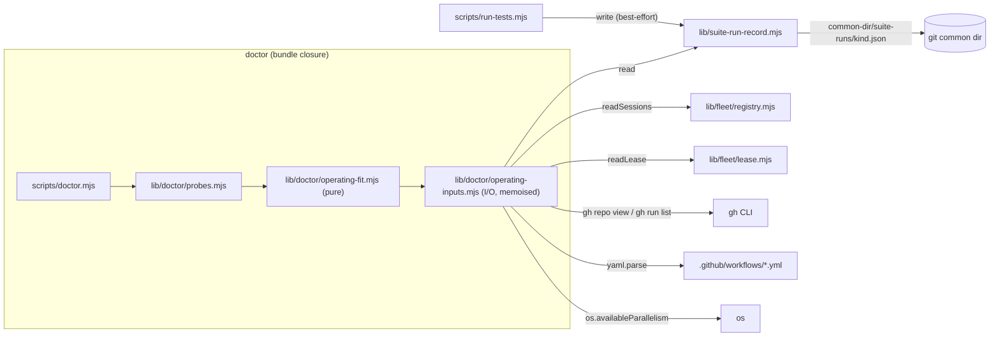

# Plan: Adoption fit check — doctor measures, then recommends fleet + gate settings
- **Date**: 2026-10-14
- **Status**: Complete
- **Author**: Claude + Louis
- **Scope**: backend (doctor probes, one local record writer, one rule-text pointer; no UI) · stack `js-ts` (`detect-stack`: `js-ts`)
- **Target domain(s)**: `scripts`, `shared-lib`, `skills-content`
- ⚠ **Cross-domain work** — `scripts` (`scripts/run-tests.mjs`), `shared-lib` (`scripts/lib/doctor/**`, `scripts/lib/suite-run-record.mjs`), `skills-content` (`skills/fleet/references/**`). The seam is the suite-run record (written by the runner, read by doctor) and the rule-12 text the probe re-derives.
- **Proposal**: `p-20261014095339-abff` (theme adoption-fit).

## 1. Context Summary

### 1.1 The problem

The fleet skill's operating numbers were measured on one machine (Louis's, 2026-10-12..14) and ship to every user as fixed constants:

| Setting | Where it is stated | Measured basis |
|---|---|---|
| ≤4 worker sessions machine-wide, ≤2 per repo | `skills/fleet/references/coordination.md:110` rule 12 (d7334c32) | "about 4 full gates an hour fitted machine-wide" — `coordination-rationale.md` §Rule 12 |
| one heavy job at a time | `coordination.md:112` rule 14 | two parallel gates pushed another repo's CI past its cap — rationale §Rule 14 |
| ~60-min turns when several repos wait | coordinator policy of 2026-10-14 (not yet in shipped rule text) | storyline's back-to-back CI windows held CES pushes 1–2 h |
| when the light pre-push tier pays off | `docs/plans/gate-cost-slice-2.md` §1 / §7 | branch tier saves ≈32–40% of a ~12–13 min gate (6–8 min) |
| where the full suite runs | the CI chip plan `ci-full-suite-actions` (in flight, not yet on main) | CES is PUBLIC ⇒ standard hosted runners are free; found by hand |

Nothing re-checks these as a consumer's repo or machine changes (its suite crosses ~10 min, it goes public, its machine is slower or faster). The deliverable is a **fit check inside `doctor`** that MEASURES the inputs and RECOMMENDS a setting for each, with the measured number and the rule it would change. Recommend-only: it never gates and never writes config.

### 1.2 What exists — measured 2026-10-14 against d7334c32

*measured* = command run, output quoted · *derived* = arithmetic on measured rows.

| # | Input the fit check needs | Where it lives today | Label |
|---|---|---|---|
| I1 | Full-suite wall time | **nowhere durable.** `scripts/run-tests.mjs:558-586` writes `report.json`/`timing.json` into an `os.tmpdir()` mkdtemp folder and `rmSync`s it; `TEST_TIMING_KEEP` (`:581`) copies only on request, and its `totalMs` is Σ test-body time, not wall (`scripts/lib/test-timing-report.mjs`). `summaryLine` (`scripts/lib/test-tier.mjs:320`) carries no timing; the hook's `--summary-file` is a deleted `mktemp`. | measured (read) |
| I1b | …from a fleet train (considered, **not used**) | `TrainSchema.tierResults` (`scripts/lib/fleet/registry.mjs:98-128`) — `looseObject({name, result})`; tier names come from each train's own `testCommand`, so nothing says which entry is the full suite, and CES has no `.git/fleet/trains/` (no train ever ran). A duration with no workload identity cannot be a full-suite measurement (R1 H1). | measured |
| I1c | …from CI | `gh run list --workflow <file> --status success --json startedAt,updatedAt` (0.53 s, measured). CES today has **no** workflow running `npm test` (all 5 jobs `ubuntu-latest`, none tests); the in-flight `full-suite.yml` will add one. wine: `pg-compat-test.yml` runs tests with `runs-on: ${{ fromJSON(needs.scope.outputs.runner \|\| '"ubuntu-latest"') }}`, `benchmark.yml` mixes `self-hosted`/`ubuntu-latest`. | measured |
| I2 | Repo visibility | no helper in `scripts/**`. `gh repo view --json visibility` → CES `PUBLIC`, wine `PRIVATE`. | measured |
| I3 | Where CI runs | nothing parses `runs-on`; `yaml` ^2.9.1 is already a bundle dependency (`scripts/lib/bundle-deps.json`), used by `scripts/lib/skills-index.mjs` et al. | measured |
| I4 | Core count | only `scripts/check-gate-poison-pills.mjs:598` (`os.cpus().length`). | measured |
| I5 | Recent concurrent sessions | `readSessions(dir)` (`registry.mjs:225`) over `fleetDir(cwd)` (`:150`) = `<git-common-dir>/fleet/`. Records are overwritten in place and never deleted; `{createdAt, updatedAt, state}` per record; **no append-only log**. Today: 62 records, 4 working / 2 ready / 56 done. The registry is **per repo** — no machine-wide view. | measured |
| I6 | Gate-slot wait times | `readLease(dir)` (`scripts/lib/fleet/lease.mjs:135`) over `machineDir()` (`:60`). Events are a ring of 20 (`LIMITS.maxEvents`, `:45`) of kinds `forced-release\|taken-over\|corrupt-recovered\|window-cleared` only; **no request/acquire/release events, no queue** (`decideAcquire` `:269` is grant-or-refuse); windows prune 1 h after they end (`pruneWindows` `:256`). ⇒ wait time **cannot be derived**. What it CAN say: which repos the lease names now (heavy + windows + events) — a "shared machine" signal. | measured |
| I7 | The tier machinery | `.test-tiers.json` + `scripts/test-tier.mjs` exist in CES only; `getSyncClosure()` contains none of `prepush-check`, `test-tier`, `prepush-tier`, `run-tests` (measured by the CI chip, `ci-full-suite-actions.md` §1.2). A consumer has no test tier to opt into. | measured |

### 1.3 Code Trace (d7334c32)

- `scripts/doctor.mjs:217-228` builds `ctx = {bundleRoot, subjectRoot, exec, fs, cloud, resolvedBundleSha}` (`exec` = `execFileSync` with `cwd: subjectRoot`) and runs every `REGISTRY` probe sequentially through `runProbe` (`scripts/lib/doctor/registry.mjs:83`), which normalises to `{id,title,class,fix,status,detail}` and never throws.
- `REGISTRY` = `PROBES` (`scripts/lib/doctor/probes.mjs:465`); `validateRegistry` (`registry.mjs:46`) requires a non-empty static `fix` and `class ∈ {repo, machine}`; `--gate` fails only on `class:'repo'` `fail|error` (`doctor.mjs:114`). A `class:'machine'` probe **cannot gate** — that is the existing mechanism for "recommend-only".
- Status vocabulary `pass|fail|warn|unknown|not_applicable|error` (`scripts/lib/doctor/report.mjs` `PROBE_STATUSES`); human output prints `Fix:` only for `fail|error|warn` (`doctor.mjs:129`).
- The sync-gate probes memoise one shared computation per run (`computeSyncGateResults`, `probes.mjs:33`) — the precedent for measuring once and letting four probes read it.
- `scripts/run-tests.mjs:569` `spawnSync(process.execPath, ['--test', …])` is the one place the suite's wall time exists; `:588` `finishRun` returns the adjudicated `exitCode`; `:581-585` is the established best-effort side-write pattern ("a failed copy is a note, never a verdict").
- Consumer reach: `scripts/doctor.mjs` is in `CORE_ENTRY` (`scripts/sync-to-repos.mjs:530`); the import walker ships its `lib/doctor/**` closure, which already pulls in `zod`. `tests/doctor-consumer-import-closure.test.mjs` asserts every closure file is under `scripts/` and loads from an isolated copy.
- `scripts/check-upstream-probe-coverage.mjs` resolves dispositions *to* probe ids; adding probes needs no disposition.

### 1.4 Patterns reused vs new

Reused: the doctor registry/probe contract, `class:'machine'` as the never-gates class, the memoised-shared-measurement pattern, `readSessions`/`fleetDir`, `readLease`/`machineDir`, `yaml`, `atomicWriteFileSync` (`scripts/lib/file-io.mjs`), the `TEST_TIMING_KEEP` best-effort write shape, and `skill-recommender.mjs`'s "nudge, never gate" stance. New: a measured-input type (`{measured:true,value,source}` | `{measured:false,why}`), four pure recommenders, and one tiny local record (the suite-run record) because I1 has no durable source.

### 1.5 Neighbourhood considered

`get-neighbourhood` over `scripts/lib/doctor/probes.mjs`, `scripts/run-tests.mjs`, `scripts/lib/fleet/lease.mjs` ("doctor probes that measure suite wall time, repo visibility, CI runs-on…"): every hit band `review` (`below-noise-floor`) — top `computeSyncGateResults` and `computeHydrationPlan` (`probes.mjs`), the doctor's own siblings. Greenfield, following the sibling's memoisation shape. Name check: `scripts/skills-fit-check.mjs` + `scripts/lib/fit-check/**` already own "fit check" (skill FITS/PARTIAL/MISMATCH), so this feature's code and probe ids use **`operating`**, never `fit-check`. `get-incident-neighbourhood` returned INC-002 (destructive DB tests vs a production DSN): not applicable — nothing here touches a DB or a DSN.

## 2. Proposed Architecture



### 2.1 Two layers, one direction

- **`operating-inputs.mjs` (I/O)** — `operatingInputs(ctx)` returns an object of **lazy, independently memoised getters** (one `WeakMap` entry per `ctx`; each input computed at most once, and only when a probe asks for it), so `doctor --only operating/test-tier` on a repo with no tier machinery makes **zero** remote calls (R1 M4). Every input is a `Measured<T>`:
  `{measured: true, value, source, at?}` | `{measured: false, why}`. There is **no third shape and no default**: a reader that cannot answer returns `measured:false` with the reason (AGENTS.md "an unasked question must never render as an empty result"). (#5, #16)
  - **Durations carry their identity.** A duration value is `{ms, workloadKind: 'full-suite'|'branch-tier'|'ci-workflow', timingBasis: 'test-step'|'workflow-wall', origin: 'this-repo-local'|'ci-hosted'|'ci-self-hosted-unattributed'|'ci-unresolved'}`. A recommender reads only the kinds its table names, so a CI workflow can never be mistaken for the local suite (R1 H1/H2).
  - **Remote budget.** All `gh` calls go through one `remote(args)` helper: 10 s timeout per call, clamped to `min(perCallMs, remainingBudgetMs)` so the last call cannot overrun, **20 s total** per doctor run (Gemini G2); the first `ENOENT`/auth/network failure marks gh unavailable and every later remote input returns `measured:false` with that same reason without calling again; once the budget is spent, remaining remote inputs read `unmeasured (remote budget of 20 s spent)`. Worst case ≈20 s, typical ≈1–2 s (0.53 s per `run list`, measured).
- **`operating-fit.mjs` (pure decisions)** — four recommenders `(inputs, now) → {status, detail}`, pure ⇒ Tier-1 test-first with fixture inputs, no fs/exec. The four probe definitions in the same file are one-line wrappers: `run(ctx) => recommendX(operatingInputs(ctx), new Date())` (the recommender touches only the getters it needs, so laziness reaches the network) — the only line that touches I/O. (#11)

### 2.2 The inputs (each one `Measured`)

| Key | Source chain (first that answers) | `why` when unmeasured |
|---|---|---|
| `cores` | `os.availableParallelism?.() ?? os.cpus().length` of the machine doctor runs on | (always measured) |
| `visibility` | `gh repo view --json visibility` in `subjectRoot` (through `remote`, §2.1) → `PUBLIC\|PRIVATE\|INTERNAL` | `gh unavailable (<err>)` / `not a GitHub remote` |
| `ciJobs` | `yaml.parse` of `subjectRoot/.github/workflows/*.y{a,}ml`; per job: runner class from ONE exported label policy (`RUNNER_LABEL_POLICY`, R2 M6) — `standard-hosted` only for a label in the explicit allowlist of GitHub's documented standard runners (`ubuntu-latest`, `ubuntu-24.04`, `ubuntu-22.04`, `ubuntu-24.04-arm`, `ubuntu-22.04-arm`, `windows-latest`, `windows-2025`, `windows-2022`, `windows-11-arm`, `macos-latest`, `macos-15`, `macos-14`, `macos-13`; source and date in the constant's comment), `larger-hosted` only for the documented concrete larger-runner labels (macOS `-large` / `-xlarge` suffixes on an allowlisted base, e.g. `macos-14-large`), `self-hosted` (any normalised label is `self-hosted`). Scalar, array and `{group, labels}` mapping forms are normalised to one label list first; a group with no self-hosted or allowlisted label is `unresolved` (a group can hold either kind, R3 M1), and `unresolved` for everything else (`${{ … }}` expressions, a reusable `uses:` job, any custom or unknown label — never guessed by prefix); `runsTests` = a step `run:` matching the test-command pattern (§2.4). The value carries **coverage**: `{files: {inspected, failed: [{file, why}]}, jobs: {standardHosted, largerHosted, selfHosted, unresolved}, testJobs: {standardHosted, largerHosted, selfHosted, unresolved}, complete}` where `complete = failed.length === 0 && testJobs.unresolved === 0` (R1 H3) | `no .github/workflows directory` / `workflows directory unreadable` (a single unparseable file is NOT unmeasured: it lands in `failed` and makes the census incomplete) |
| `ciTestWalls` | per test-running workflow (≤3, most test jobs first): median `updatedAt − startedAt` of its last ≤10 successful runs within 30 days, as `{ms, workloadKind:'ci-workflow', timingBasis:'workflow-wall', origin}` with `origin` from that workflow's runner class — `ci-self-hosted-unattributed` for self-hosted, because a label does not prove which machine ran it (R1 H2). **Reported, never used to size this machine.** | `no workflow runs the test command` / `no successful run in 30 d` / gh reason |
| `localSuiteWall` | suite-run record `full` (§2.3) within 30 days — the only source that is both the full suite AND this repo's local run (R1 H1/H2) | `no suite-run record (run the full suite once with scripts/run-tests.mjs)` / `record older than 30 d (<age>)` / `record unreadable (<why>)` |
| `localHeavyWall` | the `full` suite-run record when there is one (the slot must fit the full gate), else the `branch` record, within 30 days; `workloadKind` travels with the value | as above, both kinds named |
| `peakSessions` | this repo's `readSessions`: sweep-line over `[createdAt, end]`, `end = now` for `working\|blocked\|ready`, else `updatedAt`; 7-day window; labelled **approx** (a done record's `updatedAt` is its last change, not its end) | `no fleet registry` / `registry unreadable (<n> invalid)` |
| `leaseSharing` | `readLease(machineDir())`: other repos named by the current `heavy`, the current `windows`, and `events` **within the last 24 h** (`by` suffix) → `{otherRepos: [...], observedAt}`. **Positive evidence only**: an empty list means *sharing unobserved*, never *exclusive* — refusals are not recorded and windows prune after 1 h (R1 M2) | `no lease file at <dir>` / `lease <state>` |
| `slotWait` | — | **always** `unmeasured (the lease records no request/acquire events and prunes windows 1 h after they end)` until the lease grows those events (proposal, §8) |
| `tierCapability` | `present` only when BOTH: `subjectRoot/.test-tiers.json` parses as JSON with `version === 1` and a non-empty `heavy` array, AND `subjectRoot/scripts/run-tests.mjs` contains the tier protocol marker (`'export const TIER_PROTOCOL'`, pinned to `TIER_PROTOCOL_MARKER` in `scripts/lib/test-tier.mjs:34` by a drift test — not imported, so `lib/test-tier.mjs` stays out of the consumer closure the CI chip asserts on) (R1 M3) | `absent` (no `.test-tiers.json`) is a **measured** `absent`, not unmeasured; `present-but-unverifiable (<which check failed>)` is `measured:false` |

`machine-wide` session concurrency is **not** an input: each repo's registry is its own and doctor reads only the diagnosed repo's (§8 deferral).

### 2.3 The suite-run record (closes I1)

`scripts/lib/suite-run-record.mjs` owns the schema, the writer and the reader — one module on both sides of the seam (#5).

```js
// <git-common-dir>/suite-runs/<kind>.json, kind ∈ {full, branch}
{ schema: 'suite-run/v1', kind, wallMs, files, finishedAt, head, cores, platform }
```

- **Writer** — `scripts/run-tests.mjs` measures `Date.now()` around the `spawnSync` at `:569`, and after `finishRun` calls one exported function, `recordSuiteRun({preflight, tierSkip, userArgs, exitCode, wallMs, files, cwd, write})` (`write` injectable, defaulting to `writeSuiteRunRecord`). It derives the kind via `suiteRunKind(...)`: `'full'` for the default set (no preflight, no `--tier-skip`, no caller file args), `'branch'` for `--tier-skip`, else `null`; it writes **only when** the kind is non-null and `exitCode === 0`. Preflight and caller-narrowed runs never write (they are not the suite). A failed or crashed run never writes: its wall is not the suite's. It returns `{written, note}` and never throws; `main` appends `note` to the printed lines — best-effort exactly like `TEST_TIMING_KEEP`, and the exit code is `finishRun`'s, untouched. (#16)
- **Location** — the git **common** dir (`git rev-parse --path-format=absolute --git-common-dir`), so the pre-push sandbox's throwaway worktree (`docs/runbooks/prepush-sandbox.md`) and every linked worktree write to the one place doctor reads. Atomic (`atomicWriteFileSync`); last-writer-wins per kind, which is right for "latest".
- **Reader** — `readSuiteRunRecord(commonDir, kind)` → `Measured`; a missing file, an unreadable file, or a schema mismatch is `measured:false` with that reason, never a throw and never a zero.
- **Why `wallMs` is the test step, not the whole gate** — the gate's other steps live in `scripts/prepush-check.mjs`, which this plan must not touch (the CI chip owns it). The probe labels it "test step" and the gate is ~17% longer (`ci-full-suite-actions.md` F1: 962 s test step of 1,153 s). Named as a known under-estimate, not hidden.

### 2.4 Test-command pattern

`runsTests(step.run)` matches `(npm|pnpm|yarn|bun)\s+(run\s+)?test\b`, `node\s+--test\b`, `\b(vitest|jest)\b`, `playwright\s+test\b`. It is **discovery evidence**: it decides which workflows' durations get reported (`ciTestWalls`) and whether "the suite runs in CI" for the ci-location census. It never produces a full-suite or local measurement (§2.2), so a Playwright-only or deploy-plus-test workflow can at worst be reported under its own name as a CI workflow wall.

### 2.5 The four recommendations

Every probe is `class:'machine'` (never gates, `doctor.mjs:114`). Status: `pass` = the measurement does not contradict the shipped setting (worded as such when the input is a lower bound) · `warn` = the measurement recommends a different setting (the nudge; `Fix:` says "recommend-only" and names the rule) · `unknown` = an input it needs is unmeasured — **detail reads `unmeasured (<why>)` and the shipped default is named as "stands unverified"**, never adopted as if measured · `not_applicable` = the setting does not exist for this repo. Each `detail` names: the measured number(s) with source and age, the derivation, the recommendation, and the rule it changes.

**Lower bounds decide in one direction only (R1 M1).** The suite-run record's `wallMs` is the test step; the heavy job a push puts in the slot is that plus the gate's other steps (≈17% more on CES). So `G` is a **lower bound** on occupancy. A check that a lower bound *fails* is sound (the real job is longer still) → `warn`. A check that a lower bound *passes* proves nothing about the real job → `pass` with the detail worded **"not contradicted (test-step lower bound)"**, never "fits". No correction multiplier.

| Probe id | Inputs | Rule | Recommendation |
|---|---|---|---|
| `operating/ci-location` | `visibility`, `ciJobs`, `ciTestWalls`, `leaseSharing` | rule 14 (what occupies the heavy slot) | Decision table below. |
| `operating/test-tier` | `tierCapability`, `localSuiteWall` | `gate-cost-slice-2.md` stage 1 (`AUDIT_PREPUSH_TIER=branch`) | `tierCapability` absent → `not_applicable`; present-but-unverifiable → `unknown`. Present: `localSuiteWall` unmeasured → `unknown`; ≥ **10 min** → `warn`: *opt work-in-progress pushes into `AUDIT_PREPUSH_TIER=branch`; at the measured 32–40% saving that is ≈X–Y min per push (derived)* (the wall is a lower bound, so a ≥10-min reading is sound); < 10 min → `pass`, "not contradicted (test-step lower bound)". |
| `operating/wip-limit` | `localHeavyWall` (G min), `cores`, `peakSessions` | rule 12 (4 machine-wide / 2 per repo) | Slot-bound **upper** limit `N = max(1, floor(60 / G))` — one heavy slot (rule 14) and ~1 heavy job per worker-hour, which is what reproduces rule 12's 4 at a ~15-min gate (rationale §Rule 12). Because G is a lower bound, N is an upper bound on what the slot allows. `N < 4` → `warn`: *recommend ≤N machine-wide, ≤min(2,N) per repo — more workers only queue on the slot*. `N ≥ 4` → `pass`: *4 not contradicted (test-step lower bound allows up to N); raising it needs the full-gate time and attention/message budget, both unmeasured*. Appended when they apply: "observed peak P in this repo (approx, 7 d)" when `peakSessions > min(2,N)`; "measured on a different machine (X vs Y cores)" when the record's `cores` ≠ this machine's. |
| `operating/turn-length` | `localHeavyWall`, `ciTestWalls`, `leaseSharing`, `slotWait` | the ~60-min turn default (coordinator policy 2026-10-14) | `localHeavyWall` unmeasured → `unknown`. Else `2·G > 60` → `warn`: *recommend turns of ≥ ⌈2·G/15⌉·15 min so one turn holds two of this repo's jobs*; else `pass`, "a 60-min turn is not contradicted (holds ⌊60/G⌋ jobs at the lower bound)". Always appended: sharing as observed (`other repos on the lease in the last 24 h: …` or `sharing unobserved — the lease cannot show exclusivity`); each self-hosted CI wall as *"if this runner is on this machine, its CI window is X min of heavy time inside its repo's turn"* (conditional, never fed into the decision); and `gate-slot wait: unmeasured (…)`. |

**`operating/ci-location` decision table** — first matching row wins (R1 H3):

| # | Condition | Status | Detail |
|---|---|---|---|
| 1 | `visibility` unmeasured | `unknown` | `unmeasured (<why>)`; runner census still printed |
| 2 | `ciJobs` unmeasured (no workflows dir / dir unreadable) and PUBLIC | `warn` | *no CI workflows: the suite can only run locally; standard hosted runners are free for public repos* — sound without a census, because absence of the directory is measured |
| 3 | PUBLIC and `testJobs.selfHosted > 0` | `warn` | *move the N self-hosted test job(s) to standard hosted runners (free for public repos) to take them out of this machine's heavy slot* — sound even if the census is incomplete (positive evidence) |
| 4 | PUBLIC and census **incomplete** | `unknown` | `unmeasured (census incomplete: <failed files>, <n> unresolved test jobs)` — no conclusion either way |
| 5 | PUBLIC and complete and `testJobs` total = 0 | `warn` | *no workflow runs the test command: the suite runs locally if anywhere; standard hosted runners are free for public repos* |
| 6 | PUBLIC and complete and `testJobs.largerHosted > 0` | `warn` | *N test job(s) use larger runners, which are billed even on public repos; standard hosted runners are free* |
| 7 | PUBLIC and complete and every test job `standard-hosted` | `pass` | standard-hosted test jobs listed, with `ciTestWalls` when measured |
| 8 | PRIVATE / INTERNAL | `pass` | *hosted minutes are billed for private repos; self-hosted/local keeps them free* + the census, coverage stated; never a move-to-hosted nudge |

Each `warn` cites GitHub's billing line ("public repositories that use standard GitHub-hosted runners" are free) and that **larger** runners are billed even on public repos.

Constants live at the top of `operating-fit.mjs`, each with its citation: `TIER_PAYOFF_MIN = 10` (proposal; `gate-cost-slice-2.md` §7 saving range), `TIER_SAVING = [0.32, 0.40]` (ibid.), `RULE12_DEFAULT = {machine: 4, perRepo: 2}` (`coordination.md:110`), `HEAVY_JOBS_PER_WORKER_HOUR = 1` (derived from rationale §Rule 12), `TURN_DEFAULT_MIN = 60`, `FRESH_DAYS = 30`. (#4)

### 2.6 Rule text

`coordination.md:110` rule 12 gains "(default; see doctor's fit check)" after the numbers (+36 chars; the file is 11,739 of the 12,000-char `skills:size:gate` threshold). `coordination-rationale.md` §Rule 12 gains one sentence: the 4 assumes a ~15-min local gate and `doctor`'s `operating/wip-limit` re-derives it from the machine's measured run. Rule 14 states no number, and the turn default is not in shipped text yet, so neither gets a pointer here; whoever writes the turn policy into rule 14 adds "default; see doctor's fit check" (noted in §8). `skills/fleet/SKILL.md` is over the size cap and states none of these numbers — untouched.

## 6. Sustainability Notes

- **Assumptions that could change**: one heavy job per worker-hour (the rule-12 derivation); the 32–40% tier saving (re-measured if the heavy list changes); `gh` field names (`startedAt`/`updatedAt`, verified on gh today). Each is a named constant or one function, so a change is one edit.
- **Extension points**: a new recommendation = one pure recommender + one probe entry reading the same inputs. When the lease grows acquire/request events, `slotWait` gains a source and the turn-length probe a real wait figure — no probe reshaping.
- **Coupling**: doctor reads fleet's registry and lease through their exported readers only; the suite-run record is the only new cross-module contract and has one owning module.

## 7. File-Level Plan

| File | Intent | Key exports / change | Why |
|---|---|---|---|
| `scripts/lib/suite-run-record.mjs` | create | `SUITE_RUN_SCHEMA`, `suiteRunPath(commonDir, kind)`, `writeSuiteRunRecord(commonDir, rec)`, `readSuiteRunRecord(commonDir, kind, now)`, `suiteRunKind({preflight, tierSkip, userArgs})`, `recordSuiteRun({…, cwd, write})` | one owner for the writer↔reader seam (#5) |
| `scripts/run-tests.mjs` | modify | wall-time capture around `spawnSync`; one `recordSuiteRun(...)` call after `finishRun`, its `note` appended to the printed lines | the only place I1 exists (#16) |
| `scripts/lib/doctor/operating-inputs.mjs` | create | `operatingInputs(ctx)` (lazy per-input memo), `createRemote(exec, {perCallMs, totalMs, now})`, `classifyRunsOn(runsOn)`, `runsTests(runText)`, `parseWorkflowJobs(text, file)`, `censusOf(files)`, `peakConcurrency(sessions, now, days)`, `medianRunMs(runs, now)`, `tierCapability(root, fs)`, `TIER_MARKER` | all I/O in one layer, injectable `exec`/`fs`/`env`/clock (#11) |
| `scripts/lib/doctor/operating-fit.mjs` | create | constants; `recommendCiLocation`, `recommendTestTier`, `recommendWipLimit`, `recommendTurnLength`; `OPERATING_PROBES` | pure decisions, test-first (#11) |
| `scripts/lib/doctor/probes.mjs` | modify | import + append `...OPERATING_PROBES` to `PROBES` | the one registry |
| `scripts/doctor.mjs` | modify | with `--only`, skip running `class:'machine'` probes not named in it (every `class:'repo'` probe still runs, so `--only` still never narrows the `--gate` set, `doctor.mjs:114`) — without this, laziness never reaches the network, because today every probe runs and `--only` filters only the printout (Gemini G1) | the CLI is where laziness is decided |
| `skills/fleet/references/coordination.md` | modify | rule 12 pointer (§2.6) | supersede the constant honestly |
| `skills/fleet/references/coordination-rationale.md` | modify | one sentence under §Rule 12 | why the number moved |
| `tests/suite-run-record.test.mjs` | create | round-trip, schema-invalid → unmeasured, missing → unmeasured | Tier 1 |
| `tests/run-tests-suite-record.test.mjs` | create | `suiteRunKind` table; `recordSuiteRun` integration in a temp git repo **with a linked worktree**: a write from the worktree lands in the common dir and `readSuiteRunRecord` sees it from the main checkout; narrowed / preflight / non-zero-exit runs write nothing; an injected throwing `write` returns `{written:false, note}` without throwing; and a source check that `run-tests.mjs`'s `main` passes `finishRun`'s `exitCode` (not `recordSuiteRun`'s result) to `process.exit` | Tier 1 + integration at the seam (R1 M5) |
| `tests/doctor-operating-fit.test.mjs` | create | each recommender over fixture inputs: every status branch, the unmeasured wording, rule named in every detail | Tier 1 |
| `tests/doctor-operating-inputs.test.mjs` | create | runs-on classification table, test-command matcher, YAML fixtures (incl. wine's `fromJSON` expression → `unresolved`), sweep-line peak, median, fake `exec` (gh absent / gh error / gh JSON), temp registry + lease dirs, memoisation = one gh call set per ctx | Tier 1/2 |
| `.claude/skills/fleet/references/coordination*.md` | modify (generated) | `npm run skills:regenerate` | Category B copy |

### 7b. Implementation Phases

**Phase 1 — Suite-run record**: the record module and the runner's best-effort write. Files: `scripts/lib/suite-run-record.mjs` (create), `scripts/run-tests.mjs` (modify), `tests/suite-run-record.test.mjs` (create), `tests/run-tests-suite-record.test.mjs` (create).

**Phase 2 — Measured inputs**: the I/O layer. Files: `scripts/lib/doctor/operating-inputs.mjs` (create), `tests/doctor-operating-inputs.test.mjs` (create).

**Phase 3 — Recommenders + probes**: the pure layer, registration, `--only` skipping, rule text. Files: `scripts/lib/doctor/operating-fit.mjs` (create), `scripts/lib/doctor/probes.mjs` (modify), `scripts/doctor.mjs` (modify), `tests/doctor-operating-fit.test.mjs` (create), `skills/fleet/references/coordination.md` (modify), `skills/fleet/references/coordination-rationale.md` (modify).

**Close-out (not a phase)**: `npm run skills:regenerate && npm run skills:check`; `npm run bundle:deps:check` (regenerate with `npm run bundle:deps` if the doctor closure's dependency set moved); `npm run skills:size:gate`; `node --test tests/doctor*.test.mjs tests/suite-run-record.test.mjs tests/run-tests-suite-record.test.mjs`; sample output: `node scripts/doctor.mjs --only operating/ci-location,operating/test-tier,operating/wip-limit,operating/turn-length` on CES, and `--consumer-root C:/GIT/wine-cellar-app` (read-only).

## 8. Risk & Trade-off Register

**Right-sizing.** *Band-aid*: print rule-12's constants next to a few raw facts (cores, visibility) and let the reader work it out — the inputs that matter (suite wall, slot contention) would read unmeasured forever, so the check could never recommend anything for CES. *Over-engineered*: a timing-history store with per-run rows, machine-wide session aggregation across every registered repo's registry, lease acquire/wait telemetry, and a config writer that applies the recommendation. *Chosen*: measure what is already recorded, add the **one** missing durable fact (the last green suite run per kind — 1 small file, no history), and print recommendations a human applies. Each piece serves a current input in §2.2; nothing is kept "for later".

| Risk / trade-off | Handling |
|---|---|
| `run-tests.mjs` is a `SELECTOR_DEPENDENCIES` file (`scripts/lib/test-tier.mjs:40`) | the push that carries it takes the `full` tier by the selector-change escape — expected, one push |
| The CI chip (`ci-full-suite-actions`) changes the pre-push recipe concurrently | this plan touches none of `.githooks/**`, `scripts/prepush*`, `scripts/lib/prepush-tier*`, `.github/workflows/**`; both edit `coordination.md` but different rules (8 vs 12) — a line-level merge |
| CI run wall includes setup and inter-job queueing, and a self-hosted runner may be any machine | labelled `workflow-wall`, origin `ci-self-hosted-unattributed`; reported only, never an input to a local decision (§2.2); the turn probe phrases it conditionally |
| Record `wallMs` is the test step, not the whole gate (≈17% short on CES) | treated as a **lower bound** and the WIP / turn / tier checks decide in the sound direction only (§2.5); `pass` is worded "not contradicted"; full-gate timing needs `scripts/prepush-check.mjs`, which this plan must not touch — deferred, §8 last rows |
| A stale record misleads after the machine changes | age printed; `cores` mismatch flagged; > 30 days ⇒ `unmeasured (record older than 30 d)` |
| A lease snapshot read as "no other repo" | positive evidence only, 24-h event window; empty reads "sharing unobserved", never exclusive, never `not_applicable` |
| `gh` cost per doctor run | lazy inputs (a probe that needs no remote input makes none), ≤4 calls, 10 s per call, 20 s total budget, first failure short-circuits; measured 0.53 s per `run list`. Doctor is not run by the sync (`scripts/sync-to-repos.mjs` names it only in `CORE_ENTRY`), so "cheap enough per sync" is a budget: ~1–2 s typical, 20 s worst |
| Deferred: full-gate (heavy-slot) timing | needs a timing point in `scripts/prepush-check.mjs` (owned by the CI chip now). Finding → `fleet propose`: *record gate wall in the suite-run record kind `gate`*; the recommenders then read it in place of the lower bound with no reshaping |
| Deferred: gate-slot wait time | not derivable (I6). Finding → `fleet propose`: *lease records `acquired` and `refused` events (with the waiting repo) so wait time becomes measurable*. Until then the turn probe prints it as unmeasured every run. |
| Deferred: machine-wide session concurrency | needs every repo's registry; doctor diagnoses one repo. Per-repo peak is measured; machine-wide stays out of scope, said in the probe detail. |
| Deferred: turn default in shipped text | the coordinator writes the turn policy into rule 14; the pointer "default; see doctor's fit check" goes in with it (`fleet propose` note) |

## 9. Testing Strategy

- **Tier 1 (test-first)** — `operating-fit.mjs` recommenders over fixture `inputs`: for each probe, every status branch (`pass`/`warn`/`unknown`/`not_applicable`); every `unknown` detail contains `unmeasured (` and the shipped default's "stands unverified"; every detail names its rule; every `pass` from a lower bound says "not contradicted"; boundary cases (G = 15 → N = 4 pass; G = 16 → N = 3 warn; G = 30/31 for turns; suite 9.9 / 10 min for the tier). **Every row of the ci-location decision table** has a fixture, including row 3 firing on an incomplete census and row 4 refusing a conclusion. A fixture where `ciTestWalls` holds a self-hosted 40-min wall and `localHeavyWall` is unmeasured proves the turn probe stays `unknown` (CI walls never size the slot). Empty `leaseSharing.otherRepos` never yields `not_applicable`. `suite-run-record.mjs` round-trip + invalid/missing/stale.
- **Tier 2 (canned fixtures, no network)** — `operating-inputs.mjs` with an injected `exec` + clock: gh missing (`ENOENT`) → every remote input `measured:false` naming gh, after **one** call; a hanging-gh fake that advances the clock proves the 20 s total budget stops further calls; gh JSON fixtures → median; YAML fixtures including wine's `${{ fromJSON(...) }}` (→ `unresolved`), an array label `[self-hosted, linux]`, `macos-14-large` (→ `larger-hosted`), `{group: internal-linux}` (→ `unresolved`), `{group: g, labels: [self-hosted]}` (→ `self-hosted`), a custom label `my-runner` (→ `unresolved`), `runs-on: {group, labels}`, a reusable `uses:` job, and an unparseable file (lands in `failed`, census `complete:false`, others counted); lease fixture with a 25-h-old event (ignored) and a 1-h-old one (counted); `tierCapability` absent / valid / bad JSON / missing marker; `TIER_MARKER === TIER_PROTOCOL_MARKER` drift assertion; temp `fleet/sessions` and lease dirs. **Laziness**: `doctor.mjs --only operating/test-tier --json` (spawned, injected fake `gh` on PATH) on a fixture with no `.test-tiers.json` makes zero `gh` calls, and `--only operating/test-tier --gate` still runs and reports every `class:'repo'` gating finding; at the unit level, running only `operating/test-tier` on a fixture with no `.test-tiers.json` makes zero `exec` calls; running all four makes each remote call at most once.
- **Negative controls (seen to fail first)** — the "never a default" property: delete each source from a fixture and assert the probe goes `unknown`, not `pass` (the check must be seen to fail against a stub that returns rule-12's 4 as if measured). The "never gates" property: run `doctor.mjs --gate --json` in a fixture where every operating probe warns → exit 0, no gating findings.
- **Consumer** — `tests/doctor-consumer-import-closure.test.mjs` already loads doctor from an isolated closure copy; it must stay green with the new modules (they import only `scripts/lib/**`, `yaml`, `zod`, node built-ins).
- **Live** — the close-out sample runs on CES and on wine (`--consumer-root`, read-only), pasted into the PR.

## Security Considerations

- `gh` and `git` run through `execFileSync` with argv arrays (no shell), `cwd: subjectRoot`, a timeout; nothing from a workflow file reaches an argv except a workflow **basename** read from `readdirSync`, which is passed as `--workflow <basename>` — validated against `^[\w.-]+\.ya?ml$` before use.
- Workflow YAML is parsed with `yaml.parse` (no custom tags, no code execution); a hostile file can at worst be reported unparseable.
- The suite-run record holds counts, a sha, timestamps, core count and platform — no paths beyond the common dir, no env, no secrets. Nothing leaves the machine; no LLM egress.

## 11. Execution Clustering

- **Cluster A** — Phases 1–1 — fix-gate: yes
  - Coupling: the record's schema, writer and the runner's write predicate are one contract; Cluster B reads it, so it must be settled first.
- **Cluster B** — Phases 2–3 — fix-gate: final
  - Coupling: the inputs layer and the recommenders share the `Measured` shape and the memoised input object; the probe registration and rule-text pointer describe exactly what the recommenders compute.
- **Final gate**: consolidated Gemini review over the union diff.

## Audit trail

- **/audit-plan** (SID `audit-plan-1791973401479-102088`, run `96a1071f`): R1 H:3 M:5 → all 8 accepted (duration identity, self-hosted attribution, census coverage, lower-bound direction, lease exclusivity, tier capability, lazy/remote budget, runner integration test). R2 H:0 M:1 (larger runners billed) → accepted. R3 H:0 M:1 (runner group ≠ larger runner — propagation from the R2 fix) → accepted. 10/10 accepted, 0 dismissed. Stopped at the 3-round default cap: the last two rounds were single propagation MEDIUMs from the previous fix.
- **Gemini final gate** (round 1/2): **APPROVE**, gateDisposition `approve`, 0 blocking, 2 LOW, both folded in: G1 `--only` must skip non-selected `class:'machine'` probes for laziness to reach the network (`scripts/doctor.mjs` added to Phase 3); G2 per-call timeout clamped to the remaining budget, §2.2's stale 15 s removed.

## Implementation audit trail

- **Cluster A** (suite-run record + runner; scope via `scripts/cycle-cluster-scope.mjs`): R1 H:4 M:4 L:1. Two Structure findings (the Cluster B modules and tests were not built yet) were `deferred-declared` and are satisfied by Cluster B; the other 7 were fixed (monotonic clock and a refusal, not a clamp, for an invalid duration; caller narrowing judged before either kind; future-dated records rejected; source-text tests replaced by behavioural `completeRun` tests; fixture cleanup). R2: only the two deferred findings remained.
- **Cluster B** (doctor probes): R1 H:2 M:11 — 12 fixed, 1 dismissed (informational: the adjacency pass hit its own enumeration bound). Real defects found: a fractional `timeout` that `execFileSync` rejects with `ERR_OUT_OF_RANGE`; a `shared-lib -> fleet` layering violation (fixed by moving the fleet reads into `scripts/lib/fleet/operating-evidence.mjs`, injected through `ctx`, with one justified `scripts -> fleet` edge in `.audit-loop/domain-map.json`); the capacity formula (`floor(60 / (g*h))`, not `floor(60*h/g)`); reusable-workflow calls hiding test jobs from the census. R2: **PASS, H:0 M:2**, both fixed (quote/comment-aware command splitting; unresolved repo identity reads unmeasured).
- **Consolidated Gemini gate** over the union diff: **APPROVE**, 0 blocking, 0 debt (reviewer note: changed-line coverage PARTIAL for 11 files).
- **Negative controls run** (each seen to fail against a deliberately broken tree): runner exit code isolated from the recorder; `--only` skips non-selected machine probes (counting fake `gh`); integer timeout at the real `execFileSync` boundary.
- **Full suite**: not run during implementation (it is the pre-push gate and needs the machine heavy slot in CES's turn); it ran at push time and passed on `e9b6f016` (after one failure that exposed the `prepush-worktree-anchor` declaration, fixed in `fddf7c30`). GitHub's `full-suite` check was green on the same head. `npm run check:static` and `npm run guards:preflight` pass.

## Implementation Log

### 2026-10-15
- Completed: everything in sections 7 and 7b. Cluster A (suite-run record, runner `completeRun`), Cluster B (`operating-inputs.mjs`, `operating-fit.mjs`, probe registration, `doctor --only` skipping, rule-12 pointer), plus `scripts/lib/fleet/operating-evidence.mjs` and its tests. PR #250.
- Remaining: gate-slot wait is still `unmeasured`; #252's lease journal and `measureSlotWaits` make it measurable (proposal `p-20261014103957-4acc`). Whole-gate timing (`p-20261014103958-81f8`), a rule-14 pointer (`p-20261014103958-fd60`) and a suite-run writer for consumers (`p-20261014113553-e216`) are queued.
- Deviations: (1) `scripts/lib/fleet/operating-evidence.mjs` is new, not in the file-level plan: the audit found a real shared-lib -> fleet layering violation, so the fleet reads moved there and reach shared-lib through `ctx`, with one `scripts -> fleet` edge declared in `.audit-loop/domain-map.json` (section 7 listed neither). (2) `scripts/doctor.mjs` is modified (the `--only` skip and the provider wiring). (3) `localHeavyWall` is the full record when present, the branch record only as a fallback (section 2.2 said "newer of"). (4) Reusable-workflow calls are opaque and make the census incomplete; `runsTests` is command-aware. (5) `tests/prepush-worktree-anchor.test.mjs` declares `suite-run-record.mjs` (found by the full gate, after the audits).
