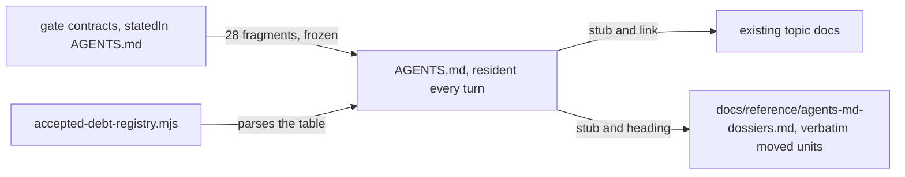

# Plan: AGENTS.md kernel shrink, staged (tripwire / pointer / dossier inventory)
- **Date**: 2026-11-22
- **Status**: In Progress
- **Author**: Claude + Louis
- **Scope**: backend (stack `js-ts`; docs-only: `AGENTS.md` and one new reference doc; no code)
- **Builds on**: `docs/research/checklist-pilot-2026-11.md` §Kernel size and §Decision item 4 (the 217-unit inventory it asked for)

Neighbourhood considered: not consulted. AGENTS.md "When NOT to consult" exempts doc-only changes; this plan adds no symbol.

---

## 1. Context Summary

**Why.** `AGENTS.md` (plus the `CLAUDE.md` that imports it) is re-read on every turn of every session. The coordinator
measured about 720 cached-input tokens per output token across 110 sessions. The checklist pilot measured the file at
73364 chars (LF-folded) in **217 units**, and a kernel of 49373 to 61111 chars if only its 27 gate-anchored units left,
against a 10-15K target. Its single-cut shrink did not run: a failed threshold stops it (`checklist-pilot-2026-11.md`
§Decision 1). Item 4 of that decision asked for this plan: a full 217-unit inventory with dispositions, done separately.

**What exists today (Code Trace, pinned to `b52a77f1`).**
- Unit split: `kernelEstimate` in `scripts/lib/checklist/pilot.mjs:134-147 (b52a77f1)`: blank-line blocks, split
  again at list items and table rows. This plan uses the same splitter, so the 217 is the same 217.
- Size gate: `agentsMdCharCount` in `scripts/lib/claudemd/context-size.mjs` is `text.length`, compared with
  `DEFAULT_MAX_AGENTS_MD_CHARS = 79000` by `scripts/check-context-drift.mjs:39 (b52a77f1)`. The cap is not touched.
- Gate quotes: 28 `stated` fragments with `statedIn: "AGENTS.md"` across `scripts/gate-contracts/*.json` and
  `skills/*/gate-contract.json` (27 gates, the pilot's census), checked by `gates:check` (`docs/reference/gate-honesty.md`
  §`stated`). They sit in **15 units** (17289 chars).
- Other readers of AGENTS.md text that a move could break:
  - `scripts/lib/doc-sections.mjs:17 (b52a77f1)` extracts H2 sections by heading (`## Architecture` for `/brainstorm`
    and the audit context). **Every H2/H3 heading stays**, its text unchanged.
  - `scripts/lib/accepted-debt-registry.mjs` holds fingerprints of the "Accepted Technical Debt" table rows, parsed out
    of AGENTS.md. Units 210-217 are **coupled**: they move only with that parser (stage 5).
  - `<!-- arch-map-discoverability:start -->` (unit 3) and `<!-- host-contract: ... -->` (unit 154) are machine-read
    markers. Kept byte-identical.
  - `scripts/lib/checklist/gen.mjs` quotes AGENTS.md sentences in its `context:` strings, with `@@` standing for the
    gate fragment. All of them sit in gate-quoted units (stage 5), so stages 1-4 do not touch them.

**Patterns reused.** AGENTS.md's own preamble rule ("condense a dossier section to a stub + `docs/<topic>.md` rather
than raising the cap") and its test for a line ("would an agent that never opens the linked doc still avoid the
mistake?").

## 2. Proposed Architecture



**Dispositions** (one per unit; full table in §12):
- **tripwire**: stops a mistake an agent makes unprompted. **Stays resident, shortened, never moved.** Shortening keeps
  the rule, its trigger and, where it is the reason anyone believes the rule, the one-line incident.
- **pointer**: already a stub plus a link. Stays, may be shortened.
- **dossier**: describes a subsystem. Moves out; a stub pointer stays.
- **gate-quoted** (frozen): hosts a `statedIn: AGENTS.md` fragment. Untouched in stages 1-4 (§7, stage 5).
- **coupled** (frozen): read by code (the debt-table parser, the markers). Moves only together with its reader.
- **heading**: H2/H3 headings and label lines. Always stay.

**Where moved text goes: one new file, verbatim.** Each stage appends the units it rewrites to
`docs/reference/agents-md-dossiers.md`, under the original H2 heading text (`## <heading>`, so the anchor slug is the
same as AGENTS.md's and a stub links `docs/reference/agents-md-dossiers.md#<slug>` directly), byte-for-byte except for
link targets, rewritten by type (`rebaseLinks`, §13):
- external (`https:`, `mailto:`): unchanged;
- fragment-only (`#x`): becomes `../../AGENTS.md#x`, since the heading it names stays in AGENTS.md;
- `./path` and repo-root-relative `path` (with or without `#fragment`): become `../../path`.
AGENTS.md has no reference-style links (checked at `b52a77f1`); a stage that meets one stops and adds a rule.
**One dossier section per H2, never two.** The first stage that moves a unit of a given H2 creates `## <heading>`; a
later stage moving more units of the same H2 (Testing's subsections and the Architecture pointers both sit under
`## Architecture`) appends inside that existing section, so the anchor `#<slug>` reaches every copied unit. Units before
the first H2 (stage 4's units 5 and 7) go under `## Preamble`, and their stubs link `#preamble`. The check enforces both:
a repeated `## ` heading in the dossier is a failure. Inside an H2 section the original H3/H4 headings are copied with
the units they head (Testing's `### Testing`, `#### Pre-push runs ...` and so on), so the subsection labels survive, and a
stub links the most specific heading's anchor, not just the H2's. Whole units
are copied, so table header rows and list structure come with them; a copied table row carries its header row. The
repository's own `npm run docs:refs` runs on the result each stage, and the stubs' anchors are checked by it too.
One file rather than each section's topic doc because:
- revert is that file plus AGENTS.md (the staging constraint);
- the proof is mechanical: every rewritten unit is found verbatim in one place (§9);
- no side effects on docs other gates read (`docs/audit/shared-references/verification-discipline.md` is byte-checked
  across ten synced copies; `docs/plans/*` feed the plans index; several topic docs are synced to consumers).

Folding the dossier text into the topic docs is a later cleanup, not part of this plan.

**Right-sizing.** Band-aid: cut sentences until the file is under some number, with no inventory (the pilot showed a single
cut has no stopping rule). Over-engineered: a generated kernel with per-unit metadata and a gate enforcing dispositions.
Chosen: a one-time inventory table in this plan, verbatim relocation, and a relocation check run per stage (§9). Current
requirement served: cut resident context in revertable stages without losing a rule.

## 3-5. Frontend sections: not applicable (docs-only, backend scope).

## 6. Sustainability Notes
- The dossier file grows to about 60K over five stages. It is never auto-loaded, so its size costs nothing per turn.
- The 79000 cap stays. After stage 4 a separate PR may propose LOWERING it to the new size plus headroom. A cap change is
  still Louis's decision.

## 7. File-Level Plan and Stages

Every stage changes `AGENTS.md` (modify) and `docs/reference/agents-md-dossiers.md` (create in stage 1, append later),
plus this plan's Implementation Log. Per-stage figures are **derived** from the §12 table (sum of the units the stage
rewrites). The net resident reduction is **expected** to be 60-70% of that, since stubs and shortened tripwires stay.

**Stage 1: lower-half subsystem sections (units rewritten: 14835 chars).** Browser Tool Setup, Mermaid validation, Model
Resolution, Memory-Health Gate, Learning System, Shadow Final-Review A/B, Tiered-Recall (units 113-114 only; unit 115 is
gate-quoted and stays byte-identical), Model Swap-In, Local Weekly Maintenance, Azure AI Foundry, Cross-Skill Data Loop,
R2+ Audit Mode, Security incident memory and Secret pre-write gate, Quick-fix detection (unit 154's host-contract marker
stays byte-identical), Where enforcement lives, Commit provenance trailers. Files: `AGENTS.md` (modify),
`docs/reference/agents-md-dossiers.md` (create).

**Per-stage protocol (every stage, in this order).**
1. **Baseline check.** `relocation-check.mjs pre --base b52a77f1 --manifest docs/plans/agents-md-kernel-shrink.units.json
   --stage N` (§13). It first verifies every manifest fingerprint against `b52a77f1`, then requires each of the stage's
   units to occur **exactly once, by content**, in the live AGENTS.md: unit numbers and line numbers are never the key.
   Any unit missing, changed or duplicated stops the stage. The `b52a77f1` fingerprints are immutable provenance and
   `--base` is always `b52a77f1`; a unit changed upstream is **rebased**, never re-fingerprinted: its row gains
   `rebased: {base: <later sha>, unit: <its number in that commit's split>, sha256_16}` (from `manifest --base <later
   sha>`), the rebased text is re-classified and reviewed, and the rebase is recorded in the Implementation Log before
   going on. Tested when written: a dangling simulated commit editing unit 64 made `pre` fail (exit 1), the rebased row
   made it pass (exit 0), and a wrong rebased fingerprint failed again (exit 1).
2. **Resident spec.** Before editing, write in the Implementation Log one line per tripwire unit the stage rewrites:
   the trigger, the rule, its exceptions, and the link that replaces the detail. A rule deliberately made non-resident is
   listed by name with the reason. Stage 1's spec is the list below; stages 2-4 write theirs at stage start, and each
   stage's `/audit-code` round checks the stubs against that spec and the pinned originals. Rules the inventory already
   flags for stage 2-4 specs: the empty-DSN air-gap rule, the INCOMPLETE-round exit 3, the disposable-host allowlist,
   `isClaudeAvailableFor('sdk')` at pinned sites, and the MANDATORY `get-neighbourhood` consult.
3. **Edit, then `post` check** (§9), gates and targeted tests, measurement, commit.

Tripwires kept resident in stage 1, shortened (the resident spec for stage 1; the audit checks the stubs against it and
against the pinned original of each unit, including every exception):
- Model Resolution: sentinels, not concrete ids; never drop `-preview` from Gemini 3 ids unverified; never retry a 4xx
  except 429 (`classifyLlmError`); when rewrapping an LLM error surface `err.status` and the provider's own message; OpenRouter needs `provider:{require_parameters,sort}` and `reasoning`; a
  model id carries its route, so never normalise `source_model`; use `modelFamily`, and `VENDOR_ALIASES` for a new vendor.
- Memory-Health: a new control-state wave needs a `control_marker_prefixes` sentinel, matched on the prefix.
- Learning: `LEARNING_DISABLE=1` kills all learning and telemetry; telemetry never crashes a run.
- Shadow A/B: closed, verdict KEEP; read the briefing before any reviewer or model comparison.
- Tiered-Recall: chooser default off; `allowTiered` is per-call, only `openai-audit.mjs` `main()` passes it.
- Model Swap: a swap is synchronous, never a background window, do not add a collector; stamp `contractEpoch` at the
  collector, unstamped is ineligible, never backfill by date.
- Local Weekly: opt-in flag; the only runner of the four store-backed checks here; `ok` means the run did not fail, not
  that the thing it measures is current; the `audit-loop-no-measurement` notice, never a grep of the job log.
- Azure: opt-in only on `AZURE_OPENAI_ENDPOINT`; the four invariants (ask whether a route exists, `isClaudeAvailable()`;
  the deployment is constructor state; endpoint and credential are one unit, assert the emitted request; a deployment
  switch is a different vector space).
- Cross-Skill: all cross-skill writes go through `scripts/cross-skill.mjs`; never hand-write curl POSTs in a SKILL.md.
- R2+: a rulings header claims only what its ruling established; hard-suppress keys on the concern, not category text.
- Security incident: the consult command, when to consult, `mitigation-failing` incidents addressed in the design;
  `security:refresh` refuses high-confidence secrets; the final redactor is `secret-patterns.mjs`, NOT `sanitizer.mjs`.
- Quick-fix: the rule is host-neutral, the hook is Claude-Code-only acceleration; the cadence is not equivalent.
- Where enforcement lives: enforcement goes into the code that performs the action; the `$PATH` wrapper was rejected
  2026-11-15, read the four reasons before proposing one.
- Commit provenance: `AI-*` trailers are written only by `ship-commit.mjs` and `ship-train.mjs`; never hand-write
  `.audit/last-audit-run.json` to chase `passed`.
- Browser and Mermaid: `npx playwright install chromium` first; `plans:lint` ERROR `subgraph-as-edge-endpoint`.

**Stage 2: store, backends, env (14786).** Environment Variables, Postgres-Parity Store (units 94 and 96 frozen),
Anthropic Backend Routing (unit 103 frozen), Architectural Memory (the MANDATORY rule stays resident, shortened),
Requirements Layer, Contracts across the prose-code seam (unit 179 frozen).

**Stage 3: consumer layout, testing, verification (15173).** Consumer-repo layout and Sync mechanics, CLI smoke contract,
Project Overview, Skill Chain pointers, Testing and its subsections (unit 53 frozen), Sensitive paths and VCS,
Verification discipline (a summary of the synced canonical: pointer plus the one-line rules).

**Stage 4: preamble tripwires and small tables (5229).** Category A bullet, Design right-sizing, the unmeasured-round
callout, the four imperatives, the Dependencies table (the zod 4 row stays), the Architecture pointers.

**Stage 5: SEPARATE PR, waits for Louis (18788).** The 15 gate-quoted units and the coupled debt table. Moving or rewording
a gate-quoted sentence is a gate LOOSENING unless its contract moves with it (`statedIn` re-pointed and `gates:check` green
on the new location). This stage proposes, per unit, either trimming only the words around the frozen fragment or
re-pointing the contract; the debt table moves together with `accepted-debt-registry.mjs`'s parser. Nothing in stage 5
runs without Louis's explicit approval.

**Untouched (4196):** Personal config, Scope discipline, Code Style, Do NOT: already short tripwires.

**Close-out (not a phase), every stage:** `npm run context:check`, `npm run gates:check`, `npm run skills:check`, the
relocation check and the targeted tests (§9).

## 8. Risk & Trade-off Register
- **A tripwire mis-classed as dossier drops out of resident context.** Mitigation: the per-stage tripwire list (§7) is
  what the audit checks the stubs against, and the verbatim copy means a lost rule is restored by copying it back.
- **A reader keyed on AGENTS.md text breaks.** Mitigation: headings, markers, gate fragments and the debt table are
  frozen; the targeted tests that read AGENTS.md run every stage.
- **Agents stop finding the detail.** Each stub names the topic doc; the dossier keeps the original heading text, so a
  search for the old heading lands on it.
- **Shortening is rewording.** For tripwires it is, and that is allowed for units that are not gate-quoted.
- **Deferred:** folding dossier text into topic docs; lowering the cap. The 10-15K target is reachable only with stage 5
  and a second shortening pass (§10); stages 1-4 are expected to land at about 45-50K.

## 9. Testing Strategy and Proof Plan
- **Relocation check (the oracle, per stage):** `relocation-check.mjs post --base b52a77f1 --manifest
  docs/plans/agents-md-kernel-shrink.units.json --stage N --dossier docs/reference/agents-md-dossiers.md` (source in §13).
  The committed manifest records, per unit: number, enclosing H2, chars, a 16-hex sha256 of its text at `b52a77f1`,
  disposition and stage. For every tripwire, pointer or dossier unit of stage N it requires the base text, links
  rewritten, to occur **exactly once inside the dossier section with that unit's H2**: missing (0) and ambiguous (>1)
  both fail, exit 1. Bad input exits 2, and so does a check that would select nothing: `--stage` must be the string 1-4,
  the manifest must hold units 1..217 in order, each once, with string stages from a closed set, known dispositions and
  the base's H2, and the stage must select at least one unit. Those input controls were run once when the script was
  written (numeric stage, missing row, duplicate row, empty stage, no `--stage`, `--stage 5`: all exit 2; before the
  hardening every one of them exited 0, audit round 2 H1). Negative controls each stage: (a) delete one line of one copied unit in a scratch
  copy of the dossier and confirm the check names that unit; (b) paste one unit twice and confirm it reports `2x`. The
  command and its output go in the Implementation Log. The script is a migration artifact kept in this plan (§13), not a
  repo gate; it is retired when the stages end.
- **Gate fragments:** `npm run gates:check`, plus a direct count that all 28 fragments are present before and after.
- **Readers:** every test file that names AGENTS.md (`rg -l "AGENTS.md" tests --glob "*.test.mjs"`), which includes
  `tests/checklist-gen-pilot.test.mjs` (the `ANCHORS` table); stage 1 first ran only `tests/check-context-drift.test.mjs`, `tests/context-size.test.mjs`,
  `tests/doc-sections.test.mjs`, `tests/accepted-debt-check.test.mjs`, `tests/gate-honesty.test.mjs`,
  `tests/gate-honesty-checklist-statedin.test.mjs`, `tests/check-docs-refs.test.mjs`,
  `tests/brainstorm-arch-context.test.mjs`, `tests/repo-context.test.mjs`, `tests/checklist-controls.test.mjs`. No full
  `npm test` locally; CI's `full-suite.yml` runs it on the PR.
- **Measurement:** resident chars before and after: `agentsMdCharCount` on the working-tree bytes (what `context:check`
  counts) and LF-folded, both labelled **measured**, with the command.

## 10. Expected end state (expected, not measured)
After stages 1-4: about 45-50K resident, from 73.4K (stage 1 measured at 53% cut of the units it rewrote; at that rate
stages 2-4 land nearer 50K). What remains is tripwires (about 42.6K before shortening) and the
17.3K of gate-quoted units. Reaching 10-15K needs stage 5 plus a second shortening pass over tripwires; whether that is
worth doing is a decision for after stage 4, on measured numbers.

## 11. Execution Clustering
- **Cluster S1**: Stage 1, fix-gate yes. Coupling: one file pair, one revertable PR.
- **Clusters S2-S4**: Stages 2-4, each its own PR after the previous one merges, fix-gate yes.
- **Final gate**: the consolidated final review on each stage's PR. Stage 5 is outside this plan's autonomous run.

## Audit trail
- `/audit-plan` 2026-11-22, SID `audit-plan-1795342704697-110136`: GPT R1 H3 M2, R2 H2 M1, R3 H2 M2; all 12 accepted as
  fix-now (acceptance 100% each round), stopped at the 3-round cap. Fixes: the 4xx rule, the per-stage resident spec, the
  content-matched baseline and rebase, link rules by type, the executable check with schema validation, the Preamble
  section, one section per H2 with subsection headings, whole-unit matching, drained exits.
- Final gate: Gemini (`latest-pro`) round 1 **APPROVE**, gate `approve` (blocking 0, debt 0), run `49e3cd94`.

## Implementation Log

### Stage 1 — 2026-11-22
- **Pre check**: `relocation-check.mjs pre --base b52a77f1 --manifest docs/plans/agents-md-kernel-shrink.units.json --stage 1`
  → 40 units checked, 0 problems (AGENTS.md on this branch was unchanged since `b52a77f1`: no rebase needed).
- **Resident spec**: the stage-1 tripwire list in §7, applied as written. Deliberately made non-resident (detail kept in the
  dossier and topic docs): the sentinel catalogue and live-catalog mechanics; the incident narratives behind the model-swap
  and OpenRouter rules; the security "when NOT to consult" list and `/security-strategy bootstrap` hint; the quick-fix
  layer names and signature list; the four reasons against a `$PATH` wrapper (the stub names that they exist and where).
- **Change from §2**: stubs link their topic doc only. Instead of a dossier link on each of 18 stubs (about 1.5K chars), one
  resident line after the preamble says moved text lives in `docs/reference/agents-md-dossiers.md` under the same H2.
- **Edit**: 18 unit groups replaced; 16 dossier sections written; units 115 (gate-quoted) and 154 (host-contract marker)
  untouched; every H2/H3 heading kept.
- **Post check**: `post ... --stage 1 --dossier docs/reference/agents-md-dossiers.md` → 40 units checked, 0 problems.
  Negative controls on scratch copies: one line deleted from unit 69 → `unit 69 ... found 0x`, exit 1; unit 75 pasted twice →
  `found 2x`, exit 1; a second `## Model Resolution` → `appears twice`, exit 1. Later stages still intact: `pre` for stages
  2, 3, 4 → 42, 35, 12 units, 0 problems.
- **Gates and tests**: `context:check` OK; `gates:check` and `skills:check` exit 0 (27 contracted gates); all 28 gate
  fragments present (direct count); `checklist:gen:check` current; `docs:refs:gate` exit 0 (dossier links resolve);
  `guards:preflight` PASS (38 steps); 18 targeted test files that read AGENTS.md, `node --test` → 581 pass, 0 fail.
- **Code audit R1** (H0 M3, all valid; M1 and M3 the same): the Azure stub had dropped `azureRoute: null` for an id that
  means the public service, and narrowed "deployment or resource switch ... auto-promotes to a full re-embed". Both restored. R2 (sustainability, structure) PASS H0 M0 L0. R3 (plus wiring) PASS H0 M2: the tiered stub had
  dropped "flag AND eligibility both hold before a provider is constructed", the provenance stub "or reorder a ship to
  chase it". Both restored (the R3 suggestion of a new test is not applicable: no code changed). R4 PASS H0 M2: the R2+ stub had dropped
  "the existence gate" as a read-first trigger, the model-swap stub "only intervention-over-organic-work earns a
  shadow". Both restored, plus a self-sweep of every stub against its original that restored four more clauses the audit
  had not yet named: a cadence is observed, never trusted (and the two doctors); `/brainstorm` voices are
  `defaultProviders()`; the security exclusions and the `/security-strategy bootstrap` hint; the learning outbox.
  R5 PASS H0 M1: the R2+ stub had dropped the `--ledger`/`--diff`/`--changed` qualifier; restored. Threshold
  (H 0, M <= 2) met in R2-R5; GPT rounds stopped at 5 because every round since R2 found one or two dropped sub-clauses,
  each fixed, none a design issue.
  Final gate: Gemini (`latest-pro`) round 1 **APPROVE**, gate `approve` (blocking 0, debt 0), Code: FULL, run `e216f984`.
- **Merge of origin/main (8bcc6a05)**, before stage 1 merged: #450 (`4ba6c280`) rewrote unit 32 (Browser Tool Setup:
  the built-in pane is what sessions mostly use, Playwright the pinned fallback). The first live use of the rebase
  protocol: the conflict was resolved by carrying the new content into the stub; manifest row 32 gained
  `rebased: {base: 4ba6c280, unit: 32}`; the dossier copy of unit 32 was replaced by the 4ba6c280 text. No other unit
  differs between `b52a77f1` and main. `post --stage 1` → 40 units, 0 problems; the pre-merge dossier against the
  rebased manifest → `unit 32 ... found 0x`, exit 1 (the control); `pre` for stages 2-4 → 0 problems. Measured after
  the merge: AGENTS.md **65944** chars (main's own AGENTS.md is 73660, so −7716 against main).
- **CI fix (PR #456, run 45014511649)**: `tests/checklist-gen-pilot.test.mjs` "kernelEstimate anchors every entry" failed:
  the checklist entry `provider-route-not-env-var` anchors on "An availability gate must ask whether a ROUTE exists"
  (`ANCHORS` in `scripts/lib/checklist/pilot.mjs`), and the Azure stub had reworded it. The sentence is restored
  word-for-word in the stub; the checklist source is unchanged. All 13 `ANCHORS` strings now resolve in AGENTS.md. The
  targeted set in §9 had missed this test file; stages 2-4 run every test file that names AGENTS.md
  (`rg -l "AGENTS.md" tests --glob "*.test.mjs"`, 159 files) and check the `ANCHORS` table before editing.
  Measured: AGENTS.md **65970** chars (main 73660, −7690).
  **Lesson for stages 2-4**: the resident spec must list every clause of each tripwire, not its headline, before editing.
- **Measured** (`node -e` over `fs.readFileSync('AGENTS.md','utf8').length`, the count `context:check` uses; the file is LF):
  AGENTS.md **73364 → 65743 chars, −7621 (−10.4%)**; with CLAUDE.md (2169, unchanged) the resident pair is 75533 → 67912.
  The 18 groups covered 14942 chars of original text (§7's 14835 excludes blank-line separators and the H3 heading of
  unit 150, which a group re-emits) and became 7134 chars of stubs, a 52% cut; the moved-detail line adds 187 back
  (14942 − 7134 − 187 = 7621). That is below the 60-70% §7 expected, because most stage-1 units were tripwires rather than
  dossier. Reproducible: re-running the stage-1 script on `b52a77f1`'s AGENTS.md gives a byte-identical file.

## 13. Relocation check source

Copy into a scratch file and run with Node 22 from the repo root (it imports `scripts/lib/cli-io.mjs` for `finishAndExit`, so every exit drains stdout; a whole-unit match means a unit must start and end at line boundaries, so `---` is not found inside a table separator). The manifest
`docs/plans/agents-md-kernel-shrink.units.json` was produced by its `manifest` mode at `b52a77f1` and then given the
disposition and stage columns of §12.

```js
// AGENTS.md kernel-shrink relocation check (docs/plans/agents-md-kernel-shrink.md §9).
// A migration artifact, not a gate: it lives in the plan, not in scripts/.
//   node relocation-check.mjs manifest --base <sha>                        > units.json
//   node relocation-check.mjs pre  --base <sha> --manifest <f> --stage N   (live AGENTS.md still holds the stage's units)
//   node relocation-check.mjs post --base <sha> --manifest <f> --stage N --dossier <f>
// Exit 0 = every unit accounted for; 1 = a unit missing, changed or ambiguous; 2 = bad input.
import fs from 'node:fs';
import crypto from 'node:crypto';
import { execFileSync } from 'node:child_process';
import path from 'node:path';
import { pathToFileURL } from 'node:url';

const lf = (t) => t.replace(/\r\n/g, '\n');
const sha = (t) => crypto.createHash('sha256').update(t).digest('hex').slice(0, 16);
const arg = (k) => { const i = process.argv.indexOf(k); return i > 0 ? process.argv[i + 1] : undefined; };

// The splitter of kernelEstimate (scripts/lib/checklist/pilot.mjs), plus the enclosing H2.
export function splitUnits(text) {
  const units = []; let h2 = 'Preamble'; // pre-H2 units go to the dossier's '## Preamble'
  for (const block of lf(text).split(/\n\s*\n/)) {
    let cur = [];
    const flush = () => { if (cur.length) { units.push({ h2, text: cur.join('\n') }); cur = []; } };
    for (const l of block.split('\n')) {
      if (/^## /.test(l)) { flush(); h2 = l.slice(3).trim(); }
      const starts = /^(>\s*)?(- |\| |\* )/.test(l) && !/^(>\s*)?\|[-\s|]+\|?$/.test(l);
      if (starts && cur.length) flush();
      cur.push(l);
    }
    flush();
  }
  return units.map((u, i) => ({ unit: i + 1, ...u }));
}

// Link rewrite for text copied from the repo root into docs/reference/:
// external and mailto unchanged; '#frag' -> AGENTS.md#frag; './x' and 'x' -> ../../x.
export function rebaseLinks(text) {
  return text.replace(/\]\(([^)\s]+)\)/g, (m, t) => {
    if (/^[a-z]+:/i.test(t)) return m;
    if (t.startsWith('#')) return `](../../AGENTS.md${t})`;
    return `](../../${t.replace(/^\.\//, '')})`;
  });
}

// One section per H2: a later stage appends INTO the existing section, never a second heading of the same text.
function dossierSections(text, problems) {
  const out = new Map(); let cur = null;
  for (const l of lf(text).split('\n')) {
    if (/^## /.test(l)) {
      cur = l.slice(3).trim();
      if (out.has(cur)) problems.push(`dossier heading "## ${cur}" appears twice: its anchor reaches only the first`);
      out.set(cur, out.get(cur) || '');
      continue;
    }
    if (cur) out.set(cur, out.get(cur) + l + '\n');
  }
  return out;
}
// Whole-unit match: the needle must start and end at line boundaries, so '---' is not found inside '|---|'.
const count = (hay, needle) => {
  const h = `\n${hay}\n`, n0 = `\n${needle}\n`; let n = 0, i = 0;
  while ((i = h.indexOf(n0, i)) !== -1) { n++; i += n0.length - 1; }
  return n;
};
const MOVABLE = new Set(['tripwire', 'pointer', 'dossier', 'heading']);
const DISPOSITIONS = new Set([...MOVABLE, 'gate-quoted', 'coupled']);
const STAGES = new Set(['1', '2', '3', '4', '5*', '—']);
const EXPECTED_UNITS = 217;

// Exits drain stdout first (AGENTS.md: an exit that stdout can reach must drain first). Run from the repo root.
const { finishAndExit } = await import(pathToFileURL(path.resolve('scripts/lib/cli-io.mjs')).href);
const die = async (msg) => { process.stderr.write(msg + '\n'); await finishAndExit(2); };

const splitCache = new Map();
const unitsAt = (sha1) => {
  if (!splitCache.has(sha1)) splitCache.set(sha1, splitUnits(execFileSync('git', ['show', `${sha1}:AGENTS.md`], { encoding: 'utf8' })));
  return splitCache.get(sha1);
};

async function main() {
  const [mode] = process.argv.slice(2);
  const base = arg('--base');
  if (!mode || !base) return die('usage: see header');
  const baseUnits = unitsAt(base);
  if (mode === 'manifest') {
    process.stdout.write(JSON.stringify(baseUnits.map(u => ({ unit: u.unit, h2: u.h2, chars: u.text.length, sha256_16: sha(u.text) })), null, 1) + '\n');
    return finishAndExit(0);
  }
  const stage = arg('--stage');
  if (!['1', '2', '3', '4'].includes(stage)) return die(`--stage must be 1, 2, 3 or 4 (got ${stage}); stage 5 is not run by this check`);
  if (!arg('--manifest')) return die('--manifest is required');
  const manifest = JSON.parse(fs.readFileSync(arg('--manifest'), 'utf8'));
  // Schema: exactly units 1..217 of the ORIGINAL base, in order, each once; string stages and known dispositions.
  if (!Array.isArray(manifest) || manifest.length !== EXPECTED_UNITS || baseUnits.length !== EXPECTED_UNITS) {
    return die(`manifest has ${manifest.length} rows and the base has ${baseUnits.length} units; expected ${EXPECTED_UNITS} (--base is always the original inventory commit)`);
  }
  for (const [i, m] of manifest.entries()) {
    if (m.unit !== i + 1) return die(`manifest row ${i} is unit ${m.unit}: rows must be units 1..${EXPECTED_UNITS} in order, each once`);
    if (typeof m.stage !== 'string' || !STAGES.has(m.stage)) return die(`unit ${m.unit}: stage ${JSON.stringify(m.stage)} is not one of ${[...STAGES].join(' ')}`);
    if (!DISPOSITIONS.has(m.disposition)) return die(`unit ${m.unit}: unknown disposition ${m.disposition}`);
    if (m.h2 !== baseUnits[i].h2) return die(`unit ${m.unit}: manifest h2 "${m.h2}" differs from the base's "${baseUnits[i].h2}"`);
  }
  const problems = [];
  // Original fingerprints are immutable provenance. A unit changed upstream after the inventory is REBASED, never
  // re-fingerprinted: the row gains {rebased: {base, unit, sha256_16}} naming its current text as a unit of a later commit.
  const textOf = new Map();
  for (const m of manifest) {
    const u = baseUnits[m.unit - 1];
    if (sha(u.text) !== m.sha256_16) problems.push(`unit ${m.unit}: base text does not match the manifest fingerprint`);
    let text = u.text;
    if (m.rebased) {
      const r = unitsAt(m.rebased.base)[m.rebased.unit - 1];
      if (!r || sha(r.text) !== m.rebased.sha256_16) problems.push(`unit ${m.unit}: rebased text (${m.rebased.base} unit ${m.rebased.unit}) does not match its fingerprint`);
      else text = r.text;
    }
    textOf.set(m.unit, text);
  }
  const todo = manifest.filter(m => m.stage === stage && MOVABLE.has(m.disposition) && m.disposition !== 'heading');
  if (todo.length === 0) return die(`stage ${stage} selects no units: a check over nothing is not a pass`);
  if (mode === 'pre') {
    const live = lf(fs.readFileSync('AGENTS.md', 'utf8'));
    for (const m of todo) {
      const n = count(live, textOf.get(m.unit));
      if (n !== 1) problems.push(`unit ${m.unit} (${m.h2}): found ${n}x in live AGENTS.md, expected 1 - re-inventory (rebase) before this stage`);
    }
  } else if (mode === 'post') {
    if (!arg('--dossier')) return die('--dossier is required');
    const secs = dossierSections(fs.readFileSync(arg('--dossier'), 'utf8'), problems);
    for (const m of todo) {
      const body = secs.get(m.h2);
      const n = body === undefined ? 0 : count(body, rebaseLinks(textOf.get(m.unit)));
      if (n !== 1) problems.push(`unit ${m.unit} (${m.h2}): found ${n}x in dossier section, expected 1`);
    }
  } else return die(`unknown mode ${mode}`);
  process.stdout.write(`${mode} stage ${stage}: ${todo.length} units checked, ${problems.length} problem(s)\n`);
  for (const p of problems) process.stdout.write(`  ${p}\n`);
  return finishAndExit(problems.length ? 1 : 0);
}
await main();
```

## 12. Unit inventory (all 217 units)

Units as split by `kernelEstimate` at `b52a77f1`. "Line" is the 1-based start line at that commit. Stage `—` means the
unit stays as it is; `5*` means a separate PR with Louis's approval. `Q<n>` is the number of gate-quoted fragments in the
unit.

| # | Line | Chars | Disposition | Stage | Unit (first words) |
|---|---|---|---|---|---|
| 1 | 1 | 39 | heading | — | # AGENTS.md — Claude Engineering Skills… |
| 2 | 3 | 1499 | gate-quoted (Q1) | 5* | > **Canonical project context for all AI coding agents.** Read by Clau… |
| 3 | 26 | 3359 | gate-quoted (Q1) | 5* | <!-- arch-map-discoverability:start --> **Architecture map**: ['docs/a… |
| 4 | 78 | 4452 | gate-quoted (Q7) | 5* | > **An ignored path declares WHY it is ignored, and a private one decl… |
| 5 | 144 | 396 | tripwire | 4 | > - **A — derived from external/mutable state OR carrying volatile pro… |
| 6 | 149 | 935 | gate-quoted (Q4) | 5* | > - **B — a pure, deterministic function of committed source → committ… |
| 7 | 164 | 1705 | tripwire | 4 | > **Design right-sizing — the simplest structurally-honest solution.**… |
| 8 | 188 | 19 | heading | — | ## Project Overview… |
| 9 | 190 | 278 | pointer | 3 | 18 AI-pair-programming skills covering the development quality lifecyc… |
| 10 | 195 | 14 | heading | — | ## Skill Chain… |
| 11 | 197 | 599 | pointer | 3 | 18 skills; 16 run in this order: **plan → audit-plan → *(implement)* →… |
| 12 | 206 | 216 | pointer | 3 | Diagram, per-skill scope and depth (modes, flags, wave/lens design inv… |
| 13 | 210 | 331 | gate-quoted (Q1) | 5* | **Skill file structure** (progressive disclosure): 'skills/<name>/' is… |
| 14 | 216 | 1804 | gate-quoted (Q3) | 5* | > **Skill surfaces — three invariants.** Discovery-root history, the r… |
| 15 | 244 | 545 | gate-quoted (Q1) | 5* | Every reference file has 'summary:' YAML frontmatter that must byte-ma… |
| 16 | 252 | 771 | tripwire | 4 | > **AN UNMEASURED ROUND MUST NOT WEAR A CLEAN ROUND'S CLOTHES.** A rou… |
| 17 | 263 | 750 | tripwire | 4 | **Four imperatives the roster is too late to tell you.** **(1)** A new… |
| 18 | 273 | 35 | heading | — | ## Consumer-repo layout (isolation)… |
| 19 | 275 | 431 | tripwire | 3 | This repo's tooling deploys to consumers under **'scripts/.claude-skil… |
| 20 | 282 | 1582 | tripwire | 3 | > **Upstream-owned — never patch the synced copy (governance).** A fai… |
| 21 | 306 | 998 | gate-quoted (Q3) | 5* | > **SEVEN shapes consumers keep reporting — read them before adding a … |
| 22 | 320 | 614 | tripwire | 3 | > **"Is this file mine to fix?" must be answerable OFFLINE**, and no s… |
| 23 | 329 | 290 | tripwire | 3 | > **Upstream bug, but you're blocked?** Patching upstream-owned *sourc… |
| 24 | 334 | 729 | tripwire | 3 | > **Consumer divergence is DECLARED, never inferred — and the sync mus… |
| 25 | 345 | 28 | heading | — | ### Sync mechanics — pointer… |
| 26 | 347 | 369 | pointer | 3 | Sync-behavior detail (the isolated subdir, the what-goes-where table, … |
| 27 | 353 | 518 | tripwire | 3 | **A consumer's package manager is ['package-manager.mjs'](scripts/lib/… |
| 28 | 361 | 49 | heading | — | ### CLI smoke contract ('--selfcheck-relocation')… |
| 29 | 363 | 843 | tripwire | 3 | A CLI in 'CLI_SMOKE_SET' implements the '--selfcheck-relocation' handl… |
| 30 | 376 | 254 | gate-quoted (Q1) | 5* | **Adopting these skills in a new consumer repo** — the migration recip… |
| 31 | 380 | 36 | heading | — | ## Browser Tool Setup (persona-test)… |
| 32 | 382 | 403 | pointer | 1 | '/persona-test' drives a real browser; **Playwright MCP is the preferr… |
| 33 | 384 | 41 | heading | — | ## Mermaid validation (for plan diagrams)… |
| 34 | 386 | 625 | pointer | 1 | **Interactive**: call **'mcp__mermaid__generate_mermaid_diagram'** wit… |
| 35 | 388 | 3 | dossier | 4 | ---… |
| 36 | 390 | 66 | heading | — | ## Dependencies (CRITICAL — check versions before flagging issues)… |
| 37 | 392 | 59 | tripwire | 4 | | Package | Version | Notes | |---------|---------|-------|… |
| 38 | 394 | 255 | tripwire | 4 | | 'zod' | **4.6.7** | Zod 4 API — NOT Zod 3. '_def.type' is a string (… |
| 39 | 395 | 211 | dossier | 4 | | 'openai' | **7.8.0** | v7 since 2026-08-09; 'responses.parse()' + 'z… |
| 40 | 396 | 111 | dossier | 4 | | '@google/genai' | ^2.19.0 | 'responseMimeType: 'application/json'' +… |
| 41 | 397 | 85 | tripwire | 4 | | 'dotenv' | 17.4.2 | Load via 'lib/load-env.mjs', never 'dotenv/confi… |
| 42 | 399 | 15 | heading | — | ## Architecture… |
| 43 | 401 | 552 | pointer | 4 | **Do not hand-maintain a module tree here** — ['docs/architecture-map.… |
| 44 | 409 | 331 | pointer | 4 | Per-module prose (openai-audit, gemini-review, the learning-store barr… |
| 45 | 415 | 11 | heading | — | ### Testing… |
| 46 | 417 | 290 | tripwire | 3 | Run: 'npm test' (Node.js built-in test runner — the suite under 'tests… |
| 47 | 422 | 65 | heading | — | #### Pre-push runs against a clean checkout, not the working tree… |
| 48 | 424 | 469 | tripwire | 3 | The hook runs 'check' in a throwaway worktree at the **commit being pu… |
| 49 | 431 | 505 | tripwire | 3 | **THIS repo's full suite runs in GitHub Actions, not on the shared mac… |
| 50 | 439 | 298 | tripwire | 3 | **A rerun may diagnose, never clear.** 'ci-verdict' counts every attem… |
| 51 | 441 | 77 | heading | — | #### A spend-bearing run PINS its revision — it never shares the worki… |
| 52 | 443 | 490 | tripwire | 3 | The store refuses a snapshot whose arms disagree, so two died on 2026-… |
| 53 | 451 | 764 | gate-quoted (Q1) | 5* | - **A DB suite no runner names has never run.** Without a disposable D… |
| 54 | 461 | 353 | tripwire | 3 | - **Sandbox-honesty rule.** A fresh worktree has no gitignored inputs,… |
| 55 | 466 | 327 | tripwire | 3 | - **'npm test' refuses a green it did not earn.** Node can report a su… |
| 56 | 470 | 295 | tripwire | 3 | - **One range, one resolver** — ['push-range.mjs'](scripts/lib/push-ra… |
| 57 | 474 | 469 | tripwire | 3 | - **Hashing working-tree bytes ≠ hashing committed source.** A generat… |
| 58 | 480 | 446 | tripwire | 3 | - **An mtime freshness oracle is usually wrong in the HEALTHY case, no… |
| 59 | 487 | 31 | heading | — | #### Testing doctrine — pointer… |
| 60 | 489 | 521 | tripwire | 3 | Three tiers, because blanket TDD is theatre at the LLM boundary but ri… |
| 61 | 497 | 73 | heading | — | #### Pre-ship empirical verify — for skills that assert on a live runt… |
| 62 | 499 | 761 | tripwire | 3 | Static review cannot catch what only appears when a real browser rende… |
| 63 | 510 | 19 | heading | — | ## Model Resolution… |
| 64 | 512 | 185 | dossier | 1 | 'scripts/lib/model-resolver.mjs' resolves model IDs so config stops go… |
| 65 | 516 | 615 | dossier | 1 | **Sentinels** (preferred in '.env') — 'latest-gpt', 'latest-gpt-mini',… |
| 66 | 525 | 33 | tripwire | 1 | **Anti-patterns (load-bearing):**… |
| 67 | 526 | 74 | tripwire | 1 | - Do NOT pin concrete model IDs in new code — use a sentinel ('latest-… |
| 68 | 527 | 166 | tripwire | 1 | - Do NOT drop '-preview' from Gemini 3 IDs unverified — bare 'gemini-3… |
| 69 | 529 | 85 | tripwire | 1 | - Do NOT retry 404 — 'classifyLlmError' treats any 4xx (except 429) as… |
| 70 | 530 | 160 | tripwire | 1 | - When rewrapping an LLM error, surface 'err.status' + the real provid… |
| 71 | 532 | 350 | tripwire | 1 | - **OpenRouter**: one model id → many backends with incompatible ctx l… |
| 72 | 533 | 707 | tripwire | 1 | - **A model id carries its ROUTE, and the two are never reconciled.** … |
| 73 | 543 | 170 | pointer | 1 | → Per-sentinel table, resolution order, live-catalog mechanics, startu… |
| 74 | 547 | 21 | heading | — | ## Memory-Health Gate… |
| 75 | 549 | 499 | tripwire | 1 | 'scripts/memory-health.mjs': three trigger metrics deciding whether th… |
| 76 | 557 | 28 | heading | — | ## Learning System (Phase 1)… |
| 77 | 559 | 469 | tripwire | 1 | Adaptive-learning telemetry across audit decision points → 'learning_d… |
| 78 | 567 | 24 | heading | — | ## Environment Variables… |
| 79 | 569 | 302 | pointer | 2 | **Full table** (every variable, default and purpose): ['docs/reference… |
| 80 | 574 | 91 | tripwire | 2 | | Variable | Default | Load-bearing because | |----------|---------|--… |
| 81 | 576 | 94 | tripwire | 2 | | 'OPENAI_API_KEY' | — | The one **required** variable. Everything els… |
| 82 | 577 | 189 | tripwire | 2 | | 'AUDIT_DB_URL' | — | Postgres DSN for the store. Unset → **local-onl… |
| 83 | 578 | 103 | tripwire | 2 | | 'LEARNING_DISABLE' | — | '1' kills **all** adaptive-learning behavio… |
| 84 | 579 | 264 | tripwire | 2 | | 'LEARNING_REPO_NAME' | — | Must be the **'owner/repo' slug** (matche… |
| 85 | 580 | 353 | tripwire | 2 | | 'FINAL_REVIEW_TIMEOUT_MS' | '270000' | **COUPLED** to 'FINAL_REVIEW_… |
| 86 | 581 | 111 | dossier | 2 | | 'AUDIT_AUTHOR_TIER_HINT' | — | **Observation-only** — it records an … |
| 87 | 582 | 140 | dossier | 2 | | ~~'SUPABASE_AUDIT_*'~~ | — | **Sunset in M4.** The runtime DSN's cre… |
| 88 | 584 | 32 | heading | — | ## Postgres-Parity Store (M1–M4)… |
| 89 | 586 | 246 | dossier | 2 | The cloud learning store talks to **Postgres directly via the 'pg' dri… |
| 90 | 590 | 1041 | tripwire | 2 | - **Connect**: 'AUDIT_DB_URL' + 'AUDIT_DB_SSL_MODE=no-verify', via the… |
| 91 | 603 | 198 | tripwire | 2 | - **Never use the dashboard as the routine migration path** — it reint… |
| 92 | 606 | 444 | tripwire | 2 | - **'audit_runs.commit_sha' is HEAD at audit-capture time, not the com… |
| 93 | 612 | 531 | tripwire | 2 | - **jsonb-safe write seam — do NOT hand-'JSON.stringify' a jsonb colum… |
| 94 | 619 | 156 | gate-quoted (Q1) | 5* | - **Migrations stay schema-portable**: 'parity:check-coupling' fails o… |
| 95 | 621 | 811 | tripwire | 2 | - **Every audit-store write in 'legacy-production-audit.mjs''s cloud b… |
| 96 | 631 | 486 | gate-quoted (Q1) | 5* | - **'emit({ok:false})' sets a non-zero exit code** ([cli-io.mjs](scrip… |
| 97 | 638 | 608 | tripwire | 2 | - **A SCHEMA ERROR IS NOT AN EMPTY RESULT — and a bare 'catch { return… |
| 98 | 646 | 695 | tripwire | 2 | - **"Disposable" is an ALLOWLIST of loopback hosts, and it fails CLOSE… |
| 99 | 655 | 501 | tripwire | 2 | - **Bound an RPC at the CALLER** — 'SET statement_timeout' inside a fu… |
| 100 | 663 | 378 | pointer | 2 | → **Design** (the no-adapter 'pg'-direct decision, schema scope, privi… |
| 101 | 665 | 28 | heading | — | ## Anthropic Backend Routing… |
| 102 | 667 | 770 | dossier | 2 | All Claude API calls go through one seam, ['anthropic-client.mjs'](scr… |
| 103 | 679 | 1085 | gate-quoted (Q1) | 5* | > **A BACKEND MUST NOT ACCEPT A CALL IT CANNOT HONOUR — THROW AND PIN.… |
| 104 | 694 | 25 | heading | 2 | **Load-bearing gotchas**:… |
| 105 | 696 | 394 | tripwire | 2 | - **Forced tool-calling needs '{backend:'sdk'}' explicitly (found 2026… |
| 106 | 701 | 146 | tripwire | 2 | - **'max_tokens' is UNENFORCED on 'cli'** — accepted and ignored, not … |
| 107 | 703 | 671 | tripwire | 2 | - **Availability is the backend's own answer, never 'process.env.ANTHR… |
| 108 | 712 | 151 | tripwire | 2 | - **'claude-trace' cannot meter the scripted cli backend** (it corrupt… |
| 109 | 715 | 181 | pointer | 2 | → Backend table, cost-telemetry detail, migration pattern, and the ful… |
| 110 | 718 | 60 | heading | — | ## Shadow Final-Review A/B — CLOSED 2026-07-28, verdict KEEP… |
| 111 | 720 | 361 | dossier | 1 | Opt-in, observation-only 2nd final reviewer ('FINAL_REVIEW_SHADOW'); c… |
| 112 | 726 | 31 | heading | — | ## Tiered-Recall Audit Pipeline… |
| 113 | 728 | 283 | dossier | 1 | Discovery → Stage 0/1/2 alternative to the GPT 5-pass legacy audit; ch… |
| 114 | 734 | 234 | tripwire | 1 | - **Execution eligibility is per-call, not env-global** ('allowTiered'… |
| 115 | 737 | 282 | gate-quoted (Q1) | 5* | - **"Window met" is epoch-gated, not eyeballed** (2026-07-26, after th… |
| 116 | 742 | 35 | heading | — | ## Model Swap-In Evaluation Harness… |
| 117 | 744 | 287 | dossier | 1 | 'scripts/lib/model-eval/' answers "is this new LLM release worth switc… |
| 118 | 748 | 386 | tripwire | 1 | - **A model swap is SYNCHRONOUS, never a background window**: run it w… |
| 119 | 753 | 338 | tripwire | 1 | - **Evidence counts only if produced under the contract the stopping r… |
| 120 | 759 | 91 | pointer | 1 | → Design: ['docs/plans/model-swap-eval-harness.md'](docs/plans/model-s… |
| 121 | 761 | 43 | heading | — | ## Local Weekly Maintenance Checks (opt-in)… |
| 122 | 763 | 799 | tripwire | 1 | Default-OFF local replica of the weekly maintenance checks, run from t… |
| 123 | 775 | 32 | heading | — | ## Azure AI Foundry Work Profile… |
| 124 | 777 | 522 | tripwire | 1 | The **same** bundle in a corporate Azure tenant (restricted models), e… |
| 125 | 785 | 64 | heading | 1 | **Four invariants that constrain any code reaching a provider**:… |
| 126 | 787 | 645 | tripwire | 1 | - **An availability gate must ask whether a ROUTE exists, not whether … |
| 127 | 796 | 218 | tripwire | 1 | - **The deployment is CONSTRUCTOR-level route state, not a body field*… |
| 128 | 799 | 235 | tripwire | 1 | - **An endpoint and the credential it is addressed with are ONE unit**… |
| 129 | 802 | 161 | tripwire | 1 | - **A deployment or resource switch is a DIFFERENT vector space** — pr… |
| 130 | 805 | 24 | heading | — | ## Cross-Skill Data Loop… |
| 131 | 807 | 271 | dossier | 1 | Migration '20260419120000_cross_skill_data_loop.sql' closes the feedba… |
| 132 | 812 | 270 | tripwire | 1 | **Design rule**: all cross-skill writes go through 'scripts/cross-skil… |
| 133 | 817 | 27 | heading | — | ## R2+ Audit Mode (Phase 1)… |
| 134 | 819 | 616 | tripwire | 1 | '--round >= 2' (with '--ledger'/'--diff'/'--changed') enables three-la… |
| 135 | 829 | 58 | heading | — | ## Architectural Memory — pre-fix consultation (MANDATORY)… |
| 136 | 831 | 351 | dossier | 2 | [Architectural memory](docs/plans/architectural-memory.md) indexes eve… |
| 137 | 837 | 319 | tripwire | 2 | **Rule** — before writing a new function, class, hook, component, rout… |
| 138 | 843 | 181 | tripwire | 2 | Then act on the recommendation column. **Three bands, and no absolute … |
| 139 | 847 | 342 | tripwire | 2 | - **'precedent'** — existing code occupies this space: open the named … |
| 140 | 852 | 214 | tripwire | 2 | - **'review'** — nothing rose above this repo's noise floor; proceed g… |
| 141 | 855 | 170 | tripwire | 2 | - **'unscored'** — the symbol has **no embedding**, so nothing was com… |
| 142 | 859 | 232 | tripwire | 2 | The old 'reuse'/'extend'/'justify-divergence' band names are **retired… |
| 143 | 863 | 438 | tripwire | 2 | **When NOT to consult**: bug fixes changing only an existing function'… |
| 144 | 869 | 583 | tripwire | 2 | **The rule above is host-neutral and mandatory; the hook is Claude-Cod… |
| 145 | 879 | 52 | heading | — | ## Security incident memory — mandatory consultation… |
| 146 | 881 | 190 | tripwire | 1 | Companion to architectural memory. '/plan' auto-fires 'get-incident-ne… |
| 147 | 885 | 132 | tripwire | 1 | 'node scripts/cross-skill.mjs get-incident-neighbourhood --json' with … |
| 148 | 888 | 315 | tripwire | 1 | **When to consult**: any change to auth flows, payment handling, input… |
| 149 | 893 | 370 | tripwire | 1 | If the response includes incidents with 'mitigation-failing' or 'manua… |
| 150 | 899 | 70 | heading | — | ### Secret pre-write gate + audit trail (back-port from corporate kit)… |
| 151 | 901 | 640 | tripwire | 1 | 'npm run security:refresh' gates every parsed incident before it reach… |
| 152 | 911 | 47 | heading | — | ## Quick-fix detection — two-layer architecture… |
| 153 | 913 | 100 | tripwire | 1 | **Philosophy**: nudge, not gate — root cause beats shortcut, explicit … |
| 154 | 916 | 153 | coupled | — | <!-- host-contract: hook-rule; rule=quickfix-surfaced-before-done; por… |
| 155 | 918 | 1100 | tripwire | 1 | **The RULE is host-neutral; the hook is Claude-Code-only ACCELERATION*… |
| 156 | 935 | 53 | heading | — | ## Where enforcement lives — NOT in a '$PATH' wrapper… |
| 157 | 937 | 468 | tripwire | 1 | **Enforcement goes into the code that performs the action — host-agnos… |
| 158 | 944 | 688 | tripwire | 1 | **A '$PATH'-wrapper layer — a '.bin/' prepended to 'PATH' shadowing 'g… |
| 159 | 954 | 49 | heading | — | ## Requirements Layer — de-facto invariant ledger… |
| 160 | 956 | 517 | dossier | 2 | A materialized view of the codebase's de-facto requirements — the inva… |
| 161 | 964 | 223 | tripwire | 2 | **Egress safety (resident)** — 'extract --files' is user-supplied: eve… |
| 162 | 968 | 51 | heading | — | ## Personal config — keep it out of the public repo… |
| 163 | 970 | 413 | tripwire | — | This repo is **public on GitHub**, so the committed '.claude/settings.… |
| 164 | 977 | 54 | heading | — | ## Scope discipline — pre-existing uncommitted changes… |
| 165 | 979 | 239 | tripwire | — | Uncommitted, unstaged, untracked or unpushed changes **unrelated to th… |
| 166 | 983 | 136 | tripwire | — | - **Stage by name only** — never 'git add -A', 'git add .' or 'git add… |
| 167 | 985 | 133 | tripwire | — | - **Never auto-commit** pre-existing state to "clean up" — that bundle… |
| 168 | 987 | 99 | tripwire | — | - **Never auto-stash** unrelated work — stash conflicts on pop bite wo… |
| 169 | 989 | 174 | tripwire | — | - **Never 'git rm --cached'** legacy tracked-but-gitignored files with… |
| 170 | 992 | 134 | tripwire | — | - **Mention what you saw, once**: *"Heads-up: 3 unrelated unstaged fil… |
| 171 | 994 | 126 | tripwire | — | - If the unrelated state genuinely blocks the task (a half-edited file… |
| 172 | 997 | 63 | heading | — | ## Contracts across the prose↔code seam (no compiler runs here)… |
| 173 | 999 | 550 | tripwire | 2 | The single-oracle rule's worst case is the seam where the **producer i… |
| 174 | 1008 | 225 | tripwire | 2 | - **Before reading a field out of a model-authored payload**, grep the… |
| 175 | 1011 | 172 | tripwire | 2 | - **At least one fixture must be derived from a row actually in the st… |
| 176 | 1014 | 189 | tripwire | 2 | - **One exported accessor owns the read.** The duplicate inline predic… |
| 177 | 1017 | 183 | tripwire | 2 | - **Name the mismatch distinctly.** "No P0/P1 findings" and "P0/P1 dec… |
| 178 | 1020 | 459 | tripwire | 2 | - **The worse variant: the prompt asks for a field the RESPONSE SCHEMA… |
| 179 | 1026 | 339 | gate-quoted (Q1) | 5* | - **A hand-written annotated example in a reference doc is the same se… |
| 180 | 1032 | 55 | heading | — | ## Sensitive paths + VCS contract (canonical locations)… |
| 181 | 1034 | 286 | pointer | 3 | ['scripts/lib/sensitive-paths.mjs'](scripts/lib/sensitive-paths.mjs) i… |
| 182 | 1039 | 183 | tripwire | 3 | - **Skip logging goes through 'formatSkipLog'.** Sensitive entries agg… |
| 183 | 1042 | 392 | tripwire | 3 | - **Fail closed, always.** 'resolveAndClassify' re-checks the realpath… |
| 184 | 1047 | 488 | tripwire | 3 | - **Structured results, never bare throws.** ['vcs.mjs'](scripts/lib/v… |
| 185 | 1055 | 160 | pointer | 3 | Category lists, the 12-case diff-state matrix, both error enums and th… |
| 186 | 1058 | 40 | heading | — | ## Verification discipline (cross-skill)… |
| 187 | 1060 | 286 | pointer | 3 | Eight rules, each led by its measurement. Canonical: ['verification-di… |
| 188 | 1065 | 353 | tripwire | 3 | - **Pin a line number to the commit you read it at** — 'path:120 (a4ec… |
| 189 | 1070 | 238 | tripwire | 3 | - **Label figures 'measured'/'derived'/'expected' and carry the comman… |
| 190 | 1073 | 373 | tripwire | 3 | - **A check is not trustworthy until seen to fail; when one fails, sus… |
| 191 | 1078 | 304 | tripwire | 3 | - **Reproducing a figure is not verifying its attribution.** A 22.5% r… |
| 192 | 1082 | 240 | tripwire | 3 | - **Promote a one-off check that mattered** — subject probe + negative… |
| 193 | 1085 | 177 | tripwire | 3 | - **Verify what the consumer receives, not what the producer sent.** '… |
| 194 | 1089 | 38 | heading | — | ## Commit provenance trailers ('AI-*')… |
| 195 | 1091 | 510 | tripwire | 1 | '/ship' commits carry 'AI-*' git trailers ('AI-Skill'/'AI-Models'/'AI-… |
| 196 | 1099 | 13 | heading | — | ## Code Style… |
| 197 | 1101 | 48 | tripwire | — | - ESM modules ('import'/'export', not 'require')… |
| 198 | 1102 | 77 | tripwire | — | - 'process.stderr.write()' for progress logging (keeps stdout clean fo… |
| 199 | 1103 | 56 | tripwire | — | - '--out <file>': JSON to file, 1-line summary to stdout… |
| 200 | 1104 | 66 | tripwire | — | - Zod schemas define structured output contracts for all LLM calls… |
| 201 | 1105 | 67 | tripwire | — | - Functions follow the '{result, usage, latencyMs}' return contract… |
| 202 | 1106 | 171 | tripwire | — | - Operator docs: real values or PowerShell vars in CLI examples, **nev… |
| 203 | 1108 | 9 | heading | — | ## Do NOT… |
| 204 | 1110 | 81 | tripwire | — | - Use '_def.typeName' / '_def.shape()' (Zod 3) or 'require()' — see §D… |
| 205 | 1111 | 50 | tripwire | — | - Send '.env' or credential files to external APIs… |
| 206 | 1112 | 76 | tripwire | — | - Use 'import 'dotenv/config'' — cwd-only; import 'lib/load-env.mjs' i… |
| 207 | 1113 | 85 | tripwire | — | - Create new Anthropic/OpenAI client instances per call — reuse the on… |
| 208 | 1114 | 131 | tripwire | — | - Hand-keep a "which files are code" extension list — derive from 'fil… |
| 209 | 1116 | 26 | heading | — | ## Accepted Technical Debt… |
| 210 | 1118 | 53 | coupled | 5* | These items were evaluated and deliberately accepted:… |
| 211 | 1120 | 77 | coupled | 5* | | Item | Rationale | Revisit trigger | |------|-----------|-----------… |
| 212 | 1122 | 184 | coupled | 5* | | 'atomicWriteFileSync' no fsync | CLI tool, not a database. Rename at… |
| 213 | 1123 | 152 | coupled | 5* | | 'atomicWriteFileSync' temp naming (PID+timestamp) | Collision requir… |
| 214 | 1124 | 138 | coupled | 5* | | 'readFileOrDie' process.exit(1) | Name is self-documenting. Only cal… |
| 215 | 1125 | 241 | coupled | 5* | | 'normalizePath()' lowercasing | Correct for Windows, and it is a MAT… |
| 216 | 1126 | 352 | coupled | 5* | | Module-global caches ('_repoProfileCache', '_taskStore', '_clientCac… |
| 217 | 1127 | 302 | coupled | 5* | | 'anthropic-client.mjs' '_internals' test exports | Mirrors 'file-io.… |
