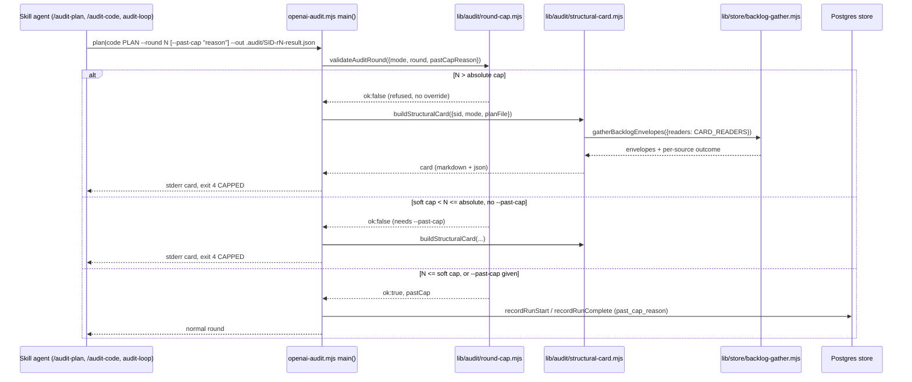

# Plan: Enforced audit round cap + structural-or-stop card
- **Date**: 2026-10-25
- **Status**: Approved
- **Author**: Claude + Louis
- **Scope**: backend (CLI scripts, store readers, one migration, skill prose). Stack `js-ts`.
- **Target domain(s)**: `audit-orchestration`, `plan`, `scripts`, `skills-content`
- ⚠ **Cross-domain work**: the work touches 4 domains. Each crossing is intentional:
  - the cap lives in audit-orchestration;
  - the plan-status predicate lives in `plan`;
  - the prose lives in skills-content.
- **Fleet proposals covered**:
  - `p-20261024213701-730e` (cap + card + dismissed_count): built here.
  - `p-20261024235653-1ad3` (plan-selection papercuts): built here, as its own PR.
  - `p-20261025005623-484f` (pre-push non-convergence on large diffs): deferred with a corrected diagnosis (§8).

## 1. Context Summary

**The problem, measured.** Store `audit_runs`, every repo, `created_at >= 2026-10-04`, run 2026-10-25 against store `d5a9d07b91225a93`:
- **Code-mode rounds past 6:** wine had 679 rows in the `7+` band. The maximum `rounds` is 102.
- **Spend:** per the brief, $462 of $1,259 of wine audit spend went on rounds past 6.
- **Plan-mode yield:** from round 4 on, plan findings stay flat at ~1.4-1.7 a round (wine bands `4-6` and `7+`), with a 28-37% clean-round rate. A rule of "two consecutive clean rounds" is therefore a random stopping time, not evidence of convergence.
- **The trigger:** wine's AGENTS.md:162 (#786) demands two stable rounds with no cap. Nothing in code contradicts it, because both caps exist only in prose:
  - `skills/audit-plan/SKILL.md` "Cap: 3 rounds by default, 5 absolute"
  - `skills/audit-code/SKILL.md` "Max 6 rounds for code audits"
- **Why a per-plan loop can't fix this.** WP4's 55-round plan audit (wine PR #1189; notes `historical-import-audit-churn.md`) was chasing three missing shared primitives: document identity, a lock registry and lot enrichment. 16 of its 17 design defects were absorbed by them. The structural fact lives *outside* the plan, in the repo's backlog and memory, so the cap decision has to consult them.

**Code Trace** (HEAD `31af4a6f`):
- **Round parse.** `--round` is read at `scripts/openai-audit.mjs:632-633 (31af4a6f)` with `parseInt` and a default of 1.
  - Nothing validates it: `0`, `-1` and `abc` all fall through and act as R1.
  - The mode is positional `args[0]`, checked at `:723`, so `--mode plan` (passed by audit-plan) is ignored by openai-audit.
  - openai-audit does not call `assertKnownFlags`; it is on the accepted baseline at `scripts/check-cli-flags.mjs:208`.
- **Where the round flows.**
  - Plan branch:
    - R2+ finalize: `:990`
    - rulings: `:994`
    - `R2_ROUND_MODIFIER`: `:1017`
    - `suppressReRaises`: `:1072`
    - result stamp: `stampAuditRound` at `:1250`
  - Code branch: `runMultiPassCodeAudit` at `:945`, then `isR2Plus` at `scripts/lib/audit/legacy-production-audit.mjs:676`.
  - Exit 3 on INCOMPLETE (code mode only): `:954`.
- **No cap exists.** The only round comparisons are `>= 2`. The enforced caps today are:
  - `scripts/audit-loop.mjs --max-rounds` (default 4, `:155`; loop at `:278`). It passes `--round N --run-id` each round (`:283`).
  - The Gemini gate.
- **Precedent.** `scripts/lib/final-review/round-gate.mjs:186-204 (31af4a6f)` `validateRoundArgs` is the pure validator. It runs in `scripts/gemini-review.mjs:935-940`: `console.error` then `exit(1)`, before any provider is built. `FINAL_REVIEW_MAX_ROUNDS = 2` at `:31`.
- **Run row.**
  - `recordRunStart` writes `mode` and `rounds:0` (`scripts/lib/store/runs-findings.mjs:255-308`).
  - `recordRunComplete` overwrites `rounds` with the latest round (`:333`). On the code path this goes through `durableWrite('audit.runComplete')` (`scripts/lib/audit/run-persistence.mjs:367,433`). On the plan path it goes through `completePlanAuditRun` (`scripts/lib/audit/plan-audit-cloud.mjs:165,188`).
  - Reason-text precedent: `r2_skip_reason text` (`supabase/migrations/20260718180000_*.sql`).
- **Per-round history on disk.**
  - Result files are `.audit/<SID>-r<N>-result.json`. `parseResultPath` (`scripts/lib/finalize-outcomes.mjs:53`) and `discoverRoundResults`/`readRoundResult` (`scripts/lib/audit/transcript.mjs:65,91`) read them.
  - R2+ re-raises move into `_suppression.suppressed`, so recurrence must count them too.
- **Clustering helpers.** `normaliseCategoryKey`/`findingFiles` (`scripts/lib/concern-identity.mjs:46,57`), plus `buildConcernIndex` (`:83`, union-find over category key + shared file). The index only takes dismissed ledger entries (`:69-72`).
- **Backlog fan-out precedent.** `gatherBacklogEnvelopes` + `classifyReaderResult` (`scripts/lib/store/backlog-gather.mjs:229,123 (31af4a6f)`).
  - Readers: `debt` = `debt-reconcile.mjs --json`; `upstream` = `cross-skill.mjs upstream list`; plus `q1`/`q2`/`q3`.
  - Each read is classified as `ok` / `store-off` / `store-unreachable` / `schema-fault` / `timeout` / `process-failed` / `malformed`.
  - It is the honest-absence contract the card needs.
- **The other sources.**
  - Proposals: `readProposals` (`scripts/lib/fleet/proposals.mjs:206`) returns `{records, complete, unmeasured, reason}`. It is local and offline.
  - Recurring clusters: `readStaleClusters` / `readNoBrainerRecommendations` (`scripts/lib/store/learning-decisions.mjs:268,223`). Neither returns *all open* clusters, and both swallow errors to `[]`.
  - Needs-triage findings: `readPendingTriageFindings` (`:210`). It also swallows errors to `[]`.
  - Architectural memory: the `cross-skill.mjs get-neighbourhood` CLI (`scripts/lib/cross-skill/commands/arch-query.mjs:201`), which carries `cloud`/`degraded` honesty.
- **dismissed_count.** Columns: `supabase/migrations/20260330063355_learning_store.sql:29-30`. Writers:
  - Only `updateRunMeta` (`runs-findings.mjs:456`) writes real values, through `writeCloudOutcomes` (`scripts/lib/outcome-sync.mjs:208-215`). It counts only that ONE round's enriched findings.
  - Callers: `finalizePriorRoundOutcomes` (R2+ start), `write-code-outcomes.mjs` (the manual final-round step) and `cross-skill.mjs finalize-outcomes` (/cycle).
- **Plan selection.**
  - `selectAuditPlan` (`scripts/lib/plan-status.mjs:276-303 (31af4a6f)`) treats `absent` as invisible and warns.
  - The lint (`scripts/check-plan-status.mjs:125-136`) skips `absent` as "not a plan".
  - The two enumerate files differently: lint uses `statSync().isFile()`, which follows symlinks; the selector uses `Dirent.isFile()`, which doesn't.
  - The no-plan refusal text is at `scripts/lib/prepush-audit-gate.mjs:258-277`. It never names `AUDIT_PREPUSH_PLAN`, which is read only at `scripts/check-plan-status.mjs:72`.

**Item 3 finding: plan-mode dismissed_count ~0 is mostly real, plus two write gaps.**
- **Measured:** adjudication events since 2026-10-04 are plan 2392 accepted / 34 dismissed and code 4687 / 1846. Plan dismissals have been ~0 every week since 2026-08-10, except 08-17 (124). The write path does work for plan mode: 50 dismissals on `final-review-scoped-second-reviewer.md`. So the ~0 reflects behaviour: plan triage accepts nearly everything as additive text. WP4 names the same habit in its own churn note.
- **The acceptance-rate early-stop never reads the store.** `scripts/write-ledger-entries.mjs:475-491` computes it from the agent's triage file. It is inert because acceptance really is ~100%, not because of the data.
- **Write gap 1: the final round is never labelled.** That round's row stays at 0/0 with `labeled` unset unless the agent runs the manual `write-code-outcomes.mjs`. Local artifacts after 10-04: three of three final-round rows were unlabelled.
- **Write gap 2: a shared `--run-id` overwrites.** audit-loop and code paths share a run id across rounds. `writeCloudOutcomes` then writes only the latest round's counts instead of the run's.

**Patterns reused vs new.** Reused:
- the `validateRoundArgs` shape;
- `gatherBacklogEnvelopes` + `classifyReaderResult`;
- `readProposals`;
- `loadAuthoritativeDebt` (via `debt-reconcile --json`);
- `normaliseCategoryKey`/`findingFiles`;
- `discoverRoundResults`;
- `finalizeRoundOutcomes`;
- `parsePlanStatus`.

New:
- one cap module;
- one card builder;
- one reader for open recurring clusters;
- one migration column.

**Neighbourhood considered** (arch memory, 2026-10-25): `validateRoundArgs` in `scripts/lib/final-review/round-gate.mjs` came back as `precedent` (`above-floor-cluster`). Everything else came back as `review`.
- **Decision: write a sibling, and don't extend it.** The final-review gate has a single hard cap tied to `--prior`. The audit cap has two levels (soft cap plus an absolute cap), a reason-gated override and per-mode limits.
- Folding both into one function would couple two CLIs' flag contracts. The sibling copies its shape (pure, `{ok, …}`/`{ok:false, error}`, called before any spend). The two share no code path.

## 2. Proposed Architecture



### 2.1 Enforced round cap (item 1)

`scripts/lib/audit/round-cap.mjs` (new, pure):
- `AUDIT_ROUND_CAPS = Object.freeze({ plan: {soft: 3, absolute: 5}, code: {soft: 6, absolute: 8} })`.
  - These are the numbers in the brief and in today's prose: plan "3 default, 5 absolute"; code "6".
  - There is deliberately no env override. A cap with an env escape is advisory again (#5, #10).
- `parseRoundFlag(raw, {flag, defaultValue})` is the one strict parser, used for both `--round` and audit-loop's `--max-rounds` (#1, #12).
  - The default applies only when the flag is absent.
  - A present flag must match `/^[1-9]\d*$/` as a whole string and be `<= Number.MAX_SAFE_INTEGER`. Otherwise it is refused with `BAD_ROUND`. That covers a missing value, `1.5`, `3junk`, `1e2`, `0`, `-1` and `abc`.
- `resolveAuditMode({positional, modeFlag})` is the one mode contract (round-1 H1).
  - The positional `args[0]` is authoritative.
  - `--mode` is now parsed by openai-audit. Absent is fine. Equal to the positional is fine, since that is what `/audit-plan` sends today. Different from the positional is refused with `MODE_CONFLICT`, so `plan … --mode code` can never pick up the wrong cap.
  - The skill command lines are unchanged.
- `validateAuditRound({ mode, round, pastCapReason })` returns `{ok:true, round, pastCap:boolean, pastCapReason|null}` or `{ok:false, code, error}`. Its rules:
  - `round` is the output of `parseRoundFlag`.
  - `mode === 'rebuttal'` is out of scope: there is no round, so it always returns ok.
  - `round <= soft` gives ok. If `--past-cap` is given without being needed, that is a refusal with code `PAST_CAP_UNNEEDED`. That stops a reason being pre-attached to make the flag habitual.
  - `soft < round <= absolute` needs a non-empty `pastCapReason` of at least 15 characters after trimming. Without one, the code is `PAST_CAP_REQUIRED`. The error text names the flag and the soft and absolute numbers.
  - `round > absolute` is always refused with `ABSOLUTE_CAP`, even with `--past-cap`. The text says the audit is over and names the two exits: capture as debt, or open a structural plan.
- `formatRoundCapLine({mode, round, pastCap})` returns e.g. `Round 4/3 (soft) — past cap: "<reason>"`, for the result summary.

`scripts/openai-audit.mjs` changes:
- Parse `--past-cap <reason>` next to `--round`, then call `validateAuditRound` immediately after the mode check (`:723`). This happens before the preflight cost estimate, the brief, or any provider construction.
  - **The guarantee, stated exactly** (round-1 M5): a refused round makes **zero audit-inference requests**: no OpenAI or Gemini chat or responses call, no brief generation.
  - The card's `arch` reader is the only permitted paid call: ≤3 embedding requests of about $0.0003 each, a separately bounded budget.
  - `AUDIT_CARD_NO_ARCH=1` and an air-gapped store (an empty `AUDIT_DB_URL`) both turn `arch` into `not-queried` (#14).
- On refusal:
  - build and print the structural card (§2.2) to stderr;
  - write it to `.audit/<SID>-r<N>-structural-card.json` when the SID is derivable from `--out`;
  - exit **4 (`CAPPED`)**, a new named constant `EXIT_CAPPED` in `round-cap.mjs` (brainstorm B1).
    - Exit 1 already means "the CLI errored" and exit 3 means INCOMPLETE (AGENTS.md "an unmeasured round…").
    - A cap stop is neither, so an agent or loop must never read it as "retry with other arguments". `BAD_ROUND` and `MODE_CONFLICT` stay at exit 1, since they are argument errors.
- **A refusal writes no `--out` file and no gate evidence** (brainstorm B2, "stopped must not become passed"):
  - `.audit/last-audit-run.json` is untouched;
  - no `audit_runs` row is started;
  - no `-rN-result.json` exists for `build-audit-transcript` to fold in.
  - **Consequences:** the pre-push hook's v12 reuse finds no converged run, and `/ship`'s AI-Gate resolves to `not-run` or `waived`, never `converged`. Convergence telemetry is untouched, because a refused round is not an executed round.
  - **Test:** spawn a refusal next to an existing marker file and assert the marker's bytes and mtime are unchanged.
- **Continuing past the soft cap requires a card computed for this exact `(SID, round)`** (brainstorm B3).
  - `validateAuditRound` passes. `main()` then checks that `.audit/<SID>-r<N>-structural-card.json` exists, was written by either the refusal or the standalone CLI, and carries this round number. If not, the run is refused with `CARD_REQUIRED`, exit 4, after the card is built.
  - So the normal sequence is: refused once (the card is built), then re-invoked with `--past-cap`.
  - The card's summary `{structural, local, unmeasured, clusters}` is recorded with the reason.
  - This does not prove a human read the card, and the plan does not claim it does. It guarantees the evidence existed at the moment of the decision and is recorded with it. A `past_cap_reason` with `structural > 0` is the review signal for the coordinator.
- The run is stamped in three places:
  - `result._roundCap = {soft, absolute, pastCap, pastCapReason}`, next to `stampAuditRound`;
  - `past_cap_reason` on the `audit_runs` row, through `recordRunStart`, so it is on the row even when the round dies mid-way;
  - the summary line.

`supabase/migrations/20261025120000_audit_runs_past_cap_reason.sql` adds two columns:
- `past_cap_reason text`;
- `past_cap_card jsonb`, the card summary.

It follows the `r2_skip_reason` precedent.

**Write path** (brainstorm B4). Neither column rides `recordRunStart` or `recordRunComplete`. Doing so would put the whole row on the single-UPDATE atomic-failure class, and on a consumer store that hasn't been migrated it would turn a past-cap round into `lost`, and so `incomplete`.
- The columns are written by a separate `recordPastCap(runId, {reason, card})`, guarded by `columnExists('audit_runs', 'past_cap_reason')`. That is the same probe-guard `cache_seed_enabled` uses, justified here because consumers sit on stores migrated at different times.
- **Column absent:** stderr logs `[round-cap] store lacks past_cap_reason (run setup-postgres --migrate); recorded locally only`. The authoritative local record is `result._roundCap` plus the card JSON.
- It is never silent, and it never blocks or fails the round.

`scripts/audit-loop.mjs` validates `--max-rounds` against `AUDIT_ROUND_CAPS[mode]` up front, using `parseRoundFlag`:
- **Omitted:** the default becomes mode-aware, `min(4, AUDIT_ROUND_CAPS[mode].soft)`. That is 3 for plan and 4 for code. An omitted limit never needs an override (round-1 M2).
- **An explicit value up to the soft cap:** accepted as is.
- **Above the soft cap:** needs `--past-cap`, which is forwarded to each past-cap round.
- **Above the absolute cap:** refused at startup.
- This replaces a mid-loop exit 1 with a refusal at startup (#15).
- **If a child round still exits 4,** for example a card-required refusal, audit-loop stops at once. It prints the card path, makes no retry and exits 4 itself (brainstorm B1).

**Skill prose (Phase 3).** The SKILL.md main flow says:
- the round cap is enforced by `openai-audit`;
- exit 4 means stop, never retry;
- at the soft cap, build the card (`audit-structural-card.mjs`) and **present it to the operator**, the user or the coordinator, with the three choices. Continuing is the operator's call.

The `--past-cap` mechanics are documented in `references/round-cap-and-structural-card.md`, not in the main flow. The prose test still asserts that the reference names the flag, so the flag stays discoverable for the operator.

### 2.2 Structural-or-stop card (item 2)

`scripts/lib/audit/structural-card.mjs` (new). One builder, two callers:
- the refusal path in openai-audit;
- a standalone CLI, `node scripts/audit-structural-card.mjs --sid <SID> --mode plan|code --plan <file> [--json]`. The skills run it at the end of the soft-cap round when the audit has not converged, so the structural question is asked even when the agent chooses to stop.

**Step A: this audit's clusters (offline).**
- Read `discoverRoundResults({sid})`, taking each round's `findings[]` plus `_suppression.suppressed[]`.
- Cluster by `normaliseCategoryKey(category)` plus any shared file from `findingFiles`, using union-find. This generalises `buildConcernIndex`'s grouping rule to raw findings through one new exported helper, `clusterFindings(findings)`, in `scripts/lib/concern-identity.mjs`. The existing dismissed-entry index then calls it, so there is one grouping rule (#1, #5).
- Per cluster: label (most frequent category), files, the rounds it appeared in, recurrence (number of distinct rounds), severity mix.
- Per audit: rounds read, clean-round rate (`findings.length === 0` after suppression), and findings per round from R4 on.
- If no SID is derivable or no result files exist, Step A reports `UNMEASURED (no round results for SID …)`. It never reports zero clusters.

**Step B: repo-wide match.** It reuses `gatherBacklogEnvelopes`, extended with an optional `readers` parameter that defaults to today's `READERS` so existing callers are byte-identical. The card's reader set is `CARD_READERS`:

| Source | Reader | Match rule (cluster to item) |
|---|---|---|
| Debt ledger | `debt` (`debt-reconcile.mjs --json`, existing) | shares a file (`affectedFiles`, case-insensitive) or the same category key |
| Recurring clusters | `recurring` = `cross-skill.mjs list-recurring-clusters --json` (new command; reader `readOpenRecurringClusters` in `learning-decisions.mjs`; errors surface as `ok:false`, never `[]`) | `files_affected` overlaps, or `cluster_label` matches the category key |
| Needs-triage findings | `triage` = `cross-skill.mjs list-pending-triage --json` (new thin command over `readPendingTriageFindings`, with the error path made explicit) | `primary_file` in the cluster's files |
| Upstream issues | `upstream` (existing) | `affected_path` in the cluster's files |
| Unremediated acceptances | `q2` (existing) | `primary_file` in the cluster's files, which catches "accepted elsewhere, never fixed" |
| Fleet proposals | in-process `readProposals` (offline, its own `unmeasured`) | the `where`/`what` text contains a cluster file's repo-relative path or basename |
| Architectural memory | `arch` = `cross-skill.mjs get-neighbourhood` for the top 3 clusters by recurrence | any `precedent` record means existing code occupies the space, so a shared primitive may already exist |

- **Cost.** The arch reader makes ≤3 embedding calls of about $0.0003 each. Every reader runs in parallel under the gather's 120 s cap, and the card runs at most once per audit.
- **Classifier change.** `classifyReaderResult` gains the new reader keys. Their `EXPECTED_ABSENCE_REASONS` are empty, so any `ok:false` is a failure and is never read as absence.

**One evidence policy** (round-1 M3). There is no hub filter: a threshold computed over a 1-4 cluster set degenerates. Each match is recorded as `{source, kind, item, via}`:
- `kind` is `file` (a repo-relative path shared, case-insensitive), `category` (the same `normaliseCategoryKey`), `text` (a proposal's `where`/`what` names a cluster file) or `precedent` (arch).
- A cluster is **corroborated** when it has ≥1 `file` match, OR ≥1 `category` match backed by a `file` match in another source, OR an arch `precedent`.
- Category-only and text-only matches are listed as evidence but don't corroborate on their own.
- Every match is printed with its `via` (the file or key it matched on), so an over-match on a hub file is visible to the human making the call. The human call is the safeguard; the heuristic is not trusted alone.

**Per-cluster coverage** (round-1 M4). Each cluster carries `coverage[source]`, one of `measured` | `failed` | `not-queried`. There is no `not-applicable`: every source applies to every cluster. A source that was not asked is `not-queried`; a source that was asked and could not answer is `failed`, which includes `store-off`.
- Global readers (debt, recurring, triage, upstream, q2, proposals) give every cluster the same coverage.
- `arch` is `measured` or `failed` for the three clusters it queried, and `not-queried` for every other cluster.
- A verdict is computed from that cluster's own coverage. A cluster with no corroboration and any `failed` or `not-queried` source reads `local-or-structural (unmeasured: <sources>)`.

**Step C: verdict per cluster.** `verdictFor(cluster)` is an **ordered, first-match table**, deterministic and with no LLM. It is total: rule 5 catches everything left over (round-2 M1).

| # | Condition (checked in order) | Verdict |
|---|---|---|
| 1 | recurrence < 2 rounds | **rigour-polish**. If it is corroborated, the evidence is still printed as `POLISH (also seen in: …)`. |
| 2 | every member's severity is LOW | **rigour-polish**, with any corroboration printed as in rule 1 |
| 3 | corroborated (§ evidence policy) | **structural**. The concern exists outside this plan, so no per-plan fix will settle it. |
| 4 | any `coverage[source]` is `failed` or `not-queried` | **local-or-structural (unmeasured: <sources>)**. Never shown as LOCAL. |
| 5 | otherwise (recurrent, ≥1 HIGH/MEDIUM, uncorroborated, every source `measured`) | **local design defect** |

Corroboration is positive evidence, so rule 3 can fire even when some sources failed. Uncorroborated is a negative claim, so it is trusted only under full coverage (rule 4 before rule 5).

**Step D: render.**

```
── Structural-or-stop: plan audit, round 4 requested (soft cap 3, absolute 5) ──
This audit: 3 rounds read · clean-round rate 33% · 1.7 findings/round since R2
Sources: debt ok(42) · recurring ok(7) · triage store-unreachable · upstream ok(3) · q2 ok(0) · proposals ok(31) · arch ok
Clusters (by recurrence):
  STRUCTURAL   [3 rounds] identity/idempotency — src/import/*.js (5 files)
               ↳ debt d-91ab "dedupe key per source" · proposal p-…-c0de "shared ingestion primitive"
  LOCAL?       [2 rounds] lock ordering — src/db/lots.js  (local-or-structural; unmeasured: triage)
  POLISH       [1 round ] wire shape / error codes (4 findings)
UNMEASURED: triage (store unreachable). No cluster can read LOCAL until it answers.
Human call (pick one; record it in the plan's audit trail):
  STOP        accept the rest as debt → node scripts/debt-auto-capture.mjs …
  STRUCTURAL  plan the shared primitive first → /plan "<cluster label>" ; fleet propose --theme <slug>
  CONTINUE    one more round → --round 4 --past-cap "<why this round will converge>"
```

- **Shared-primitive question** (brainstorm B5, the WP4 lesson). Backlog lookup finds only primitives somebody already wrote down; WP4's lock registry was not in any backlog. So the card always prints one prompt line, whatever the verdicts:
  > `Would one missing shared capability remove several of these clusters? (recurrent clusters: N across M directories)`
  - When there are ≥3 recurrent clusters, or recurrent clusters spanning ≥2 top-level directories, the line is promoted above the clusters as `⚠ SHARED-PRIMITIVE CHECK`.
  - It is a question for the human, never a verdict, and nothing is auto-created: no debt, no proposal. An answer of "yes" leads to the STRUCTURAL action, which the human runs.
- **The card never prints "no structural pattern".** When there are no structural clusters, it prints `0 structural clusters among N clusters; sources read: <list with counts>` and, where they apply, `unmeasured: <list>`.
- **Absolute cap.** The CONTINUE line is replaced by `CONTINUE is not available (absolute cap 5)`.

### 2.3 Plan-mode outcome capture (item 3)

**Gap 1: label the final round.** `scripts/write-ledger-entries.mjs` already reads `--result` and the triage every round. After writing the ledger, it calls `finalizeRoundOutcomes` for that round.
- It resolves the store the way `finalizePriorRoundOutcomes` does, and fails open: a store failure prints `[finalize] … failed` and the ledger write still succeeds.
- The existing `<runId|sid>:<round>` marker makes the R2+ `finalizePriorRoundOutcomes` a no-op for rounds already finalized.
- The manual `write-code-outcomes.mjs` step stays as an idempotent fallback, and the skills' Step 3.5b prose shrinks to "automatic; manual only if `[finalize]` reported a failure".

**Gap 2: run-wide counts.** `writeCloudOutcomes` stops stamping `accepted_count`/`dismissed_count` itself. It calls ONE new store-owned operation, `refreshRunAdjudicationCounts(runId)` in `scripts/lib/store/runs-findings.mjs`. Every finalizer and the spill-replay path call only this operation (round-2 H1).
- **Inside one transaction** (`withTx`), it runs:
  1. `SELECT id FROM audit_runs WHERE id = $1 FOR UPDATE`. The row lock serializes refreshes per run.
  2. Under that lock, the count: `SELECT count(*) FILTER (WHERE adjudication_outcome = 'accepted'), count(*) FILTER (WHERE adjudication_outcome = 'dismissed') FROM audit_findings WHERE run_id = $1`.
  3. `UPDATE audit_runs SET accepted_count, dismissed_count, labeled = true`.
- **Run scoping is structural, not inferred** (round-3 H1).
  - `finding_adjudication_events.finding_id` is the run-scoped `audit_findings.id` UUID (FK, `supabase/migrations/20260330063355_learning_store.sql:58 (31af4a6f)`), not a fingerprint. The fingerprint is only the lookup key: `recordAdjudicationEvent` resolves it to that run's row through `selectFindingRow({runId, fingerprint, …})` (`scripts/lib/store/runs-findings.mjs:2301-2331 (31af4a6f)`).
  - There is one event per finding: the previous one is deleted and the new one inserted in the same transaction.
  - That same transaction writes the denormalised `audit_findings.adjudication_outcome`. Counting that column `WHERE run_id = $1` is therefore run-scoped by construction, and needs neither a join to events nor `DISTINCT ON`.
- **Why this ordering is safe.** Postgres READ COMMITTED takes a fresh snapshot per statement. A refresh that waited on the lock therefore counts after the earlier holder committed, and it sees every event committed before it took the lock. A stale-last-writer ordering cannot occur.
- **It runs after** that round's `recordAdjudicationEvent` writes have committed.
- **It replaces the one-round count.** A shared `--run-id` now sums every round instead of being overwritten.

**Failure policy** (round-1 H3):
- When the count query fails, the counts are **not written**. The previous aggregate stays as it was, and stderr logs `[outcome-sync] run counts not refreshed (…); previous aggregate kept`.
- A per-round count is never substituted.
- The count is a pure function of the events table, recomputed in full on every finalize. The next successful finalize therefore repairs a stale aggregate. That includes a spill replay's finalize and the manual `write-code-outcomes.mjs`.
- Two finalizes running at once are serialized by the row lock above. Neither one alone can leave a stale total.
- There is no separate repair job. The events table is the source of truth, and the column is a cache of it.

**What the counts mean** (brainstorm B6): adjudicated `audit_findings` **rows** in the run. A concern raised in two rounds is two rows and counts twice, the same per-row semantics `total_findings` already uses. The column's comment says so, so nobody reads it as unique concerns.

**Behaviour, stated rather than "fixed".** Plan triage seldom dismisses. That is a fact about the agents, not the pipe. The enforced cap (§2.1) plus the card's polish verdict replace the acceptance-rate stop as the thing that ends a plan audit. The acceptance-rate prose stays, now as an input to the human call and not as the stop.

### 2.4 Plan-selection papercuts (p-1ad3, separate PR)

`scripts/lib/plan-status.mjs`:
- **The parser recognises near-miss Status lines.** `parsePlanStatus` sees `**Status:** X` (colon inside the bold), a bare `Status: X`, `> **Status**: X`, and a Status line after the first `## `. For these it returns `{ok:false, reason:'malformed', line}` instead of `absent`.
- **"Absent" now means what it says.** A file with no status-shaped line in its header stays `absent`, which means "not a plan".
- **One classification, two separate axes** (round-1 H2). It is exported as `classifyPlanStatus(parsed)` and returns `{validity, eligibility, reason}`:
  - `validity` is one of `valid` (a recognised Status), `not-a-plan` (no status-shaped header line) or `invalid` (malformed / unrecognized / duplicate, plus whatever reasons the lint already flags today, such as the `implemented` value outside the vocabulary).
  - `eligibility` is one of `selectable` (valid and active), `skipped` (valid but parked or terminal, e.g. Complete or Superseded) or `invisible` (invalid).
  - **The lint judges validity only.** It fails `invalid` and passes `valid` whatever the eligibility, so a correctly formatted completed plan still passes. It skips `not-a-plan`. This is how `incremental-refresh-ownership-propagation.md:3`'s `**Status:** Approved` gets caught: it is now `invalid` (malformed), not `absent`.
  - **The selector judges eligibility only.** It picks among `selectable`, skips `skipped` silently, warns on `invisible`, and is silent on `not-a-plan`.
  - Both call the same function. Neither re-derives a state from the raw parse.
- **One file enumeration.** It is exported as `listPlanFiles(dir)`, which follows symlinks the way the lint does, and both sides use it.

`scripts/lib/prepush-audit-gate.mjs` no-plan refusal:
- The refusal names `AUDIT_PREPUSH_PLAN=docs/plans/<plan>.md git push` as the first fix.
- When the selector refused because more than one active plan changed, the `why` names that case.
- When `AUDIT_PREPUSH_PLAN` pointed at a missing file, the `why` says that too. Today `check-plan-status.mjs:75` prints it but the refusal shows the wrong reason. The selector's exit text is plumbed through `prepush-step.mjs no-plan --reason <code>`.

## 6. Sustainability Notes
- **The caps are data.** Changing a number in `AUDIT_ROUND_CAPS` is one edit, and the skill prose quotes the constant by name, not the digits. A `skills:check`-style test asserts that the prose numbers equal the constant (§9).
- **Assumption: agents pass `--round` honestly.** An agent could restart at `--round 1` under a new SID. The card's Step A shows "rounds read" for this SID only, and the risk register records this. The store already holds `plan_file` × `rounds`, so a later cross-SID count needs no schema change.
- **New sources plug in through one row.** A new source is one entry in `CARD_READERS` plus a match rule, with no new fan-out code (#20).

## 7. File-Level Plan

### 7b. Implementation Phases

**Phase 1 — Round cap in code.** Files:
- `scripts/lib/audit/round-cap.mjs` (create)
- `scripts/openai-audit.mjs` (modify)
- `scripts/lib/store/runs-findings.mjs` (modify)
- `scripts/lib/audit/plan-audit-cloud.mjs` (modify)
- `scripts/lib/audit/run-persistence.mjs` (modify)
- `supabase/migrations/20261025120000_audit_runs_past_cap_reason.sql` (create)
- `scripts/audit-loop.mjs` (modify)
- `tests/audit-round-cap.test.mjs` (create)
- `tests/fixtures/no-network-preload.mjs` (create)

**Phase 2 — Structural-or-stop card.** Files:
- `scripts/lib/audit/structural-card.mjs` (create)
- `scripts/audit-structural-card.mjs` (create)
- `scripts/lib/concern-identity.mjs` (modify)
- `scripts/lib/store/backlog-gather.mjs` (modify)
- `scripts/lib/store/learning-decisions.mjs` (modify)
- `scripts/lib/cross-skill/commands/quality.mjs` (modify)
- `scripts/openai-audit.mjs` (modify)
- `tests/structural-card.test.mjs` (create)
- `tests/backlog-gather.test.mjs` (modify)

**Phase 3 — Skill prose + reference.** Files:
- `skills/audit-plan/SKILL.md` (modify)
- `skills/audit-code/SKILL.md` (modify)
- `skills/audit-plan/references/round-cap-and-structural-card.md` (create)
- `skills/audit-code/references/round-cap-and-structural-card.md` (create; the synced shared reference, if `sync-shared-audit-refs.mjs` fits, otherwise one canonical + pointer)
- `tests/audit-round-cap-prose.test.mjs` (create)

**Phase 4 — Outcome capture gaps.** Files:
- `scripts/write-ledger-entries.mjs` (modify)
- `scripts/lib/outcome-sync.mjs` (modify)
- `scripts/lib/store/runs-findings.mjs` (modify)
- `tests/write-ledger-entries-finalize.test.mjs` (create)
- `tests/outcome-sync-run-counts.test.mjs` (create)

**Phase 5 — Plan-selection papercuts (separate PR).** Files:
- `scripts/lib/plan-status.mjs` (modify)
- `scripts/check-plan-status.mjs` (modify)
- `scripts/lib/prepush-audit-gate.mjs` (modify)
- `scripts/prepush-step.mjs` (modify)
- `scripts/install-prepush-hook.mjs` (modify, only if the no-plan step must forward the reason code; bump the hook version if HOOK_BODY changes)
- `tests/plan-status.test.mjs` (modify)
- `tests/prepush-audit-gate.test.mjs` (modify)
- `docs/plans/incremental-refresh-ownership-propagation.md` (modify: fix its Status line, which the new lint will fail)

**Close-out (not a phase):**
- `npm run skills:regenerate`
- `npm run skills:check`
- `npm run skills:size:gate`
- `npm run size:ratchet:gate` (openai-audit.mjs is over 1000 lines and must not grow net: move the new flag parsing into `round-cap.mjs` and re-baseline only if it shrinks)
- `npm run emit:exit:gate`
- `npm run stdout:flush:gate`
- `npm run context:check`
- `npm run plans:index`
- `npm run guards:preflight`

| File | Purpose / key exports | Why (#) |
|---|---|---|
| `scripts/lib/audit/round-cap.mjs` | `AUDIT_ROUND_CAPS`, `validateAuditRound`, `formatRoundCapLine` | One source of truth for the caps (#5); pure and testable (#11) |
| `scripts/lib/audit/structural-card.mjs` | `clusterAuditRounds`, `matchClusters`, `verdictFor`, `buildStructuralCard`, `renderStructuralCard` | Splits the pure decision from IO (#2, #11); honest degradation (#16) |
| `scripts/audit-structural-card.mjs` | CLI with `isInvokedAsScript`, `--selfcheck-relocation`, `assertKnownFlags`, `finishAndExit` | Gives the skills a card at the soft cap without a refusal (#8) |
| `scripts/lib/concern-identity.mjs` | `clusterFindings` (generalised union-find); `buildConcernIndex` delegates to it | One grouping rule (#1) |
| `scripts/lib/store/backlog-gather.mjs` | `gatherBacklogEnvelopes({readers})`, `CARD_READERS` | Reuses the honest fan-out (#1, #16) |
| `scripts/lib/store/learning-decisions.mjs` | `readOpenRecurringClusters` returns `{ok, rows, error}` | No reader returned open clusters, and the existing ones swallow errors |
| `scripts/lib/cross-skill/commands/quality.mjs` | `list-recurring-clusters`, `list-pending-triage` | Commands whose envelopes the gather can classify |
| `scripts/write-ledger-entries.mjs` | finalizes the triaged round | Closes write gap 1 (#14) |
| `scripts/lib/outcome-sync.mjs` + `runs-findings.mjs` | `refreshRunAdjudicationCounts` (one locked transaction) | Closes write gap 2 (#5, #14) |
| `scripts/lib/plan-status.mjs` | `classifyPlanStatus` ({validity, eligibility, reason}), `listPlanFiles`, `malformed` reason | One classification; validity and eligibility kept apart (#2, #5) |
| `tests/fixtures/no-network-preload.mjs` | records and refuses fetch/socket/tls connects | Hermetic proof of zero inference requests |

**Manual vs scripted:** every edit is hand-made. There are no repeated regular sites.

### 11. Execution Clustering

- **Cluster A** — Phases 1-3 — fix-gate: yes
  - Coupling: the cap's refusal path calls the card, and the prose quotes the cap constant and the card CLI. Auditing them together lets the wiring pass see the openai-audit → round-cap → structural-card seam.
- **Cluster B** — Phase 4 — fix-gate: final
  - Coupling: the outcome-capture write path is independent of the cap. It shares only `runs-findings.mjs`, for a different function.
- **Cluster P** — Phase 5 — fix-gate: none (separate branch/PR, audited on its own)
  - Coupling: plan selection is fully independent, and the brief asks for its own PR.
- **Final gate**: one consolidated Gemini review over the union diff of A+B. P gets its own `/audit-code` + Gemini on its own PR.

## 8. Risk & Trade-off Register

**Item 5 (pre-push non-convergence, p-484f): deferred.**
- The cap cannot reach it. The figure "H:28 → 11 → 22" came from separate pushes, each a fresh round 1. The hook passes no `--round` or `--ledger` (`scripts/install-prepush-hook.mjs:606-621`).
- The real defects:
  - (a) no memory across pushes: the R1 ledger is orphaned at `.audit/prepush/.tmp-ledger.*`, never read and never pruned, and re-reports are reworded, with a file+category overlap of 0/32;
  - (b) a merge push took `--files` and read 94 files (92 from the plan) against 29 changed.
- The diagnosis is recorded on the proposal, which stays queued, and in the coordinator notes (`prepush-nonconvergence-484f-diagnosis-2026-10-25.md`).
- Independence: nothing in this plan calls the pre-push audit path. The hook runs single-round, so the cap never fires there.

**Consumer rollout** (brainstorm B7). Wine's AGENTS.md:162 ("two stable rounds, no cap") will now hit refusals at plan round 4 and code round 7. That rule is a repo-guidance conflict, and it is fixed at its source rather than engineered around (no synthetic clean rounds; brainstorm option rejected).
- **Wine already changed AGENTS.md:162** in wine PR #1190 (merged 2026-10-25): plan 3 (at most 5), code 6 (at most 8), then a structural-or-stop call, and never push past the cap to wait for two clean rounds. Two things #1190 does not say, for the coordinator to reconcile at sync time: (1) it does not mention the enforcement (exit 4 `CAPPED`, the card, `--past-cap`), so an agent that hits a refusal has no pointer to `audit-structural-card.mjs`; (2) the sentence it keeps, "a pass means rounds that COMPLETE… stable across two rounds", still reads as the definition of passing, while a capped audit is by design not a pass. A one-sentence addition covers both: "A capped audit is not a pass: read the card the tool printed and record the call in the plan's audit trail."
  - That PR is drafted in this repo's handover note to the coordinator, not committed here.
  - storyline and ai-organiser are checked for the same rule: `grep -n "stable rounds\|clean rounds" AGENTS.md`.
- **In-flight audits past the cap are refused with exit 4 and a card.** Their history is kept: no renumbering, nothing grandfathered, nothing auto-completed. The human disposition is recorded in that plan's audit trail.
- **Mixed versions.**
  - A new SKILL.md with an old `openai-audit` is impossible, because both ship in the same sync.
  - An old consumer pre-push hook is unaffected: it runs a single round.
  - A store without the migration degrades as described in §2.1.

**Gaming / episode identity** (both brainstorm voices raised it).
- The cap counts the caller-supplied `--round` within one SID. It is a **per-invocation guard**, and the plan labels it that way; it does not claim to bound orchestration. A new SID restarts the count.
- **Deferred, independent:** a store-side "episode" check that warns at round 1 when the same `plan_file` on the same branch had a non-converged episode reach the soft cap in the last 48 h. The cap's spend bound does not depend on it.
- **Revisit trigger:** `past_cap_reason` stays near zero while round-1 rows per `plan_file` rise in wine after the sync. That would mean agents are restarting rather than overriding.
- `/cycle` audits each cluster at round 1 without `--round` (`skills/cycle/SKILL.md:364`), so clusters are independent episodes by design and never share a counter.

**Card cost and latency.**
- Up to 7 readers in parallel, capped at 120 s, plus ≤3 embedding calls.
- It runs at most twice per audit: once at the soft cap, once on refusal.
- If the gather times out, the card degrades to the offline Step A plus the sources marked `timeout`.

**Verdict rules are heuristics.**
- File-overlap matching can over-match on hub files such as `config.mjs`.
- Mitigation: the evidence policy in §2.2 prints each match's `via`, so a hub-file match is visible. The verdict feeds a human call, never an automatic action.
- A computed hub filter was considered and rejected: it degenerates on small cluster sets (round-1 M3). A repo fan-in hub list is deferred until the card's evidence shows hub over-matching in practice.

**Migration on an unmigrated consumer store.** Only past-cap rounds write the column. They fail loudly through `durableWrite` `lost`, and the round result still carries `_roundCap`.

**Deferred:**
- an LLM-written cluster summary (the deterministic first, per the Tier-2 doctrine);
- the cross-SID round count;
- a `deferred_count` column. The acceptance rate's "defer counts as not-accepted" definition stays local to `write-ledger-entries`.

**Right-sizing (new module + migration + card):**
- *Band-aid*: stronger prose ("really stop at 6") plus a debt:review reminder. That is exactly what failed: the prose cap was ignored by 64 audits.
- *Over-engineered*: a clustering service with embeddings, LLM verdicts and a new findings-cluster table.
- *Chosen*: a pure cap validator, plus a deterministic card that reuses the existing fan-out and readers, plus one nullable column. The current requirements it serves:
  - stop spend past the cap;
  - make each continuation an explicit, recorded human call;
  - surface backlog matches at that moment.

## Brainstorm synthesis (2026-10-25, session 1792891470166, gpt-6.1-sol + gemini-pro-latest, one debate round)

**Accepted into this plan:**
- **B1** exit 4 `CAPPED`, a distinct terminal outcome, with audit-loop and /cycle handling it.
- **B2** a refusal writes no evidence of any kind.
- **B3** the card must exist before a past-cap round, and its summary is recorded.
- **B4** probe-guarded persistence of the past-cap record.
- **B5** the shared-primitive question.
- **B6** the count semantics, pinned.
- **B7** the consumer rollout paired with the wine AGENTS.md fix.
- **SKILL.md main flow.** At the soft cap, the agent stops and presents the card to the operator. The `--past-cap` mechanics live in the reference file, and the main flow says continuing is the operator's call.

**Rejected:**
- **Gemini's "yield" (exit 0 with `findings: []`).** It fabricates clean-round evidence that the hook, the provenance trailers and the convergence metrics would all read as inspected-and-clean.
- **Auto-converting findings to debt or proposals at the cap.** It writes speculative reviewer output into authoritative backlog state.
- **An undocumented env override.** It contradicts the no-escape decision and is less auditable than a recorded flag.
- **Dropping the soft cap.** The soft cap is the observable escalation boundary, and the absolute cap is the spend bound.

**Deferred:**
- **Episode identity across SIDs**, with a revisit trigger in §8.
- **A structured multi-field continuation form.** Both voices agree an agent fills a form as easily as a string. The leverage is the card-before-continue rule plus coordinator review of `past_cap_reason` rows.

## Audit trail

- **/audit-plan, SID `audit-plan-1792890539625-101952`:**
  - R1: H:3 M:5, 8/8 accepted.
  - R2: H:1 M:1, 2/2 accepted.
  - R3: H:1 M:1, 1 accepted and 1 severity-adjusted (its premise was half wrong; the spec was clarified).
- **Stopped at R3, the plan soft cap.** The acceptance rate stayed at 100%, but the findings narrowed from design (R1: mode contract, validity vs eligibility) to concurrency detail inside one write gap (R2-R3).
- **The R3 items are in the plan,** but the code audit is where they get checked against real SQL.

## 9. Testing Strategy

**Unit (Tier 1, test-first)** in `tests/audit-round-cap.test.mjs`:
- `parseRoundFlag` over `{absent, '', '1', '1.5', '3junk', '1e2', '0', '-1', 'abc', '9007199254740993'}`.
- `resolveAuditMode` over {positional only, `--mode` equal, `--mode` conflicting}.
- `validateAuditRound` over a grid: mode {plan, code, rebuttal} × round {1, soft, soft+1, absolute, absolute+1} × reason {none, short, ok}.
- Assert each `code`, and that the error text names `--past-cap` and both numbers.
- Assert that `ABSOLUTE_CAP` ignores the reason.

**CLI (spawned).** The tests use the **exact command lines the two skills publish**: `plan "$PLAN_FILE" --mode plan --round N --ledger … --out .audit/$SID-rN-result.json`, and the code form from `skills/audit-code/SKILL.md`. Each is extracted from the SKILL.md text by the prose test below, so a skill edit cannot drift silently from what the tests exercise.
- **Hermetic.** Every test:
  - runs with the provider env scrubbed (`OPENAI_API_KEY`, `GEMINI_API_KEY`, `ANTHROPIC_API_KEY`, `AZURE_*`);
  - sets `AUDIT_DB_URL=` (empty, the air-gap signal) so neither `.env` nor `~/.audit-loop.env` adds credentials;
  - preloads `tests/fixtures/no-network-preload.mjs` via `--import`. The preload wraps `globalThis.fetch`, `net.Socket.prototype.connect` and `tls.connect`. It records each attempt to a file named by env and then throws.
- **Plan, round 4, no override:** exits **4**; stderr carries the card header; the recorded network attempt count is **0**. The arch reader is `not-queried` when air-gapped. No `--out` file exists afterwards, and a pre-existing `.audit/last-audit-run.json` keeps the same bytes.
- **`--round 4 --past-cap "<15+ chars>"` with no card on disk:** exits 4 with `CARD_REQUIRED`, and the card is written.
- **The same command again:** gets past the gate. This is shown by the gate's own `[round-cap] past cap` stderr line, not by a later failure's text.
- **`--round 6` with `--past-cap`:** exits 4 with `ABSOLUTE_CAP`.
- **`plan … --mode code --round 4`:** exits 1 with `MODE_CONFLICT`.
- **audit-loop with an injected child that exits 4:** the loop stops at once, prints the card path, makes no retry, and exits 4.
- **Negative control:** `--round 3` without the flag passes the gate (it emits the `[round-cap] within cap` line).
- **audit-loop:**
  - with `--max-rounds` omitted, the default is 3 for plan and 4 for code, and there is no refusal;
  - `--max-rounds 3` is accepted;
  - `--max-rounds 5` without `--past-cap` is refused at startup;
  - `--max-rounds 9 --past-cap …` is refused as `ABSOLUTE_CAP`.

**Card** (`tests/structural-card.test.mjs`):
- Fixtures are derived from real `.audit/*-rN-result.json` shapes (a trimmed copy of one real session, per the prose↔code rule).
- `clusterAuditRounds` counts `_suppression.suppressed`.
- Verdicts are checked across the four rules.
- A failing reader (`process-failed`) turns a would-be LOCAL into `unmeasured`.
- **One to four clusters with genuine shared-file evidence:** every fixture size yields a corroborated STRUCTURAL verdict. This proves that no small-set filter erases the evidence (round-1 M3).
- **Four recurrent clusters, arch answering for only the top three:** the fourth carries `arch: not-queried` and reads `local-or-structural`, never LOCAL (round-1 M4).
- **Category-only match:** listed as evidence, not corroborating.
- **`verdictFor` table test** (round-2 M1). It covers recurrence {1, 2} × severity {all-LOW, has-HIGH} × corroborated {yes, no} × coverage {all measured, one failed, one not-queried}. It asserts exactly the first-match row, including:
  - a corroborated all-LOW cluster is POLISH, with its evidence still printed;
  - an uncorroborated recurrent HIGH cluster with one failed source is `local-or-structural`.
- The rendered text never contains `no structural pattern` (asserted on every fixture).
- Zero-structural output names the counts.
- With no result files, Step A reads UNMEASURED.

**Gather:**
- With no `readers` argument, the result is byte-identical to today's, for the existing callers.
- For the new readers, `ok:false` is classified as a failure.
- `readOpenRecurringClusters` returns `ok:false` on a query error. Add one assertion on a real Postgres, enrolled in the DB suite lists (two edits: `db-test-container.mjs` `*_SUITE_FILES` + `postgres-parity.yml`).

**Outcome capture:**
- `write-ledger-entries` finalizes round N: the marker is written, and a second call is a no-op.
- `refreshRunAdjudicationCounts` sums across rounds for a shared run id (DB-gated, enrolled as above).
- **Two runs sharing a fingerprint with opposite rulings** (DB-gated): refreshing either run counts only its own ruling (round-3 H1).
- **Barrier concurrency test** (DB-gated; round-3 M1). `refreshRunAdjudicationCounts(runId, {_afterCount})` takes a test-only hook that is awaited between the count and the UPDATE; production passes nothing. The schedule:
  1. Refresh A runs with an `_afterCount` that parks on a barrier, so A has counted but not yet updated.
  2. The test commits round-2 events and starts refresh B.
  3. The test then determines B's state deterministically, by polling `pg_stat_activity` for B's backend with `wait_event_type = 'Lock'` (bounded at 5 s), or by observing that B has settled.
  4. A is released.
  - **Corrected implementation:** B is observed blocked on A's row lock, then counts after A commits. The final aggregate includes both rounds.
  - **Defective implementation:** the same hook placed after a count that took no lock. B completes first with the fresh total, then A overwrites it with the stale one. The test asserts the stale total, which makes it the red-first control.
  - Both implementations run through this one oracle. The harness supplies no lock of its own.
- **Count-query failure** (injected): `updateRunMeta` receives no count fields; a previously correct aggregate is unchanged.
- **Repair:** a later successful finalize rewrites the full recomputation (round-1 H3).
- **Store function absent** (old store adapter): no counts are written, and a warning is logged.

**Prose↔code:** `tests/audit-round-cap-prose.test.mjs` reads both SKILL.md files and the reference, and asserts:
- the soft and absolute numbers they quote equal `AUDIT_ROUND_CAPS`;
- `--past-cap` is named;
- it exports the R2+ `openai-audit.mjs` command line each skill publishes (fenced `bash` block, first line matching `node scripts/openai-audit.mjs (plan|code)`). The spawned CLI tests run exactly those lines, with only `$PLAN_FILE`/`$SID`/round substituted.

**Papercuts:**
- `classifyPlanStatus` table:
  - `**Status:** X` is invalid and invisible;
  - a correctly formatted `Complete` plan is valid and skipped, and **the lint passes it**;
  - Parked is valid and skipped;
  - Approved is valid and selectable;
  - no status line is not-a-plan.
- Lint and selector agree on every fixture. One test iterates a fixture directory with both and asserts the same eligibility.
- The no-plan refusal contains `AUDIT_PREPUSH_PLAN`.
- A symlinked plan is handled the same way by both.

**Proof plan:**

| Behaviour | Oracle | Pass condition | Report evidence |
|---|---|---|---|
| Cap enforced before spend | spawned CLI, no API key, `--round 4` | exit 4, card printed, 0 network attempts, no --out, marker untouched | test name + stderr excerpt |
| Override recorded | `_roundCap` in the result + `past_cap_reason` on the run (DB-gated) | reason round-trips | DB test |
| Card honest under failure | injected `run` that fails one reader | source named `unmeasured`; no "no structural pattern" | test |
| Final round labelled | `write-ledger-entries` against the fixture store | `labeled=true`, counts = triage | test |
| Lint ≡ selector | shared fixture dir | identical eligibility per file | test |
| Live check | after merge, query `audit_runs` for `past_cap_reason IS NOT NULL` and plan rows `labeled` at the final round | non-zero within one week of the sync | recorded in status.md by the coordinator |
