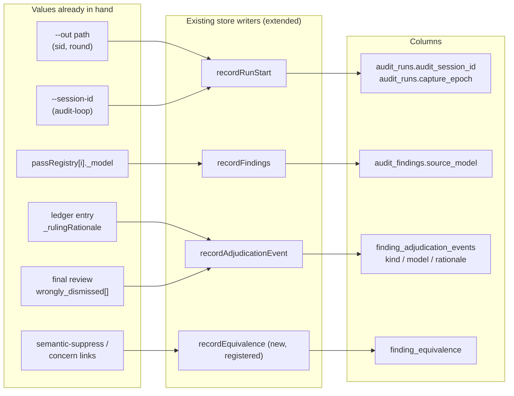

# Plan: Audit telemetry capture — make dispute and model-quality questions plain queries
- **Date**: 2026-10-29
- **Status**: Approved
- **Author**: Claude + Louis
- **Scope**: backend
- **Target domain(s)**: `audit-orchestration`, `stores`
- ⚠ **Cross-domain work**: the plan touches two domains. The crossings are intentional: writers in `audit-orchestration` hand values to row builders in `stores`.
- ⚠ **Untagged paths**: `.own-model-coverage.json` is a config file and matches no domain rule. That is expected.

## 1. Context Summary

**Stack**: `js-ts`. **Scope**: backend only. No UI is involved.

**Why.** On 2026-10-29 we asked whether escalating disputed audit findings from
`gpt-6.1-terra` to `gpt-6.1-sol` would pay off. The cost could be answered:
about 0.7% of findings are disputed, which is about $8 per 90 days. Whether Sol
would *rule better* could not be answered from the store. The store records too
little about who ruled, with which model, across which rounds. The goal is that
the three questions below become plain SQL after a few weeks of normal work,
with **no new collector**:

- **(a)** At what rate do findings reopen or get disputed across the rounds of one audit?
- **(b)** What is finding quality per auditor model, Terra after experiment 8 against Sol before it?
- **(c)** How often do Gemini (the final review) and GPT agree, both per run and per finding?

**Measured** on store `d5a9d07b` over code-audit runs from the last 90 days
(4,126 runs, 17,146 findings, 10,928 events). The command was a read-only `pg` query script; its scratch copy is not committed.

| # | Gap | Measured | Root cause (traced) |
|---|---|---|---|
| 1 | Rounds of one audit are not linked | `audit_runs.task_id` and `work_item_id` are 100% null | Every round mints its own row. `task_id` means the arm-eval task hash and `work_item_id` means the own-model ledger key, so neither is a session key. The skill's `$SID` exists only in the `--out` path. |
| 2 | Who ruled is not recorded | `adjudicator_kind` 98.2%, `adjudicator_model` 99.2% and `ruling_rationale` 99.6% null | Mostly legacy: rows written before slice 1 (`76b03788`, 2026-10-26) never set kind. Still live: outcome-sync drops the rationale it already holds, the override CLI drops `actor`, and the model is unknown for host-agent triage. |
| 3 | Which model raised a finding is not recorded | `audit_findings.source_model` 97.2% null; `audit_pass_stats.source_model` about 58% null | GPT pass findings are never stamped `_sourceModel`, although the model is in hand per pass. The upsert overwrites a set value with NULL. Mechanical passes legitimately have no model. |
| 4 | Reworded re-raises are not linked | `finding_equivalence` has 0 rows ever | The only writer is the manual `model-ab-adjudicate --action duplicate`. Semantic-suppress and concern identity know the canonical finding but record it only in prose or the file ledger. |
| 5 | The 28 human overrides have no `audited_sha` | 0 of 28 on `audit_runs` | **Partly an instrument artifact.** Overrides sit on bake-off arm runs, and `mintArmRun` writes `commitSha` only. The audited identity does exist, in `campaign_snapshots.audited_sha` (NOT NULL). |
| 6 | Findings with no outcome | 34.7% null `adjudication_outcome` | Mostly legitimate states: needs_triage pending, control markers, final-review findings not yet adjudicated, rounds never finalized. One bug: `model-ab.mjs` writes the literal `'pending'`. |

**Also found while tracing.** These are in scope because question (c) depends on them:
- **Gemini's per-finding reversals are never persisted.** `wrongly_dismissed[].original_finding_id` is in the final-review output, but it reaches only the markdown and JSON result (`scripts/gemini-review.mjs:573`).
- **`recordRunComplete` writes `gemini_verdict: stats.geminiVerdict` unconditionally** (`scripts/lib/store/runs-findings.mjs:342`). A null there overwrites a verdict that was already written.
- **`recordAdjudicationEvent` deletes prior audit-origin rows for the finding** before it inserts (`scripts/lib/store/adjudication-events.mjs:141`). A second adjudicator kind on the same finding would therefore erase the first.

**Code Trace.** The writer map was traced read-only by a subagent and is pinned to `58352c39`. `/audit-plan` must re-verify each citation.
- Run row: `recordRunStart` at `scripts/lib/store/runs-findings.mjs:255` (58352c39). It is called from `scripts/lib/audit/legacy-production-audit.mjs:458` (code), `scripts/lib/audit/plan-audit-cloud.mjs:133` (plan), `scripts/openai-audit.mjs:1134` (plan A/B shadow) and `scripts/bakeoff-collect.mjs:358` (bake-off arm).
- Session key today:
  - `parseResultPath` at `scripts/lib/finalize-outcomes.mjs:54` (58352c39) recovers `{sid, round}` from `--out`.
  - `scripts/audit-loop.mjs:302` passes `--session-id`, but `scripts/openai-audit.mjs` never parses it.
  - `_sid` (`scripts/lib/audit/run-persistence.mjs:557`) is a per-process debt run id, despite its comment.
- Finding row:
  - Builder: `buildFindingRow` at `scripts/lib/store/runs-findings.mjs:646` (58352c39).
  - Upsert: `DO UPDATE SET` overwrites `source_model`, `stage` and `arm` at `:964`.
  - The per-pass model is in hand at `scripts/lib/audit/finding-assembly.mjs:207` (`passRegistry[i]._model`).
  - The plan-run model is in hand at `scripts/lib/audit/plan-audit-cloud.mjs:207`.
- Pass stats: `recordPassStats` at `scripts/lib/store/runs-findings.mjs:1826` (58352c39) is fed by `scripts/lib/audit/run-telemetry.mjs:139`.
- Events:
  - `recordAdjudicationEvent` at `scripts/lib/store/adjudication-events.mjs:106` (58352c39), called from outcome-sync at `scripts/lib/outcome-sync.mjs:188`.
  - The rationale is in hand at `:128` but not passed.
  - `recordHumanOverride` is at `scripts/lib/store/campaign.mjs:1344`, and its CLI `verbOverride` at `scripts/campaign.mjs:744` drops `actor`.
- Equivalence:
  - The table is defined in `supabase/migrations/20260701120000_model_ab.sql:63`.
  - Its only inserter is at `scripts/lib/store/model-ab.mjs:440`.
  - The canonical finding is known at `scripts/semantic-suppress.mjs:175` and at `scripts/lib/concern-identity.mjs:210` (`resolveConcernLinks`).
- Coverage gate:
  - The closed `APPLICABILITY` enum is at `scripts/lib/telemetry/coverage.mjs:25` (58352c39).
  - A nullable `ADD COLUMN` after `coverageFromMigration` forces an entry or an exemption (`:122`).

**Neighbourhood considered.** `registerAuditStoreWriters` (`scripts/lib/audit-store-writers.mjs:113`) is `precedent`, `above-floor-standout`. **Decision: extend it.** The new store writes register there, and no sibling registry is created. `runMultiPassCodeAudit` is `review`.

**Past incidents to verify against**

| Incident | Status | Lesson applied here |
|---|---|---|
| INC-002: destructive DB tests wiped the production store | `manual-verification-required` | Every new DB assertion runs through `npm run db:local` against a loopback container (`assertDisposableDbUrl`), and is enrolled in `*_SUITE_FILES` plus `postgres-parity.yml`. |
| INC-001: symlink bypass of the sensitive-path classifier | `manual-verification-required` | Not on the path. This plan sends nothing to an LLM. `ruling_rationale` is stored text only. |

## 2. Proposed Architecture

### Key decisions

1. **New columns `audit_runs.audit_session_id text` and `audit_runs.audit_round integer`. Neither `task_id` nor `work_item_id` is reused.** Both of those columns have committed meanings: `task_id` is the arm-eval task hash and `work_item_id` is the own-model ledger UUIDv7. Overloading either would corrupt the `own_model_task_cost` view (#5, #18).

   `recordRunStart` sets the session id, taking the first of these that exists:
   1. `--session-id`, which makes audit-loop's dead flag live;
   2. the `sid` from `parseResultPath(--out)` (the skill path);
   3. NULL, with a stderr warning. The id is never guessed.

   The round comes from `--round`, falling back to the round in the `--out` path. **If the flag and the path disagree on the round or on the session, the run refuses to stamp either value** and warns: an ambiguous identity becomes NULL, never a pick. A retried or restarted round produces two rows with the same `(repo_id, audit_session_id, audit_round)`. This is deliberate: no uniqueness constraint is added, because a crashed attempt is evidence. Queries take the **latest `created_at` per key**, so a retry counts once.

   The same `audit_session_id` can appear in a primary audit, a plan A/B shadow run and bake-off arm runs, so a query must not count those as extra rounds:
   - The plan A/B shadow run and bake-off arm runs get `audit_session_id` but **`audit_round = NULL`**.
   - The bake-off run id is their session id.
   - `experiment_tag`, which they already carry or will be stamped with, marks them as non-primary.

   A round is identified by the composite key `(repo_id, audit_session_id, audit_round)`, counting only rows where `audit_round IS NOT NULL` (#16).
2. **New column `audit_runs.capture_epoch text`, stamped `'capture-v1'` by `recordRunStart`.** This column is necessary but not sufficient for eligibility. A run-start stamp proves only that the fixed writer *started*, not that its later writes landed. Eligibility per capability is:
   - **Findings, pass stats and events:** `capture_epoch IN (:epochs)` AND `run_status = 'complete'`. This is positive eligibility. `run_status` is the closed `complete | incomplete | …` domain from `supabase/migrations/20260812080000_audit_runs_write_outcomes.sql`, written by `recordRunComplete` (`scripts/lib/store/runs-findings.mjs:394` (58352c39)), and it is `incomplete` whenever any `durableWrite` outcome was `lost` or `spilled`. NULL, and every other state, is ineligible.
   - **Reviewer agreement:** additionally requires a complete reviewer receipt on the run (Decision 4).
   - **Writes that happen later.** `run_status` covers only the writes made inside the audit run. Outcome-sync, which runs on the next round or at finalize, and the equivalence links each record **their own receipt** under `write_outcomes.outcome_sync` and `write_outcomes.equivalence` (`{expected, written, spilled, lost}`), and each query names the receipt it requires. Query (b) requires an `outcome_sync` receipt with `written = expected`, and query (a) reports the `equivalence` counts alongside its result.

   The epoch set is an **explicit query parameter**, never hard-coded, so bumping the epoch is a deliberate change of cohort. Rows written before the fix stay NULL and are ineligible. There is no backfill and no cutoff by date (#14, #19).
3. **Stamp `f._sourceModel` with the model id the provider returned.** That id is `response.model ?? wm` from `callModel` (`scripts/lib/audit/llm-helpers.mjs:355` (58352c39)), carried as `passRegistry[i]._model` to `scripts/lib/audit/finding-assembly.mjs:207` (58352c39). On the plan path it is the plan call's returned `model`, not `openaiConfig.model`.
   - It is a concrete id and is **never normalised**.
   - A value that still looks like an unresolved `latest-*` sentinel is refused and stored as NULL, with a warning. Change the upsert to `source_model = COALESCE(EXCLUDED.source_model, audit_findings.source_model)`, and the same for `stage` and `arm`, so a re-record can no longer null a set value (#15).
4. **Gemini's per-finding reversals become events, over an explicit presented set.** The reviewer's response schema does not account for each presented finding individually; it lists only reversals. A finding that was not reversed is therefore **"not reversed"**, never "sustained", and no sustain event is written. The metric is the **reversal rate**, not an "agreement" rate. Changing the reviewer schema to rule on every finding is a contract change at the prose-to-code seam and is out of scope here.
   - **Path.** Both the primary and the shadow final-review results persist through `buildFinalReviewPersistPayload` (`scripts/lib/final-review/shadow.mjs:431` (58352c39)), which `runShadowAndPersist` calls at `:646`. The run is the `--run-id` passed to `scripts/gemini-review.mjs`, the last round's `_cloudRunId`.
     - **Only the primary reviewer writes events.** Shadow results stay observation-only, as they are today.
     - No `--run-id` means no events and no receipt, so the run is ineligible for (c).
   - **Presented set.** These are the dismissed ledger entries in the transcript the reviewer received. `scripts/build-audit-transcript.mjs` builds that transcript from the ledger, and each entry carries `latestFindingId`, `topicId` and `resolvedRound`.
   - **Source rows can be in earlier rounds.** A presented entry may come from any round of the session. Each one resolves to its **source** finding row through:
     1. `(repo_id, audit_session_id, audit_round = entry.resolvedRound)`, which finds that round's run;
     2. then `topicId` / fingerprint within that run.

     This is a direct use of Decision 1's columns.
   - **Writes.** On a successful review (non-null verdict, no truncation), the writer emits one `reviewer` event, **on the source row**, for each presented entry that appears in `wrongly_dismissed[]`:
     - `ruling:'overrule'` and outcome `accepted`;
     - rationale `reason_claude_was_wrong`;
     - `adjudicator_model` set to the primary model.
   - **Lineage.** Each event's `evidence` jsonb carries `{reviewing_run_id, review_round}`, and the receipt on the reviewing run lists the presented `latestFindingId`s. For reviewer rows, the kind-scoped delete is narrowed further to the **same `reviewing_run_id`**:
     - rerunning one review replaces only that review's rows;
     - a later review of the same source finding adds its rows rather than overwriting.
   - **ID resolution.**
     - Finding IDs restart every round, so `R1 H1` and `R2 H1` can both be present. An `original_finding_id` with a round prefix (`R2 H7`, the form the transcript's `claude_resolutions` prints) is parsed into `(resolvedRound, latestFindingId)` and matched on both.
     - A bare id is matched on `latestFindingId` only.
     - Either way, the id must match exactly one entry in the presented set. The transcript's presented entries carry the round-qualified id.
     - An ID that is unmatched, ambiguous, outside the presented set, or whose source row does not resolve is not written, and is counted.
   - **Receipt.** The writer stores `{presented, presented_resolved, reversals, reversals_written, unresolved, ambiguous, status}` under `write_outcomes.reviewer` on the **reviewing** run, as jsonb passed raw.
     - `reversals_written` counts only events `durableWrite` reports as `written`, never `spilled`.
     - `status` is `complete` only when every presented entry resolved, every reversal was written, and both `unresolved` and `ambiguous` are 0.
     - Query (c) uses only runs with `status = 'complete'`. It reports reversals ÷ `presented_resolved`, labelled "reversal rate"; incomplete runs are counted separately.
   - **Kind.** Add adjudicator kind `'reviewer'` by dropping and re-adding `fae_adjudicator_kind_chk`. `'agent'` is not reused, because it carries the campaign unique-live-verdict index.
   - **Delete scope.** The prior-row delete in `recordAdjudicationEvent` (`scripts/lib/store/adjudication-events.mjs:141` (58352c39)) is keyed on `finding_id`, which is a **per-run finding row**, so history across rounds already survives as separate rows. Within one run, replacing a row of the same kind is the intended idempotent re-finalization. The change narrows the delete to the **same `adjudicator_kind`** (NULL-kind legacy rows keep matching the pipeline path), so reviewer and pipeline rows coexist.
     - **Concurrency is unchanged and already serialized.** The same `withTx` first takes `SELECT … FROM audit_findings WHERE id = $1 FOR UPDATE` (`:129`), so two re-finalizations of one finding queue on that row lock.
     - Reviewer writes use the same function and inherit that lock (#1, #15).
5. **Fill what is dropped; exempt what cannot be known.**
   - outcome-sync passes `rulingRationale: f._rulingRationale`.
   - `verbOverride` records `actor` in the event's `evidence` jsonb. Pass the value raw; it goes through the jsonb write seam.
   - **Every free-text value written here** (`ruling_rationale` and `actor`) goes through `redactSecrets` (`scripts/lib/secret-patterns.mjs`, the gentle redactor, as `docs/plans/security/` prescribes for prose) and is capped at 2,000 characters at the store boundary, with a seeded-secret test.
   - `adjudicator_model` on `pipeline` rows is the *host agent's* model (Claude doing triage). The script cannot observe it, and `AUDIT_AUTHOR_TIER_HINT` is a tier and observation-only. It gets a **reasoned coverage exemption** for `pipeline` rows, not a guess.
6. **`finding_equivalence` gets automatic writers, with a defined identity contract.**
   - A new `recordEquivalence` store export is registered in `registerAuditStoreWriters`, so it goes through `durableWrite`.
   - Callers:
     - semantic-suppress: the canonical finding is the open finding it suppressed against;
     - the ledger concern links from `resolveConcernLinks`.
   - `created_by` is `'semantic-suppress'` or `'concern-v1'`.
   - **Contract.** The keys are finding fingerprints, as in the existing table. Every equivalence mutation, **manual and automatic alike**, runs inside one `withTx`. Inside it, the writer:
     1. takes `pg_advisory_xact_lock` on one fixed key (`hashtext('finding_equivalence')`). Write volume is low, so a single global lock is the simple, correct way to serialize opposite-direction inserts;
     2. checks that **both** fingerprints have a persisted `audit_findings` row whose run has the **same `repo_id`**, and refuses with `skipped:endpoint` otherwise;
     3. refuses with `skipped:ambiguous-repo` any fingerprint that appears in more than one repo. The table is keyed globally, and re-keying it plus its model-ab readers is disproportionate to a table with zero rows;
     4. resolves the root with `resolveCanonicalRoot` (`scripts/lib/store/model-ab.mjs:384` (58352c39));
     5. refuses self-links, and any link whose root resolves back to the duplicate, with `skipped:cycle`;
     6. upserts `ON CONFLICT (duplicate_finding_id)` only when the existing row's `created_by` is automatic. **A manual `model-ab-adjudicate` link is never overwritten.** The manual writer takes the same lock.
   - **Receipt.** Link outcomes (`written`, `skipped:endpoint`, `skipped:ambiguous-repo`, `skipped:cycle`) are counted into `write_outcomes.equivalence` on the run. Query (a) is reported as a **lower bound**, with those counts next to it.
   - **Ordering.** Semantic-suppress runs after `recordFindings` in the same run, so the endpoint exists. Concern links run after the ledger write, by which point findings are persisted.
   - **No outcome semantics.** An automatic link never sets an outcome. Only the manual duplicate adjudication assigns the canonical outcome (`scripts/lib/store/model-ab.mjs:451` (58352c39)). Queries treat an automatic link as "same concern", nothing more.
7. **`gemini_verdict` is written only when defined.** `recordRunComplete` omits the key when `stats.geminiVerdict == null`. Same shape as `recordConvergenceState`'s conditional patch.
8. **Gap 5 needs no new capture; gap 6 is classified, not filled.**
   - `mintArmRun` stamps `audited_sha/audited_tree` from the snapshot it already holds, which also stops arm runs from dragging the `code_run` floor down.
   - The `'pending'` literal at `scripts/lib/store/model-ab.mjs:451` becomes "leave NULL".
   - The 34.7% gets a committed classification query (§9). The remaining NULL states are legitimate lifecycle states, not a capture failure.
   - **Terminal state is derived from one committed mapping.** `(adjudication_outcome, user_action)` maps to `accepted | dismissed | severity_adjusted | open | unknown`. `user_action='accepted-permanent'` maps to `accepted` (`scripts/lib/store/finding-disposition.mjs:119` (58352c39)), and `'auto_dismissed'` control markers are excluded. The mapping lives as a SQL CASE in `docs/reference/audit-telemetry-queries.md`, and query (b) reads it from there. The producer is not changed.

### Right-sizing

- **Band-aid**: backfill `source_model` from `audit_pass_stats` by `(run_id, pass_name)`, and infer sessions from `created_at` proximity. That guesses at both, and it breaks the "never backfill by date" rule.
- **Over-engineered**: a first-class `audit_sessions` table with lifecycle states, a session service, and per-finding lineage graphs.
- **Chosen**: two nullable columns on `audit_runs`, one CHECK widening, and one new registered writer. Everything else is filling values the existing writers already hold. Each piece serves one of the three named questions; nothing serves "might need later".

### Execution model

The phases are independent at runtime: each writer change is one write site. **Phase 1's migration must land before any writer that writes the new columns.**

**Deploy order** (one order everywhere, including close-out):
1. Merge the PR.
2. **Before** fast-forwarding any checkout that consumer hooks run from, create a pinned fixture at the merged commit (`npm run fixture:create -- --name capture-v1 --rev <merged sha>`, then check its `git rev-parse HEAD`). From that fixture, apply `node scripts/setup-postgres.mjs --migrate` to every store (NAS and storyline's Azure store), and confirm with `--check-drift` that each store reports no drift.
3. Then fast-forward CES main.
4. Then consumers sync.

A fast-forward of main is a live deploy to consumer hooks.

**Compatibility gate.** Every **additive** field or operation this plan introduces is gated on one column probe: `columnExists('audit_runs', 'capture_epoch')`. That covers the new run columns, the `source_model` stamp on plan findings, reviewer events, equivalence writes, the new receipts and the `'reviewer'` kind.
- That column and the widened `fae_adjudicator_kind_chk` arrive in the **same migration**, so the probe proves the CHECK is widened too. A reviewer event can therefore never reach an old CHECK.
- On an unmigrated store, **only the additive parts are skipped**. Existing writes (run rows, findings, pipeline events, pass stats) behave byte-identically to today, and a real database error still surfaces as it does now.
- One stderr notice per process names `setup-postgres --check-drift`.
- Nothing is queued, so a later migration does not replay old writes. Those runs simply stay ineligible.
- An old-schema integration test covers this.

## 6. Sustainability Notes

- **Assumption: the skill keeps writing `--out .audit/$SID-r<N>-result.json`.** If the naming changes, `parseResultPath` returns null, the session id is NULL, and the coverage floor fails loudly. The run does not read as clean.
- **New adjudicator kinds** need only the CHECK widening and the delete scoping in Decision 4. The pattern is now per-kind.
- **`capture_epoch` is the one seam for "the meaning changed".** Bump it, and the queries in §9 automatically exclude older rows.

## 7. File-Level Plan

| File | Change | Principle |
|---|---|---|
| `supabase/migrations/20261029120000_audit_capture_v1.sql` | create: `ADD COLUMN IF NOT EXISTS audit_runs.audit_session_id text`, `audit_round integer` and `capture_epoch text`; an index on `(audit_session_id)`; drop and re-add `fae_adjudicator_kind_chk` with `'reviewer'`. Idempotent and schema-portable, no `public.` qualification. | #14, #18 |
| `tests/fixtures/expected-schema.json` | modify: regenerate via `npm run db:local:regen` (fresh replay only) | #11 |
| `scripts/lib/store/runs-findings.mjs` | modify: `recordRunStart` accepts `{auditSessionId, auditRound}` and writes `audit_session_id`, `audit_round` and `capture_epoch` (column-probed); the finding upsert becomes COALESCE for `source_model/stage/arm`; `recordRunComplete` omits a null `gemini_verdict` | #15, #16 |
| `scripts/openai-audit.mjs` | modify: parse `--session-id` (with `assertKnownFlags`); one pure `resolveAuditIdentity({sessionFlag, roundFlag, outPath})` returns `{auditSessionId, auditRound, conflict}`, applying the Decision 1 precedence and the conflict-means-NULL rule; place it in the run context; the plan A/B shadow (`:1134`) gets the session with `auditRound: null` | #4, #11 |
| `scripts/lib/audit/legacy-production-audit.mjs` | modify: pass `{auditSessionId, auditRound}` from the run context into `recordRunStart` (`:458`) | #1 |
| `scripts/lib/audit/plan-audit-cloud.mjs` | modify: pass `{auditSessionId, auditRound}` into `recordRunStart` (`:133`); stamp `_sourceModel` with the plan call's provider-returned `model` (Decision 3), not `openaiConfig.model` | #1 |
| `scripts/bakeoff-collect.mjs` | modify: `mintArmRun` passes `auditSessionId = <bake-off run id>`, `auditRound: null`, and `audited_sha/audited_tree` from the snapshot | #5 |
| `scripts/build-audit-transcript.mjs` | modify: confirm each presented ledger entry carries `resolvedRound` and `topicId` into the transcript, and add them where missing, so that Decision 4 can resolve source rows | #2 |
| `scripts/lib/audit/finding-assembly.mjs` | modify: stamp `f._sourceModel = passRegistry[i]._model` where findings are assembled | #1 |
| `scripts/lib/store/adjudication-events.mjs` | modify: scope the prior-row delete to the same `adjudicator_kind`; accept `'reviewer'` | #15 |
| `scripts/lib/outcome-sync.mjs` | modify: pass a redacted `rulingRationale`; write the `write_outcomes.outcome_sync` receipt `{expected, written, spilled, lost}` | #19 |
| `scripts/campaign.mjs` | modify: `verbOverride` records `actor` in `evidence` | #19 |
| `scripts/lib/final-review/shadow.mjs` | modify: primary only. Write `reviewer` overrule events on the cross-round **source** rows (Decision 4), carrying `evidence {reviewing_run_id, review_round}`. Write the `write_outcomes.reviewer` receipt on the reviewing run. Count unresolved and ambiguous IDs; never drop one silently | #15, #19 |
| `scripts/lib/store/model-ab.mjs` | modify: export `recordEquivalence` (advisory lock, endpoint/repo/cycle checks, `resolveCanonicalRoot`); the manual duplicate path takes the same lock; `'pending'` becomes leave NULL; link outcomes are counted into the `write_outcomes.equivalence` receipt | #1, #5 |
| `scripts/lib/audit-store-writers.mjs` | modify: register `audit.equivalence` and `audit.reviewerEvents` | #16 |
| `scripts/semantic-suppress.mjs` | modify: call `recordEquivalence` (via durableWrite) for each suppressed duplicate | #1 |
| `scripts/lib/concern-identity.mjs` | modify: return the link pairs from `resolveConcernLinks` so the ledger writer can persist them | #2 |
| `scripts/write-ledger-entries.mjs` | modify: persist the concern links via `durableWrite('audit.equivalence')` | #16 |
| `scripts/lib/telemetry/coverage.mjs` | modify: add the `APPLICABILITY` keys `model_finding` and `model_pass` (predicate on `source_kind` / pass name, generated from `MECHANICAL_WAVES`, never a hand list) and `reviewer_event` | #4, #5 |
| `.own-model-coverage.json` | modify: entries for the newly filled columns (§9); exemption for `adjudicator_model` on pipeline rows | #19 |
| `docs/reference/audit-telemetry-queries.md` | create: the three question queries plus the null-outcome classification | #19 |

**Path self-check**: run `node scripts/lib/plan-paths.mjs docs/plans/audit-telemetry-capture.md` before `/audit-code`. The plan has about 20 repo-relative paths, so fuzzy discovery should not fire.

### 7b. Implementation Phases

- **Phase 1 — Session identity and capture epoch**: add the migration, fixture and run-start writers so that every run carries its audit session and epoch. Files:
  - `supabase/migrations/20261029120000_audit_capture_v1.sql` (create)
  - `tests/fixtures/expected-schema.json` (modify)
  - `scripts/lib/store/runs-findings.mjs` (modify)
  - `scripts/openai-audit.mjs` (modify)
  - `scripts/lib/audit/legacy-production-audit.mjs` (modify)
  - `scripts/lib/audit/plan-audit-cloud.mjs` (modify)
  - `scripts/bakeoff-collect.mjs` (modify)
- **Phase 2 — Source model on findings**: stamp the per-pass model, add the COALESCE upsert and the `gemini_verdict` null guard. Files:
  - `scripts/lib/audit/finding-assembly.mjs` (modify)
  - `scripts/lib/store/runs-findings.mjs` (modify)
  - `scripts/lib/audit/plan-audit-cloud.mjs` (modify)
- **Phase 3 — Adjudication provenance**: add reviewer events, the kind-scoped delete, the rationale and the actor. Files:
  - `scripts/lib/store/adjudication-events.mjs` (modify)
  - `scripts/lib/outcome-sync.mjs` (modify)
  - `scripts/campaign.mjs` (modify)
  - `scripts/lib/final-review/shadow.mjs` (modify)
  - `scripts/build-audit-transcript.mjs` (modify)
  - `scripts/lib/audit-store-writers.mjs` (modify)
- **Phase 4 — Equivalence links**: add the automatic `finding_equivalence` writers and fix the `'pending'` literal. Files:
  - `scripts/lib/store/model-ab.mjs` (modify)
  - `scripts/semantic-suppress.mjs` (modify)
  - `scripts/lib/concern-identity.mjs` (modify)
  - `scripts/write-ledger-entries.mjs` (modify)
  - `scripts/lib/audit-store-writers.mjs` (modify)
- **Phase 5 — Coverage and query recipes**: add the applicability keys, the coverage entries and the reference doc. Files:
  - `scripts/lib/telemetry/coverage.mjs` (modify)
  - `.own-model-coverage.json` (modify)
  - `docs/reference/audit-telemetry-queries.md` (create)

**Close-out (not a phase)**:
- Run `npm run db:local`, `npm test`, `npm run own-model:coverage:gate` and `npm run guards:preflight`.
- Deploy in the §2 Execution-model order: migrate and drift-check every store, *then* fast-forward main.
- Once rows exist, run `npm run own-model:coverage`.

## 8. Risk & Trade-off Register

- **Consumer blast radius.** wine produces 71% of runs, and every writer change ships to it on sync.
  - All new writes are column-probed or conditional, so an unmigrated consumer store is a no-op and not a crash.
  - The CHECK widening is additive.
  - The delete-scoping change is the riskiest change, because it touches the live write path of every audit. It needs a DB test showing that a pipeline re-write still replaces its own prior row (no duplicates) while leaving a reviewer row intact.
- **`original_finding_id` resolution.** Gemini cites ledger ids such as `H3`, and those ids restart every round.
  - Mitigation: a round-qualified id (`R2 H7`) matches on round and id together. A bare id must be unique across the presented set.
  - Each id resolves to its **source** row through `(repo_id, audit_session_id, resolvedRound)`, which can be an earlier round.
  - An unresolved or ambiguous id makes the receipt `incomplete`. It is counted, never guessed.
- **Session id from a path.** This is a convention, not a contract. It is mitigated by the NULL-plus-warning fallback and by the coverage floor.
- **Deliberately deferred.**
  - Deriving `work_item_id` from the `wi-` branch: that is own-model scope, and this plan's queries do not depend on it.
  - `closeFindingById`'s accepted-permanent not setting an outcome: its semantics need a product call, and none of (a), (b) or (c) depend on it.
  - The agent verdict `confidence` and rationale: they are campaign-only, and the tool schema has no field for them. Adding one is a schema change at the prose-to-code seam.
- **The pipeline `adjudicator_model` stays unknown.** It is exempt with a reason. Question (b) is answered through `source_model` (which model *raised* the finding) and the run-level outcome, and does not need the triage model.

## 9. Testing Strategy

**Unit tests (Tier 1)**:
- Session-id precedence: the flag, the `--out` path, the arm run, then NULL plus a warning.
- `capture_epoch` is stamped.
- `_sourceModel` stamping per pass, including that mechanical passes stay null.
- The COALESCE upsert does not null a set value.
- A null `gemini_verdict` is omitted.
- Applicability keys are generated from `MECHANICAL_WAVES`.

**DB tests**, enrolled in `scripts/db-test-container.mjs` `*_SUITE_FILES` and in `postgres-parity.yml`, run only via `npm run db:local`:
- The migration is idempotent (applied twice).
- The `'reviewer'` kind is accepted and an unknown kind is rejected.
- The kind-scoped delete: a pipeline re-write replaces its own row, and a reviewer row survives.
- `recordEquivalence` round-trips, and its root resolution matches the duplicate.

**Proof plan**:

| Behaviour | Oracle | Pass condition | Evidence in the report |
|---|---|---|---|
| Rounds are linked and distinct | a red unit test before the fix | two `recordRunStart` calls from `.audit/X-r1-result.json` and `-r2-` share an `audit_session_id` and get `audit_round` 1 and 2; a flag/path round conflict yields NULL; an arm run gets round NULL | test output |
| The reversal denominator is explicit | a DB test | a review with 3 presented entries (one from round 1, two from round 2) and 1 reversal writes exactly 1 overrule on the correct source row; the receipt is `presented=3, presented_resolved=3, reversals_written=1, complete`; an unresolvable ID yields `incomplete` | test output |
| An old schema is untouched | an integration test on an unmigrated fixture | the existing run, findings and pipeline event writes succeed byte-identically; the additive writes are skipped with one notice | test output |
| Equivalence refuses bad links | a DB test | a cross-repo endpoint, a missing endpoint and a cycle are each skipped and counted; a manual link survives an automatic upsert | test output |
| A set value is not nulled | a DB test | re-record with a null `_sourceModel` keeps `gpt-6.1-terra` | test output |
| Reviewer and pipeline rows coexist | a DB test, red first on the current delete | both rows are present after the pipeline re-write | test output |
| The gate covers the new columns | `npm run own-model:coverage:gate` fails before the entries are added | it fails naming `audit_session_id`, then passes | gate output, both runs |
| The questions are answerable | the live check after two weeks | `npm run own-model:coverage` reports ok, not unmeasured, for the new entries, and the three §9 queries return rows with `capture_epoch='capture-v1'` | query output |

**Coverage entries** (Phase 5):
- `audit_runs.audit_session_id` and `capture_epoch`, where `code_run`, expectFill 0.9.
- `audit_findings.source_model`, where `model_finding`, expectFill 0.9.
- `audit_pass_stats.source_model`, where `model_pass`. The writer already passes `entry._model` (`scripts/lib/audit/run-telemetry.mjs:139` (58352c39)). Most of the 58% nulls are mechanical passes, rows from before the 2026-08-23 fix, and `-unverified` A/B rows. **Phase 5 measures the post-2026-08-23 rate on `model_pass` rows first** and sets `expectFill` from that measurement. Any residual null among LLM passes is traced before the floor is committed.
- `finding_adjudication_events.ruling_rationale`, where `non_campaign_event`, expectFill 0.6. This is hand-set, because the ledger can carry an empty rationale.
- `finding_equivalence.canonical_finding_id`, where `all`. Zero rows reads `unmeasured`, never green.
- Exemption: `adjudicator_model` on `pipeline` rows, because the host-agent model cannot be observed.

**Query recipes** (in `docs/reference/audit-telemetry-queries.md`). There are two paths, and they are never pooled:
- The **prospective** path takes `:epochs` as a parameter (today `{'capture-v1'}`) and applies Decision 2's eligibility.
- The **historical-derived** path (only (b)'s Sol cohort) uses recorded-data eligibility: the `(run_id, pass_name)` join has exactly one model, and `run_status = 'complete'` *or* the row predates `run_status`. Its exclusions are counted.

The recipes:
- **(a)** Three metrics, each with its own denominator and never combined. They are computed per `(repo_id, audit_session_id)`, over rounds with `audit_round IS NOT NULL`, taking the latest row per round. A concern is a fingerprint, or its `finding_equivalence` root, but a root is followed **only when it has a finding row in the same repo** as the duplicate.
  - **Re-raise rate**: concerns seen in at least two rounds ÷ concerns seen.
  - **Reopen rate**: concerns re-raised after their terminal state in an earlier round was `dismissed` ÷ concerns dismissed in a non-final round.
  - **Dispute rate**: finding rows whose adjudication events carry conflicting outcomes across kinds ÷ finding rows with at least two kinds.

  All three are lower bounds, reported next to the `equivalence` receipt counts.
- **(b)** This query is **observational**, not a controlled eval. Every output carries n and missingness, and is stratified by repo and pass. Terminal state comes from the committed mapping in Decision 8. Two cohorts are reported **separately and never pooled**:
  - **Prospective:** `audit_findings.source_model` on eligible capture-v1 runs.
  - **Historical (derived):** findings joined to `audit_pass_stats` on `(run_id, pass_name)`, admitted only where **exactly one `audit_pass_stats` row** exists for that pair and its `source_model` is non-null. A pair with several rows, or with any null-model row, is excluded and counted. This is a deterministic join on recorded data, not a guess, and it supplies the Sol cohort from before experiment 8. Pairs with zero or several models are excluded and counted.

  A claim that one model "finds better" requires the synchronous `model-eval-auditor` harness. This query only shows drift.
- **(c)**
  - **Per run** (a committed mapping):

    | GPT side | Reviewer side | Result |
    |---|---|---|
    | converged (`H = 0 AND M <= 2` on the session's last round) | `gateDisposition` in (`approve`, `approve_with_debt`) | **agree** |
    | not converged | `blocked` | **agree** |
    | converged | `blocked` | **disagree** |
    | not converged | approve, or approve-with-debt | **disagree** |
    | any | NULL verdict, failed or skipped review | **unknown** |

    Each category is counted, and every row of the table gets a fixture test.
  - **Per finding:** the reversal rate = `reversals ÷ presented_resolved`, over runs whose reviewer receipt is `complete`. Incomplete runs and unresolved IDs are reported as their own counts.
  - This compares Gemini against the **ledger disposition**, which is the host agent's triage of GPT's findings, not GPT alone. The doc says so.
- **Null-outcome classification**: buckets for needs_triage, control marker, final-review not adjudicated, never finalized, and other. "Other" is the capture-failure signal.

## Audit trail

- **/audit-plan (GPT, `gpt-6.1-terra`)**, session `audit-plan-1793255983373-72276`. Each round's findings were folded into the plan:
  - Round 1: H:9 M:3, 12 of 12 accepted.
  - Round 2: H:9 M:2, 10 of 11 accepted. H7 (concurrent re-finalization) was dismissed because the existing `FOR UPDATE` row lock already serializes it.
  - Round 3: H:7 M:1, 8 of 8 accepted.
- **Stop decision at the 3-round cap.** The structural card classified all 29 clusters as POLISH (0 structural, 0 local), and round 3's findings had shifted to lineage, concurrency and cohort precision. **STOP**: further precision belongs to `/audit-code` against the real writers.
- **Final gate (Gemini, `gemini-pro-latest`), round 1: APPROVE**, disposition `approve`, 0 blocking items and 2 debt items, both folded into the plan:
  - M: §7/§7b/§8 propagation drift from Decisions 3 and 4 (the plan-findings model source, cross-round source rows, receipts, `build-audit-transcript.mjs` in Phase 3).
  - L: round-qualified `original_finding_id` parsing.
