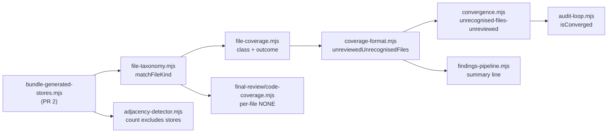

# Plan: Audit honesty — unadmitted changed files, and the bundle's own generated stores
- **Date**: 2026-10-15
- **Status**: Approved (audit-plan converged 2026-10-15; implementation pending)
- **Author**: Claude + Louis
- **Scope**: backend (audit CLIs + `scripts/lib/**`; no UI) · stack `js-ts`
- **Target domain(s)**: `audit-orchestration`, `shared-lib`, `skills-content`, `tech-debt`
- ⚠ **Cross-domain work** — the crossing is intentional: the one classification oracle (`shared-lib`) feeds the round verdict (`audit-orchestration`); `tech-debt` only re-sources a path constant (PR 2).
- **Upstream reports**: `57bd3de9` (PR 1, #258, merged) · `3b84d8bb` (PR 2, #259, merged) · fleet `p-20261015065849-095b` (PR 3, §8). Coordinator rule 13: one plan, sequential PRs. Each report is closed only after its own PR merges.

Neighbourhood considered: `get-neighbourhood` returned only `review` bands (`summariseCodeCoverage`, `runAdjacencyAnalysis`, …) — nothing above this repo's noise floor. Every change below extends an existing function; no new near-duplicate.

## 1. Context Summary

### 1.1 The two reports

**57bd3de9 (wine, 2026-10-15).** A PR changed `tests/eval/fixtures/compactionToolFacts.jsonl`, the fixture that defines what the eval counts as a fact. The taxonomy has no `.jsonl` row, so the file was `uncovered` → `not-admitted`. The round printed `uncovered: jsonl 1` / `not-admitted: 1`, coverage partial/warn, and the verdict was still **PASS** (and converged). The Gemini gate reported `Code: NONE` and downgraded to CONCERNS only when the file was sent alone; inside a normal multi-file group it read `Code: PARTIAL` with an anonymous count. A load-bearing data file passed two gates unread.

**3b84d8bb (wine, 2026-10-15).** Since CES #247 the tech-debt ledger is one file per entry (`.audit/tech-debt/entries/<id>.json`, committed in consumers). An ordinary migration PR touched hundreds of those generated files; `--scope diff` counted them against adjacency's `maxChangedFiles` (default 60), so the round went `INPUT_BOUND` / PARTIAL. The only levers were raising the global bound or accepting a PARTIAL round.

### 1.2 Code Trace (pinned to `423789e4`)

- `matchFileKind` `scripts/lib/file-taxonomy.mjs:191 (423789e4)` — `DECLARATIVE_DEFS` at `:86` lists `.json/.jsonc/.json5`, no `.jsonl`/`.ndjson` → rule 4 `uncovered`.
- `classifyFileCoverage` `scripts/lib/language-profiles.mjs:314 (423789e4)` delegates to it; `buildCoverageReport` `scripts/lib/audit/file-coverage.mjs:396 (423789e4)` sets `outcome = 'not-admitted'` for `non-code`/`uncovered`; `:341-343` counts an uncovered not-admitted file as required + short → `status: partial`, `gate: warn`.
- The verdict: `computeAuditVerdict` (`scripts/lib/audit/findings-pipeline.mjs:350`) downgrades to INCOMPLETE only on `incomplete`, which `finding-assembly.mjs:859 (423789e4)` sets for failed passes or `coverage.gate === 'fail'`. `warn` changes nothing.
- Convergence: `evaluateConvergenceWithDetectors` `scripts/lib/audit/convergence.mjs:66 (423789e4)` withholds convergence only for `changedLinesUnreadTotal(coverage) > 0` (`changed-lines-unread`, upstream 58f4e3a5). An uncovered file has `changedLinesUnread: null`, so it never blocks. `run-finalization.mjs:135` puts `_convergence` on the round JSON; `run-persistence.mjs` reads it for `AI-Gate`.
- Summary line: `formatAuditSummaryLine` `findings-pipeline.mjs:397 (423789e4)` appends `— not convergence evidence` only for changed-lines-unread. `formatCoverageSuffix` `scripts/lib/coverage-format.mjs:51` words the uncovered case as `N unrecognised file type(s): jsonl ×1` — no statement that the file was never read.
- `audit-loop.mjs` `countFindings` `:76` / `isConverged` `:94 (423789e4)` never read `_convergence`, so even `changed-lines-unread` converges there (its banner prints the suffix, but says `Converged`).
- Gemini: `gemini-review.mjs:306` (full envelope) renders `transcript.code_files` = the round's admitted files, so an unadmitted file is absent. `summariseCodeCoverage` `scripts/lib/final-review/code-coverage.mjs:44 (423789e4)` records it as `not-requested` → `changedUnmeasured`; with ≥1 other file seen, `state: 'partial'`; `formatCodeCoverageSegment` `:198` prints only a count. `applyCoverageGate` `:223` downgrades only `state === 'none'`.
- Adjacency: `runAdjacencyAnalysis` `scripts/lib/audit/adjacency-detector.mjs:578 (423789e4)` compares `ns.files.length` (raw `git diff --numstat`, `vcs.mjs:534`) with `adjacencyConfig.maxChangedFiles` (`config.mjs:675`, default 60). No path is ever subtracted.
- Ledger paths: `DEFAULT_DEBT_LEDGER_PATH = '.audit/tech-debt.json'` `scripts/lib/debt-ledger.mjs:76`; `resolveLedgerLocation` `scripts/lib/debt-ledger-files.mjs:44` derives `entries/` and `budgets.json` under `.audit/tech-debt/`. `RECEIPT_PATH = '.sync-receipt.json'` `scripts/lib/sync-receipt.mjs:77`.

### 1.3 Prior decision this plan revises (and why)

`docs/plans/file-coverage-contract-and-csharp.md` §"gate: warn" decided an uncovered file changes **wording only**: "failing on *any* uncovered file would make every repo with one unknown file type unable to converge — the cried-wolf gate." That held when nothing let a repo state "this file is not reviewable". It does now: `.auditignore` / `--exclude-paths` make a path `excluded-user`, and an excluded uncovered file is outside `required` (`file-coverage.mjs:331`, no warn). So withholding convergence no longer traps a repo: there is a one-line declaration that clears it, and the declaration is the explicit acceptance AGENTS.md prefers to a silent shortcut. Its later sibling (`changed-lines-unread`, 58f4e3a5) already withholds convergence on a measured shortfall; this is the same family.

## 2. Proposed Architecture

### 2.1 PR 1 — upstream 57bd3de9

**D1. Admit `.jsonl` and `.ndjson` (ask 1).** Two rows in `DECLARATIVE_DEFS`, fence `json` — line-delimited JSON is reviewable data exactly as `.json` is. The taxonomy stays the one oracle; every derived list (`AUDITABLE_EXTENSIONS`, `EXTENSION_FENCES`, admission, profiling) picks the rows up with no second edit (#5 SSOT; AGENTS.md "Do NOT hand-keep a 'which files are code' list").

**D2. A changed unrecognised file withholds convergence — qualified PASS, not INCOMPLETE (ask 2).**
- New pure helper `unreviewedUnrecognisedFiles(cov)` in `coverage-format.mjs`: ledger records with `class === 'uncovered' && outcome === 'not-admitted'`. That excludes, by construction: `non-code` (binary, asset, lockfile, generated — expected exclusions), `excluded-user`/`excluded-infra` (declared), `sensitive`, `deleted`. Works on the ledger and the reviewer projection, like its siblings.
- `evaluateConvergenceWithDetectors` gains a fourth requirement after `changed-lines-unread`: `{converged: false, reason: 'unrecognised-files-unreviewed'}` when that list is non-empty. AI-Gate `passed`/`converged` then refuse through the existing `run-persistence` wiring — no new path.
- The verdict word stays `PASS`. **Why not INCOMPLETE:** INCOMPLETE means "this round did not measure the change" — exit 3, the provider-failure class. Here the admitted change *was* measured; one file of an unknown type was not. Making it INCOMPLETE would turn every stray unknown file into an exit-3 run and conflate two different facts. Withholding convergence is what actually stops the ship (it is what `AI-Gate` and the skill's "2 stable rounds" read); the verdict line says why.
- Summary line: `notEvidence` fires when `changedLinesUnreadTotal > 0` **or** the new list is non-empty. `formatCoverageSuffix`'s uncovered phrase becomes `N unrecognised file type(s) never sent to any pass: xyz ×1` (the existing wording plus "never sent to any pass", so the `unrecognised file type` assertions in coverage-surface and final-review-coverage-request still hold) — it says the file was not read, not just that its type is odd. Result: `Verdict: PASS | H:0 M:0 L:0 | 30s | coverage: PARTIAL — 1 of 4 …; 1 unrecognised file type(s) never sent to any pass: xyz ×1 — not convergence evidence`.
- Remedy, printed nowhere new but documented in the skill row: declare the file in `.auditignore` (explicit acceptance), or report the missing type upstream.
- `audit-loop.mjs`: `countFindings` carries `coverageBlocked = COVERAGE_CONVERGENCE_REASONS.has(results._convergence?.reason)` and `isConverged` refuses on it, so the older driver stops printing `Converged` over either coverage shortfall. The reason set is exported from `convergence.mjs` (one list, two readers). Only the coverage reasons — the other `_convergence` reasons have their own established handling in that driver, and widening it further is not this change.

**D3. Gemini names each unreceived file (ask 3).** In `summariseCodeCoverage`, a changed file the reviewer never received (`not-requested` or `budget-omitted`) whose `matchFileKind` kind is **not** `non-code` goes into a new `changedNotReceived: [{path, outcome}]`. `formatCodeCoverageSegment` appends `; NONE: <p1>, <p2> (+N more)` (cap 5). So a multi-file group reads `Code: PARTIAL, changed lines unmeasured for 1 file(s); NONE: tests/eval/x.jsonl`. **Reported, not gated**: `applyCoverageGate`'s policy (`partial` never downgrades) is unchanged, because the round-level convergence block in D2 already stops the chain, and a second mechanical downgrade at a different layer would double-count one fact. `coverageBlockFor` already lists uncovered files to the reviewer; unchanged.

### 2.2 PR 2 — upstream 3b84d8bb

**D4. One registry of the bundle's own generated stores, sourced by the writers.** New dependency-free `scripts/lib/bundle-generated-stores.mjs` exports:
- `DEBT_LEDGER_STEM = '.audit/tech-debt'` — the ledger's one location descriptor. Both forms derive from it exactly as `resolveLedgerLocation` derives them from any path: the legacy file `${stem}.json` and the tree `${stem}/` (holding `entries/` and `budgets.json`). `debt-ledger.mjs`'s `DEFAULT_DEBT_LEDGER_PATH` becomes `` `${DEBT_LEDGER_STEM}.json` `` (audit-plan R1-M1).
- `SYNC_RECEIPT_PATH = '.sync-receipt.json'`, imported by `sync-receipt.mjs` as its `RECEIPT_PATH`.
- `BUNDLE_GENERATED_STORES` — frozen `{path, kind: 'file'|'tree', writer}` entries built from those constants; `isBundleGeneratedStore(relPath)` (slash-normalised, case-insensitive, repo-relative, anchored at the root — `src/.audit/tech-debt.json` is not a store); and `bundleStoreExcludePathspecs()` → git pathspecs `:(top,exclude,icase)<file>` / `:(top,exclude,icase,glob)<tree>/**` for D6.

**Derived, not a second list:** the writers import their default paths from the registry, so writer and classifier read one constant. The test is drift detection, not import enforcement: it resolves `resolveLedgerLocation(DEFAULT_DEBT_LEDGER_PATH)` and asserts its `legacyFile`, an `entries/` child and `budgetsFile` (made repo-relative) all satisfy `isBundleGeneratedStore`, and that `RECEIPT_PATH === SYNC_RECEIPT_PATH`.

**D5. Classification: a generated store is `non-code`.** `matchFileKind` gains a rule 0 — `isBundleGeneratedStore(path)` → `{kind: 'non-code', rule: 'generated-store:<entry>'}`. This is the taxonomy's own documented meaning of `non-code` ("an EXPECTED exclusion: … generated"), and it keeps the module path-only and dependency-free (the registry imports nothing). Downstream, with no further edits: admission drops the files as expected exclusions; the coverage ledger records them `non-code`/`not-admitted`, outside `required` (no warn); D3's per-file NONE skips them.

**D6. The adjacency inputs exclude the stores at the source — git does the partition.** `gitNumstatWithWorkingTree` and `gitUnifiedDiffWithWorkingTree` (`scripts/lib/vcs.mjs:514`, `:567`) gain an optional `pathspecs` argument, appended after `--` (default none ⇒ byte-identical command for every other caller). `runAdjacencyAnalysis` passes `['.', ...bundleStoreExcludePathspecs()]` to **both** calls (audit-plan R1-M2: the acquired patch then never carries store hunks, so `maxDiffBytes` bounds only what is analysed; the bound itself is unchanged).

Rename endpoints are git's own answer, not a path-text parse (R1-M3): with the stores excluded by pathspec, rename detection only ever pairs visible paths, so store→visible arrives as an addition of the visible file, visible→store as a deletion of it, store→store not at all, and visible→visible as an ordinary rename. Counts, line totals and the patch all come from the same pathspec-limited diff, so they cannot disagree.

When the file or line bound fires, a second, cheap numstat limited to the store pathspecs (non-exclude form) supplies M, and the message adds `(M further changed file(s) are bundle-generated stores and were not counted)`. Below the bound nothing extra runs and the output is unchanged. A failed second numstat says `store count unavailable`, never `0`.

**Not done (ask 2 of 3b84d8bb, the consumer glob list):** `.auditignore` is that list already for admission and coverage; the defect was the adjacency count ignoring the bundle's *own* stores, which D6 fixes without a new config surface.

### 2.3 Right-sizing (D2 and D4 introduce new structure)

- **Band-aid:** add `.jsonl` and stop (the next unknown type passes unread the same way); raise `maxChangedFiles` (weakens the bound for every real diff).
- **Over-built:** a new coverage outcome / schema version for "unrecognised", a Gemini-layer downgrade, a configurable consumer exclusion DSL for the diff scope.
- **Chosen:** reuse the existing `uncovered`/`not-admitted` record, the existing `_convergence` → AI-Gate path, and the existing `non-code` meaning. The only new structures are one helper (D2) and one 3-entry registry whose consumers are its writers (D4) — each serves a requirement in the reports.

### 2.4 Execution model

PR 1 and PR 2 are independent in code (PR 2 touches `matchFileKind` at a different rule), but sequenced by policy: PR 2's branch is cut from `main` after PR 1 merges. Within each PR, operations are pure functions; no ordering or atomicity concerns.

## 3. Sustainability Notes

- A new reviewable type is still a one-row taxonomy edit; until it lands, the round says so and withholds convergence — the visible-not-silent property the coverage contract was built for.
- A new bundle-written, committed store is one registry row plus the writer importing its path from it.
- Assumption: consumers use the default ledger path. A `--ledger` override is not recognised as a generated store (documented in the registry header; the override is rare and the cost is today's behaviour, not a regression).

## 4. File-Level Plan

### 4.1 Implementation Phases

**Phase 1 — Red tests (PR 1)**: write the failing tests first and record their failure at `423789e4`. Files: `tests/coverage-orchestrator.test.mjs` (modify), `tests/file-taxonomy.test.mjs` (modify), `tests/file-coverage.test.mjs` (modify), `tests/final-review-code-coverage.test.mjs` (modify), `tests/audit-loop-coverage-convergence.test.mjs` (create).

**Phase 2 — Taxonomy + convergence + summary line (PR 1)**: D1, D2. Files: `scripts/lib/file-taxonomy.mjs` (modify), `scripts/lib/coverage-format.mjs` (modify), `scripts/lib/audit/convergence.mjs` (modify), `scripts/lib/audit/findings-pipeline.mjs` (modify), `scripts/audit-loop.mjs` (modify), `skills/audit-code/SKILL.md` (modify), `skills/audit-code/gate-contract.json` (modify).

**Phase 3 — Gemini per-file NONE (PR 1)**: D3. Files: `scripts/lib/final-review/code-coverage.mjs` (modify).

**Phase 4 — Generated-store registry + adjacency (PR 2)**: D4–D6, with its own red tests first. Files: `scripts/lib/bundle-generated-stores.mjs` (create), `scripts/lib/file-taxonomy.mjs` (modify), `scripts/lib/debt-ledger.mjs` (modify), `scripts/lib/sync-receipt.mjs` (modify), `scripts/lib/vcs.mjs` (modify), `scripts/lib/audit/adjacency-detector.mjs` (modify), `tests/bundle-generated-stores.test.mjs` also carries the `vcs.mjs` pathspec and real-git adjacency tests (one file, one fixture helper; no `tests/vcs.test.mjs` / `tests/adjacency-detector.test.mjs` edit), `tests/bundle-generated-stores.test.mjs` (create), `tests/adjacency-detector.test.mjs` (modify).

**Close-out (not a phase)**: `npm run skills:regenerate`; `npm run skills:size:gate` (the SKILL.md row is generalised in place — net ≤ 0 chars; a shrink is re-baselined DOWN, never up); `npm run guards:preflight`; `node scripts/check-plan-status.mjs`.

### 4.2 Per-file notes

| File | Change | Why |
|---|---|---|
| `scripts/lib/file-taxonomy.mjs` | `.jsonl`, `.ndjson` → declarative `json` (PR 1); rule 0 generated store → `non-code` (PR 2) | #5 one oracle |
| `scripts/lib/coverage-format.mjs` | export `unreviewedUnrecognisedFiles(cov)`; suffix wording | dependency-free wording seam already shared by summary line and envelope |
| `scripts/lib/audit/convergence.mjs` | reason `unrecognised-files-unreviewed`; export `COVERAGE_CONVERGENCE_REASONS` | the one convergence oracle (#5) |
| `scripts/lib/audit/findings-pipeline.mjs` | `notEvidence` on either coverage reason | the verdict line never bare (#19) |
| `scripts/audit-loop.mjs` | `countFindings` → `coverageBlocked`; `isConverged` refuses | same predicate in the older driver (#5) |
| `scripts/lib/final-review/code-coverage.mjs` | `changedNotReceived`; segment names files | ask 3 (#19 observability) |
| `skills/audit-code/SKILL.md`, `gate-contract.json` | the `changed-lines-unread` row generalised to "summary line ends `— not convergence evidence`", naming both reasons and the `.auditignore` remedy | the skill reads the same signal |
| `scripts/lib/bundle-generated-stores.mjs` | registry + predicate | D4 |
| `scripts/lib/debt-ledger.mjs`, `scripts/lib/sync-receipt.mjs` | default path imported from the registry | writer = source (#5) |
| `scripts/lib/vcs.mjs` | optional `pathspecs` on numstat + unified diff (absent ⇒ unchanged command) | D6 |
| `scripts/lib/audit/adjacency-detector.mjs` | both git calls carry the store exclude pathspecs; message names M | D6 |

`openai-audit.mjs` and `scripts/lib/config.mjs` are **not** modified: the summary line flows through `formatAuditSummaryLine`, and the bound's default is unchanged.

## 5. Risk & Trade-off Register

- **Convergence withheld on a harmless unknown file.** Intended; remedy is a one-line `.auditignore` entry. Measured risk is low after D1: the wine case was the only report of its kind.
- **SKILL.md size ratchet.** The row is reworded in place, not added; if it shrinks, the baseline is lowered (tightened).
- **Wording change breaks existing assertions** on `N unrecognised file type(s)` — updated in the same commit; consumers parse the verdict word and `_convergence`, not this phrase (grep confirms no code reader of the phrase).
- **Deferred:** a Gemini-layer downgrade for unreceived files (D3 rationale); a consumer glob list for the diff scope (§2.2).

## 6. Testing Strategy

Red first, each test seen to fail at `423789e4` before the fix, failure output recorded in the PR body.

- **End to end (ask 4)** — `tests/coverage-orchestrator.test.mjs`, real orchestrator with the stubbed client:
  - `.cs` + `fixtures/x.jsonl` changed → before: jsonl `not-admitted`, `_convergence.converged === true`, verdict PASS. After: jsonl `audited` (declarative), coverage `complete`.
  - `.cs` + `svc/notes.xyz` → before: `_convergence.converged === true`. After: verdict `PASS`, `_convergence = {converged:false, reason:'unrecognised-files-unreviewed'}`, summary line ends `— not convergence evidence`.
  - Negative controls (must NOT fire): `.cs` + `logo.png` (non-code) converges; `.cs` + `svc/notes.xyz` listed in `--exclude-paths` converges.
- **Oracle** — `tests/file-coverage.test.mjs`: the convergence matrix over `uncovered` × {not-admitted, excluded-user, sensitive, deleted} and `non-code` × not-admitted; `changed-lines-unread` keeps precedence when both hold.
- **Taxonomy** — `tests/file-taxonomy.test.mjs`: `.jsonl`/`.ndjson`/`.NDJSON` → declarative, fence `json`.
- **Gemini** — `tests/final-review-code-coverage.test.mjs`: a multi-file group with one unreceived `.jsonl`/`.xyz` names it under `NONE:`; an unreceived `.png` is not named; the cap prints `(+N more)`; `applyCoverageGate` still does not downgrade `partial`.
- **audit-loop** — `tests/audit-loop-coverage-convergence.test.mjs`: `countFindings`/`isConverged` (already exported, `scripts/audit-loop.mjs:627 (423789e4)`) refuse on both coverage reasons and accept other results unchanged.
- **PR 2** — registry: `resolveLedgerLocation(DEFAULT_DEBT_LEDGER_PATH)` legacy/entries/budgets all satisfy `isBundleGeneratedStore`; `RECEIPT_PATH === SYNC_RECEIPT_PATH`; both slash styles and case; near-misses `.audit/tech-debt-notes.md` and `src/.audit/tech-debt.json` are not stores. `vcs.mjs`: no `pathspecs` ⇒ argv identical to today. Adjacency, in a real temp git repo: 70 store files + 3 source files does not fire the bound; 61 source + 10 store fires and names `10`; store hunks larger than `maxDiffBytes` with a small source change stays enumerated, and the control (source alone over the byte bound) still fires; the four rename cases (store→visible = addition, visible→store = deletion, store→store = absent, visible→visible = rename). Negative control: 61 source files and no stores fires exactly as today.

## 7. Audit Trail

- **/audit-plan** (SID `audit-plan-1792040978411-43536`): R1 GPT `NEEDS_REVISION` H:0 M:3 L:0 — all three on PR 2 (ledger layout from one stem; store hunks still consumed `maxDiffBytes`; rename endpoints undefined), accepted 3/3 (100%) and folded into D4/D6 + §6. R2 GPT `READY_TO_IMPLEMENT` H:0 M:0 L:0. Stopped at the first clean round (lean route).
- **Final gate** (Gemini, round 1 of 2): `APPROVE`, disposition `approve` — 0 new, 0 wrongly dismissed.

## 8. PR 3 — the final reviewer gets the same infra scope as the audit (fleet `p-20261015065849-095b`, `p-…4cc2` folded)

- **Status**: Draft (PR 1 #258 and PR 2 #259 merged; PR 3 branch `fix/gemini-infra-scope`, cut from main `68769d55`, first commit = the 3b84d8bb disposition)
- **Depends on**: PR 1 (D3's `NONE:` segment is how a still-withheld file stays visible)

### 8.1 The defect, measured

`isAuditInfraFile` (`scripts/lib/audit-scope.mjs:68 (f66abe19)`) is true for ~65 listed basenames sitting directly in `scripts/` or `scripts/lib/`. It exists so a consumer's synced copy of this tool is not audited as the consumer's code. In THIS repo those files are the subject.

- **GPT side:** excluded unless `--allow-infra-scope` (`scripts/openai-audit.mjs:650 (f66abe19)` → `buildChangeRecord`, `scripts/lib/audit/change-record.mjs:63-64`; plan admission `scripts/lib/audit/legacy-production-audit.mjs:364`). `/cycle` passes the flag when `scripts/cycle-cluster-scope.mjs:218` sees `infra-requires-allow-flag`; standalone `/audit-code` does not, so my own PR 1 round 1 audited 2 fewer files than it changed ("2 source file(s) excluded by policy").
- **Gemini side:** no opt-in at all. `scripts/gemini-review.mjs:297 (f66abe19)` (reduced scopes, `isInfra: isAuditInfraFile`) and `:306` (full scope, `.filter(f => !isAuditInfraFile(f))`) withhold every such file. #247's final review covered `PARTIAL — changed lines unmeasured for 14 files` (incl. `scripts/lib/debt-ledger.mjs`) and AI-Gate still read `converged`; #258's and #259's final reviews printed `NONE: scripts/audit-loop.mjs, scripts/lib/file-taxonomy.mjs` and `NONE: scripts/lib/debt-ledger.mjs, scripts/lib/file-taxonomy.mjs`: the files those PRs were about.

### 8.2 Design

**D7. One oracle for "is infra admitted here".** `resolveInfraScope({ flag, repoRoot })` in `scripts/lib/audit-scope.mjs`, beside `isAuditInfraFile`: `flag` → admitted (`source: 'flag'`); else the AUDITED repo is the bundle source (`isSourceRepoRoot(repoRoot)`, `package.json` name `claude-engineering-skills`) → admitted (`'source-repo'`), because there the "infra" is the code under review, not a synced copy; else not admitted (`null`). Fails closed: an unreadable `package.json` is not the source repo. `scripts/lib/is-source-repo.mjs` gains the exported, path-taking `isSourceRepoRoot(root)`; `isSourceRepo()` delegates to it, and the dashboard's private copy (`scripts/lib/dashboard/collect-home-consumers.mjs:156`) imports it (one predicate, three readers). Keyed on the audited repo (the cwd root), not on where the script lives, because the question is about the subject.

**D8. The audit's decision rides with the round; the final reviewer inherits it.** `openai-audit.mjs` takes its scope from D7 (replacing the bare `args.includes`, same line budget) and the round result gains `_infraScope: { admitted }` (written in `scripts/lib/audit/run-finalization.mjs` from the value `legacy-production-audit.mjs` already carries). `build-audit-transcript` keeps round fields as they are (`scripts/lib/audit/transcript.mjs:182`), so it reaches the reviewer unchanged. `gemini-review.mjs` resolves its own scope as: its new `--allow-infra-scope` flag, OR any transcript round with `_infraScope.admitted === true`, OR D7 for its own cwd. One function, `resolveFinalReviewInfraScope({ flag, transcript, repoRoot })` in `scripts/lib/final-review/scope.mjs`. **Why inherit and not only a flag:** `/cycle` passes the flag to GPT; a second flag every caller must also remember for Gemini is the second-spelling failure this theme keeps paying for.

**D9. Selection moves out of `gemini-review.mjs`.** The code-path selection block (`scripts/gemini-review.mjs:265-310`) becomes `selectFinalReviewCodePaths({ reduced, transcript, planContent, infraAdmitted, ... })` in `scripts/lib/final-review/scope.mjs`, which applies the infra filter only when not admitted (reduced: `isInfra`; plan paths: `extractPlanPaths(…, { allowInfraFiles })`). **Full scope cannot stop at un-filtering `transcript.code_files`** (audit-plan R1-H1): that list is the round's ADMITTED files, so an infra file the audit excluded is not in it to un-filter. When admitted, full scope therefore also adds the changed infra files from `transcript.changed_files` (the declared diff set the coverage accounting already measures against, `scripts/gemini-review.mjs:316`), passed through the same `selectInScopeCodeFiles` rules as reduced scope (exists on disk, sensitive excluded, `isInfra` off), and only the infra ones: every other changed file keeps today's full-scope rule. A transcript with no `changed_files` (older tooling, or a plan review) adds nothing, and the coverage segment already reports such a run as `unknown`, never full; no current working-tree diff is substituted for it. `gemini-review.mjs` is over the size ratchet (baseline 1112), so this is a net shrink (re-baselined down). The envelope accounting records `infraScope: { admitted, source }` so a reader can see why a file was or was not rendered.

**Unchanged by design:** consumers (never the source repo; flag behaviour as today); the GPT `excluded-infra` → `excludedRequired` → `warn` path; `applyCoverageGate`'s policy; the `NONE:` naming (it still names an infra file a non-source repo withholds).

### 8.3 Right-sizing

- **Band-aid:** add `--allow-infra-scope` to `gemini-review.mjs` and to SKILL.md Step 7, and rely on every caller passing it: the same caller-remembers contract that let GPT round 1 skip the files.
- **Over-built:** a per-repo config surface for "what counts as infra", or rewriting `isAuditInfraFile` for consumers (§8.6).
- **Chosen:** one oracle that answers from facts already on disk (the flag, the repo identity), one field that carries the audit's answer to the reviewer, and the existing filter applied conditionally.

### 8.4 Files (PR 3)

| File | Change |
|---|---|
| `scripts/lib/is-source-repo.mjs` | export `isSourceRepoRoot(root)`; `isSourceRepo()` delegates |
| `scripts/lib/dashboard/collect-home-consumers.mjs` | import `isSourceRepoRoot` instead of its private copy |
| `scripts/lib/audit-scope.mjs` | `resolveInfraScope({ flag, repoRoot })` |
| `scripts/lib/file-io.mjs` | re-export it (the barrel `openai-audit.mjs` imports from) |
| `scripts/openai-audit.mjs` | scope from `resolveInfraScope` (net 0 lines) |
| `scripts/lib/audit/legacy-production-audit.mjs` | pass `allowInfraScope` into the finalization data (an existing line) |
| `scripts/lib/audit/run-finalization.mjs` | `mergedResult._infraScope = { admitted }` |
| `scripts/lib/final-review/scope.mjs` | `resolveFinalReviewInfraScope`, `selectFinalReviewCodePaths` |
| `scripts/lib/final-review/review-args.mjs` | accept `--allow-infra-scope` |
| `scripts/gemini-review.mjs` | call the two functions; record `infraScope` on the envelope accounting (net shrink) |
| `docs/reference/file-coverage.md` | one paragraph: who admits infra files, and how the reviewer inherits it |
| `tests/infra-scope.test.mjs` (create) | the oracle, the inheritance and the selection |

No SKILL.md change: the behaviour is automatic, which is the point (the skill text stays within its size baseline).

### 8.5 Tests (red first, at `f66abe19`)

- **Oracle:** temp dirs with `package.json` name `claude-engineering-skills` → admitted `source-repo`; another name → not; no or unreadable `package.json` → not (fail closed); `flag: true` anywhere → admitted `flag`.
- **Inheritance:** a transcript round with `_infraScope.admitted: true` → admitted `transcript` in a non-source repo; all rounds false or absent → falls through to the oracle; the flag wins.
- **Selection (the behavioural red):** reduced scope, changed `scripts/lib/file-taxonomy.mjs` + `src/a.mjs`, both on disk: not admitted → infra excluded and counted (`excluded.infra === 1`); admitted → both selected. Full scope: `transcript.code_files` with an infra path kept only when admitted; **and the R1-H1 case**: a transcript built from a round that EXCLUDED `scripts/lib/file-taxonomy.mjs` (absent from `code_files`, present in `changed_files`) gets it added when admitted, not when not admitted; a sensitive or deleted changed infra path is never added; a transcript without `changed_files` adds nothing. Today's code (`isInfra: isAuditInfraFile` unconditionally) fails the admitted case.
- **Round field:** `run-finalization` writes `_infraScope.admitted` from the data it is given (true and false).
- **Controls:** a consumer-shaped repo (other package name, no flag, no transcript signal) behaves exactly as today; a deeper path (`scripts/lib/persona-test/schemas.mjs`) was never infra and is unaffected.

### 8.6 Out of scope (recorded)

- **`isAuditInfraFile` in consumers.** Consumers' tooling now lives under `scripts/.claude-skills/` (gitignored, never in a diff), so a consumer path `scripts/lib/config.mjs` that the predicate excludes is the consumer's OWN file, not a synced copy. That is a separate coverage hole in consumers (a hypothesis, not yet measured against a consumer diff); filed as a fleet proposal rather than changed here, because it alters consumer audit scope and needs its own measurement.
- **The #247 catch-up** (`p-…ce6d`): run the final reviewer over #247's 14 files once this lands.

### 8.7 Audit trail (PR 3)

- **/audit-plan** (SID `audit-plan-1792087454782-43212`): R1 GPT `NEEDS_REVISION` H:1 (full scope cannot recover an infra file the audit excluded by un-filtering `code_files`; accepted, folded into D9 and §8.5); R2 GPT `READY_TO_IMPLEMENT` H:0 M:0 L:0.
- **Final gate** (Gemini, round 1 of 2): `APPROVE`, disposition `approve`, 0 new.
