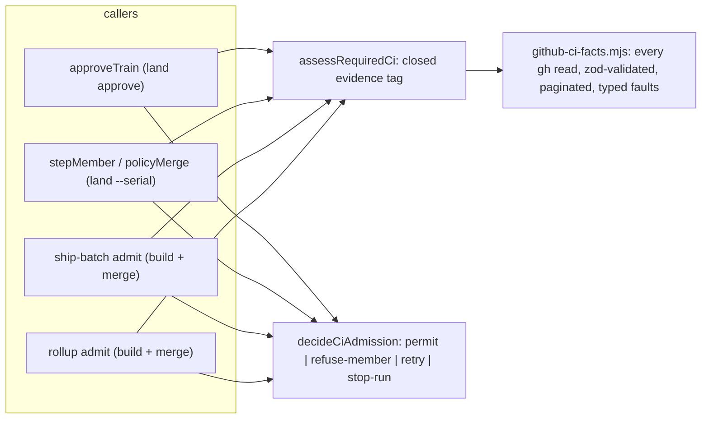

# Plan: One CI-evidence oracle for fleet landing (approve, serial, ship-batch, rollup)
- **Date**: 2026-11-19
- **Status**: Draft
- **Author**: Claude + Louis
- **Scope**: backend (js-ts). Principle set: `skills/plan/references/engineering-principles.md`.
- **Depends on**: docs/plans/ship-batch-member-outcomes.md — PR 1 of this plan re-scopes that plan's PR #395; PR 2 stacks on it.
- **Target domain(s)**: `fleet`, `tests`
- ⚠ **Cross-domain work**: `tests` is touched only through test files and fixtures. No new import edge leaves `fleet`.
- ⚠ **Untagged paths**: `.fleet.json` (repo-root config; one line added, no rule needed).

**Neighbourhood considered** (`get-neighbourhood`, k=8, 2026-11-19): one `precedent` (`above-floor-cluster`):
`main` in `scripts/ensure-branch-protection.mjs`, which sits on `scripts/lib/branch-protection.mjs`. Opened and rejected as
a reuse target: it is an admin-scoped WRITER over `GET/PUT repos/{r}/rulesets/{id}` (the ruleset definitions), while this plan
needs the read-only, non-admin `rules/branches/{b}` answer (the rules that APPLY to a branch) plus check runs. Different
endpoint, privilege and question, so the adapter is a sibling in `fleet`. The other seven candidates banded `review`.
`scripts/lib/ci-merge.mjs:272 (90c60bf2)` also reads check runs, but async and with SKIPPED/NEUTRAL counted as pass for
/ship's "every check" policy; reusing it would import the opposite rule. It is recorded as a finding, not changed here.
Incident neighbourhood: only INC-001 (sensitive-path symlinks), which does not touch these paths.

---

## 1. Context Summary

### The problem

PR #395 (`claude/ship-batch-member-outcomes-f4c9de`, head `90c60bf2`) was audited clean at `03da77a1`. Every round after that
found a NEW HIGH fail-open hole, and every one sat in the same seam: "is there CI evidence that member M may merge at head H?"

| Round | Hole (unknown read as pass) |
|---|---|
| 1 | an optional import of the verdict module whose load failure read as "nothing to check" |
| 2 | "is a verdict declared?" decided from a non-authoritative signal |
| 3 | an unreadable ruleset mapped to a member refusal instead of a run stop |
| 4 (`347a7836`, residuals in `docs/plans/ship-batch-member-outcomes.md` §"CI inventory classification") | `requiredChecks` config taken as COMPLETE when the GitHub inventory read fails; `gh pr view` JSON unvalidated (absent `isDraft` passes); fault kind classified by matching reason text |

The seam is structural. "CI evidence for M at H" is assembled at four call sites from four sources (rulesets, classic
protection, `.fleet.json`, `gh pr checks`), and each source has a fallback. Every fallback is a place where *unknown* can leave
as *pass*. Patching sites produced the next hole each round.

### Code Trace (pinned to `90c60bf2` unless marked `origin/main`)

- **The seam**: `scripts/lib/fleet/required-checks.mjs`.
  - `requiredInventory` `:100` unions rulesets, classic protection and config; `:118` returns `source:'config'` when either
    GitHub read failed and a config list exists — **the config substitutes for an unreadable inventory (H1)**. `:113` makes a
    proven-empty inventory `unknown` unless config says `[]`.
  - `parseBranchProtection` `:76` reads `protected === false` as "no classic protection". Measured below: `protected` is
    `true` on CES and WCA with no classic protection (a ruleset sets it), so this was right only by accident.
  - `observeRequiredChecks` `:193` reads `gh pr checks --json name,state,bucket,completedAt`, which carries no app identity
    and no run ids; `:206` turns stderr "no checks reported" into an empty observation (**reason-text matching**).
  - `latestByName` `:139` collapses duplicates by `completedAt`, an undocumented rule.
- **Callers on `origin/main`** (the hole is live there today, not only in #395):
  - `fleet land approve` (pr mode): `approveTrain` `scripts/lib/fleet/train-approve.mjs:224` → `verifyPrsForPlan` `:135` →
    `requiredInventory` `:140` + `observeRequiredChecks` `:155`. `missing`/`pending`/`unknown` print a plan with a WAIT
    annotation `:157`; `d.isDraft === true` `:147` lets an absent `isDraft` through.
  - `fleet land --serial`: `approveSerial` `scripts/lib/fleet/serial.mjs:613` → `runSerial` `:228` → `stepMember` wait loop
    `:441-455` → `observeRequiredChecks`; then `gh pr merge --squash --match-head-commit h` (plain `:470+`, policy `:346`).
- **Callers added by #395**:
  - `ciAndIdentityReasons` `scripts/lib/fleet/ship-batch.mjs:153` (PR view + inventory + observation, returning reason
    STRINGS) → `admitMember` `:189`, which classifies by regex on those strings `:199-200` (**M1/M3**).
  - `makeRollupPolicy` `scripts/lib/fleet/rollup-land.mjs:200` → `:215-218`.
  - Member-outcome codes: `scripts/lib/fleet/member-outcome.mjs:99` (`checks-inventory-unknown`, run scope), `:105` (`ci-refused`).
- **Merge-queue rule read**: `readRules` `scripts/lib/fleet/serial.mjs:251` reads `rules/branches/{b}` a second time, unpaginated.
- **Test seams**: `tests/helpers/fleet-serial-fx.mjs` `RULES`/`BRANCH`/`scriptedGh` (fakes in the OLD shapes: a rule with no
  `integration_id`, a branch `{protected:false}`); `tests/fixtures/fleet-serial-golden.json` (20 plain-serial scenarios
  generated from `origin/main` code); `tests/fleet-required-checks.test.mjs`.

### Measured GitHub facts (2026-11-19, `gh` 2.78.0, owner token; fixtures to be committed under `tests/fixtures/fleet/github-ci/`)

| # | Measurement | Result | Consequence |
|---|---|---|---|
| M1 | `GET repos/{r}/branches/main`, CES + WCA | `protected: true`, `protection.enabled: false`, `required_status_checks.enforcement_level: "off"`, `contexts: []`, `checks: []` | A ruleset alone sets `protected`. **Classic protection is off iff `protection.enabled === false`** (with empty contexts/checks). |
| M2 | same, AIO | `protected: false`, same `protection` block | Proven-empty classic. |
| M3 | `GET .../branches/main/protection`, all three | `404 "Branch not protected"`, even under a ruleset | Unusable. Never read. |
| M4 | `GET repos/{r}/rules/branches/main` | CES: one `required_status_checks` rule, `{context:"full-suite", integration_id:15368}`. WCA: `"Required gate"`, `"AI-Models trailer"`, both `integration_id:15368`. AIO: `[]` | Rulesets pin the app (15368 = GitHub Actions). AIO is **proven-empty**. |
| M5 | `rules/branches/no-such-branch` (CES) | **`[]`, exit 0** | "No rules" means nothing until `branches/{b}` returns 200. The branch read gates the rules read. |
| M6 | `branches/no-such-branch` | `404 Branch not found`, exit 1 | Branch existence is provable. |
| M7 | storyline (other account), both endpoints | `404 Not Found` | A 404 is also "you cannot see it". 404 is never "absent". |
| M8 | `rules/branches/main?per_page=1 --paginate --slurp` (WCA) | 4 pages, one rule each, `Link: rel="next"` | Pagination is real; `--paginate --slurp` returns an array of pages. |
| M9 | `commits/{sha}/check-runs?per_page=10 --paginate --slurp` (WCA) | 4 pages, each `total_count: 31`, lengths 10/10/10/1 | Completeness is checkable: sum of lengths == `total_count`. |
| M10 | `commits/90c60bf2/check-runs` (CES #395 head) | `full-suite` app 15368 `completed/success`; `auto-merge` `completed/skipped` | Head-SHA observation carries `app.id`, `head_sha`, `status`, `conclusion`. |
| M11 | `commits/1f0a5263/check-runs?filter=latest` (WCA) | `Dependency audit` returned twice (success 11-19, failure 11-18), different `check_suite.id` | **`filter=latest` does not collapse same-name runs across suites.** No documented resolution rule is fixture-proven, so a conflict fails closed. |
| M12 | `commits/90c60bf2/status` | `state: "pending"`, `total_count: 0` | The combined-status `state` is "pending" with zero statuses: never read it as a verdict. |

Not measurable without changing GitHub settings (not authorised): classic protection that is ENABLED, a ruleset requirement
with no `integration_id`, and an in-suite job re-run. The design treats all three as unsupported or fail-closed (§2.4).

### Consumers

No consumer's `origin/main` carries a `.fleet.json` (`wine-cellar-app`, `ai-organiser`, `storyline`, checked 2026-11-19), so
the change of `requiredChecks` meaning (§2.5) breaks no consumer config. CES's `.fleet.json` has no `requiredChecks` today.

---

## 2. Proposed Architecture

### The one design idea

**Facts, evidence and disposition are three layers, and each has ONE owner.**



- `github-ci-facts.mjs` (new) owns every GitHub read the oracle needs. It returns decoded, schema-checked facts or a
  `{fault:{kind}}`. It never classifies by stderr text (#11, #13, #15).
- `assessRequiredCi` (in `required-checks.mjs`) turns facts into ONE evidence value from a closed tag set. It never returns
  an action (#2, #5).
- `decideCiAdmission` maps a tag to ONE disposition from a fixed table. Callers map dispositions to their own effects; no
  caller inspects a tag or a reason string (#1, #5).

### 2.1 Evidence: the closed tag set

```js
assessRequiredCi({ repo, prNumber, expectedBase, expectedHead, configAssertion }, deps) → CiEvidence
```

| Tag | Meaning | Carries |
|---|---|---|
| `passed` | every required (context, app) observed `success` on `expectedHead` | `head`, `required[]` |
| `none-required` | PROVEN by successful reads: base exists, classic protection off, no required-status-check rule applies | `head`, `proof` |
| `failed` | some required check concluded failure / cancelled / timed_out / startup_failure | `head`, `names` |
| `not-run` | some required check concluded skipped / neutral / stale / action_required (it never ran green) | `head`, `names` |
| `missing` | some required check has no run from the pinned app on the head (a same-name run from another app is listed as `wrongApp`) | `head`, `names`, `wrongApp` |
| `pending` | some required check is queued / in_progress / waiting / requested / pending | `head`, `names` |
| `ineligible` | the PR is not a merge candidate at `expectedHead` | `code`: `closed` \| `merged` \| `draft` \| `retargeted` \| `head-moved` |
| `unknown` | the evidence could not be established | `fault.kind` (closed enum, §2.4), `fault.detail` |

Precedence when several required checks differ: `failed` > `not-run` > `missing` > `pending`, and the evidence lists every
name per class (the operator sees all, the tag is the worst). Any `unknown` cause anywhere makes the whole result `unknown`.
`ineligible` is decided before any CI read.

**Read order** (each step needs the previous one's success; M5 makes the order load-bearing):

1. `pr view <n> --json state,isDraft,headRefOid,baseRefName` → schema. `state != OPEN` → `ineligible closed|merged`;
   `isDraft === true` → `draft`; `baseRefName != expectedBase` → `retargeted`; `headRefOid != expectedHead` → `head-moved`.
   `isDraft` absent or not a boolean → `unknown(malformed)` (H3).
2. `api repos/{r}/branches/{b}` → schema. 404 or any failure → `unknown(transport)` (M6, M7). `protection.enabled === true`
   → `unknown(unsupported-classic-protection)`. `enabled === false` with non-empty `contexts`/`checks` →
   `unknown(malformed)` (a contradiction is not a fact).
3. `api --paginate --slurp repos/{r}/rules/branches/{b}?per_page=100` → schema per rule. Required pairs = every
   `{context, integration_id}` of every `required_status_checks` rule. A requirement with no positive-integer
   `integration_id` → `unknown(unsupported-unpinned-requirement)`.
4. Config assertion (§2.5). Mismatch → `unknown(config-drift)` with the diff.
5. No required pairs → `none-required` (steps 2 and 3 succeeded: proven, not inferred).
6. `api --paginate --slurp repos/{r}/commits/{expectedHead}/check-runs?per_page=100` → schema per run; every page's
   `total_count` equal and the sum of `check_runs` lengths equal to it, else `unknown(incomplete-pagination)`; every run's
   `head_sha === expectedHead`, else `unknown(malformed)`.
7. Per required pair: candidates = runs with `name === context && app.id === integration_id`.
   - none → `missing` (same-name runs from other apps → `wrongApp`);
   - any candidate not `completed` → `pending` (a re-run in flight);
   - all completed → classify each conclusion; one class → that class; two or more classes →
     `unknown(duplicate-conflict)` (M11); an unrecognised conclusion string → `unknown(unknown-conclusion)`.
8. Re-read step 1. Head no longer `expectedHead` → `ineligible head-moved`. Any other change → the new `ineligible` code.

Commit statuses (the legacy status API) are not read: every measured requirement pins app 15368, which only check runs can
satisfy, and a status can never satisfy a pinned requirement. An unpinned requirement is unsupported (step 3).

### 2.2 Disposition: one fixed table

```js
decideCiAdmission(evidence) → { disposition, tag, ... }
```

| Tag | Disposition |
|---|---|
| `passed`, `none-required` | `permit` |
| `failed`, `not-run`, `ineligible` (not `head-moved`) | `refuse-member` |
| `missing`, `pending`, `ineligible head-moved` | `retry` |
| `unknown` | `stop-run` |
| anything else at runtime | `stop-run` (with `fault.kind: unexpected-tag`) |

`permit` is a positive allowlist: the function returns `permit` only from the first row. A test enumerates `CI_EVIDENCE_TAGS`
and asserts the table covers each exactly once (§9).

**Change from the brainstorm synthesis, argued:** the synthesis gave the mapper a `policy` argument. No current caller needs
the table to differ: the four callers differ only in what a disposition DOES (below), which is caller effect, not
classification. A `policy` object would be a second place where `unknown` could be configured into `permit`. Dropped (YAGNI).

**What each caller does with a disposition:**

| Disposition | `land approve` (pr mode) | plain `land --serial` | ship-batch / rollup BUILD | ship-batch / rollup APPROVE + RESUME (policy serial) |
|---|---|---|---|---|
| `permit` | merge line in the plan | merge, after the merge-site re-assessment (§2.3) | member admitted | merge, after the merge-site re-assessment |
| `refuse-member` | problem → approve refused, no plan (today's unit) | `checks-failed` fault → run stops (today's unit) | member excluded, `needs-user` | outcome `refused` / `ci-refused` |
| `retry` | **approve refused, no plan** ("required checks not green yet: approve again when they are") | poll until the deadline (today); `head-moved` → re-verify from the top | member excluded, `needs-user` ("ready means CI green") | poll until the deadline → `not-run` / `checks-pending`; `head-moved` → `bump` |
| `stop-run` | approve refused, no plan, fault printed | `checks-inventory-unknown` fault → run stops | nothing built, every member `needs-user` with the fault | run stops (`checks-inventory-unknown`, run scope); merged members stay merged, resume re-asks |

**Deliberate behaviour change, approve:** today `missing`/`pending`/`unknown` print a plan with a WAIT annotation that a human
must honour (`train-approve.mjs:157`). That is a fail-open by discipline: the plan is authorised and its merge commands are
runnable. Now no plan is emitted until every PR is `permit`. The cost is re-running approve once CI is green.

### 2.3 The merge site

**Invariant: no `gh pr merge` is reachable without a `permit` from `decideCiAdmission` on evidence whose `head` equals the
`--match-head-commit` argument, assessed in the same pass immediately before the merge.**

- Plain serial: after the wait loop permits and the PR is re-read, call `assessRequiredCi` once more with
  `expectedHead = h`; only `permit` proceeds; `retry` → `AGAIN`; anything else → the table above.
- Policy serial (`policyMerge`): the same call after the existing final re-read and before the `merge` intent is written; a
  resume therefore re-assesses (stale green on resume is re-asked, never replayed).
- `--match-head-commit` takes `evidence.head` (the freshly observed head), never a recorded one.
- Head pinning freezes the CONTENT, not the POLICY: a ruleset change between assessment and merge is not caught by the pin.
  The merge-site re-assessment narrows that window to the gap between two API calls; it does not close it, and the docs say so.
- The tested-tree and provenance checks (`treeIdentity`, the base chain, `baseRefOid`) stay where they are and separate.
- `readRules` (`serial.mjs:251`, merge-queue detection) moves onto the adapter's paginated rules read, so the base's rules are
  read one way.

Enforced by a source census test (§9): the set of `'pr', 'merge'` call sites under `scripts/lib/fleet/**` is pinned, and each
is preceded in its function by an `assessRequiredCi` call; a new merge site fails the test until wired.

### 2.4 The adapter and the fault enum

`scripts/lib/fleet/github-ci-facts.mjs`:

- `readPrCandidate`, `readBranchProtection`, `readBranchRules`, `readCheckRuns` — each `(deps, cwd, args) → {ok:true, value} |
  {ok:false, fault:{kind, detail}}`.
- Transport: `deps.gh` (the existing `ghRunner` shape). **Any non-zero exit, spawn failure or timeout is `transport`**, with
  the exit status and the first stderr line kept as opaque `detail` for the operator. No branch reads stderr. There is no
  "404 means empty" (M3, M7).
- Decode: `JSON.parse` failure → `malformed`.
- Validate: zod 4 `z.object` over the DECISION fields only; unrelated extra keys tolerated (no `.strict()`, deliberately:
  GitHub adds fields). Failure → `malformed`, with the zod issue path.
- Pagination: `--paginate --slurp`, completeness checked as in §2.1 step 6. A `gh` too old for `--slurp` exits non-zero →
  `transport` (fail closed, never a single page).

`CI_FAULT_KINDS` (closed): `transport`, `malformed`, `incomplete-pagination`, `unsupported-classic-protection`,
`unsupported-unpinned-requirement`, `config-error`, `config-drift`, `duplicate-conflict`, `unknown-conclusion`,
`unexpected-tag`, `unimplemented-oracle` (PR 1 only, §3).

**Malformed decision data stops the RUN, never one member** (`unknown` → `stop-run`). A malformed answer says something about
the tooling or GitHub, not about the member.

### 2.5 Authority, and what `.fleet.json` `requiredChecks` now means

GitHub defines what is required. Config never substitutes for an unreadable inventory, and there is no union.

| `requiredChecks` | Old meaning (`config.mjs:109`) | New meaning |
|---|---|---|
| absent | not declared (proven-empty → `unknown`) | no assertion: GitHub's answer stands; proven-empty → `none-required` → `permit` |
| `[]` | "this repo requires none" (vouched) | assert GitHub requires none; GitHub requires some → `config-drift` |
| `["a","b"]` | unioned with GitHub; substitutes when GitHub is unreadable | assert the set of required contexts equals exactly `{a,b}`; mismatch → `config-drift` with the diff |
| unloadable | `unknown` | `unknown(config-error)` |

**CES's `.fleet.json` gains `"requiredChecks": ["full-suite"]`** (decision 6). If `main`'s ruleset ever stops requiring
`full-suite`, every CES landing stops with `config-drift` instead of proceeding on `none-required`. The tier caveat of
`docs/plans/ship-batch-member-outcomes.md` (the required check must BE the full run) is unchanged and still stated there.

### 2.6 Execution model

Each assessment is a read-only chain of five to seven `gh` calls with a strict order (§2.1); a failure at any step ends the
chain as `unknown`. Assessments of different members are independent and run serially, as the callers already iterate. No
assessment writes state; the callers record dispositions exactly where they record outcomes today (#14). A read is
idempotent, so a resume simply re-assesses (#13).

### 2.7 Scope and split: two PRs (decision 10)

**PR 1 = #395 re-scoped: the member-outcome / serial / rollup core, with ship-batch and rollup UNABLE to merge.**
- `ship-batch.mjs` and `rollup-land.mjs` stop calling `requiredInventory`/`observeRequiredChecks` and the reason-string
  `ciAndIdentityReasons`/`admitMember` regex classification. They call `deps.assessCi` (default: an `unimplementedOracle`
  returning `unknown(unimplemented-oracle)`) and `decideCiAdmission`. In production every build excludes all members and every
  approve/resume stops at RUN scope before any merge, naming this plan.
- `decideCiAdmission`, `CI_EVIDENCE_TAGS` and `CI_FAULT_KINDS` land in PR 1 (pure, small, exhaustively tested), so PR 1's
  admission path is already the final shape and PR 2 changes only the default oracle and the two main-era callers.
- The core's tests inject `deps.assessCi` with fixed evidence to exercise the merge path; the production default cannot merge.

**PR 2 = the oracle**: the adapter, `assessRequiredCi`, and the rewiring of `land approve` and plain `land --serial` (main-era
callers), plus the default `deps.assessCi` for ship-batch/rollup.

**Why the split is honest here:** PR 1 does not widen anything on `main`. `land approve` and plain serial carry the H1
fail-open on `main` already (§1 Code Trace) and #395 changes neither's CI path (the golden test pins plain serial
byte-identical). The split keeps the 9.7k-line core's converged audit separate from a new seam, so PR 2's audit reads only the
seam (~6 files) instead of resetting audit on everything; and PR 2 fixes a pre-existing `main` defect with its own blast
radius, which belongs in its own PR. **The cost, stated:** between the two merges `main` carries `--ship-batch` and
`--rollup` commands that always refuse, and the docs must say so. If Louis prefers one PR, Phase 1 is simply not split off and
the phases run on one branch; nothing else changes.

**Mechanics:** Phase 1 commits are made on this branch first. The coordinator decides whether they reach #395 by fast-forward
of `claude/ship-batch-member-outcomes-f4c9de` (it pushes CES branches). PR 2 is this branch, opened only on the coordinator's
turn, targeting #395's branch until #395 merges, then `main`.

### Right-sizing

- **Band-aid**: a fifth fallback: schema-check `isDraft`, return a `kind` from `ciAndIdentityReasons`, refuse when config and
  GitHub disagree. Each closes one cited hole and leaves four sources with fallbacks; round 5 finds the sixth.
- **Over-built**: a persisted evidence ledger (per member, per head, per assessment), or a policy engine that lets a repo
  configure which tags permit. Neither serves a current requirement; the ledger adds a second record (F2 of #395 again), and a
  configurable `permit` is exactly the hole being closed.
- **Chosen**: one read-only adapter, one pure evidence function, one fixed table, and one merge-site rule. It serves the
  current requirement (four callers must not merge on unknown) and nothing else. No new persisted state, no config surface
  beyond narrowing `requiredChecks` to an assertion.

---

## 6. Sustainability Notes

- **Assumptions that could change:** GitHub adds a field (tolerated: schemas cover decision fields only); GitHub adds a new
  check conclusion (→ `unknown-conclusion`, stop-run, visible); a repo adopts classic protection or an unpinned requirement
  (→ a clear unsupported stop naming the fix: pin the integration in a ruleset). Each is a loud stop, never a silent pass.
- **Extension point:** supporting classic protection or statuses later is one more adapter reader plus fixtures; the tag set
  and the table do not change.
- **Seam:** `deps.assessCi` is the one injection point; production never sets it.

## 7. File-Level Plan

- `scripts/lib/fleet/github-ci-facts.mjs` (create) — `readPrCandidate`, `readBranchProtection`, `readBranchRules`,
  `readCheckRuns`, the zod schemas, `CI_FAULT_KINDS`' transport/malformed/pagination members. Imports `zod`, `gh-facts.mjs`
  (`spawnGh` via `ghRunner`). Imported by `required-checks.mjs`. (#2, #11, #13)
- `scripts/lib/fleet/required-checks.mjs` (modify) — PR 1: add `CI_EVIDENCE_TAGS`, `CI_FAULT_KINDS`, `decideCiAdmission`,
  `unimplementedOracle`, `describeEvidence`. PR 2: add `assessRequiredCi`; delete `requiredInventory`,
  `observeRequiredChecks`, `requiredChecksVerdict`, `parseRulesInventory`, `parseBranchProtection`, `parseChecksJson`,
  `latestByName`, `CHECKS_FIELDS`, `VERDICTS`, `MERGEABLE`, `describeVerdict` (no caller left; knip would flag them). (#5)
- `scripts/lib/fleet/ship-batch.mjs` (modify) — PR 1: admission via `deps.assessCi` + `decideCiAdmission`; delete
  `ciAndIdentityReasons` and the regex in `admitMember`. PR 2: default `deps.assessCi` = `assessRequiredCi`.
- `scripts/lib/fleet/rollup-land.mjs` (modify) — the same change in `makeRollupPolicy` `:215-218`.
- `scripts/lib/fleet/member-outcome.mjs` (modify) — PR 1: keep `checks-inventory-unknown` (run scope) and `ci-refused`; add
  nothing unless the table needs a code it lacks (checked in Phase 1).
- `scripts/lib/fleet/train-approve.mjs` (modify, PR 2) — `verifyPrsForPlan` uses the oracle; `retry` and `stop-run` refuse
  the approve; its own state/draft/base/head checks are removed (the oracle's `ineligible` owns them); the `baseRefOid`
  provenance check stays.
- `scripts/lib/fleet/serial.mjs` (modify, PR 2) — wait loop and both merge sites per §2.3; `readRules` via the adapter;
  `requiredChecks`/`requiredChecksError` become the `configAssertion` argument.
- `scripts/lib/fleet/config.mjs` (modify, PR 2) — the `requiredChecks` comment `:109` states the new meaning (§2.5).
- `.fleet.json` (modify, PR 2) — `"requiredChecks": ["full-suite"]`.
- `tests/fixtures/fleet/github-ci/*.json` (create, PR 2) — the M1-M12 recordings, each with a provenance header
  (repo, endpoint, date, command).
- `tests/fleet-github-ci-facts.test.mjs` (create, PR 2) — adapter tests over the recorded fixtures.
- `tests/fleet-required-checks.test.mjs` (modify) — PR 1: the exhaustive tag/table test; PR 2: `assessRequiredCi` per tag.
- `tests/fleet-ci-admission.test.mjs` (create, PR 2) — decision 9 (§9).
- `tests/fleet-merge-site-census.test.mjs` (create, PR 2) — §2.3 census.
- `tests/helpers/fleet-serial-fx.mjs` (modify, PR 2) — `RULES`/`BRANCH`/`scriptedGh` in the recorded shapes, answering
  check-runs by sha.
- `tests/fixtures/fleet-serial-golden.json` (modify, PR 2) — regenerated deliberately; only CI-read scenarios may change, and
  the change list goes in the Implementation Log.
- `tests/fleet-land-ship-batch.test.mjs`, `tests/fleet-rollup.test.mjs` (modify) — PR 1: inject `deps.assessCi`; add the
  stub row (production default refuses at run scope, zero merges).
- `tests/fleet-serial.test.mjs`, `tests/ship-train-recovery.test.mjs`, `tests/fleet-cli-approve.test.mjs` (modify, PR 2) —
  fakes move to the new shapes; approve WAIT expectations become refusals.
- `skills/fleet/references/ship-batch.md`, `skills/fleet/references/landing.md`, `skills/fleet/SKILL.md` (modify) — PR 1:
  "ship-batch and rollup cannot merge until the CI-evidence oracle lands"; PR 2: the evidence/disposition contract, the
  `requiredChecks` assertion, the unsupported shapes. `.claude/skills/fleet/**` regenerated, never hand-edited.
- `docs/plans/ship-batch-member-outcomes.md` (modify, PR 1) — residuals H1/H2/H3/M1/M3 marked "moved to
  docs/plans/ci-evidence-oracle.md".

### 7b. Implementation Phases

**Phase 1 — PR 1: stub the oracle at the ship-batch/rollup seam**: tags, fault kinds, the fixed table and the stub in
`required-checks.mjs`; ship-batch and rollup admit through `deps.assessCi` + `decideCiAdmission`; the reason-string
classification deleted; tests inject evidence; docs say the commands cannot merge. Files:
scripts/lib/fleet/required-checks.mjs (modify), scripts/lib/fleet/ship-batch.mjs (modify),
scripts/lib/fleet/rollup-land.mjs (modify), scripts/lib/fleet/member-outcome.mjs (modify),
tests/fleet-required-checks.test.mjs (modify), tests/fleet-land-ship-batch.test.mjs (modify), tests/fleet-rollup.test.mjs
(modify), skills/fleet/references/ship-batch.md (modify), skills/fleet/SKILL.md (modify),
docs/plans/ship-batch-member-outcomes.md (modify).

**Phase 2 — the GitHub-facts adapter and fixtures**: the four readers, schemas, pagination and transport faults over the
recorded fixtures. Files: scripts/lib/fleet/github-ci-facts.mjs (create), tests/fixtures/fleet/github-ci/ces-branch-main.json
(create), tests/fixtures/fleet/github-ci/ces-rules-main.json (create), tests/fixtures/fleet/github-ci/wca-rules-main.json
(create), tests/fixtures/fleet/github-ci/aio-branch-main.json (create), tests/fixtures/fleet/github-ci/wca-rules-paged.json
(create), tests/fixtures/fleet/github-ci/wca-check-runs-paged.json (create), tests/fixtures/fleet/github-ci/ces-check-runs-395.json
(create), tests/fixtures/fleet/github-ci/wca-check-runs-duplicate.json (create), tests/fleet-github-ci-facts.test.mjs (create).

**Phase 3 — the evidence function**: `assessRequiredCi` per §2.1, the config assertion per §2.5, old exports deleted only
after Phase 4 removes their callers (Phase 3 adds; Phase 4 deletes). Files: scripts/lib/fleet/required-checks.mjs (modify),
tests/fleet-required-checks.test.mjs (modify).

**Phase 4 — rewire the four callers and the merge sites**: approve, plain and policy serial (§2.3), the ship-batch/rollup
default, `readRules`, the config comment, CES's assertion, the shared fakes and the golden regeneration. Files:
scripts/lib/fleet/train-approve.mjs (modify), scripts/lib/fleet/serial.mjs (modify), scripts/lib/fleet/ship-batch.mjs
(modify), scripts/lib/fleet/rollup-land.mjs (modify), scripts/lib/fleet/config.mjs (modify), scripts/lib/fleet/required-checks.mjs
(modify), .fleet.json (modify), tests/helpers/fleet-serial-fx.mjs (modify), tests/fixtures/fleet-serial-golden.json (modify),
tests/fleet-serial.test.mjs (modify), tests/ship-train-recovery.test.mjs (modify), tests/fleet-cli-approve.test.mjs (modify).

**Phase 5 — the admission test, the census and the docs**: decision 9's fixture-driven test through the real entry points,
the merge-site census, the operator docs. Files: tests/fleet-ci-admission.test.mjs (create),
tests/fleet-merge-site-census.test.mjs (create), skills/fleet/references/landing.md (modify),
skills/fleet/references/ship-batch.md (modify), skills/fleet/SKILL.md (modify).

**Close-out (not a phase)**: `npm run skills:regenerate`, `npm run skills:check`, `npm run bundle:deps` (the new module
enters the consumer closure) + `npm run bundle:deps:check`, `npm run guards:preflight`, the fleet + ship-record suites.

## 8. Risk & Trade-off Register

- **Approve is stricter** (§2.2): an operator re-runs approve after CI finishes. Accepted: the WAIT plan was authorised and
  runnable while unproven.
- **Duplicate-conflict stops the run** (M11): a repo whose required workflow runs on two events (push + pull_request) with
  different results stops until it is re-run or fixed. Fail closed until a fixture proves GitHub's own resolution rule;
  recorded as a follow-up measurement (an in-suite re-run fixture needs a CI run, which costs a runner slot).
- **Classic protection and unpinned requirements are unsupported**: no current repo uses either (M1, M4). Supporting them
  needs a fixture recorded on a repo that has them, which needs a GitHub settings change (Louis's).
- **Policy is not frozen by the head pin** (§2.3): the window is narrowed, not closed. A server-side merge queue would close
  it and is a GitHub setting; already tracked as proposal `p-20261118092842`.
- **More API calls per member** (two assessments of five to seven reads): ~14 calls per member, well inside the 5000/h limit
  for batches of tens.
- **Golden regeneration** could hide an unrelated drift: the regeneration diff is reviewed scenario by scenario and only
  CI-read scenarios may change (Phase 4 records the list).
- **Deferred**: `scripts/lib/ci-merge.mjs` counts SKIPPED/NEUTRAL as pass (finding, out of scope: /ship's tool, not fleet).

## 9. Testing Strategy

- **Unit, adapter** (`tests/fleet-github-ci-facts.test.mjs`): each recorded fixture decodes to the expected facts; mutated
  copies (field removed, wrong type, a page dropped, `total_count` off by one, a non-zero exit with a 404 body) each yield the
  named fault, and no branch reads stderr (a test feeds an identical stderr with exit 0 and exit 1 and expects different
  results only by exit).
- **Unit, evidence + table** (`tests/fleet-required-checks.test.mjs`): one case per tag and per fault kind; the table test
  iterates `CI_EVIDENCE_TAGS` and asserts exactly one disposition each, that only `passed`/`none-required` permit, and that an
  unlisted tag returns `stop-run`.
- **Integration, decision 9** (`tests/fleet-ci-admission.test.mjs`): a scenario describes GitHub (branch, rules pages, check
  runs, PR views over time); the fake `gh` answers BOTH the `90c60bf2` read shapes (`pr checks --json`, unpaginated rules) and
  the new ones from the same scenario, so every row runs against both seams. Entry points: `approveTrain`, `approveSerial`,
  `approveShipBatch`, `resumeShipBatch`, `approveRollup`. For every non-permitting row: the exact disposition, **zero `pr
  merge` calls**, and for approve no plan. Positive controls: CES-shaped ruleset pass and AIO proven-empty both PERMIT and
  merge once, so an always-refuse implementation fails.

  Rows: classic-only (enabled) · ruleset-only · mixed (ruleset + classic enabled) · proven-empty · ambiguous 404 (rules `[]`
  + branch 404, M5) · 403 on rules · config drift (`["full-suite"]` vs ruleset `["full-suite","lint"]`) · incomplete
  pagination (required check on page 2; `total_count` short) · `isDraft` missing · skipped · neutral · wrong app (same name,
  app 999) · duplicate runs (success + failure, M11) · head moved mid-observation · stale green on resume (green at assessment
  1, failed at the merge-site re-assessment).

- **Census** (`tests/fleet-merge-site-census.test.mjs`): every `'pr', 'merge'` site under `scripts/lib/fleet/**` is in the
  pinned list and preceded in its function by `assessRequiredCi`; a planted merge call in a temp copy fails it (negative
  control).
- **Regression**: golden 20/20 (regenerated per §8), `fleet-serial`, `ship-train-recovery`, `fleet-land-ship-batch`,
  `fleet-rollup`, `fleet-cli-approve`, all fleet + ship-record suites.

### Proof plan

| Behaviour change | Oracle | Pass condition | Report evidence |
|---|---|---|---|
| No merge on unknown/missing/pending/failed evidence, in all four callers | `tests/fleet-ci-admission.test.mjs` rows run against `90c60bf2` and against the head | every row that is fail-open at `90c60bf2` is red there (a merge call or a plan) and green at the head; every row asserts zero merges | per-row table: red@90c60bf2 / green@head, merge-call counts, test count |
| The oracle permits what it should | the two positive controls | both permit and merge exactly once at head | the same table |
| Facts come only from proven signals | recorded fixtures M1-M12 | adapter tests pass on the recordings; each mutation yields its named fault | fixture provenance lines (repo, endpoint, date) |
| Every merge site is gated | census test + its planted negative control | census green at head; planted site red | census output |
| PR 1 cannot merge in production | the stub row in `fleet-land-ship-batch` / `fleet-rollup` | default deps: run-scope stop, zero merges | test names + counts |

## 11. Execution Clustering

- **Cluster A** — Phases 1-1 — fix-gate: yes
  - Coupling: PR 1 alone; the ship-batch/rollup admission seam and the pure table it calls, which PR 2 builds on.
- **Cluster B** — Phases 2-3 — fix-gate: yes
  - Coupling: the adapter's facts and the evidence function that consumes them share the fault enum and the read order (§2.1); auditing them apart would hide the seam where a fact becomes a tag.
- **Cluster C** — Phases 4-5 — fix-gate: final
  - Coupling: rewiring the callers and the test that drives those same callers through their real entry points; the census pins the merge sites Phase 4 edits.
- **Final gate**: the consolidated Gemini review over the union diff of Clusters B and C (PR 2); Cluster A's union diff is reviewed as PR 1's final gate before it is handed to the coordinator.

## Audit trail

(filled by /audit-plan)

## Implementation Log

(filled during implementation)
