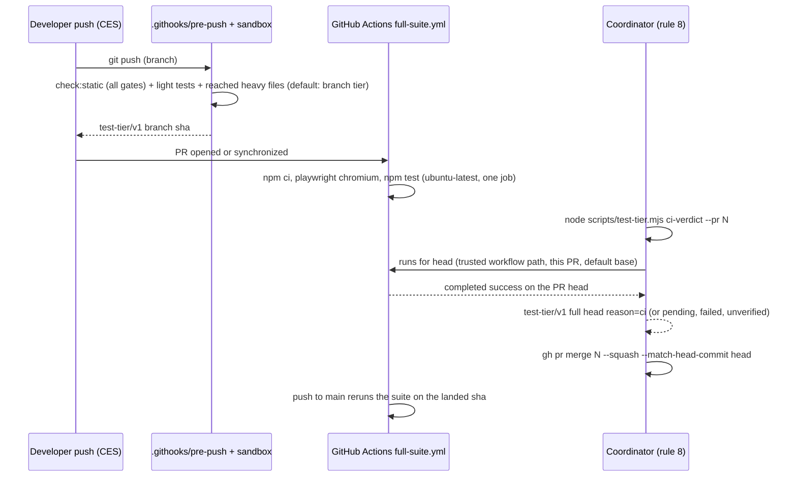

# Plan: CES full suite on GitHub Actions, light local pre-push
- **Date**: 2026-10-14
- **Status**: Approved
- **Author**: Claude + Louis
- **Scope**: backend (one workflow, the pre-push tier default, one verdict reader, one guard test, coordination text; no UI) · stack `js-ts` (`detect-stack`: `js-ts`)
- **Target domain(s)**: `scripts`, `shared-lib`, `skills-content`
- ⚠ **Cross-domain work** — touches `scripts` (CLIs), `shared-lib` (`scripts/lib/**`) and `skills-content` (`skills/fleet/references/**`); the seam is the `test-tier/v1` summary line, which already crosses all three.
- ⚠ **Untagged paths**: `.github/workflows/full-suite.yml`, `.test-tiers.json` — no rule in `.audit-loop/domain-map.json`; both are config, not code.
- **Depends on**: docs/plans/gate-cost-slice-2.md — stages 0 and 1 (Complete, #241); this plan is its stage 2, **for CES only**.
- **Depends on**: docs/plans/skill-markdown-size-ratchet.md — PR #245 splits `skills/fleet/references/coordination.md`; the rule-8 text edit lands on top of it (wait for #245 to merge first).

Origin: Louis's decision of 2026-10-14. CES is a **public** repository, so GitHub-hosted standard runners cost nothing for it: Actions usage is free for "public repositories that use standard GitHub-hosted runners" (docs.github.com/en/billing/concepts/product-billing/github-actions). Move CES's one full test run per PR off the shared machine (which also runs wine's and storyline's gates and CI) onto GitHub Actions, and make the CES local pre-push the light branch tier. Wine and storyline stay local-first; **no consumer's hook behaviour changes.** Inspiration: Anthropic's "redesigning source control" post, which drops the global lock in front of merges in favour of testing outside it.

## 0. Hard constraints (budget, from Louis via the coordinator, 2026-10-14)

| # | Constraint | How the plan honours it |
|---|---|---|
| B1 | **Standard GitHub-hosted runners only** (`ubuntu-latest` / `windows-latest`); never larger runners, which are billed even on public repos | the workflow names one standard label; a test fails on any other `runs-on` label in any workflow (§2.6) |
| B2 | **No uploaded artifacts; minimal or no `actions/cache`** (storage billing for public repos is not clearly free) | the workflow has no `upload-artifact` step and no cache (`setup-node` without `cache:`); the §2.6 test also fails on `actions/upload-artifact` or `actions/cache` in `full-suite.yml` |
| B3 | **Concurrency groups with cancel-in-progress** | `concurrency: {group: full-suite-${{ github.ref }}, cancel-in-progress: true}` |
| B4 | **State that CES is public and cite the docs line** | the Origin paragraph above; `gh repo view --json visibility` reads `PUBLIC` (measured 2026-10-14) |

## 1. Context Summary

### 1.1 The problem, measured

*measured* = a command was run and its output is quoted; *derived* = arithmetic on measured rows; *expected* = a forecast.

| # | Fact | Figure | Label · source |
|---|---|---|---|
| F1 | One full local pre-push gate on CES | **1,153 s** total, test step 962 s, on a 32-thread machine at 84% CPU average | measured 2026-10-13 · gate-cost-slice-2.md M1 |
| F2 | What a CES PR's only full-suite run costs the shared machine | the whole of F1: PR CI does not run the suite (`postgres-parity.yml` is path-filtered to DB code); `release.yml` runs `npm test` only on a `v*` tag and **has never run** (`gh run list --workflow release.yml` → `[]`) | measured 2026-10-14 |
| F3 | The machine is shared | the heavy slot was HELD by storyline's gate when this plan started (`fleet lease status`, 09:30Z) | measured 2026-10-14 |
| F4 | Branch protection on `main` | none: `gh api …/rulesets` → `[]`; `…/branches/main/protection` → 404 "Branch not protected" | measured 2026-10-14 |
| F5 | Static gates in CI | `npm run check:static` on `ubuntu-latest` fails in 18 s at its first gate (`docs:refs`): ~40 references to gitignored files (`scripts/.sync-owned.json`, `scripts/lib/consumer-repos.local.json`, …) that the local sandbox provisions and a fresh clone lacks | measured 2026-10-14 · run on `archive/ci-measure-2` |
| F6 | Full suite on GitHub runners | see §1.4 (Q1) | measured 2026-10-14 |

### 1.2 Code Trace (all `(4b145e90)`)

- `.githooks/pre-push:407-421` passes `--tier "$AUDIT_PREPUSH_TIER"` only when the variable is set, `--pushes-default` when the push updates `main`, and a `--summary-file`; `:429-448` turns the one `test-tier/v1` summary line into the success label. Wired by `core.hooksPath` (`scripts/install-git-hooks.mjs`), **CES only**.
- `scripts/prepush-check.mjs` → `runTieredChecks` (`scripts/lib/prepush-tier.mjs:47`): `check:static`, then `node scripts/test-tier.mjs plan --head … [--tier] [--pushes-default]`, then `run-tests.mjs --tier-skip` (branch) or `npm test` (full). Any selector failure runs the full suite (`:96-101`).
- `scripts/test-tier.mjs:95` `cmdPlan` parses `.test-tiers.json` at the head (`parseHeavyList`, `scripts/lib/test-tier.mjs:76`) and calls `selectTier` (`:219`). `effective = raw ?? DEFAULT_BRANCH_TIER` (`:222`), `DEFAULT_BRANCH_TIER = 'full'` (`:31`). `envelopeMatchesRequest` (`:310`) rejects a `branch` envelope unless the raw request was `branch`.
- `.githooks/pre-push:453-488` §1.5 warns (never blocks) when the latest `postgres-parity.yml` run on `main` is red.
- **Consumers:** the hook consumers get is a different, generated body (`scripts/install-prepush-hook.mjs`, the `/audit-code`-on-draft-plans hook). `getSyncClosure()` (`scripts/lib/sync-inventory.mjs`) contains none of `prepush-check`, `test-tier`, `prepush-tier`, `run-tests` or `.githooks` (measured 2026-10-14). `.test-tiers.json` is not synced. So **a default keyed on `.test-tiers.json` cannot reach a consumer**, and that is asserted by a test (§9).
- `skills/fleet/references/coordination.md:291-312` rule 8 (pre-#245 text): "merge only a sha whose output carries a `test-tier/v1 full <sha>` line: push the candidate with `AUDIT_PREPUSH_TIER=full`, or … `prepush-check.mjs --tier full --head <sha>`". After #245 the rule is one sentence and the recipe lives in `coordination-rationale.md`.
- `.github/workflows/dependabot-auto-merge.yml:44-51` merges a Dependabot PR after `gh pr checks --watch --fail-fast`; it will wait for the new check too, which is the intended effect.

### 1.3 Neighbourhood considered

`get-neighbourhood` over `scripts/lib/test-tier.mjs`, `scripts/lib/prepush-tier.mjs`, `scripts/lib/fleet/train.mjs`, intent "read a GitHub Actions check-run conclusion for a commit sha and map it to a full-suite merge verdict": top hit `classifyMitigation` (`scripts/security-memory/incident-status.mjs`, band `precedent`, above-floor-cluster) and `ruleStatus` (`scripts/lib/efficacy-lints.mjs`, `review`). Opened: both map a tool result to a status enum for an unrelated subject (semgrep runs, lint rules); neither reads GitHub. **Sibling, not reuse**: the shape (an exhaustive status map where absence is never green) is copied, the code is not shared. `get-incident-neighbourhood` returned **INC-002** (destructive DB tests run against a production DSN): the workflow sets no `AUDIT_DB_URL` / `AUDIT_DB_TEST_URL` and no secrets at all, so the DB-gated suites skip themselves in CI exactly as in a local `npm test` (§ Security Considerations).

### 1.4 Q1 — which OS (measured)

Measured by pushing a throwaway `archive/ci-measure-1` branch through the hook's archive lane (scan-only, so no local heavy job) carrying a temporary matrix workflow: `npm ci`, global git identity, `npm test`, on both standard runners at once. Head `4b145e90` plus the workflow. Run: https://github.com/Lbstrydom/claude-engineering-skills/actions/runs/38543195026.

| Runner | Machine | `npm test` wall | Result | Label |
|---|---|---|---|---|
| `ubuntu-latest` | 4 vCPU, 16 GB, Node v22.23.3 | **563 s** (`# duration_ms 562830`); job 9 min 38 s including setup | 20,088 tests, 19,975 pass, **40 fail in 14 files**, 73 skipped | measured |
| `windows-latest` | 4 vCPU | **1,595 s** (`# duration_ms 1594877`); job 27 min 35 s | 20,091 tests, 19,971 pass, **47 fail in ~18 files** (the 4 E files, durable-write, learning-store, finalize-shadow-eval, plus Windows-runner-only failures: `doctor` context, env-path discovery, node_modules provisioning, worktree anchoring, `ship-commit` guards, `sync-pr` on real git, extract determinism) | measured |
| local (reference) | 32 threads, shared, 84% CPU | 962 s test step, 1,153 s whole gate | green | measured 2026-10-13 (F1) |

The 14 ubuntu failures, classified by reading each failing subtest's diagnostics and its source (`4b145e90`):

| Class | Files | What | Fix |
|---|---|---|---|
| **P** platform (assumes Windows) | `tests/check-cli-flags.test.mjs`, `tests/check-npm-run-args.test.mjs` | `new URL(import.meta.url).pathname.replace(/^\//, '')` turns `/home/runner/…` into a relative path | `fileURLToPath(import.meta.url)` |
| P | `tests/fleet-handover.test.mjs` (via `tests/helpers/fleet-repo.mjs`) | `scrubbedEnv` replaces every PATH dir holding `gh` with a git+node shim; on ubuntu `gh` lives in `/usr/bin`, so `sh` disappears | put `sh` in the shim; assert `status === 1`, not `!== 0` (the "missing worktree" half passed vacuously on `null`) |
| P | `tests/plan-path-validation.test.mjs` → `scripts/lib/store/plans.mjs` | `C:/Users/…` is relative on POSIX, so `validatePlanPath` accepts it | reject `^[A-Za-z]:[\\/]` explicitly (a real fix: a Linux consumer would store the row) |
| P | `tests/runner-probe.test.mjs` → `scripts/lib/runner-probe.mjs` | host `path.join` on a `\\wsl$\…` root ignores the injected `platform: 'win32'` | `path.win32` for injected-win32 / UNC roots |
| P | `tests/prepush-hook-fail-closed-on-signal.test.mjs` (consumer hook, SIGTRAP) | `/bin/sh` is dash on ubuntu; dash's `kill -l TRAP` errors on a name, so the consumer hook's L1 block leaves the XSI signals untrapped. The push is still refused; only the message assertion fails | **the hook is not changed here**: the fix is in the consumer hook body, which this plan must not change. The case is split: the **push-refusal assertion** (what the remote received) stays enabled on every platform; only the **diagnostic-message assertion** is `{skip: <finding id>}` when `/bin/sh` is dash (detected, not "non-Windows"). The defect goes to `fleet propose` (§8) (R1 M4) |
| **E** environment (CI lacks it) | `tests/arm-generation.test.mjs` | "pure" tests build a real OpenAI client, which throws without `OPENAI_API_KEY` | `scripts/lib/model-eval/arm-generation.mjs` gains an injected client factory (`{createClient}` option, the existing `createOpenAIClient` / `createOpenRouterClient` as production defaults; today `resolveGenerationClient` calls them directly, `:91`, `4b145e90`). Construction happens after the route check, so an unsupported transport still refuses before any client exists; the pure cases pass a factory spy and assert it was or was not called, with no credentials in the environment. Never a dummy key in the workflow (R1 M2) |
| E | `tests/solo-control-egress.test.mjs` → `scripts/solo-control-audit.mjs` | clients are built before the refusals under test, so a missing key masks the refusal the test claims fires "with no client" | construct clients after the per-commit policy check and the adapter check |
| E | `tests/finalize-shadow-eval.test.mjs` | a "real DB" case has no DSN gate; with the store off the function returns `{ok:true, cloud:false}` before the check under test | skip with a reason when the store is off (the suite's other DB cases already do) |
| E | `tests/visual-extract.test.mjs` | deliberate: "Chromium missing in CI — extract integration test must run" | the workflow installs Chromium (`npx playwright install chromium`, no cache, B2) |
| **D** defect the run exposed | `tests/durable-write.test.mjs` | hardcoded `cwd: 'C:/GIT/claude-engineering-skills'`: from a worktree it imports the MAIN checkout's module, so it tests the wrong code even on Windows | derive the repo root |
| D | `tests/learning-store-phase1.test.mjs` | asserts `ok:false` for cloud-off; the code returns `{ok:true, applied:false}` (cloud-off is a supported mode, AGENTS.md "skipped"). With the cloud on, each test returned early and read as a pass, so the stale assertion had never run | assert the current contract; replace early `return` with `{skip}` |
| D | `tests/stage1-triage-dto.test.mjs` → `scripts/lib/audit/stage1-triage.mjs` | a 750-char token makes `realpathSync` throw `ENAMETOOLONG` on Linux, which fails closed to `[REDACTED]`; two cases `return` early on Windows and had never run | separate **lexical path candidacy** from filesystem resolution: a token that is not path-shaped (no `/` or `\`, no drive-letter or UNC prefix, no `~`) is not probed with `realpathSync` at all; a path-shaped token that cannot be resolved, for any reason including `ENAMETOOLONG`, stays fail-closed exactly as today. Tests: a 750-char ordinary token passes unredacted; overlong absolute, drive-letter and UNC paths stay redacted; the sensitive-path and secret classifications are unchanged. Create the fixtures the two never-run cases need; `{skip}` instead of `return` (R1 M3) |
| D | `tests/subprocess.test.mjs` | a voided promise rejects after its test ends (the script it spawns was already unlinked), failing the file; `return`s early on Windows, so it never ran there | await and assert the rejection |

**Decision: `ubuntu-latest`.** It runs the suite in 563 s on 4 vCPUs, faster than the shared 32-thread machine's 962 s, and 2.8x faster than `windows-latest` (1,595 s). The 14 failures are all understood. 13 get a real fix (5 touch production code: `plans.mjs`, `runner-probe.mjs`, `solo-control-audit.mjs`, `stage1-triage.mjs`, `arm-generation.mjs`), and 1 keeps its push-refusal assertion but skips one diagnostic assertion under dash, because the fix belongs to the consumer hook. Windows would not have avoided the work: it failed more files (~18), including the same 4 E files and 3 of the D files, plus failures specific to a `D:\a\…` runner checkout.

**The Windows coverage contract (R1 M5).** Ubuntu CI does not exercise Windows-only behaviour (Git Bash, `.cmd` shims, `pwd -W`, CRLF). What still runs on Windows, locally, on every CES push in the branch tier: the static gates, **every light file** (944 of 992), and **every heavy file the diff reaches**. Reach is a property of the diff, not of the platform, so a heavy file the diff cannot reach runs the same code on Windows as before the change; its Windows behaviour cannot have regressed through that diff. The residual gap is exactly the tier's known blind spots (`blind` in the envelope: a non-literal `import()` inside `scripts/**`, slice-2 §13 item 9) **on Windows**. Before this plan, the merge candidate's local full run covered them on Windows; after it, CI covers them on ubuntu only. Accepted, with two backstops: any push that touches `package.json`, the selector or `.githooks/**`, or pushes `main`, is still full on Windows; and **a Windows CI leg is added** (a second matrix entry and a second required context, both free under B1) the first time a Windows-only failure is found on `main` that a full local run would have caught. That trigger is recorded in §6.

**Static gates stay local (F5).** `check:static` cannot run in a fresh clone: the sandbox provisions gitignored inputs (`provisionArtifacts`, `scripts/prepush-check.mjs`) that CI does not have. CI therefore carries the **test suite**, and every local push, in either tier, carries the **static gates**.

## 2. Proposed Architecture

### 2.1 The flow



### 2.2 Decisions

| # | Decision | Principle |
|---|---|---|
| D1 | **One workflow, one job, one check name**: `.github/workflows/full-suite.yml`, job id and name `full-suite`. Triggers `pull_request` (no path filter: every PR) and `push` to `main`. `concurrency: {group: full-suite-${{ github.ref }}, cancel-in-progress: true}`: a new push to a PR cancels the superseded run (the PR ref is `refs/pull/N/merge`, so PRs never cancel each other). `permissions: contents: read`; `persist-credentials: false`; no secrets; `timeout-minutes: 30` (3x the measured job). Steps: checkout (`fetch-depth: 0`, the shape that was measured; a shallow clone was not tried), `setup-node` 22 **without** `cache:`, global git identity, `npm ci`, `npx playwright install chromium`, `npm test` | B1–B3, #4 no hardcoding of a second test command: CI runs the same `npm test` (`scripts/run-tests.mjs`, the same false-green guard) |
| D2 | **The CES-only default is committed data in `.test-tiers.json`**, the file only CES has: `"defaultTier": "branch"` plus `"ciVerdict": {"workflow": ".github/workflows/full-suite.yml"}`. `HeavyListSchema` gains both as optional fields and a refinement: `defaultTier: "branch"` **requires** `ciVerdict`. `DEFAULT_BRANCH_TIER` in code stays `'full'`, so any tree without the field (a head that predates this plan, any future adopter) behaves exactly as today. Consumers have neither the file nor the tier code (§1.2), and a test asserts the sync closure contains neither (§9) | #5 single source of truth; #18 backward compatibility; "no hardcoded repo name in a shared body" (launch brief) |
| D3 | `selectTier` resolves the request in one place: `effective = raw ?? list.defaultTier ?? DEFAULT_BRANCH_TIER`, and records `defaultSource: 'list' or 'code'` in the envelope. **New content escape `ci-verdict-missing`**: when the default (not an explicit request) is `branch` and the head's tree lacks `ciVerdict.workflow`, the tier is `full`. A light local push is only the default where the CI that supplies the full verdict exists in the same tree. An explicit `AUDIT_PREPUSH_TIER=branch` keeps its stage-1 meaning (no CI needed) | fail toward more; sandbox honesty |
| D4 | `envelopeMatchesRequest(envelope, {tier, pushesDefault, list})` accepts a `branch` envelope for an EMPTY request only when `list.defaultTier === 'branch'`, the envelope says `requestedRaw: null, requested: 'branch', defaultSource: 'list'`, and no escape fired. Every other mismatch still runs the full suite (the audit-H1 guard of slice 2 stays intact) | guard §2.4 of slice 2 |
| D5 | **Push to `main` stays full locally** (`pushes-default` escape, unchanged); `AUDIT_PREPUSH_TIER=full` still forces full. The hook needs **no tier change**: it already passes `--tier` only when set, and its success label already says `branch tier: N heavy files skipped - NOT the full suite` | #18 |
| D6 | **The merge verdict reader and its evidence contract (R1 H1)**: `node scripts/test-tier.mjs ci-verdict (--pr <n> or --head <sha>) [--json]`; the decision is a pure module `scripts/lib/ci-verdict.mjs` (`classifyCiVerdict`), `gh` and `git` sit behind an injected runner. Acquisition, in order: (1) the repository from `gh repo view --json nameWithOwner,defaultBranchRef`; (2) **a fresh trusted default**: `git fetch origin <default>` (a failure is `unverified`, never a stale read), then `ciVerdict.workflow` from `.test-tiers.json` at that fetched sha, never the PR's copy; (3) for `--pr`: `gh pr view <n> --json number,headRefOid,baseRefName,state`; a PR whose base is not the default branch is `unverified`; (4) the runs: `gh api repos/<r>/actions/runs?head_sha=<head>&per_page=100`, which carries `path`, `event`, `head_sha`, `run_attempt`, `status`, `conclusion`, `pull_requests[]` (number, base ref and sha) and `html_url`. **Accepted evidence**: `path` equals the trusted `ciVerdict.workflow`; `head_sha` equals the head; for `--pr`, `event` is `pull_request` and `pull_requests[]` names that PR number with the default branch as base; for `--head`, `event` is `push` on the default branch (post-merge verification of a landed sha) or `pull_request` into the default branch. Among accepted runs, the one with the latest `created_at` is judged at its latest attempt. Output on success: the existing grammar, `test-tier/v1 full <head> skipped=0 base=<tested base sha or none> reason=ci:<runId>`, so rule 8 still reads one line and `parseSummary` accepts it unchanged. **Stale base is reported, not hidden (R1 M1)**: when the accepted run's tested base sha differs from the fetched default, the output adds one line, `ci-verdict note: tested against <base8>, <default> is now <sha8> (<n> commits ahead)`, so the merger sees it | #1 reuse the grammar; one verdict vocabulary; evidence bound to the PR, not to a sha alone |
| D7 | **Absence is never green (Q6).** The classifier's whole map: `completed/success` → **full** (exit 0); `completed/failure, timed_out, startup_failure` → **failed** (exit 2); `queued, in_progress, waiting, pending, requested` → **pending** (exit 3); `completed/cancelled, skipped, neutral, stale, action_required`, **no accepted run for the head** (including runs that exist but fail an acceptance clause, named in the reason), **no `ciVerdict` on the trusted default**, **a failed `git fetch`**, **`gh` missing, unauthenticated or erroring**, **a malformed response**, **a PR not based on the default branch** → **unverified** (exit 3), each with its reason. Exit 1 = the CLI was misused. Nothing but `success` prints a `test-tier/v1` line | AGENTS.md "an unasked question must never render as an empty result"; sandbox honesty |
| D8 | **A PR cannot grade itself.** If the blob of `ciVerdict.workflow` at the head differs from the trusted default's (or is absent there, which is the case for THIS plan's PR), the verdict is **unverified: the PR changes the workflow that produces its verdict**. Because a `pull_request` run executes the workflow from the PR's merge ref, an unchanged blob means the accepted run used the trusted workflow; a changed one means it did not, and its own green proves nothing. What such a PR needs instead depends on the mode (§2.3b) | vacuous-pass guard |
| D9 | **Rule 8 keeps its number and its one-line test**: "merge only a sha with a `test-tier/v1 full <sha>` line". The rationale's recipe gains the CI source and the two modes of §2.3b: in a repo whose `.test-tiers.json` declares `ciVerdict`, run `ci-verdict --pr <n>`; `pending` waits; `failed` is not a verdict; `unverified` is not a verdict, and the recovery depends on the mode (mode R: wait, or the user disables the ruleset; mode L: the local full tier). Consumers, which declare no `ciVerdict`, keep today's recipe unchanged. Never `gh pr merge --auto` (unchanged). The edit lands after #245, in `coordination-rationale.md`, plus at most a clause in rule 8 itself (the #245 size ratchet) | #18; synced text stays true for consumers |
| D10 | **Red `main` is surfaced**: `.githooks/pre-push` §1.5 checks `full-suite.yml` beside `postgres-parity.yml` (same non-blocking warning, one loop over both names). The post-merge `push` run is information about an already-landed sha, never a block | existing pattern |
| D11 | **Budget guard as a test (B1, B2)**: `tests/workflow-runner-labels.test.mjs` parses every `.github/workflows/*.y{a,}ml` with the `yaml` package and fails on any `runs-on` that is not exactly `ubuntu-latest` or `windows-latest`: a label array, a `group:` object, `self-hosted`, any larger-runner label, a `${{ matrix.* }}` expression whose matrix values (including `include:` entries) are not all allowed, and any other expression it cannot resolve (fail closed). For `full-suite.yml` it also fails on `actions/upload-artifact`, `actions/cache`, a `cache:` input to `setup-node`, or a missing `cancel-in-progress: true` | gate the constraint, not the habit |

### 2.3 Q4 — branch protection (proposed; the user applies it)

Today nothing is required (F4), so `gh pr merge` can merge before CI finishes, which is why rule 8 bans `--auto`. Proposed ruleset on the default branch (GitHub Actions' app id is 15368):

```bash
gh api -X POST repos/Lbstrydom/claude-engineering-skills/rulesets --input - <<'EOF'
{
  "name": "main: full-suite required",
  "target": "branch",
  "enforcement": "active",
  "conditions": { "ref_name": { "include": ["~DEFAULT_BRANCH"], "exclude": [] } },
  "rules": [
    { "type": "required_status_checks",
      "parameters": {
        "strict_required_status_checks_policy": false,
        "do_not_enforce_on_create": false,
        "required_status_checks": [ { "context": "full-suite", "integration_id": 15368 } ] } }
  ],
  "bypass_actors": []
}
EOF
```

What it does and does not do:
- `gh pr merge` refuses until `full-suite` succeeds on the PR head. The coordinator's verdict reader (D6) stays the recipe, because it also catches D8 (a PR that edits the workflow), which a required check alone cannot.
- `strict: false`, **with its risk stated, not mitigated (R1 M1)**: head pinning pins the PR head, not the base. A green run tested head H against base B; if `main` has moved to B2 since, nothing re-tests H against B2 before the merge, and the push-to-`main` run finds an incompatibility only after landing. Accepted because strict mode turns every `main` advance into a merge-in commit plus a full CI run on every open PR, the serialising lock this change exists to remove. Two things make the risk visible: the reader prints the stale-base note (D6), and a red push-to-`main` run is surfaced at the next push (D10). Revisit if a post-merge red `main` caused by a stale base happens twice.
- `--auto` stays banned by rule 8. With a required check it would wait instead of merging at once, but the rule's other reason (merging a head nobody pinned) stands.
- **Direct pushes to `main` of a commit without a green `full-suite` run are rejected**, with no bypass. Today every CES change lands by PR (memory: branch + PR + squash since 2026-09-25), and `fleet land` trains are not the merge path (slice-2 F6). When trains become it, the train must produce the check or the ruleset gains a bypass; that is a separate decision.
- `dependabot-auto-merge.yml` already waits on `gh pr checks --watch --fail-fast`, so it gains the check with no edit.
- Reverting: see §2.3b.

### 2.3b Two operating modes, and the ordered rollback (R1 H2)

The ruleset and the local fallback cannot both be the rule at once: with the check required, no local verdict can satisfy it. So CES runs in exactly one of two modes, and rule 8's rationale names both.

| | **Mode R** (ruleset active: the target state) | **Mode L** (no ruleset: from merge of this plan until the user applies §2.3) |
|---|---|---|
| Merge evidence | `ci-verdict --pr <n>` prints `test-tier/v1 full`; GitHub enforces the check | `ci-verdict --pr <n>` prints `test-tier/v1 full`; nothing enforces it but rule 8 |
| `pending` | wait | wait |
| `failed` | fix and push | fix and push |
| `unverified`: CI outage, `gh` down, no run | **wait.** The local full tier cannot substitute (GitHub would refuse the merge anyway). If the outage must be bypassed, **the user** disables the ruleset (`enforcement: disabled`), which moves CES to mode L for that merge, then re-enables it. A session never does this | the local full tier: `AUDIT_PREPUSH_TIER=full` push, or `prepush-check.mjs --tier full --head <sha>` |
| `unverified`: the PR changes the workflow (D8) | its own CI run must still pass (GitHub requires it) **and** a local full tier verdict for the same head is required by rule 8. Both, because the run graded itself | a local full tier verdict for the head |

**Rollback to local-first**, in this order, so no step leaves merges without a valid path: (1) the user sets the ruleset to `enforcement: disabled` (`gh api -X PUT repos/Lbstrydom/claude-engineering-skills/rulesets/<id> -f enforcement=disabled`); CES is now in mode L; (2) one commit sets `.test-tiers.json` `defaultTier` back to `full` (or removes it): local pushes are full again; (3) verify: `node scripts/test-tier.mjs plan --head HEAD --out <tmp>` reports `requested: full, defaultSource: code`, and one PR merges on a local `test-tier/v1 full` line. The workflow itself may stay: it is free and only adds evidence. Ordinary CI errors never trigger a rollback; only a decision by the user does.

### 2.4 Q5 — what a CES push costs before and after

| Push kind | Before (today, default full) | After (default branch) | Label |
|---|---|---|---|
| work in progress, diff reaches no heavy file (35% of commits, slice-2 F8b) | static gates + all 992 test files | static gates + 944 light files | measured at implementation (below) |
| reaches 10+ heavy files (33%) | full | ≈ full (the reached files run) | derived, slice-2 §2.1 |
| touches the selector, `package.json`, `.githooks/**`, or pushes `main` | full | full (escapes unchanged) | by construction |
| the PR's full suite | the shared machine, as part of the push | GitHub `ubuntu-latest`, 563 s, off the machine | measured §1.4 |

**The measurement** (two real pushes, each in a gate slot from `fleet lease`): this plan's first docs-only commit pushed with `AUDIT_PREPUSH_TIER=branch` (the same code path the new default takes; a docs-only diff reaches 0 of 48 heavy files), timed with `time git push`, gives **after**. The implementation push gives **before**, because a diff that touches the selector is `full` by the escape. Both are recorded here with their commands. Results go in the Implementation Log with both commands and the lease windows.

### 2.5 Right-sizing

- **Band-aid**: tell people to push with `AUDIT_PREPUSH_TIER=branch` and trust that someone runs the suite somewhere. That leaves no full verdict, and the merge would rest on a habit.
- **Over-built**: a sharded CI matrix with result caching, a persisted per-sha verdict store, a GitHub App posting tier statuses, a merge queue.
- **Chosen**: one job, one check name, one committed field that flips the CES default only where that CI exists, and one reader that maps the check onto the existing `test-tier/v1 full` line, with absence mapped to `unverified`. Sharding is unnecessary: the single job already beats the local gate (563 s vs 962 s).

## 6. Sustainability Notes

- **Assumption: GitHub keeps standard runners free for public repos.** If that changes, or CES goes private, set `defaultTier` back to `full` (one line) and the merge recipe falls back to the local full tier. Nothing else depends on CI.
- **Assumption: ubuntu stays representative.** The Windows coverage contract is in §1.4: light files and reached heavy files run on Windows locally; the residual is the blind spots. **Trigger for a Windows CI leg**: the first Windows-only failure on `main` that a local full run would have caught.
- **The never-run pattern** (`if (win32) return`, `if (cloudEnabled) return`) hid 3 of the 4 defects found here. This plan fixes the instances it hit; a census of the rest is a separate finding (§8), not scope creep.
- **Extension point**: a second OS later is a matrix line plus a second required context; the runner-label test already resolves matrices.

## 7. File-Level Plan

| File | Intent | Purpose |
|---|---|---|
| `tests/check-cli-flags.test.mjs` | modify | `fileURLToPath` for the repo root (P) |
| `tests/check-npm-run-args.test.mjs` | modify | `fileURLToPath` for the repo root (P) |
| `tests/helpers/fleet-repo.mjs` | modify | the `gh`-scrub shim keeps `sh` on POSIX (P) |
| `tests/fleet-handover.test.mjs` | modify | assert `status === 1` (the vacuous `!== 0`) |
| `scripts/lib/store/plans.mjs` | modify | `validatePlanPath` rejects drive-letter paths on every platform (P→D) |
| `tests/plan-path-validation.test.mjs` | modify | a drive-letter case that runs on both platforms |
| `scripts/lib/runner-probe.mjs` | modify | `path.win32` for injected-win32 / UNC roots (P) |
| `tests/prepush-hook-fail-closed-on-signal.test.mjs` | modify | the push-refusal assertion runs everywhere; the diagnostic-message assertion is `{skip: <finding>}` when `/bin/sh` is dash (consumer hook not changed here) |
| `scripts/lib/model-eval/arm-generation.mjs` | modify | injected client factory, production defaults unchanged, construction after the route check (E, R1 M2) |
| `tests/arm-generation.test.mjs` | modify | pure cases use a factory spy, no credentials (E) |
| `scripts/solo-control-audit.mjs` | modify | build clients after the refusals (E→D) |
| `tests/solo-control-egress.test.mjs` | modify | asserts the refusals fire with no key in the environment |
| `tests/finalize-shadow-eval.test.mjs` | modify | the real-DB case skips with a reason when the store is off (E) |
| `tests/durable-write.test.mjs` | modify | repo root derived, not hardcoded (D) |
| `tests/learning-store-phase1.test.mjs` | modify | current cloud-off contract; `{skip}` not `return` (D) |
| `scripts/lib/audit/stage1-triage.mjs` | modify | a non-path-shaped token is not probed; path-shaped tokens stay fail-closed (D, R1 M3) |
| `tests/stage1-triage-dto.test.mjs` | modify | fixtures for the two never-run cases; `{skip}` not `return` |
| `tests/subprocess.test.mjs` | modify | await the rejection (D) |
| `.github/workflows/full-suite.yml` | create | D1 |
| `.test-tiers.json` | modify | `defaultTier: "branch"`, `ciVerdict` (D2) |
| `scripts/lib/test-tier.mjs` | modify | schema fields, `effective` resolution, `defaultSource`, `ci-verdict-missing` escape, `envelopeMatchesRequest` (D2–D4) |
| `scripts/lib/prepush-tier.mjs` | modify | passes the list to `envelopeMatchesRequest`; the summary `reason` for a default-branch run |
| `scripts/lib/ci-verdict.mjs` | create | `classifyCiVerdict`, `readCiRuns` (injected `gh`), D6–D8 |
| `scripts/test-tier.mjs` | modify | `ci-verdict` subcommand (`assertKnownFlags`, `finishAndExit`) |
| `scripts/.cli-catalog.json` | modify | the `test-tier` entry names `ci-verdict` |
| `.githooks/pre-push` | modify | §1.5 also watches `full-suite.yml` (D10) |
| `tests/test-tier.test.mjs` | modify | D2–D4 cases |
| `tests/prepush-tier.test.mjs` | modify | an empty request with a list default of `branch` runs the branch tier; without `ciVerdict` it is full |
| `tests/ci-verdict.test.mjs` | create | every row of D7, D8, the CLI exit codes, consumer-isolation assertion |
| `tests/workflow-runner-labels.test.mjs` | create | D11, two-direction |
| `skills/fleet/references/coordination.md` | modify | rule 8 clause (after #245) |
| `skills/fleet/references/coordination-rationale.md` | modify | the CI-verdict recipe (after #245) |
| `docs/runbooks/gate-cost.md` | modify | §6: stage 2 for CES, the CI verdict, revert |
| `docs/plans/gate-cost-slice-2.md` | modify | log: stage 2 approved for CES only, built by this plan |
| `AGENTS.md` | modify | one line under "Pre-push runs against a clean checkout": CES default branch tier, full suite in CI |

### 7b. Implementation Phases

**Phase 1 — Portability fixes (ubuntu green)**: the 13 fixes and 1 tracked skip of §1.4. Files: `tests/check-cli-flags.test.mjs` (modify), `tests/check-npm-run-args.test.mjs` (modify), `tests/helpers/fleet-repo.mjs` (modify), `tests/fleet-handover.test.mjs` (modify), `scripts/lib/store/plans.mjs` (modify), `tests/plan-path-validation.test.mjs` (modify), `scripts/lib/runner-probe.mjs` (modify), `tests/prepush-hook-fail-closed-on-signal.test.mjs` (modify), `scripts/lib/model-eval/arm-generation.mjs` (modify), `tests/arm-generation.test.mjs` (modify), `scripts/solo-control-audit.mjs` (modify), `tests/solo-control-egress.test.mjs` (modify), `tests/finalize-shadow-eval.test.mjs` (modify), `tests/durable-write.test.mjs` (modify), `tests/learning-store-phase1.test.mjs` (modify), `scripts/lib/audit/stage1-triage.mjs` (modify), `tests/stage1-triage-dto.test.mjs` (modify), `tests/subprocess.test.mjs` (modify). Verified by re-running the measurement workflow on `archive/ci-measure-3` (archive lane) until ubuntu is green, and by the same files passing locally on Windows.
**Phase 2 — The workflow and its guard**: Files: `.github/workflows/full-suite.yml` (create), `tests/workflow-runner-labels.test.mjs` (create).
**Phase 3 — The CES default and the verdict**: Files: `.test-tiers.json` (modify), `scripts/lib/test-tier.mjs` (modify), `scripts/lib/prepush-tier.mjs` (modify), `scripts/lib/ci-verdict.mjs` (create), `scripts/test-tier.mjs` (modify), `scripts/.cli-catalog.json` (modify), `.githooks/pre-push` (modify), `tests/test-tier.test.mjs` (modify), `tests/prepush-tier.test.mjs` (modify), `tests/ci-verdict.test.mjs` (create).
**Phase 4 — Recipe and docs** (after #245 merges): Files: `skills/fleet/references/coordination.md` (modify), `skills/fleet/references/coordination-rationale.md` (modify), `docs/runbooks/gate-cost.md` (modify), `docs/plans/gate-cost-slice-2.md` (modify), `AGENTS.md` (modify).

**Close-out (not a phase)**: `npm run skills:regenerate`, `npm run plans:index`, `npm run cli:flags:gate`, `npm run knip:gate`, `npm run size:ratchet:gate`, `npm run guards:preflight`; the memory note "local-first CI" gains the CES exception; findings to `fleet propose`.

## 8. Risk & Trade-off Register

| Risk | Handling |
|---|---|
| CI tests the PR's merge ref, not the bare head | the verdict is pinned to the head sha by `--match-head-commit`; the merge ref is the stronger test (head with current base). The push-to-main run re-tests the landed sha |
| A sha reaches a PR without passing the local static gates (`--no-verify`, a web edit) | static gates are not in CI (F5); `--no-verify` is already forbidden. Honest weakness: the reader cannot prove the static gates ran for that sha. Recorded, not hidden |
| CI unreachable, `gh` unauthenticated, Actions outage | `unverified` (D7); mode R waits (only the user may disable the ruleset), mode L uses the local full tier (§2.3b) |
| `main` moves after a green run (stale base) | accepted with `strict: false`, made visible: the reader's stale-base note (D6) and the red-`main` warning (D10); revisit after two stale-base reds (§2.3) |
| The PR changes the workflow | `unverified` (D8); both its own green run and a local full verdict are needed (§2.3b) |
| Ubuntu passes where Windows would fail | the Windows coverage contract (§1.4); a Windows CI leg on the first such failure |
| The skipped SIGTRAP message assertion hides a consumer defect | the refusal assertion still runs everywhere; the skip names the finding; the finding is filed (below) |
| GitHub-side flakiness reads as a red PR | rerun the job (`gh run rerun --failed`); the verdict reads the latest attempt |
| `defaultTier` silently reaches a consumer | impossible by construction (§1.2); `tests/ci-verdict.test.mjs` asserts the sync closure contains neither `.test-tiers.json` nor the tier modules |

**Findings for `fleet propose`** (outside this plan's scope): (1) the consumer hook's L1 block uses `kill -l NAME`, which dash rejects, so XSI signals are untrapped on Linux consumers; (2) the never-run census: tests that `return` early under a platform or cloud condition instead of `{skip}`; (3) `postgres-parity.yml` uses `actions/upload-artifact` and `cache: 'npm'` (B2 asks for neither; the runner-label test scopes its budget checks to `full-suite.yml` so as not to change that workflow here).

**Deferred**: running the static gates in CI (needs the provisioned artifacts reproduced from committed source); a Windows CI leg.

## 9. Testing Strategy

Tier 1 (deterministic, test-first):
- `classifyCiVerdict`: one case per row of D7 (each status/conclusion pair, no runs, runs for another sha only, two attempts where the latest wins, a malformed payload, `gh` failing); D8 (workflow blob differs, absent on the default branch); only `success` yields a summary that `parseSummary(text, head)` accepts.
- `selectTier`: an empty request with `defaultTier: "branch"` and the workflow present → `branch`, `defaultSource: 'list'`; the workflow absent → `full` with `ci-verdict-missing`; no `defaultTier` → `full` (today's behaviour, byte-identical envelope apart from the new `defaultSource` field); `AUDIT_PREPUSH_TIER=full` and `pushes-default` still `full`; schema refuses `defaultTier: "branch"` without `ciVerdict`.
- `envelopeMatchesRequest`: each illegal pair from D4 runs the full suite.
- Evidence binding (R1 H1): a green run for the same head from another PR, from a PR into a non-default base, from a different workflow path, or from a `push` to a non-default branch is **not** accepted (`unverified`, the reason names the failed clause); a re-run whose latest attempt failed is `failed` even if attempt 1 succeeded; a failed `git fetch` is `unverified`; a tested base behind the fetched default prints the stale-base note and still verifies.
- The stage1 path candidacy (R1 M3): a 750-char ordinary token is not redacted; overlong absolute, drive-letter and UNC paths are; a sensitive path and a secret are still caught.
- `arm-generation` (R1 M2): the factory spy is not called for an unsupported transport; it is called once for a supported one; no `OPENAI_API_KEY` in the environment.
- Runner-label test, both directions: it must fire on `ubuntu-latest-4-cores`, `self-hosted`, `[ubuntu-latest, gpu]`, `{group: x}`, a matrix containing a large label, an unresolvable expression, `upload-artifact` / `actions/cache` / `cache: npm` in `full-suite.yml`; it must stay quiet on today's five workflows plus `full-suite.yml`.
- Consumer isolation: `getSyncClosure()` contains none of `.test-tiers.json`, `scripts/lib/test-tier.mjs`, `scripts/lib/ci-verdict.mjs`, `scripts/lib/prepush-tier.mjs`, `.githooks/pre-push`.

Tier 2 (CLI): `ci-verdict` end to end with a fake `gh` first on `PATH` (the pattern the fleet tests use), asserting exit codes 0/2/3/1 and that no `test-tier/v1` line is printed except on success.

Tier 2 (real): the measurement workflow re-run on `archive/ci-measure-3` until ubuntu is green; then the real `full-suite.yml` on this plan's PR (whose verdict is `unverified` by D8, so it merges on the local full tier, which its own selector-touching push produces anyway).

## 11. Execution Clustering

- **Cluster A** — Phases 1–2 — fix-gate: yes
  - Coupling: the workflow is only meaningful once the suite it runs is green on its runner; both are judged by one CI run.
- **Cluster B** — Phases 3–4 — fix-gate: final
  - Coupling: the default flip (D3) is legal only with the verdict reader (D6) and the recipe that requires it (D9); shipping one without the others leaves merges with no full verdict.
- **Final gate**: the mandatory consolidated Gemini review over the union diff of A and B.

## Security Considerations

- **INC-002** (destructive DB tests against a production DSN): the workflow defines no `AUDIT_DB_URL` / `AUDIT_DB_TEST_URL` and uses no secrets, so the DB-gated suites skip themselves as in a local `npm test`. The DB suites keep running in `postgres-parity.yml` against its own disposable container.
- `pull_request` (not `pull_request_target`): fork PRs get a read-only token and no secrets; `permissions: contents: read`; `persist-credentials: false`.
- Third-party actions are pinned by commit sha, as `release.yml` does.

## Audit Trail

`/audit-plan` session `audit-plan-1791971985120-90956` (2026-10-14), `--mode plan`. Lean by request (the coordinator relayed that Louis wants this fast: stop at the first clean GPT round plus Gemini).

| Reviewer | Round | Result | Disposition |
|---|---|---|---|
| GPT (`gpt-6.1-sol`) | 1 | NEEDS_REVISION, H:2 M:5 | 7 of 7 accepted (100%), all fixed: H1 the verdict reader binds evidence to the PR, its default base, the trusted workflow path and a freshly fetched default (D6); H2 the ruleset and the local fallback are two modes with an ordered rollback (§2.3b); M1 stale base stated as an accepted risk and reported by the reader; M2 `arm-generation.mjs` gains an injected client factory; M3 lexical path candidacy separated from resolution, path-shaped tokens stay fail-closed; M4 the push-refusal assertion stays on every platform, only the dash message assertion is skipped; M5 the Windows coverage contract and a trigger for a Windows CI leg |
| GPT | 2 | **READY_TO_IMPLEMENT, H:0 M:0 L:0**; 16 rulings injected, 0 suppressed | converged |
| Gemini (`latest-pro`) | 1 | **APPROVE**, gate `approve`: blocking 0, debt 0, new 0, wrongly dismissed 0 | none needed |

## Implementation Log
