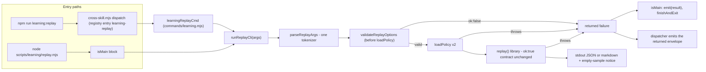

# Plan: CLI contract hardening — strict boolean flags, emit ordering, replay CLI honesty
- **Date**: 2026-10-03
- **Status**: Complete (plan audited: GPT 2 rounds NEEDS_REVISION to READY_TO_IMPLEMENT; Gemini plan gate APPROVE, round 1)
- **Author**: Claude + Louis
- **Scope**: backend (CLI scripts + shared CLI primitives; no UI)
- **Stack**: js-ts (ESM), Node built-in test runner
- **Target domain(s)**: `cross-skill-bridge`, `install`, `scripts`, `shared-lib`
- ⚠ **Cross-domain work** — touches >1 domain. Intentional and edge-free: `scripts/learning/replay.mjs` already imports `scripts/lib/cli-io.mjs`; `scripts/lib/cross-skill/commands/learning.mjs` already lazy-imports `scripts/learning/replay.mjs`. No new import edge is added (the registry stays static data; the registry-vs-replay parity check lives in a test, not in `registry.mjs`). `tests/arm-vocabulary-layering.test.mjs` re-derives the violation set and is in `npm test`.

Ledger topicIds this plan closes: `77cee58d`, `25a36d16`, `3cf21fe3` (accepted, §8), `b445b4ba`, `af81be85`; `14ae944f` is closed as **not-real** (no change).

## 1. Context Summary

**Detected scope**: backend · stack `js-ts`. Pinned to commit `498af659` (main at planning time).

**What exists today** — six small defects, all in one family: *a CLI contract that accepts input, or reports an outcome, and then does something other than what it said.* Every one was re-confirmed by EXECUTING the code on 2026-10-03, not by reading it.

| # | Defect | Measured (2026-10-03, `498af659`) |
|---|---|---|
| 1 | `hasFlag('apply')` reads `--apply=fasle` as ON — only `false/0/no/off/''` mean off. `scripts/defect-harvest.mjs` `main()` calls `hasFlag('apply')` before writing a committed artifact, so a typo ENABLES the mutation. | `hasFlag` returns `true` for `=fasle`, `=nope`, `=n`, `=" false"` |
| 2 | `emit({ok:false},{softFail:true})` writes the envelope to stdout, THEN throws on the missing `reason`. A caller that catches the throw has already put a failure envelope on the machine channel. | stdout written, `process.exitCode` undefined |
| 3 | `OPT_OUT_RE` in `scripts/check-emit-exit-agreement.mjs` matches only `softFail: true`; the gate never checks a `reason` is present. | baseline = 0 opt-outs; population is empty |
| 4 | "`ok:false` envelope never produced by a hand-written CLI" (`14ae944f`). | **NOT-REAL** — see §8 |
| 5 | `scripts/learning/replay.mjs`: (a) `{ok:false}` results exit 1 but are never WRITTEN — `node scripts/learning/replay.mjs bogus_type` exits 1 with empty stdout; the success path writes stdout then calls bare `process.exit` (a baselined stdout-flush site). (b) `--repo`/`--repo-id` are UUID-only but unvalidated: `owner/repo` raises Postgres `22P02`, which `readDecisionsPaginated` swallows → `ok:true sampleSize:0` exit 0 (a false zero). (c) cloud-off / unreadable store / no decisions are indistinguishable (`sampleSize:0`). (d) `optVal` reads only the space form, but `assertKnownFlags` admits `--x=y`: `--since=7d` ran with `sinceMs=2592000000` (30d), `--format=markdown` printed JSON, `--repo=<uuid>` was ignored and widened scope to all repos. | all four reproduced live (read-only store access) |
| 6 | Registry entry `learning-replay` has `positionals:'none'` and no flags, so the documented `npm run learning:replay -- pass_selection` is dead. | `cross-skill.mjs learning-replay pass_selection` → exit 2 `BAD_INPUT`; `--since 7d` → exit 2 "unknown flag" |

**Code Trace** (read at `498af659`):
- `scripts/lib/cli-io.mjs:207` `hasFlag` → `:237` the falsy-only list. `scripts/lib/cli-io.mjs:45` `emit` → `:60` write precedes `:66` reason check.
- `scripts/defect-harvest.mjs:180` `hasFlag('apply')` → `:205` `atomicWriteFileSync` (the mutation); `:215` `main().catch` logs `FATAL` and sets `exitCode = 1`, so a throw from `hasFlag` is loud there.
- `scripts/learning/replay.mjs:154` `runReplayCli` → `:162` `optVal` (space form only) → `:179` `loadPolicy` runs BEFORE `:182` rewardFn check → `:189` `replay()` → `:198` writes stdout. `:206` isMain → `:213` `assertKnownFlags` → `:219` `runReplayCli` → `:220` bare `process.exit`.
- `scripts/lib/learning/replay.mjs:62` `replay()` returns `ok:true sampleSize:0` when `readDecisionsForType` returns `[]` (`:69`); `scripts/lib/store/learning-decisions.mjs:375` `readDecisionsPaginated` → `:406` catch → `break` (swallows `22P02`). Library contract pinned by `tests/learning-replay.test.mjs:63`.
- Dispatcher: `npm run learning:replay` (`package.json:133`) → `node scripts/cross-skill.mjs learning-replay` → `scripts/lib/cross-skill/dispatch.mjs:174` validates ONLY the registry-declared flags (`:180`) and refuses positionals when `positionals === 'none'` (`:192`) → `scripts/lib/cross-skill/commands/learning.mjs:140` `learningReplayCmd` forwards `ctx.forwardArgs` to `runReplayCli` and returns its `ok:false` envelope (`:147`), which `dispatch.mjs:384` turns into exit 1.
- `tests/cross-skill-registry-conformance.test.mjs:65` asserts "forward entries … must not also declare flags" — a premise the dispatcher does not honour (the registry docstring, `scripts/lib/cross-skill/registry.mjs:32`, says validation is "delegated to the target CLI"; `dispatch.mjs:180` never delegates).
- Census (hasFlag): 50 distinct literal `hasFlag('<name>')` names across 37 files / 107 call sites; a repo-wide search for `--<name>=<value>` found NO caller or doc spelling a non-boolean `=value` for any of them (the only hits are `--update=true`, `--dry-run=1`, `--force=true`, all truthy, plus prose). Dynamic `hasFlag(<var>)` calls: none (the two other `hasFlag` definitions, `scripts/cross-skill.mjs:295` and `scripts/lib/cross-skill/dispatch.mjs:274`, are separate local functions).

**Patterns reused**: `ArgvError` + the "refuse rather than ignore" doctrine of `assertKnownFlags` (same file); `finishAndExit` (`scripts/lib/cli-io.mjs:377`) for the exit; `emit` for the failure envelope (the `ok:false` ⇒ exit-1 coupling is already in it); the dispatcher's forwarder contract (`learningReplayCmd` already emits the returned failure).

**Neighbourhood considered** (`get-neighbourhood`, k=8): all eight returned symbols are in the files being edited (`hasFlag`, `argOption`, `assertKnownFlags`, `emit`, `ArgvError`, `replayPositionals`, `runReplayCli`); band `review` — nothing outside them cleared the repo's noise floor. Greenfield for the new code; the existing symbols ARE the extension points.

**Past incidents**: INC-001 (symlink sensitive-path) returned; not applicable — no path classification, secret handling or egress is touched.

## 2. Proposed Architecture

### 2.1 `hasFlag` — a closed value set (`77cee58d`)

`scripts/lib/cli-io.mjs`: for `--name=<v>`, lower-case `v` and classify:
- **TRUTHY** `{true, 1, yes, on}` → present; **FALSY** `{false, 0, no, off, ''}` → absent (unchanged);
- **anything else** → `throw new ArgvError(...)` naming the flag, the offending value, and BOTH accepted sets.

Every occurrence in the pre-`--` region is classified, not just the last: `--apply=fasle --apply=false` is still a typo, and a wrapper appending an override must not be able to launder one. Last-wins is unchanged for VALID occurrences. The value is NOT trimmed — `" false"` is a typo, not an off switch. `argOption` is untouched: it returns a string by contract; the claimed `argOption`/`hasFlag` "disagreement" is not a defect. A caller with no `ArgvError` catch exits 1 with a stack — loud, which is the point; `defect-harvest` already routes it to `FATAL … exitCode 1`. (#12 defensive validation at a boundary, #15 consistent error handling.)

### 2.2 `emit` — validate before writing (`25a36d16`)

Hoist the `softFail` ⇒ non-empty-string-`reason` check ABOVE `process.stdout.write`, next to the existing `undefined` check (which already validates first). A refusal then leaves stdout and `process.exitCode` untouched. No baseline moves: `scripts/check-emit-exit-agreement.mjs:142` excludes `cli-io.mjs`. (#12, #15.)

### 2.3 `3cf21fe3` — ACCEPT, with the reason written down

Right-sizing: **band-aid** = leave it unrecorded (the finding is re-filed next sweep); **over-engineered** = capture the whole `emit(...)` statement, add `hit.hasReason`, exit 1 outside the ratchet (~12 lines + a temp-git-repo test) to police a population of **zero**; **chosen** = no code, one docblock paragraph in `scripts/check-emit-exit-agreement.mjs`. Why it is true, not merely cheap: (a) the runtime check is the single oracle, and §2.2 makes it fail BEFORE any output; a second static oracle over the same invariant is the "two oracles" defect this gate's own header names; (b) the scan blanks string literals, so only a `reason` KEY is checkable — it would prove presence, never meaning; (c) any new opt-out already trips the ratchet as growth, forcing a human `--update` whose diff shows the line. **Revisit trigger**: the baseline becomes non-empty. (#9 no dead code, #10 single source of truth.)

### 2.4 `learning replay` CLI (`b445b4ba`, `af81be85`)

All in `scripts/learning/replay.mjs`; the **library `replay()` keeps its `ok:true, sampleSize:0` contract** (pinned by `tests/learning-replay.test.mjs:63`).

1. **One tokenizer.** `parseReplayArgs(args) → {positionals, opts}` replaces the two readers that disagreed (`replayPositionals` understood `=`; `optVal` did not — that disagreement IS defect d). Its grammar is fully specified, because `assertKnownFlags` validates names only and stops at `--`:
   - `--name=value` carries its own value (everything after the FIRST `=`); only `VALUED_FLAGS` names are options; other `--x` tokens consume nothing (a boolean-looking flag must not eat a positional — existing test).
   - **Space form takes the next token ONLY if it exists and does not start with `--`** (the guard `argOption` already uses). Otherwise the option is recorded with an empty value and `validateReplayOptions` refuses it ("requires a value"). So `--policy --since 7d` is `policy=''` (refused) plus `since=7d` — `--since` is never swallowed as a filename. A value that genuinely starts with `--` is written in the `=` form.
   - **The POSIX `--` terminator ends option parsing**: every token after it is a positional, never an option — so `pass_selection -- --policy=file.mjs` cannot smuggle an importable policy path past the flag allowlist (the same boundary `assertKnownFlags`, `argOption` and the dispatcher's `flagRegion` already honour). The `--` token itself is dropped.
   - Last occurrence wins (both spellings). `replayPositionals` becomes a one-line wrapper so `tests/replay-positionals.test.mjs` keeps passing; it gains terminator and guard cases. (#1 DRY, #10 single source of truth.)
2. **`validateReplayOptions`, run BEFORE `loadPolicy`** (today `--policy` is imported before the decision type is checked, so a typo'd type with a bad policy path surfaces as an import error). Returns `{ok:false, error}` for: **positional cardinality — exactly one decision type; a second bare word is refused, not ignored**; a valued flag with an empty/missing value; unknown decision type (the existing `rewardFn` message, kept verbatim — a test matches it); `--repo`/`--repo-id` not an `audit_repos` UUID (`learning_decisions.repo_id` is `uuid REFERENCES audit_repos(id)`, `supabase/migrations/20260508120000_adaptive_learning_v1.sql:67`); `--since` that `parseDuration` rejects (today silently 30d); `--format` outside `json|markdown` (today silently JSON). The last two are the SAME accepted-and-inert class as defect d, one line each, in the block being written anyway.
2b. **Failures AFTER validation are returned too** (round-1 audit H2). `loadPolicy` (missing file, module that throws on import, no `default`/`policy` function) and `replay()` itself (it calls the candidate policy outside `safeReward`, so a throwing policy propagates; `validateInput` throws `TypeError`) are wrapped: `runReplayCli` returns `{ok:false, error:'policy-load-failed: --policy FILE: MESSAGE'}` / `{ok:false, error:'replay-failed: MESSAGE'}` and writes the stack to stderr. Without this the isMain tail only emits a RETURNED result, so these rejections would bypass the new output lifecycle and still exit via an unhandled rejection with empty stdout — the very defect (5a) being fixed. Only the failure's TRANSPORT changes; the policy-contract wording of the existing error message is preserved inside it.
3. **Honest empty result.** `emptySampleNotice(result)` returns a message when `sampleSize === 0` that names all three causes (store off/unreadable — see the `[learning]` stderr line; window/repo filter matches nothing; none recorded yet) and says a zero delta is NOT evidence the candidate matches baseline. Written to stderr as `[replay] WARNING …` and rendered as a block in the markdown report. **stdout JSON is unchanged** (the library contract and existing JSON consumers).
4. **`{ok:false}` is WRITTEN.** isMain: `if (result.ok === false) emit(result); await finishAndExit(process.exitCode ?? 0);` — `emit` writes the envelope and (via the F4 coupling) sets exit 1; `finishAndExit` drains stdout first, retiring the baselined bare-`process.exit` site. `emit` is NOT called inside `runReplayCli`: `learningReplayCmd` (`commands/learning.mjs:147`) already emits the returned failure, so doing both would put two JSON values on one stdout.
5. **Usage text** corrected (`--repo-id UUID`, not `--repo <name>`) and written without angle brackets (operator-doc convention: PowerShell reserves `<`).
6. **Test seam**: `runReplayCli(args, { replayFn = replay } = {})` so validation tests assert `replayFn` was never called, with no DB touched.
7. Export a frozen `REPLAY_GRAMMAR = { decisionTypes, valuedFlags }` derived from the module's own tables, so §2.5's parity test has ONE source to compare against.

*Right-sizing:* **band-aid** = patch `optVal` for `=` and add a UUID regex, leaving two tokenizers and the bare exit; **over-engineered** = a shared `parseArgv` framework in `cli-io.mjs` for every CLI. **Chosen**: one local tokenizer in the one file that has the bug. The `UUID_RE` here is a 5th private copy (`scripts/campaign.mjs:607`, `scripts/lib/store/bandit-fp.mjs:18`, …): hoisting it needs a shared home in a domain this plan does not own and the lead has asked that `cli-io.mjs` edits stay local to `hasFlag`/`emit` — recorded as debt, not fixed here.

### 2.5 Registry entry `learning-replay` (dead documented command)

`scripts/lib/cross-skill/registry.mjs`: replace `positionals:'none'` with `{ verbs: ['pass_selection','convergence_predict','arch_memory_band'] }` and declare `flags` (valued): `policy`, `baseline`, `since`, `repo`, `repo-id`, `format`. All six are already in `cross-skill.mjs` `KNOWN_FLAGS` (the flag-registry parity test requires it). Unknown verbs still flow to the handler (registry docstring), so a typo'd type reaches replay's own validation and gets the `ok:false` envelope and exit 1 instead of a dispatcher-level `BAD_INPUT`.

**Premise correction.** The conformance test at `tests/cross-skill-registry-conformance.test.mjs:65` forbids forwarders from declaring flags. That encoded the registry docstring's "delegated to the target CLI", which `dispatch.mjs:180` does not implement — measured: the dispatcher refuses an undeclared flag before the forwarder runs. Two ways out: (A) declare the grammar on the entry and delete the false assertion; (B) make the dispatcher actually delegate for `forward:` entries (skip name/positional validation and rely on the sub-CLI). **(B) is rejected for this plan**: it changes shared dispatch behaviour for every forwarder, `runReplayCli` does no flag-name validation of its own (only its isMain does), and `friction-log` would change in the same stroke without anyone measuring it. **(A)** is the smallest change that makes the documented command work, with duplication pinned by a parity test (registry flags/verbs == `REPLAY_GRAMMAR`) so the two inventories cannot drift silently. The sibling `friction-log` forwarder has the same shape (its flags and positional message are refused through `cross-skill.mjs`) but `npm run audit:wtf` points straight at `scripts/friction-log.mjs` (`package.json:139`) — no documented caller is broken; deferred, with that independence stated, as debt.

### 2.6 `14ae944f` — NOT-REAL

Nothing to build. The gate header (`scripts/check-emit-exit-agreement.mjs:13-19`) deliberately refuses a static "every `ok:false` exits non-zero" oracle; the cited `replay()` instance returns `ok:true`; a census of four hand-written-envelope CLIs found all four couple exit to result. Building a detector would be the second-oracle defect.

## 3. Sustainability Notes
- **Assumption that could change**: the truthy/falsy spellings. They live in two module constants beside `hasFlag`; adding `y`/`n` later is a one-line change *and* a deliberate decision (today `--apply=n` throws — chosen: a one-letter spelling is exactly the typo-adjacent value to refuse).
- **If the dispatcher later learns real delegation** for `forward:` entries, the registry declaration and the parity test become removable together; nothing else couples to them.
- **Extension point**: `validateReplayOptions` is a flat list of checks over `opts`; a new valued flag is one `VALUED_FLAGS` entry + one check, and the parity test forces the registry to follow.

## 4. File-Level Plan
See §7b — every file is intent-tagged there.

## 5. Risk & Trade-off Register
| Risk / trade-off | Position |
|---|---|
| A real caller somewhere passes `--flag=<other>` to a `hasFlag` flag and now throws | In-repo census: zero. Out-of-repo consumers run the same synced scripts. The failure is loud (stack, exit 1), never silent, and names the accepted spellings. Accepted. |
| `ArgvError` from `hasFlag` is not mapped to exit 2 by callers that only wrap `assertKnownFlags` | Accepted: those paths exit 1 with a stack. Mapping 37 files to exit 2 is out of scope and not needed to close the hazard (a typo no longer ENABLES a mutation). |
| `cli-io.mjs` merge conflict with a concurrent `requiredFlagValue` export (lead's worktree) | Edits are confined to the bodies of `hasFlag` and `emit` + two constants; neighbours are not reformatted. |
| Registry duplicates replay's grammar (6 flags, 3 verbs) | Pinned by a parity test against `REPLAY_GRAMMAR`; the alternative (B) is rejected in §2.5. |
| New `--since`/`--format` validation changes accepted input | Only previously-garbage values change (silently ignored → loud). Valid values unchanged. |
| `replay.mjs` `--help` is accepted by `assertKnownFlags` but has no handler (prints usage + `ok:false`, exit 1) | Out of scope; unchanged. |

**Deliberately deferred**: `friction-log` forwarder grammar (above); a shared `UUID_RE` export; mapping `ArgvError` from `hasFlag` to exit 2 repo-wide; distinguishing cloud-off from empty in the library (would change the `ok:true` contract the tests pin).

**Out of Scope (Future) — partial samples (round-1 audit H1, deferred with independence).** `readDecisionsPaginated` (`scripts/lib/store/learning-decisions.mjs:406`) catches a page error and `break`s, so a failure AFTER page 1 returns a partial NON-empty sample, which `emptySampleNotice` (zero-only) cannot flag; today the only signal is the helper's own `[learning] readDecisionsPaginated error` stderr line. **Independence:** this plan's design does not depend on that path — the notice is additive and claims nothing about the completeness of a non-empty sample; the one deterministic way to trigger the swallow from this CLI (a non-UUID repo id → `22P02` on page 1) is closed by the validation in §2.4.2; and the page loop shares neither a column nor a transaction with anything this plan writes. Fixing it means changing the helper's return contract (also read by `quickfix-stats`) — a separate change with its own callers. Recorded as debt, not silently dropped.

## 6. Execution Model
Independent changes. The only ordering constraints: (i) Phase 2 precedes Phase 3's parity test (it needs `REPLAY_GRAMMAR`); (ii) the stdout-flush baseline is regenerated AFTER Phase 2 lands (`npm run stdout:flush:baseline`), because the gate fails on a shrink; (iii) tests are written first and run RED against the unfixed code before each fix (a check not seen to fail is not trusted).

## 7. File-Level Plan

### 7b. Implementation Phases

**Phase 1 — cli-io primitives + gate note**: `hasFlag` closed value set; `emit` validates `reason` before writing; document why `reason` presence is enforced at runtime only. Files: `scripts/lib/cli-io.mjs` (modify), `tests/cli-io-equals-flags.test.mjs` (modify), `tests/emit-exit-coupling.test.mjs` (modify), `scripts/check-emit-exit-agreement.mjs` (modify — docblock only).

**Phase 2 — replay CLI honesty**: one tokenizer, pre-load validation, empty-sample notice, written `ok:false`, `finishAndExit`, Usage, `REPLAY_GRAMMAR`, `replayFn` seam. Files: `scripts/learning/replay.mjs` (modify), `tests/learning-replay.test.mjs` (modify), `tests/replay-positionals.test.mjs` (modify), `.stdout-flush-baseline.json` (modify — regenerated by `npm run stdout:flush:baseline`, never hand-edited), `scripts/check-cli-flags.mjs` (modify — one `BASELINE` entry for `scripts/learning/replay.mjs` removed: the gate itself reported it shrinkable, and the spawned `--nope ⇒ exit 2` test is the negative control).

**Phase 3 — make the documented command work**: registry declaration, premise-correcting conformance edit, parity + spawn tests, runbook. Files: `scripts/lib/cross-skill/registry.mjs` (modify), `tests/cross-skill-registry-conformance.test.mjs` (modify), `docs/runbooks/learning-system.md` (modify).

**Close-out (not a phase)**: `npm run stdout:flush:baseline` (expect the `replay.mjs` entry, count 1 and its id, to disappear and nothing else); `npm run emit:exit:gate`; `npm run stdout:flush:gate`; `npm run cli:flags:gate`; `npm run knip:gate`; `npm run plans:lint`; full `npm test`. `scripts/check-cli-flags.mjs`'s `BASELINE` entry for `scripts/learning/replay.mjs` is re-examined: remove it only if the gate itself says it can shrink (never on the detector's say-so alone — verify with a typo'd flag exiting 2).

**Per-file notes**
- `scripts/lib/cli-io.mjs` — `hasFlag`: add `TRUTHY`/`FALSY` constants, classify each `--name=` occurrence, throw `ArgvError` otherwise. `emit`: hoist the reason check. Depends on nothing new; imported by ~100 scripts (backward compatible except the loud failure in §5). (#12, #15)
- `scripts/learning/replay.mjs` — `parseReplayArgs`, `validateReplayOptions`, `emptySampleNotice`, `REPLAY_GRAMMAR`, `renderMarkdownReport` (notice block), `runReplayCli(args, {replayFn})`, isMain tail. Imports `emit`/`finishAndExit` added to the existing `cli-io` import. (#1, #11, #12, #15, #19)
- `scripts/lib/cross-skill/registry.mjs` — one entry. (#10)

## 8. Testing Strategy (RED first, then GREEN)

**Unit / contract (Tier 1 — deterministic seams)**
- `tests/cli-io-equals-flags.test.mjs`: typos (`fasle`, `nope`, `n`, `y`, `2`, `" false"`, `ture`) throw `ArgvError` whose message names the flag and both accepted sets; `TRUE`, `Yes`, `ON`, `1` → true; existing falsy cases unchanged; an invalid EARLIER occurrence still throws even when a later one is valid; an invalid value AFTER `--` does not throw (positional); the validator/reader pair agree (`assertKnownFlags` accepts it ⇒ readable or loudly refused, never silently true).
- End-to-end negative control: spawn `scripts/defect-harvest.mjs --apply=fasle --out <tmp path>` ⇒ exit non-zero, stderr names `--apply`, and the tmp file does NOT exist. Run against the UNFIXED code first: it must write the file (that is the red).
- `tests/emit-exit-coupling.test.mjs`: `emit({ok:false},{softFail:true})` throws AND `written.length === 0` AND `process.exitCode` is unchanged; same for each bogus `reason`.
- `tests/replay-positionals.test.mjs`: `parseReplayArgs` — `--since=7d` and `--since 7d` both land in `opts.since`; last wins across both spellings; `--format=markdown`; an unknown flag consumes nothing; `--policy --since 7d` ⇒ `policy === ''` and `since === '7d'` (the next flag is never swallowed); a trailing `--since` with no value ⇒ `''`; **everything after `--` is a positional** (`['pass_selection','--','--policy=x.mjs']` ⇒ positionals `['pass_selection','--policy=x.mjs']`, no `policy` opt).
- `tests/learning-replay.test.mjs` (`runReplayCli` with an injected `replayFn` + captured stdout/stderr): validation precedes `replay()` and `loadPolicy` (a nonexistent `--policy` path with a bogus type yields the rewardFn error, not an import error); two positionals ⇒ `ok:false` (extra input refused, `replayFn` not called); **a VALID type with a nonexistent `--policy` file, and with a module exporting no function, ⇒ `ok:false` /policy-load-failed/ (not a rejection); a `replayFn` that throws ⇒ `ok:false` /replay-failed/ with the stack on stderr**; `owner/repo` ⇒ `ok:false` /UUID/ and `replayFn` never called; `--repo-id=<uuid>` reaches `replayFn`; `--since=7d` ⇒ 7d in ms; `--since=garbage`, `--since` (no value), `--format=xml` ⇒ `ok:false`; `sampleSize:0` ⇒ stderr warning + markdown notice + stdout JSON still `ok:true`; non-zero sample ⇒ no warning.
- Spawn the direct CLI: `node scripts/learning/replay.mjs bogus_type` ⇒ status 1, stdout parses to `{ok:false, error:/rewardFn/}` (RED first: today stdout is empty); and `node scripts/learning/replay.mjs pass_selection --policy tests/fixtures/does-not-exist.mjs` ⇒ status 1, stdout parses to `{ok:false, error:/policy-load-failed/}` (RED first: today an unhandled rejection, empty stdout).
- Spawn the dispatcher path (hermetic, `cloud:'none'`): `cross-skill.mjs learning-replay bogus_type --since=7d --format markdown` ⇒ status 1 and `error` matches `/rewardFn/` — proving it was FORWARDED, where it used to exit 2 `BAD_INPUT`.
- Parity: registry `learning-replay` verbs == `REPLAY_GRAMMAR.decisionTypes`; registry flag names == `REPLAY_GRAMMAR.valuedFlags`, all `valued`.

**Gates** (all must be at baseline or improved): `emit:exit:gate` (0 opt-outs), `stdout:flush:gate` (re-baselined: shrink only), `cli:flags:gate`, `knip:gate`, `plans:lint`.
**Full suite**: `npm test` (adjudicated by `run-tests.mjs`; expect the pre-existing skip count unchanged).
**Live verification** (read-only store access, after the fix): `npm run learning:replay -- pass_selection --since 7d --format markdown` works through npm; `--repo owner/repo` ⇒ exit 1 with an UUID error instead of a false zero.

## 9. Acceptance
Not frontend — no §10. The acceptance bar is the RED→GREEN pairs above plus the gates.

## Implementation Log

Implemented 2026-10-03 as one inline unit (no §11 — below the clustering threshold), uncommitted in a linked worktree.

**Audit trail.**
- `/audit-plan`: 2 GPT rounds — R1 `NEEDS_REVISION` (H:2 M:1; H2 and M1 folded in, H1 deferred with independence, acceptance 67%), R2 `READY_TO_IMPLEMENT` (0 findings); Gemini plan gate `APPROVE` (round 1).
- `/audit-code`: R1 `SIGNIFICANT_ISSUES` (H:3 M:8 L:0), R2 `PASS`, R3 `PASS` (0 findings each), Gemini final gate `APPROVE`, gate disposition `approve` (blocking 0, debt 0). R1 triage: 1 real defect fixed (`loadPolicy` export selection — H2/M6); 8 valid-but-independent findings deferred as debt with the full root-cause / rejected-fix / residual-risk / independence rationale (H1+M7 entry-guard idiom, 46 vs 30 files; H3+M2 unreadable-store-vs-empty; M1+M3 opt-out census lexer; M4 `ensureDir`; M5 pre-existing test); M8 (`ADJACENCY_INCOMPLETE`) dismissed as an instrument bound, not a defect. The R1 acceptance rate (2 of 11) reflects that most findings cited pre-existing code in changed files, not that the round was unproductive.
- **Coverage caveat, stated rather than hidden.** Every audit-code round reported `coverage: PARTIAL` — the diff-annotated reader rendered 4000-7740 characters per file and left changed lines past the window unread (R2: 194 lines of `scripts/learning/replay.mjs`, 382 of the test; R3: 49 lines of `scripts/lib/cli-io.mjs`, i.e. `hasFlag`). A first R2 over 7 files hit the map-reduce path, which records no render evidence, and was refused as `INCOMPLETE` (exit 3); it was re-run over 2 files. The 0-finding rounds are therefore evidence about the read window, not about the whole change. Mitigations: the Gemini gate renders changed files at up to 40K characters and said so in its verdict; every behaviour has a test seen RED against the defect (below); the eight `replay.mjs` negative controls were run by hand.

**Negative controls (Step 4.5).** `hasFlag`/`emit`/`defect-harvest` tests were run RED against the unfixed code (the `defect-harvest --apply=fasle --since 6` control WROTE the file on unfixed code, exit 0). For `scripts/learning/replay.mjs`, eight single-line mutations were each applied in turn and each turned the suite RED (isMain `emit` removed, `hasOwn` → truthiness, `parseDuration` fallback restored, `--` terminator ignored, flag-swallowing space form, thrown policy-load failure, notice suppressed, UUID check disabled), then the original bytes were restored.

**Deviations from the plan as written.**
1. Phase 2 also removes one `BASELINE` entry from `scripts/check-cli-flags.mjs` (the gate already reported `replay.mjs` shrinkable).
2. The two `fs.rmSync` calls added to tests had to carry `{maxRetries: 3, retryDelay: 50}` — `tests/rmsync-retry-guard.test.mjs` failed the first full run on exactly those two sites.
3. `loadPolicy` now selects its export by the validating predicate (audit finding), with tests for the four export combinations.
4. `docs/runbooks/learning-system.md` examples use `my-policy.mjs`, not a `scripts/` path: `docs:refs:gate` flagged the invented path as a dead reference.

**Verified.** `npm run learning:replay -- pass_selection --since 7d --format markdown` now runs through npm (window `7.0d`, 34 decisions vs 257 at the 30d default); `--repo owner/repo` and `bogus_type` exit 1 with an `{"ok":false,...}` envelope on stdout.
