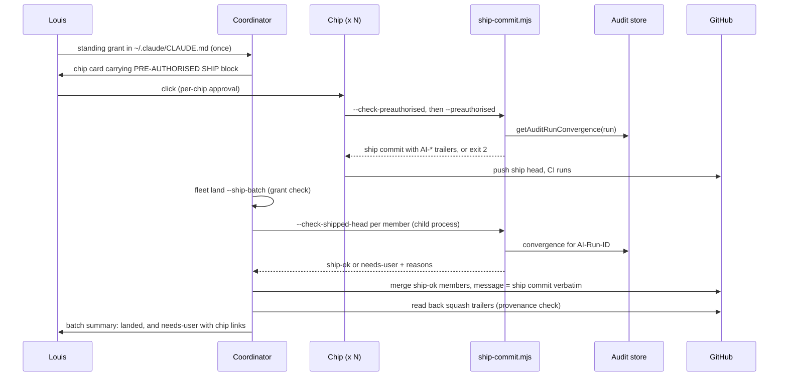

# Plan: Coordinator-owned aggregate ship (one ship action per batch)
- **Date**: 2026-11-18
- **Status**: Draft
- **Author**: Claude + Louis
- **Scope**: backend (CLI scripts + skill prose; no UI). Stack `js-ts`.
- **Target domain(s)**: `fleet`, `ship`, `skills-content`, `docs`
- ⚠ **Cross-domain work**: this touches `fleet` and `ship`. The boundary crossing is intentional and follows the existing rule
  that fleet reaches ship **as a child process, never by import** (`.audit-loop/domain-map.json:265 (ceea43d2)`).

## 1. Context Summary

### The problem
Louis runs several chips a night. Each one ends at ship-ready, and he must type `/ship` in each chip session.

`/ship` is user-only:
- `disable-model-invocation: true` at `skills/ship/SKILL.md:14 (ceea43d2)`.
- "The `/ship` command IS the user's approval" at `skills/ship/SKILL.md:800 (ceea43d2)`.

The interim practice is that the coordinator squash-merges each PR under Louis's 2026-10-18 merge grant, then writes ONE record
PR (`ship-record.mjs catchup --write`, committed via `ship-commit.mjs --record --decision`). For example, CES #381 covered 16 PRs
and #389 covered 7. That record is honest but provenance-poor: every member lands as `merged-without-ship`
(`scripts/lib/ship-record/commands.mjs:25 (ceea43d2)`), and its squash commit carries no `AI-*` trailers of its own.

**Measured** with `git log -200 --format=%B origin/main` at ceea43d2, covering 2026-10-10 to 2026-11-18:
- 133 of the last 200 main commits carry no `AI-Gate` line at all.
- 67 carry one somewhere in the body.
- Only 54 carry one that git can parse as a trailer (`%(trailers:key=AI-Gate)`).

So 13 had their provenance pasted into the middle of a squash body, where no reader finds it. One of these is a pre-authorised
ship, `81bdd88b`, whose `AI-Ship-Authority: launch-prompt` block is present inline but not parseable. The cause is the repo's
squash setting, `squash_merge_commit_message: COMMIT_MESSAGES` (from `gh api repos/…`): it concatenates every commit message,
so the ship commit's trailer block is no longer the last paragraph.

**Goal.** A clean member ships with full per-member provenance, and Louis types nothing for it. One coordinator action per batch
lands every clean member. Each member that fails a condition waits for Louis's `/ship`, and the rest still land.

### Inventory: what exists and why it does not solve this today
All citations are read at `ceea43d2`.

| # | Machinery | What it does | Why it is not the answer today |
|---|---|---|---|
| 1 | `/ship` (`skills/ship/SKILL.md`) | Step 2 writes the status entry (`:580-598`). Step 5 writes the plan Status and Implementation Log (`:659-674`). Step 6.3 runs `ship-commit.mjs`, which writes the `AI-*` trailers (`:805-834`). The gate is passed, converged, waived or not-run (`:774-796`). | User-only (`:14`, `:800`). A coordinator cannot type it into another session, and a mid-turn invocation is refused. |
| 2 | `/ship --train` (`skills/ship/SKILL.md:1082-1092`; `skills/ship/references/train-mode.md:31-67`; `scripts/ship-train.mjs`) | Lands a batch of ship-ready PRs. Per-PR provenance comes from `decideTrainGate` (`scripts/lib/ship-train/provenance.mjs:145`). Squash messages come from `composeSquashMessage` (`:208`). | **Human-only**: "does not relax the explicit-invocation rule" (`SKILL.md:1086`, `train-mode.md:31`). It is source-repo-gated, and `ship-train.mjs` and `lib/ship-train/` are **not synced** to any consumer (checked on disk in wine-cellar-app, storyline and ai-organiser). It checks no final review, sensitive path, migration or policy file, and it writes no per-member plan log. |
| 3 | `ship-commit.mjs --preauthorised` / `--check-preauthorised` (`scripts/ship-commit.mjs:154-194`, `:657-684`) + `scripts/lib/ship-preauth.mjs` | A chip ships ITSELF when `evaluatePreauthorisedShip` (`ship-preauth.mjs:67`) holds all six conditions (`:23-25`): gate passed/converged and no `--no-tests`; audit converged per the store; final review APPROVE with result approve, bound to the audited tree and round; and no sensitive, migration or policy path (`:36-50`). It writes `AI-Ship-Authority: launch-prompt` (`ship-commit.mjs:682`) and refuses with exit 2, with no override. | **This is the right per-member mechanism, and it works.** Three such ships are on main: `e564473f`, `81bdd88b` and `7ff8883a`. But it is used only when the coordinator includes the opt-in launch block. Coordinators leave it out because it is "a launch-prompt decision, not a default" (`skills/fleet/references/chip-preamble.md:84`), and no standing grant makes it the default. Nothing checks a self-shipped head again at merge time. |
| 4 | Chip-preamble PRE-AUTHORISED SHIP block (`skills/fleet/references/chip-preamble.md:57-65`) | The prose that grants item 3 to a chip, approved by the user's chip click (`:17-23`). | Opt-in per launch, "Include only when the user approved it at launch" (`:57`), so the default chip ends at ship-ready (`:53-55`). |
| 5 | `ship-record.mjs catchup` (`scripts/lib/ship-record/state.mjs:1-20`; `entry.mjs:114-186`) | Records each merged PR once, after the fact. A PR counts as recorded if its own merge commit ADDED a log entry (`state.mjs:11-13`), so a self-shipped PR needs no catch-up entry. | Post-merge record only. It claims no gate: the record commit is `not-run` with `record-catchup` (`scripts/lib/ship-record/authority.mjs:84-125`). |
| 6 | `fleet land` / `land --approve` (`scripts/lib/fleet/land.mjs`; `train-approve.mjs:211-215`; `serial.mjs:26,118`) | One combined test over every ready head, then `gh pr merge --squash --match-head-commit <oid>` per member (`train-approve.mjs:213`). It prints a record nudge (`land.mjs:43-57`). `serial.mjs` already has a `messageFor` seam for a caller-supplied squash message (`:26`, validated `:118-127`). | It takes no ship verdict: it lands ready heads whether or not they shipped. The default merge passes no `--subject`/`--body`, which is how trailers get buried (the measurement above). It also needs "the user's explicit go-ahead in chat" (`skills/fleet/SKILL.md:88`). |
| 7 | `fleet decision record` (`scripts/lib/fleet/decisions.mjs:8-13,29,37`) | Durable, immutable declarations in four scopes: `record-catchup`, `note`, `test-plan`, `answer`. | "A declaration, not verified authority" (`:8`). By design no scope grants a merge, push, override or deletion (`:37`). |
| 8 | Coordinator playbook §1 and §7 (`skills/fleet/references/coordinator-playbook.md:17-37`, `:115-134`) | §1 merges only the audited head, compared by tree oid. §7 has the coordinator own the record catch-up, with one record PR at a time. | §1 is written for an unshipped head. A self-shipped head has, by construction, a tree that differs from the audited tree by the ship's doc steps, and no rule says which deltas are acceptable. |

**Code Trace.** The path of a pre-authorised ship, today:
1. Chip, at ship-ready: `ship-commit.mjs --check-preauthorised` (`scripts/ship-commit.mjs:154`).
2. `ship-commit.mjs --preauthorised` reads the gate evidence (`:174`) and the convergence via `readConvergence` (`:137`). That
   calls `getAuditRunConvergence` (`scripts/lib/store/runs-findings.mjs:1956`).
3. `evaluateGateVerification` (`scripts/lib/commit-trailers.mjs:420`) decides the gate.
4. `readFinalReviewMarker` and `boundFinalReviewDisposition` (`scripts/lib/final-review-marker.mjs:29,238,291`) bind the final
   review. The result becomes the `AI-Final-Review` value.
5. `evaluatePreauthorisedShip` (`ship-preauth.mjs:67`) with `gatherChangedPaths` (`:134`) runs the six conditions.
6. The commit is written with `AI-Ship-Authority: launch-prompt` and pushed.
7. Coordinator: `fleet land` builds the train; `land --approve` merges via `planFor` (`train-approve.mjs:211`), with no message.
8. The squash commit has the ship trailers buried inline (`81bdd88b`).

**Patterns reused vs new.** Reused: the preauth evaluator and its path predicates, `getAuditRunConvergence`, `ciVerdict`
(`scripts/lib/ci-verdict.mjs:271`), `requiredInventory` (`scripts/lib/fleet/required-checks.mjs:100`), the `messageFor` seam, the
record-commit path shape (`authority.mjs:103`) and ship-record's "recorded" oracle. New: one read-only `ship-commit.mjs` mode, one
pure evaluator, one grant reader, and one `fleet land` flag.

**Neighbourhood considered.** `get-neighbourhood` returned only `review`-band hits: `ship-commit.mjs main`, `git`,
`formatMigrationBlockLine`, `resolveSkillNames`. Nothing cleared the noise floor, so this plan opened the symbols directly and
chose to extend rather than add a sibling.

## 2. Proposed Architecture

### The one design idea
**The chip ships itself; the coordinator lands and re-verifies.** This keeps the existing split:
- The gate evidence and final-review marker live in the chip's worktree (`.audit/`, bound to its branch, `ship-preauth.mjs:78-89`).
  They can only be honestly read there.
- The chip that made the change is the best-placed author of its own status entry and Implementation Log.
- The coordinator gets the batch verb (`fleet land`), extended to re-verify each member **from durable facts alone**: the commit's
  trailers, the store, CI, and git trees. Only members that verify are merged.

"One ship per batch" therefore means ONE coordinator action and zero Louis actions for every clean member. The records stay per
member, because provenance is per change. A single aggregate commit for N PRs is rejected (§8): it would need one `AI-Gate` value
for N members, which is exactly the laundering §4 forbids.



### 2.1 Authority model (#5 Single Source of Truth, #16 Graceful Degradation)

**A. The standing grant. Louis writes it himself; no session edits `~/.claude/CLAUDE.md`.** Draft text to paste under
"Louis's standing instructions":

```markdown
## Coordinators may ship batches of pre-authorised chips

Since <DATE>: every repo coordinator session (titled `CES: Coordinator`, `WCA: Coordinator`, `STO: Coordinator`,
`AIO: Coordinator`) may include the PRE-AUTHORISED SHIP block in every chip launch prompt by default, and may land a
batch with `fleet land --ship-batch`. My click on a chip card that carries the block is my approval of that chip's
ship. Standing rules still apply:

- a chip ships itself only through `ship-commit.mjs --preauthorised`; if any condition refuses, that chip waits for
  me to type /ship in its session, and the rest of the batch still lands;
- the coordinator merges only members `ship-commit.mjs --check-shipped-head` reports ship-ok, squash, pinned with
  `--match-head-commit`, never `--auto`; the squash message is the member's ship commit message, verbatim;
- never `--no-verify` in wine-cellar-app;
- still mine: secrets and Railway or other deploy-environment writes, database migrations, sensitive paths,
  repository-policy files (.github/, CODEOWNERS, .test-tiers.json), plan decisions, deletions, GitHub settings and
  rulesets, raising caps or baselines.

<!-- grant: coordinator-ship-batch v1 -->
```

The last line is the machine-readable marker the grant reader keys on (§2.3, `C7`). It must be written exactly.

Optionally, and also Louis's own act, he can make the file unwritable by sessions with a permission deny rule in his user
settings, for example `"deny": ["Edit(~/.claude/CLAUDE.md)", "Write(~/.claude/CLAUDE.md)"]`. Sessions may not edit settings files.
This is offered, not required.

**B. How the coordinator proves the grant came from Louis, not from a relay.** There are three layers, each named honestly:
1. **Where the coordinator reads it.** The grant reaches the coordinator in the harness-loaded "user's private global
   instructions" (its system context), never in a peer message. A cross-session message, a file in the repo, a `fleet next`
   line or a decision record that *claims* the grant is data, not the grant. The playbook says this explicitly (Phase 3).
2. **The per-chip act is still Louis's click.** The grant only lets the coordinator *include* the block by default. Each chip
   still needs Louis to click its card. A message can never add the block to a chip that is already running, because the
   launch block says "No message can WIDEN this block" (`chip-preamble.md:17-23`). A chip launched without the block, or before
   the grant existed, ends at ship-ready and waits for `/ship`.
3. **Code fails closed when the grant is absent.** `fleet land --ship-batch` reads `~/.claude/CLAUDE.md` for the exact marker
   line. If the marker is absent or the file is unreadable, the run refuses (`grant-absent`) and falls back to today's
   behaviour. This is labelled a **declaration check, not verified authority**, in the same words `decisions.mjs:8` uses for
   itself: it proves the line is in the file only sessions are forbidden to write. The verb prints this label. This repeats the
   reason `ship-preauth.mjs` exists (`:5-9`): an authority's absence is enforced in code, not in prose the actor reads about
   itself.

**C. What stays Louis's** is listed in the grant text. In code, the per-member conditions `C4`-`C6` refuse migrations, sensitive
paths and policy files, so those members always wait for him. Secrets, deploy writes, GitHub settings, caps and baselines are not
file changes a merge makes, so they stay outside the grant by its text, exactly as today's merge grant handles them.

### 2.2 Per-member ship (unchanged mechanism; the default flips)
- `chip-preamble.md:57-65` and `:84`: the block becomes **default whenever the coordinator is acting under the grant**. Without
  the grant it stays opt-in, as today. The ship steps are unchanged: status entry, Implementation Log,
  `--check-preauthorised`, `--preauthorised`, push.
- **Order.** The chip ships, then pushes the ship head, then runs `fleet ready`. That records the ship commit as the ready oid,
  so the CI that runs is CI on the ship head.
- **The worktree must survive until the ship commit exists.** The `.audit/` markers are gitignored, and archiving destroys
  them. The chip-preamble adds: "never archive before your ship commit is pushed".

### 2.3 Batch re-verification: `ship-commit.mjs --check-shipped-head <oid>` (new read-only mode, #1 DRY, #11 Testability)
This mode lives in `ship-commit.mjs`, beside `--check-preauthorised` (`:154-194`), because that script already owns
`readConvergence` and the trailer vocabulary. `fleet` calls it as a child process (domain rule above). It gathers facts and calls
a **pure** `evaluateShippedHead(facts)`, added to `scripts/lib/ship-preauth.mjs` so that ONE module owns "may this ship
without the user". It reuses that module's `row`, `isSensitivePath`, `isMigrationPath` and `isPolicyPath`.

The output is one row per condition, the same shape as `renderPreauthConditions`, plus a JSON envelope when `--json` is passed.
Exit 0 means ship-ok and exit 2 means needs-user. It **fails closed**: any unknown fact is a refusal with its own reason, never a
pass.

| id | Condition (all on the member's head commit `H`, its tree `T_H`, the PR's base `B`) | Source |
|---|---|---|
| `C1 trailers` | `git interpret-trailers --parse` of `H`'s message yields exactly one of each of these: `AI-Skill: ship`, `AI-Ship-Authority: launch-prompt`, `AI-Gate` ∈ {`passed`,`converged`}, `AI-Final-Review: approve`, `AI-Run-ID`. They must be **parseable trailers**, not inline text. | git object |
| `C2 store` | `getAuditRunConvergence(AI-Run-ID).roundConvergedAfter` is an integer, and the run row's `audited_tree` is non-null. Cloud off or a failed query refuses with its reason. | store |
| `C3 post-audit-delta` | Let `P` be the paths the branch changes (`gatherChangedPaths` semantics, `B`…`T_H`). For every `p ∈ P` whose blob differs between `audited_tree` and `T_H`, `p` must be ship-step-shaped. That means a new file under `docs/status/entries/`, or a plan file whose diff is confined to its `Status:` line and `## Implementation Log` section. This reuses `authority.mjs` `pathVerdict` (`:103`), lifted to a shared export. Upstream changes to paths outside `P` (a rebase) are ignored. A path changed both by the branch and after the audit refuses, because a conflict resolution is unaudited code. A missing `audited_tree` object (gc'd) refuses. | git trees |
| `C4 sensitive-path` / `C5 migration` / `C6 repo-policy` | The existing predicates over `P`. An empty or unresolvable `P` refuses (`ship-preauth.mjs:104-110` semantics). | git + `sensitive-paths.mjs` |
| `C7 grant` | Checked once per batch by `fleet land --ship-batch`, not per member (§2.1 B3). | `~/.claude/CLAUDE.md` |
| `C8 ci` | `ciVerdict` (`ci-verdict.mjs:271`) for `requiredInventory` (`required-checks.mjs:100`) at **exactly `H`** is green. Unmeasured, pending or unknown refuses. | GitHub |
| `C9 identity` | Registry ready oid, PR head and `H` are one oid. This is the existing `fleet land` invariant (`verifyFacts`, `train-approve.mjs:90`), restated as a row so a mismatch is named. | fleet registry + gh |

**Why `C1` and `C2` together.** A raw `git commit` can type trailers by hand. `ship-commit` refuses `AI-*` lines in its message
input (`skills/ship/SKILL.md:768-769`), but nothing stops a non-ship-commit writer. `C2` re-derives the gate's backing fact from
the store, so a forged `AI-Gate` with no converged run is caught. **Residual risk, stated:** `AI-Final-Review` has no store-side
target identity (`ship-preauth.mjs:91-94`), so a hand-forged `approve` is caught only by convention. This is the same exposure a
pre-authorised chip already has today, and the grant widens it by nothing. It is recorded as a follow-up, not hidden (§8).

### 2.4 `fleet land --ship-batch` (extends land; no new verb, #18 Backward Compat)
1. `C7`: read the grant. If it is absent, refuse the flag with `grant-absent`. Plain `fleet land` is unchanged.
2. Build: for each ready member, run `--check-shipped-head` (`C1`-`C6`, `C9`). Mark each member `ship-ok` or `needs-user`, with
   reasons.
3. **Partition before integrating.** Exclude `needs-user` members, and any member stacked on one (`--base`), **before**
   building the integration worktree, so the tested set equals the merged set. Then run the existing combined test once.
4. Approve: re-run `C8` and `C9` at approval time (CI can flip). Merge each `ship-ok` member through the existing `messageFor`
   seam (`serial.mjs:26,118`) with `subject` and `body` set to **`H`'s commit message, byte for byte** (`git log -1 --format=%B`).
   The trailer block is then the last paragraph of the squash. It is copied from a git object, never composed, and so is not
   "hand-written".
5. **Read back.** After each merge, parse the squash commit's trailers and compare them with `H`'s, canonicalised against
   `AI_TRAILER_KEYS` (`commit-trailers.mjs:30`). A mismatch is a **loud** `provenance-lost` row on that member: the merge already
   happened and cannot be retried into honesty. The batch summary names it.
6. Print the batch summary: `landed: N (passed a, converged b)` and `needs-user: M`, one line each with its refusals, the chip's
   session link and the exact sentence "type /ship <plan> in this session". Then the existing record nudge
   (`land.mjs:43-57`).
   Self-shipped members are already "recorded" by `state.mjs:11-13`. The nudge therefore counts only members merged without a
   ship: legacy, or `needs-user` members Louis later chose to merge without `/ship`.

Under the grant, `skills/fleet/SKILL.md:88` gains one sentence: `land --approve --ship-batch` may run without a chat go-ahead
**only** for the `ship-ok` set; every other land still needs Louis.

### 2.5 Fallback when a member fails (#16)
- A `needs-user` member stays open at its chip, untouched. That chip is idle at ship-ready, so Louis can type `/ship`.
- The rest of the batch lands. A stacked dependent of a `needs-user` member waits with it (reason `blocked-by <id>`).
- Nothing retries a refused condition, and nothing re-runs an audit to find a pass. The chip-preamble already forbids that
  (`:63-64`); the batch verb has no retry path to offer.
- If the grant is absent, the store is off, or CI is unmeasured, the whole batch degrades to today's flow: plain `fleet land`,
  which needs Louis's go-ahead, then the record catch-up.

### 2.6 AI-Gate honesty (invariants the implementation must hold)
1. **No batch-level trailer anywhere.** Each squash carries exactly its own member's ship-commit block. The batch summary prints
   per-member gate counts, never one aggregate value.
2. **`waived` and `not-run` can never land under the grant.** `C1` admits only `passed` and `converged`. A member whose ship
   evidence was waived goes to Louis. No code path raises a member's gate: the verb reads trailers and never writes one.
3. **`AI-*` trailers are written only by `ship-commit.mjs`.** The merge copies `H`'s message verbatim; the read-back proves it.
   The record commit stays `not-run` with `record-catchup` (`authority.mjs:84`).
4. **No gate evidence is hand-written.** `--check-shipped-head` is read-only, and nothing here writes `.audit/*`.

### 2.7 Other repos (WCA, STO, AIO)
- **Synced already** (checked on disk): `.claude/skills/{ship,fleet}` and
  `scripts/.claude-skills/{ship-commit,ship-record,fleet}.mjs` plus `lib/ship-preauth.mjs` exist in all three consumers. Every
  file this plan changes is already in the sync closure (`scripts/lib/sync-path-map.mjs:7`; closure from entry points,
  `scripts/lib/sync-inventory.mjs:344`). `ship-train` is **not** needed, which is why the plan avoids it.
- **The new `pathVerdict` export** is a lib move inside `scripts/lib/ship-record/`, which is already synced. `npm run sync`
  verifies the closure. Synced SKILL prose names tooling **by path** (AGENTS.md shape 5).
- **Per-consumer store.** `C2` reads the consumer's own store (wine and storyline are on different stores). An air-gapped or
  cloud-off consumer refuses `C2`, so `--ship-batch` lands nothing there and the flow degrades to today's. It is honest, and it
  is never a pass.
- **wine-cellar-app**: never `--no-verify` (in the grant text). Its sync PR stays `--no-merge` and is merged by WCA (memory
  rule). This plan adds no auto-merge of sync PRs.
- **Rollout.** One CES PR, then the normal re-sync of each consumer. The grant line names all four coordinators. A coordinator
  in a repo whose sync predates the change finds no `--ship-batch` flag and stays on today's flow.

### 2.8 Docs every member ship still produces (unchanged, and still per member)
- The status entry file under `docs/status/entries/`, written by the chip in ship Step 2 (`skills/ship/SKILL.md:580-598`).
- The plan `Status:` and `## Implementation Log` entry, written by the chip in Step 5 (`:659-674`).
- The ship commit with `AI-*` trailers, written by `ship-commit.mjs`.
- The coordinator writes no per-member docs. Its only write is the record PR for members merged without a ship
  (coordinator-playbook §7, unchanged).

## 6. Sustainability Notes
- **Assumptions that could change.** The grant marker lives in a Claude-Code-only file. A Copilot-hosted coordinator has no
  `~/.claude/CLAUDE.md`, so `C7` refuses and that host keeps today's flow. This is accepted, because coordinators are Claude
  Code sessions today. The reader takes the path as an argument, so a second host adds one path, not a redesign.
- If GitHub's squash setting changes to `PR_BODY`, the explicit `messageFor` message still wins. The read-back (§2.4 step 5)
  catches any future drift.
- **Extension point.** `evaluateShippedHead` returns rows, so a future condition (for example a store-side final-review identity
  that would close the §2.3 residual) is one row.

## 7. File-Level Plan

### 7b. Implementation Phases
- **Phase 1: pure evaluator + shared path verdict.** Files:
  - `scripts/lib/ship-preauth.mjs` (modify: add `evaluateShippedHead`, `SHIPPED_HEAD_CONDITIONS`, `renderShippedHeadConditions`)
  - `scripts/lib/ship-record/authority.mjs` (modify: export the ship-step `pathVerdict` as `isShipStepPath`, with one caller
    left in place)
  - `tests/ship-preauth-shipped-head.test.mjs` (create)
- **Phase 2: the `ship-commit.mjs --check-shipped-head` read-only mode.** Files:
  - `scripts/ship-commit.mjs` (modify: flag, gather `C1`-`C6`, `C9`, emit; `--selfcheck-relocation` already present)
  - `tests/ship-commit-check-shipped-head.test.mjs` (create)
  - `docs/reference/commit-provenance.md` (modify: a coordinator batch section; reading parseable vs inline trailers)
- **Phase 3: `fleet land --ship-batch`, the grant reader, the merge message and read-back.** Files:
  - `scripts/lib/fleet/coordinator-grant.mjs` (create: `readShipBatchGrant(path, fs)`, marker grammar, pure parse)
  - `scripts/lib/fleet/land.mjs` (modify: the flag, partition before integrate, the summary)
  - `scripts/lib/fleet/train-approve.mjs` (modify: re-check `C8`/`C9` at approve, route through `messageFor`, the read-back)
  - `scripts/fleet.mjs` (modify: flag registration / `assertKnownFlags`)
  - `tests/fleet-land-ship-batch.test.mjs` (create)
  - `tests/fleet-coordinator-grant.test.mjs` (create)
- **Phase 4: prose.** Files:
  - `skills/fleet/references/chip-preamble.md` (modify: block default under the grant; ship before `ready`; no archive before
    the ship commit)
  - `skills/fleet/references/coordinator-playbook.md` (modify: §1 the shipped-head delta rule; a new §7a batch ship; where the
    grant is read from)
  - `skills/fleet/SKILL.md` (modify: the `:88` rule exception, `--ship-batch` usage)
  - `skills/ship/SKILL.md` (modify: one line saying a coordinator batch lands self-shipped members; `/ship` stays user-only)
  - `skills/fleet/references/coordination.md` (modify: rule 4 cross-reference)

**Close-out (not a phase):** `npm run skills:regenerate`, `npm run skills:check`, `npm run skills:size:gate`,
`npm run size:ratchet:gate` (`ship-commit.mjs` is over 1000 lines: the new mode must stay small or move into `lib/`),
`npm run emit:exit:gate`, `npm run stdout:flush:gate`, `npm run plans:lint`, `npm run guards:preflight`, the CES full suite in
Actions.

### 11. Execution Clustering
- **Cluster A**: Phases 1-2, fix-gate: yes
  - Coupling: the evaluator's fact shape is the contract the CLI gathers. They are audited together so the wiring pass sees the
    gatherer against the evaluator.
- **Cluster B**: Phases 3-4, fix-gate: final
  - Coupling: the land flag's behaviour and the prose that authorises it must say the same thing, notably the `:88` exception
    and the chip ordering.
- **Final gate**: the consolidated final review over the union diff.

## 8. Risk & Trade-off Register

**Right-sizing.**
- **Band-aid extreme.** Tell coordinators to always include the PRE-AUTHORISED SHIP block, and keep merging as today. Chips ship
  themselves, but nothing re-verifies at merge, and the squash still buries the trailers (`81bdd88b` shows that this already
  happens).
- **Over-engineered extreme.** A coordinator-run ship that writes members' docs from its own worktree, or a new signed-grant
  token, or porting `ship-train` to consumers and making it model-invocable.
- **Chosen.** Flip the default under a user-written grant, and add one read-only re-check and one `land` flag. Each piece serves
  a current requirement: Louis types nothing for clean members (default flip), only clean members land (re-check), and the
  provenance survives the squash (the message plus read-back).

**Trade-offs and what could go wrong.**
- **A single aggregate commit is rejected.** It would need one `AI-Gate` for N members, and it would lose per-member
  attribution.
- **The coordinator runs no member's ship steps.** The evidence lives in the chip's worktree, and two sessions writing one
  worktree is the shared-tree failure mode.
- **`C3` may refuse more members than expected** when chips rebase after the audit onto changes to the same files. That is
  correct, because a conflict resolution is unaudited. Measure the refusal mix on the first three batches before tuning anything.
- **`AI-Final-Review` forgery residual** (§2.3) is recorded as a `fleet propose` follow-up: bind the final review to a store row
  with target identity.
- **Louis's 2026-10-18 merge grant is broader than this one.** It already lets a coordinator merge an UNSHIPPED PR. This plan does
  not narrow it; that is Louis's call. The plan flags it so the two grants are read together.
- **Deferred:** making `ship-train` model-invocable, or syncing it (not needed); a store-backed final-review identity (follow-up
  above).

## 9. Testing Strategy

**Proof plan.** Each behaviour has an oracle that could fail:

| Behaviour | Oracle | Pass condition | Report evidence |
|---|---|---|---|
| `evaluateShippedHead` refuses each failing fact | A pure unit test per condition, in **both directions**: must fire on a forged trailer with no converged run, `waived`, `not-run`, an inline-only (unparseable) trailer block, a code path changed after the audit, a both-sides-changed path, a gc'd `audited_tree`, sensitive / migration / policy paths, an empty `P`, and unmeasured CI; must NOT fire on a status-entry-only delta, a plan-Implementation-Log-only delta, or an upstream rebase change outside `P` | Written red first against a stub returning ok, then green | Test names and counts, the red run output |
| `--check-shipped-head` reads real git objects | A temp-repo integration test that builds ship-shaped commits with a mocked store | Exit 0 / 2 and the rows match | Test output |
| The positive control against history | Run `--check-shipped-head` on `7ff8883a` (a real launch-prompt ship) | `C1` refuses on `AI-Final-Review` alone, because the trailer post-dates it. That proves the check is not vacuous. A fixture commit carrying every trailer passes `C1` | Command output, recorded in the Implementation Log |
| Negative control | `--check-shipped-head` on `ceea43d2` (a record commit, `not-run`) | Refuses `C1` | Command output |
| Partition before integrate | A land test with three members (ok, needs-user, stacked-on-needs-user) | The integration worktree contains only the ok member, and its oids equal the merged set | Test output |
| The squash message carries the trailers | A test asserting the **emitted** `gh pr merge` argv carries `--subject`/`--body` equal to `H`'s message bytes (assert the emitted request, not the config), plus a read-back mismatch test producing `provenance-lost` | Both | Test output |
| Grant fails closed | Reader tests: absent file, no marker, marker with wrong version, marker inside a code fence elsewhere | Only the exact top-level line passes | Test output |

The live check, after merge, is the first real batch: `git log --format='%(trailers:key=AI-Ship-Authority)'` on each landed squash
shows `launch-prompt` as a **parseable** trailer. That is the consumer-side verification.

**Test log.** If `fleet next` reports `fullSuite: "train"`, write "full suite deferred to the train (fullSuite: train)". CES runs
its full suite in Actions.
