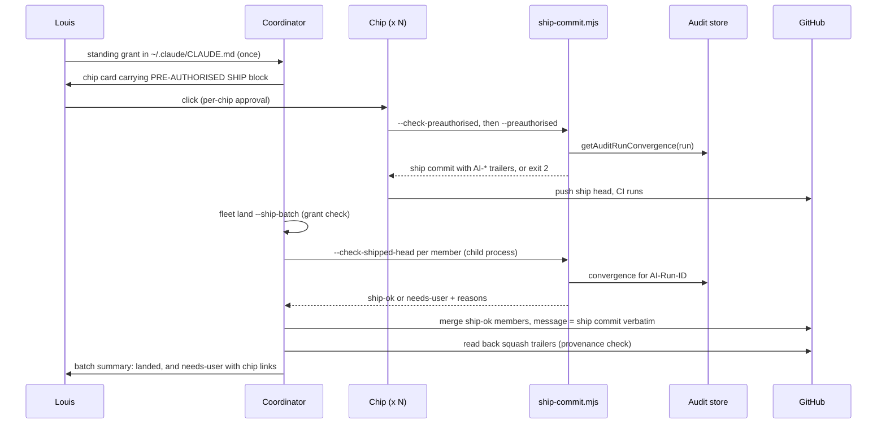

# Plan: Coordinator-owned aggregate ship (one ship action per batch)
- **Date**: 2026-11-18
- **Status**: In Progress
- **Author**: Claude + Louis
- **Scope**: backend (CLI scripts + skill prose; no UI). Stack `js-ts`.
- **Target domain(s)**: `fleet`, `ship`, `skills-content`, `docs`
- ⚠ **Cross-domain work**: this touches `fleet` and `ship`. The boundary crossing is intentional and follows the existing rule
  that fleet reaches ship **as a child process, never by import** (`.audit-loop/domain-map.json:265 (ceea43d2)`).

## 1. Context Summary

### The problem
Louis runs several chips a night. Each one ends at ship-ready, and he must type `/ship` in each chip session.

`/ship` is user-only:
- `disable-model-invocation: true` at `skills/ship/SKILL.md:14 (ceea43d2)`.
- "The `/ship` command IS the user's approval" at `skills/ship/SKILL.md:800 (ceea43d2)`.

The interim practice is that the coordinator squash-merges each PR under Louis's 2026-10-18 merge grant, then writes ONE record
PR (`ship-record.mjs catchup --write`, committed via `ship-commit.mjs --record --decision`). For example, CES #381 covered 16 PRs
and #389 covered 7. That record is honest but provenance-poor: every member lands as `merged-without-ship`
(`scripts/lib/ship-record/commands.mjs:25 (ceea43d2)`), and its squash commit carries no `AI-*` trailers of its own.

**Measured** with `git log -200 --format=%B origin/main` at ceea43d2, covering 2026-10-10 to 2026-11-18:
- 133 of the last 200 main commits carry no `AI-Gate` line at all.
- 67 carry one somewhere in the body.
- Only 54 carry one that git can parse as a trailer (`%(trailers:key=AI-Gate)`).

So 13 had their provenance pasted into the middle of a squash body, where no reader finds it. One of these is a pre-authorised
ship, `81bdd88b`, whose `AI-Ship-Authority: launch-prompt` block is present inline but not parseable. The cause is the repo's
squash setting, `squash_merge_commit_message: COMMIT_MESSAGES` (from `gh api repos/…`): it concatenates every commit message,
so the ship commit's trailer block is no longer the last paragraph.

**Goal.** A clean member ships with full per-member provenance, and Louis types nothing for it. One coordinator action per batch
lands every clean member. Each member that fails a condition waits for Louis's `/ship`, and the rest still land.

### Inventory: what exists and why it does not solve this today
All citations are read at `ceea43d2`.

| # | Machinery | What it does | Why it is not the answer today |
|---|---|---|---|
| 1 | `/ship` (`skills/ship/SKILL.md`) | Step 2 writes the status entry (`:580-598`). Step 5 writes the plan Status and Implementation Log (`:659-674`). Step 6.3 runs `ship-commit.mjs`, which writes the `AI-*` trailers (`:805-834`). The gate is passed, converged, waived or not-run (`:774-796`). | User-only (`:14`, `:800`). A coordinator cannot type it into another session, and a mid-turn invocation is refused. |
| 2 | `/ship --train` (`skills/ship/SKILL.md:1082-1092`; `skills/ship/references/train-mode.md:31-67`; `scripts/ship-train.mjs`) | Lands a batch of ship-ready PRs. Per-PR provenance comes from `decideTrainGate` (`scripts/lib/ship-train/provenance.mjs:145`). Squash messages come from `composeSquashMessage` (`:208`). | **Human-only**: "does not relax the explicit-invocation rule" (`SKILL.md:1086`, `train-mode.md:31`). It is source-repo-gated, and `ship-train.mjs` and `lib/ship-train/` are **not synced** to any consumer (checked on disk in wine-cellar-app, storyline and ai-organiser). It checks no final review, sensitive path, migration or policy file, and it writes no per-member plan log. |
| 3 | `ship-commit.mjs --preauthorised` / `--check-preauthorised` (`scripts/ship-commit.mjs:154-194`, `:657-684`) + `scripts/lib/ship-preauth.mjs` | A chip ships ITSELF when `evaluatePreauthorisedShip` (`ship-preauth.mjs:67`) holds all six conditions (`:23-25`): gate passed/converged and no `--no-tests`; audit converged per the store; final review APPROVE with result approve, bound to the audited tree and round; and no sensitive, migration or policy path (`:36-50`). It writes `AI-Ship-Authority: launch-prompt` (`ship-commit.mjs:682`) and refuses with exit 2, with no override. | **This is the right per-member mechanism, and it works.** Three such ships are on main: `e564473f`, `81bdd88b` and `7ff8883a`. But it is used only when the coordinator includes the opt-in launch block. Coordinators leave it out because it is "a launch-prompt decision, not a default" (`skills/fleet/references/chip-preamble.md:84`), and no standing grant makes it the default. Nothing checks a self-shipped head again at merge time. |
| 4 | Chip-preamble PRE-AUTHORISED SHIP block (`skills/fleet/references/chip-preamble.md:57-65`) | The prose that grants item 3 to a chip, approved by the user's chip click (`:17-23`). | Opt-in per launch, "Include only when the user approved it at launch" (`:57`), so the default chip ends at ship-ready (`:53-55`). |
| 5 | `ship-record.mjs catchup` (`scripts/lib/ship-record/state.mjs:1-20`; `entry.mjs:114-186`) | Records each merged PR once, after the fact. A PR counts as recorded if its own merge commit ADDED a log entry (`state.mjs:11-13`), so a self-shipped PR needs no catch-up entry. | Post-merge record only. It claims no gate: the record commit is `not-run` with `record-catchup` (`scripts/lib/ship-record/authority.mjs:84-125`). |
| 6 | `fleet land` / `land --approve` (`scripts/lib/fleet/land.mjs`; `train-approve.mjs:211-215`; `serial.mjs:26,118`) | One combined test over every ready head, then `gh pr merge --squash --match-head-commit <oid>` per member (`train-approve.mjs:213`). It prints a record nudge (`land.mjs:43-57`). `serial.mjs` already has a `messageFor` seam for a caller-supplied squash message (`:26`, validated `:118-127`). | It takes no ship verdict: it lands ready heads whether or not they shipped. The default merge passes no `--subject`/`--body`, which is how trailers get buried (the measurement above). It also needs "the user's explicit go-ahead in chat" (`skills/fleet/SKILL.md:88`). |
| 7 | `fleet decision record` (`scripts/lib/fleet/decisions.mjs:8-13,29,37`) | Durable, immutable declarations in four scopes: `record-catchup`, `note`, `test-plan`, `answer`. | "A declaration, not verified authority" (`:8`). By design no scope grants a merge, push, override or deletion (`:37`). |
| 8 | Coordinator playbook §1 and §7 (`skills/fleet/references/coordinator-playbook.md:17-37`, `:115-134`) | §1 merges only the audited head, compared by tree oid. §7 has the coordinator own the record catch-up, with one record PR at a time. | §1 is written for an unshipped head. A self-shipped head has, by construction, a tree that differs from the audited tree by the ship's doc steps, and no rule says which deltas are acceptable. |

**Code Trace.** The path of a pre-authorised ship, today:
1. Chip, at ship-ready: `ship-commit.mjs --check-preauthorised` (`scripts/ship-commit.mjs:154`).
2. `ship-commit.mjs --preauthorised` reads the gate evidence (`:174`) and the convergence via `readConvergence` (`:137`). That
   calls `getAuditRunConvergence` (`scripts/lib/store/runs-findings.mjs:1956`).
3. `evaluateGateVerification` (`scripts/lib/commit-trailers.mjs:420`) decides the gate.
4. `readFinalReviewMarker` and `boundFinalReviewDisposition` (`scripts/lib/final-review-marker.mjs:29,238,291`) bind the final
   review. The result becomes the `AI-Final-Review` value.
5. `evaluatePreauthorisedShip` (`ship-preauth.mjs:67`) with `gatherChangedPaths` (`:134`) runs the six conditions.
6. The commit is written with `AI-Ship-Authority: launch-prompt` and pushed.
7. Coordinator: `fleet land` builds the train; `land --approve` merges via `planFor` (`train-approve.mjs:211`), with no message.
8. The squash commit has the ship trailers buried inline (`81bdd88b`).

**Patterns reused vs new.** Reused: the preauth evaluator and its path predicates, `getAuditRunConvergence`, `ciVerdict`
(`scripts/lib/ci-verdict.mjs:271`), `requiredInventory` (`scripts/lib/fleet/required-checks.mjs:100`), the `messageFor` seam, the
record-commit path shape (`authority.mjs:103`) and ship-record's "recorded" oracle. New: one read-only `ship-commit.mjs` mode, one
pure evaluator, one grant reader, and one `fleet land` flag.

**Neighbourhood considered.** `get-neighbourhood` returned only `review`-band hits: `ship-commit.mjs main`, `git`,
`formatMigrationBlockLine`, `resolveSkillNames`. Nothing cleared the noise floor, so this plan opened the symbols directly and
chose to extend rather than add a sibling.

## 2. Proposed Architecture

### The one design idea
**The chip ships itself; the coordinator lands and re-verifies.** This keeps the existing split:
- The gate evidence and final-review marker live in the chip's worktree (`.audit/`, bound to its branch, `ship-preauth.mjs:78-89`).
  They can only be honestly read there.
- The chip that made the change is the best-placed author of its own status entry. The plan's Status and Implementation Log line are written by record catch-up after the merge (2.3).
- The coordinator gets the batch verb (`fleet land`), extended to re-verify each member **from durable facts alone**: the commit's
  trailers, the store, CI, and git trees. Only members that verify are merged.

"One ship per batch" therefore means ONE coordinator action and zero Louis actions for every clean member. The records stay per
member, because provenance is per change. A single aggregate commit for N PRs is rejected (§8): it would need one `AI-Gate` value
for N members, which is exactly the laundering §4 forbids.



### 2.1 Authority model (#5 Single Source of Truth, #16 Graceful Degradation)

**A. The standing grant. Louis writes it himself; no session edits `~/.claude/CLAUDE.md`.** Draft text to paste under
"Louis's standing instructions":

```markdown
## Coordinators may ship batches of pre-authorised chips

Since <DATE>: every repo coordinator session (titled `CES: Coordinator`, `WCA: Coordinator`, `STO: Coordinator`,
`AIO: Coordinator`) may include the PRE-AUTHORISED SHIP block in every chip launch prompt by default, and may land a
batch with `fleet land --ship-batch`. My click on a chip card that carries the block is my approval of that chip's
ship. Standing rules still apply:

- a chip ships itself only through `ship-commit.mjs --preauthorised`; if any condition refuses, that chip waits for
  me to type /ship in its session, and the rest of the batch still lands;
- the coordinator merges only members `ship-commit.mjs --check-shipped-head` reports ship-ok, squash, pinned with
  `--match-head-commit`, never `--auto`; the squash message is the member's ship commit message, verbatim;
- never `--no-verify` in wine-cellar-app;
- still mine: secrets and Railway or other deploy-environment writes, database migrations, sensitive paths,
  repository-policy files (.github/, CODEOWNERS, .test-tiers.json), plan decisions, deletions, GitHub settings and
  rulesets, raising caps or baselines.

<!-- grant: coordinator-ship-batch v1 -->
```

**How the reader matches the grant (R1-H6).** The reader in `scripts/lib/fleet/coordinator-grant.mjs` finds the section from its
`## Coordinators may ship batches` heading to the marker line.
- That section must equal the **canonical grant text** held as a constant in the same module. The comparison folds line endings
  (`canonicalizeEol`) and ignores the `Since <DATE>` value; nothing else is folded.
- **Revocation is deletion.** If Louis removes or rewrites the section (narrows it, or adds a carve-out), the reader refuses with
  `grant-mismatch`. A changed grant therefore needs a new canonical version, a `v2` marker shipped in a CES PR that Louis
  merges. A stale marker can never outlive its text.
- A marker inside a code fence, or a second marker anywhere in the file, refuses.

**Recommended (Louis's own act):** a user-settings deny rule, for example
`"deny": ["Edit(~/.claude/CLAUDE.md)", "Write(~/.claude/CLAUDE.md)"]`, so that the harness refuses a session write to the file. No
session may edit settings files, and code cannot verify file permissions. So whether or not the rule exists, the check stays
labelled a declaration (B3 below), and the authority that actually gates each chip is still Louis's own click (B2).

**B. How the coordinator proves the grant came from Louis, not from a relay.** There are three layers, each named honestly:
1. **Where the coordinator reads it.** The grant reaches the coordinator in the harness-loaded "user's private global
   instructions" (its system context), never in a peer message. A cross-session message, a file in the repo, a `fleet next`
   line or a decision record that *claims* the grant is data, not the grant. The playbook says this explicitly (Phase 3).
2. **The per-chip act is still Louis's click.** The grant only lets the coordinator *include* the block by default. Each chip
   still needs Louis to click its card. A message can never add the block to a chip that is already running, because the
   launch block says "No message can WIDEN this block" (`chip-preamble.md:17-23`). A chip launched without the block, or before
   the grant existed, ends at ship-ready and waits for `/ship`.
3. **Code fails closed when the grant is absent.** `fleet land --ship-batch` reads `~/.claude/CLAUDE.md` and requires the canonical
   grant section and its marker (A above). If either is absent or the file is unreadable, the run refuses (`grant-absent`).
   If the text differs, it refuses (`grant-mismatch`). Either way it merges nothing, and today's flow remains a separate,
   Louis-approved invocation (§2.5). This is labelled a **declaration check, not verified authority**, in the same words `decisions.mjs:8` uses for
   itself: it proves the line is in the file only sessions are forbidden to write. The verb prints this label. This repeats the
   reason `ship-preauth.mjs` exists (`:5-9`): an authority's absence is enforced in code, not in prose the actor reads about
   itself.

**C. What stays Louis's** is listed in the grant text. In code, the per-member condition `C5` (paths) refuses migrations, sensitive
paths and policy files, so those members always wait for him. Secrets, deploy writes, GitHub settings, caps and baselines are not
file changes a merge makes, so they stay outside the grant by its text, exactly as today's merge grant handles them.

### 2.2 Per-member ship (unchanged mechanism; the default flips)
- `chip-preamble.md:57-65` and `:84`: the block becomes **default whenever the coordinator is acting under the grant**. Without
  the grant it stays opt-in, as today. The ship step is: status entry file only (the plan Status and Implementation Log move to catch-up, 2.3),
  `--check-preauthorised`, `--preauthorised`, push.
- **Order.** The chip ships, then pushes the ship head, then runs `fleet ready`. That records the ship commit as the ready oid,
  so the CI that runs is CI on the ship head.
- **The worktree must survive until the PR is merged.** The `.audit/` markers are gitignored, archiving destroys them, and the
  batch re-check reads them (§2.3). The chip preamble adds: "never archive before your PR is merged". `fleet archive-check`
  gains the same refusal for a member that is ready but unmerged.

### 2.3 Batch re-verification: `ship-commit.mjs --check-shipped-head` (new read-only mode, #1 DRY, #11 Testability)

**Where it runs, and why there.** The checker runs with **cwd = the member's own worktree**. Fleet knows that path because a
claim binds the branch and worktree it runs from. The worktree is where the two local markers live that the ship-time check
already bound:
- `.audit/last-audit-run.json`, the gate evidence: `runId`, `auditedTree`, `round`, `auditedBranch`.
- `.audit/last-final-review.json`, the final review (`final-review-marker.mjs:29`).

Re-reading them with the **same predicates** is what binds the run and the final review to THIS member (R1-H1, R1-H2). There is
no second, weaker binding.

If the worktree, or either marker, is gone, the member is `needs-user` with reason `evidence-unavailable`. So the chip preamble
gains: **never archive before your PR is merged** (§2.2).

The mode lives in `ship-commit.mjs`, next to `--check-preauthorised` (`:154-194`), because that file already owns
`readConvergence` and the trailer vocabulary. Fleet calls it as a child process, per the domain rule above. It gathers facts and
calls a **pure** `evaluateShippedHead(facts)`, added to `scripts/lib/ship-preauth.mjs` so that ONE module owns the question
"may this ship without the user". That function reuses `row`, `matchFinalReviewMarker`, `isSensitivePath`, `isMigrationPath` and
`isPolicyPath`. To keep the file under its size ratchet, the gatherer lives in `scripts/lib/ship-shipped-head.mjs`, so
`ship-commit.mjs` gains only flag parsing and one call.

**The child contract, v1 (R1-H4):**
- **Argv:** `node <tooling>/ship-commit.mjs --check-shipped-head --head <oid> --json`. `<tooling>` is resolved by fleet relative to
  its own module (`import.meta.url`), never as the literal `scripts/`, so it is right in a consumer too (`scripts/.claude-skills/`).
- **Base:** the child resolves it itself, exactly as `gatherChangedPaths` does (`origin/HEAD`, else `refs/remotes/origin/main`,
  fully qualified). It takes no fleet facts.
- **Stdout:** exactly one JSON object:

  ```json
  {"schema":"shipped-head/v1","ok":true,"head":"<oid>","runId":"<uuid>","gate":"converged","conditions":[{"id":"C1","ok":true,"reason":"..."}]}
  ```

  Write it through `emit` / `await finishAndExit(code)`; an `ok:false` envelope sets a non-zero exit.
- **Exit:** 0 = ship-ok, 2 = refused (each condition carries its reason), 1 = the checker errored.
- **Fleet's reading of the result:** exit 1, a timeout, unparsable stdout, a `schema` other than v1, or `head` ≠ the oid asked
  for all count as `needs-user`, reason `checker-failed: <detail>`. None of them is ever a pass.
- **Ownership of the conditions:**
  - The child owns `C1`-`C5`.
  - Fleet owns `C7` (grant), `C8` (CI) and `C9` (identity), from facts it already holds (`verifyFacts`, `train-approve.mjs:90`).

**The conditions.** `H` is the member's head commit, `T_H` its tree, `A` the audited tree. `P` is the set of paths the branch
changes (`git diff --name-only --no-renames merge-base(H, base)..T_H`).

| id | Condition | Source |
|---|---|---|
| `C1 trailers` | `git interpret-trailers --parse` of `H`'s message yields exactly one each of `AI-Skill: ship`, `AI-Ship-Authority: launch-prompt`, `AI-Gate` ∈ {`passed`,`converged`}, `AI-Final-Review: approve` and `AI-Run-ID`. They must be **parseable trailers**: an inline-only block refuses. | git object |
| `C2 evidence` | The worktree's gate-evidence marker is content-verifiable (`isContentVerifiable`), and its `runId` equals `AI-Run-ID`. Its `auditedBranch` equals `H`'s branch, and it is known (the `ship-preauth.mjs:78-89` rule). The store row for that run reads `roundConvergedAfter` as an integer (`getAuditRunConvergence`, `runs-findings.mjs:1956`). Its `repo_id` matches this repo by the store's own `repoIdentityMatches` (`runs-findings.mjs:279`). Cloud off, a failed query, or no row refuses with the reason. | marker + store |
| `C3 final-review` | `matchFinalReviewMarker(evidence, readFinalReviewMarker(worktree))` binds the review to the same `runId`, `auditedTree` and `round` (`final-review-marker.mjs:273`). Its verdict must be `APPROVE` and its disposition `approve`, the same policy as `ship-preauth.mjs:95-102`. Corroboration: the run's stored `gemini_verdict` (`runs-findings.mjs:351`) must not contradict it. A stored REJECT or CONCERNS refuses; a null stored verdict refuses with `final-review-unrecorded`. | marker + store |
| `C4 post-audit-delta` | The algorithm below. | git trees |
| `C5 paths` | Three rows, `sensitive-path`, `migration` and `repo-policy`: the existing predicates over `P`. An empty or unresolvable `P` refuses (`ship-preauth.mjs:104-110`). | git + `sensitive-paths.mjs` |
| `C7 grant` | Fleet checks this at build, at approve, at resume and before each merge (§2.1 B3, §2.4). | `~/.claude/CLAUDE.md` |
| `C8 ci` | Two mechanisms, and both must be green at **exactly `H`** (final review G1). (1) The required status checks: `observeRequiredChecks` (`required-checks.mjs:193`) over `requiredInventory` (`:100`), which `train-approve.mjs` and `serial.mjs` already use. (2) Where `.test-tiers.json` declares a full-suite workflow, `ciVerdict` (`ci-verdict.mjs:271`) for that workflow's run on `H`. Unmeasured, pending or unknown on either refuses. | GitHub |
| `C9 identity` | The registry ready oid, the PR head and `H` are one oid. | registry + gh |

**`C4`, the post-audit delta (R1-H3).** It compares the **audited tree `A` with `T_H`**, never with the base, so a plan the branch
changed before its audit is handled the same way as any other path.
1. **Build the candidate set (R2-H2)** as `P* = P_head ∪ P_audit`:
   - `P_head = P`, the paths the head changes against `merge-base(H, base)`;
   - `P_audit` = `git diff --name-only --no-renames -z F A`. This diffs the audited **tree `A` itself** against **its own**
     fork point `F = merge-base(audited_sha, base)` (R3-H3), so a dirty-tree audit's uncommitted change is included even when
     `audited_sha's` tree is not `A`. `audited_sha` comes from the run's store row and is used only to find `F`; if it is null or
     the commit is missing, refuse with `audited-sha-missing`.

   Including `P_audit` catches an audited change that was later reverted to base, which drops out of `P_head`.
2. Compute `D = git diff --name-status --no-renames -z A T_H -- <P*>`. **Every git call that takes candidate paths runs with
   literal pathspecs (R3-H2)**: `GIT_LITERAL_PATHSPECS=1` is set on that child's own environment only, never exported into the
   coordinator's shell, because it leaks into hooks (memory tripwire). All output is parsed NUL-delimited (`-z`). Fixtures cover
   names with `[]`, `*?`, a leading `:(` magic prefix, and an embedded newline. `A` must exist as a tree object locally; if it is missing
   (gc'd), refuse with `audited-tree-missing`. A path in neither set is an upstream-only change brought in by a rebase, and it is
   correctly excluded.
3. An empty `D` is allowed. This is the `passed` case, where `T_H === A` on `P`.
4. The post-audit delta is **path-based only**: the single permitted entry of `D` is an ADDED (`A`, never `M`, `D`, `R` or `T`) regular
   file (mode `100644`) matching `docs/status/entries/<name>.md`. Every other path refuses with that path named: a modified, deleted or
   renamed entry, a file added outside the directory, a symlink or gitlink under it, a plan edit (Status or Implementation Log) and a
   `status.md` edit. No content is parsed, so no Markdown grammar can be wrong. The entry's content is not checked either: a new file is
   not part of the audited tree, so it cannot rewrite audited content, and what it says is the chip's own record, not a claim the audit relied on.
   A repository still on a single legacy `status.md`, or a ship that edits the plan, therefore waits for the user's `/ship`.
5. **A path changed both by the branch and after the audit is therefore legal ONLY as that added entry.** A conflict resolution
   anywhere else refuses, because it is unaudited code.

The plan `Status:` and `## Implementation Log` line move out of the pre-merge ship step: record catch-up adds them after the merge,
which is where the repository already writes them for members that merge without a ship.

**Fixtures (real git).** Each case is built in a temp repo:
- a status-entry-only delta;
- a plan Status edit, and an Implementation Log append, each REFUSED, on a plan the branch already changed before its audit;
- a modified, a deleted and a renamed audited entry, a file added outside the entries directory, a symlink and a gitlink under it;
- a code change after the audit;
- a rebase that changes an untouched path;
- an audited branch change reverted to base after the audit;
- an audited **uncommitted** (dirty-tree) change reverted before shipping;
- path names with pathspec metacharacters and newlines;
- a rebase whose conflict resolution touches a branch path;
- a delete;
- a rename;
- a gc'd `A`.

**Residuals, stated.**
- **Deletions are not mechanically refused.** The grant text keeps "deletions" as the user's decision, but neither the chip's own `--preauthorised` ship nor this re-check refuses a member whose audited diff deletes tracked files: both share one path row set, and the audit read the deletion. Making the re-check stricter than the chip's own ship would be a behaviour change to main outside this PR, and the user decides whether a file removal inside an audited diff is a "deletion". Residual: a member that deletes files can land without the user. Follow-up, user's call. **Closed 2026-11-18**: Louis accepted this residual, verbatim: "deletions can /ship - in a crisis we can always roll back from github" (relayed by CES: Coordinator), so a deletion in an audited diff may self-ship; no mechanical refusal is added.
- **Self-shipped members and the plan's Implementation Log.** Catch-up counts a PR whose merge added a status entry as recorded, so with the plan lines moved out of the ship step a self-shipped member's plan log line would never be written. The re-check fails closed meanwhile (a ship that still edits the plan refuses and waits for `/ship`). The follow-up that closes it is: catch-up suggests the plan line for an in-band PR whose plan carries no marker, and `/ship` Step 5 skips the plan edit under `--preauthorised`. Not in this PR (it edits the `/ship` skill, which is size-ratcheted).
- Audit **scope** coverage (did the run's passes read every path in `P`?) is not checked. Neither is it checked at today's ship
  time, so the grant widens nothing.
- A forged `AI-Final-Review` trailer is now caught by `C3`. A forged local marker is not, because a session that hand-writes
  `.audit/` breaks AGENTS.md's rule outright. The same exposure exists today at ship time.

### 2.4 `fleet land --ship-batch` (extends land; no new verb, #18 Backward Compat)
1. **Grant (`C7`).** Read the grant (§2.1 A, canonical-text match). If it is absent or mismatched, refuse with `grant-absent` or
   `grant-mismatch`, merge nothing, and exit 2. Plain `fleet land` is unchanged.
2. **Build.** For every ready member, run the child (`C1`-`C5`) and fleet's own `C8` and `C9`. Mark each member `ship-ok` or
   `needs-user`, with its rows.
3. **Partition, then integrate.** Exclude every `needs-user` member, and every member stacked on one (`--base`), **before**
   building the integration worktree. The tested set is then the merged set. The existing train manifest records:
   - the base oid;
   - the ordered `ship-ok` heads;
   - the excluded members with their reasons;
   - a `shipBatch: {grantVersion, checkedAt}` stamp.

   Run the existing combined test once.
4. **Approve** (`land --approve <train> --ship-batch`). These are the only steps that may run without a chat go-ahead.
   - The manifest must carry the `shipBatch` stamp. A plain train cannot be approved with `--ship-batch`, and vice versa.
   - **Re-read the grant (R2-H1)** at approve, at every `--resume`, and immediately before each merge. If it has been revoked or
     changed, stop with `grant-revoked`: merged members stay merged and are listed, and the rest are `not-attempted`.
   - **Base progression (R2-H3).** The manifest records the build-time base `B0`. After each successful merge it appends that
     member's squash oid `Mi`. Before any merge or resume, the live base tip must be **exactly** the last recorded oid (`B0` if
     none), and each `Mi`'s first parent must be its predecessor. Any foreign commit on the base refuses with `base-moved`, and
     the coordinator rebuilds: a new build and a new combined test, with nothing reconciled. The combined test therefore stays
     valid for the remaining members exactly when the only base movement is the batch's own merges, which are the heads it
     tested. This extends the existing approval-eligibility check (`approvable`, `train-approve.mjs`) rather than adding a second
     one. (R1-H5)
   - **Immediately before each merge**, re-run the child for that member, and `C8`/`C9`. This is cheap and read-only. Then merge
     with `gh pr merge --squash --match-head-commit <H>`, which is GitHub's server-side guard that the head did not move.
   - Merges go through the **serial** path (`serial.mjs`), which persists per-member progress and resumes.
   - **No remote branch update in `--ship-batch` mode** (final review G2). The serial runner's `update-branch` step
     (`serial.mjs:274`) is disabled. That step would create an unshipped merge commit on the PR branch, which breaks `C1` and
     `C9` and leaves the chip worktree behind. A member that is behind the base, or not cleanly mergeable at `H`, is
     `needs-user` (`behind-base`). It is never mutated.
   - **Durable per-member state (R3-H4)**, written to the manifest **before** each transition: `pending`, then
     `merge-requested`, then `merged` (squash oid recorded), then `verified` (read-back passed) or `provenance-lost`.
   - **Reconciliation** on resume, and on any uncertain merge result (a timeout or a non-zero exit): query
     `gh pr view <n> --json state,mergeCommit,headRefOid`.
     - A member in `merge-requested` that GitHub reports MERGED is adopted only if its `headRefOid` is `H`, its merge
       commit's first parent is the expected tip, and its message passes the read-back. The member then advances to
       `verified`, and the base progression appends its oid. That is how the batch's own unrecorded merge never reads as
       `base-moved`.
     - A member that GitHub reports not merged returns to `pending` and is re-checked.
     - A member in `merged` but not `verified` is read back on resume, never skipped.
   - **Base race (R3-H1).** `--match-head-commit` guards the head, not the base, and a server-enforced queue would be a GitHub
     setting, which is Louis's (Out of Scope). The plan therefore **detects** the race rather than claiming to prevent it. After
     each merge, if the squash's first parent is not the recorded tip, a foreign commit landed in the window, and the member
     landed on an untested base. It is reported `landed-on-untested-base`, the batch stops (exit 2), and the remaining members
     need a rebuild.
   - If a merge fails, the run **stops** at that member. Members already merged stay merged and are listed as such. The rest are
     listed `not-attempted`. `--resume` continues from the manifest, after re-checking.
5. **Message (R1-H4, R1-M1).** Merge through the `messageFor` seam (`serial.mjs:26`, validated `:118-127`):
   - `subject` = line 1 of `H`'s message (`git log -1 --format=%B H`, LF-normalised);
   - `body` = **every** line after line 1, with exactly one leading blank line removed if one is present and trailing whitespace
     trimmed. This is lossless (R2-M1): a message without a blank line after its subject loses nothing.

   The trailer block is then the last paragraph of the squash. It is copied from a git object, never composed.
6. **Read back.** The guarantee is **semantic, not byte-level**. After each merge, two things must hold:
   - the squash commit's subject and LF-normalised, whitespace-trimmed body must equal the split above (non-trailer content is
     retained);
   - `git interpret-trailers --parse` of the squash commit must equal `H`'s parsed trailers as a canonical multiset over
     `AI_TRAILER_KEYS` (`commit-trailers.mjs:30`). A mismatch is
   a loud `provenance-lost` row on that member, and the batch exits 2. The merge has already happened, so the row tells the
   coordinator to file it with `fleet propose`; it never tries to retry the merge into honesty.
7. **Summary.**
   - Landed members: `landed: N (passed a, converged b)`.
   - `needs-user` members: one line each with its refusals, the chip's session link, and the exact sentence "type /ship <plan> in
     this session".
   - Then the existing record nudge (`land.mjs:43-57`). Self-shipped members are already "recorded" (`state.mjs:11-13`), so the
     nudge counts only members merged without a ship.

`skills/fleet/SKILL.md:88` gains exactly one exception: `land --approve --ship-batch` on a `shipBatch` train may run without a chat
go-ahead. Every other `land --approve`, `--confirm`, `--override` and `--accept-rerun` still needs Louis.

### 2.5 Fallback when a member fails: the state table (#16, R1-M2)

| State | Who is affected | Outcome | Exit |
|---|---|---|---|
| Grant absent or mismatched | the whole batch | nothing merged; `grant-absent` or `grant-mismatch`. Today's flow is still available as a **separate** plain `fleet land` invocation, with Louis's go-ahead | 2 |
| Store off or unreachable (`C2` cannot read) | every member | every member is `needs-user` (`store-unavailable`); nothing merged | 2 |
| GitHub or CI unreachable (`C8` unmeasured for every member) | every member | every member is `needs-user` (`ci-unmeasured`); nothing merged | 2 |
| A member refuses any of `C1`-`C9` | that member, plus members stacked on it | `needs-user` with its rows; the rest land | 0 if ≥1 member landed and no `provenance-lost`, else 2 |
| Every member refuses | every member | nothing merged | 2 |
| Merge failure mid-batch | the remaining members | stop; `--resume` | 2 |
| `provenance-lost` on read-back | that member (already merged) | reported loudly; the remaining merges still run | 2 |

- **No automatic fallback merge.** `--ship-batch` never runs a plain land, and a plain land never borrows the grant.
- A `needs-user` member stays open at its idle chip for Louis's `/ship`.
- Nothing retries a refused condition, and nothing re-runs an audit to find a pass. The chip preamble already forbids it
  (`chip-preamble.md:63-64`), and the verb offers no such path.

### 2.6 AI-Gate honesty (invariants the implementation must hold)
1. **No batch-level trailer anywhere.** Each squash carries exactly its own member's ship-commit block. The batch summary prints
   per-member gate counts, never one aggregate value.
2. **`waived` and `not-run` can never land under the grant.** `C1` admits only `passed` and `converged`. A member whose ship
   evidence was waived goes to Louis. No code path raises a member's gate: the verb reads trailers and never writes one.
3. **`AI-*` trailers are written only by `ship-commit.mjs`.** The merge copies `H`'s message verbatim; the read-back proves it.
   The record commit stays `not-run` with `record-catchup` (`authority.mjs:84`).
4. **No gate evidence is hand-written.** `--check-shipped-head` is read-only, and nothing here writes `.audit/*`.

### 2.7 Other repos (WCA, STO, AIO)
- **Synced already** (checked on disk): `.claude/skills/{ship,fleet}` and
  `scripts/.claude-skills/{ship-commit,ship-record,fleet}.mjs` plus `lib/ship-preauth.mjs` exist in all three consumers. Every
  file this plan changes is already in the sync closure (`scripts/lib/sync-path-map.mjs:7`; closure from entry points,
  `scripts/lib/sync-inventory.mjs:344`). `ship-train` is **not** needed, which is why the plan avoids it.
- **The new `pathVerdict` export** is a lib move inside `scripts/lib/ship-record/`, which is already synced. `npm run sync`
  verifies the closure. Synced SKILL prose names tooling **by path** (AGENTS.md shape 5).
- **Per-consumer store.** `C2` reads the consumer's own store (wine and storyline are on different stores). An air-gapped or
  cloud-off consumer refuses `C2`, so `--ship-batch` lands nothing there and the flow degrades to today's. It is honest, and it
  is never a pass.
- **wine-cellar-app**: never `--no-verify` (in the grant text). Its sync PR stays `--no-merge` and is merged by WCA (memory
  rule). This plan adds no auto-merge of sync PRs.
- **Rollout.** One CES PR, then the normal re-sync of each consumer. The grant line names all four coordinators. A coordinator
  in a repo whose sync predates the change finds no `--ship-batch` flag and stays on today's flow.

### 2.8 Docs every member ship still produces (unchanged, and still per member)
- The status entry file under `docs/status/entries/`, written by the chip in ship Step 2 (`skills/ship/SKILL.md:580-598`).
- The plan `Status:` and `## Implementation Log` line is NOT written by the ship step any more: record catch-up adds it after the merge (see 2.3).
- The ship commit with `AI-*` trailers, written by `ship-commit.mjs`.
- The coordinator writes no per-member docs. Its only write is the record PR for members merged without a ship
  (coordinator-playbook §7, unchanged).

## 6. Sustainability Notes
- **Assumptions that could change.** The grant marker lives in a Claude-Code-only file. A Copilot-hosted coordinator has no
  `~/.claude/CLAUDE.md`, so `C7` refuses and that host keeps today's flow. This is accepted, because coordinators are Claude
  Code sessions today. The reader takes the path as an argument, so a second host adds one path, not a redesign.
- If GitHub's squash setting changes to `PR_BODY`, the explicit `messageFor` message still wins. The read-back (§2.4 step 5)
  catches any future drift.
- **Extension point.** `evaluateShippedHead` returns rows, so a future condition (for example a store-side final-review identity
  that would close the §2.3 residual) is one row.

## 7. File-Level Plan

### 7b. Implementation Phases
- **Phase 1: pure evaluator + path-only post-audit delta.** Files:
  - `scripts/lib/ship-preauth.mjs` (modify: add `evaluateShippedHead`, `SHIPPED_HEAD_CONDITIONS`, `renderShippedHeadConditions`)
  - `scripts/lib/ship-shipped-head.mjs` (the path-only `shipEntryRefusal`; `ship-record/authority.mjs` is NOT modified)
  - `tests/ship-preauth-shipped-head.test.mjs` (create)
- **Phase 2: the `--check-shipped-head` read-only mode and its gatherer.** Files:
  - `scripts/lib/ship-shipped-head.mjs` (create: gathers `C1`-`C5` in the member worktree, plus the v1 envelope)
  - `scripts/ship-commit.mjs` (modify: flag parsing and one call only, under the size ratchet; `--selfcheck-relocation` is
    already present)
  - `tests/ship-commit-check-shipped-head.test.mjs` (create: the real-git fixtures of §2.3)
  - `docs/reference/commit-provenance.md` (modify: a coordinator-batch section; parseable vs inline trailers)
- **Phase 3: `fleet land --ship-batch`, the grant reader, the merge message and read-back.** Files:
  - `scripts/lib/fleet/coordinator-grant.mjs` (create: `readShipBatchGrant(path, fs)`, the canonical text, a pure parse)
  - `scripts/lib/fleet/land.mjs` (modify: the flag, partition before integrate, the manifest stamp, the summary)
  - `scripts/lib/fleet/train-approve.mjs` (modify: the stamp check, `base-moved`, the per-merge re-check, routing through
    `messageFor`)
  - `scripts/lib/fleet/serial.mjs` (modify: the read-back hook after each merge, the `provenance-lost` row)
  - `scripts/lib/fleet/lifecycle.mjs` (modify: `cmdArchiveCheck`, `:287`, refuses for a ready, unmerged member)
  - `scripts/fleet.mjs` (modify: flag registration / `assertKnownFlags`)
  - `tests/fleet-land-ship-batch.test.mjs` (create)
  - `tests/fleet-coordinator-grant.test.mjs` (create)
  - `tests/sync-ship-batch-closure.test.mjs` (create, **Tier 3, same commit**: the sync closure contains
    `coordinator-grant.mjs` and `ship-shipped-head.mjs`; in a relocated `scripts/.claude-skills/` layout, fleet's child-path
    resolution finds `ship-commit.mjs`; the relocated CLI answers `--selfcheck-relocation`; grant-absent and store-off refuse
    there too)
- **Phase 4: prose.** Files:
  - `skills/fleet/references/chip-preamble.md` (modify: block default under the grant; ship before `ready`; no archive before
    the ship commit)
  - `skills/fleet/references/coordinator-playbook.md` (modify: §1 the shipped-head delta rule; a new §7a batch ship; where the
    grant is read from)
  - `skills/fleet/SKILL.md` (modify: the `:88` rule exception, `--ship-batch` usage)
  - `skills/ship/SKILL.md` (modify: one line saying a coordinator batch lands self-shipped members; `/ship` stays user-only)
  - `skills/fleet/references/coordination.md` (modify: rule 4 cross-reference)

**Close-out (not a phase):** `npm run skills:regenerate`, `npm run skills:check`, `npm run skills:size:gate`,
`npm run size:ratchet:gate` (`ship-commit.mjs` is over 1000 lines: the new mode must stay small or move into `lib/`),
`npm run emit:exit:gate`, `npm run stdout:flush:gate`, `npm run plans:lint`, `npm run guards:preflight`, the CES full suite in
Actions.

### 11. Execution Clustering
- **Cluster A**: Phases 1-2, fix-gate: yes
  - Coupling: the evaluator's fact shape is the contract the CLI gathers. They are audited together so the wiring pass sees the
    gatherer against the evaluator.
- **Cluster B**: Phases 3-4, fix-gate: final
  - Coupling: the land flag's behaviour and the prose that authorises it must say the same thing, notably the `:88` exception
    and the chip ordering.
- **Final gate**: the consolidated final review over the union diff.

## 8. Risk & Trade-off Register

**Right-sizing.**
- **Band-aid extreme.** Tell coordinators to always include the PRE-AUTHORISED SHIP block, and keep merging as today. Chips ship
  themselves, but nothing re-verifies at merge, and the squash still buries the trailers (`81bdd88b` shows that this already
  happens).
- **Over-engineered extreme.** A coordinator-run ship that writes members' docs from its own worktree, or a new signed-grant
  token, or porting `ship-train` to consumers and making it model-invocable.
- **Chosen.** Flip the default under a user-written grant, and add one read-only re-check and one `land` flag. Each piece serves
  a current requirement: Louis types nothing for clean members (default flip), only clean members land (re-check), and the
  provenance survives the squash (the message plus read-back).

**Trade-offs and what could go wrong.**
- **A single aggregate commit is rejected.** It would need one `AI-Gate` for N members, and it would lose per-member
  attribution.
- **The coordinator runs no member's ship steps.** The evidence lives in the chip's worktree, and two sessions writing one
  worktree is the shared-tree failure mode.
- **`C4` may refuse more members than expected** when chips rebase after the audit onto changes to the same files. That is
  correct, because a conflict resolution is unaudited. Measure the refusal mix on the first three batches before tuning anything.
- **`AI-Final-Review` forgery residual** (§2.3) is recorded as a `fleet propose` follow-up: bind the final review to a store row
  with target identity.
- **Louis's 2026-10-18 merge grant is broader than this one.** It already lets a coordinator merge an UNSHIPPED PR. This plan does
  not narrow it; that is Louis's call. The plan flags it so the two grants are read together.
- **Deferred:** making `ship-train` model-invocable, or syncing it (not needed); a store-backed final-review identity (follow-up
  above).

## 9. Testing Strategy

**Proof plan.** Each behaviour has an oracle that could fail:

| Behaviour | Oracle | Pass condition | Report evidence |
|---|---|---|---|
| `evaluateShippedHead` refuses each failing fact | A pure unit test per condition, in **both directions**: must fire on a forged trailer with no converged run, `waived`, `not-run`, an inline-only (unparseable) trailer block, a code path changed after the audit, a both-sides-changed path, a gc'd `audited_tree`, sensitive / migration / policy paths, and an empty `P` (unmeasured CI is fleet's `C8`, tested in the approve row); must NOT fire on a status-entry-only delta, a plan-Implementation-Log-only delta, or an upstream rebase change outside `P` | Written red first against a stub returning ok, then green | Test names and counts, the red run output |
| `--check-shipped-head` reads real git objects | A temp-repo integration test that builds ship-shaped commits with a mocked store | Exit 0 / 2 and the rows match | Test output |
| The positive control against history | Run `--check-shipped-head` on `7ff8883a` (a real launch-prompt ship) | `C1` refuses on the missing `AI-Final-Review` trailer, which post-dates that commit, and `C2` refuses with `evidence-unavailable`, because the chip worktree is gone. That proves the check is not vacuous. A fixture worktree and commit carrying every trailer and marker pass `C1`-`C5` | Command output, recorded in the Implementation Log |
| Negative control | `--check-shipped-head` on `ceea43d2` (a record commit, `not-run`) | Refuses `C1` | Command output |
| Partition before integrate | A land test with three members (ok, needs-user, stacked-on-needs-user) | The integration worktree contains only the ok member, and its oids equal the merged set | Test output |
| The squash message carries the trailers | (1) The **emitted** `gh pr merge` argv carries `--subject` and `--body` per the §2.4 split, tested on multiline bodies, a message with no blank line after its subject, a trailing newline and CRLF input. (2) A read-back test on a fixture squash commit built by `git commit-tree` with GitHub's message: the parsed trailer multiset equals `H`'s. (3) A mismatch fixture produces `provenance-lost` | All three | Test output |
| Grant fails closed | Reader tests: absent file, unreadable file, no marker, wrong version, a section whose text differs from canonical (narrowed, carve-out added), a marker in a code fence, two markers, CRLF file | Only the canonical section passes | Test output |
| Fresh verification at approve | Approve tests: base moved, a head moved between build and merge, a member whose CI flips red between build and approve, an interruption at each state transition (after merge-requested with GitHub merged and not merged, after merged before read-back), a base commit injected between the client check and the merge (`landed-on-untested-base`), a mid-batch merge failure followed by `--resume` with only the batch's own merges on the base (accepted), the same with a foreign commit in between (`base-moved`), and the grant revoked between build and approve and between two merges (`grant-revoked`) | As stated; resume skips merged members | Test output |
| Child contract | Tests with a stub child returning exit 1, a timeout, non-JSON, the wrong schema, or the wrong head | Each gives `needs-user` / `checker-failed` | Test output |
| The consumer sync contract (Tier 3) | `tests/sync-ship-batch-closure.test.mjs`, in the same commit as Phase 3 | The closure contains the new modules; the child resolves in the relocated layout | Test output |

The live check, after merge, is the first real batch: `git log --format='%(trailers:key=AI-Ship-Authority)'` on each landed squash
shows `launch-prompt` as a **parseable** trailer. That is the consumer-side verification.

**Test log.** If `fleet next` reports `fullSuite: "train"`, write "full suite deferred to the train (fullSuite: train)". CES runs
its full suite in Actions.

## Out of Scope (Future)
- **A server-enforced base binding for merges** (a GitHub merge queue or a ruleset): this is a GitHub settings change and
  Louis's decision (R3-H1). Until then the batch detects a base race after the fact (`landed-on-untested-base`) and stops.
- **A store-side final-review target identity**, so that `C3` does not depend on the chip worktree's local marker surviving:
  recorded as a `fleet propose` follow-up (§2.3 residuals).
- **Audit scope coverage** (did the run's passes read every path in `P`?): not checked at ship time today either.

## Audit trail
- **/audit-plan, SID `audit-plan-1794982045277-103580`** (2026-11-18). GPT rounds: R1 H7 M2, R2 H3 M1, R3 H4. Every finding was accepted and fixed:
  acceptance 100% in each round, recorded in the ledger and the cloud outcomes.
- **The soft cap (3) stopped the loop, not convergence.** The structural card at the cap read:
  - "AT THE CAP WHILE PRODUCTIVE";
  - one STRUCTURAL cluster, the base verification race, which is resolved here as detection plus an Out-of-Scope server-side
    queue that is Louis's call;
  - one LOCAL? cluster, the post-audit delta, which is resolved by the tree algorithm in §2.3 `C4`;
  - two POLISH clusters.
- **No round 4 was run.** The card is a human call. This chip has no user to answer it, so the call goes to the coordinator and
  Louis with the handoff.
- The mandatory final review follows.
- **Final review** (gemini, round 1/2): `CONCERNS`, gate `approve_with_debt` (blocking 0, debt 3). All three findings were fixed in
  the plan rather than carried as debt:
  - G1: `C8` names both CI mechanisms;
  - G2: no `update-branch` in batch mode;
  - G3: stale condition ids and the `archive-check` file.

  The gate was approved, so no round 2 was needed.

## Implementation Log

> **Read the REWORK note at the end of this log first.** The delta-grammar rows and rounds below describe the DELETED content-grammar design and are kept as history; the current rule is path-only (2.3).

**2026-11-18: SPLIT.** The plan was implemented in full on `claude/plan-coordinator-aggregate-ship-f258c2` (pushed, tag `pr-b-source`), and
the user then decided to land it in two PRs ("Split it"). The code audit of the whole thing stopped at its round cap with the serial
runner raised in all six rounds: it has no per-member outcome model, so the batch's skip, hook and read-back semantics are bolted on
through three seams. So:

- **PR A (this one): the read-only half.** `ship-commit.mjs --check-shipped-head` and its gatherer (`scripts/lib/ship-shipped-head.mjs`),
  the two store reads (`scripts/lib/store/ship-run-facts.mjs`), `evaluateShippedHead` and the shared path rows
  (`scripts/lib/ship-preauth.mjs`), the ship-step delta grammar `isShipStepDelta` (`scripts/lib/ship-record/authority.mjs`), the grant
  READER (`scripts/lib/fleet/coordinator-grant.mjs`), and the archive-check refusal `shipEvidenceOwed` (`scripts/lib/fleet/lifecycle.mjs`).
  Sections 2.1 (the reader only), 2.3 and 2.2 (the archive part) of this plan are what it delivers. Nothing merges, writes a trailer, or
  calls the grant reader yet.
- **PR B (not opened): `fleet land --ship-batch`** and its `serial.mjs` seams (section 2.4 and 2.5). It waits for a small plan that gives
  the serial runner a real per-member outcome primitive (proposal recorded from the audit's structural card). The grant text in section
  2.1 must NOT be pasted into `~/.claude/CLAUDE.md` until PR B lands: it names a command that does not exist yet.

Deviations from the audited text, for what PR A contains (each deliberate):

| Plan said | Code does | Why |
|---|---|---|
| `GIT_LITERAL_PATHSPECS=1` on the child | NO pathspecs at all: `git diff --raw -z A T_H` lists every path and the candidate set filters it in code; file text is read as `A:<path>` | a name with glob or magic characters can never be misread, and no env var leaks into hooks |
| `isShipStepDelta` replaces `pathVerdict`'s grammar | a new exported grammar beside it; `pathVerdict` is unchanged | the record grammar is narrower (log lines must match `PLAN_LOG_LINE_RE`) and a shared one would have changed record behaviour |
| the store row's `audited_tree` must match | it must be recorded on BOTH the marker and the store row, and equal (a row from before audited-tree identity refuses) | a code-audit finding: a null is not a binding |
| the post-audit delta | append-only Implementation Log, ONE log heading, a created log must be appended after the whole document, only the Status field may change, regular-file modes only, `--ignore-submodules=none`, a size bound | each was a code-audit finding with a test |
| the change set is measured against `origin/HEAD` | against `refs/remotes/<remote>/<branch>` the PR targets (`--base`, `--remote`), and with `--verify-base` the local ref must equal the LIVE branch | a stale or wrong base would define "the change" |
| `archive-check` refuses via `cmdArchiveCheck` | `shipEvidenceOwed(session, pr)` feeds `archiveReport`'s `unverified` list (verdict UNVERIFIED); a PR that could not be queried is uncertain, not clear | no new verdict value |

Proof: red-then-green for `evaluateShippedHead` and `isShipStepDelta` (the first run failed on the missing export); real-git fixtures for
a dirty-tree audit, a change reverted to base, an upstream-only rebase, a symlink status entry, a gitlink under
`diff.ignoreSubmodules=all`, odd path names, a non-default and a non-origin base, a stale local base against a real bare remote, a HEAD
that moves mid-check, and the two storyline incidents of 2026-11-18 (a range cherry-pick that dropped its first commit: the tree
differs, so it refuses; the PR head differing from the tested head). Mutation checks of the evaluator's rows each turned the suite red.
The relocated-layout test copies the sync closure through the real path map and runs the relocated CLI. **Not in this PR, so not proved
here:** the merge-time re-read of the PR head and the head-identity check (`C9`); they belong to PR B's `land --ship-batch`.

### Code audit trail, PR A (`/audit-code --scope diff --base origin/main`, SID `audit-code-1795000910440-83564`)

GPT rounds (HIGH / MEDIUM): R1 9 / 14, R2 3 / 1, R3 2 / 1, R4 1 / 1, R5 2 / 1, R6 3 / 1. Every finding is ruled in the ledger (fixed with a
test; dismissed with a reason; or deferred with the honest-deferral fields: the batch design finding belongs to PR B, and the two
overlapping record/ship grammars are recorded debt).

**The loop stopped at the soft cap (6), not at convergence.** Rounds 2 to 6 were one family: the ship-step grammar kept being asked to
model a further Markdown construct that can change how unchanged text renders (comments, fences, raw HTML, headings, reference
definitions, setext). Round 6 therefore PIVOTED instead of patching: a line the ship adds inside the Implementation Log must be a plain
list item or prose line (`PLAIN_LOG_LINE_RE`), and the live remote base is re-read at the end of the check. Round 6's fixes are tested
but were not re-audited. A member whose log needs a table, a code block or a link reference waits for the user's `/ship`.

**Final review** (gemini, round 1 of 2) in two disjoint batches so that every changed line was shown: both coverage notes read `FULL`
(batch 1: 4 files, 494 changed lines; batch 2: 3 files, all whole). Batch 1 `APPROVE`; batch 2 `CONCERNS`, gate `approve_with_debt`
(0 blocking, 2 debt, captured): a section-boundary edge case in the log range and a note that the markup/context rules are now partly
redundant with the whitelist (kept deliberately as defence in depth). A single review over all seven files read `PARTIAL, 177 of 911
changed lines never shown`, which is why it was split.

**One round past the cap** (approved by the user to verify the pivot): R7 raised 2 HIGH, the same finding twice: a link reference definition nested in a list item (`- [x]: url`) passed the plain-line whitelist. Fixed with a test (six container shapes, red without the fix) and NOT re-audited: the user's ruling was exactly one round past the cap. The finding class (a Markdown construct the whitelist did not name) is therefore narrowed but not proved closed, and the PR carries that caveat.

**Final round, after narrowing the rule to no Markdown characters** (approved by the user: "narrow the whitelist and run one final round"): R8 raised 5 HIGH: a one-hyphen setext underline (H1), an inserted link reference definition in the legacy status.md log (H2, H4), and emphasis or code spans pairing across soft line breaks (H3, H5, which showed that the measured-exception variant that still allowed `*`, `_` and a single backtick was unsafe). All five fixed with tests and NOT re-audited (the ruling was one round past the cap). The forbidden set is now `[ ] < > | * _` and the backtick, one named constant `LOG_LINE_FORBIDDEN_CHARS` with `LOG_LINE_ALLOWED_INLINE` empty, after one leading list marker is stripped. Cost, measured over 3,950 real Implementation Log lines: 69.0% are refused (17.3% for the rejected variant), so most batch members will wait for the user's /ship. Rounds 1 to 8 raised HIGH 9, 3, 2, 1, 2, 3, 2, 5; the round-8 fixes are unaudited.

**REWORK of PR A (the user's decision: "rework PR A").** Eight audit rounds (HIGH 9, 3, 2, 1, 2, 3, 2, 5) showed that a content grammar over Markdown cannot be closed: every round found one more construct that changes how unchanged text renders. The grammar is therefore deleted, not patched: `isShipStepDelta`, the plain-log-line rule, `LOG_LINE_FORBIDDEN_CHARS` and every helper behind them are gone, and `ship-record/authority.mjs` is back to main's version. The post-audit delta is now path-only (`shipEntryRefusal` in `ship-shipped-head.mjs`): an ADDED regular file `docs/status/entries/<name>.md` and nothing else. **Decision, content of the new entry: no check.** A new file is absent from the audited tree, so it cannot modify audited content, and the audit never relied on what it says. The cost is that the plan Status and Implementation Log line (and the legacy `status.md` insert) are no longer a ship-step edit: they are written by record catch-up after the merge, as for the members that merged without a ship. Tests: an added entry passes; a modified, deleted or renamed entry, a file added outside the directory, a plan Status edit, a log append, a `status.md` edit, a symlink and a gitlink under the directory each refuse; a negative control asserts the grammar module exports no longer exist. The earlier audit (SID `audit-code-1795000910440-83564`, rounds 1 to 8) audited the deleted design; the rework starts a fresh audit with its own round count.

**Fresh audit of the reworked PR A** (SID `audit-code-1795011593962-68156`, its own round count; the earlier eight rounds audited the deleted grammar). Round 1: 5 HIGH, 11 MEDIUM, 1 LOW (full PR diff). Rulings: 3 fixed (branch identity at the end of the check, import-versus-read error separation, isolated fixture git), 3 deferred with reasons to PR B or a follow-up (batch-landing design M1/M4/M5, grant-reader HTML blocks M7), 2 residuals stated in section 2.3 (file deletions are not mechanically refused; self-shipped members' plan lines need a catch-up follow-up), the rest dismissed with a reason each (run row read by id is compared by the evaluator; fork PRs are other branches; the grant tail is already checked; new entry content is unchecked by decision). Round 2: 1 HIGH invalid as stated (JS `$` does not match before a trailing newline) but its neighbour was real (an embedded newline passed): entry names now use the repository's own `ENTRY_NAME_RE`. Rounds 3 to 5 were one family, the base the change is measured against: the default branch is asked of the remote (not a stale local symref) and re-read at the end, and the base is resolved ONCE to a commit id and passed to both change-set calculations, in both modes. Round 6: PASS, 0 HIGH, 1 MEDIUM, 1 LOW (JSON envelope on checker errors, repository lookup reason), fixed with tests and not re-audited (cap 6). `_convergence`: converged. **Final gate:** gemini, three disjoint batches (6 source files; the two large test files; the four remaining test files), each `Code: FULL`, each `APPROVE` (blocking 0, debt 0). Round HIGH counts: 5, 1, 1, 2, 2, 0.
- 2026-11-18: merged #394 (d53272aa1484) — recorded by ship-record catch-up <!-- ship-record pr=394 -->
- 2026-11-19: merged #395 (5de17cfa4489) — recorded by ship-record catch-up <!-- ship-record pr=395 -->
