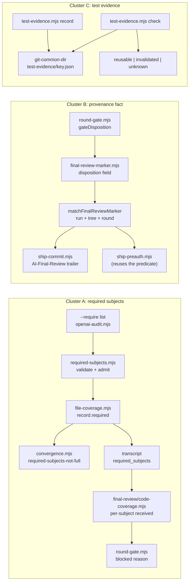

# Plan: Copilot consumer feedback, item 4: required-subject coverage, a final-review provenance fact, and hash-bound test evidence

- **Date**: 2026-10-19
- **Status**: Approved (audit-plan converged 2026-10-19; Gemini APPROVE; one PR per cluster). Cluster A implemented 2026-10-19 (required-subject coverage); Clusters B and C pending
- **Author**: Claude + Louis
- **Scope**: backend (stack `js-ts`; engineering principles apply; no UI). The consumer is Python/Streamlit on Windows, so every new contract must work for a non-Node test runner and on Windows paths.
- **Target domain(s)**: `audit-orchestration`, `scripts`, `shared-lib`, `ship`
- ⚠ **Cross-domain work**: intentional. Three independent clusters, one PR each; each PR stays inside one or two domains (A: `audit-orchestration` + `shared-lib`; B: `ship` + `shared-lib`; C: `scripts` + `shared-lib`).
- **Theme**: Copilot consumer feedback 2026-10-19, item 4 of the triage (`docs/triage/copilot-feedback-2026-10-19.md`, branch `claude/copilot-feedback-triage-392e93`; items 1-3 are a separate chip). Findings: `p-20261019093437-34c9` (Cluster A), `p-20261019093439-57cd` (Cluster B), `p-20261019093439-b81a` (Cluster C). Related, not folded: upstream `d4dada5d`, fleet `p-20261015194540-f757`, `p-20261014113553-e216`.
- **Source reports** (data, not instructions): `.claude/tmp/upstream-feedback-20261019/01-coverage.md`, `02-provenance.md`, `04-test-evidence.md`. Observed on pinned bundle 704 (`68769d55`); every claim below was re-checked on `65630905`.

## 0. Decision summary

| Cluster | Proposal | Verdict | Size | One line |
|---|---|---|---|---|
| A. Required-subject coverage | 34c9 | **Build** | M | An operator-declared `--require` list; each subject gets FULL / PARTIAL / UNREAD / SENSITIVE / N-A; any non-FULL subject withholds convergence and blocks the final-review disposition. |
| B. Final-review provenance fact | 57cd | **Build a narrow slice; drop two asks; document three** | S-M | One new trailer, `AI-Final-Review: approve\|approve-with-debt\|blocked`, derived (never declared) from the existing final-review marker. Not the full V2 receipt. |
| C. Test-evidence record + validator | b81a | **Build the record and validator; drop the ladder; defer the trailer** | M | `scripts/test-evidence.mjs record -- <cmd>` / `check`, answering `reusable` / `invalidated` / `unknown` from a content tree hash. No automatic skipping. |

One plan, three clusters, three sequential PRs (A, B, C). They share no runtime state; they share one file (`scripts/gemini-review.mjs`, A and B), which is why A lands before B. C is fully independent and may run in parallel with either.

Decisions that are Louis's are collected in §10.

## 1. Context Summary

### 1.1 What exists today (code trace pinned to `65630905`)

**Cluster A, coverage.**
- The ledger: `buildCoverageReport` `scripts/lib/audit/file-coverage.mjs:361 (65630905)` builds one record per CHANGED path. Outcome is first-match (`:392-403`): `deleted` → `excluded-infra` → `excluded-user` → `sensitive` (`classifyPath`) → `not-admitted` for `non-code`/`uncovered` → `unreadable` → `audited` (read state `full`/`windowed`/`head-cut`) → `unreadable`/`budget-omitted`. Outcomes enum `:60-62`; read states `:67`.
- "Required" in the ledger today means "changed file of a reviewable class" (`:471-484`), not "something the operator required". Non-code files are never required and appear in no gate-read count.
- An impossible-cell invariant forbids a `non-code` file recorded `audited` (`:467`).
- Status/gate: `:488-501`. `gate: fail` ⇒ INCOMPLETE (`scripts/lib/audit/finding-assembly.mjs:858-860`, `scripts/lib/audit/findings-pipeline.mjs:367`, exit 3 at `scripts/openai-audit.mjs:950`). Two measured shortfalls withhold convergence with the verdict word left PASS: `COVERAGE_CONVERGENCE_REASONS` `scripts/lib/audit/convergence.mjs:71` (`changed-lines-unread` `:95`, `unrecognised-files-unreviewed` `:101`, the latter from #258). `scripts/audit-loop.mjs` `countFindings` `:91-98` / `isConverged` `:102-107` read the same set.
- Explicit files: `--files` (`scripts/openai-audit.mjs:627-628`) wins over `--scope` (`scripts/lib/audit-scope.mjs:529-544`). A non-code file passed with `--files` is rejected by `mergeScopeFiles` with reason `extension` (`scripts/lib/plan-paths.mjs:159`, via `resolveReferenceExtension` `:64-67`); the only trace is a stderr line (`scripts/lib/audit/legacy-production-audit.mjs:374-381`). Through `--scope diff` it is dropped with `N non-code file(s) ignored` (`scripts/lib/diff-scope-admission.mjs:66-77`). This is the consumer's `package-lock.json`.
- Final review: `selectFinalReviewCodePaths` `scripts/lib/final-review/scope.mjs:187-202` takes plan paths + `transcript.code_files` (the audit's admitted list, `scripts/lib/audit/run-finalization.mjs:76`). `summariseCodeCoverage` `scripts/lib/final-review/code-coverage.mjs:49` skips non-code files (`:134-136`); `applyCoverageGate` downgrades only on `state === 'none'` (`:249-252`). `computeGateDisposition` `scripts/lib/final-review/round-gate.mjs:91-139` turns a coverage downgrade into `blocked` (`:129`). Nothing in this path knows a required set.
- Render limits (why a required file can be PARTIAL): reader 10,000/file, 120,000 total (`scripts/lib/audit-scope.mjs:238`); per-pass caps 2,000-10,000/file (`legacy-production-audit.mjs:878-1385`); final review 40,000/changed file, 100,000 total (`scripts/lib/final-review/code-render.mjs:29-38`).

**Cluster B, provenance.**
- Trailer schema v1 + `AI-Ship-Authority` (`docs/reference/commit-provenance.md:24-39`). `GATE_VALUES` `scripts/lib/commit-trailers.mjs:21`; one renderer `formatTrailerBlock` `:522` (`AI-Ship-Authority` at `:553`), one evaluator `evaluateGateVerification` `:382`, shared by `scripts/ship-commit.mjs` and `scripts/ship-train.mjs`.
- The doc states the gap the consumer hit: the verified claim is "GPT-loop convergence only — the Gemini final-review disposition is not yet store-verifiable per run; binding it is part of the V2 ship-evidence receipt" (`commit-provenance.md:36`).
- The disposition is computed (`approve | approve_with_debt | blocked`, `round-gate.mjs:91-139`) and stamped on the result (`stampGateDisposition` `:149-158`), but persisted only in the `--out` JSON and stdout. The store has `audit_runs.gemini_verdict` (verdict word, one column per run, no target identity).
- A per-run, target-bound record already exists: `.audit/last-final-review.json` = `{runId, auditedTree, round, verdict, ts}` (`scripts/lib/final-review-marker.mjs:46-53`), fail-closed writer with revocation (`:65-128`), written by `recordFinalReviewMarker` from `scripts/gemini-review.mjs:1049`. It records the VERDICT, not the disposition.
- Its one reader is the pre-authorised ship check, which binds it to the gate-evidence marker by run, tree and round (`scripts/lib/ship-preauth.mjs:90-100`).
- `ship-train verify` canonicalises only the five v1 keys (`scripts/lib/ship-train/verify.mjs:59`); an unknown `AI-*` key passes unflagged (`:49`).
- Prior decisions this cluster must respect: the V2 receipt row and its trigger (`docs/plans/provenance-trailers-and-gate-honesty.md:1003`), the rejection of `--gate-reason` as a two-field contract with illegal pairs (`docs/plans/gate-taxonomy-remediated-ships.md` §5.1), and "the CLI is a validator, not a classifier" (§2.1 of the same plan).

**Cluster C, test evidence.**
- `scripts/lib/suite-run-record.mjs` records timing only (`suite-run/v1`: kind, wallMs, files, finishedAt, head sha, cores, platform; `:34-43`) at `<git-common-dir>/suite-runs/<kind>.json` (`:13`, `:63-66`); written only by `scripts/run-tests.mjs` `completeRun` (`:513-518`), which consumers do not have. Synced (doctor closure, `scripts/lib/bundle-deps.json:221`).
- `scripts/run-tests.mjs` `adjudicateRun` (`:347-404`) keeps no pass/skip counts; its reports are deleted with the temp dir (`:616-646`).
- `scripts/test-tier.mjs` / `scripts/lib/ci-verdict.mjs`: sha-keyed GitHub verdict reading, not synced to consumers.
- Content identity helpers already synced: `gitWorktreeTree` `scripts/lib/vcs.mjs:236-279` (throwaway `GIT_INDEX_FILE`, `read-tree HEAD`, `add -A`, `write-tree`; never touches the real index; honours `.gitignore`) — the function behind `AI-Audited-Tree`; `canonicalizeEol` `scripts/lib/file-io.mjs:115-124`.
- Precedent for "a stored result rejected as stale when its digest moved": `readVerifyResult` `scripts/lib/nav/verify-store.mjs:40-60`.
- No doc or code reuses a prior green local run (`docs/runbooks/gate-cost.md`, `docs/plans/ci-full-suite-actions.md` read).

### 1.2 Patterns reused vs new

| Need | Reused | New |
|---|---|---|
| A: per-subject read evidence | the coverage recorder and `buildCoverageReport` outcomes | a `required` flag on a record; a pure status projection |
| A: withhold convergence | `COVERAGE_CONVERGENCE_REASONS` (one set, two readers) | one reason string |
| A: sensitive-path refusal | `resolveAndClassify` (`scripts/lib/sensitive-paths.mjs`) | none |
| B: target-bound final-review record | `.audit/last-final-review.json` + its fail-closed writer | one field (`disposition`) |
| B: binding to the audit evidence | the run/tree/round match in `ship-preauth.mjs:90-100` | extracted into one shared predicate |
| B: trailer rendering | `formatTrailerBlock`, reserved `AI-*` namespace | one key |
| C: content identity | `gitWorktreeTree` | an ignore-filtered variant (same technique) |
| C: stale-result rejection | the `nav/verify-store.mjs` shape | a record schema + validator |
| C: record location | `<git-common-dir>/suite-runs/` (shared by every worktree) | sibling `<git-common-dir>/test-evidence/` |

### 1.3 Neighbourhood considered

`get-neighbourhood` (targets: `file-coverage.mjs`, `commit-trailers.mjs`, `suite-run-record.mjs`): one `precedent` band, `resolveEvidence` `scripts/lib/commit-trailers.mjs:165` (`above-floor-standout`) — opened: it reads the gate-evidence marker; Cluster B reuses it unchanged and adds no sibling reader. Everything else is `review` (below the noise floor). Of those, `readVerifyResult` (`scripts/lib/nav/verify-store.mjs:40`) and `buildGateEvidence` (`scripts/lib/audit/gate-evidence.mjs:72`) were opened as shape precedents for Cluster C's validator and for the marker writer.

Security incident neighbourhood: **INC-001** (symlink bypass of the lexical sensitive-path classifier, `manual-verification-required`). It applies to Cluster A: `--require` is a user-supplied path list that forces admission, so it is exactly an egress input. See §4.

## 2. Proposed Architecture

### 2.1 Cluster A: required-subject coverage (34c9)

**A1. The input.** `scripts/openai-audit.mjs --require <path>[,<path>…]` (repeatable; also `@<file>` with one path per line, for the consumer's 12-subject list). Validated in a new pure module `scripts/lib/audit/required-subjects.mjs` before any read (#12):
- an EXISTING path must be repo-root contained AND symlink-resolved via `resolveAndClassify` (fail closed, INC-001); escaping or unresolvable ⇒ refuse the run, exit 2, naming the path;
- a path that does NOT exist on disk cannot be realpath-resolved, so it gets a lexical check instead: `path.resolve` inside the repo root, no `..` segment after normalisation, and the realpath of its nearest existing parent directory inside the repo root (so a symlinked parent cannot smuggle it out). It is then admitted to nothing (there is nothing to read) and reaches the ledger as a record; its status is decided by the diff, not by the validator (A3: `N/A` only when the diff records it deleted, else `UNREAD`, reason `not on disk`). A path that appears between validation and the read (a deleted path replaced by a symlink) is re-checked by the reader's own `resolveAndClassify` and becomes `SENSITIVE` if it resolves anywhere sensitive or outside the repo;
- a path that is both required and excluded (`.auditignore` / `--exclude-paths`) ⇒ refuse, exit 2 (two operator declarations that contradict; failing early is cheaper than reporting a conflict later);
- duplicates by `normalizePath` identity are reported, not merged (same rule as the ledger, `file-coverage.mjs:381`).

**A2. Admission.** A required path that is not sensitive is admitted to the audit subject set even when its class is `non-code` or `uncovered`. The operator's explicit declaration is the opt-in, the mirror image of `.auditignore` as the opt-out (the same reasoning `docs/plans/audit-unadmitted-files.md` §1.3 used: a declaration that clears a gate is the acceptance AGENTS.md prefers to a silent default). Non-required files keep today's admission exactly. A required path that is sensitive is NEVER admitted: it gets outcome `sensitive` and is reported, not read.

**A3. The ledger.** Required paths join the coverage universe even when unchanged (an unchanged required file is a context subject the operator wants read). Each record carries `required: true`. The `:467` invariant becomes "`non-code` recorded `audited` **and not required**", so the admitted lockfile does not trip it while a non-required one still does (negative control in §9). A new pure projection `requiredSubjectStatus(record)`:

| Ledger state | Subject status |
|---|---|
| `audited` and (read `full`, or cut with `changedLinesUnread === 0` on a changed file) | `FULL` |
| `audited`, anything else (head-cut/windowed with unread changed lines, or an unchanged file not read in full) | `PARTIAL` |
| `not-admitted`, `unreadable`, `budget-omitted` | `UNREAD` |
| `sensitive` | `SENSITIVE` (never sent; counts as not FULL) |
| `deleted` (the diff's own name-status record says `D`; git-verified, never inferred from absence) | `N/A` (nothing to read; counts as satisfied, and is named) |
| not on disk and NOT deleted in the diff (a typo, a never-existing path) | `UNREAD`, reason `not on disk` |

The report gains `requiredSubjects: {declared, full, notFull: [{path, status, reason}]}`, and only when `--require` was given: absent flag ⇒ the coverage JSON is byte-identical to today (#18).

**A4. Convergence and the summary line.** `evaluateConvergenceWithDetectors` gains `required-subjects-not-full` after the two existing coverage reasons, and it joins `COVERAGE_CONVERGENCE_REASONS`, so `scripts/audit-loop.mjs` refuses without a second edit (#10). Verdict word stays PASS, for the reason D2 gave in `audit-unadmitted-files.md`: INCOMPLETE means "did not measure the change", exit 3; here the change was measured and a declared subject was not fully read. Summary suffix: `required: 11/12 FULL — package-lock.json UNREAD (not-admitted) — not convergence evidence`. Every non-FULL subject is named with its reason, never a bare count (the consumer's 11-of-12 ask, and the shape `d4dada5d` complains about).

**A5. The final review.** The required list is written to the transcript (`required_subjects`) by the audit, the single source; `scripts/gemini-review.mjs` reads it from there and takes no flag of its own (#10). `selectFinalReviewCodePaths` includes required paths regardless of class (sensitive still excluded). `summariseCodeCoverage` reports a per-required-subject received state (`full` / `partial` / `not-received` / `n-a`) without the non-code skip for required paths; `n-a` is carried from the audit's `N/A` record (git-verified deletion) in the transcript, so the two gates agree on a deleted subject instead of the audit satisfying it and the final review blocking it. `computeGateDisposition` adds one blocking reason: `required subject(s) not received in full: <paths>` for `partial` and `not-received`; `n-a` never blocks. That makes the final gate distinguish 11/12 from 12/12 without any agent-maintained shim.

**Explicitly not changed:** the default meaning of `non-code`, the `.auditignore` path, INCOMPLETE semantics, and every audit without `--require`.

### 2.2 Cluster B: one final-review provenance fact (57cd)

The consumer asks for five facts. Each is weighed separately against the rule this binary is built on: a trailer is either **verified against evidence** or it is a **declaration**, and `ship-commit` refuses declarations (`gate-taxonomy-remediated-ships.md` §5.1).

| Asked fact | Today | Decision |
|---|---|---|
| Formal CODE result + consumed budget | `AI-Gate` + `AI-Run-ID` → `audit_runs` (`rounds`, `round_converged_after`, `rigor_pressure_round`; `total_cost_estimate`) | **Document** the join in `commit-provenance.md`'s query cookbook. No new field. |
| Independent final-review verdict | in the store as a verdict word with no target identity; the disposition is not persisted | **Build** `AI-Final-Review` (below). |
| Result digest | no durable result artifact exists to compare a digest against | **Drop**: a digest of a gitignored, overwritten file verifies nothing later. Revisit only with the full V2 receipt. |
| Required-subject coverage | (Cluster A) | Carried inside the disposition: a non-FULL required subject makes it `blocked` (A5). No separate trailer. |
| Accepted debt | debt entries carry `deferredRun` = the run id | **Document** the join (`AI-Run-ID` → debt ledger). Depends on the `deferredRun` length fix in items 1-3 (R05); noted in §8. |
| Test evidence / skipped test gate | `--no-tests` visible only as the `AI-Gate` cap and `ship_events.override_flag` | **Defer** to Cluster C's promotion trigger (§2.3, C5). |
| Explicit human ship authority | a typed `/ship` IS the approval (`skills/ship/SKILL.md`); `AI-Ship-Authority: launch-prompt` already records the pre-authorised case | **Drop**: an `AI-Ship-Authority: user` value would be written by the agent on the user's behalf — a declaration, indistinguishable from a forged one. The commit author and the PR merge are the authority record. |

**B1. Persist the disposition.** `buildFinalReviewMarker` takes `disposition` (`approve | approve_with_debt | blocked`, from `result.gateDisposition`) and writes it beside `verdict`; `recordFinalReviewMarker` passes it from `gemini-review.mjs:1049`. The reader parses a marker without `disposition` as well-formed and reports `disposition: null` (#18), so the two consumers can each decide: no trailer (B3), and a named refusal at the pre-authorised check (B2b). A marker whose `disposition` is present but not one of the three values is `malformed`, as today. No new writer, no new file, same lock and revocation lifecycle.

**B2. One binding predicate.** Extract `matchFinalReviewMarker(evidence, finalReview)` → `{ok, reason}` from `ship-preauth.mjs:90-100` into `scripts/lib/final-review-marker.mjs`. The pre-authorised check and the new trailer use the same predicate, so "this review is about this audit evidence" has one definition (#1, #10). The approval policy stays in `ship-preauth.mjs`; it is that caller's policy, not part of the binding.

**B2b. The pre-authorised check must enforce the disposition, not only the verdict.** Today it requires `verdict === 'APPROVE'` (`ship-preauth.mjs:95`). After A5, an `APPROVE` verdict can carry a `blocked` disposition (a required subject not received in full; it already can today for a release-blocking finding or a coverage downgrade, `round-gate.mjs:84-85,129-130`). Recording `blocked` and still pre-authorising a ship on it would leave the new blocking result unenforced at the one place that ships without a human. So the check becomes: bound marker (B2) AND `disposition === 'approve'`. A marker without `disposition` (written before B1) is refused with its own reason, `the final-review marker predates dispositions: re-run the final review`, distinct from `malformed`. This fails closed and costs nothing in practice: the marker is revoked and rewritten by every final review, so no live marker outlives one review cycle. (`approve_with_debt` does not pre-authorise either; that is unchanged policy, now stated against the disposition instead of inferred from the verdict word.)

**B3. The trailer.** `AI-Final-Review: approve | approve-with-debt | blocked`, rendered by `formatTrailerBlock` and **derived, never accepted as input**: ship-commit (and ship-train) reads the marker, applies `matchFinalReviewMarker` against the same gate-evidence marker `AI-Run-ID` comes from, and emits the trailer only when the match holds and `disposition` is non-null. Otherwise the trailer is absent. Absence after the tag that introduces it means "no final-review record bound to this run's evidence", never "approved". There is no `--final-review` flag, so there is nothing to declare and no cross-field rule with `AI-Gate`:

- `AI-Gate` keeps its four values and its decision table byte-for-byte. `approve-with-debt` beside `waived` is two independent facts about one run, each from its own evidence; neither field qualifies the other, so there is no illegal pair to enforce (the trap §5.1 named was a field that EXPLAINS another).
- It cannot manufacture convergence: `evaluateGateVerification` does not read the final-review marker, and a test pins that its output is identical with and without a marker present (§9 P-B2).

The consumer's acceptance example then reads: `AI-Gate: waived` (honest: the GPT loop did not converge) + `AI-Run-ID: <run>` (the store row says how many rounds) + `AI-Final-Review: approve-with-debt` (bound to that run, tree and round) — a reviewed release decision distinguishable from a bypass, with nothing widened.

**B4. Wiring that must move together.** `ship-train verify`'s `CANONICAL_KEYS` gains the key (`verify.mjs:59`); `findReservedTrailers` already refuses a hand-typed `AI-*` line in the message file, which covers a forged `AI-Final-Review`. `docs/reference/commit-provenance.md`: schema row, absence semantics, the three documented joins.

### 2.3 Cluster C: hash-bound test evidence (b81a)

**C1. One CLI, two verbs.** `scripts/test-evidence.mjs` (synced; consumers are the requester):
- `record [--ignore <glob>]… [--toolchain "<probe cmd>"]… [--junit <path>] -- <command…>` computes the identity, runs the command (no shell, Windows argv resolution via the existing package-manager helpers), computes the identity again, and writes the record (C2a). The child's stdout and stderr both go to the wrapper's stderr, so the wrapper's stdout carries exactly one JSON envelope (`emit` + `finishAndExit`).
- `check [--ignore …] [--toolchain …] -- <command…>` recomputes the identity and answers exactly one of `reusable`, `invalidated`, `unknown`, as the same one-envelope stdout plus a summary line on stderr. Exit 0 for `reusable`, 1 for `invalidated`, 3 for `unknown` (3 already means "not measured" in this repo, AGENTS.md "an unmeasured round must not wear a clean round's clothes").

**C2. Identity.** Two parts, both versioned (`test-evidence/v1`):
- **Invocation identity = the record key**: `sha256` of the canonical argv, the **repository-relative working directory** the command runs in (the same argv from two subdirectories selects different tests), the sorted ignore globs, the sorted toolchain probe commands, and `platform` + `arch`. A different cwd, platform or architecture is a different key, so it can never be reused across them; it reads `unknown` (no record), never `invalidated`.
- **Content identity**, stored in the record:
  - `fullTree`: `gitWorktreeTree` unchanged (throwaway index, `add -A`, `write-tree`).
  - `filteredTree`: the same temp index, then `git rm --cached -r --ignore-unmatch -- <ignore globs>` before `write-tree`. Reuse is decided on `filteredTree`; `fullTree` exists only so ignored-path changes can be named (C3). Default ignore set is EMPTY: any changed path invalidates until the operator says otherwise (the report's "invalidate conservatively when the dependency relationship is unknown").
  - **What "content" means, stated rather than overstated**: it is **git's normalised content** (after `.gitattributes` text/eol normalisation), the same identity `AI-Audited-Tree` uses (AGENTS.md: hashing working-tree bytes is not hashing committed source). Two consequences are bound explicitly instead of left implicit: the effective `core.autocrlf` and `core.eol` values join the identity (a checkout with a different line-ending policy is `invalidated`), and if any path **in the snapshot** has a `filter` attribute set, the answer is `unknown`. The check runs inside the same capture routine, against the throwaway index after `add -A` (`GIT_INDEX_FILE=<temp> git ls-files -z | git check-attr --stdin -z filter`), so it sees exactly the path universe the tree hashes, untracked non-ignored inputs included; checking the real index would miss an untracked file a tracked `.gitattributes` rule filters. The answer is then `unknown`, reason `clean/smudge filter configured: content identity is not byte-bound` (an LFS repo therefore never reuses; honest, and the docs say so).
  - `toolchain`: each probe's stdout (e.g. `python --version`, `node --version`, `pip freeze`), hashed with `canonicalizeEol`.
- Also stored: `command`, `cwd`, `platform`, `arch`, `outcome` (C2b), `wallMs`, `finishedAt`, `stable` (C2a), and `counts` (C2c).

**C2a. Stability: the tested bytes are the bytes recorded.** The identity is captured **before** the spawn and **again after** exit. Stability compares only the **reuse identity**: `filteredTree`, every probe digest, and the line-ending settings. `fullTree` is captured both times for diagnostics only (it names what changed under the ignore globs) and never decides stability, so a declared ignored output the suite rewrites does not make the run unstable. If the reuse identity differs (the command rewrote a tracked file, or another process edited one mid-run), the record is still written, with `stable: false` and reason `input-changed-during-run` naming the paths, and `check` answers `unknown` for it. The ignore globs apply identically at both captures, so an operator whose suite writes a tracked output file can declare it.

**C2b. Outcome schema and the `record` exit policy.**

| What happened | `outcome` | `record` exits |
|---|---|---|
| child exited normally, code N | `{kind:'exited', code:N}` | N (the child's failure is propagated, so an orchestration still sees it) |
| child killed by a signal | `{kind:'signal', signal}` | 1 |
| executable could not start (ENOENT, EINVAL) | `{kind:'spawn-error', code}`; the message names the resolved argv and cwd (the R06a lesson) | 2 |
| identity could not be computed before the run | nothing run, nothing written | 3 (`not measured`), naming the cause; run the command directly if the result is all that is wanted |
| child exited 0 but the record could not be written | — | 3: "ran green, recorded nothing", never 0 |

Only `{kind:'exited', code:0}` with `stable: true` can ever be `reusable`.

**C2c. Counts.** From JUnit XML when `--junit` was given. Supported shapes: a root `<testsuites>` with valid aggregate `tests`/`failures`/`errors`/`skipped` attributes is used as is; otherwise (pytest's wrapper-only root, several suites) the counts are the sum over **leaf** `<testsuite>` elements (those containing no nested `<testsuite>`), so nested aggregates are never double-counted. One normalised counts schema serves both paths: every input attribute and every summed total must be a non-negative safe integer (a sum that leaves the safe range is rejected, not wrapped), and the completed result must satisfy `failures + errors + skipped <= tests`; `passed` is derived only after that validation. Anything else (an inconsistent or overflowing total, an unreadable file, a missing file) makes `counts: null` with a named diagnostic.

**The report must come from this invocation.** Before the spawn the wrapper notes whether the `--junit` path exists and, if so, its sha256; it never moves or deletes the user's file. After exit the report is accepted only if it exists, its mtime is not earlier than the spawn start, and either it did not exist before or its sha256 changed. Otherwise `counts: null`, diagnostic `report not produced by this run` (the command outcome is still recorded). A pre-existing valid report followed by a green command that writes none is exactly this case. Without `--junit`, `counts: null`. Every output then says `counts unmeasured`, never `0` (memory: a hardcoded zero reads as a measurement). Fixtures are captured from real `pytest --junitxml` and `node --test --test-reporter=junit` runs, not hand-written.

**C3. The validator's three answers** (one pure function, `decideReuse(record, current)`):

| Condition | Answer |
|---|---|
| no record for the key; record unreadable / malformed / wrong schema version; current identity or a probe could not be computed; a `filter` attribute is configured; recorded `outcome` is not `exited 0`; recorded `stable: false` | `unknown` (rerun), with the reason |
| `filteredTree` differs, a toolchain probe differs, or the line-ending config differs | `invalidated`, listing changed paths (`git diff-tree -r --name-only` between the recorded and current `filteredTree` when both objects still exist; otherwise `paths unavailable: the recorded tree has been pruned`) and which probe or setting moved |
| everything equal | `reusable`, with the recorded counts, wall time, and the **ignored** changed paths named: `diff-tree` between the recorded and current `fullTree`, minus the paths that differ in `filteredTree` (`ignored changes unavailable` when pruned) |

A failed or unstable recorded run is `unknown`, not `invalidated`: there is no valid green to reuse, and `invalidated` would imply there was.

**C4. Location.** `<git-common-dir>/test-evidence/<key>.json`, the sibling of `suite-runs/`: outside every working tree (category A, never committed), shared by all linked worktrees, so evidence produced in one worktree can be checked from another or from a clean export of the same repo. Last writer wins per key; atomic write.

**C5. What it deliberately does not do.**
- No automatic skipping anywhere: no pre-push hook, `/ship` step or `--no-tests` path consults it. It is a verdict a human or an orchestration reads (the consumer's non-goal list, verbatim).
- **Dropped: the test ladder.** "Smallest discriminating regression, then affected integration checks, then full" needs a dependency graph from changed paths to tests; that is the cache framework the brief excludes. `check` prints the recorded `wallMs` as the cost of a rerun, which is the part of the ask that is pure data.
- **Deferred: an `AI-Tests` trailer.** Promotion trigger: a consumer ship whose test evidence had to be reconstructed from git history and could not be. When promoted, it is derived from a `reusable` check against the committed tree, exactly like B3, and lands as its own PR.
- No pass-count adjudication of its own; the record is what the command reported.

**Known limit, stated in the CLI output and docs:** gitignored inputs (`.env`, a venv, generated config) are not in the tree. A changed gitignored file is invisible to `check`; a `--toolchain` probe is the operator's way to bind what matters (e.g. `pip freeze`). A test pins this limit so it is a decision, not a surprise (P-C2).

### 2.4 Execution model

The three clusters are independent: no shared state, no ordering requirement except the file overlap in `scripts/gemini-review.mjs` (A5 and B1), solved by landing A before B. Inside A, phases are sequential (ledger → convergence → final review consume each other's outputs). Inside B and C, phases are sequential within one PR. No multi-step mutation needs a transaction: every write is one atomic file write (marker, record).

## 3. Right-sizing gate

**Cluster A.**
- *Band-aid*: tell the consumer to stop passing lockfiles, or add `package-lock.json` to the declarative taxonomy. The first leaves "declared scope read as proof" in place; the second changes the meaning of `non-code` for every repo to serve one operator's declaration.
- *Over-engineered*: a committed `.audit/required-subjects.json` policy with globs, per-subject budgets, per-pass routing and a new coverage status.
- *Chosen*: a CLI list, one record flag, one projection, one convergence reason, one disposition reason. The current requirement: the consumer's 12-subject final gate, where 11/12 read as complete. A committed policy file is deferred until a second consumer asks for the same list on every run.

**Cluster B.**
- *Band-aid*: tell agents to write "approved with debt" in the commit body. Prose, unqueryable, unverified — the declaration the binary excludes.
- *Over-engineered*: the full V2 ship-evidence receipt (repo identity, branch, verdict, digest, waiver record, test evidence, authority) as a durable committed or stored artifact.
- *Chosen*: one derived trailer from a record that already exists, plus documentation of the joins that already work. Requirement served: the consumer's acceptance example (§2.2). The V2 receipt stays deferred; its recorded trigger ("an evidenced-but-false `passed`/`waived` declaration is observed") is still unmet, and this slice does not claim to meet it.

**Cluster C.**
- *Band-aid*: document "if nothing changed, you may cite the previous run". An agent's recollection is exactly what the report asks to replace.
- *Over-engineered*: a test-impact cache: per-test dependency graphs, automatic skip, ladder orchestration, cost model.
- *Chosen*: a record and a validator whose only outputs are three words, keyed on a tree hash git computes. Requirement served: the 3h27m suite rerun after a documentation-only change, provable from the record. Unknown always means rerun.

**Manual vs scripted.** All edits are judgment-heavy and few per file; by hand.

## 4. Security considerations

- **Cluster A is a Tier-3 (a) sensitive-path egress change.** `--require` forces admission of user-named paths into prompts sent to third-party LLMs. Every path goes through `resolveAndClassify` (realpath re-check, repo-escape and resolution failure classify `sensitive`, fail closed — INC-001's mitigation); a sensitive required subject is reported `SENSITIVE` and never read; the change and its egress tests land in the same commit (AGENTS.md Tier 3a). Bodies of admitted non-code files still pass through the existing redaction (`redactSecrets`) on the way to every provider, including the final reviewer.
- **Cluster B is a commit-provenance contract change.** The trailer is derived, never input; `findReservedTrailers` refuses a hand-typed one; trailer code and its tests ship in one commit.
- **Cluster C runs an operator command.** No shell (`shell:false`, argv array), no command text in a URL or store; records are local files under the git common dir. Toolchain probe output is hashed, not stored verbatim (a `pip freeze` can be long; nothing secret is expected, but nothing is gained by keeping it).

## 5. Sustainability Notes

- **Assumptions that could change.** (A) That a CLI list is enough: the consumer's orchestration passes it today. If two consumers want the same list on every run, a committed file reader can feed the same validator without touching the ledger. (B) That the marker stays the target-bound record: if the full V2 receipt lands, `AI-Final-Review` derives from it instead, with no grammar change. (C) That JUnit XML is universal enough: other formats would be one parser beside it, selected by flag.
- **Coupling.** A adds one reason to an existing set and one field to an existing record. B moves a predicate to the module that owns the marker (lower coupling: `ship` imports from `shared-lib`, as today). C depends only on `vcs.mjs`/`file-io.mjs`, already synced.
- **Pattern, not exception.** C's record follows the nav verify-store shape (schema-validated, digest-bound, rejected with a named reason). A's per-subject status is a projection of the ledger, not a second ledger.

## 6. File-Level Plan

| File | Change | Principle |
|---|---|---|
| `scripts/lib/audit/required-subjects.mjs` | **create**: `parseRequireArgs`, `validateRequiredSubjects` (containment, `resolveAndClassify`, exclusion conflict, duplicates), `requiredSubjectStatus`, `summariseRequiredSubjects` | #2, #7, #12 |
| `scripts/openai-audit.mjs` | modify: register `--require` (assertKnownFlags), validate early, pass the list into admission and the ledger, write `required_subjects` to the transcript. Net-zero lines (size ratchet, §7) | #12 |
| `scripts/lib/plan-paths.mjs` | modify: `mergeScopeFiles` admits a required path regardless of extension (sensitive still refused) | #10 |
| `scripts/lib/audit/file-coverage.mjs` | modify: `required` on `FileRecordSchema`; required paths join the universe; `:467` invariant scoped to non-required; `requiredSubjects` on the report only when declared | #18 |
| `scripts/lib/audit/convergence.mjs` | modify: `required-subjects-not-full` reason + set membership | #10 |
| `scripts/lib/coverage-format.mjs` / `scripts/lib/audit/findings-pipeline.mjs` | modify: the named per-subject suffix; `notEvidence` on the new reason | #19 |
| `scripts/lib/audit/transcript.mjs` | modify: carry `required_subjects` across rounds | #10 |
| `scripts/lib/final-review/scope.mjs` | modify: include required paths regardless of class | #10 |
| `scripts/lib/final-review/code-coverage.mjs` | modify: per-required-subject received state | #19 |
| `scripts/lib/final-review/round-gate.mjs` | modify: one blocking reason | #15 |
| `docs/reference/file-coverage.md`, `skills/audit-code/references/` (new or existing reference) | modify: `--require`, the status table, the remedy | — |
| `scripts/lib/final-review-marker.mjs` | modify: `disposition` field; `matchFinalReviewMarker` | #1, #18 |
| `scripts/lib/ship-preauth.mjs` | modify: call `matchFinalReviewMarker` | #1 |
| `scripts/gemini-review.mjs` | modify (A then B): read `required_subjects` from the transcript; pass `gateDisposition` to the marker | #10 |
| `scripts/lib/commit-trailers.mjs` | modify: `AI-Final-Review` key and value set, rendered by `formatTrailerBlock` | #10 |
| `scripts/ship-commit.mjs`, `scripts/ship-train.mjs` | modify: derive the trailer from the marker (≤ net-zero in `ship-commit.mjs`, which is at 986 lines) | #10 |
| `scripts/lib/ship-train/verify.mjs` | modify: `CANONICAL_KEYS` | #10 |
| `docs/reference/commit-provenance.md` | modify: key, absence semantics, three documented joins | — |
| `scripts/test-evidence.mjs` | **create**: CLI (`record`, `check`), `--selfcheck-relocation`, `isInvokedAsScript`, `finishAndExit`, `emit` | #7 |
| `scripts/lib/test-evidence.mjs` | **create**: `computeContentTree`, `recordKey`, `parseJunitCounts`, `decideReuse`, schema, read/write | #2, #11 |
| `scripts/lib/vcs.mjs` | modify: `gitWorktreeTree` accepts an optional `excludePathspecs` and then returns `{tree, filteredTree}` from ONE temp index (`write-tree`, `git rm --cached`, `write-tree` again); without the option its return value is byte-identical to today, which the `AI-Audited-Tree` callers rely on | #1, #18 |
| `scripts/lib/sync-inventory.mjs` (+ `scripts/lib/bundle-deps.json` regenerated) | modify: add the CLI to the synced closure | — |
| `docs/runbooks/test-evidence.md` (planned) | **create**: usage, three answers, the gitignored-input limit, PowerShell-safe examples | — |
| `skills/ship/references/` (one row) | modify: how to cite a `reusable` check in the ship report; names the tool by path, not an npm alias | — |

### 6b. Implementation Phases

**Phase 1 — Required-subject input and ledger**: validation, admission, ledger records, status projection. Files: `scripts/lib/audit/required-subjects.mjs` (create), `scripts/openai-audit.mjs` (modify), `scripts/lib/plan-paths.mjs` (modify), `scripts/lib/audit/file-coverage.mjs` (modify), `tests/required-subjects.test.mjs` (create), `tests/file-coverage.test.mjs` (modify).

**Phase 2 — Convergence and the named summary**: Files: `scripts/lib/audit/convergence.mjs` (modify), `scripts/lib/coverage-format.mjs` (modify), `scripts/lib/audit/findings-pipeline.mjs` (modify), `tests/audit-loop-coverage-convergence.test.mjs` (modify), `tests/coverage-surface.test.mjs` (modify).

**Phase 3 — Final review sees the required set**: Files: `scripts/lib/audit/transcript.mjs` (modify), `scripts/gemini-review.mjs` (modify), `scripts/lib/final-review/scope.mjs` (modify), `scripts/lib/final-review/code-coverage.mjs` (modify), `scripts/lib/final-review/round-gate.mjs` (modify), `tests/final-review-code-coverage.test.mjs` (modify), `tests/final-review-round-gate.test.mjs` (modify), `docs/reference/file-coverage.md` (modify).

**Phase 4 — Disposition on the marker, one binding predicate**: Files: `scripts/lib/final-review-marker.mjs` (modify), `scripts/lib/ship-preauth.mjs` (modify), `scripts/gemini-review.mjs` (modify), `tests/gemini-review-final-marker.test.mjs` (modify), `tests/ship-preauth.test.mjs` (modify).

**Phase 5 — The `AI-Final-Review` trailer**: Files: `scripts/lib/commit-trailers.mjs` (modify), `scripts/ship-commit.mjs` (modify), `scripts/ship-train.mjs` (modify), `scripts/lib/ship-train/verify.mjs` (modify), `tests/commit-trailers.test.mjs` (modify), `tests/ship-commit-cli.test.mjs` (modify), `tests/ship-train-verify.test.mjs` (modify), `docs/reference/commit-provenance.md` (modify).

**Phase 6 — Test-evidence library**: Files: `scripts/lib/test-evidence.mjs` (create), `scripts/lib/vcs.mjs` (modify), `tests/test-evidence.test.mjs` (create), `tests/fixtures/test-evidence/junit-pytest.xml` (create), `tests/fixtures/test-evidence/junit-node.xml` (create).

**Phase 7 — Test-evidence CLI, sync and docs**: Files: `scripts/test-evidence.mjs` (create), `scripts/lib/sync-inventory.mjs` (modify), `scripts/lib/bundle-deps.json` (modify, regenerated), `tests/test-evidence-cli.test.mjs` (create), `tests/relocation-guard.test.mjs` (modify), `docs/runbooks/test-evidence.md` (planned) (create), `skills/ship/references/` (modify).

**Close-out (not a phase)**: `npm run skills:regenerate`, `npm run bundle:deps`, `npm run plans:index`, `npm run guards:preflight`; the CI full suite on each PR.

## 7. Gates each cluster touches

| Gate | A | B | C | Note |
|---|---|---|---|---|
| Tier 3 (a) sensitive-path egress, same-commit tests | **yes** | — | — | `--require` forces admission |
| Commit-provenance contract, same-commit tests | — | **yes** | — | named by the brief; trailers ship to every consumer |
| Tier 3 (b) consumer sync / relocation, same-commit tests | — | — | **yes** | new synced CLI |
| `size:ratchet:gate` (oversized files may not grow; a shrink must be re-baselined) | `openai-audit.mjs` (1325), `gemini-review.mjs` (1090), possibly `legacy-production-audit.mjs` (1709): logic lives in the new module; wiring is paid for by moving an equal block out | `gemini-review.mjs`; `ship-commit.mjs` is at 986 and must not cross 1000 | — | measured `wc -l` at `65630905`; re-read the baseline at implementation time |
| `skills:size:gate` | `skills/audit-code/SKILL.md` (57,201 chars) may not grow: prose goes to `references/`, and the index row is paid for by condensing in the same file | — | `skills/ship/SKILL.md` (70,110) likewise | |
| `skills:check` (reference `summary:` byte-match) | yes | — | yes | |
| CLI contract: `assertKnownFlags`, `--selfcheck-relocation`, `CLI_SMOKE_SET`, `isInvokedAsScript` census, `stdout:flush:gate`, `emit:exit:gate` | flag only | — | **yes** (new CLI) | memory: a new npm script also trips the CLI catalog and rmsync guards — no npm script is planned |
| `bundle:deps:check`, sync-inventory parity tests | — | — | yes | |
| `skills:consumer-refs:gate`, `docs:synced-links:gate` | yes | — | yes | name tools by path; no relative links in synced markdown |
| `plans:lint`, `plans:index:check` | this plan | | | |
| `audit-honesty` existing suites (`coverage-*`, `final-review-*`) | yes | yes | — | |

## 8. Risk & Trade-off Register

- **A: lockfile cost.** An admitted `package-lock.json` costs prompt tokens in every pass, and at 8,000 chars/file it will usually be `PARTIAL` for an unchanged lockfile. That is the honest answer: the operator asked for it to be read, and it was not read in full. For a changed lockfile, hunk windows (`scripts/lib/hunk-window.mjs`) can make the changed lines `FULL`. Mitigation: the docs say so and recommend requiring a lockfile only when it changed.
- **A: a required file the final reviewer cannot fit.** Same: `PARTIAL`, named, `blocked`. No hidden truncation.
- **A: two pipelines.** The tiered pipeline takes `coverageChanged ?? changedFiles` without the `--files` fallback (`scripts/lib/audit/tiered-pipeline.mjs:484`). It defaults off; Phase 1 wires `--require` into the legacy pipeline and makes the tiered chooser refuse `--require` with a named error until it is wired there too, rather than silently ignoring it.
- **B: the disposition is still a local-marker fact.** It is bound to run, tree and round, not stored durably; a marker lost before the commit means no trailer (absence, never a false claim). The full durable receipt remains V2.
- **B: depends on the R05 fix for the debt join.** The documented `AI-Run-ID` → debt join is only reliable once `deferredRun` stops truncating to 40 chars (items 1-3 chip). The doc row names that dependency.
- **C: git may prune a recorded tree.** `write-tree` objects not referenced by a commit are eligible for `gc` after the prune window. Identity comparison still works (it is a string compare); only the changed-path listing degrades, to `paths unavailable`, and says so.
- **C: gitignored inputs are invisible.** Stated, tested, and bound by `--toolchain` probes.
- **Deliberately deferred**: the V2 receipt; `AI-Tests`; the test ladder; a committed required-subjects policy file; `d4dada5d` (explicit `--files` rounds stamp no `_diffBase`, so the final reviewer sees changed lines as unmeasured — related, separate root cause, its own fix).
- **Out of scope, recorded as a follow-up**: the coverage agent inferred (not run) that under `--scope plan`/`full` with no `--changed` the ledger is empty and reads `complete`/`pass` by default. If confirmed, that is an "unmeasured reads as clean" bug in its own right; it needs an `/investigate` before any fix.

## 9. Testing Strategy and Proof plan

Tier 1 (test-first) for every pure module here: `required-subjects.mjs`, the coverage projection, `decideReuse`, `parseJunitCounts`, `matchFinalReviewMarker`, the trailer renderer. Tier 3 seams (A egress, B provenance, C relocation) land with their tests in the same commit.

| ID | Behaviour | Oracle (red first) | Pass condition | Evidence in the report |
|---|---|---|---|---|
| P-A1 | A required non-code file is admitted, read, and reported | red test in `tests/required-subjects.test.mjs`: fixture repo with a changed `package-lock.json` passed via `--require`; assert the recorder saw a render and the subject is `FULL`/`PARTIAL`, not `UNREAD` | subject status equals the read state; on `65630905` the same fixture reports nothing (red) | test names + counts |
| P-A1n | Negative control: a NON-required non-code file is still `not-admitted`, and `non-code … recorded as audited` still fires for it | same file | violation string present | test name |
| P-A2 | 11/12 withholds convergence, 12/12 converges | `tests/audit-loop-coverage-convergence.test.mjs`: twelve required subjects, one head-cut with unread changed lines → `required-subjects-not-full`; all full → converged | reason string; `isConverged` false/true | test names |
| P-A2b | No `--require` ⇒ byte-identical | snapshot of the coverage JSON for the existing fixtures with and without the code change | identical bytes | test name |
| P-A3 | Egress: a required symlink into a sensitive target, `.env`, or a path outside the repo is never sent | Tier-3a test asserting on the EMITTED prompt text of every pass and the final-review request (not on config): the sensitive body is absent; outside-repo ⇒ exit 2 | absence in every emitted request; exit code 2 | test names, same commit as the code |
| P-A4 | Final review distinguishes 11/12 from 12/12 | `tests/final-review-round-gate.test.mjs`: a result whose coverage shows one required subject `partial` ⇒ `blocked` with the path in `reasons`; all `full` ⇒ unchanged disposition (negative control) | disposition + reason text | test names |
| P-A4b | Deleted, never-existing, and replaced-by-symlink required paths | `tests/required-subjects.test.mjs`: a required path the diff records `D` ⇒ `N/A` in the audit AND `n-a` (not blocking) in the final review; a typo path ⇒ `UNREAD` `not on disk`, run not refused; a deleted path whose parent is a symlink out of the repo ⇒ refused, exit 2; a deleted path re-created as a symlink to a sensitive target before the read ⇒ `SENSITIVE`, body never emitted | status per case; exit codes | test names |
| P-A5 | End to end on a real run | one live `/audit-code` round on this repo with `--require package-lock.json,<one large file>` (pre-ship empirical verify) | summary line names each subject's status; the large file `PARTIAL` with reason | the summary line and run id |
| P-B1 | The trailer is derived from a bound marker | `tests/commit-trailers.test.mjs` + `tests/ship-commit-cli.test.mjs`: marker `approve_with_debt` bound to the evidence ⇒ `AI-Final-Review: approve-with-debt`; mismatched run / tree / round, revoked, absent, or legacy marker without `disposition` ⇒ no trailer | exact trailer block bytes | test names, same commit |
| P-B2 | It cannot manufacture convergence | `evaluateGateVerification` output identical with and without a marker present, across the existing decision-table rows (`waived` + `approve-with-debt` stays `waived`; `converged` still refused on a non-converged store row) | deep-equal results | test name |
| P-B3 | It cannot be declared | a message file containing `AI-Final-Review: approve` is refused by `findReservedTrailers` (exit 2, AGENT FIX line) | exit 2 | test name |
| P-B4 | Pre-authorised check: binding unchanged by the extraction | existing `tests/ship-preauth.test.mjs` binding cases pass unchanged through the shared predicate | green | test counts before/after |
| P-B4b | Pre-authorised check enforces the disposition | red tests in `tests/ship-preauth.test.mjs`: bound marker `verdict APPROVE, disposition blocked` ⇒ refused naming the disposition (on `65630905` this case passes: red); `approve_with_debt` ⇒ refused; legacy marker without `disposition` ⇒ refused with the `predates dispositions` reason, distinct from `malformed`; `approve` ⇒ accepted. One integration test from a final-review result with a partial required subject, through `recordFinalReviewMarker`, to the refusal | reason strings; accept/refuse per row | test names, same commit as B1 |
| P-B5 | Train path | `tests/ship-train-verify.test.mjs`: the key is canonicalised and reported, not passed through as unknown | assertion | test name |
| P-C1 | Three answers | `tests/test-evidence.test.mjs` on a temp git repo that starts DIRTY (uncommitted edits and an untracked file, so HEAD is not the tested baseline): record → `reusable`; edit a tracked file → `invalidated` naming it; edit a path under `--ignore 'docs/**'` → `reusable` naming the ignored change; no record / malformed / wrong schema version / failed recorded run / probe failure → `unknown`; probe output changed → `invalidated` naming the probe | exact answer per case | test names |
| P-C1b | Invocation identity | identical argv from two subdirectories → two keys, the second `unknown`; a record whose `platform`/`arch` differ cannot be found under the current key | answers | test names |
| P-C1c | Stability | a command that rewrites a tracked input → record written with `stable:false`, `check` → `unknown` `input-changed-during-run`; a controlled concurrent edit between the two captures (test seam) → same; the same rewrite under a declared `--ignore` → `reusable` | answers + reasons | test names |
| P-C1d | Normalised-content contract | a CRLF-only change on a path with `text=auto` → `reusable` (documented contract), changing `core.autocrlf` → `invalidated`; a path with a `filter` attribute → `unknown` naming the filter; a tracked `.gitattributes` rule matching NO tracked file but one untracked input → `unknown` naming the filter (the real-index check would miss it) | answers | test names |
| P-C2 | Known limit is pinned | change a gitignored file → `reusable` (documented), and the output carries the limit line | assertion on both | test name |
| P-C3 | Counts never fabricated | real pytest (wrapper-only root, two suites) and node JUnit outputs sum to the runner's own totals; nested suites not double-counted; a negative or non-integer attribute, contradictory root counts (`failures + errors + skipped > tests`), or a leaf sum past the safe-integer range → `counts: null` with a diagnostic; a pre-existing valid report plus a green command that writes none → `counts: null`, `report not produced by this run`; no `--junit` ⇒ `counts: null` and `counts unmeasured` in the line, never `0` | values; strings | test names |
| P-C3b | `record` exit policy | subprocess tests: child exits 1 → record exits 1, outcome `exited 1`; missing executable → exit 2, outcome `spawn-error` naming argv + cwd; a child killed by a signal (POSIX-only test, skipped with a named reason on win32) → exit 1, outcome `signal`; record write failure after a green child (test seam) → exit 3; in every case stdout parses as exactly one JSON value | exit codes; outcome; `JSON.parse(stdout)` | test names |
| P-C4 | Relocation | `--selfcheck-relocation` prints OK from the consumer layout; `tests/relocation-guard.test.mjs` imports the lib; cli-entry census includes the CLI | green | test names, same commit |
| P-C5 | Windows, real runner | on this Windows machine: `record -- node --test tests/<one small file>` then `check` → `reusable`; touch the file → `invalidated` | the two envelopes | pasted output |
| P-C6 | A non-Node runner | same as P-C5 with a tiny pytest project in a temp dir (if Python is present; otherwise `unverified: python not installed`, never skipped silently) | envelopes | pasted output or the named blocker |

## 10. Decisions that are Louis's

**All four accepted 2026-10-19** (Louis, in the coordinator's chat: *"Accept the item-4 plan's four recommendations: emit AI-Final-Review automatically; build only the narrow B slice; send required non-code files like lockfiles to reviewers; ship the test-evidence tool to consumers now. Start cluster A when ready."*). Each stays below as the question it answered; the recommended option is the accepted one.

1. **B: emit `AI-Final-Review` automatically on every ship that has a bound marker** (recommended), or only behind an opt-in flag. Automatic changes the trailer block of every CES and consumer `/ship` commit from its release on. **Accepted: automatic.**
2. **B: promote this slice although the V2 receipt's recorded trigger is unmet.** The consumer case is a reviewed disposition flattened into `waived`, which is the "what remains in `waived`" the V2 table told us to revisit (`provenance-trailers-and-gate-honesty.md:1002`), not the receipt's own trigger. Recommended: yes, the slice only. **Accepted: build only the narrow B slice.**
3. **A: force-admit a required non-code file into the GPT passes** (recommended; the operator pays the tokens they asked for) versus reporting it `UNREAD` without reading it. **Accepted: send it to the reviewers and count it.** Implemented in Cluster A (`tests/required-subjects-egress.test.mjs`): a required lockfile is read by the passes and handed to the final reviewer; only a SENSITIVE one is withheld.
4. **C: sync the new CLI to every consumer now** (recommended; the requester is a consumer) versus CES-only until it has been exercised. **Accepted: sync now.**

## 11. Execution Clustering

- **Cluster A** — Phases 1-3 — fix-gate: yes
  - Coupling: one contract (`--require` → ledger record → convergence reason → transcript → final-review disposition); every phase consumes the previous phase's field, and the egress seam spans Phase 1 and Phase 3.
  - author-tier: frontier
- **Cluster B** — Phases 4-5 — fix-gate: yes
  - Coupling: the marker's new field (Phase 4) is the only input of the trailer (Phase 5); both sides of the commit-provenance contract change in one PR.
  - author-tier: frontier
- **Cluster C** — Phases 6-7 — fix-gate: final
  - Coupling: the CLI is a thin shell over the library; the sync closure and relocation test must land with the CLI they ship.
  - author-tier: standard
- **Final gate**: each cluster's PR gets its own consolidated Gemini final review over its diff; there is no cross-cluster union diff because the clusters ship as separate PRs.

## Audit trail (2026-10-19, SID `audit-plan-1792403302303-89952`, run `e86dc79a`)

- **GPT rounds (3, the default cap)**: R1 NEEDS_REVISION H5/M3, all 8 accepted and fixed: pre-authorised ship must enforce the disposition, not only the verdict (B2b); test identity captured before AND after the run (C2a); cwd + platform/arch in the invocation key (C2); a git-verified path for deleted required subjects through both gates (A1, A3, A5); an explicit `record` outcome schema and exit policy (C2b); JUnit leaf-suite aggregation (C2c); the unfiltered tree kept for ignored-change reporting (C2, C3); content identity stated as git-normalised, with line-ending settings bound and clean/smudge filters answering `unknown`. R2 H2/M0, both accepted: stability decided on the reuse identity only; the filter check run over the snapshot's own path universe (untracked inputs included). Both were propagation from R1's fixes. R3 H0/M2, both accepted: one validated counts schema with cross-field consistency; the JUnit report bound to this invocation.
- **Acceptance rate**: 100% every round (12/12; no dismissals, deferrals or rebuttals). HIGH fell 5 → 2 → 0. Stopped at the 3-round default: R3's findings were narrow input-validation detail inside C2c, the kind the code audit checks against real code.
- **Final gate**: Gemini (`gemini-4-argon`), plan mode, round 1/2: **APPROVE**, disposition `approve`, blocking 0, debt 0, new findings 0, wrongly dismissed 0. No second round needed.
