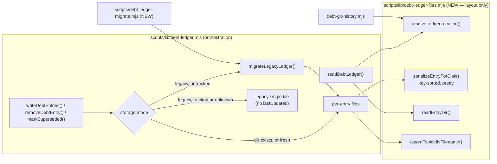

# Plan: Tech-Debt Ledger — One File Per Entry (merge conflict-free by construction)

- **Date**: 2026-10-13
- **Status**: Draft
- **Author**: Claude + Louis Strydom
- **Scope**: backend (js-ts) — CLI/library + consumer sync contract; no UI
- **Target domain(s)**: `tech-debt`, `install`
- ⚠ **Cross-domain work** — `install` is touched only by the managed-ignore rule and the `DEBT_ENTRY` list in `scripts/sync-to-repos.mjs` (§2.6); the crossing is the consumer-sync contract change and is intentional.
- **Supersedes the deferral in**: `docs/plans/debt-ledger-merge-safety.md` §4 "Per-topicId-file storage — deferred". Its revisit trigger has fired (see §1).
- **Evidence**: upstream report `d338aa8a-415b-427c-b515-616d9a234038` (wine-cellar-app) + annotations `08c62924`, `43f5222f`.

## Neighbourhood considered

`get-neighbourhood` (k=8, cloud, refresh `71b071d6`) over `scripts/lib/debt-ledger.mjs`, `scripts/lib/debt-git-history.mjs`, `scripts/sync-to-repos.mjs`, `scripts/debt-ledger-claims-check.mjs`:

- **`writeDebtEntries`** (`scripts/lib/debt-ledger.mjs`, `precedent`, `above-floor-cluster`) — **extend, not sibling.** It is the one sanctioned write path (`persistDebtEntries`, `debt-auto-capture.mjs`, `debt-backfill.mjs` all reach it); its merge semantics (immutable `deferredAt`/`deferredRun`, unioned `contentAliases`, mutable fields overwritten) are kept byte-for-byte and only the storage under it changes. A second writer would be a second definition of "update an entry".
- **`readDebtLedger`** (`review`) — extend in place; its availability discriminator and `budgets` passthrough are the contract every reader already relies on.
- The remaining `review`-band hits are the functions this plan modifies.

## Security incident neighbourhood

`INC-001` (symlink path-canonicalisation bypass) is directly relevant: this plan makes **`topicId` a filesystem path component for the first time**. `PersistedDebtEntrySchema` declares `topicId: z.string()` (unbounded). See §Security Considerations.

## 1. Context Summary

### What exists today

`.audit/tech-debt.json` is one JSON object `{version, budgets?, entries:[…], lastUpdated}`. Since `debt-ledger-merge-safety.md` (2026-09-15) the three writers render it through `serializeLedgerForDisk` — one compact entry per line, sorted by `topicId`. That fixed silent *duplication*; it did not make merges *clean*. With ~10 parallel wine sessions, every PR that records debt goes DIRTY once another merges (wine #900, #902), each needing a hand merge and a full re-push on a contended box. Two conflict sources, both structural:

1. **`lastUpdated`** — every writer sets `new Date().toISOString()`, so any two branches that write at all conflict on that line. It is volatile provenance in a committed file, which the generated-artifact policy (AGENTS.md, category A vs B) forbids.
2. **One sorted array** — two branches inserting neighbouring `topicId`s insert at the same position (and touch the same trailing-comma line), which diff3 must conflict on. That was #900's third resolution. In one clean case the union was exact: base 571, ours 573, theirs 573, merged 575.

The prior plan named its own revisit trigger: *"a consumer reports continued … incidents on a ledger already using the compact serialization"*. Source 2 is that report.

**Default vs tracking consumers.** `.audit/` is ignored by the **sync's managed gitignore block** (`MANAGED_IGNORE_PATTERNS`, `scripts/sync-to-repos.mjs:107 (972e5077)`), not by consumer-owned rules. wine force-tracks `tech-debt.json` (verified: `git -C wine-cellar-app ls-files .audit` lists it; the `.audit/` line sits inside wine's managed block). So the merge problem exists only for a consumer that tracks the ledger — but the format change applies to everyone, and **a per-entry file created under an ignored `.audit/` is silently never committed**. That is the trap this plan must not walk into (§2.6).

### Code Trace (pinned at `972e5077`)

- Writers: `writeDebtEntries` `scripts/lib/debt-ledger.mjs:421`, `removeDebtEntry` `:532`, `markSuperseded` `:590`; `lastUpdated` set at `:509`, `:557`, `:627`; all serialize via `serializeLedgerForDisk` `:391`; lock via `proper-lockfile` on the ledger file (`:437`).
- Reader: `readDebtLedger` `:297` → `{version, entries, available, reason, budgets}`; never returns `lastUpdated`.
- **`lastUpdated` readers: none.** Grep of `scripts/`, `skills/`, `dashboard/` for `lastUpdated` finds only this writer, the optional `DebtLedgerSchema.lastUpdated` (`scripts/lib/schemas.mjs:1323`, never used to parse the file), and unrelated `findings-tracker.mjs` fields. No dashboard, `debt-review.mjs` or `debt-auto-capture.mjs` read. wine-owned code: grep for `tech-debt.json` outside synced tooling finds `tests/unit/contracts/techDebtLedgerNoDuplicateTopicIds.test.js` and `scripts/coordination/capstone-scope.config.json` — neither reads `lastUpdated`. "Derive it where read" therefore has no reader to serve; if one appears, `git log -1 --format=%cI -- .audit/tech-debt` is the derivation (§6).
- Existence probes that name the single file: `scripts/audit-loop.mjs:423`, `scripts/debt-auto-capture.mjs:478`, `scripts/debt-capture-trail-check.mjs:156`, `scripts/debt-ledger-claims-check.mjs:177`.
- Git-history fallback: `countCommitsTouchingTopic` / `findFirstDeferCommit` `scripts/lib/debt-git-history.mjs:45`/`:82` pickaxe `-S<topicId> -- <single file>`. `findFirstDeferCommit` also passes `--diff-filter=A`, which restricts matches to the commit that **created the file** — so a topicId added in any later commit is never found. Pre-existing, but this plan's history continuity rides on it (§8).
- Sync: managed block written at `scripts/sync-to-repos.mjs:1640-1652` = tooling dir + `MANAGED_IGNORE_PATTERNS` + `renderGitignoreExtras(overridesDoc.gitignoreExtra)` — **consumer-declared lines rendered inside the fence, after ours** (`scripts/lib/sync-overrides.mjs:308`). `UNTRACK_PATTERNS` (`:181`) is a separate, destructive allow-list and is not touched.
- `audit-clean.mjs` walks `.audit` non-recursively with filename regexes (`scripts/audit-clean.mjs:120-131`) — a `.audit/tech-debt/` directory is never a delete candidate. `findRoundLedgers` (`scripts/lib/debt-capture-trail.mjs`) is non-recursive on `*-ledger.json` — unaffected.
- `atomicWriteFileSync` writes a `.tmp-<pid>-<ts>` sibling then renames (`scripts/lib/file-io.mjs:44`) — the entry-directory reader must ignore dotfiles.

### Patterns reused vs new

Reused: `writeDebtEntries` merge semantics, `atomicWriteFileSync`, `proper-lockfile`, `isLedgerTracked`, the availability discriminator, `.sync-overrides.json` `gitignoreExtra` (the existing, sanctioned way a consumer adds a line to the managed block). New: the entry-directory layout module and a one-shot migration CLI.

## 2. Proposed Architecture



### 2.1 On-disk format (v2)

```
.audit/tech-debt/
  entries/<topicId>.json   one entry, JSON.stringify(sortKeysDeep(entry), null, 2) + "\n"
  budgets.json             optional, the former top-level `budgets` object (human-edited policy)
```

No `version`, no `lastUpdated`, no index file — nothing every writer touches. (#5 single source of truth: the directory listing *is* the index.)

- **Why per-entry files, compared honestly** (the task's three options):

  | Option | New entries on two branches | Same entry on two branches | Needs per-clone config? | Works on GitHub's server-side merge / mergeability check? |
  |---|---|---|---|---|
  | **(a) one file per entry** | different paths → never conflicts, in any 3-way merge engine | normal 3-way text merge of one small file (defined below) | no | **yes** — plain git, no attributes |
  | (b) JSONL + `merge=union` | union keeps both lines | union keeps **both versions** → a silent duplicate `topicId`; correctness then needs an append-only event discipline for every update and removal, plus compaction | no | depends on the host honouring `.gitattributes` for a bare-repo merge — **not verifiable from here**, and the wine PRs went DIRTY *on GitHub* |
  | (c) custom merge driver | clean (driver merges) | driver decides | **yes** — `git config merge.<x>.driver` per clone; consumers won't have it | **no** — never runs server-side (already established in `debt-ledger-merge-safety.md` §1) |

  (a) is the only option whose conflict-freedom is a property of *paths*, not of a merge engine's configuration. It is also the smallest: no event log, no compaction, no driver. (#18, #20)

- **Deterministic bytes.** Keys are sorted recursively before `JSON.stringify(…, null, 2)`, so two branches that record the *same* logical entry write byte-identical files, and git merges identical changes cleanly. Pretty-printing (one key per line) is deliberate: it makes the same-entry case a field-level text merge (§2.3) and keeps a hand-resolution readable.

### 2.2 Location resolution and the read path

`resolveLedgerLocation(ledgerPath)` → `{dir, legacyFile}`: a path ending in `.json` names the legacy file and the directory is the same path without `.json`; otherwise the path is the directory and the legacy file is `<dir>.json`. **`DEFAULT_DEBT_LEDGER_PATH` keeps its value `.audit/tech-debt.json`** and every `--ledger x.json` argument keeps working — no caller and no CLI flag changes (#18 backward compat).

`readDebtLedger`:

| On disk | Result |
|---|---|
| dir only | entries from `entries/*.json`, sorted by `topicId` (the order the old file had), `budgets` from `budgets.json` |
| legacy only | today's behaviour exactly |
| **both** (an interrupted migration, or a stale branch's legacy file resolved back in) | union by `topicId`; dir copy wins; a legacy copy that **differs** is reported once on stderr as an unresolved conflict naming `debt-ledger-migrate.mjs`. Never silently dropped from the warning, never silently merged. |
| neither | `available:false, reason:'clean-checkout-sandbox'` (unchanged) |

Corruption stays **loud** (throws, naming the file): an entry file that is not valid JSON (e.g. a hand-resolution that left markers), whose `topicId` ≠ its filename, or that is not a regular file. `debtLedgerExists(ledgerPath)` (new export) answers "is there a ledger in either form" for the four existence probes in §1.

### 2.3 The same-entry case — defined outcome

Two branches change the same entry → both modify `entries/<topicId>.json`. Git's ordinary 3-way text merge applies to that one ~25-line file:

| Branch edits | Outcome | Why it is correct |
|---|---|---|
| identical (both re-surface the same finding) | **clean** | deterministic bytes (§2.1) |
| different fields, separated by ≥1 unchanged line | **clean, both edits kept** | field-wise union — the same semantics `writeDebtEntries` already applies to an update |
| the same field (or adjacent lines) | **loud conflict on that one file** (`UU`) | a genuine disagreement; a human picks. A leftover marker makes the file unparseable → `readDebtLedger` throws naming it. |
| one removes, one modifies | loud modify/delete conflict | genuine disagreement |

**No outcome is a silent duplicate or a silent loss** — duplicates are unrepresentable (the filename is the key). All four rows are pinned by the fixture test (§9).

### 2.4 The write path and when migration happens

All writers take one lock on the ledger **directory** (`proper-lockfile` on `<dir>` → lock dir `<dir>.lock`, a sibling under `.audit/`), created on demand. Storage mode is decided under the lock:

1. **dir exists, or neither exists** → v2. (A fresh ledger is always v2.)
2. **legacy only, and definitively untracked** (`isLedgerTracked` → `tracked:false, degraded:false`, or the file is outside any git work tree) → **auto-migrate** (§2.5) then write v2. Safe: an untracked file has no git consequences. This is every default consumer, and this repo.
3. **legacy only, tracked — or tracking unknown** → keep writing the **legacy single file**, minus `lastUpdated` (conflict source 1 is gone immediately for wine even before it migrates); warn once: *"tracked legacy ledger — migrate it in one commit on your default branch: node <tooling>/debt-ledger-migrate.mjs"*. Unknown is treated as tracked: the conservative branch is the one that cannot delete a committed file.
4. **both exist** → fold (§2.5) under the same rule as 2/3, then write v2.

Why a tracked ledger is **not** auto-migrated by a writer: a writer runs inside a feature branch. Auto-migrating there deletes the tracked file in N parallel branches while other branches still modify it — N modify/delete conflicts, the very pain being removed. Migration of committed state is a deliberate single commit on the default branch (§2.5).

Per-writer behaviour in v2 — same API, same return shapes:
- `writeDebtEntries`: per entry, read existing file (if any) → apply today's merge → write only if the bytes changed. `total` = entry-file count afterwards. Rejections unchanged, plus `topicId-not-a-safe-filename` and `topicId-case-collision` (§Security).
- `removeDebtEntry`: unlink `entries/<id>.json`; also removes the id from a legacy remainder if one exists (so a union read cannot resurrect it).
- `markSuperseded`: rewrite the one entry file; existence of both ids checked against the union.
- Legacy-mode writers additionally **strip a pre-existing `lastUpdated`** (`markSuperseded` spreads `...raw` today, which would carry it forward).

A batch of N entries is N atomic file writes, not one atomic set: a crash mid-batch leaves the first k entries written, each individually valid. Acceptable — entries are independent records and the batch is idempotent on retry (#14).

### 2.5 Migration — `migrateLegacyLedger()` + `scripts/debt-ledger-migrate.mjs`

One function, two callers (auto path §2.4 and the CLI). Under the directory lock **and** the legacy file's own lock (order: dir, then legacy — an older synced writer still in another worktree takes only the legacy lock, so the order cannot deadlock):

1. Parse the legacy file (corrupt → throw, nothing written).
2. Group legacy entries by `topicId`. For each id:
   - unsafe as a filename → **refuse** that id (remainder);
   - several legacy copies that differ → **refuse** (remainder; the pre-existing duplicate class `findDuplicateTopicIds` reports);
   - no entry file yet → write it;
   - entry file byte-identical after canonicalisation → nothing to do;
   - entry file differs → **refuse** (remainder) unless `--prefer dir|legacy` was passed to the CLI (the auto path never prefers).
3. `budgets`: written to `budgets.json` if non-empty and absent; differing → refuse (remainder).
4. **Verify by re-reading** every written file and comparing canonical bytes.
5. Remainder empty → delete the legacy file. Remainder non-empty → rewrite the legacy file to contain **only** the remainder, and report each refused id with its reason. Nothing is ever dropped: every legacy entry ends either in an entry file or in the remainder.

Crash between 4 and 5 → both forms exist → the union read is correct and re-running is idempotent (step 2's "identical → nothing").

**Tracked legacy, destination trackability.** Before step 2, if the legacy file is tracked: `git check-ignore -q -- <dir>/entries/__probe__.json`. Ignored → **refuse the whole migration** with the exact remedy (§2.6). This is the guard against the silent-untracking trap: deleting a tracked file and creating ignored ones would make every entry vanish from the repo while looking fine on disk.

**The CLI** (`node scripts/debt-ledger-migrate.mjs [--ledger <path>] [--dry-run] [--prefer dir|legacy] [--json]`): exit 0 migrated or nothing to do; 1 refused (remainder, or destination ignored); 2 operational error. It never touches the git index (writers never have); for a tracked ledger it prints the one staging command: `git add -A -- .audit/tech-debt .audit/tech-debt.json`. `assertKnownFlags`, `--selfcheck-relocation`, `finishAndExit` per repo conventions; registered in `scripts/.cli-catalog.json` and `DEBT_ENTRY` (so consumers receive it).

### 2.6 Consumer-sync contract change: the managed rule `.audit/` → `.audit/*`

This changes what every consumer's managed `.gitignore` block contains, so it is recorded on its own.

- **Problem.** Git cannot re-include a path whose parent *directory* is excluded. With `.audit/` in the managed block, a consumer that wants to commit `.audit/tech-debt/` has no rule it can add — and wine's existing force-add trick works per *file*, not for files created later. Every new per-entry file would be ignored-and-untracked: **silently never committed**.
- **Change.** `MANAGED_IGNORE_PATTERNS` carries `.audit/*` instead of `.audit/`. For a consumer that adds nothing, the set of ignored paths is identical — every child of `.audit/` is still ignored, so `git status` / `git add -A` behave the same, and no tracked file changes state (an ignore rule never affects a tracked file). The difference is only that a later negation can now take effect.
- **How a tracking consumer opts in** — through the existing, sanctioned mechanism, not by editing the fence: `.sync-overrides.json`
  ```json
  "gitignoreExtra": [{ "pattern": "!.audit/tech-debt/", "reason": "debt ledger is committed here (shared across sessions)" }]
  ```
  `renderGitignoreExtras` renders it inside the managed block **after** `.audit/*`, which is the order a negation needs. No sync code changes for this half; a test proves the rendered block actually un-ignores an entry path (`git check-ignore`, real repo).
- **`UNTRACK_PATTERNS` is not touched** — it is destructive and stays narrow (`tests/sync-ignore-vs-untrack.test.mjs` invariants kept; the "blanket directory rule" assertions are updated to the `.audit/*` spelling, and the subset check learns that `.audit/*` covers `.audit/<file>`).
- **Rollout order for wine** (runbook, §7): (1) sync (receives `.audit/*`, the migrate CLI, and the new writers); (2) add the `gitignoreExtra` negation, re-sync; (3) on main, one commit: `debt-ledger-migrate.mjs` + stage + update wine-owned references (`capstone-scope.config.json` `alwaysAllowed` → `.audit/tech-debt/**`; `techDebtLedgerNoDuplicateTopicIds.test.js` → read via `readDebtLedger` or retire, since duplicates are now unrepresentable; optionally drop `.fleet.json` hot-file entries for the old path). Until step 3, wine's writers stay on the legacy file without `lastUpdated` (§2.4 rule 3). If step 2 is skipped, the CLI refuses (§2.5) and names it.
- **Does the same format apply to `.sync-receipt.json` later?** Same *class* (a committed, append-only record every branch touches; upstream `2f933809`, `fc843d6b`) — out of scope here and handled by "CES: sync-pr supersedes an open sync PR". Note for that work: per-record files fit it *better* than they fit this ledger, because receipt records are append-only and never updated — one file per sync run (`.sync-receipts/<timestamp>-<sha>.json`) is conflict-free with no same-record case at all. Recorded as a recommendation, not decided here.

### Key design decisions

- **Layout module separate from orchestration** (#2 SRP, #3 modularity): `scripts/lib/debt-ledger-files.mjs` knows paths, filenames, canonical bytes and directory reads; it knows nothing of merge semantics, locks or git. `debt-ledger.mjs` stays the single orchestration seam every caller already imports — no caller changes its import (#18). It also keeps `debt-ledger.mjs` under the 1000-line size ratchet.
- **Mode is decided by git facts, never by a flag** (#16): the only signal that a migration is safe to do automatically is "this file has no git consequences", which `isLedgerTracked` already answers.
- **Refuse, don't pick** (#15): every place two copies of one entry disagree ends in a loud remainder or a git conflict, never in a winner chosen by code — the class the prior plan's "the serializer is format-only" rule protected.

## 3. Execution Model (Phase 1.5)

- **Migration chain** (one atomic-in-intent operation, crash-safe by idempotence rather than by transaction): lock dir → lock legacy → parse → write entry files → verify → delete-or-shrink legacy → release. Partial failure before delete leaves both forms; the union read is correct and a re-run finishes. No step deletes before verification.
- **Writers vs migration**: serialised by the directory lock. An older synced writer (pre-upgrade tooling in another worktree) holds only the legacy lock; migration takes both, so it waits for it.
- **Sync rollout vs consumer migration**: sequential and consumer-driven (§2.6). The sync never migrates anything.
- Everything else is independent.

## 4. Sustainability Notes

### Right-sizing gate

- **Band-aid extreme**: drop `lastUpdated` only. Removes conflict source 1 (most conflicts) but leaves neighbouring inserts conflicting on the sorted array — the #900 case — and the 2026-09-15 plan already proved serialization tweaks do not close source 2.
- **Over-engineered extreme**: event-sourced append-only JSONL with union merge, a compactor, a custom merge driver as backup, and a migration that also rewrites history.
- **Chosen**: one file per entry + one migration function + one CLI. Current requirement: two branches recording debt must merge with zero conflicts on GitHub, with no per-clone config — met by paths alone.

**Manual vs scripted**: the migration *is* a script, because it is regular (one entry → one file) and verifiable (re-read, compare canonical bytes, count = count). Test-file updates (§7, ~5 files reading the ledger raw) are irregular → by hand.

### Assumptions that could change

- `topicId`s stay filename-safe. Today: wine's 568 match `[A-Za-z0-9-]`, length 8–49, no case-insensitive collisions (measured 2026-10-13 against `c:/GIT/wine-cellar-app/.audit/tech-debt.json`, `node -e` over `entries[].topicId`). An unsafe one is refused, not mangled — mangling would make two ids collide.
- ~600 small files per ledger. `readDebtLedger` becomes N reads instead of 1; at this size that is milliseconds. If a ledger reaches tens of thousands, a sharded directory (`entries/ab/<id>.json`) is the upgrade path without a format change in the files themselves.

## 5. Security Considerations

`topicId` becomes a path component (INC-001's lesson, applied to construction instead of resolution):

- `assertTopicIdIsFilename(id)`: `^[A-Za-z0-9][A-Za-z0-9._-]{0,127}$`, not ending in `.`, and not a Windows reserved device name (`CON`, `PRN`, `AUX`, `NUL`, `COM1-9`, `LPT1-9`, case-insensitive, with or without an extension) — `NUL.json` cannot be created on Windows. Applied on **every** write path and in migration; never a sanitiser (two ids must never map to one file).
- **Case collisions**: on a case-insensitive filesystem `ABC.json` overwrites `abc.json`. Writers check the directory's existing names case-insensitively and reject a differing-case id (`topicId-case-collision`).
- **Read side fails closed**: only regular files ending `.json` and not starting with `.` are entries; a symlink or other non-regular entry → throw (never followed). The filename must equal the parsed `topicId`.
- No new egress, credentials or network.

## 6. File-Level Plan

- **`scripts/lib/debt-ledger-files.mjs`** (create) — `resolveLedgerLocation`, `assertTopicIdIsFilename`, `serializeEntryForDisk` (recursive key sort), `readEntryDir` (fail-closed listing + parse + filename check), `entryFilePath`, `readBudgetsFile`. Pure layout; imported only by `debt-ledger.mjs` and `debt-git-history.mjs` (#2, #5).
- **`scripts/lib/debt-ledger.mjs`** (modify) — mode selection; v2 + legacy writers; `lastUpdated` removed and stripped; directory lock; `migrateLegacyLedger`; union read with remainder warning; `debtLedgerExists`; `warnIfLedgerTracked` re-scoped to a *tracked legacy* ledger (a tracked v2 ledger is merge-safe by construction, so the old "can silently duplicate" text would be false) and pointing at the migrate CLI; module header updated.
- **`scripts/debt-ledger-migrate.mjs`** (create) — the CLI in §2.5.
- **`scripts/.cli-catalog.json`** (modify) — register the CLI.
- **`scripts/sync-to-repos.mjs`** (modify) — `.audit/` → `.audit/*` with its rationale comment; add the CLI to `DEBT_ENTRY`.
- **`scripts/lib/debt-git-history.mjs`** (modify) — count/first-commit over **both** the entry file path (`git log -- <dir>/entries/<id>.json`, no pickaxe needed: every commit touching it concerns that topic) and the legacy file (pickaxe, as today), union by sha. Drop `--diff-filter=A` from the legacy pickaxe (it restricted matches to the file-creating commit; `--reverse` + `-S` already yields the introducing commit). Without the legacy half, every migrated entry's "first deferred" would become the migration commit.
- **`scripts/audit-loop.mjs`**, **`scripts/debt-auto-capture.mjs`**, **`scripts/debt-capture-trail-check.mjs`**, **`scripts/debt-ledger-claims-check.mjs`** (modify) — replace `fs.existsSync(<single file>)` with `debtLedgerExists(...)`. One line each.
- **`docs/runbooks/consumer-adoption.md`** (modify) — "Tech-debt ledger: per-entry format (2026-10)" section: what changed, default consumers need nothing, the tracking-consumer rollout in §2.6, the migrate command by path (`scripts/.claude-skills/debt-ledger-migrate.mjs`).
- **`skills/audit-code/references/debt-capture.md`** (modify) + regenerated **`.claude/skills/audit-code/references/debt-capture.md`** — where it names `.audit/tech-debt.json` as *the* file, say "the ledger (`.audit/tech-debt/`, or the legacy `.audit/tech-debt.json` until migrated)".
- **Not changed, deliberately**: `DEFAULT_DEBT_LEDGER_PATH`'s value and the `--ledger` help strings of eight debt CLIs (still accepted, still resolve); `DebtLedgerSchema` (its optional `lastUpdated` still describes legacy files); `UNTRACK_PATTERNS`; `audit-clean.mjs` (verified unaffected, §1). The help-string wording is a cosmetic follow-up for `fleet propose`.

### Tests

- **`tests/debt-ledger-per-entry-merge.test.mjs`** (create) — the real-git proof (§9).
- **`tests/debt-ledger-migrate-cli.test.mjs`** (create) — migration + CLI exit contract (§9).
- **`tests/debt-ledger.test.mjs`** (modify) — v2 read/write/remove/supersede, mode selection, `lastUpdated` absent and stripped, filename validation, case collision, fail-closed reads.
- **`tests/debt-ledger-merge-safety.test.mjs`** (modify) — its scenarios exercise the legacy serializer, which remains the tracked-unmigrated write path; seed it explicitly as legacy and keep its no-silent-corruption property.
- **`tests/debt-git-history.test.mjs`** (modify) — entry-file history, legacy→v2 continuity, first-commit not created-file-only.
- **`tests/sync-ignore-vs-untrack.test.mjs`** (modify) — `.audit/*` spelling; a real `git check-ignore` proof that `.audit/*` + `!.audit/tech-debt/` un-ignores an entry file and that `.audit/*` alone ignores exactly what `.audit/` did for a sample of real artifact names.
- **Raw-read updates** (modify, by hand): `tests/debt-resolve-cli.test.mjs`, `tests/debt-auto-capture-supersedes.test.mjs`, `tests/debt-auto-capture-trail-warn-cli.test.mjs`, `tests/final-review-round-cap-cli.test.mjs` — they `JSON.parse` the single file after a write; read through `readDebtLedger` instead (format-agnostic).

## 7. Implementation Phases

**Phase 1 — Per-entry storage core**: layout module; v2 read/write/remove/supersede; mode selection; `lastUpdated` dropped and stripped; directory lock; `debtLedgerExists`. Files: `scripts/lib/debt-ledger-files.mjs` (create), `scripts/lib/debt-ledger.mjs` (modify), `tests/debt-ledger.test.mjs` (modify), `tests/debt-ledger-merge-safety.test.mjs` (modify), `tests/debt-ledger-per-entry-merge.test.mjs` (create), `tests/debt-resolve-cli.test.mjs` (modify), `tests/debt-auto-capture-supersedes.test.mjs` (modify), `tests/debt-auto-capture-trail-warn-cli.test.mjs` (modify), `tests/final-review-round-cap-cli.test.mjs` (modify).

**Phase 2 — Migration**: `migrateLegacyLedger` (auto path + remainder + verification + trackability guard) and the CLI. Files: `scripts/lib/debt-ledger.mjs` (modify), `scripts/debt-ledger-migrate.mjs` (create), `scripts/.cli-catalog.json` (modify), `tests/debt-ledger-migrate-cli.test.mjs` (create).

**Phase 3 — Readers and history**: existence probes and git-history continuity. Files: `scripts/audit-loop.mjs` (modify), `scripts/debt-auto-capture.mjs` (modify), `scripts/debt-capture-trail-check.mjs` (modify), `scripts/debt-ledger-claims-check.mjs` (modify), `scripts/lib/debt-git-history.mjs` (modify), `tests/debt-git-history.test.mjs` (modify).

**Phase 4 — Consumer sync contract**: managed rule, `DEBT_ENTRY`, runbook, skill reference. Files: `scripts/sync-to-repos.mjs` (modify), `tests/sync-ignore-vs-untrack.test.mjs` (modify), `docs/runbooks/consumer-adoption.md` (modify), `skills/audit-code/references/debt-capture.md` (modify).

**Close-out (not a phase)**: `npm run skills:regenerate` (→ `.claude/skills/audit-code/references/debt-capture.md`), `npm run plans:index` after the plan is committed, `npm run bundle:deps` / `bundle:deps:check` for the new lib module, `npm run guards:preflight`.

## 8. Risk & Trade-off Register

- **A tracking consumer that syncs but never migrates** stays on the legacy file. It still loses conflict source 1 at once (no `lastUpdated`); source 2 remains until it migrates, and the writer warns once per run saying exactly how. Accepted: migrating committed state without the operator is the larger risk.
- **Skipping the `gitignoreExtra` step** → the CLI refuses with the remedy; nothing is deleted. This is the one failure that would otherwise be silent, so it is the one with a hard guard.
- **Stale branches after migration**: a branch cut before the migration commit that edits the legacy file gets one modify/delete conflict on merge. Resolution: keep the file (`git add .audit/tech-debt.json`); the next write — or the CLI — folds it in; differing entries land in the remainder, loud. One-time per stale branch.
- **Git-history pickaxe fix** changes `findFirstDeferCommit` output for entries added after the file's first commit (it used to return null for them). That is the fix, but `debt-pr-comment.mjs` output can change; covered by `tests/debt-git-history.test.mjs`.
- **Same-entry clean merges combine field edits from two branches** — a merge no single writer produced. Each field edit was valid alone and the merge is the same field-wise union `writeDebtEntries` performs for an update; an unparseable result is loud. Accepted.
- **Deferred**: help-string wording (cosmetic, `fleet propose`); `.sync-receipt.json` (other session; recommendation in §2.6); retiring `findDuplicateTopicIds`/`--fail-on-duplicates` (still meaningful for legacy and remainder files).

## 9. Testing Strategy

**Red then green, on a real git fixture** (`tests/debt-ledger-per-entry-merge.test.mjs`; temp repos under the OS temp dir with `gitFixtureEnv()`, `user.name`/`user.email` set, cleanup through the repo's rmSync retry helper):

- Base: 50 entries written through `writeDebtEntries`, committed. Branch `ours`: two **new** entries whose `topicId`s neighbour each other and an existing id (differ in the last character). Branch `theirs`: two other new neighbouring entries, interleaved with ours in sort order. Merge.
  - **Green (v2)**: `git merge` exits 0, `git status --porcelain` has no unmerged paths, `readDebtLedger` → exactly 54 entries, all four new ids present with each branch's exact content, no duplicate ids.
  - **Red, two ways.** (1) The new test file is written first and run against the unmodified code at `972e5077`: the v2 assertions fail (the writer still produces one file with `lastUpdated`, and the merge conflicts). That run's output goes in the PR description. (2) An in-file **legacy control** keeps the red reproducible after the change: the same scenario on a seeded, tracked legacy file (legacy mode, §2.4 rule 3) must still conflict, because all four new ids are inserted into the *same gap* between two base lines of the sorted array. Hard-asserted — the outcome is deterministic, unlike the multi-line misalignment the prior plan could only log — so the control proves the fixture can detect the defect, not merely that v2 passes.
- **Same entry** (§2.3 table), each a separate case: identical update → clean; disjoint fields (`deferredRationale` vs `contentAliases`, chosen so their lines are non-adjacent in key-sorted output) → clean and both present; same field → exit 1 with `UU .audit/tech-debt/entries/<id>.json` and **no other unmerged path**; remove vs modify → modify/delete conflict on that one file. Conflict detection uses the porcelain status codes, not exit code alone (prior plan's round-3 lesson).
- **Removal on one branch, unrelated addition on the other** → clean.

**Migration** (`tests/debt-ledger-migrate-cli.test.mjs`): untracked legacy auto-migrates on first write, entry count preserved, legacy deleted; `budgets` carried to `budgets.json`; tracked legacy + `.audit/*`-style ignore without the negation → CLI exit 1, nothing deleted, remedy printed; with the negation → exit 0, entry files `git check-ignore`-clean, staging command printed; differing copies (dir vs legacy; duplicate legacy copies) → remainder kept, exit 1, ids listed; `--prefer dir|legacy` resolves the first, never the second; crash simulation (both forms present) → union read correct, re-run idempotent; `--dry-run` writes nothing; `--selfcheck-relocation`.

**Unit** (`tests/debt-ledger.test.mjs`): canonical bytes (key order irrelevant); `lastUpdated` never written, stripped from a legacy file on rewrite; filename validation incl. `../x`, `a/b`, `NUL`, `con.txt`, 129 chars; case collision; dotfile/tmp ignored; symlink entry → throw; filename≠topicId → throw; tracked legacy → legacy write + one warning.

**Edge**: empty `entries/` dir is an *available, empty* ledger (not unavailable); a ledger dir with only `budgets.json` likewise.

**Not done here**: a full `npm test` / pre-push gate runs only in a coordinator gate slot; single test files during implementation.
