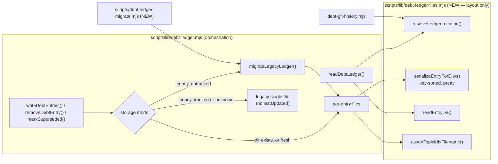

# Plan: Tech-Debt Ledger — One File Per Entry (merge conflict-free by construction)

- **Date**: 2026-10-13
- **Status**: Draft
- **Author**: Claude + Louis Strydom
- **Scope**: backend (js-ts) — CLI/library + consumer sync contract; no UI
- **Target domain(s)**: `tech-debt`, `install`
- ⚠ **Cross-domain work** — `install` is touched only by the managed-ignore rule and the `DEBT_ENTRY` list in `scripts/sync-to-repos.mjs` (§2.6); the crossing is the consumer-sync contract change and is intentional.
- **Supersedes the deferral in**: `docs/plans/debt-ledger-merge-safety.md` §4 "Per-topicId-file storage — deferred". Its revisit trigger has fired (see §1).
- **Evidence**: upstream report `d338aa8a-415b-427c-b515-616d9a234038` (wine-cellar-app) + annotations `08c62924`, `43f5222f`.

## Neighbourhood considered

`get-neighbourhood` (k=8, cloud, refresh `71b071d6`) over `scripts/lib/debt-ledger.mjs`, `scripts/lib/debt-git-history.mjs`, `scripts/sync-to-repos.mjs`, `scripts/debt-ledger-claims-check.mjs`:

- **`writeDebtEntries`** (`scripts/lib/debt-ledger.mjs`, `precedent`, `above-floor-cluster`) — **extend, not sibling.** It is the one sanctioned write path (`persistDebtEntries`, `debt-auto-capture.mjs`, `debt-backfill.mjs` all reach it); its merge semantics (immutable `deferredAt`/`deferredRun`, unioned `contentAliases`, mutable fields overwritten) are kept byte-for-byte and only the storage under it changes. A second writer would be a second definition of "update an entry".
- **`readDebtLedger`** (`review`) — extend in place; its availability discriminator and `budgets` passthrough are the contract every reader already relies on.
- The remaining `review`-band hits are the functions this plan modifies.

## Security incident neighbourhood

`INC-001` (symlink path-canonicalisation bypass) is directly relevant: this plan makes **`topicId` a filesystem path component for the first time**. `PersistedDebtEntrySchema` declares `topicId: z.string()` (unbounded). See §Security Considerations.

## 1. Context Summary

### What exists today

`.audit/tech-debt.json` is one JSON object `{version, budgets?, entries:[…], lastUpdated}`. Since `debt-ledger-merge-safety.md` (2026-09-15) the three writers render it through `serializeLedgerForDisk` — one compact entry per line, sorted by `topicId`. That fixed silent *duplication*; it did not make merges *clean*. With ~10 parallel wine sessions, every PR that records debt goes DIRTY once another merges (wine #900, #902), each needing a hand merge and a full re-push on a contended box. Two conflict sources, both structural:

1. **`lastUpdated`** — every writer sets `new Date().toISOString()`, so any two branches that write at all conflict on that line. It is volatile provenance in a committed file, which the generated-artifact policy (AGENTS.md, category A vs B) forbids.
2. **One sorted array** — two branches inserting neighbouring `topicId`s insert at the same position (and touch the same trailing-comma line), which diff3 must conflict on. That was #900's third resolution. In one clean case the union was exact: base 571, ours 573, theirs 573, merged 575.

The prior plan named its own revisit trigger: *"a consumer reports continued … incidents on a ledger already using the compact serialization"*. Source 2 is that report.

**Default vs tracking consumers.** `.audit/` is ignored by the **sync's managed gitignore block** (`MANAGED_IGNORE_PATTERNS`, `scripts/sync-to-repos.mjs:107 (972e5077)`), not by consumer-owned rules. wine force-tracks `tech-debt.json` (verified: `git -C wine-cellar-app ls-files .audit` lists it; the `.audit/` line sits inside wine's managed block). So the merge problem exists only for a consumer that tracks the ledger — but the format change applies to everyone, and **a per-entry file created under an ignored `.audit/` is silently never committed**. That is the trap this plan must not walk into (§2.6).

### Code Trace (pinned at `972e5077`)

- Writers: `writeDebtEntries` `scripts/lib/debt-ledger.mjs:421`, `removeDebtEntry` `:532`, `markSuperseded` `:590`; `lastUpdated` set at `:509`, `:557`, `:627`; all serialize via `serializeLedgerForDisk` `:391`; lock via `proper-lockfile` on the ledger file (`:437`).
- Reader: `readDebtLedger` `:297` → `{version, entries, available, reason, budgets}`; never returns `lastUpdated`.
- **`lastUpdated` readers: none.** Grep of `scripts/`, `skills/`, `dashboard/` for `lastUpdated` finds only this writer, the optional `DebtLedgerSchema.lastUpdated` (`scripts/lib/schemas.mjs:1323`, never used to parse the file), and unrelated `findings-tracker.mjs` fields. No dashboard, `debt-review.mjs` or `debt-auto-capture.mjs` read. wine-owned code: grep for `tech-debt.json` outside synced tooling finds `tests/unit/contracts/techDebtLedgerNoDuplicateTopicIds.test.js` and `scripts/coordination/capstone-scope.config.json` — neither reads `lastUpdated`. "Derive it where read" therefore has no reader to serve; if one appears, `git log -1 --format=%cI -- .audit/tech-debt` is the derivation (§6).
- Existence probes that name the single file: `scripts/audit-loop.mjs:423`, `scripts/debt-auto-capture.mjs:478`, `scripts/debt-capture-trail-check.mjs:156`, `scripts/debt-ledger-claims-check.mjs:177`.
- Git-history fallback: `countCommitsTouchingTopic` / `findFirstDeferCommit` `scripts/lib/debt-git-history.mjs:45`/`:82` pickaxe `-S<topicId> -- <single file>`. `findFirstDeferCommit` also passes `--diff-filter=A`, which restricts matches to the commit that **created the file** — so a topicId added in any later commit is never found. Pre-existing, but this plan's history continuity rides on it (§8).
- Sync: managed block written at `scripts/sync-to-repos.mjs:1640-1652` = tooling dir + `MANAGED_IGNORE_PATTERNS` + `renderGitignoreExtras(overridesDoc.gitignoreExtra)` — **consumer-declared lines rendered inside the fence, after ours** (`scripts/lib/sync-overrides.mjs:308`). `UNTRACK_PATTERNS` (`:181`) is a separate, destructive allow-list and is not touched.
- `audit-clean.mjs` walks `.audit` non-recursively with filename regexes (`scripts/audit-clean.mjs:120-131`) — a `.audit/tech-debt/` directory is never a delete candidate. `findRoundLedgers` (`scripts/lib/debt-capture-trail.mjs`) is non-recursive on `*-ledger.json` — unaffected.
- `atomicWriteFileSync` writes a `.tmp-<pid>-<ts>` sibling then renames (`scripts/lib/file-io.mjs:44`) — the entry-directory reader must ignore dotfiles.

### Patterns reused vs new

Reused: `writeDebtEntries` merge semantics, `atomicWriteFileSync`, `proper-lockfile`, `isLedgerTracked`, the availability discriminator, `.sync-overrides.json` `gitignoreExtra` (the existing, sanctioned way a consumer adds a line to the managed block). New: the entry-directory layout module and a one-shot migration CLI.

## 2. Proposed Architecture



### 2.1 On-disk format (v2)

```
.audit/tech-debt/
  entries/<fileKey(topicId)>.json   one entry, JSON.stringify(sortKeysDeep(entry), null, 2) + "\n"
  budgets.json                      optional, the former top-level `budgets` object (human-edited policy)
```

No `version`, no `lastUpdated`, no index file — nothing every writer touches. (#5 single source of truth: the directory listing *is* the index.)

**`fileKey(topicId)` — an injective, case-fold-safe name** (R1 H5). A per-writer "does `abc.json` already exist?" check cannot see another branch: branch X adds `ABC`, branch Y adds `abc`, git merges two distinct paths cleanly, and a case-insensitive filesystem (Windows, default macOS) cannot hold both. So the filename never depends on letter case: each uppercase letter `X` is written as `~x` (`~` is outside the allowed topicId alphabet, §5, so the mapping is injective and `decodeFileKey` is exact). Every filename is therefore lowercase, and two distinct ids can never map to names that fold together. Today's ids are already all-lowercase (wine: 568/568), so for them `fileKey(id) === id` and the files read naturally. The reader decodes the name and requires it to equal the stored `topicId`.

- **Why per-entry files, compared honestly** (the task's three options):

  | Option | New entries on two branches | Same entry on two branches | Needs per-clone config? | Works on GitHub's server-side merge / mergeability check? |
  |---|---|---|---|---|
  | **(a) one file per entry** | different paths → never conflicts, in any 3-way merge engine | normal 3-way text merge of one small file (defined below) | no | **yes** — plain git, no attributes |
  | (b) JSONL + `merge=union` | union keeps both lines | union keeps **both versions** → a silent duplicate `topicId`; correctness then needs an append-only event discipline for every update and removal, plus compaction | no | depends on the host honouring `.gitattributes` for a bare-repo merge — **not verifiable from here**, and the wine PRs went DIRTY *on GitHub* |
  | (c) custom merge driver | clean (driver merges) | driver decides | **yes** — `git config merge.<x>.driver` per clone; consumers won't have it | **no** — never runs server-side (already established in `debt-ledger-merge-safety.md` §1) |

  (a) is the only option whose conflict-freedom is a property of *paths*, not of a merge engine's configuration. It is also the smallest: no event log, no compaction, no driver. (#18, #20)

- **Deterministic bytes.** Keys are sorted recursively before `JSON.stringify(…, null, 2)`, so two branches that record the *same* logical entry write byte-identical files, and git merges identical changes cleanly. Pretty-printing (one key per line) is deliberate: it makes the same-entry case a field-level text merge (§2.3) and keeps a hand-resolution readable.

### 2.2 Location resolution and the read path

`resolveLedgerLocation(ledgerPath)` → `{dir, legacyFile}`: a path ending in `.json` names the legacy file and the directory is the same path without `.json`; otherwise the path is the directory and the legacy file is `<dir>.json`. **`DEFAULT_DEBT_LEDGER_PATH` keeps its value `.audit/tech-debt.json`** and every `--ledger x.json` argument keeps working — no caller and no CLI flag changes (#18 backward compat).

`readDebtLedger`:

| On disk | Result |
|---|---|
| dir only | entries from `entries/*.json`, sorted by `topicId` (the order the old file had), `budgets` from `budgets.json` |
| legacy only | today's behaviour exactly |
| **both, legacy untracked** (an interrupted auto-migration — the only way an untracked pair arises) | union by `topicId`. Ids present in only one form, or identical in both, are ordinary entries. An id whose two copies **differ** — or a `budgets` that differs — is an **unresolved conflict**: listed in the new additive return field `conflicts: [{topicId|'budgets', reason}]`, warned once on stderr naming `debt-ledger-migrate.mjs`, and **refused by every writer** (`writeDebtEntries` rejects it with `topicId-unresolved-conflict`; `removeDebtEntry` / `markSuperseded` return an error) until the CLI resolves it. |
| **both, legacy tracked or tracking unknown** (a stale branch's legacy file kept during a merge, or a tracked migration interrupted before its commit) | **no union** (R3 H2): `entries` = the per-entry files only. Absence from the directory cannot distinguish *deleted after migration* from *not yet migrated*, so treating a legacy-only id as live would resurrect deletions. The legacy file is reported as `pendingReconcile: {legacyOnly, differing}` (additive field; counts plus ids) with one stderr warning naming `debt-ledger-migrate.mjs`, and resolved only by the CLI's baseline reconcile (§2.5). |
| neither | `available:false, reason:'clean-checkout-sandbox'` (unchanged) |

**Why a conflicted id still appears in `entries` (R1 M1, compromise).** Its *dir* copy is returned so re-raise suppression keeps recognising a debt that is genuinely recorded; dropping it would make the finding re-surface as new on every audit while the conflict waits. That is a visibility choice, not a resolution: the id is flagged in `conflicts`, no code path mutates it, and only an explicit `--prefer` resolves it. The return shape stays additive (`conflicts` is `[]` in every other case), so a caller destructuring `{entries}` is unaffected.

**Reader concurrency** (R2 H2). Mutations are serialised by the lock (§2.4) but reads are not — `readDebtLedger` is synchronous and the lock is async, and a read is the hot path of every audit. One atomically replaced file had no enumerate-then-open window; a directory of files does: a reader can list `x.json` just before `removeDebtEntry` unlinks it, or see the legacy file just before migration deletes it. Protocol: an **optimistic whole read**, in a fixed order — (1) read the legacy file's **bytes** (or record its absence), (2) enumerate and read the directory, (3) re-read the legacy bytes and compare. Any `ENOENT` on a path the read itself discovered, or legacy bytes that changed, appeared or vanished, restarts the whole read. Comparing bytes rather than existence closes the migration interleaving (R3 H1): a reader that enumerated the directory before migration wrote entry A, then read a legacy file already shrunk to its remainder, would otherwise return a ledger missing A with both forms still present. Legacy first, directory second, because migration writes the directory *before* it shrinks the legacy file — so a stable legacy read bracketing the directory read proves no transfer happened in between. Restarts are bounded: up to 5 attempts with a short synchronous back-off. Exhausted → `available:false, reason:'ledger-unreadable'` (the existing reason; transient, retryable). It never becomes a corruption throw (only *content* errors throw) and never an empty available ledger. A concurrent `writeDebtEntries` replacing a file is already safe (atomic rename: the reader sees old or new bytes).

Corruption stays **loud** (throws, naming the file): an entry file that is not valid JSON (e.g. a hand-resolution that left markers), whose decoded name ≠ its `topicId`, or that fails the path boundary (§5). `debtLedgerExists(ledgerPath)` (new export) answers "is there a ledger in either form" for the four existence probes in §1.

### 2.3 The same-entry case — defined outcome

Two branches change the same entry → both modify `entries/<fileKey>.json`. Git's ordinary 3-way text merge applies to that one ~25-line file:

| Branch edits | Outcome | Why it is correct |
|---|---|---|
| identical (both re-surface the same finding) | **clean** | deterministic bytes (§2.1) |
| different fields, separated by ≥1 unchanged line | **clean, both edits kept** | field-wise union — the same semantics `writeDebtEntries` already applies to an update |
| the same field (or adjacent lines) | **loud conflict on that one file** (`UU`) | a genuine disagreement; a human picks. A leftover marker makes the file unparseable → `readDebtLedger` throws naming it. |
| one removes, one modifies | loud modify/delete conflict | genuine disagreement |

**No outcome is a silent duplicate or a silent loss** — duplicates are unrepresentable (the filename is the key). All four rows are pinned by the fixture test (§9).

### 2.4 The write path and when migration happens

**One lock, at the name old tooling already uses** (R1 H1 + H3). Every mutation — `writeDebtEntries`, `removeDebtEntry`, `markSuperseded`, migration — takes exactly one lock: `proper-lockfile` on the **legacy file path** with `realpath:false`, i.e. the lock directory `<legacyFile>.lock` (`.audit/tech-debt.json.lock`). Two properties follow, both load-bearing:

- **Locking creates nothing that selects a mode.** `realpath:false` locks a path that need not exist (probed 2026-10-13: lock on a missing `ledger.json` → `ledger.json.lock` created, the file not; a second lock → `ELOCKED`). An earlier draft locked the *directory*, which had to be created first — and an existing directory is precisely the signal that selects v2, so a tracked legacy ledger would have been flipped to v2 by its own lock acquisition. The v2 directory is now created only **after** mode selection chooses v2.
- **Old and new writers exclude each other.** Pre-upgrade synced tooling locks `<legacyFile>` with default options, whose lock directory is the same `<legacyFile>.lock`. One name, one mutex — no lock ordering exists to get wrong.

Exclusion is **per physical ledger path**: two linked worktrees each have their own `.audit/` (gitignored, or a separate checkout of a tracked one), so they never share a ledger and never needed to. A pre-upgrade writer that *creates* the legacy file while a v2 directory exists is the "both" state (§2.2) — handled, not prevented.

Storage mode is decided **under the lock**:

1. **dir exists, or neither exists** → v2. (A fresh ledger is always v2; its directory is created now.)
2. **legacy only, and definitively untracked** (`isLedgerTracked` → `tracked:false, degraded:false`, or the file is outside any git work tree) → **auto-migrate** (§2.5) then write v2. Safe: an untracked file has no git consequences. This is every default consumer, and this repo.
3. **legacy only, tracked — or tracking unknown** → keep writing the **legacy single file**, minus `lastUpdated` (conflict source 1 is gone immediately for wine even before it migrates); warn once: *"tracked legacy ledger — migrate it in one commit on your default branch: node <tooling>/debt-ledger-migrate.mjs"*. Unknown is treated as tracked: the conservative branch is the one that cannot delete a committed file.
4. **both exist, legacy untracked** → fold (§2.5), then write v2. **Both exist, legacy tracked or unknown** → write v2 only, never fold (R3 H2), and warn once that a reconcile is pending.

Why a tracked ledger is **not** auto-migrated by a writer: a writer runs inside a feature branch. Auto-migrating there deletes the tracked file in N parallel branches while other branches still modify it — N modify/delete conflicts, the very pain being removed. Migration of committed state is a deliberate single commit on the default branch (§2.5).

Per-writer behaviour in v2 — same API, same return shapes:
- `writeDebtEntries`: per entry, read existing file (if any) → apply today's merge → write only if the bytes changed. `total` = entry-file count afterwards. Rejections unchanged, plus `topicId-not-a-safe-filename` (§5) and `topicId-unresolved-conflict` (§2.2).
- `removeDebtEntry`: unlink `entries/<id>.json`. In the **untracked** both-forms state it also removes the id from the legacy remainder (so the union read cannot resurrect it). In the **tracked/unknown** both-forms state the legacy file is the immutable stale source `S` of a pending reconcile and is **read-only to every ordinary writer** (Gemini G1): editing it would change its blob id and make the reconcile refuse on provenance. A removal there touches the directory only; the reconcile table then reads that id as *deleted on main* and keeps it deleted unless the stale branch itself changed it (a genuine conflict).
- `markSuperseded`: rewrite the one entry file; both ids must exist in the **authoritative view** (R4 H3).

**One authoritative view, shared by reads and every mutation precondition** (R4 H3). `authoritativeState(location, mode)` → `{entries, conflicts, pendingReconcile}` is the single state `readDebtLedger` returns and every writer checks against — a writer looks an id up in `entries` for existence **and** in `conflicts` for refusal, from the same object (R5 M1: an earlier wording filtered conflicted ids out of the view while §2.2 kept them visible; there is one rule, and it is §2.2's): v2 → the directory; legacy-only → the legacy file; both + untracked → the union, each conflicted id carried by its **directory copy and flagged** (the §2.2 visibility choice); both + tracked/unknown → **the directory only** — legacy-only ids are pending reconcile and do not exist for any purpose, so `markSuperseded(dirId, legacyOnlyId)` is refused exactly as a read would not show `legacyOnlyId`. Two definitions of "which entries exist" is how the read and mutation paths drifted in the first place.
- Legacy-mode writers additionally **strip a pre-existing `lastUpdated`** (`markSuperseded` spreads `...raw` today, which would carry it forward).

A batch of N entries is N atomic file writes, not one atomic set: a crash mid-batch leaves the first k entries written, each individually valid. Acceptable — entries are independent records and the batch is idempotent on retry (#14).

### 2.5 Migration — `migrateLegacyLedger()` + `scripts/debt-ledger-migrate.mjs`

One function, two callers (auto path §2.4 and the CLI), under the single ledger lock (§2.4):

1. Parse the legacy file (corrupt → throw, nothing written).
2. Group legacy entries by `topicId`. For each id:
   - unsafe as a filename → **refuse** that id (remainder);
   - several legacy copies that differ → **refuse** (remainder; the pre-existing duplicate class `findDuplicateTopicIds` reports);
   - no entry file yet → write it;
   - entry file byte-identical after canonicalisation → nothing to do;
   - entry file differs → **refuse** (remainder) unless `--prefer dir|legacy` was passed to the CLI (the auto path never prefers).
3. `budgets` (R3 H3) — **absent** (no `budgets` key in the legacy file / no `budgets.json`) and **empty** (`{}`) are different: absent declares no policy, empty declares an empty one. Legacy absent → nothing to move. Legacy present, `budgets.json` absent → write it. Both present and canonically equal → nothing. Both present and different → conflict: without `--prefer`, keep both and refuse (remainder); `--prefer dir` keeps `budgets.json` and drops the legacy policy; `--prefer legacy` writes the legacy policy to `budgets.json`. Whichever destination becomes authoritative joins the preservation manifest and both trackability checks, and is verified in step 4 before the legacy policy leaves the source.
4. **Verify by re-reading** every written file and comparing canonical bytes.
5. Remainder empty → delete the legacy file. Remainder non-empty → rewrite the legacy file to contain **only** the remainder, and report each refused id with its reason. Nothing is ever dropped: every legacy entry ends either in an entry file or in the remainder.

Crash between 4 and 5 → both forms exist → for an untracked ledger the union read is correct; for a tracked one the reader shows the directory only and flags `pendingReconcile` — and re-running is idempotent either way (step 2's "identical → nothing").

**Staged publication — a partially written directory is never visible** (R5 H1). When the ledger directory does not exist yet (every initial migration, tracked or untracked), steps 2–4 write into a sibling staging directory `<dir>.migrating/` (under `.audit/`, so ignored by `.audit/*` and never matched by the negation), verify it there, and only then **publish it with one directory rename** onto `<dir>` (atomic on the same volume when the target is absent; `retrySync` absorbs Windows' transient `EPERM`/`EBUSY`). Without this, a reader could take a complete legacy read, enumerate a directory holding only the first migrated entry, re-read unchanged legacy bytes, and — the directory being authoritative in the tracked both-forms state — return a partial ledger marked available, with no `ENOENT` and no byte change to trigger the retry. Readers never look inside `*.migrating/`. A crash before the rename leaves only the staging directory: the ledger is still legacy-only, readers are unaffected, and the next run discards and rebuilds the staging directory (it is a pure function of the legacy file). After the rename, the ledger is in the both-forms state until step 5 removes or shrinks the legacy file — every entry is already published by then, so both read rules return the complete set. **Fold** (untracked both-forms) and **stale reconcile** write into an existing directory and so are not staged: a fold only adds ids the bracketed legacy read already contributes to the union, and a reconcile in progress is reported as `pendingReconcile` (the legacy file is still present) rather than as a complete ledger.

**Initial migration is copy-only.** Steps 1–5 never delete an entry file and never read a legacy-absent id as a deletion: an id missing from the legacy file simply has nothing to move. That is what makes a shrunk remainder safe to retry — the next run sees fewer legacy ids and copies fewer, never deletes more.

**Stale-branch reconcile — the tracked both-forms case** (R3 H2, corrected R4 H1/H2). A legacy file that a branch cut *before* the migration commit carried back in. The CLI decides which case it is from git, never from the files:

- **Initial (or resumed) migration** — no commit reachable from `HEAD` deleted the legacy file (`git log --full-history --diff-filter=D -1 --format=%H -- <legacyFile>` is empty; `--full-history` because after a merge that kept the file, default history simplification can hide the side where it was deleted). Steps 1–5.
- **Stale-branch reconcile** — such a commit `M` exists. This needs **explicit provenance**: `--stale-ref <rev>`, the stale branch's tip *before* the merge (the runbook gives the exact spelling for each merge direction: `ORIG_HEAD` / `HEAD^1` / `HEAD^2`). Without it the CLI refuses and says so — guessing which parent is the stale side is the error class R4 H1 found, so it is not guessed.
  - **Inputs are immutable git blobs, never the working file** (R4 H2): stale `S` = `<stale-ref>:<legacyFile>`; baseline `B` = the legacy file at **`git merge-base <stale-ref> M`** — the common ancestor of the stale branch and the migration lineage, **not** `M^` (R4 H1: entries main added or edited after the fork but before migrating are in `M^` and would read as stale-side deletions or edits). `D` = the current entry files.
  - **Validation, all before any write**: `S` and `B` must both exist and parse; `<stale-ref>` must not itself contain `M` (else it is not stale); if a working legacy file is present it must have the **same blob id as `S`** — compared as `git hash-object --path=<repo-relative legacy path> <file>` (which applies the repository's clean filters and EOL conversion) against `git rev-parse <stale-ref>:<legacyFile>`, never byte-for-byte (R5 H2: with `core.autocrlf=true` or an `eol=crlf` attribute the working copy has CRLF while the blob has LF, with no edit made). A different blob id means the file was edited after the merge and its provenance is unknown → refuse.
  - **Plan, then apply all-or-nothing.** Per id, compare `B`, `S`, `D` and compute *only the stale branch's own change*:

  | in `B` | in `S` | `S` vs `B` | `D` | Action |
  |---|---|---|---|---|
  | no | yes | (added on stale branch) | absent | write `S` copy |
  | no | yes | | identical to `S` | nothing |
  | no | yes | | differs | conflict |
  | yes | yes | unchanged | any (incl. absent) | **nothing** — `D` is authoritative; an absent `D` was deleted after the fork on main and stays deleted |
  | yes | yes | changed | equals `B` | write `S` copy |
  | yes | yes | changed | equals `S` | nothing |
  | yes | yes | changed | absent, or differs from both | conflict (both sides changed it) |
  | yes | no | (deleted on stale branch) | equals `B` | delete the entry file |
  | yes | no | | absent | nothing |
  | yes | no | | differs from `B` | conflict |

  Budgets follow the same rule, with absent ≠ empty (step 3). **If any conflict remains and no `--prefer` was given, nothing is applied** — exit 1 listing every conflict (including conflicting *deletions*, which a remainder of entries could not represent). With `--prefer dir|legacy` every conflict has a decided action (`legacy` = take `S`'s side, including its deletion). Then: preservation manifest + both trackability checks over every destination written or kept → apply → verify every postcondition (written files byte-equal, deleted files absent) → remove the working legacy file → print the staging command.
  - **Idempotent by construction**: because `B` and `S` come from git and are never shrunk, a re-run after a crash at any point recomputes the same plan; already-applied operations now read as `D == S` / `D` absent → *nothing*. No remainder file, no operation journal.
- **No baseline** — `merge-base` empty, a blob unreadable (shallow clone, rewritten history), or git fails → **refuse**, exit 1, nothing changed, with the instruction to fetch full history or reconcile by hand. Never a union: that is the resurrection this exists to prevent.

**Tracked legacy, destination trackability — over the real manifest** (R1 H4). Before step 2 writes anything, if the legacy file is tracked: build the **preservation manifest** — every destination that becomes the authoritative home of a record leaving the legacy file: each `entries/<fileKey>.json` to be **written, already byte-identical, or kept by `--prefer dir`**, plus `budgets.json` when budgets leave the legacy file. It is defined by what *leaves the tracked source*, not by what this run writes (R2 H1): after an interrupted run every destination may already exist, and a write-set manifest would then be empty while the legacy file is still deleted. Ask git about **all of them** in one call: `git check-ignore -z --stdin` (paths NUL-delimited, repo-relative). Exit 1 = none ignored → proceed. Exit 0 = the listed paths are ignored → **refuse the whole migration**, name them, print the remedy (§2.6). Any other exit, or a spawn error → refuse ("trackability could not be established"). A single probe path would not do: an id-specific or `budgets.json`-specific ignore rule could exclude a real destination while the probe passed, and the migration would then delete tracked data whose replacements are ignored. The manifest is re-checked immediately before the legacy file is **shrunk or deleted** (step 5) — both remove records from the tracked source — so an ignore change between runs or mid-run cannot slip through. This is the guard against the silent-untracking trap: deleting a tracked file and creating ignored ones would make entries vanish from the repo while looking fine on disk.

**The CLI** (`node scripts/debt-ledger-migrate.mjs [--ledger <path>] [--dry-run] [--prefer dir|legacy] [--json]`): exit 0 migrated or nothing to do; 1 refused (remainder, or destination ignored/unverifiable); 2 operational error. It never touches the git index (writers never have); for a tracked ledger it prints the staging command **built from the resolved location** (R1 M2): both paths made relative to the repository root (`git rev-parse --show-toplevel` from the ledger's directory), POSIX-quoted, after `--` — e.g. `git -C '<root>' add -A -- '.audit/tech-debt' '.audit/tech-debt.json'` for the default, and the custom paths for `--ledger`. `assertKnownFlags`, `--selfcheck-relocation`, `finishAndExit` per repo conventions; registered in `scripts/.cli-catalog.json` and `DEBT_ENTRY` (so consumers receive it).

### 2.6 Consumer-sync contract change: the managed rule `.audit/` → `.audit/*`

This changes what every consumer's managed `.gitignore` block contains, so it is recorded on its own.

- **Problem.** Git cannot re-include a path whose parent *directory* is excluded. With `.audit/` in the managed block, a consumer that wants to commit `.audit/tech-debt/` has no rule it can add — and wine's existing force-add trick works per *file*, not for files created later. Every new per-entry file would be ignored-and-untracked: **silently never committed**.
- **Change.** `MANAGED_IGNORE_PATTERNS` carries `.audit/*` instead of `.audit/`. For a consumer that adds nothing, the set of ignored paths is identical — every child of `.audit/` is still ignored, so `git status` / `git add -A` behave the same, and no tracked file changes state (an ignore rule never affects a tracked file). The difference is only that a later negation can now take effect.
- **How a tracking consumer opts in** — through the existing, sanctioned mechanism, not by editing the fence: `.sync-overrides.json`
  ```json
  "gitignoreExtra": [{ "pattern": "!.audit/tech-debt/", "reason": "debt ledger is committed here (shared across sessions)" }]
  ```
  `renderGitignoreExtras` renders it inside the managed block **after** `.audit/*`, which is the order a negation needs. No sync code changes for this half; a test proves the rendered block actually un-ignores an entry path (`git check-ignore`, real repo).
- **`UNTRACK_PATTERNS` is not touched** — it is destructive and stays narrow (`tests/sync-ignore-vs-untrack.test.mjs` invariants kept; the "blanket directory rule" assertions are updated to the `.audit/*` spelling, and the subset check learns that `.audit/*` covers `.audit/<file>`).
- **Rollout order for wine** (runbook, §7): (1) sync (receives `.audit/*`, the migrate CLI, and the new writers); (2) add the `gitignoreExtra` negation, re-sync; (3) on main, one commit: `debt-ledger-migrate.mjs` + stage + update wine-owned references (`capstone-scope.config.json` `alwaysAllowed` → `.audit/tech-debt/**`; `techDebtLedgerNoDuplicateTopicIds.test.js` → read via `readDebtLedger` or retire, since duplicates are now unrepresentable; optionally drop `.fleet.json` hot-file entries for the old path). Until step 3, wine's writers stay on the legacy file without `lastUpdated` (§2.4 rule 3). If step 2 is skipped, the CLI refuses (§2.5) and names it.
- **Does the same format apply to `.sync-receipt.json` later?** Same *class* (a committed, append-only record every branch touches; upstream `2f933809`, `fc843d6b`) — out of scope here and handled by "CES: sync-pr supersedes an open sync PR". Note for that work: per-record files fit it *better* than they fit this ledger, because receipt records are append-only and never updated — one file per sync run (`.sync-receipts/<timestamp>-<sha>.json`) is conflict-free with no same-record case at all. Recorded as a recommendation, not decided here.

### Key design decisions

- **Layout module separate from orchestration** (#2 SRP, #3 modularity): `scripts/lib/debt-ledger-files.mjs` knows paths, filenames, canonical bytes and directory reads; it knows nothing of merge semantics, locks or git. `debt-ledger.mjs` stays the single orchestration seam every caller already imports — no caller changes its import (#18). It also keeps `debt-ledger.mjs` under the 1000-line size ratchet.
- **Mode is decided by git facts, never by a flag** (#16): the only signal that a migration is safe to do automatically is "this file has no git consequences", which `isLedgerTracked` already answers.
- **Refuse, don't pick** (#15): every place two copies of one entry disagree ends in a loud remainder or a git conflict, never in a winner chosen by code — the class the prior plan's "the serializer is format-only" rule protected.

## 3. Execution Model (Phase 1.5)

- **Migration chain** (one atomic-in-intent operation, crash-safe by idempotence rather than by transaction): lock → parse → (tracked: manifest trackability check) → write entry files → verify → (tracked: re-check manifest) → delete-or-shrink legacy → release. Partial failure before delete leaves both forms; the union read is correct and a re-run finishes. No step deletes before verification.
- **Writers vs migration vs pre-upgrade writers**: all serialised by the one `<legacyFile>.lock` (§2.4), which pre-upgrade tooling already takes.
- **Sync rollout vs consumer migration**: sequential and consumer-driven (§2.6). The sync never migrates anything.
- Everything else is independent.

## 4. Sustainability Notes

### Right-sizing gate

- **Band-aid extreme**: drop `lastUpdated` only. Removes conflict source 1 (most conflicts) but leaves neighbouring inserts conflicting on the sorted array — the #900 case — and the 2026-09-15 plan already proved serialization tweaks do not close source 2.
- **Over-engineered extreme**: event-sourced append-only JSONL with union merge, a compactor, a custom merge driver as backup, and a migration that also rewrites history.
- **Chosen**: one file per entry + one migration function + one CLI. Current requirement: two branches recording debt must merge with zero conflicts on GitHub, with no per-clone config — met by paths alone.

**Manual vs scripted**: the migration *is* a script, because it is regular (one entry → one file) and verifiable (re-read, compare canonical bytes, count = count). Test-file updates (§7, ~5 files reading the ledger raw) are irregular → by hand.

### Assumptions that could change

- `topicId`s stay filename-safe. Today: wine's 568 match `[A-Za-z0-9-]`, length 8–49, no case-insensitive collisions (measured 2026-10-13 against `c:/GIT/wine-cellar-app/.audit/tech-debt.json`, `node -e` over `entries[].topicId`). An unsafe one is refused, not mangled — mangling would make two ids collide.
- ~600 small files per ledger. `readDebtLedger` becomes N reads instead of 1; at this size that is milliseconds. If a ledger reaches tens of thousands, a sharded directory (`entries/ab/<id>.json`) is the upgrade path without a format change in the files themselves.

## 5. Security Considerations

`topicId` becomes a path component (INC-001's lesson, applied to construction instead of resolution):

- `assertTopicIdIsFilename(id)`: `^[A-Za-z0-9][A-Za-z0-9._-]{0,127}$`, not ending in `.`, and — on its `fileKey` — not a Windows reserved device name (`con`, `prn`, `aux`, `nul`, `com1-9`, `lpt1-9`, with or without an extension) — `nul.json` cannot be created on Windows. The length bound is on the **encoded basename**, not the raw id (R2 M1 — `~` escapes can double an uppercase id, so a 128-char raw cap does not bound the filename): `fileKey(id) + '.json'` ≤ **140 bytes** (ASCII, so bytes = chars). 140 keeps `<repo>/.audit/tech-debt/entries/<name>` under Windows' 260-char `MAX_PATH` for repo roots up to ~90 characters — git for Windows without `core.longpaths` fails beyond it. Today's longest id is 49. An overlength id is rejected by writers (`topicId-not-a-safe-filename`) and left in the migration remainder — never truncated. Applied on **every** write path and in migration; never a sanitiser (two ids must never map to one file).
- **Case collisions are unrepresentable**, not checked for: `fileKey` (§2.1) is lowercase and injective, so neither a same-branch write nor a cross-branch merge can produce two names that fold together.
- **One path boundary, shared by every read, write and migration** (R1 H2): `assertLedgerPathSafe(location, relPath)` `lstat`s each component from the ledger's parent directory down — the ledger directory, `entries/`, the target file, `budgets.json`, and the legacy file — and refuses any symbolic link (on Windows, `lstat` also reports junctions/reparse points as links) or non-regular/non-directory node. Reads list only regular `*.json` non-dotfiles in `entries/`; anything else under it (a link, a sub-directory, a FIFO) → throw. Writes run the boundary on the target's parent before the atomic write (the rename itself replaces a leaf, so the escape route is a linked *parent*, which this closes).
- **Threat model, stated so the boundary is not over-read**: it defends against a symlink that was **committed** (e.g. a PR adding `.audit/tech-debt/entries` as a link to elsewhere — the realistic vector, since the directory is now tracked in some consumers) or created by accident. It does **not** defend against a concurrent local process swapping a path component between the check and the write (TOCTOU): a process with write access to the working tree can already rewrite the ledger directly, so no-follow syscalls would buy nothing against it. Same scoping as INC-001's mitigation.
- No new egress, credentials or network.

## 6. File-Level Plan

- **`scripts/lib/debt-ledger-files.mjs`** (create) — `resolveLedgerLocation`, `assertTopicIdIsFilename`, `fileKey`/`decodeFileKey`, `assertLedgerPathSafe` (the one path boundary, §5), `serializeEntryForDisk` (recursive key sort), `readEntryDir` (fail-closed listing + parse + filename check), `entryFilePath`, `readBudgetsFile`. Pure layout; imported only by `debt-ledger.mjs` and `debt-git-history.mjs` (#2, #5).
- **`scripts/lib/debt-ledger.mjs`** (modify) — mode selection; v2 + legacy writers; `lastUpdated` removed and stripped; the single `<legacyFile>.lock` lock; `migrateLegacyLedger`; union read with remainder warning; `debtLedgerExists`; `warnIfLedgerTracked` re-scoped to a *tracked legacy* ledger (a tracked v2 ledger is merge-safe by construction, so the old "can silently duplicate" text would be false) and pointing at the migrate CLI; module header updated.
- **`scripts/lib/debt-ledger-migration.mjs`** (create) — `migrateLegacyLedger` (initial/resumed migration, untracked fold, baseline reconcile, preservation manifest, trackability checks, remainder). Separate from `debt-ledger.mjs` so the orchestration module stays under the 1000-line size ratchet and migration — a one-time transition — can be retired as a unit later (#3). Imports the layout module and `debt-ledger.mjs`'s lock helper; imported by `debt-ledger.mjs` (auto path, lazily) and the CLI.
- **`scripts/debt-ledger-migrate.mjs`** (create) — the CLI in §2.5.
- **`scripts/.cli-catalog.json`** (modify) — register the CLI.
- **`scripts/sync-to-repos.mjs`** (modify) — `.audit/` → `.audit/*` with its rationale comment; add the CLI to `DEBT_ENTRY`.
- **`scripts/lib/debt-git-history.mjs`** (modify) — count/first-commit over **both** the entry file path (`git log -- <dir>/entries/<id>.json`, no pickaxe needed: every commit touching it concerns that topic) and the legacy file (pickaxe, as today), union by sha. Drop `--diff-filter=A` from the legacy pickaxe (it restricted matches to the file-creating commit; `--reverse` + `-S` already yields the introducing commit). Without the legacy half, every migrated entry's "first deferred" would become the migration commit.
- **`scripts/audit-loop.mjs`**, **`scripts/debt-auto-capture.mjs`**, **`scripts/debt-capture-trail-check.mjs`**, **`scripts/debt-ledger-claims-check.mjs`** (modify) — replace `fs.existsSync(<single file>)` with `debtLedgerExists(...)`. One line each.
- **`docs/runbooks/consumer-adoption.md`** (modify) — "Tech-debt ledger: per-entry format (2026-10)" section: what changed, default consumers need nothing, the tracking-consumer rollout in §2.6, the migrate command by path (`scripts/.claude-skills/debt-ledger-migrate.mjs`).
- **`skills/audit-code/references/debt-capture.md`** (modify) + regenerated **`.claude/skills/audit-code/references/debt-capture.md`** — where it names `.audit/tech-debt.json` as *the* file, say "the ledger (`.audit/tech-debt/`, or the legacy `.audit/tech-debt.json` until migrated)".
- **Not changed, deliberately**: `DEFAULT_DEBT_LEDGER_PATH`'s value and the `--ledger` help strings of eight debt CLIs (still accepted, still resolve); `DebtLedgerSchema` (its optional `lastUpdated` still describes legacy files); `UNTRACK_PATTERNS`; `audit-clean.mjs` (verified unaffected, §1). The help-string wording is a cosmetic follow-up for `fleet propose`.

### Tests

- **`tests/debt-ledger-per-entry-merge.test.mjs`** (create) — the real-git proof (§9).
- **`tests/debt-ledger-migrate-cli.test.mjs`** (create) — migration + CLI exit contract (§9).
- **`tests/debt-ledger.test.mjs`** (modify) — v2 read/write/remove/supersede, mode selection, `lastUpdated` absent and stripped, filename validation, `fileKey` round-trip, path boundary, lock/mode matrix, conflict discriminator.
- **`tests/debt-ledger-merge-safety.test.mjs`** (modify) — its scenarios exercise the legacy serializer, which remains the tracked-unmigrated write path; seed it explicitly as legacy and keep its no-silent-corruption property.
- **`tests/debt-git-history.test.mjs`** (modify) — entry-file history, legacy→v2 continuity, first-commit not created-file-only.
- **`tests/sync-ignore-vs-untrack.test.mjs`** (modify) — `.audit/*` spelling; a real `git check-ignore` proof that `.audit/*` + `!.audit/tech-debt/` un-ignores an entry file and that `.audit/*` alone ignores exactly what `.audit/` did for a sample of real artifact names.
- **Raw-read updates** (modify, by hand): `tests/debt-resolve-cli.test.mjs`, `tests/debt-auto-capture-supersedes.test.mjs`, `tests/debt-auto-capture-trail-warn-cli.test.mjs`, `tests/final-review-round-cap-cli.test.mjs` — they `JSON.parse` the single file after a write; read through `readDebtLedger` instead (format-agnostic).

## 7. Implementation Phases

**Phase 1 — Per-entry storage core**: layout module; v2 read/write/remove/supersede; mode selection; `lastUpdated` dropped and stripped; single legacy-path lock; path boundary; `debtLedgerExists`. Files: `scripts/lib/debt-ledger-files.mjs` (create), `scripts/lib/debt-ledger.mjs` (modify), `tests/debt-ledger.test.mjs` (modify), `tests/debt-ledger-merge-safety.test.mjs` (modify), `tests/debt-ledger-per-entry-merge.test.mjs` (create), `tests/debt-resolve-cli.test.mjs` (modify), `tests/debt-auto-capture-supersedes.test.mjs` (modify), `tests/debt-auto-capture-trail-warn-cli.test.mjs` (modify), `tests/final-review-round-cap-cli.test.mjs` (modify).

**Phase 2 — Migration**: `migrateLegacyLedger` (auto path + remainder + verification + trackability guard) and the CLI. Files: `scripts/lib/debt-ledger-migration.mjs` (create), `scripts/lib/debt-ledger.mjs` (modify), `scripts/debt-ledger-migrate.mjs` (create), `scripts/.cli-catalog.json` (modify), `tests/debt-ledger-migrate-cli.test.mjs` (create).

**Phase 3 — Readers and history**: existence probes and git-history continuity. Files: `scripts/audit-loop.mjs` (modify), `scripts/debt-auto-capture.mjs` (modify), `scripts/debt-capture-trail-check.mjs` (modify), `scripts/debt-ledger-claims-check.mjs` (modify), `scripts/lib/debt-git-history.mjs` (modify), `tests/debt-git-history.test.mjs` (modify).

**Phase 4 — Consumer sync contract**: managed rule, `DEBT_ENTRY`, runbook, skill reference. Files: `scripts/sync-to-repos.mjs` (modify), `tests/sync-ignore-vs-untrack.test.mjs` (modify), `docs/runbooks/consumer-adoption.md` (modify), `skills/audit-code/references/debt-capture.md` (modify).

**Close-out (not a phase)**: `npm run skills:regenerate` (→ `.claude/skills/audit-code/references/debt-capture.md`), `npm run plans:index` after the plan is committed, `npm run bundle:deps` / `bundle:deps:check` for the new lib module, `npm run guards:preflight`.

## 8. Risk & Trade-off Register

- **A tracking consumer that syncs but never migrates** stays on the legacy file. It still loses conflict source 1 at once (no `lastUpdated`); source 2 remains until it migrates, and the writer warns once per run saying exactly how. Accepted: migrating committed state without the operator is the larger risk.
- **Skipping the `gitignoreExtra` step** → the CLI refuses with the remedy; nothing is deleted. This is the one failure that would otherwise be silent, so it is the one with a hard guard.
- **Stale branches after migration**: a branch cut before the migration commit that edits the legacy file gets one modify/delete conflict on merge. Resolution: keep the file (`git add .audit/tech-debt.json`), commit the merge, then run the migrate CLI with `--stale-ref <the branch's pre-merge tip>`, which reconciles it three-way against the merge-base of that tip and the migration commit (§2.5) — the stale branch's own additions, updates and deletions are applied, entries deleted on main after the migration stay deleted, and true two-sided edits land in the remainder, loud. Until then writers never fold it and readers ignore it apart from the `pendingReconcile` warning. One-time per stale branch.
- **Git-history pickaxe fix** changes `findFirstDeferCommit` output for entries added after the file's first commit (it used to return null for them). That is the fix, but `debt-pr-comment.mjs` output can change; covered by `tests/debt-git-history.test.mjs`.
- **Same-entry clean merges combine field edits from two branches** — a merge no single writer produced. Each field edit was valid alone and the merge is the same field-wise union `writeDebtEntries` performs for an update; an unparseable result is loud. Accepted.
- **Deferred**: help-string wording (cosmetic, `fleet propose`); `.sync-receipt.json` (other session; recommendation in §2.6); retiring `findDuplicateTopicIds`/`--fail-on-duplicates` (still meaningful for legacy and remainder files).

## 9. Testing Strategy

**Red then green, on a real git fixture** (`tests/debt-ledger-per-entry-merge.test.mjs`; temp repos under the OS temp dir with `gitFixtureEnv()`, `user.name`/`user.email` set, cleanup through the repo's rmSync retry helper):

- Base: 50 entries written through `writeDebtEntries`, committed. Branch `ours`: two **new** entries whose `topicId`s neighbour each other and an existing id (differ in the last character). Branch `theirs`: two other new neighbouring entries, interleaved with ours in sort order. Merge.
  - **Green (v2)**: `git merge` exits 0, `git status --porcelain` has no unmerged paths, `readDebtLedger` → exactly 54 entries, all four new ids present with each branch's exact content, no duplicate ids.
  - **Red, two ways.** (1) The new test file is written first and run against the unmodified code at `972e5077`: the v2 assertions fail (the writer still produces one file with `lastUpdated`, and the merge conflicts). That run's output goes in the PR description. (2) An in-file **legacy control** keeps the red reproducible after the change: the same scenario on a seeded, tracked legacy file (legacy mode, §2.4 rule 3) must still conflict, because all four new ids are inserted into the *same gap* between two base lines of the sorted array. Hard-asserted — the outcome is deterministic, unlike the multi-line misalignment the prior plan could only log — so the control proves the fixture can detect the defect, not merely that v2 passes.
- **Same entry** (§2.3 table), each a separate case: identical update → clean; disjoint fields (`deferredRationale` vs `contentAliases`, chosen so their lines are non-adjacent in key-sorted output) → clean and both present; same field → exit 1 with `UU .audit/tech-debt/entries/<id>.json` and **no other unmerged path**; remove vs modify → modify/delete conflict on that one file. Conflict detection uses the porcelain status codes, not exit code alone (prior plan's round-3 lesson).
- **Removal on one branch, unrelated addition on the other** → clean.
- **Case across branches** (R1 H5): branch X records `Abc1`, branch Y records `abc1` → clean merge, two files (`~abc1.json`, `abc1.json`) that differ after case-folding too, both ids read back.

**Locking and mode** (R1 H1/H3), in `tests/debt-ledger.test.mjs`: tracked legacy-only → after a write the directory does **not** exist and the legacy file holds the entry; untracked legacy-only → migrated; absent → v2 directory created; the lock path is `<legacyFile>.lock` in all three; a lock held on `<legacyFile>` by a default-options `proper-lockfile` call (what pre-upgrade tooling does) makes a new writer wait/fail with the lock error rather than proceed.

**Path boundary** (R1 H2): symlinked ledger directory, symlinked `entries/`, symlinked `budgets.json`, symlinked entry file → read throws and every writer refuses, nothing written outside. (Symlink creation needs privilege on Windows; those cases `skip` with a stated reason when `fs.symlinkSync` throws `EPERM`, and never pass vacuously.)

**Reader race** (R2 H2): a child process loops `removeDebtEntry`/`writeDebtEntries` and, separately, runs a migration, while the parent calls `readDebtLedger` repeatedly — every read returns either a complete, available ledger or `ledger-unreadable`, never a throw and never a partial-empty result; plus a deterministic unit case that injects an `ENOENT` between enumeration and open (the read helpers take an injectable `fs`) and asserts one retry recovers.

**Staged publication** (R5 H1): a tracked initial migration paused (injected hook) after its first destination write → `<dir>` does not exist, `readDebtLedger` returns the complete legacy ledger; crash before the rename → next run rebuilds `<dir>.migrating/` and publishes; readers never list a `*.migrating` entry.

**Interrupted migration + changed ignore rules** (R2 H1): a migration stopped after all entry files exist (legacy still present), then an ignore rule added for one entry, then a retry with nothing left to write → exit 1, legacy file **not** deleted; same for a partial run that would leave a remainder → legacy **not** shrunk.

**Migration-shrink interleaving** (R3 H1): a deterministic test (injectable `fs` hook) runs the reader's directory pass, then performs a migration that transfers entry A and shrinks the legacy file to a remainder R, then lets the reader finish → the reader restarts and returns A and R; never a ledger without A.

**Stale-branch reconcile, real git** (R3 H2, R4 H1/H2): fork at {A}; main adds B and edits A (**after the fork, before migrating** — the R4 H1 case), migrates (commit M), then removes A; the stale branch adds C; merge keeping the legacy file → reader shows main's directory only plus `pendingReconcile` (A not resurrected, C not visible); CLI without `--stale-ref` → exit 1, nothing changed; with it → {B,C}: B is **not** deleted (absent from the stale branch only because it never had it), A stays deleted, main's pre-migration edit of A is not overwritten. Mirror: the stale branch deletes an id main left untouched → its entry file deleted. Two-sided edit, and a stale deletion of an id main edited → exit 1, **nothing applied**; `--prefer legacy` / `--prefer dir` each give their side. **Retry** (R4 H2): crash after half the operations (injected), re-run → same final state; re-run after success → no-op. Working legacy file hand-edited after the merge → refuse (provenance); the **same, unedited file checked out with `core.autocrlf=true`**, and again under an explicit `eol=crlf` attribute → accepted (R5 H2). Shallow-clone fixture with no merge-base → exit 1, nothing changed. Authoritative view (R4 H3): in the kept-file state, `markSuperseded(B, C)` is refused until the reconcile makes C authoritative.

**Budgets** (R3 H3): legacy `{}` vs absent `budgets.json` → `budgets.json` = `{}`; absent legacy budgets vs existing `budgets.json` → untouched; differing → exit 1 without `--prefer`, each `--prefer` yields its policy; interrupted rerun idempotent; an ignore rule on `budgets.json` alone → exit 1, legacy intact.

**Conflict discriminator** (R1 M1, R5 M1): both forms with a differing copy → the id is **present in `entries`** (directory copy) **and** listed in `conflicts`; `writeDebtEntries` rejects it; `removeDebtEntry`/`markSuperseded` return an error; after `--prefer dir` the conflict is gone.

**Migration** (`tests/debt-ledger-migrate-cli.test.mjs`): untracked legacy auto-migrates on first write, entry count preserved, legacy deleted; `budgets` carried to `budgets.json`; tracked legacy + `.audit/*`-style ignore without the negation → CLI exit 1, nothing deleted, remedy printed; with the negation → exit 0, entry files `git check-ignore`-clean, staging command printed; **an id-specific ignore rule** (`.audit/tech-debt/entries/abc1.json`) and **a `budgets.json`-only rule** each → exit 1 naming that path, legacy intact (R1 H4); git unavailable for the check (`PATH` without git) → exit 1 "could not be established"; **custom `--ledger` with a space in its path, run from a different cwd** → the printed staging command, executed verbatim, stages exactly the migration (R1 M2); differing copies (dir vs legacy; duplicate legacy copies) → remainder kept, exit 1, ids listed; `--prefer dir|legacy` resolves the first, never the second; crash simulation (both forms present) → union read correct, re-run idempotent; `--dry-run` writes nothing; `--selfcheck-relocation`.

**Unit** (`tests/debt-ledger.test.mjs`): canonical bytes (key order irrelevant); `lastUpdated` never written, stripped from a legacy file on rewrite; filename validation incl. `../x`, `a/b`, `NUL`, `con.txt`, `x~y`, 129 chars, and the encoded-length boundary (a 128-char lowercase id — the raw cap — encodes to 133 bytes and passes; 67 uppercase letters encode to 134+5=139 and pass, 68 to 141 and fail); `fileKey`/`decodeFileKey` round-trip and lowercase output; dotfile/tmp ignored; symlink entry → throw; filename≠topicId → throw; tracked legacy → legacy write + one warning.

**Edge**: empty `entries/` dir is an *available, empty* ledger (not unavailable); a ledger dir with only `budgets.json` likewise.

**Not done here**: a full `npm test` / pre-push gate runs only in a coordinator gate slot; single test files during implementation.

## Audit trail

- **/audit-plan (GPT), 5 rounds — the absolute cap.** R1 H:5 M:2 · R2 H:2 M:1 · R3 H:3 · R4 H:3 · R5 H:2 M:1 — 22 findings, **22 accepted, 0 dismissed, 0 deferred** (acceptance 100% every round). Continued past the 3-round default because every round was concrete *design* defects at full acceptance (the rigor-pressure test), not polish: the single lock (R1), the reader race and encoded-length bound (R2), stale-branch deletion resurrection (R3), the merge-base baseline and idempotent all-or-nothing reconcile (R4), staged publication and CRLF-safe provenance (R5). Stopped at R5 because 5 is the absolute cap; the remaining surface is the reconcile path, which the code audit verifies against real code and the real-git fixtures in §9.
- **Final gate (Gemini, round 1 of 2)**: `CONCERNS` → disposition **`approve_with_debt`** (0 release-blocking, 0 wrongly dismissed). Its single MEDIUM, G1 (ordinary writers must not mutate a tracked stale legacy file pending reconcile), was folded into §2.4 rather than carried as debt — a one-line contract with no design change. No second Gemini round needed.
