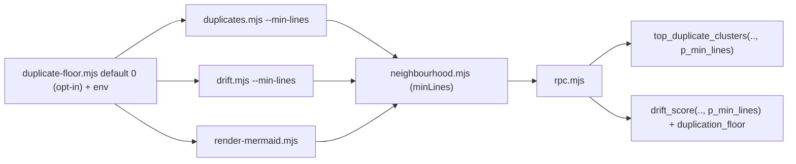

# Plan: Size floor for `arch:duplicates` and the drift score

- **Date**: 2026-11-16
- **Amendment (2026-11-16, user-approved via the CES coordinator)**: the floor is **OPT-IN**. `DEFAULT_DUPLICATE_MIN_LINES` is `0`; a consumer opts in from its own workflow (storyline: `--min-lines 6` on both `duplicates.mjs` and `drift.mjs`). Reason: a default of 6 shifts every consumer's drift-score population at once and breaks trend comparability, and a short helper copied in production code is real debt. Everything else below stands; where the text says "default 6" read "the recommended opt-in value 6". Since an inherited default can no longer be positive, the "unsupported + default ⇒ degrade" branch of the exit contract is unreachable from the real resolver (kept as a pure function, tested synthetically).
- **Status**: In Progress
- **Author**: Claude + Louis
- **Scope**: backend (detector CLI + Postgres RPCs + consumer docs)
- **Origin**: storyline coordinator report — nightly "Architectural drift" failed 7 of 8 runs; 5 clusters (`claim`, `filler`, `sha256`, `sleep`, `imp`) are 2–5 line test helpers.

## 1. Context Summary

Code Trace (all at `88bf43ee`):
`scripts/symbol-index/duplicates.mjs:160` → `getTopDuplicateClusters`
(`scripts/lib/store/arch/neighbourhood.mjs:48`) → `topDuplicateClusters`
(`scripts/lib/db/rpc.mjs:254`) → SQL `top_duplicate_clusters`
(`supabase/migrations/20260715120000_symbol_duplicate_justification.sql:25`).
The score is a *separate* RPC, `drift_score` (same file `:72`), called from
`scripts/symbol-index/drift.mjs:253` and `scripts/symbol-index/render-mermaid.mjs:319`.
Both group `symbol_index` rows by `(signature_hash, kind)`, keep `HAVING COUNT(DISTINCT file_path) > 1`,
and exclude `duplicate_justified = true`. `symbol_index` carries `start_line`/`end_line`
(`20260501120000_symbol_index.sql:98`), the only size signal in the store.

**Consequence:** a floor applied only in `duplicates.mjs` (JS post-filter) would leave
`drift_score` — the number arch:drift gates on — inflated by the same noise. The floor must be
a row predicate in SQL, shared by both RPCs.

Neighbourhood: `precedent`-style existing mechanism is the `duplicate_justified` exclusion
(pragma + `scripts/lib/symbol-index/drift-path-exemptions.mjs`). Reused as the *shape*
(row-level exclusion inside both RPCs), not as the column: a floor is not a justification,
and writing it into `duplicate_justified` would erase the suppressed count and inflate
`duplication_excluded_count`.

## 2. Proposed Architecture

Decisions (principles from `engineering-principles.md`):

- **Metric = line span** `end_line - start_line + 1` of the symbol. The index has no AST
  complexity; span is the one stored, deterministic size measure (#4 no hardcoding, #5 single source of truth). "Complexity" is
  deliberately not modelled — no current requirement.
- **Floor is a row predicate before grouping**, shared verbatim by both RPCs, so list and score
  cannot disagree (#5). Rows with NULL `start_line`/`end_line` are **kept** (unknown size is
  never silently suppressed).
- **SQL default `p_min_lines = 0` (off); CES default lives in JS config = 6.** Old callers and the
  existing DB suite stay byte-identical; the CES default is one value in
  `DEFAULT_DUPLICATE_MIN_LINES` in `duplicate-floor.mjs` (`ARCH_DUPLICATE_MIN_LINES`), overridable per run with
  `--min-lines N` (precedence flag > env > default; default 0 = off). Matches storyline's
  flag-passing pattern.
- **Default 6** = suppress symbols spanning ≤5 lines, exactly the reported class (`sleep`,
  `sha256`, `claim` helpers). Anything ≥6 lines (a real function body with logic) still clusters.
- **Suppressed count is measured in SQL**: `drift_score` gains
  `duplication_floor: {min_lines, clusters_before, clusters_after, suppressed_clusters}`;
  `duplicates.mjs` reads it (one extra cheap RPC call) and emits it in `--json` and text.
  Count failure → `suppressedClusters: null` rendered `UNKNOWN`, never `0` (#16).
- **Argument-list change = different function** (AGENTS.md): the migration `DROP`s the old
  3-arg `top_duplicate_clusters` and 4-arg `drift_score` and recreates them with the new
  trailing defaulted param, restating `SET search_path`, then `REVOKE … FROM PUBLIC, anon,
  authenticated` / `GRANT … service_role`. Old 3/4-arg call sites resolve to the new function via
  the default. Verified by `has_function_privilege`, not review.
- **Unmigrated store — exact detection, structured state, defined exit** (audit R1 H1/H2):
  - *Call shape*: `minLines = 0` calls the legacy 3-/4-arg form (new argument omitted), so a floor-off run behaves identically on any store. `minLines > 0` calls the new form.
  - *Detection*: on SQLSTATE `42883` only, probe the exact failed signature on the same connection: `SELECT to_regprocedure('public.top_duplicate_clusters(uuid,uuid,integer,integer)')` (resp. `public.drift_score(uuid,uuid,numeric,numeric,integer)`) — schema-qualified, full argument types, so an unrelated same-named overload cannot satisfy it. Non-null ⇒ the `42883` came from elsewhere ⇒ rethrow unchanged. Null ⇒ `FLOOR_UNSUPPORTED`. **No cache** (probe runs only on the error path, once per failing call), so two stores in one process can never share an answer. Every other error propagates. Tests: unrelated overload present, both RPCs, two stores with different migration states in one process.
  - *State*: one `floor` object end to end (store → CLI JSON/text → drift report → Mermaid): `{minLines, source, applied: true|false, reason, suppressedClusters|null}`.
  - *Monotonic*: the floor only removes rows before grouping, so an un-floored score is ≥ the floored one — an unsupported store can over-report, never under-report.
  - *Exit contract*: unsupported + floor from **default** ⇒ retry un-floored, `applied:false`, banner, drift status additionally labelled `floor not applied`, exit 0 (legacy behaviour, visibly annotated). Unsupported + floor from an **explicit** flag/env ⇒ exit 2 (infra: operator demanded a floor the store cannot honour). `--min-lines 0` is always legal.
  - Consumers are on different stores → every store must be migrated (`--migrate`) before relying on the floor.
- **One input contract** (R1 H3): `resolveMinLines` in `scripts/lib/symbol-index/duplicate-floor.mjs` is the only parser; `config.mjs` exposes the raw `ARCH_DUPLICATE_MIN_LINES` string and the default constant, nothing else. Accepts base-10 integers `0..10000`; a missing flag value, non-integer, negative, or out-of-range value (flag or env) → diagnostic on stderr + exit 2, never a silent fallback to the default. Precedence flag > env > default.
- **List/stat consistency** (R1 H4/M1): both RPCs build their population from one shared predicate (same `refresh_id`, `duplicate_justified = false`, non-empty `signature_hash`, floor predicate). A snapshot is immutable per `refresh_id` (refreshes write a new id), so the list and the stats describe the same data. Stats are whole-snapshot (independent of `--limit`/pagination) and requested once per run. Failure semantics: list failure ⇒ exit 2; stats failure ⇒ list still emitted with `suppressedClusters: null` rendered `UNKNOWN` (never 0). `duplication_floor` reports `clusters_before/after`, `pairs_before/after`, `rows_suppressed`, so a cluster that survives with fewer files still explains the score change; `suppressed_clusters` is defined as "clusters that no longer have >1 file".

Right-sizing: *band-aid* = filter in JS / add storyline's helpers to exceptions (score stays inflated,
or false justifications). *Over-built* = AST complexity metric, per-path floors, new table. *Chosen* =
one integer predicate in the two RPCs + one config value; serves the current requirement (trivial
fixtures out of clusters AND score, tunable, counted).

## 3. Sustainability Notes
Assumption: line span proxies triviality. If it proves too coarse, the predicate is one line in two
RPCs, and `duplication_floor` already reports what it removes, so a bad default is visible.
CES's own drift baseline may drop slightly; `ARCH_DUPLICATE_MIN_LINES=0` restores it.

## 4. File-Level Plan
- `supabase/migrations/20261030130000_duplicate_min_lines_floor.sql` (create) — DROP/CREATE both RPCs with `p_min_lines`, floor predicate, `duplication_floor` jsonb, ACL.
- `scripts/lib/db/rpc.mjs` (modify) — `topDuplicateClusters`/`driftScore` take `minLines`; map `42883` when `minLines>0` to `FLOOR_UNSUPPORTED`.
- `scripts/lib/store/arch/neighbourhood.mjs` (modify) — pass `minLines` through; surface `FLOOR_UNSUPPORTED` as `err.code`.
- `scripts/lib/symbol-index/duplicate-floor.mjs` (create) — owns the default (6), the env var `ARCH_DUPLICATE_MIN_LINES` and the pure helpers (no `config.mjs` change — one owner, not two): `resolveMinLines({flag, env, default})` → `{minLines, source}`, `describeFloor(stats, applied)`; the one oracle both CLIs use.
- `scripts/symbol-index/duplicates.mjs` (modify) — `--min-lines`, floor in `KNOWN_FLAGS`/help, fallback, `floor` in `--json`, text line, header docs.
- `scripts/symbol-index/drift.mjs` (modify) — `--min-lines`, pass to both RPC calls, report suppressed count.
- `scripts/symbol-index/render-mermaid.mjs` (modify) — pass config floor so renders match drift.
- `tests/duplicate-min-lines-floor.test.mjs` (create) — pure tests: resolution precedence, render of suppressed/UNKNOWN/not-applied, fallback decision.
- `tests/symbol-index-drift-justification.test.mjs` (modify) — new describe on real Postgres: below-floor suppressed, above-floor kept (positive control), override honoured, NULL lines kept, list/score parity, `has_function_privilege`.
- `tests/fixtures/expected-schema.json` (modify, regenerated) — via `db:local:regen` only.
- `tests/arch-duplicates-pagination.test.mjs` (modify if needed) — keep `paginate` contract.
- `README.md` (modify) and `docs/reference/architecture-index.md` (modify) — document the knob; name `node scripts/symbol-index/duplicates.mjs --min-lines N` by path, env `ARCH_DUPLICATE_MIN_LINES`; synced path `scripts/.claude-skills/symbol-index/duplicates.mjs` for consumers.
- `scripts/.cli-catalog.json` (modify if the flag list is catalogued).

- `tests/duplicate-min-lines-floor.test.mjs` also carries the distribution check: the sync ships by import closure (`getSyncClosure()`), derived not hand-listed, so the test asserts `scripts/lib/symbol-index/duplicate-floor.mjs` is in the closure beside `duplicates.mjs` (`bundle-deps.json` lists npm packages only and is unchanged). A full relocated-copy run was not built: the closure is the mechanism, and the CLI's `--selfcheck-relocation` smoke is unchanged.

Close-out (not a phase): `npm run skills:regenerate` only if skills change (none expected), `npm run db:local`, `npm run check`.

## 5. Risk & Trade-off Register
- Migrating consumer stores is an operator step; mitigated by loud degradation, never a clean-looking result.
- Default 6 changes CES's own drift number; acceptable, documented, reversible by env.
- Same-hash rows have near-equal spans, so a cluster is either wholly below the floor or not; mixed-span edge (comment/whitespace) handled by per-row predicate and counted as "suppressed" only if the cluster no longer has >1 file.
- Deferred: complexity metric, per-path floors (no current requirement).

Migration safety (R1 M2): before writing the SQL, inventory dependents (`pg_depend`/`pg_proc` references to both functions, callers via grep: `rpc.mjs`, `cross-skill` compute-drift-score), and current ACLs. One `BEGIN … COMMIT`; forward-only (the repo ledger has no down-migrations; a bad floor is undone by `ARCH_DUPLICATE_MIN_LINES=0`, not a rollback). Tests call old positional shapes (3-/4-arg) and the new shape on a migrated DB.
Query cost (R1 M4): stats come from `drift_score`, which already aggregates the same grouping; the "before" count adds one aggregate over the same index-served scan. Build-time spike: `EXPLAIN ANALYZE` before/after on the CES store, recorded in the PR; if the delta is material, share one CTE.

## 6. Testing Strategy / Proof plan
- CLI-level tests (R1 M3): spawn `scripts/symbol-index/duplicates.mjs` / `drift.mjs` with cloud disabled (no RPC, existing exit 2 contract unchanged), invalid `--min-lines`/env (exit 2), and exercise the exported envelope builder + exit decision for applied / unsupported-default / unsupported-explicit / stats-failed; a real-Postgres test for `42883` with signature present vs absent.
- Mixed-span test: a 3-file cluster where one file's copy is under the floor keeps the cluster but changes `pairs_before/after`.
- Oracle: real-Postgres tests (pure mocks cannot prove SQL). Red first: floor-off baseline shows the 3-line cluster; floor 6 removes it and `suppressed_clusters = 1`; an 8-line duplicate remains under the same floor (positive control); `--min-lines 2` keeps a 3-line cluster (override); NULL-line rows survive; `drift_score.duplication_pairs` equals the sum implied by the listed clusters.
- Pure tests: precedence flag>env>default; `FLOOR_UNSUPPORTED` fallback emits `applied:false` and never `suppressedClusters: 0`; unknown count renders `UNKNOWN`.
- Negative control: revert the predicate, confirm the below-floor test fails.
- Run `npm run db:local` (enrolled suite) and `npm run check`.
