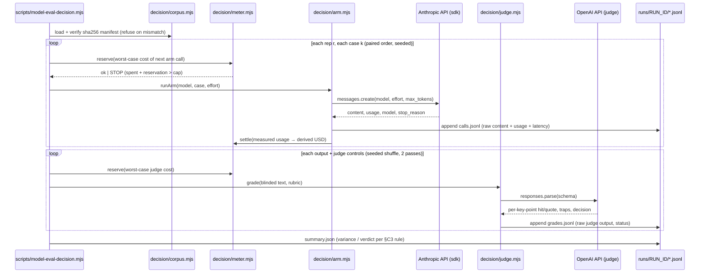

# Plan: Fable 5.2 vs Opus 5.5 on coordinator-grade decisions
- **Date**: 2026-11-15
- **Status**: Approved
- **Author**: Claude + Louis
- **Scope**: backend (js-ts; CLI + `scripts/lib/model-eval/decision/` + corpus + research artifacts)
- **Mode**: campaign
- **Target domain(s)**: `model-eval`, `arm-eval`, `shared-lib`, `scripts`
- ⚠ **Cross-domain work** — touches `arm-eval` (judge fix) and `shared-lib` (price row) alongside the new `model-eval` module; both are instrument fixes the experiment depends on, not new boundary crossings.

## 0. The question, and what this plan is not

**Question.** Does Claude Fable 5.2 (`claude-fable-5-2`) earn its extra cost over
Claude Opus 5.5 (`claude-opus-5-5`) on the decisions a coordinator session makes —
high-stakes review / diagnosis, hard design forks, cross-repo synthesis? The current
advice ("Fable on demand for high-stakes reviews and design forks; no standing Fable
coordinator, because context size drives cost") is asserted, not measured. This plan
measures **quality and cost together**, per call and per correct decision.

**Not this plan.** A standing collector, a shadow, a toggle, or a background window
(runbook `docs/runbooks/model-eval-harness.md` §"Why synchronous" — a sixth collector
is the band-aid it exists to prevent). One synchronous run, verdict to `docs/research/`.

**Autonomous scope stops after the variance phase** (≤ $10 measured spend). The main
comparison needs Louis's explicit approval of its budget (§C6, §12).

## 1. Context Summary

### Neighbourhood considered (arch-memory, 2026-11-15)
- `scripts/lib/arm-eval/judge.mjs::callJudgeDefault` — **precedent** (`above-floor-standout`).
  Decision: **fix it, do not reuse it as this experiment's judge** — it is a Claude judge
  (same vendor as both arms) scoring comparative 1–5 dimensions, while this experiment
  needs a cross-vendor judge scoring a per-case rubric of known key points. The new judge
  is a sibling that reuses its shape (seeded shuffle, egress gate, schema-validated JSON).
- `judgeSession`, `buildJudgePrompt` (arm-eval), `buildUsageEvent`, `toArmSpend`
  (`model-eval/cost.mjs`) — `review` band; read, see §2 for reuse decisions.

### Reuse decisions (what fits, what does not, and why)
| Asset | Use? | Why |
|---|---|---|
| `scripts/lib/model-pricing.mjs` `costFromUsage` / `priceFor` + `model-pricing-table.mjs` | **Yes — the only price source** (#5 SSoT) | Cache-aware, per-model `cachedInput`. Needs a **Fable 5.2 row** (§2.1). |
| `scripts/lib/anthropic-client.mjs` `createAnthropicClient({backend:'sdk'})` | **Yes — every arm call** | Metered usage; `cli` backend drops options and adds a ~164K prefix. Passed **explicitly**, never ambient (`CLAUDE_BACKEND=cli` is the local default; PR #360 still open). |
| `scripts/lib/openai-client.mjs` `createOpenAIClient({purpose:'gpt'})` + `responses.parse` + `zodTextFormat` | **Yes — judge transport** | Cross-vendor judge; repo's existing structured-output pattern (`scripts/lib/llm-wrappers.mjs:42`, 809a615e). |
| `scripts/lib/sensitive-egress-gate.mjs` `assertEgressSafe` | **Yes** | Every outbound payload (arm and judge) is scanned before the wire. |
| `scripts/lib/rng.mjs` `mulberry32` / `seededShuffleCopy` | **Yes** | Seeded, recorded grading order and spot-sample draw. |
| `scripts/lib/model-eval/cli-shared.mjs` `BUDGET_STOPPED_EXIT_CODE`, `RunPreflightError` | **Yes** | Same exit contract as the sibling model-eval CLIs (4 = budget stop). |
| `scripts/lib/cli-io.mjs` `assertKnownFlags`, `finishAndExit`; `scripts/lib/cli-entry.mjs` `isInvokedAsScript` | **Yes** | AGENTS.md CLI invariants (stdout drain, entry guard). |
| `scripts/lib/model-eval/cost.mjs` usage events | **No** | `RoleSchema` is the swap-eligible enum (`auditor`/`adjudicator`); widening it to "coordinator" would enrol a non-swap role into the swap harness's verdict machinery. Price via `costFromUsage` directly. |
| `model-eval-auditor/adjudicator.mjs` + `known-defects.json` | **No** | Oracle = "did it localise the curated defect"; our ground truth is a *decision* with key points and traps, not a file+line. Runbook Step 1: do not unify scoring modes. |
| `scripts/lib/arm-eval/judge.mjs` judge | **No (fix only)** | Claude judge → self-vendor bias for both arms; comparative 1–5 scale, not rubric key points. |
| `scripts/bandit.mjs` | **No** | Thompson sampling over **prompt variants** allocates trials adaptively toward the apparent winner. This experiment needs a **fixed, paired, equal-n design**: adaptive allocation biases the effect estimate, starves the losing arm of the samples that measure its variance, and cannot pre-register n. Different question (online optimisation vs one-off inference). |
| `scripts/pinned-worktree.mjs` (`npm run fixture:create`) + `scripts/run-heartbeat.mjs` | **Yes** | Spend-bearing runs pin their revision; heartbeat journals the run. |

### Code Trace (read at 809a615e)
- Judge bug: `scripts/lib/arm-eval/judge.mjs:171-209 (809a615e)` — `callJudgeDefault`'s
  `catch` returns `{conformant:false, …, error: err.message}` for every error except
  `[egress-gate]` → `judgeSession` (`:116-127`) treats it as a schema rejection, sends
  the transport error text back as a "CRITICAL — your previous response was REJECTED"
  corrective prompt, and on a second failure returns `conformant:false` — the same value
  a malformed model answer produces. `run.mjs:91 (809a615e)` then records nothing and
  reports `judged:false`; no caller can tell an outage from a bad judge answer.
- Price gap: `priceFor('claude-fable-5-2')` returns **null** at 809a615e (measured:
  `node -e "import('./scripts/lib/model-pricing.mjs').then(m=>console.log(m.priceFor('claude-fable-5-2')))"`)
  — `pricingKeys` yields only `['claude-fable-5-2']` and the table has rows for
  `claude-fable-5-1` / `claude-fable-5` only (`scripts/lib/model-pricing-table.mjs:108-111`).
  An unpriced arm reports `null` cost, so the cost half of the comparison would be absent.
- Cache multiplier: `CACHE_MULTIPLIER = {write:1.25, read:0.10}` (`scripts/lib/model-pricing.mjs:118`);
  `costFromUsage` prefers a row's `cachedInput` over `read` (`:431`). Opus 5.5's row
  already carries `cachedInput: 0.20` (`model-pricing-table.mjs:111`).
- Transport: `createAnthropicClient` sdk path `wrapSdkClient` (`anthropic-client.mjs:558-582`)
  passes `params` through to `rawClient.messages.create` unchanged — `output_config.effort`
  reaches the API; usage comes back on `resp.usage`.

### Published pricing (read 2026-11-15 from the bundled `claude-api` skill: SKILL.md model table "cached: 2026-11-03" and `shared/model-migration.md`)
| Model | Input $/MTok | Output $/MTok | 5-min cache write | 1-h cache write | Cache read |
|---|---|---|---|---|---|
| `claude-fable-5-2` | 8.00 | 40.00 | 10.00 (1.25x) | 16.00 | 0.20 (0.025x) |
| `claude-opus-5-5` | 4.00 | 20.00 | 5.00 (1.25x) | 8.00 | 0.20 (0.05x) |
| `claude-haiku-5-5` (rehearsal only) | 0.10 | 0.50 | — | — | (multiplier) |
| `gpt-6.1-terra` (judge; existing table row) | 1.00 | 5.00 | — | — | 0.05 |

Thinking: **always on for both** (adaptive; `{type:"disabled"}` and `budget_tokens` 400
on both). Depth is controlled only by `output_config.effort`; **Opus 5.5 defaults to
`medium`**, so effort must be set explicitly to be equal. Thinking tokens are billed as
output tokens; the raw chain is never returned (`display` defaults to `omitted`).

## 2. Proposed Architecture

### 2.1 Instrument fixes first (Cluster A — they gate every number after them)
1. **Judge transport failure ≠ quality failure** (`scripts/lib/arm-eval/judge.mjs`). A
   thrown error from the client (network, 5xx, timeout, auth) returns
   `{conformant:false, unmeasured:true, reason:'judge-transport', error}`; a parsed-but-
   invalid answer stays `{conformant:false, unmeasured:false}`. `judgeSession` retries
   an unmeasured pass **once with the original prompt** (never feeds the transport error
   back as a schema correction) and, if still unmeasured, returns
   `{conformant:false, unmeasured:true, …}`; `run.mjs` surfaces `judgeUnmeasured:true`
   in its result. Excluded and counted, never scored. (#15, #16)
2. **Fable 5.2 price row** (`scripts/lib/model-pricing-table.mjs`):
   `'claude-fable-5-2': { input: 8, output: 40, cachedInput: 0.20 }` with source + read date. (#5)

### 2.2 New module `scripts/lib/model-eval/decision/` (Cluster B)
Sibling to the swap harness, sharing plumbing only (runbook Step 1: one CLI per scoring
mode). Pure functions where possible; I/O injected (#11).

- **Arms.** Same system prompt, same user message (case context + question), `max_tokens`
  16000 (non-streaming SDK default), `output_config:{effort:'high'}` for **both** (effort
  held equal; `high` is the skill's starting point for Fable 5.2 and above Opus 5.5's
  `medium` default), `thinking` omitted (adaptive, always on for both), **no `fallbacks`**
  (a server-side fallback would let a *different* model answer under the arm's name), no
  `cache_control`, no `temperature` (400 on both). Recorded per call: requested model,
  **`response.model`**, `stop_reason`, `stop_details`, every usage field, latency, raw
  `content` (text blocks; thinking blocks recorded as present/length only — their text
  is empty under `omitted`). A run whose `response.model` ≠ requested is an
  **instrument failure** (stop).
- **Meter (hard cap).** Before each billable call: `reservation = inputTokensMax × inPrice
  + outputCap × outPrice`, refused when `spent + reservation > cap`. `inputTokensMax` is the
  request's **UTF-8 byte length** — a strict upper bound, since a byte-level BPE token covers
  ≥ 1 byte (over-reserves input ~4x). `outputCap` is the provider-enforced hard cap that
  **includes thinking / reasoning tokens**: arms `max_tokens = 16000`, judge
  `max_output_tokens = 6000`; a call without a finite cap is refused. The reservation row is
  **written to the ledger before the call**; a killed process leaves it open and the scope
  sum charges it at its worst case until a human reconciles it. One process per scope: an
  exclusive lock file `runs/.budget-<scope>.lock` (left behind by a killed process, so the
  next run refuses until reconciled). The SDK's
  own retries (429/5xx) bill only the attempt that succeeds; any call that fails with no
  usage returned is charged its **full reservation** (never under-reported). **One cap per
  budget scope**: `--budget-scope autonomous` makes the rehearsal and the variance phase
  share the single $10 — the meter starts from the scope's summed ledger spend, and refuses
  to start when the scope is exhausted. After the call: settle with
  `costFromUsage(usage, responseModel)` (derived from **measured** tokens). Spend
  therefore cannot exceed the cap unless the price table is wrong — independent of
  pre-flight estimates (which have run 8x low). The ledger is append-only JSONL written
  after every call, so a crash loses at most the in-flight call. An unpriced model or
  `usage` missing → **stop** (never priced as 0).
- **Judge (blinded, cross-vendor, double-pass).** `gpt-6.1-terra` via the resolved
  `latest-gpt` sentinel, the concrete id recorded per call. Input: the case's question,
  rubric (decision statement, key points, traps) and ONE arm output — no arm label, model
  names scrubbed (`/\b(Claude|Fable|Opus|Sonnet|Haiku|Mythos|Anthropic)\b/gi → [model]`),
  thinking blocks absent. Grading order is a seeded shuffle over all outputs + controls.
  Each output is graded **twice** (two independent calls) to measure judge noise.
  Structured output: per key point `{id, hit, quote}`, per trap `{id, fell, quote}`,
  `decisionCorrect {value, quote}`. **Quote check (mechanical):** every `hit:true`,
  `fell:true` or `decisionCorrect:true` must carry a quote that is a whitespace-normalised
  substring of the output; a failed check marks *that item* `unverified` (excluded from
  its denominator, counted) — never silently flipped to a miss or a hit.
- **Judge failure taxonomy.** `scored` | `unmeasured:judge-transport` |
  `unmeasured:judge-malformed` (no parse, or not an exact cover of the rubric ids, after one
  plain retry). Retries follow the shared classifier `classifyLlmError`
  (`scripts/lib/robustness.mjs`): a non-429 4xx (auth, bad request, unknown model) is
  unmeasured **at once, never retried**; 429/5xx/network get one plain retry. The same
  classification is applied in the arm-eval judge fix. Unmeasured grades are excluded and
  counted; if > 10% of grades in a run are unmeasured the run is `not-credible`.
- **Scoring contract (what is measurable).** A *pass* is scoreable only when the judge
  graded every rubric key point and trap exactly once (exact id cover, no extras or
  duplicates) AND at least one key point is measured (verified) AND `decisionCorrect` is
  measured AND **no positive claim failed the quote check**; otherwise its `q` is null. A
  single unverified claim voids the pass rather than leaving its denominator — excluding
  just that item would let a fabricated quote raise coverage or erase a trap penalty. An
  *output* is measured only when **both** passes have a non-null `q`; anything less is
  excluded and counted (`unverifiedItems`, unmeasured outputs). Every case has ≥ 1 trap
  (schema), so the trap denominator is never empty.
- **Score.** Per graded output `q = clamp01(0.6·correct + 0.4·coverage − 0.2·trapRate)`,
  `coverage` = weighted share of *measured* key points hit, `trapRate` = share of measured
  traps fallen into. Per output, `q` = mean of its two passes; `correct` (for cost per
  correct decision) = both passes say `true`. A pass disagreement on `correct` is counted
  and reported. Weights are fixed here, before any output is read.
- **Controls (judge-side).** Per case, two canned outputs written by hand and frozen with
  the corpus: a **gold** answer (must grade `correct:true` in both passes, mean coverage
  ≥ 0.8) and a **trap** answer that confidently reaches the falsified conclusion (must grade
  `correct:false` and `trap1 fell:true` in both passes). Graded at two points:
  1. **Checkpoint before any arm spend** — every case's gold + trap, double-pass. Every
     checkpoint control must be **scored and pass**: a miss OR an unmeasured control
     (judge unreachable) ⇒ `stopped:InstrumentFailure` and **no arm call is made**.
  2. **In-run, per rep** — interleaved with that rep's arm outputs under opaque ids in the
     shuffled order, indistinguishable from them. A scored miss makes the run
     `not-credible`; an unmeasured in-run control is not a miss and counts toward the
     ≤ 10% unmeasured gate (the checkpoint already proved the judge discriminates).
- **Run states.** `completed` | `stopped:BudgetStop` | `stopped:InstrumentFailure`
  (control checkpoint, model mismatch) | `stopped:ArmRouteBroken` (2 consecutive arm
  transport errors) | `stopped:UnpricedModelError`; a crash leaves no `summary.json`. Every
  call / grade / ledger row is appended as it happens, keyed by a stable `callId`
  (`run:case:rep:model`) and an opaque `gradeId`, so a stopped or crashed run is fully
  auditable. **There is no resume**: evidence is append-only, a new attempt takes a new
  `--run-id` (the budget scope still carries the earlier spend). In the main run a
  case-rep counts toward Δ only when **both** arms have a measured output; unpaired
  case-reps are excluded and listed.
- **Arm-side failure taxonomy.** `ok` | `refusal` (a real behaviour → graded as-is,
  q=0 if no decision text, listed separately) | `max_tokens` with text (equal budget →
  graded as-is, flagged) | `truncated-no-text` (`max_tokens` with **no text block** — the
  whole budget went to thinking: a truncation defect, never graded as an empty answer;
  excluded and counted) | `incomplete` (any other non-`end_turn` stop → graded as-is,
  flagged) | `arm-error` (transport after SDK retries → excluded, counted, charged at the
  reservation) | `model-mismatch` (served id is neither the requested id nor a dated
  snapshot of it → stop).
- **Spot sample (human-checkable).** Seeded draw of 20% of graded arm outputs (min 4)
  rendered blinded with the rubric into `spot-sample.md`; Louis marks `correct` Y/N per
  row; `spot-agree` reports judge–human agreement. The judge label compared is **Y only
  when both passes said correct** (the cost-per-correct definition); rows whose passes
  split are flagged `split` and reported separately; agreement is `null` (unmeasured,
  never 0) unless **every** sampled row is marked (sample ≥ 4) — no skipping. Required
  before the main verdict, optional after the variance phase.
- **Artifact review before commit (public repo).** Every file a run writes is scanned
  with `scanEgressPayload` (secret shapes) and for private-consumer terms supplied via
  the gitignored env `DECISION_EVAL_PRIVATE_TERMS` (the terms are never committed). The
  result lands in `summary.json → artifactScan.safeToCommit`; **unconfigured terms read as
  not safe**, and a run directory is committed only when it is `true`. Arm and judge
  payloads pass `assertEgressSafe` before the wire (tested in the same commit — the
  sensitive-path egress Tier-3 seam).

### 2.3 Persistence (raw outputs, not only scores)
`docs/research/fable-vs-opus-decision-eval/`:
- `corpus/<case-id>.json` (context, question, rubric, controls, provenance) +
  `corpus/manifest.json` (sha256 per case, corpus hash, rubric hash, arm-prompt hash,
  contract epoch). The runner **refuses** on any hash mismatch.
- `runs/<run-id>/calls.jsonl`, `grades.jsonl`, `ledger.jsonl`, `summary.json`,
  `spot-sample.md`, `heartbeat` id = run id.
- `variance-report.md` (this plan's deliverable), later `verdict.md`.

These are **recorded evidence, not generated artifacts** (two runs are not byte-identical
by nature, and nothing regenerates them) — committed as authored research data, the
same footing as `docs/arm-eval/sessions/` which survived the 2026-07-14 wipe when DB
rows did not. No DB rows; no store writes.

## 3. Corpus

Five decision points from this repo's real history, each with a now-known outcome,
verified against git / PRs / docs (provenance per case in `corpus/<id>.json` →
`sources`, never sent to an arm). Frozen as byte-identical inputs: context that was
available **before** the answer was known + a question that does not leak it.

| id | Role | Decision at the time | Known outcome (rubric only) |
|---|---|---|---|
| `cli-system-honour-claim` | design-fork | PR #360 refuses `system` on the cli backend because cli "does not honour `system`" — is that property accurate as worded, and does the throw / warn / route choice follow? (pre-fix cb1f0323) | Wording overstated: `system` is delivered (`--system-prompt`) and obeyed for a short instruction (3/3) but outranked for a contract-bearing one (0/4); keep the throw on the stronger argument (params cannot tell the two apart); only `tools`/`tool_choice` are truly dropped (falsifier 48add1a4) |
| `sync-manifest-ratchet-report` | cross-repo | A consumer coordinator reports the sync records *intended* hashes for refused paths ("ratchet") and the verifier is blind — right diagnosis? what to reproduce, what to fix? (d0f3d8f5) | Not a ratchet: a refused path's entry is the last real write (stable across refusals); do not reconcile manifest to disk; the real defect is a one-shot held-staleness warning that asks the previous receipt (PR #357, e4aae46d) |
| `stale-override-four-sites` | cross-repo | A private consumer holds a sync override because four sites in a delivered doc name upstream paths — is that reason still true; keep the override / the upstream report? (f48d9863) | No: the 3 `node` sites are rewritten on delivery, the 4th is a link label with the consumer path two lines on; verify the delivered bytes, close the report as not reproducing; the override's other rationale is separate (PR #359, 809a615e) |
| `sdk-pin-max-tokens-review` | review | Review a PR that moves call sites from the ambient cli backend to a literal sdk pin with code otherwise unchanged — regressions? (a4697858) | Yes: `max_tokens` goes from ignored to enforced; with a model that thinks by default a 64-token budget is spent on thinking (`stop_reason: max_tokens`, no text block) and `content[0].text` reads the wrong block (fix dfb174b8) |
| `check-ignore-ci-cause-string` | review | A test pinned to a cause string fails only on the CI runner with a different cause — flake, loosen the assertion, or change code? (9232dd28) | Real race: `git check-ignore --stdin` outside a work tree exits 128 without reading stdin, so the parent sees 128 or EPIPE by timing; report the non-zero status over the write error in code, keep the test (1e43ade6; CI run 43603919168) |

Roles: `review` ×2, `cross-repo` ×2, `design-fork` ×1 — so per-role verdicts are possible
for review and cross-repo only; **design forks are under-covered** (one case) and the
verdict reports that role as `untested`. Adding ≥ 1 more design-fork case before the main
run is recommended in the variance report (it needs a re-freeze → epoch stays 1 only if
done before any main-run output exists).

### 3.1 Freezing rules
- Context excerpts are taken at the **pre-fix** commit; anything written after the answer
  was known (fix commit, post-mortem comments, memory notes) is excluded.
- A leak scan per case: the falsifying phrase(s) recorded in `rubric.leakTerms` must not
  appear in `context` or `question` (a test enforces this).
- **Private-consumer content**: this repo is public. Excerpts from the private consumer
  repo are not committed verbatim; that consumer is named generically ("a private
  consumer repo") and only CES-side code or a paraphrase of the consumer's file is
  frozen (memory: repo-disclosure rule).
- Role tags: `review` (diagnosis / falsify a claim), `design-fork`, `cross-repo`. The
  verdict is per role only where a role has ≥ 2 cases; otherwise pooled, with the role
  reported descriptively and the gap named in the verdict.
- Training-data leakage: every case postdates both models' published knowledge cutoffs
  in the bundled skill's table; recorded per case as `decisionDate`.

## 4–5. (frontend sections — not applicable)

## 6. Sustainability Notes
- **Assumption that will change:** prices. The run reads them through `priceFor` at run
  time and stamps `PRICING_VERSION` + the price-review date in `summary.json`; a re-run
  after a price change re-derives USD from the persisted tokens (tokens are the
  measurement, USD is derived).
- **Extension point:** adding a model arm = one entry in the CLI's `--arms`; adding a
  case = one corpus JSON + a manifest regen (`--freeze`). No new code per case (#20).
- **What this deliberately is not:** a reusable "coordinator eval platform". If a second
  question arises, the corpus and judge are the reusable parts; the CLI stays thin.

### Right-sizing gate
- **Band-aid extreme**: run each model once per case in a chat, eyeball the answers,
  estimate cost from list prices — n=1, unblinded, the exact failure the xhigh trial was.
- **Over-engineered extreme**: a store-backed eval service with DB tables, a dashboard,
  per-role adaptive allocation and a shadow on live coordinator traffic.
- **Chosen**: one CLI + one small lib dir + committed JSONL evidence. Every piece serves
  a stated requirement: meter (hard cap), double-pass + controls (instrument check),
  quote check (judge hallucination), manifest hashes (byte-identical inputs).

## 7. File-Level Plan

| File | Purpose | Key exports | Principles |
|---|---|---|---|
| `scripts/lib/arm-eval/judge.mjs` (modify) | Transport failure → `unmeasured`, plain retry, never a corrective nudge | `callJudgeDefault` gains injectable `deps.createClient` via `_internals` | #15, #16, #11 |
| `scripts/lib/arm-eval/run.mjs` (modify) | Surface `judgeUnmeasured` in the result | `runArmEvalSession` result field | #19 |
| `tests/arm-eval-judge.test.mjs` (modify) | Red-then-green: transport throw → `unmeasured`, not `conformant:false`-as-quality; corrective prompt never built from a transport error | — | #11 |
| `scripts/lib/model-pricing-table.mjs` (modify) | `claude-fable-5-2` row | — | #5 |
| `tests/model-pricing-pool-coverage.test.mjs` (modify) | Red-then-green: Fable 5.2 priced at $8/$40, cache read $0.20 | — | #11 |
| `scripts/lib/model-eval/decision/corpus.mjs` (create) | Load cases, verify manifest hashes, leak scan, `freeze()` writes manifest | `loadCorpus`, `freezeManifest`, `leakScan`, `CaseSchema` | #13, #5 |
| `scripts/lib/model-eval/decision/meter.mjs` (create) | Reservation + settlement against a hard cap; append-only ledger | `createMeter`, `worstCaseCost`, `BudgetStop` | #14, #16 |
| `scripts/lib/model-eval/decision/arm.mjs` (create) | One arm call via injected sdk client; usage/latency/model capture; failure taxonomy | `buildArmRequest`, `runArmCall`, `extractUsage` | #11, #19 |
| `scripts/lib/model-eval/decision/judge.mjs` (create) | Blinded cross-vendor rubric grading; quote check; taxonomy | `buildJudgeInput`, `gradeOutput`, `verifyQuotes`, `scrubModelNames`, `GradeSchema` | #12, #15 |
| `scripts/lib/model-eval/decision/analysis.mjs` (create) | `q`, within-arm spread, judge noise, n, bootstrap CI, decision rule, cost per correct | `scoreGrade`, `varianceSummary`, `proposeN`, `decide`, `costSummary` | #11, #1 |
| `scripts/lib/model-eval/decision/spot-sample.mjs` (create) | Worksheet render + agreement parse | `renderSpotSample`, `parseSpotAgreement` | #11 |
| `scripts/lib/model-eval/decision/runner.mjs` (create) | Run orchestration with injected clients/sinks (testable offline); pure `buildSummary` + `projectMainCost` from persisted rows | `runDecisionEval`, `buildSummary`, `projectMainCost`, `fillCheck` | #11, #2 |
| `scripts/model-eval-decision.mjs` (create) | Thin CLI: `freeze`, `run --phase rehearsal|variance|main`, `report`, `spot-agree`; `--cap-usd` required for any spend | `main` | #4, #19 |
| `tests/model-eval-decision.test.mjs` (create) | Unit tests over all lib modules with injected clients (no network) | — | #11 |
| `docs/research/fable-vs-opus-decision-eval/corpus/*.json` (create) | Frozen cases + controls + manifest | — | #5 |
| `docs/research/fable-vs-opus-decision-eval/deviations.md` (create) | C10 ledger | — | — |
| `docs/research/fable-vs-opus-decision-eval/variance-report.md` (create) | Variance-phase result, measured cost, proposed n, projected main cost | — | — |

### 7b. Implementation Phases
- **Phase 1 — Instrument fixes**: judge transport-failure fix + Fable 5.2 price row, each red-then-green. Files: `scripts/lib/arm-eval/judge.mjs` (modify), `scripts/lib/arm-eval/run.mjs` (modify), `tests/arm-eval-judge.test.mjs` (modify), `scripts/lib/model-pricing-table.mjs` (modify), `tests/model-pricing-pool-coverage.test.mjs` (modify)
- **Phase 2 — Decision-eval library**: corpus/meter/arm/judge/analysis/spot-sample modules + unit tests. Files: `scripts/lib/model-eval/decision/corpus.mjs` (create), `scripts/lib/model-eval/decision/meter.mjs` (create), `scripts/lib/model-eval/decision/arm.mjs` (create), `scripts/lib/model-eval/decision/judge.mjs` (create), `scripts/lib/model-eval/decision/analysis.mjs` (create), `scripts/lib/model-eval/decision/spot-sample.mjs` (create), `scripts/lib/model-eval/decision/runner.mjs` (create), `tests/model-eval-decision.test.mjs` (create)
- **Phase 3 — CLI + frozen corpus**: thin CLI and the five frozen cases with controls and manifest. Files: `scripts/model-eval-decision.mjs` (create), `docs/research/fable-vs-opus-decision-eval/corpus/manifest.json` (create), `docs/research/fable-vs-opus-decision-eval/deviations.md` (create)

**Close-out (not a phase)**: `npm test` (branch tier) · `npm run check` · `node scripts/campaign-contract-check.mjs docs/plans/fable-vs-opus-decision-eval.md` · `node scripts/lib/plan-paths.mjs docs/plans/fable-vs-opus-decision-eval.md`.

**Execution (not a code phase; after close-out, in a pinned fixture)**: rehearsal (Haiku 5.5, §C7) → variance phase (Opus 5.5, §C3) → `variance-report.md` → STOP for budget approval.

## 8. Risk & Trade-off Register
- **5 cases is a small corpus.** Per-role verdicts need ≥ 2 cases per role; with 5 cases
  at most two roles get one. Mitigation: pooled verdict primary; §C3 states the
  detectable effect; the verdict says which roles are untested rather than generalising.
- **Judge is GPT, not a human.** Mitigated by double-pass noise measurement, gold/trap
  controls every batch, mechanical quote check, and the human spot sample before the
  main verdict. Single-adjudicator limit stated (§C4).
- **Length bias** — longer answers hit more key points. Traps penalise confident wrong
  conclusions; output length is recorded and its correlation with `q` reported.
- **Ceiling** — if Opus already scores near 1.0, Fable cannot show a gain. Pre-registered
  as `inconclusive:ceiling` (§C3), not as "no difference".
- **Effort held at `high`** — a Fable-at-`medium` or Opus-at-`xhigh` arm might change the
  answer; effort is a held-equal factor here, named as a limit, and a follow-up factor if
  the main result is close.
- **Deferred**: Fable/Opus at other efforts, multi-turn agentic tasks, real coordinator
  context sizes (the "context size drives cost" half of the advice) — this run measures
  per-decision cost at fixed context, which is the honest scope of a 5-case corpus.

## 9. Testing Strategy
- **Unit (Tier 1, deterministic)**: meter (reservation refuses at the boundary; settle
  with missing usage stops; ledger append-only), corpus (hash mismatch refuses; leak
  scan catches a planted leak term), judge (quote check accepts normalised substring,
  rejects fabricated quote → `unverified`; transport throw → `unmeasured`; malformed →
  one plain retry then `unmeasured:judge-malformed`; model-name scrub), analysis (`q`
  formula, pooled within-case SD, `proposeN` bounds, bootstrap CI determinism under seed,
  decision-rule branches incl. ceiling and not-credible), arm (request carries
  `output_config.effort`, no `thinking`/`temperature`/`fallbacks`; `response.model`
  mismatch → instrument failure; thinking-token field captured when present, `null`
  otherwise — never 0).
- **Tier 2 (LLM seam)**: canned client fixtures with real usage shapes; no assertions on
  model prose.
- **Proof plan**: (a) judge fix — oracle: `tests/arm-eval-judge.test.mjs` new case, red
  at 809a615e, green after; (b) price row — oracle: pool-coverage test asserts $8/$40/$0.20,
  red at 809a615e; (c) meter — oracle: unit test that a scripted sequence of calls never
  exceeds the cap; plus the live rehearsal's ledger total ≤ cap.

## 10. (frontend acceptance criteria — not applicable)

## 11. Execution Clustering
- **Cluster A** — Phases 1–1 — fix-gate: yes
  - Coupling: both are instrument defects every later number rides on (a judge outage scored as quality; Fable cost = null); they must be green before the harness is built on them.
- **Cluster B** — Phases 2–3 — fix-gate: final
  - Coupling: the CLI is a thin shell over the library; the corpus format is the library's `CaseSchema`, so their seam is audited together.
- **Final gate**: consolidated Gemini review over the union diff.

## 12. Pre-registered decision rule (frozen before any arm output is read)

Definitions (all on `q` ∈ [0,1]):
- `s_w` — **within-arm spread**: pooled within-case standard deviation of per-output `q`
  across reps (variance phase, Opus arm).
- `s_j` — **judge noise**: mean |q_pass1 − q_pass2| over all graded outputs.
- `Δ_target = max(s_w, 0.10)` — the smallest gain that counts: never smaller than the
  run-to-run spread, and never below 0.10 (a material difference on this scale).
- `Δ` — Fable mean `q` − Opus mean `q`, paired by case; 95% CI by seeded paired
  bootstrap (10 000 resamples over cases, reps within case).
- `cpc_X` — cost per correct decision for arm X = arm USD (derived) / # outputs with
  `correct` = both passes true. `R = cpc_F / cpc_O`.

**Credibility gates (checked first; failing any ⇒ `not-credible`, no verdict):** judge
controls all pass (checkpoint and in-run); `s_j ≤ max(0.5·s_w, 0.10)`; unmeasured grades
≤ 10%; every `response.model` matched; **sample completeness** — every case has ≥ 2
measured units (variance: measured outputs per arm; main: measured *pairs*), measured
units ≥ 75% of planned, arm-error rate ≤ 10% per arm (rehearsal exempt: 1 rep, no
spread); spot-sample agreement ≥ 0.8 over **every** sampled row (main run only — a
partly marked sheet is unmeasured, so the human cannot choose which rows count). The
feasibility re-check counts **measured pairs**, not reps run. Exclusions are reported by
arm and reason (`statuses`, `unpairedCaseReps`, `gateFailures`).

**Estimand.** The mean paired difference in `q` **over these frozen decisions** (a
fixed-case estimand), not over all coordinator decisions. Reps reduce within-case
noise only; between-case variation in the effect enters through the CI, which resamples
**cases** first, then reps within case. With 5 cases the CI is coarse by construction
and the verdict says so; generalising beyond these decisions needs more cases, not more
reps.

**Verdict (per role with ≥ 2 cases, and pooled) — evaluated in this fixed, mutually
exclusive order (first match wins):**
1. **not-credible** — any credibility gate failed.
2. **inconclusive:ceiling** — Opus mean `q ≥ 1 − Δ_target` (no headroom to show a gain).
3. **fable-preferred** — `Δ ≥ Δ_target` AND CI lower bound > 0 AND `R ≤ 3.0`.
4. **opus:fable-better-but-not-at-that-price** — `Δ ≥ Δ_target` AND CI lower bound > 0 AND `R > 3.0` (or `R` undefined).
5. **opus:material-gain-ruled-out** — CI upper bound < `Δ_target`.
6. **inconclusive** — otherwise. A difference smaller than `s_w` is never reported as a result.

**Zero-correct cost ratio (pre-registered):** Opus never correct and Fable ≥ 1 correct ⇒
`R = 0`; Fable never correct ⇒ `R = +∞`; neither ⇒ `R` undefined (branch 4 if the
quality gain holds, no cost claim).

**Feasibility re-check:** `Δ_target` and the n check use the **larger** of the two arms'
`s_w` measured in the main run. If that spread implies more reps than were run (or is
infeasible at `r ≤ 10`), the verdict is flagged `underpowered` and cannot be
`fable-preferred` or `opus:material-gain-ruled-out` without that flag being shown beside it.

`R ≤ 3.0` is the pre-registered value of X: list price is 2x; ≤ 3x allows Fable to spend
up to 50% more tokens per correct decision before the premium is judged not earned.
Louis may replace X before the main run is approved; any change after main-run outputs
are read makes that analysis exploratory (§C2).

**Proposed usage rule shape** (filled by the verdict): for each role, `use Fable when …`
/ `use Opus` / `untested`, with the measured `Δ`, CI and `R` beside it.

## Campaign Contract

### C1 — Decision and metric
- **decision**: whether Louis adopts a Fable usage rule (which coordinator roles, when) or keeps Opus for all; Louis decides, from `verdict.md`.
- **metric**: paired mean decision-quality `q` (rubric: decision correctness, key-point coverage, trap avoidance) AND cost per correct decision, side by side; derived from the decision (a coordinator's job is reaching the right call at acceptable cost).
- **error-costs**: false "Fable preferred" = paying 2x+ on every high-stakes call for nothing; false "Opus" = missing better calls where a wrong decision costs hours of rework. Trivial-satisfaction base rate: a canned confident-wrong answer must score `correct:false` (trap control) and a canned gold answer `correct:true` — if either fails the metric is measuring nothing.

### C2 — Split, leakage and sealed test custody
- **split**: no train/calibration split — nothing is tuned on the corpus. The arm prompt, rubric weights and decision rule are frozen in this plan before any arm output is read. The variance phase reads Opus outputs; any rubric change after that is logged in `deviations.md`, bumps the contract epoch and requires re-running the variance phase before the main run.
- **test-set-hash**: `corpus/manifest.json` → `corpusSha256` (sha256 over the per-case sha256s, recorded at `freeze`); the runner refuses on mismatch.
- **access-record**: every run (rehearsal / variance / main) writes its `runs/<run-id>/summary.json` carrying the corpus hash, contract epoch and git sha; the main run is one recorded, approved run. Analysis designed after main-run outputs are seen is labelled exploratory.

### C3 — Feasibility and power
- **bound**: the rep count controls **within-case noise only** (it treats a case's reps as noise draws around that case's true score, which is what they are under the fixed-case estimand, §12); it cannot shrink between-case uncertainty, which the case-first bootstrap carries. Within that scope, with k = 5 cases and r reps per arm the 80%-power, α = 0.05 detectable paired effect is `Δ_min ≈ 2.8·√2·s_w/√(k·r)`. The best a 5-case corpus can certify: with all 5 paired case differences positive, the case-resampling CI's lower bound is positive only if the smallest case difference is positive — a single case going the other way can keep the bound ≤ 0, so a `fable-preferred` verdict needs a consistent gain across nearly every case. n is set from the measured `s_w` as `r = ceil(2·2.8²·s_w² / (k·Δ_target²))`, clamped to [3, 10]; at `Δ_target = s_w` this gives r = 4 for k = 5. If the required r > 10, the verdict is pre-declared infeasible at this corpus size and the report proposes a larger corpus instead of a run.
- **variance-phase design**: Opus 5.5 only, 4 reps × 5 cases = 20 arm calls + 2 judge passes each + 10 control grades × 2 passes per rep-batch; Opus is the cheaper arm, so the cap buys the most reps. Fable's own spread is measured in the main run (equal reps per arm) and the main verdict uses the larger of the two arms' `s_w`.
- **assumptions**: reps are independent draws (separate calls, no caching); cases are exchangeable; judge noise is small relative to `s_w` (checked: `s_j` gate); the corpus can produce a non-empty result only if Opus is below ceiling (`q < 1 − Δ_target`) on at least 2 cases — reported from the variance phase before any main-run spend.

### C4 — Instrument and controls
- **controls**: per case a frozen gold answer and a frozen trap answer, graded in every batch through the same judge path, interleaved under opaque ids in the seeded shuffle; plus the mechanical quote check on every positive judge claim; plus the Haiku rehearsal (§C7) that runs the whole pipeline (transport, meter, judge, hashes, persistence) end to end.
- **independence**: one automated adjudicator (GPT judge, different vendor from both arms), double-pass; one human (Louis) on the spot sample. The judge and the human see the same rubric — they are not independent of the rubric's correctness, which is why rubric key points cite the falsifying evidence in `sources`. Single-adjudicator limit stated in the verdict.

### C5 — Declared telemetry
- **telemetry**: per arm call — run id, contract epoch, case id, rep, arm, requested model, `response.model`, effort, max_tokens, `stop_reason`, `stop_details`, `input_tokens`, `output_tokens`, `cache_creation_input_tokens`, `cache_read_input_tokens`, thinking tokens (field name recorded when the API reports one, else `null` + `thinkingReported:false`), latency ms, derived USD + pricing version, raw text, output chars. Per judge call — grade id (opaque), pass, judge model id, status, per-item hit/fell/quote/verified, `decisionCorrect`, usage, latency, derived USD, raw response.
- **fill-check**: the rehearsal's `summary.json` reports, per declared field, filled / null-with-reason; any unexplained null fails the rehearsal. Zero token counts on a completed call are a fill failure, not a measurement.

### C6 — Operations
- **revision**: `npm run fixture:create -- --name fable-opus-variance --rev HEAD` from the main checkout at the audited branch head; the run executes inside the fixture; outputs copied back by absolute path.
- **model**: requested ids `claude-opus-5-5` (variance), `claude-fable-5-2` + `claude-opus-5-5` (main), `claude-haiku-5-5` (rehearsal); `response.model` recorded per call and must match.
- **spend-limit**: variance phase cap **$10.00** measured (reservation-based hard stop, rehearsal included); main run cap set only by Louis's approval. Price review 2026-11-15 against the bundled `claude-api` skill (catalog cached 2026-11-03). Provider quota: the rehearsal proves the key works on both providers before the variance spend.
- **heartbeat**: `node scripts/run-heartbeat.mjs run --run-id fable-opus-variance --stale-after 900 -- node scripts/model-eval-decision.mjs run --phase variance --cap-usd 10 --budget-scope autonomous` (the rehearsal runs first with the same `--cap-usd 10 --budget-scope autonomous`, so both draw on one $10).

### C7 — Dress rehearsal
- **items**: 5
- **shape**: one call per case on `claude-haiku-5-5` (same pipeline, cheapest model), full judge double-pass + controls
- **evidence**: `docs/research/fable-vs-opus-decision-eval/runs/rehearsal/summary.json`

### C8 — In-run canary
- **canary**: the gold + trap control answers per case — graded once as a checkpoint before any arm spend (a miss stops the run before arms are paid for) and again in every rep, interleaved with the arm outputs. A scored in-run control miss makes the **run** `not-credible`; there is **no re-grading** to restore credibility (a re-grade chosen after seeing a miss is a forking path). A control that is *unmeasured* (judge transport) is not a miss: it counts toward the ≤ 10% unmeasured gate.
- **evidence**: `docs/research/fable-vs-opus-decision-eval/runs/<run-id>/summary.json` → `controls`

### C9 — Contract epoch
- **contract-epoch**: `DECISION_EVAL_CONTRACT_EPOCH = 1`, stamped on every calls/grades/ledger row and in the manifest; bumped on any rubric, prompt, scoring or judge change; rows from another epoch are ineligible.

### C10 — Deviations
- **ledger**: `docs/research/fable-vs-opus-decision-eval/deviations.md` — raised to Louis in the PR description before merge.

### C11 — Done means artifact
- **done-evidence**: docs/plans/fable-vs-opus-decision-eval.md, docs/research/fable-vs-opus-decision-eval/corpus/manifest.json, docs/research/fable-vs-opus-decision-eval/variance-report.md

### C12 — Close-out claims check
- **claims-check**: docs/research/fable-vs-opus-decision-eval/variance-report.md (every figure labelled measured / derived / estimated and traced to a `runs/` artifact).

## Audit trail

- **/audit-plan, 2026-11-15** (gpt-6.1-terra, `--mode plan`): R1 7 H / 2 M — 8 fixed, H5
  (pin concrete model ids) dismissed by GPT deliberation (the runbook requires pinning when one
  specific model is the subject); R2 1 H / 2 M — all fixed; R3 3 H / 1 M — all fixed (R3's first
  attempt timed out at 300 s and was re-run; the timed-out attempt is not counted as a round).
  Acceptance 15/16. Findings per round 9 → 3 → 4, every round tightening the instrument (budget
  bound, crash-safe ledger, scoring that cannot reward an unverifiable quote).
- **Stop decision at the cap:** structural-or-stop card — 0 structural, 1 unclassifiable, 4 polish
  clusters → **STOP**, no fourth GPT round.
- **Final gate:** Gemini (`latest-pro`) round 1 — **APPROVE**, gate `approve`, 0 blocking, 0 debt.
