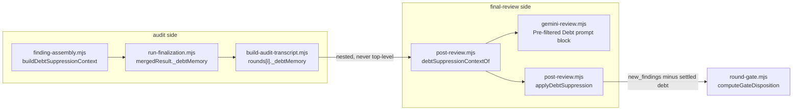

# Plan: Final-review debt suppression — make the dead stage live, and make it correct
- **Date**: 2026-10-03
- **Status**: Complete
- **Author**: Claude + Louis Strydom
- **Scope**: backend
- **Target domain(s)**: `audit-orchestration`, `shared-lib`, `tests`
- ⚠ **Cross-domain work** — `scripts/lib/final-review/output-schemas.mjs` is `shared-lib`
  (the `final-review/**` rule); every other production file is `audit-orchestration`. No new
  import edge crosses a domain: the one new import (`post-review.mjs` → `finding-match.mjs`'s
  `signatureOf`) is a file `post-review.mjs` already imports from.

> **Neighbourhood considered** — `get-neighbourhood` over `post-review.mjs`,
> `output-schemas.mjs`, `shadow.mjs` returned `review` / `below-noise-floor-near`
> for eight `post-review.mjs` symbols (`applyDebtSuppression`, `applyScopeFilter`,
> `findingTopicSig`, `suppressionLocusOf`, `applyPriorRoundSuppression`, …). Every one is a
> symbol this plan reads or modifies; none is a sibling to reuse instead. The reuse that
> matters was found by reading, not by the index: `applyPriorRoundSuppression` is the live
> sibling of the dead stage, and `finding-match.mjs::signatureOf` already IS the finding
> signature the stage hand-spells (§2.2).

> **Past incidents** — `get-incident-neighbourhood` returned INC-002 (a destructive test
> suite resolving to a production DSN). Not relevant: nothing here touches a database,
> credential, or egress path. The one egress-adjacent change is a `detailSnapshot` field
> added to a transcript envelope that already carries the same finding prose (§6).

## 1. Context Summary

**What exists today.** `applyDebtSuppression` (`scripts/lib/final-review/post-review.mjs:160`
at `498af659`) is the final-review stage that drops a reviewer's `new_findings` which
re-raise a debt topic the GPT audit already matched. Its twin read — the "Pre-filtered
Debt" prompt block (`scripts/gemini-review.mjs:318`) — tells the reviewer the same thing up
front. Both read `transcript._debtMemory.suppressionContext` **at the top level**.

**Four defects, all measured by execution on 2026-10-03** (re-confirmed in this session,
not carried over from the brief):

1. **The stage is dead in production.** `scripts/build-audit-transcript.mjs` nests every
   round's audit result under `rounds[]`, so the envelope is at `rounds[i]._debtMemory`,
   never top-level. Of the **65** transcript files in the main checkout's `.audit/`,
   **0** carry a top-level `_debtMemory`/`debt_memory`; **19** carry it nested, **2** with a
   non-empty `suppressionContext`. A real envelope (`audit-code-1786194471-transcript-v2.json`,
   round 5) holds the key only at `rounds[4]._debtMemory`. Both consumers read nothing.
2. **The matcher is wrong in both directions** once the key is reachable. It scores the
   finding's long `category + section + detail` against the debt's short
   `category + section` (`:187`) — Jaccard over unequal-length token sets measures length,
   not topic. Measured: a distinct true positive that shares the debt's category+section but
   says something else (terse `"A finding with is_reopened true is dropped."`) scores **0.50**
   and is deleted; a normal-length paraphrase of the debt scores **0.18** and is missed. The
   envelope never carried the one field that would let the two sides be compared like for like:
   `detailSnapshot` (`finding-assembly.mjs:637-643`), although the ledger entry has it.
3. **The catch is overbroad** (`:203`). `suppressionContext: [null, {…}]` makes
   `` `${d.category}` `` throw; the empty catch swallows it, writes 0 bytes to stderr, and the
   run reads as "nothing matched". The finding is kept (the safe direction), but silently.
4. **Identity fields are truncated like prose** (`output-schemas.mjs`). `_maxLengthMap` makes
   `truncateToSchema` clip `new_findings[].id` to 10 chars — `"G-existence-claim-one"` and
   `"…-two"` both become `"G-existenc"` — and `wrongly_dismissed[].original_finding_id` to
   10, turning the 12-hex ledger topicId `713af1a3f1bc` into `713af1a3f1`, which joins to
   nothing. Real logs show `new_findings[].id (21 → 10)`.
5. **`buildShadowClient` silently falls through to Anthropic** (`shadow.mjs:119`). Four
   `if` branches name a provider; the fifth case — *any other string* — constructs an
   Anthropic client. `buildShadowClient('some-future-provider')` returns one (executed).
6. **Source-text-coupled tests** assert on production source via `src.slice(indexOf(...))`
   and regexes, so they pass or fail on spelling, not behaviour (§9).

**Code Trace** (read at `498af659`). Producer: `legacy-production-audit` →
`assembleFindings` (`scripts/lib/audit/finding-assembly.mjs:100`) builds
`debtMemoryData.suppressionContext` from `surfacedTopics` (`:633-655`) →
`run-finalization.mjs:113` stamps it as `mergedResult._debtMemory` → the audit's per-round
`--out` JSON → `build-audit-transcript.mjs:130` (`rounds = resultPaths.map(readRoundResult)`)
nests it at `rounds[i]._debtMemory`. Consumers: `gemini-review.mjs:318` (prompt block, inside
`runFinalReview`) and `post-review.mjs:160`, called at `gemini-review.mjs:1058` (primary) and
`shadow.mjs:271` (shadow) — **before** `applyScopeFilter`, `applyPriorRoundSuppression`,
`applyExistenceGate` and `stampGateDisposition` (`gemini-review.mjs:1058-1063`). That ordering
is why a deletion here can change the gate disposition (§2.3).

**Patterns reused vs new.** Reused: `applyPriorRoundSuppression`'s shape (same locus gate,
same `is_reopened` exemption, same `isReleaseBlocking` fail-closed read, same audit trail in
`_…SuppressedFindings`), `finding-match.mjs::signatureOf`, `suppressionLocusOf`/`sharedLocus`,
`jaccardSimilarity`. New: one accessor (`debtSuppressionContextOf`), one producer helper
(`buildDebtSuppressionContext`), an `IDENTITY_PATHS` set, one `throw`. No new module.

## 2. Proposed Architecture

### 2.1 Decision — revive and fix, versus delete the dead stage

**Band-aid extreme**: change the two readers to look under `rounds[]` and ship. That revives a
deletion path whose matcher is wrong in both directions (defect 2), so it converts "silently
inert" into "silently deletes true positives from the release gate". Strictly worse than today.
**Over-engineered extreme**: a new `debt-envelope` module, an embedding-based matcher, a
configurable threshold surface, a telemetry table. No current requirement needs any of it.
**Delete extreme**: remove the stage, the prompt block, the producer field and the
`_debtSuppressed*` result fields.

**Chosen: revive, with the matcher fixed in the SAME change** (never the reader alone).
Why not delete: (a) the stage is ~45 lines and its live sibling `applyPriorRoundSuppression`
is the established policy for the identical question ("is this re-raise settled?") — reviving
reuses a tested shape rather than inventing one; (b) deleting touches five production files,
the skill reference `skills/audit-code/references/debt-capture.md`, and a producer field other
tooling may read, to remove a feature whose motivation (a re-raised debt topic costs a
deliberation round at the final gate) is unchanged; (c) the frequency evidence does not argue
for deletion — the stage will fire rarely (2 of 19 nested envelopes carry a non-empty context),
which is exactly the profile where being **correct when it fires** matters more than
being busy. Why not leave it dead: a "Pre-filtered Debt" prompt block and a post-filter that
both do nothing, behind a producer that does real work for them, is a documented feature that
has never once run — the verification-discipline anti-pattern this repo has already paid for.

### 2.2 The matcher — symmetric signature, calibrated on the real ledger

The signature on both sides is **`category + section + detail`** — the finding's own
`signatureOf(f)`, and for a debt topic `signatureOf({category, section, detail: detailSnapshot})`.
Making the debt side go through the *same function* makes the symmetry structural: it cannot
drift back to an asymmetric pair without editing `signatureOf`. `findingTopicSig` (a private
duplicate of `signatureOf`) becomes a one-line delegate.

**Threshold: 0.30, not the brief's ~0.35** — measured, not tuned to a test. Corpus: the 90-entry
`.audit/tech-debt.json` of the main checkout (read-only), 102 same-primary-file pairs,
debt-vs-debt as the proxy for debt-vs-reviewer-finding (both sides ≤600 chars: the persisted
`detailSnapshot` cap and `FinalReviewFindingSchema.detail`'s `maxLength`):

**One population, one denominator.** 102 same-primary-file pairs; every pair scoring ≥ 0.17
(**42** of them) was read by hand and labelled. The other 60 score below 0.17 and were not read
(none of the 5 explicit negatives below scores above 0.121). Of the 42: **39** restate one
concern (another reviewer, another round, another model) and **3** are distinct or arguable —
all three **below** the threshold: `14ae944f`↔`25a36d16` 0.196 (distinct: `emit()` exit-code
coupling versus validation-after-side-effect), `3627c83a`↔`72be9c56` 0.210 and
`5f614048f69b`↔`f7aa386c9937` 0.179 (arguable). The one pair first labelled arguable and sitting
**above** the threshold, `9c03b530`↔`ab0b35dd` (0.420), was resolved by reading both full
snapshots: each states that the accepted-debt check's §5 "local-only, never blocks a push"
contradicts test case (b), which runs under `npm test` and hard-fails on a table edit — **one
concern**, restated. It is committed in the calibration fixture with that rationale (below), not
left as an unexamined positive.

| Score band (strict `>`) | Pairs | Same concern | Distinct / arguable |
|---|---|---|---|
| `> 0.35` | 3 | 3 | 0 |
| `> 0.30` | 10 | 10 | 0 |
| `> 0.25` | 14 | 14 | 0 |
| `≥ 0.17` | 42 | 39 | 3 (all `≤ 0.210`) |
| **explicit different-defect negatives** (`713af1a3f1bc`↔`3501a8b4e9c0`, `713af1a3f1bc`↔`c5ee9c704c95`, `c4c69f5a1020`↔`3501a8b4e9c0`, `8e8d3625feca`↔`232661f933cc`, `251efde41d8d`↔`88484035bfa9`) | 5 | 0 | 5 at **0.056 – 0.121** |
| old asymmetric signature on three real same-concern pairs (`713af1a3f1bc`↔`c4c69f5a1020`, `3501a8b4e9c0`↔`c5ee9c704c95`, `8e8d3625feca`↔`dcd761b7035f`) | 3 | 3 | — at 0.10 – 0.17 |

**What 0.30 does and does not do — precision, not recall.** At `> 0.30` the stage fires on 10
pairs, **all 10 the same concern**, and on 0 of the 5 explicit negatives and 0 of the 3
distinct/arguable pairs; its **recall of the 39 same-concern pairs is 10/39 ≈ 26%**. It
deliberately catches only near-restatements and keeps the looser paraphrases
(`713af1a3f1bc`↔`c4c69f5a1020` 0.304 caught; `3501a8b4e9c0`↔`c5ee9c704c95` 0.217 and
`8e8d3625feca`↔`dcd761b7035f` 0.220 **kept**) — the right trade for a stage whose error is
deleting a finding: an extra shown duplicate is cheap, a vanished distinct defect is not. At 0.35
it would fire on 3 pairs (3/39 ≈ 8%): close to inert, which is the defect being fixed in the
other direction. 0.30 sits 0.10 above the highest pair judged distinct (0.196). **Honest limit
of "no distinct pair above 0.30"**: it is a statement about 102 pairs in one ledger, and the
stage's only concern-level discriminators are *same locus* and *token overlap*. Two genuinely
different non-blocking concerns in the same file that happen to share vocabulary could score
above the threshold; the stage records every such drop with id, topic, score and file
(`_debtSuppressedFindings`) so it is detectable after the fact, and the carve-outs
(§2.3) keep every release blocker and every reopening. It is **the constant the debt path already used** (`THRESHOLD =
0.3`), so this re-calibrates the *meaning* of that number (its old comment said it compensated
for the asymmetric signature, which it no longer is) rather than retuning it. The sibling's 0.35
was calibrated on same-model re-raises ("paraphrased re-raises score 0.3–0.6"), a different
population from a GPT-authored debt snapshot compared with a Gemini-authored finding.

**Reproducible, and pinned.** The judged pairs are committed as
`tests/fixtures/debt-memory/calibration-pairs.json` — `{label, score-at-capture, category,
section, detail, rationale}` for both sides of 10 pairs: 3 same-concern **above** the threshold
(including `9c03b530`↔`ab0b35dd`, with the rationale above), 3 same-concern **below** it
(expected-kept, i.e. deliberate false negatives), 3 distinct, and 1 arguable-below
(`3627c83a`↔`72be9c56`, kept). The test
recomputes each score from the text and asserts the label's disposition under strict `>`, so a
change to the signature, the tokenizer or the constant moves a named pair instead of a number,
and "regression" is distinguishable from "deliberate false negative". The threshold comparison
is strict (`score > 0.30`), unchanged from the existing code. **Limits stated, not hidden**: one
repo, one ledger, n=102, debt-vs-debt proxy for debt-vs-reviewer-finding. The safety nets below
bound a wrong guess; the threshold is a named constant, not a configuration surface (no current
requirement for one), and it is **not to be lowered to buy recall** without new evidence.

### 2.2b The accessor's canonical merge contract

`debtSuppressionContextOf(transcript, { onInvalid } = {})` is the **only** reader; both consumers
(the stage and the prompt block) take its result and nothing else, so there is one bound, one
precedence and one normalised shape.

**What an envelope is (settled, audit round 2 M1).** `rounds[i]._debtMemory` is an **incremental,
session-scoped observation**: "these debt topics were matched against the debt ledger as loaded
at round *i*". It is not a current-state snapshot — a topic absent from round 3 was simply not
re-raised by round 3, which says nothing about whether it is still settled. The one event that
*does* un-settle a surfaced topic inside a session is a **reopen** (the topic's file changed and
the audit re-raised it as live work), and the producer already computes it
(`reopenedDebtTopics`, `finding-assembly.mjs:583-587`). So the producer additionally emits
`reopenedTopicIds` (a string array) beside `suppressionContext`, and the accessor honours it.
Nothing else invalidates a topic; the accessor does not try to infer more.

**Algorithm** (pure, deterministic, no clock/I/O). Keep a `Map<topicId, topic>`. **Seed it first**
from the legacy top-level `_debtMemory` / `debt_memory` (nothing writes it today; kept readable for
a hand-built transcript) as the **oldest** observation — *before* any round is processed, so a
reopen in a later round deletes a legacy-seeded topic like any other and nothing can fold it back
in afterwards (audit round 3 H1: seeding it *after* the rounds resurrected a deleted topic).
Then walk `rounds[]` oldest → newest:

1. For each valid entry in `rounds[i]._debtMemory.suppressionContext`: **normalise** it (below);
   drop it if it cannot be; otherwise upsert. On a repeat of a `topicId` the **newer entry wins
   whole** (its locus and metadata are the current ones) — *except* that if the newer entry has
   no usable `detailSnapshot` and the older one did, **only the `detailSnapshot` is copied
   across**, never the older entry's other fields. Re-inserting moves the topic to the newest end.
2. Then apply that round's `reopenedTopicIds`: delete each listed topic from the map — whether
   it was seeded from the legacy source or surfaced in an earlier round. (Same round: surfaced
   *and* reopened ⇒ dropped — fail-open.) A topic surfaced again in a **later** round is settled
   again; nothing else re-admits it.
3. The result is newest-first (legacy-seeded topics therefore last), **cut to 50 topics**
   (`MAX_DEBT_CONTEXT_TOPICS`), so the oldest are the ones dropped. The producer's per-round cap
   of 50 stays; the union is what is re-bounded, and the prompt block and the stage see the same
   ≤ 50 entries.

**Normalised topic** `{ topicId, category, section, affectedFiles, deferredReason,
detailSnapshot }`, so no consumer re-validates and the 600 × 50 character bound holds for **any**
source, including a hand-built legacy transcript: `topicId` a string (else the entry falls back to
`category|section`; with neither, it is invalid); `category`, `section`, `deferredReason` strings
(else `''`); `affectedFiles` an array of **strings** (non-strings filtered; a non-array becomes
`[]`); `detailSnapshot` a **string**, trimmed, **capped at 600** (`MAX_DEBT_SNAPSHOT_CHARS`), and
**absent** when not a string or whitespace-only. Identity fields (`topicId`) are never truncated.
An entry that is not an object, or has no usable identity, is **invalid**: it is excluded and
reported through `onInvalid(reason, entry)` — the stage counts them and writes one stderr line
(`N malformed debt topic entries ignored`) — and it never prevents the valid entries from being used.
Matching text and display text are kept apart: the stage matches on the normalised fields; the
prompt block renders through a **single-line formatter** (collapse all whitespace, trim, then cap),
so a snapshot or section containing a newline cannot break the one-line-per-topic block.

### 2.3 What may never be suppressed, and what the stage must not do silently

Applied per finding, in this order — each is **fail-open** (keep the finding):

1. **`is_reopened === true`** — the prompt obliges the reviewer to cite the changed line that
   reopened it; `applyPriorRoundSuppression` already exempts it and this stage did not.
2. **`isReleaseBlocking(f)`** — *beyond the brief, and the reason is the revival itself.* The
   stage runs before `stampGateDisposition`, so a deletion changes `blocked` into
   `approve_with_debt`. While the stage was dead that was harmless; once live, a re-raise that
   the reviewer marks a release blocker (a regression the change introduced into deferred
   code) would be silently approved — the exact H6 hazard `applyPriorRoundSuppression`
   guards ("only a NON-blocking prior settles anything"). `isReleaseBlocking` fails closed, so
   a finding with a missing/invalid pair is kept too.
   **The same invariant, enforced at the sibling stage (audit-code R1 H1).** The principle is "no
   suppression stage deletes a release blocker before the gate reads it", and it must hold across
   the pipeline, not in one stage: `applyPriorRoundSuppression` guarded only the *prior*
   finding's blocking status, so a *current* finding the reviewer now marks a blocker could still
   be settled by a prior non-blocking one. It now keeps a current release-blocking finding too
   (`_priorRoundKept` reason `current_release_blocking`), tested both directions. This is
   load-bearing for the revival, not authorship: the gate's correctness rides on both stages.
3. **No shared locus** — unchanged (`a6b035b3`): a debt entry carrying files only suppresses a
   finding that shares one.
4. **A debt entry with no `detailSnapshot`** is not a candidate — every envelope written before
   this change, so the stage degrades to inert on legacy transcripts rather than falling back
   to the asymmetric comparison. Said once on stderr (`N of M debt topics carry no
   detailSnapshot — not eligible`), never silently. **Eligibility is one predicate,
   `isEligibleDebtTopic(entry)`, used by BOTH the stage and the prompt block (§2.3b)** — the
   prompt cannot steer the reviewer on a topic the filter would never act on.

### 2.3b The prompt block shares the predicate and states the carve-outs

The "Pre-filtered Debt" block moves out of `runFinalReview` into an exported pure
`buildDebtPromptBlock(context)` in `post-review.mjs`, taking the accessor's canonical result.
(`gemini-review.mjs` then only calls it: its line count falls below the size-ratchet tolerance,
so `.file-size-baseline.json` is re-baselined with `--update-baseline` — a recorded improvement,
not a loosening.) Changes from the dead block's text, all driven by audit finding H1 — a model
told "DO NOT resurface" omits the finding *before* any deterministic exemption can act, and
fail-open code downstream cannot recover a finding the model never emitted:

- **Only eligible topics** are rendered (snapshot-bearing), so a legacy envelope produces **no
  block at all** — byte-identical to a transcript with no debt, matching the §6 promise that legacy
  transcripts stay inert.
- Each line carries the topic, category, section **and a ≤ 200-char snapshot**, so the reviewer
  can tell the *settled concern* from a different defect in the same place. Every field goes
  through the single-line formatter of §2.2b (whitespace collapsed, then capped) — a newline in a
  snapshot cannot split a topic across lines or smuggle a second "instruction" line into the block.
- The block says what is **not** settled: *a different defect at the same location; a regression
  or reopening that cites the changed line (`is_reopened: true`); anything release-blocking; and
  any case you are unsure about — report it.* The instruction is "do not re-report **these
  concerns**", never "do not report anything about these locations".
- Returns `''` for an empty/ineligible context, so the caller's concatenation is unchanged.

Pure, so it is tested by calling it (no provider, no `runFinalReview`): the legacy-envelope
no-block case, the snapshot rendering, the carve-out text, the 50-line bound, and the exact
string absent when the context is empty.

**Errors.** `JSON.parse` gets its own `try` and a non-JSON transcript returns quietly (the one
expected case; `runFinalReview` treats a markdown transcript the same way). The rest computes
into locals — `kept`, `suppressed` — and `result` is assigned in **one block at the end**, so
no throw can leave it half-written. The outer catch writes
`[final-review] Debt re-suppression NOT applied: <message>` to stderr; the finding set is
unchanged. The accessor drops non-object entries, so `[null, {…valid…}]` still suppresses the
valid entry's match instead of throwing.

### 2.4 Identity is not prose (output schemas)

`IDENTITY_PATHS = {'new_findings[].id', 'wrongly_dismissed[].original_finding_id',
'wrongly_dismissed[].cited_lines[]'}` are skipped when `_collectMaxLengths` builds the map, so
`truncateToSchema` leaves them whole. The two id `maxLength`s widen 10 → 40
(`FinalReviewFindingSchema.extend` override; `WronglyDismissedSchema`) so a 12-hex topicId, or a
descriptive id, validates instead of being clipped to fit a limit that predates both. A model that
exceeds a bound gets a Zod *warning* (`callReviewer` is warn-and-keep) and an intact value — and
`addSemanticIds` re-stamps `G<n>` on every kept finding before the gate, so no gate path reads a
model-authored id.

**`cited_lines[]` — the brief's "accepted" call, reversed by two audit rounds.** The brief and
this plan's first draft *accepted* truncating citations because "the head `path:line` survives".
Audit-code R1 M1/M5 showed the premise fails for a path over 100 characters; widening the bound to
300 (`CITATION_MAX_CHARS`) made a valid citation fit but left the mechanism in place (R2 M1): a
cutoff that can change a reference, with no maximum path length that holds on every supported
system. A citation is **evidence, like an identity** — the existence gate and
`projectWronglyDismissed` read its path — so it joins `IDENTITY_PATHS`, keeps 300 as its *loud*
Zod bound, and is never repaired as prose. The cost of the reversal is nil (one set member, one
test); the ledger entries `8e8d3625feca` / `dcd761b7035f` themselves describe `cited_lines` as
"identity or evidence".

### 2.5 The shadow dispatch

`buildShadowClient` gets an explicit `claude-opus` branch (the existing body, unchanged) and a
final `throw new Error('[shadow-review] … unsupported shadow provider …')`. `runShadowAndPersist`
already wraps the call in try/catch → `shadowErrorBlock`, so an unsupported provider becomes a
non-fatal `error-unavailable` observation, never a crash and never a mis-routed bill.
**Rejected**: unifying with `PROVIDERS[].buildClient` — the two descriptors write different
stderr notes (the `claude-opus` primary descriptor announces "GEMINI_API_KEY missing; using
Claude Opus fallback", which is false for a shadow run that never had a Gemini primary to
fall back from), and `shadow-gateway-provider.test.mjs` source-pins both, so a merge is a larger
change than the defect warrants.

### 2.6 Right-sizing, and manual vs scripted

New structure: four small exported functions (`debtSuppressionContextOf`,
`isEligibleDebtTopic`, `buildDebtPromptBlock`, `buildDebtSuppressionContext`) and one set. Each
serves a current requirement (defects 1, 2, 4 and audit finding H1); none is "might need
later". No new module, config surface, or table. The
~10 test conversions are **by hand** — they vary (a fake client, a fetch stub, a direct export
call), so a codemod would be the over-engineering cliff.

## 6. Sustainability Notes

- **The envelope contract gets one writer helper and one reader accessor**, and an integration
  test drives the real seams between them — `assembleFindings` with a real debt-ledger entry →
  its `debtMemoryData` written to a round file → the real `build-audit-transcript.mjs` entry
  point → the accessor → the stage — so the next change to any hop fails where it breaks, not
  silently in production (the prose↔code seam rule: *one exported accessor owns the read; at
  least one fixture is derived from a real row*). The single un-driven hop is
  `run-finalization.mjs:113`'s one-line `mergedResult._debtMemory = assembled.debtMemoryData`
  assignment; the test performs it explicitly and names it.
- **Egress**: `detailSnapshot` joins `category`/`section`/`affectedFiles`/`deferredReason` in an
  envelope that already rides the transcript to the reviewer; the ledger entry it is copied from
  was secret-redacted at capture (`debt-capture.mjs`). Capped at 600 chars × the existing cap of
  50 topics. No new sensitive-path surface.
- **Prompt change is real**: with the key reachable, the "Pre-filtered Debt" block now actually
  appears in the Gemini prompt for any transcript whose rounds surfaced an *eligible* debt topic.
  That is the designed behaviour (Phase D.4), previously unobserved. It is bounded (≤ 50 lines,
  snapshot ≤ 200 chars), names what is NOT settled (§2.3b), and shares its eligibility predicate
  with the post-filter, which is its deterministic backstop.
- **Legacy transcripts** stay inert (defect-4 rule) rather than regressing to the old matcher.

## 7. File-Level Plan

| File | Change | Principle |
|---|---|---|
| `scripts/lib/audit/finding-assembly.mjs` | Extract the `suppressionContext` projection into exported `buildDebtSuppressionContext(topicIds, debtEntries)`, add `detailSnapshot` (≤600), and emit `reopenedTopicIds` beside it (§2.2b) | #1 SSoT, #11 testability |
| `scripts/lib/final-review/post-review.mjs` | `debtSuppressionContextOf` (§2.2b), `isEligibleDebtTopic`, `buildDebtPromptBlock` (§2.3b); `findingTopicSig` → `signatureOf`; `DEBT_MATCH_THRESHOLD`; rewrite `applyDebtSuppression` (§2.2–2.3) | #1, #14 error handling, #16 degradation |
| `scripts/gemini-review.mjs` | `runFinalReview` replaces its inline block with `buildDebtPromptBlock(debtSuppressionContextOf(transcript))`; net lines **negative** (≥ 10 fewer) | #1 |
| `scripts/lib/final-review/prompts.mjs` | system-prompt RULE 6 ("DO NOT re-raise any topic listed there") restated with the same carve-outs as the block (§2.3b) — found during implementation, see §10 | #1 (one contract, both halves) |
| `.file-size-baseline.json` | re-baselined with `npm run size:ratchet:gate -- --update-baseline` once `gemini-review.mjs` shrinks past the tolerance — a recorded improvement | size ratchet |
| `tests/fixtures/debt-memory/calibration-pairs.json` | the 10 judged pairs behind §2.2, both sides' text, labels, rationale | reproducible calibration |
| `scripts/lib/final-review/output-schemas.mjs` | `IDENTITY_PATHS`; widen `id` and `original_finding_id` to 40 | #7 validation |
| `scripts/lib/final-review/shadow.mjs` | explicit `claude-opus` branch + trailing `throw` | #14 |
| `tests/helpers/anthropic-wire.mjs`, `tests/helpers/capture-stderr.mjs` | shared test helpers (wire observation under `CLAUDE_BACKEND=cli`; stderr capture) — one definition each | #1 |
| `tests/persist-kept-embeddings.test.mjs` | imports the shared `captureStderr` instead of keeping its own copy (audit-code R2 M2: the duplicate detector flagged every new copy against it) — mechanical, behaviour-identical | #1 |
| `tests/fixtures/debt-memory/real-round-envelope.json` | trimmed real-shape envelope (§9) | testing doctrine |
| `tests/debt-transcript-suppression.test.mjs` | rewrite: delete the local logic copy; accessor merge contract, prompt block, and the producer→`build-audit-transcript`→accessor→stage integration test | #11 |
| `tests/final-review-round-gate.test.mjs` | update `debt()` fixture; add stage behaviour tests | #11 |
| `tests/final-review-structured-output.test.mjs` | add `truncateToSchema` tests | #11 |
| `tests/shadow-client-dispatch.test.mjs` | new: table-driven spec ↔ `PROVIDERS` ↔ `buildShadowClient` tie | #11 |
| `tests/gemini-review-shadow.test.mjs` | abort classification and SDK pin → behavioural | #11 |
| `tests/shadow-gateway-provider.test.mjs` | descriptor pins → direct export calls | #11 |

### 7b. Implementation Phases

**Phase 1 — Debt stage: producer, accessor, matcher, prompt block**: ship the envelope field, the
accessor, the corrected stage and the shared-predicate prompt block together (never the reader
alone). Files: `scripts/lib/audit/finding-assembly.mjs` (modify),
`scripts/lib/final-review/post-review.mjs` (modify), `scripts/gemini-review.mjs` (modify),
`scripts/lib/final-review/prompts.mjs` (modify)

**Phase 2 — Debt stage tests**: Files: `tests/fixtures/debt-memory/real-round-envelope.json` (create),
`tests/fixtures/debt-memory/calibration-pairs.json` (create),
`tests/debt-transcript-suppression.test.mjs` (modify), `tests/final-review-round-gate.test.mjs` (modify)

**Phase 3 — Identity fields survive truncation**: Files: `scripts/lib/final-review/output-schemas.mjs` (modify),
`tests/final-review-structured-output.test.mjs` (modify)

**Phase 4 — Shadow dispatch fails closed**: Files: `scripts/lib/final-review/shadow.mjs` (modify),
`tests/shadow-client-dispatch.test.mjs` (create)

**Phase 5 — Behavioural test conversions**: Files: `tests/gemini-review-shadow.test.mjs` (modify),
`tests/shadow-gateway-provider.test.mjs` (modify), `tests/helpers/anthropic-wire.mjs` (create),
`tests/helpers/capture-stderr.mjs` (create), `tests/persist-kept-embeddings.test.mjs` (modify)

**Close-out (not a phase)**: `npm run plans:index`, `npm run plans:index:check`, `npm run plans:lint`,
`npm run plans:status`, `npm run knip:gate`, `npm run size:ratchet:gate -- --update-baseline` (the
deliberate re-baseline of `.file-size-baseline.json` after `gemini-review.mjs` shrinks), then
`npm run size:ratchet:gate`, `npm run context:check`, `npm run docs:check`, then the full `npm test`.

No §11: the five phases share one domain, one author's intent and one test run, and the only
real coupling (Phase 1 ↔ 2) is a producer/consumer pair that must be audited as ONE seam —
splitting it would hide exactly the contract the plan exists to fix. Single-unit autonomous
path; one consolidated Gemini gate over the union diff.

## 8. Risk & Trade-off Register

| Risk | Disposition |
|---|---|
| **Threshold is calibrated on debt-vs-debt, one repo, n=102.** | Stated in §2.2. Bounded by four fail-open nets (§2.3). A wrong guess costs a duplicate shown to the operator (cheap) or, at worst, one distinct same-file non-blocking finding dropped from an `approve_with_debt` run — recorded in `_debtSuppressedFindings` with id, topic, score and file, so it is auditable. |
| Release-blocking exemption is **beyond the brief.** | Deliberate; justified by the stage now sitting upstream of the gate (§2.3). Tested in both directions. |
| Prompt block now live → Gemini prompt changes for transcripts that surfaced an eligible debt topic; a reviewer told "do not resurface" can drop a finding before any deterministic exemption acts. | Designed behaviour, bounded (≤ 50 lines, snapshot ≤ 200), eligible-topics-only, and the block states what is NOT settled (distinct defect, reopening, release blocker, unsure) — §2.3b, audit H1. Checked on the real envelope at close-out (§9). Residual: a model can still over-obey; the carve-outs reduce, they do not eliminate, that. Not a contract epoch event: no shadow campaign collector is open (AGENTS.md: final-review shadow CLOSED 2026-07-28). |
| Moving the prompt block out of `gemini-review.mjs` shrinks it past the ratchet tolerance. | Intended: re-baseline deliberately (`--update-baseline`) — the ratchet's own prescribed response to a shrink. Net growth is negative, never positive. |
| Widening `id` to 40 changes the Anthropic/OpenAI dialect schemas' `maxLength` text. | The Gemini dialect strips `maxLength`; the others are steering hints (`truncateToSchema` was the enforcement). Run `provider-contract-enforceable` + `final-review-structured-output`. |
| `88484035bfa9` (billed-output census, file-level) is **not** fixed here. | Honest scope boundary, with independence named: that census is a repo-wide discovery scan over ~170 files; nothing this plan changes reads or depends on it, and making it occurrence-level is a new static predicate with its own negative controls — a separate change. `630ffd6e3f03` is therefore *partially* closed (its shadow/gateway sites), its existence-gate aggregate-count site (`gemini-existence-gate.test.mjs:143-153`) likewise left. |
| `providers.mjs` `assertReady` `process.exit` | Accepted debt, out of scope per the brief. |

## 9. Testing Strategy

Tier 1 (deterministic seams), **test-first with a red run recorded** — the new debt, truncation
and dispatch tests are written and run against the unmodified production code to see them fail
for the stated reason before the fix lands.

- **Accessor merge contract** (`debt-transcript-suppression.test.mjs`, §2.2b): real-shape nested
  envelope; legacy top-level key; union across rounds deduped by `topicId` with **conflicting
  snapshots** (newest entry wins whole); **an older snapshot with a newer, changed locus** —
  result carries the older `detailSnapshot` and the **newer** `affectedFiles`/`section`; mixed
  legacy + nested (the legacy source is the oldest observation and never overrides a
  round-derived topic); **a topic reopened between rounds is dropped** (surfaced in round 2,
  `reopenedTopicIds` in round 3), **and is settled again when re-surfaced in round 4**;
  **legacy ∘ reopen interaction (audit round 3 H1)**: a snapshot-bearing *legacy* topic T followed
  by a round whose `reopenedTopicIds` is `['T']` stays **absent** — also when T was additionally
  surfaced in an earlier round — and is eligible again only after a **later** round explicitly
  re-surfaces it; surfaced-and-reopened in the same round ⇒ dropped;
  a union of **> 50** topics is cut to 50 with the newest surviving (asserted by id, so the order
  is pinned); `[null, {…}]` filtered with `onInvalid` called once; non-array `rounds`; non-JSON;
  **normalisation**: a numeric or object `detailSnapshot`, a whitespace-only one, and a 5,000-char
  legacy one (capped at 600) ; malformed `affectedFiles` (string, mixed → strings only); an entry
  with no identity is invalid; **negative control** — an envelope with the context in neither
  place returns `[]`.
- **Fixture derived from a real row**: `tests/fixtures/debt-memory/real-round-envelope.json` is
  `audit-code-1786194471-transcript-v2.json` trimmed to `rounds[].{round,_debtMemory}` +
  `changed_files`; its one real non-empty entry (`c054015e`) has **no** `detailSnapshot`, so it
  doubles as the legacy-envelope fail-open case (stage inert **and** prompt block empty).
- **Calibration pins** (`calibration-pairs.json`, §2.2): per pair, recompute the symmetric score
  from the committed text and assert the label's disposition under strict `> 0.30` — 3
  same-concern above (suppressed; includes the resolved `9c03b530`↔`ab0b35dd`), 3 same-concern
  below (**expected-kept**), 3 distinct and 1 arguable-below (kept). Each pair is also run
  through `applyDebtSuppression` itself, so the pin is on the stage, not on a re-implementation.
- **Prompt block** (`buildDebtPromptBlock`, pure): legacy-only context → `''`; mixed → only the
  eligible topics rendered; snapshot present and ≤ 200 chars; **a multi-line snapshot, section and
  category render on exactly one line each**; the carve-out sentences present (distinct defect,
  `is_reopened`, release-blocking, unsure); ≤ 50 lines; byte-equal `''` on an empty context. The
  block and the stage agree on eligibility (one table of entries drives both).
- **Producer→transcript→consumer integration** (the real seams, §6): `assembleFindings` driven
  with `minimalFinalizationData({ round: 2, debtLedger: { entries: [entry] }, … })` and a
  finding that matches the entry, so `debtMemoryData.suppressionContext` is produced by the real
  code; that value is written as `_debtMemory` into temporary round-result files (the one
  hand-performed hop, `run-finalization.mjs:113`, named in the test); the **real**
  `scripts/build-audit-transcript.mjs` entry point builds the transcript; the accessor and
  `applyDebtSuppression` consume its **actual output** and suppress a restatement, asserting the
  exact surviving `detailSnapshot`. **Negative control**: the same pipeline with `_debtMemory`
  absent from the round file → accessor `[]`, nothing suppressed. A second variant drives a
  round-3 `assembleFindings` whose debt entry is **reopened** and asserts `reopenedTopicIds`
  reaches the accessor and un-settles the round-2 topic. Producer unit cases:
  `detailSnapshot` carried and capped at 600; absent when the entry has none; unknown topic
  skipped; cap of 50; `reopenedTopicIds` is a string array (empty when nothing reopened).
- **Stage** (`final-review-round-gate.test.mjs`, `debt()` fixture gains `detailSnapshot`):
  suppresses a paraphrase (`score > 0.30`, margin asserted); **keeps the terse distinct finding
  that the old matcher deleted** (the 0.50 case, now < 0.30); keeps `is_reopened`; keeps a
  release-blocking match **and** `computeGateDisposition` returns `blocked`; negative control —
  the same finding with the blocking pair cleared *is* suppressed; fail-open on a snapshot-less
  entry with the stderr note; `[null, {valid}]` suppresses the valid match with **no** `NOT
  applied` line; a finding whose getter throws leaves `new_findings` untouched and writes
  `Debt re-suppression NOT applied` to captured stderr; non-JSON transcript is silent.
- **Truncation**: prose still truncated (`overall_reasoning`); each `IDENTITY_PATHS` member
  comes back whole; the `G-existence-claim-one/-two` collision case; every `IDENTITY_PATHS` entry
  resolves to a string property in `z.toJSONSchema(GeminiFinalReviewSchema)` (a renamed field
  must fail loudly, not silently re-enable truncation).
- **Dispatch**: table over `SHADOW_PROVIDER_SPECS` canonicals ∪ `{'azure-claude'}`: each is a
  `PROVIDERS` key and `buildShadowClient` builds a client; an unknown string rejects. Asserted on
  *where each client addresses its requests and with which credential* (audit-code R1 M6/M7: an
  SDK-family check passes when one OpenAI-compatible provider is routed to another, and
  "did not throw" passes a `ReferenceError`): each gateway's `baseURL` and `apiKey` are checked
  against distinct per-provider dummies, with a pairwise-distinct negative control; `azure-claude`
  is driven in a **subprocess** under a controlled Azure profile for both Claude shapes and the
  *emitted request* is asserted — Azure host, Azure credential, the public key never leaving.
- **Behavioural conversions**: `callReviewer` driven with a fake Anthropic client rejecting
  `AbortError` → `llmCategory:'timeout'`, `llmRetryable:true` in ~0 ms (negative control: a 404
  carries neither); SDK pin — `CLAUDE_BACKEND=cli`, `globalThis.fetch` stubbed **before**
  `await buildShadowClient('claude-opus')`, exactly one fetch to `api.anthropic.com/v1/messages`;
  negative control — a bare `createAnthropicClient({azureRoute:null, claudeBin:<nonexistent>})`
  under the same env makes **0** fetches (so the test can fail). `PROVIDERS.*.requestExtras()` /
  `.structuredOutput` called directly. The `azureRoute:null` pin stays source-pinned (config is
  frozen at import; a subprocess would be the only behavioural form).
- **Regression runs**: `final-review-structured-output`, `provider-contract-enforceable`,
  `gemini-existence-gate`, `finding-match`, `finalization-*`, `suppression-call-site`, then
  full `npm test` and `npm run size:ratchet:gate` (gemini-review.mjs never grows; re-baselined
  after the shrink).
- **Empirical verify (at close-out)**: feed the real round-5 envelope
  (`audit-code-1786194471-transcript-v2.json`, read-only) through `debtSuppressionContextOf` and
  confirm the formerly-empty context is now returned (1 topic, legacy, snapshot-less); then run
  the stage and the prompt-block builder on it and confirm both stay inert — the fail-open
  behaviour on a real pre-change envelope, observed rather than assumed.

## 10. Audit Trail

- **/audit-plan** (`audit-plan-1791022552`, GPT `gpt-6.1-sol`, then the Gemini gate): 3 rounds.
  R1 H:1 M:3 (prompt carve-outs and shared eligibility; merge/bound contract; calibration
  denominators; producer-transcript integration test) — 4/4 accepted. R2 H:0 M:3 (envelope is an
  observation, not a snapshot → `reopenedTopicIds`; normalised topic contract; the arguable
  above-threshold pair, resolved by reading it) — 3/3 accepted. R3 H:1 (legacy source seeded
  *after* the rounds could resurrect a reopened topic — a defect in R2's own fix) — 1/1 accepted.
  Acceptance 100% every round; the loop stopped on its 3-round default, not on rigor pressure.
  **Gemini final gate: APPROVE** (round 1 of 2, `gateDisposition: approve`, 0 new findings).
- **Plan amendment during implementation (recorded, not hidden).** Reading `prompts.mjs` while
  wiring the block showed the *system prompt* carries the unconditional twin of the user-prompt
  block: RULE 6, "If the prompt includes a 'Pre-filtered Debt' section, DO NOT re-raise any topic
  listed there." Audit R1 H1's fix (carve-outs in the block) would be self-defeating while the
  system prompt still says the opposite, and the rule goes live the moment the block does. One
  more file (`scripts/lib/final-review/prompts.mjs`, same `final-review/**` directory, one rule)
  was therefore added to Phase 1 and §7, with a test that pins the carve-outs. No other scope
  change. The edit only affects runs that carry a Pre-filtered Debt block — i.e. none, until now.
- **/audit-code** (`audit-code-1791024700`, GPT `gpt-6.1-sol`): 4 rounds, **converged** (R3 and R4 `PASS`, H:0 M:0 L:0,
  quickFix 0 — two stable rounds; the detector census `blocked:false`).
  R1 H:1 M:8 — fixed: **H1** the sibling suppression stage (`applyPriorRoundSuppression`) now also
  keeps a *current* release-blocking finding (§2.3); **M1/M5** `cited_lines` truncation (widened,
  then — R2 M1 — moved into `IDENTITY_PATHS`, reversing the brief's "accepted", §2.4); **M6/M7** the
  dispatch test now asserts endpoint + credential per provider and drives `azure-claude` in a
  subprocess on the emitted request; **M8** one shared `captureStderr`. Deferred, with the
  independence argument and captured as debt: **M2** `6f6c58331fc8` (assembly owns persistence),
  **M3** `183242b981ad` (`resolveShadow` exception boundary), **M4** `e76404eccd82` (shadow vs primary
  dispatch duplication — the unification §2.5 rejected). R2 M:3 — M1, M2 fixed; **M3** (adjacency wave
  hit its `maxContainers=20` bound because the patch carried the whole dirty tree) dismissed as an
  instrument limit and answered by narrowing R3's patch.
  **Coverage caveat, stated rather than hidden:** every round's file-coverage ledger read `PARTIAL`
  (changed lines past the per-pass read window on the larger files), and `scripts/gemini-review.mjs`
  is an audit-infrastructure file the audit excludes by policy — so its accessor call site rests on
  the tests and the Gemini gate, not on GPT.
- **Consolidated Gemini gate** (union diff, round 1 of 2): **APPROVE**, `gateDisposition: approve`, 0 new findings,
  0 wrongly dismissed. **Coverage caveat:** the reviewer's code budget rendered 3 of 20 changed files whole
  (`output-schemas.mjs`, `post-review.mjs`, `prompts.mjs`), 1 head-cut (`finding-assembly.mjs`) and budget-omitted
  the rest (including `shadow.mjs` and every test file) — an APPROVE of what it read plus the transcript, not of
  every changed byte.
- **Close-out**: full `npm test` 17,336 tests, 0 fail, 40 skipped (`node scripts/run-tests.mjs`, 2026-10-03; the
  first run found one real defect — `tests/debt-transcript-suppression.test.mjs` called `fs.rmSync` without the
  repo's Windows retry options, caught by `tests/rmsync-retry-guard.test.mjs` and fixed); `size:ratchet:gate`,
  `knip:gate`, `plans:*`, `context:check`, `docs:check` clean. `docs:refs:gate` reads one transient GONE (a code
  comment citing this plan, which is untracked until `/ship` stages it) and `status:integrity:gate` fails closed
  with no commit to compare — both expected before the commit exists.
- **Empirical verify**: the real round-5 envelope now yields its previously unreachable context (`c054015e`); the
  stage stays inert on it with the loud fail-open note, and the prompt block is empty — correct for a pre-change
  envelope. Over the 65 real transcripts: 0 had the context at top level, 2 now reach the accessor, 0 carry a
  `detailSnapshot` yet — the stage goes live on transcripts produced after this ships and syncs.
