# Plan: Hunk windows for the final-review envelope and the tiered discovery read
- **Date**: 2026-10-10
- **Status**: Ready
- **Author**: Claude + Louis
- **Scope**: backend — stack `js-ts` (universal engineering principles)
- **Target domain(s)**: `audit-orchestration`, `shared-lib`
- ⚠ **Cross-domain work**: audit-orchestration (`gemini-review.mjs`, `scripts/lib/audit/**`) calls the shared readers
  and the `shared-lib` final-review modules, as it does today. The one new module that needs `audit/` (hunk
  acquisition) lives in `scripts/lib/audit/`, so no `shared-lib → audit-orchestration` edge is added. No domain-map
  change.
- **Source**: follow-up deferred by `docs/plans/audit-hunk-window-coverage.md` §8 ("Deferred — final-review envelope's
  own head-cut render"); PR #182 (merge `0c030654`); upstream report `58f4e3a5`.

---

## 1. Context Summary

### The defect

PR #182 made `/audit-code`'s passes do two things for a large changed file: render it as head + changed-hunk windows,
and count the changed lines no pass rendered. Two readers were left on the old head-first shape:

1. **The final-review envelope** (the mandatory Gemini gate). Measured 2026-10-10: one gate reported code coverage
   `PARTIAL` with 27 changed files budget-omitted, and another head-cut changed files. So an `APPROVE` covered only what
   the reviewer was shown, and the coverage record could not say how many changed lines that left out.
2. **The tiered pipeline's discovery read** (off by default, `AUDIT_TIERED_PIPELINE_ENABLED`). It renders changed files
   head-first at 8000 chars, and it builds its `_coverage` without hunks, so `changedLinesUnread` is `null` for every
   cut file.

### Code trace (pinned to `5df1ade5`)

| Claim | Where | Note |
|---|---|---|
| The envelope renders changed files head-first, with no hunks | `scripts/lib/final-review/code-render.mjs:70` (`read(changed, {maxPerFile: changedMaxPerFile, maxTotal})`) | Caps: 40K per file; 100K total on `full`, 30K on `thin`/`gap`. A file under 40K renders whole; over 40K it is head-cut. Each whole file costs up to 40K, so several large changed files use up the 100K and the rest are `budgetOmitted`. That is the 27-file case. |
| The shared reader already supports windows | `scripts/lib/audit-scope.mjs:166-187` (`plainFileBlocks`), `:197` (`hunksFor` option) | Without `hunksFor`, the output is byte-identical. A windowed file is cut only when it is over `maxPerFile`. |
| The envelope's coverage is file-level only | `scripts/lib/final-review/code-coverage.mjs:122-174` (`summariseCodeCoverage`) | `full` means every changed file rendered whole. A head cut or an absent file makes it `partial`. It never says whether the cut contained the change. The gate fires only on `none` (`:193-218`). |
| The final review has no hunk evidence at all | `scripts/gemini-review.mjs:312-313`; the transcript (`scripts/lib/audit/transcript.mjs:186-191`) carries `changed_files` but no diff and no base | The audit's base is resolved at `scripts/openai-audit.mjs:852` (`diffBase = snapshot.baseSha`) and passed in as `auditBaseCommit` (`:940`). It is never written to the round result. |
| Round results reach the reviewer verbatim | `scripts/lib/audit/transcript.mjs:105-127` (`readRoundResult`) | Only `_coverage.files` is projected; any other top-level key travels unchanged. |
| The envelope drops whole files on reduced scopes | `scripts/lib/final-review/envelope.mjs:360` (Step 4) | A dropped file is absent from the final render's stats. |
| The coverage summary reaches stderr and `_envelope` | `scripts/gemini-review.mjs:426-445`, `:569` | It does not reach the `--out` summary line (`:776`). |
| The R1 change record ALREADY carries hunks (since #182) | `scripts/lib/audit/change-record.mjs:51` (`readChangeHunks({baseSha, …})` inside `buildChangeRecord`) and `:59-60` (each record gets `hunks` when the parsed diff contains the path) (`5df1ade5`); called from `scripts/openai-audit.mjs:870` and passed through as `ctx.coverageChanged` | So `buildRoundHunkMap({coverageChanged: ctx.coverageChanged})` gets real hunks in an R1 `--scope diff` tiered run. No change-record change is needed. (The older plan's "R1 has no hunks" note describes the pre-#182 state that #182 fixed.) |
| Tiered discovery reads head-first | `scripts/lib/audit/tiered-pipeline.mjs:170` (`readFilesAsContextDetailed(ctx.changedFiles, {maxPerFile: 8000, maxTotal: 100000})`) | No `hunksFor`. |
| Tiered `_coverage` gets no hunks | `scripts/lib/audit/tiered-pipeline.mjs:462-467` (`buildCoverageReport({recorder, changed, excluded…})`) | Legacy passes `hunks`/`hunksExpected` via `makeCoverageInput` (`file-coverage.mjs:235-247`). |
| The hunk-map selection rule is inlined twice | `scripts/lib/audit/file-coverage.mjs:223-233` (`startCoverage`), `:235-238` (`makeCoverageInput`) | Both call `buildHunkMap({diffMap, changed: changedListOf(...), coverageChanged})`. |
| The unread-line arithmetic is private | `scripts/lib/audit/file-coverage.mjs:326-336` (`measureUnread`) | It composes `changedLineRanges`, `prefixRange` and `countUncovered` from `hunk-window.mjs`. |
| Layering | `.audit-loop/domain-map.json`: `scripts/lib/final-review/**` → `shared-lib` (except shadow/post-review/round-gate); `scripts/lib/audit/**` → `audit-orchestration`; `shared-lib` may not import `audit-orchestration` | So `code-render.mjs`/`code-coverage.mjs` cannot import `hunk-evidence.mjs`/`change-record.mjs`. Hunks are INJECTED as a `hunksFor` function. |

### Patterns reused vs new

**Reused unchanged:**
- `buildHunkMap` (verification + the wholly-changed fallback)
- `readChangeHunks` (the R1 `git diff -U0` reader)
- `planHunkWindow`/`assembleBlocks`/`renderRanges`, through the shared plain reader
- `applyCoverageGate` (still `none`-only)

**New:**
- one pure arithmetic helper, lifted out of `file-coverage.mjs` into `hunk-window.mjs`
- one `growWholeUpTo` reader option
- one hunk-source module for the final review
- a `_diffBase` stamp on the round result

### Neighbourhood considered

- `get-neighbourhood` (2026-10-10) flagged `summariseCodeCoverage` as `precedent` (`above-floor-standout`). It is
  extended in place, not duplicated.
- `get-incident-neighbourhood` returned INC-001 (symlink sensitive-path bypass). This change adds no egress path. The
  set of files sent to the reviewer is selected exactly as today (`selectInScopeCodeFiles` / `isAuditInfraFile`), and a
  window is a subset of a file that is already being sent. The diff is read locally for line numbers only and is never
  sent anywhere.

---

## 2. Proposed Architecture

```mermaid
flowchart LR
  A["openai-audit R1<br/>snapshot.baseSha"] -->|"stampAuditRound: _diffBase"| R["round result JSON"]
  R --> T["transcript.rounds (verbatim)"]
  T --> H["audit/final-review-hunks.mjs<br/>resolveFinalReviewHunks"]
  H -->|"readChangeHunks + buildHunkMap"| F["hunksFor()"]
  F --> CR["code-render.mjs<br/>makeTieredCodeRenderer"]
  F --> CC["code-coverage.mjs<br/>summariseCodeCoverage"]
  CR --> RD["audit-scope.mjs plain reader<br/>windows + growWholeUpTo"]
  RD --> EN["envelope.mjs (unchanged)"]
  EN --> CC
  CC --> OUT["_envelope.codeCoverage + stderr + --out summary"]
```



### Decisions

**D1: The final review gets its hunks from the audit's own base, carried on the round result.**

`stampAuditRound(result, round, diffBase)` (`finalize-outcomes.mjs`) sets `result._diffBase` when `diffBase` is a full
hex object id (40 or 64 hex chars). `runMultiPassCodeAudit` passes `opts.coverageChanged ? opts.auditBaseCommit : null`
at its two existing `stampAuditRound` calls. Both edits are in place, so the change is line-neutral.

`coverageChanged` is non-null only after the `--scope diff` range snapshot has resolved (`openai-audit.mjs:852-871`). So
a plan- or full-scope round, whose `auditBaseCommit` is the provisional `'HEAD~1'` string (`:679`), stamps nothing.
`readRoundResult` already passes the key through, so the transcript carries it with no change to the transcript builder.

`resolveFinalReviewHunks({transcript, changedFiles, run, readText, warn})` is new, in
`scripts/lib/audit/final-review-hunks.mjs`:
- **Base.** The EARLIEST round whose `_diffBase` matches `/^[0-9a-f]{40}([0-9a-f]{24})?$/`. That is R1's snapshot; R2+
  rounds run on `--changed` lists and stamp nothing. Anything else is ignored. The value comes from a file and is
  passed to `git diff` as an argument, so a non-hex value (`--output=…`) can never become an option.
- **Hunks.** `readChangeHunks({baseSha, untrackedFiles})`, i.e. `git diff -U0 <base>` against the WORKING TREE. That is
  the content the reviewer renders, so fixes made after R1 are in the hunks and nothing is stale. `untrackedFiles` is
  `git ls-files --others --exclude-standard` ∩ `changedFiles`, so only changed files are ever read.
- **Map.** `buildHunkMap({changed: records, coverageChanged: records})`, where each record is `{path, hunks?}`. This is
  the audit's exact evidence rule (D7 of the prior plan): a changed file the diff does not describe, or a diff that
  could not be read, is treated as wholly changed, and stderr says so. It is never treated as clean.
- **No base.** This covers pre-change transcripts, plan mode, `--scope plan|full`, and the tiered adjudicator's
  synthetic transcripts. The result is `{evidence: 'not-applicable', hunksFor: null}` and no git call is made. The
  render is then byte-identical to today (D2), and the summary says changed lines are unmeasured (D4).

*Rejected:* re-inferring the base at review time with `resolveRangeSnapshot`. It would be right for the common
dirty-tree flow but wrong for any `--base` audit (e.g. a branch vs main). It would also be a second answer to a question
the audit already answered.

**D2: When hunks are known, changed files render as windows that can grow.**

`makeTieredCodeRenderer({…, hunksFor})`:
- `hunksFor` absent: the call is today's, byte for byte.
- `hunksFor` present: the changed-file read becomes `{maxPerFile: windowTargetFor(n, maxTotal), maxTotal, hunksFor,
  growWholeUpTo: changedMaxPerFile}`. Here `windowTargetFor(n, maxTotal) = clamp(floor(maxTotal / n), 2000, 8000)` and
  `n` is the number of changed files in the render (plan audit R1-M1). Each changed file is offered a fair share of the
  code budget for its window, so a 27-file diff on the 100K budget gets ~3.7K windows (a ~550-char head, then changed
  lines) instead of 8K ones. The 2000 floor keeps a head plus a changed range meaningful.

`growWholeUpTo` is a new option on `readFilesAsContextDetailed`. Its default is `0` (off), so every existing caller stays
byte-identical. It applies to a file over `maxPerFile` with known hunks:
- if the file is ≤ `growWholeUpTo`, its `grown` variant is the WHOLE file;
- otherwise its `grown` variant is the existing all-changed-lines window.

"Known hunks" means the array the hunk map returned (Gemini R2). Inside an applicable map (D1), a changed file always has
one. It is either its measured hunks or, by the wholly-changed fallback, `[{startLine: 1, lineCount: n}]`. So a
fallback file is windowed AND grows like any other. `null` occurs only for an unreadable file, which the reader does not
render anyway. A measured empty array (no changed text line, e.g. a mode-only change) renders as a head cut at the
target, with the whole file as its `grown` variant when it is ≤ `growWholeUpTo`. With no applicable map, none of this
applies, and the render is today's 40K call (D2 first bullet).

`assembleBlocks` then does what it already guarantees:
- phase 1 places every file's window (head, changed lines, ±3 lines of context);
- phase 2 grows files, in diff order, into the leftover budget, up to whole files where they fit.

No file is omitted to let another grow.

*Why lower the per-file target instead of only adding windows above 40K?* Windows above 40K fix only the head-cut case.
The 27-file case is budget omission: each changed file under 40K costs its full size before the next file is
considered. With windows first and growth second, files are admitted on their changed lines before any file gets
whole-file context. Leftover budget then restores whole files, so a small diff renders exactly as completely as today:
every file grows back to whole when the total fits.

**What this does NOT guarantee (plan audit R1-M1).** Admission is best-effort, not a proof that every changed line
fits. A window still costs a head and context, and changed text can exceed any budget. When the windows do not all fit,
the assembler's existing rule applies: a window that would overflow `maxTotal` is omitted whole, in diff order. That
file is reported `budget-omitted` and every one of its changed lines is counted unread (D4). The design does not split
blocks into required (changed lines) and optional (head/context) parts inside the shared assembler: that would be a new
allocation policy for every reader, the residual is already measured and surfaced, and the fair-share target above
removes the common many-file case. §9 tests both overflow shapes.

**D3: One arithmetic, one selection rule.**
- `unreadChangedLines({lineCount, hunks, ranges})` → `{total, unread}` moves into `hunk-window.mjs` (pure). It takes
  a LINE COUNT, not the text (Gemini R2), so the envelope coverage can pass `stats.lineCounts[path]` without reading the
  file. `file-coverage.mjs::measureUnread` keeps its own read and converts its prefix lengths to ranges with
  `prefixRange(text, c)` before calling.
- `buildRoundHunkMap({diffMap, coverageChanged, changedFiles, fileFilter})` is exported from `file-coverage.mjs`.
  `startCoverage` and `makeCoverageInput` call it instead of their inlined copies, and the tiered pipeline calls it too.

**D4: Coverage counts lines, and says so when a file is unmeasured.**

`summariseCodeCoverage(stats, changedFiles, {hunksFor, requested, readText})` keeps every existing field and adds the
following.

Per file, an outcome with `unread`/`total`:
- **Rendered whole:** `unread 0`. This holds even without hunks, because a whole render shows every line.
- **Cut or windowed:** measured from the recorded `ranges`. For a reader that records no ranges, `charsRendered` is
  treated as a prefix. Without hunks the value is `null`.
- **`budgetOmitted`, or in `requested` but absent from the final render** (dropped at envelope Step 4): `unread = total`.
- **Not requested, unreadable, or sensitive:** `null`, listed in `changedUnmeasured` with the reason. These are policy
  or selection outcomes. Counting their lines as "unread" would invent a shortfall the reviewer was never asked to
  cover.

Totals:
- `changedLinesTotal`: the sum of the KNOWN per-file totals. A file rendered whole without hunks has `unread 0` and
  `total null`; it adds nothing to the total and is counted in `changedLinesTotalUnknownFiles` (Gemini R2 LOW). So the
  ratio `unread / total` is never computed over a mixed denominator without saying so.
- `changedLinesUnread` (the sum over the measured files)
- `changedLinesUnmeasuredFiles`
- `hunkEvidence` (`expected` | `not-applicable`)

State:
- `state: 'full'` now means every changed file was shown AND every changed line was shown, whether rendered whole or
  windowed with a measured `unread 0`. A windowed file that holds its whole change counts as complete coverage.
- A cut file without hunk evidence stays `partial`, because nothing can prove otherwise.

`reason` names the line count: `… ; 340 of 1200 changed line(s) never shown`, or `changed lines unmeasured for 3 file(s)
(no diff evidence)`.

**Line counts come from the reader's own read (plan audit R1-M2).** `readFilesAsContextDetailed` records each file it
read in a new `stats.lineCounts` (`{path: n}`), including budget-omitted files, since those were read too.
`mergeCodeRenderStats` merges it. Coverage measures against that count and the recorded `ranges`, i.e. against the same
snapshot the envelope rendered. It reads the file itself only for a reader that records no `lineCounts` (test fakes).
`redactSecrets` preserves line count, so the redacted render and the disk count agree.

The residual race is that `git diff` (hunk acquisition) and the render are separate reads. An edit between them can
place a window against a slightly different text. This is the same residual the prior plan scoped out ("Detecting a
concurrent edit mid-round is out of scope", `audit-hunk-window-coverage.md`). Here it is bounded twice:
- `changedLineRanges` clips hunks to the rendered file's line count;
- the final review runs after the audit has finished, when the tree is not being edited by the tooling.

**D5: Surfaced, never gated, and no new gate.**

`applyCoverageGate` is unchanged (it fires on `none` only), and an unread count does not change the verdict.
Experiment-6 settled that the final reviewer does not block mechanically; this plan does not reopen that.

The shortfall is surfaced in four places:
1. the existing stderr `Code coverage:` line, which now carries the count;
2. `_envelope.codeCoverage` (an existing record, with the new fields), plus `_envelope.hunkEvidence` `{base, evidence,
   reason}`;
3. a new segment at the END of the `--out` summary line, `| Code: PARTIAL, N changed line(s) never shown`, from
   `formatCodeCoverageSegment` (`code-coverage.mjs`). It reads `Code: changed lines unmeasured` when nothing could be
   measured, and `Code: FULL` when every line was shown;
4. one line under the verdict in the markdown output.

The model already sees the shortfall in its own input:
- window headers name the lines shown;
- gap markers name the lines elided;
- omitted files are counted (`audit-scope.mjs:282`).

**D6: The tiered discovery read uses the same map, and only when one applies.**

`tiered-pipeline.mjs` gets a small exported `readDiscoveryCode(ctx, {read})`. It is a function boundary so it can be
tested. It builds the map with:

```js
buildRoundHunkMap({
  diffMap: ctx.round >= 2 && ctx.diffFile ? parseDiffFile(ctx.diffFile) : null,
  coverageChanged: ctx.coverageChanged,
  changedFiles: ctx.changedFiles,
  fileFilter: ctx.fileFilter,
})
```

That is the legacy path's rule: legacy parses `--diff` only for R2+ (`legacy-production-audit.mjs:733-736`).
- The read passes `hunksFor` only when the map is `applicable`.
- `buildCoverageReport` gets `hunks`/`hunksExpected` from the same map.
- With no evidence (no change record and no R2+ `--diff`), the read options and the coverage input are exactly today's.

The pipeline stays off. Nothing in this plan enables it.

---

## 5. Execution model

Single-process and synchronous. `resolveFinalReviewHunks` runs two git subprocesses once per `runFinalReview` call. A
shadow reviewer in the same process repeats them; that is cheap, and it keeps the function free of caching. The hunk map
memoises per file.

## 6. Sustainability Notes

- **Size ratchet.** `gemini-review.mjs` is 1128 lines against a 1129 baseline (±10). The change adds about 5 lines; all
  logic lives in the new module. `openai-audit.mjs` is edited only at two existing lines.
  `legacy-production-audit.mjs` (1711 vs 1702, so 1 line of headroom) is not touched.
- **Shadow comparability.** The final-review shadow is paused and its campaign is closed (AGENTS.md). For diffs with hunk
  evidence, changing what the reviewer is shown changes the request fingerprint. This is documented, not hidden.
- **Assumption.** The R1 base must still be an ancestor or a reachable object at review time. If it is not (history was
  gc'd or rewritten), `readChangeHunks` fails and every changed file is treated as wholly changed. That outcome is
  measured and conservative, never clean.

### Right-sizing gate

- **Band-aid:** raise `CHANGED_FILE_MAX_PER_FILE`/`FULL_CODE_MAX_CHARS`. That costs tokens, still cuts files past any
  cap, and still says nothing about lines.
- **Over-built:** ship the diff text in the transcript, add a `--base` flag to the transcript builder, or re-implement
  windowing for the envelope.
- **This plan:** one stamped key, one injected function, one reader option, and the existing planner and assembler. It
  is the smallest change that makes the render a function of the change and the count a measurement.

## 7. File-Level Plan

| File | Change |
|---|---|
| `scripts/lib/hunk-window.mjs` | Add `unreadChangedLines` (pure). |
| `scripts/lib/audit-scope.mjs` | Thread a `growWholeUpTo` option into `plainFileBlocks`; add `stats.lineCounts` (and merge it in `mergeCodeRenderStats`). |
| `scripts/lib/audit/file-coverage.mjs` | `measureUnread` calls `unreadChangedLines`; add exported `buildRoundHunkMap`, used by `startCoverage`/`makeCoverageInput`. |
| `scripts/lib/finalize-outcomes.mjs` | `stampAuditRound(result, round, diffBase)`. |
| `scripts/openai-audit.mjs` | The two `stampAuditRound` calls pass the base (edited in place). |
| `scripts/lib/audit/final-review-hunks.mjs` | NEW: `resolveFinalReviewHunks`. |
| `scripts/lib/final-review/code-render.mjs` | With `hunksFor`, the changed-file read is windowed and can grow. |
| `scripts/lib/final-review/code-coverage.mjs` | Line-level `summariseCodeCoverage`; add `formatCodeCoverageSegment`. |
| `scripts/gemini-review.mjs` | Wire hunks into the render and the coverage; summary segment; markdown line. |
| `scripts/lib/audit/tiered-pipeline.mjs` | `readDiscoveryCode`; the coverage input gets the same map. |
| `tests/final-review-hunk-windows.test.mjs` | NEW (see §9). |
| `tests/hunk-window.test.mjs` | `unreadChangedLines` cases. |

## 8. Risk & Trade-off Register

- **Medium files lose whole-file context under budget pressure.** A 20K changed file late in a long diff may now render
  windowed, where today it rendered whole and a later file was omitted. That trade is intended: changed lines come
  before context. A small diff is unaffected, because growth restores whole files when the total fits.
- **Growth order is diff order.** Early files grow first; this is the same rule the audit passes use.
- **The wholly-changed fallback renders like a head cut that grows.** With no evidence of where the change is, the
  window starts at the top. That is honest, and the count says how much went unseen.
- **Deferred: in-file continuation.** This is the same residual as the prior plan's §8: one file whose changed text
  exceeds the whole code budget stays partly unread, and is counted as such.

## 9. Testing Strategy

Tier 1, test-first. Each test fails before its change and has a negative control.

`hunk-window.test.mjs` covers `unreadChangedLines`:
- ranges covering every changed line → 0;
- a head prefix that ends before the hunk → total;
- a `null` hunks argument → rejected / `null`.

`final-review-hunk-windows.test.mjs`:
1. **Realistic envelope.** Inputs: a real ~60K-char changed module (with the change on a line past char 45,000), a
   ~20K changed file, and an ambient file. They go through the REAL `buildReviewEnvelope({scope:'full'})` with the REAL
   `makeTieredCodeRenderer`, reader and `buildHunkMap`. The needle past the old 40K head cut IS in the envelope, and
   `summariseCodeCoverage` reports `unread 0` and `state full`. Negative control: the same call without `hunksFor` gives
   needle absent, `partial`, and `changedLinesUnread null` (unmeasured, not 0).
2. **The 27-file shape.** 27 changed files of ~12K each, each changed in the middle. Without hunks, budget-omitted is
   > 0. With hunks (fair-share target), nothing is omitted and every changed line is shown.
2b. **Overflow, R1-M1.**
   - Windows exceed the budget while the changed lines alone would fit (60 files, small changes, 30K thin budget): the
     omitted files are listed `budget-omitted`, `changedLinesUnread` equals their changed-line total, and the
     coverage is `partial`, never `full`.
   - Changed lines alone exceed the budget (one file with 50K changed chars): the file's own unread lines are counted.
2c. **Snapshot, R1-M2.** Coverage uses `stats.lineCounts`, not a re-read. With an injected `readText` that would
   report a different line count, the result follows the reader's count.
3. **Thin scope** (30K total / 8K per file): a change past char 8000 is rendered.
4. **Byte-identity.** With `hunksFor` absent, the renderer output equals today's, compared against a direct call with
   the historical options.
5. **Coverage outcomes.**
   - budget-omitted with hunks → `unread = total`;
   - requested but dropped (Step 4) → counted;
   - not requested → in `changedUnmeasured`, not counted;
   - whole render without hunks → `unread 0`;
   - cut without hunks → `null`;
   - `applyCoverageGate` does not fire on `partial` with unread > 0 (the gate stays non-blocking).
6. **`resolveFinalReviewHunks`**, in a real temp git repo:
   - R1 `_diffBase` plus a committed-then-edited file → hunks match the working-tree change;
   - no `_diffBase` → `not-applicable`, and the injected `run` is never called;
   - a non-hex `_diffBase` (`--output=x`) → ignored, never reaches git.
7. **`stampAuditRound`:** a hex base is stamped; `'HEAD~1'` and `null` are not.
8. **Tiered `readDiscoveryCode`:**
   - a ctx whose change record carries hunks → `hunksFor` is passed and windows are rendered;
   - a ctx without one → the options deep-equal today's `{maxPerFile: 8000, maxTotal: 100000}`.
9. **`formatCodeCoverageSegment`:**
   - a count is present → it is named;
   - nothing measured → the segment says unmeasured;
   - a measured shortfall never produces an empty string.

## 7b. Implementation Phases

One cluster, in this order:
1. the hunk-window helper;
2. the reader option;
3. the file-coverage refactor (existing suites must stay green);
4. the stamp;
5. the hunk source;
6. the renderer and the coverage;
7. the gemini-review wiring;
8. the tiered pipeline.

## Audit trail

- **R1** (GPT, `--mode plan`): H:0 M:2 L:0, both accepted and fixed (acceptance 100%).
  - M1 aggregate admission: fair-share window target added; the guarantee restated as best-effort with a measured
    residual; overflow tests added.
  - M2 snapshot: `stats.lineCounts` from the reader's own read; the residual race is documented.
- **Gemini R1**: CONCERNS / blocked on G1 (HIGH): "the R1 change record never asks for hunks, so tiered gets no
  evidence". Ruled stale: `change-record.mjs:51` (`5df1ade5`) calls `readChangeHunks`, and records carry `hunks` since
  #182. The reviewer was reading the prior plan's pre-#182 note. The code-trace row that makes this explicit was added,
  and the gate re-run as round 2.
- **Gemini R2** (the cap): CONCERNS_REMAINING / blocked. All three findings are contract clarifications
  (implementation-completeness), so they were folded into the plan and the gate is closed. Per the 2-round cap there is
  no third round; the code audit verifies them against real code.
  - M (blocking): wholly-changed files and growth. Already true: the fallback hunks are an array, so they grow; this is
    now stated in D2.
  - M: `unreadChangedLines` takes `lineCount`, not text.
  - L: `changedLinesTotal` covers known totals only, plus `changedLinesTotalUnknownFiles`.
- **Stop decision**: GPT R2 READY_TO_IMPLEMENT (H0 M0 L0, R1 acceptance 100%); Gemini capped at 2. Status → Ready.

## Implementation notes (code audit)

- **R1** (GPT, `--scope diff --base 5df1ade5`): H:0 M:4 L:0. Coverage `complete`. Not converged: `finding-thresholds`.
  - M1 (snapshot): **fixed** with the existing oracle rather than a new snapshot mechanism. `readChangeDiff`
    (`change-record.mjs`) is now the only home of the git diff flags, and `readChangeHunks` is its projection. D1's
    map is built from the parsed diff, so `buildHunkMap` trusts a file's hunks only when the diff's post-image blob
    id matches the file's current `git hash-object`. That check runs lazily, as the reader reaches the file. An edit
    between the diff and the render demotes the file to wholly changed.
  - M2 (unbounded fallback reads): **fixed**. Both local line-count readers go through `safeReadFile`
    (repo-contained, realpath-checked, never sensitive).
  - M3 (weak assertion): **fixed**. The test now checks exact totals derived from the recorded ranges.
  - M4: **dismissed**. The adjacency wave reported its own enumeration bound. This is a census row, not a code
    defect.
