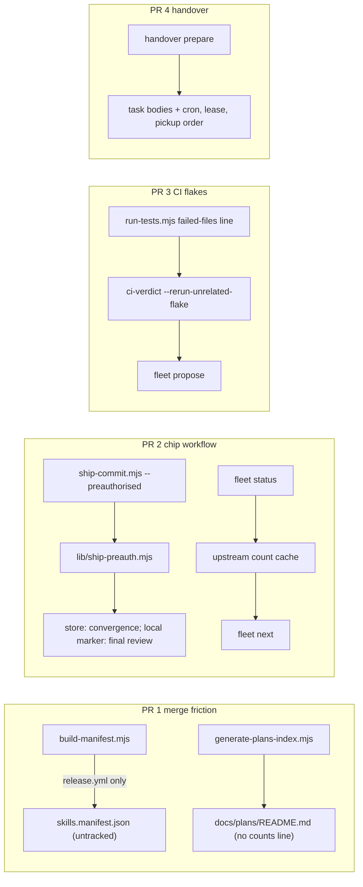

# Plan: Fleet chips & merge friction — conflict-free generated files, a standard chip preamble with a coded ship check, one recorded CI-flake re-run, and a harder handover

- **Date**: 2026-10-15
- **Status**: In Progress
- **Author**: Claude + Louis
- **Scope**: backend (stack `js-ts`; engineering principles apply; no UI)
- **Target domain(s)**: `fleet`, `install`, `scripts`, `shared-lib`, `ship`, `skills-content`
- ⚠ **Cross-domain work** — intentional: one coordinator theme (rule 13) that touches the generated-artifact writers (`install`), the ship commit helper (`ship`), the CI verdict reader (`scripts`/`shared-lib`) and the fleet skill (`fleet`, `skills-content`). Each PR stays inside one or two of them.
- **Depends on**: docs/plans/fleet-lease-turns-and-journal.md — PRs 2-4 edit `skills/fleet/**` and PR 4 reads the lease turns; start each only after that theme's PR 3 has merged (coordinator, 2026-10-15). PR 1 does not depend on it.
- **Theme**: coordinator rule 13, five sequential PRs (PR 2b, section 12, was added 2026-10-15). Findings: p-20261015045120-caf4 (PR 1); p-20261015045116-5b9d, p-20261015045132-5ee1, p-20261015045126-5696 (PR 2); p-20261015045129-6c44, p-20261014202756-400e (PR 3); p-20261014064525-f69b, p-20261014064525-9019, p-20261014064526-328a (PR 4).
- **Out of scope**: `fleet lease run` (the "CES: Fleet lease theme" chip's PR 3). PR 4 touches `scripts/lib/fleet/argv.mjs`, which that theme also edits: coordinate before starting it.

## 1. Context Summary

### 1.1 PR 1 — what conflicts, measured

Method (`measured`, 2026-10-15, at `423789e4`): for PRs #236-#253 fetch `refs/pull/<n>/head`, list every merge of
`main` into the PR branch (`git rev-list --merges <merge-base>..<head>`), and replay each with
`git merge-tree --write-tree <parent1> <parent2>`, printing the conflicted files and the conflict hunks.

| | merges of main into a PR branch | conflicted | `skills.manifest.json` | `docs/plans/README.md` | `status.md` | genuine source conflict |
|---|---|---|---|---|---|---|
| #236-#253 (18 PRs) | 16 | **13** | 9 (6 PRs) | 8 (5 PRs) | 2 (2 PRs) | 1 (`coordination.md`, #245) |

What the conflict hunks contain (`measured`, same replay, hunks printed):
- **`docs/plans/README.md`: 8 of 8 are the one summary line** `**N active · N terminal · N audit summaries · …**`.
  Every PR that adds a plan or moves a status changes it, so two such PRs always collide on it. No row conflicted.
- **`skills.manifest.json`: 9 of 9 include the `"bundleVersion"` line** (a hash over every skill file, so every PR
  that edits any skill file changes it). 4 of 9 also carry a 15-line hunk in the `fleet` entries: two PRs edited
  different lines of `skills/fleet/references/*.md`, so their sources merged but the per-file `sha`/`size` lines
  next to each other did not. The manifest turns a clean source merge into a conflict.
- **`status.md`: 2 of 13**, both two `/ship` entries inserted at the top of the log.

Rebased branches leave no merge commit, so this count is a floor (`measured` lower bound, not a rate).

Why a merge driver does not fix it: GitHub computes mergeability itself and ignores `.gitattributes` merge
drivers, and a `CONFLICTING` PR gets no `pull_request` workflow run, so no `full-suite` verdict (#250, 2026-10-14;
p-20261014202756-400e). The conflict has to be removed at the source.

### 1.2 Code Trace (pinned `423789e4`)

**Manifest.** `skills:regenerate` (`package.json`) runs `scripts/build-manifest.mjs`, which writes
`skills.manifest.json` with `bundleVersion` = sha256 over every `skill:<name>:<relPath>:<sha>` pair
(`scripts/build-manifest.mjs:201-222`). `skills:check` runs `build-manifest.mjs --check` (whole-body byte
comparison, `:236-271`), and the poison-pill contract `scripts/gate-contracts/skills-check.json` pins that check.
**Readers of the committed copy: none.** `scripts/install-skills.mjs` no longer installs (header, `:1-30`);
`scripts/check-skill-updates.mjs` does not exist; `tests/install/version-gate.test.mjs:88` records "no runtime
consumer"; `scripts/lib/audit/tiered-shadow-contract-digest.mjs` names it only in comments. The one consumer is
`.github/workflows/release.yml`, which **runs `node scripts/build-manifest.mjs` itself** ("Build manifest" step)
before reading `manifest.bundleVersion` and packing the tarball. So the committed copy is a byte-checked artifact
that nothing reads: its churn carries no information (AGENTS.md generated-artifact policy).

**Plans index.** `npm run plans:index` → `scripts/generate-plans-index.mjs` renders `docs/plans/README.md`; the
counts line is written at `scripts/generate-plans-index.mjs:254`; a second count sits in the audit-summaries
`
Show all N audit summaries
` line (`:302`; unchanged across the sample, but it moves whenever a
summary is added, so it goes too).
`plans:index:check` (in `check:static`) byte-compares; `scripts/gate-contracts/plans-index-check.json` pins it with
`tests/fixtures/poison/plans-index-tampered.md`.

**Ship commit.** `scripts/ship-commit.mjs:120-835` (`main`): parses flags (`KNOWN_FLAGS` `:69-76`), has one
read-only standalone preflight (`--check-migrations`, `:145-170`), then for `--gate passed|converged` reads the
store's convergence row via `getAuditRunConvergence` (`scripts/lib/store/runs-findings.mjs:1951`, selects
`round_converged_after, rigor_pressure_round, rounds`), resolves the tree the commit will carry (`:485-525`) and
calls `evaluateGateVerification` (`scripts/lib/commit-trailers.mjs`). `scripts/gemini-review.mjs` persists the
final-review verdict to the same `audit_runs` row (`gemini_verdict`, run id recovered from
`.audit/last-audit-run.json` when not passed, `:956-1000`).

**CI verdict.** `node scripts/test-tier.mjs ci-verdict --pr <n>` → `cmdCiVerdict` (`scripts/test-tier.mjs:153`) →
`ciVerdict` → `gatherCiEvidence` + `classifyCiVerdict` (`scripts/lib/ci-verdict.mjs`). A failed run is
`verdict: 'failed'`, exit 4; a PR with no run is `unverified`, reason "no … run exists". `gh pr view` is asked for
`number,headRefOid,baseRefName,state` only, so a `CONFLICTING` PR reads as an ordinary missing run. The full suite
prints TAP through `scripts/run-tests.mjs` (`finishRun`, `:586-597`); nothing machine-readable names the failing
files.

**Handover.** `fleet handover prepare` → `prepareHandover` (`scripts/lib/fleet/handover.mjs`) writes
`<git-common-dir>/fleet/handover/handover-<id>.{json,md}` (never in the tree). `collectScheduledTasks` keeps
`{id, description}` only; the cron lives in the scheduler, not on disk (checked: `~/.claude/scheduled-tasks/<id>/`
holds only `SKILL.md`). `renderHandoverMarkdown` / `coordinationPrompt` (`scripts/lib/fleet/handover-render.mjs`)
have no pickup order, no lease state and no memory-backup reminder.

**Fleet status/next.** `fleet status` already writes a small cache that `claim`/`touch`/`ready` footers read
(unregistered work, `skills/fleet/references/coordination.md` §Unregistered work). Upstream reports are read across
every store by `scripts/upstream-queues.mjs --json` (source repo only; `measured` 1.6 s, 2 stores, output
`{storesQueried, storesUnqueried, totalOpen, …}`).

**Size limits that shape PR 2.** `skills/fleet/references/coordination.md` is 11,898 chars against the 12,000 cap
of `skills:size:gate` (a file under the cap may not cross it); `skills/fleet/SKILL.md` is 13,620 chars, over the cap,
so it may not grow at all. Detail goes to references.

### 1.3 Patterns reused

- **Per-entry / no committed aggregate** — #247's tech-debt ledger (`docs/plans/debt-ledger-per-entry-files.md`):
  new facts are new paths, and no rendered aggregate is committed. PR 1 applies the second half.
- **Read-only standalone preflight** — `ship-commit.mjs --check-migrations`: the early, advisory copy of a check
  that the commit path enforces.
- **Status writes a cache, footers read it** — the unregistered-work cache.
- **Unmeasured is never zero** — `upstream-queues.mjs` reports unqueried stores; `ci-verdict` reports `unverified`.

### 1.4 Neighbourhood considered

`get-neighbourhood` over `scripts/ship-commit.mjs`, `scripts/lib/ci-verdict.mjs`, `scripts/lib/fleet/handover.mjs`
and the new `scripts/lib/ship-preauth.mjs`: every record banded `review` (nothing above this repo's noise floor). The
nearest, `ship-commit.mjs` `main`, is the file PR 2 extends rather than duplicates.

## 2. Proposed Architecture

### 2.1 PR 1 — remove the conflict at the source (caf4)

1. **`skills.manifest.json` stops being committed.** Delete it from the tree, ignore it with a `Category: A` block,
   drop `build-manifest.mjs --check` from `skills:check` and `build-manifest.mjs` from `skills:regenerate`.
   `release.yml` already builds it at tag time, the only place it is read. `build-manifest.mjs` keeps both modes
   unchanged: the write path (`npm run skills:manifest` builds a local copy on demand) and `--check`, which stays an
   explicit verifier of whatever file it is pointed at (`--manifest <path>`): it still fails on a missing file and on
   any byte difference from a fresh regeneration (REQ-correctness-5dc3ed1e), and its tamper tests stay, run against a
   scratch path. What changes is only that no tracked-artifact gate runs it: `skills:check` drops it, because the
   default path is now an ignored local file whose freshness says nothing about the commit, and the
   manifest pill in `scripts/gate-contracts/skills-check.json` is removed with it (no other gate runs `--check` on the
   default path, so a pill there could never go red). `npm run skills:manifest:check` stays as the
   explicit verifier. (#5 single source of truth: the skill files are the truth; #1 DRY: one generator, run where
   used.)
   - The generated-artifact policy names two categories and both assume the file must exist in the repo. A pure
     function of committed source that nothing reads from git is neither "committed + verified" (B: verifying an
     artifact nobody reads is the churn the policy forbids) nor volatile. PR 1 widens A's definition by one clause in
     `docs/reference/gitignore-policy.md` — "or a build output whose committed copy has no reader; it is generated
     where it is used" — and records the measurement above as its reason. AGENTS.md's A/B text is unchanged; its
     examples do not name the manifest.
2. **The plans index drops its counts line.** `generate-plans-index.mjs` stops writing the
   `**N active · …**` line, nor any other count embedded in the file (every `
Show all N …
` header —
   audit summaries, completed plans and any other collapsible bucket), into `README.md`, and prints the same counts on stdout instead (`plans:index` and
   `plans:index:check` both). Rows stay: a row conflicts only when two PRs insert next to each other in the same
   bucket, which the replay never saw. The file stays Category B, byte-checked. (#5; #18 backward compatibility: the
   bucket structure and links are unchanged.)
3. **`status.md` is not changed in this theme — a scope boundary, with its own revisit trigger.** 2 of 13
   conflicts, both from two `/ship` entries landing at the top. The structural fix is #247's shape (one file per
   entry, no committed aggregate), which changes `/ship`'s status contract, `status:integrity:gate` (conserved
   entries) and `status:rotate`. Independence: neither PR 1 change reads or writes `status.md` or depends on its
   writer. Recorded as a new `fleet propose` (theme `merge-friction`) with the measurement and the trigger: re-measure
   after PR 2 lands, and plan it when `status.md` conflicts in ≥3 of the next 20 CES PRs (pre-authorised ship raises
   concurrent `/ship` entries, so the rate may rise).
4. **No local merge driver.** With the manifest untracked and the counts line gone, nothing is left for a
   `.gitattributes` driver to resolve, and it would not reach GitHub anyway.
5. `.fleet.json` `hotFiles` drops `skills.manifest.json` (no longer tracked).

Expected effect on the measured sample (`derived`, from the replay): conflicted merges 13 → 3 (`status.md` twice,
plus the genuine `coordination.md` conflict).

**Right-sizing.** Band-aid: a `.gitattributes` `merge=union`/regenerate driver (fixes local merges only; GitHub
still shows CONFLICTING and skips CI). Over-built: per-entry files for all three plus a CI bot that regenerates
aggregates on `main` (needs GitHub settings this chip may not change, and keeps aggregates committed). Chosen: stop
committing the one aggregate nobody reads, and delete the one line that every PR changes; both are smaller than the
code they replace.

### 2.2 PR 2 — chip workflow

**(a) `skills/fleet/references/chip-preamble.md` (5b9d).** The standard launch block a coordinator pastes (or
cites) into every chip prompt, in fixed sections: Title; Authority (pre-authorised / NOT authorised, rule 1); Route
(rule 3, with `/cycle --autonomous`'s model handoff, rule 16: plan on the strong model, end the turn when
`/audit-plan` converges, message the coordinator, implement after "go"); Turn rule ("a FREE lease is not a turn":
push only when the coordinator says it is your turn, rule 14); Cost window (`fleet lease peak`: no new coding in peak
hours, shipping is fine); Claim and propose (the exact `fleet claim` and `fleet propose` lines; stop and report on
BLOCKED); Stop point (ship-ready, rule 4); and the **pre-authorised ship variant** (2.2b). Each section is a
fill-in template with the placeholders named. coordination.md rule 1 and rule 3 cite it instead of carrying the
example text, which pays for the citation inside the 12,000-char cap. (#1 DRY: one preamble, not one per chip.)

**(b) Pre-authorised ship, enforced in code.** A chip whose launch prompt grants it may run the ship steps by hand
(never by invoking the `/ship` skill), but only through `ship-commit.mjs --preauthorised`, which refuses unless every
condition holds:

| Condition | Measured from | Refusal names |
|---|---|---|
| the **effective** gate is `passed` or `converged` (never `waived`/`not-run`) | the gate value after every cap ship-commit applies (`--no-tests` caps it to `waived`/`not-run`, REQ-behavioural-19096e7a), then the existing `evaluateGateVerification` against the store's convergence row and the audited tree. `--preauthorised` with `--no-tests` is refused outright at argument validation, before any git mutation | `gate` |
| the audit converged | `audit_runs.round_converged_after` not null for the evidence run (same row as above) | `audit-converged` |
| the final review approved **this** audited tree | the final-review marker `.audit/last-final-review.json` (below) has `verdict: 'APPROVE'` and its `runId`, `auditedTree` and `round` equal the gate-evidence marker's. (PR 2 audit R1, 2026-10-15: the store's `gemini_verdict` is NOT also required. It has no target identity, its write semantics are under audit-honesty findings, and the tool-written marker binds what the column cannot.) | `final-review` |
| no sensitive path | every path changed between `merge-base(HEAD, origin/<default>)` and the commit's tree (`git diff --name-only --no-renames`, so both ends of a rename are checked), through `classifyPath` (`scripts/lib/sensitive-paths.mjs`) | `sensitive-path` |
| no migration | no changed path with a `migrations/` segment (`supabase/migrations/**`, `scripts/migrations/**`, any other) | `migration` |
| no repository policy | no changed path in the explicit policy list `PREAUTH_POLICY_PATHS`: `.github/**`, `CODEOWNERS` at the root, `docs/CODEOWNERS`, and `.test-tiers.json` (it names the workflow that grades a merge). Matched on normalised repo-relative paths. GitHub settings changed through the API are already outside a chip's authority (launch prompt) | `repo-policy` |

- **Binding the final review to the audited tree.** `gemini_verdict` is one column per run with no target identity:
  a run can keep an earlier approval while the audit evidence moves on. So `gemini-review.mjs` (code mode, after it
  persists the verdict) writes `.audit/last-final-review.json` = `{runId, auditedTree, round, verdict, ts}`, copying
  `runId`/`auditedTree`/`round` from the gate-evidence marker it already reads (`.audit/last-audit-run.json`) at
  review time. The preauth check requires all three to equal the CURRENT gate-evidence marker. A later audit round
  rewrites the gate-evidence marker (new round, often a new tree), so an old approval stops matching and the check
  refuses until the review runs again. No migration: the marker is written by the tool, never by hand, exactly like
  the gate-evidence marker (AGENTS.md: never hand-write gate evidence). Plan mode writes no such marker.
- The decision is a pure function, `evaluatePreauthorisedShip` in `scripts/lib/ship-preauth.mjs` (Tier 1). The CLI
  only gathers facts. Fail closed: cloud off, a store read failure, no evidence run, a missing or mismatched
  final-review marker, an unresolvable base or tree: each refuses with its own reason, never passes.
- `--check-preauthorised` is the read-only standalone preflight (same mutual-exclusivity contract as
  `--check-migrations`): it evaluates against HEAD's tree and prints one line per condition, exit 0 all-clear, 2
  refused. A chip runs it before writing the status entry, so a refused ship stops before the doc work. The commit
  path re-evaluates against the real commit tree; the preflight is advisory-early, not a second gate.
- On success the commit carries one more reserved trailer, `AI-Ship-Authority: launch-prompt`, written by the same
  renderer as the other `AI-*` trailers (`scripts/lib/commit-trailers.mjs`), so a pre-authorised ship is queryable
  from history. A user-typed `/ship` writes no such trailer. The claim records it in its intent ("pre-authorised
  ship"), as the launch prompts already do.
- Rule 4 changes from "a chip ends at ship-ready" to "a chip ends at ship-ready **unless its launch prompt
  pre-authorises the ship**; then it ships only through `ship-commit.mjs --preauthorised`, and a refusal sends it
  back to 'type `/ship <plan>`'". Rule 1's example gains the pre-authorised line. Fine print in
  `coordination-rationale.md` rule 4.

**(c) `/ship` is typed only when the chip is idle (5ee1).** One sentence in rule 4 rationale and in the preamble's
stop point: mid-turn, the host refuses the skill as a programmatic call and the user must re-type it.

**(d) Upstream count in `fleet status` / `fleet next` (5696).** New `scripts/lib/fleet/upstream-count.mjs`:
`status` runs `scripts/upstream-queues.mjs --json` when that file exists (source repo only; consumers file reports,
they do not triage them), with a 30 s timeout, and writes the cache
`{state: 'measured'|'partial'|'unmeasured', totalOpen, storesQueried, storesUnqueried, reason, measuredAt, attemptedAt,
lastMeasured}`: `measured` = every store answered; `partial` = some did (the count is a floor, labelled so);
`unmeasured` = none did or the run failed, with `reason`. `attemptedAt` moves on every refresh, `measuredAt` only on a
successful one, and a failed refresh keeps the previous success in `lastMeasured` as labelled history, never as the
current count. ONE renderer, `renderUpstreamLine(cache, now)`, serves `status`, `next` and the footers:
`upstream: N open (un-acked) across S store(s)`; `upstream: ≥N open (K store(s) unqueried)`;
`upstream: UNMEASURED (<reason>; last measured N at <time>)`; a cache older than 24 h adds `stale`. `next` and the
footers read only the cache and add `DO triage N open upstream report(s): npm run upstream:issues` when a measured or
partial N > 0. In a consumer the line is absent, not zero. (#16 graceful degradation; the unmeasured-is-never-zero
rule.)

### 2.3 PR 3 — one recorded re-run for an unrelated CI failure (6c44, 400e)

1. **`run-tests.mjs` names its failing files.** On a failing run `finishRun` also prints one machine line,
   `run-tests/v1 failed-files: <JSON array of repo-relative test files>`, derived from the same report it already
   adjudicates. A run that cannot name them prints `run-tests/v1 failed-files: unknown` (never `[]`).
2. **`ci-verdict` classifies a flake candidate.** New pure `classifyFlakeRerun` in `scripts/lib/ci-verdict.mjs`
   over an evidence record gathered for the ONE run `selectRun` already judged (same head sha, same attempt):
   eligible only when ALL hold —
   - the verdict is `failed` for a PR (not a head-only query), the run's conclusion is `failure`, and
     `run_attempt === 1` (never more than one re-run, counted by GitHub, not by us);
   - **failure coverage is complete**: every failed job of that run attempt (`gh api …/runs/<id>/attempts/1/jobs`)
     has exactly one `failed-files` marker in its log (`gh run view <id> --attempt 1 --log-failed`), every marker is a
     parsed array with ≥1 file, and no failed job lacks one (a job that failed before tests, e.g. `npm ci`, has none →
     ineligible);
   - **every failed STEP is explained by that marker**: the jobs response also lists each job's steps and their
     conclusions. The only failed step allowed is the test step that printed the marker (`npm test`); a job that also
     failed a lint, security, cleanup or always-run step is ineligible, because the marker explains the tests and
     nothing else;
   - **the changed-file set is complete**: `git diff --name-only --no-renames <testedBase>...<head>` on fetched
     commits (no paginated API list), where `testedBase` is the run's own tested base;
   - no changed file is a shared input — `SHARED_ENVIRONMENT`, `SELECTOR_DEPENDENCIES` or `SELECTOR_IDENTITY_FILES`
     (`scripts/lib/test-tier.mjs`, the inputs for which the branch tier refuses to skip anything), `package-lock.json`
     or the CI workflow;
   - no failing file is in the changed set, and none is reached by it through `computeReach` + `entryReached`, the
     same reach the branch tier uses; a reach with `computed > 0` or unresolved imports counts as reached.
   - **the evidence describes the tested snapshot, not the coordinator's checkout**: the PR head and tested base come
     from the run itself (`head_sha`, `pull_requests[].base.sha`, the same fields `classifyCiVerdict` already
     judges), and the reach graph is built from the tree AT THAT HEAD (`readTreeAt`/`git ls-tree` + `git show` in
     `scripts/lib/test-tier-git.mjs`, never the working tree). A head or base that cannot be fetched, or a run whose
     `head_sha` is not the PR's current head, is ineligible. Tests: base movement after the run, and a coordinator
     checkout that differs from the tested PR.
   Anything unknown is ineligible, with its reason.
3. **`ci-verdict --pr <n> --rerun-unrelated-flake`** (opt-in flag; the bare verdict stays a pure reader). Two
   external mutations, each with its own outcome:
   - **Re-run.** Eligible → `gh run rerun <id> --failed`. Then confirm by reading the run again: `run_attempt === 2`
     (queued or running) → `rerun: accepted`, exit 3 (`pending`). `gh` rejects it (non-zero, attempt still 1) →
     `rerun: rejected (<gh error>)`, the verdict stays `failed`, exit 4. `gh` times out or the read-back fails →
     `rerun: indeterminate`, exit 1, and no retry: the next invocation reads `run_attempt` first, so a re-run that did
     land is seen as attempt 2 and never repeated.
   - **Record.** After `accepted`, `fleet propose` (theme `ci-flakes`; evidence carries the stable key
     `ci-flake:<owner/repo>:<run id>:attempt-1` plus the run url and files). If it fails, print
     `proposal: NOT recorded (<reason>)` beside the accepted re-run (a partial outcome, never hidden). Recovery is
     idempotent: any later `--rerun-unrelated-flake` call that finds attempt ≥ 2 on a run whose attempt 1 was eligible
     looks for a proposal carrying that key (`readProposals`) and files it only if absent.
   - **Atomicity: one reservation per run, under one lock.** The eligibility read, the dispatch and the proposal are
     check-then-act, so two invocations (or a delayed one) could each see attempt 1 or an absent proposal. Every step
     therefore runs under `withFileLock` (`scripts/lib/file-lock.mjs`) on a reservation record
     `<git-common-dir>/fleet/ci-flake/<owner>__<repo>__<run id>.json`, created with exclusive create (`wx`) — the
     same machine-local authority the fleet registry and the lease already use (#14 transaction safety). States:
     `reserved` → `dispatching` → `accepted` | `rejected` | `indeterminate`, plus `proposalId` once recorded.
     Any invocation holding the lock may take a `reserved` record forward (a creator that crashed before
     dispatching strands nothing): it re-reads `run_attempt === 1`, persists `dispatching` atomically, and only then
     calls GitHub. `dispatching` means "possibly submitted": it is never dispatched again by this tool. Reconciliation is
     READ-ONLY: attempt 2 visible → `accepted`. A `gh` exit that definitively refuses the request (HTTP 4xx from the
     rerun endpoint, the call's own error, recorded when it happens) → `rejected`. Anything else, including a timeout,
     a process death or "still attempt 1 on the first read", stays `dispatching` (reported as indeterminate): a request
     can be accepted and not yet visible, so a negative counter read never authorises a second submission. The tool has
     NO retry path; the operator checks `gh run view <id>` and decides, and removing the record is their manual act, not a
     documented recipe. A failed state write before the call aborts with no dispatch; a failed write after it leaves
     `dispatching`. Tests: acceptance becoming visible after a timeout, process death between the call and the state
     write, and a first reconciliation read that still shows attempt 1. The proposal is filed only while holding the lock and only when the record has
     no `proposalId`; the id is written before the lock is released, so recovery after a crash between accept and
     record files it exactly once. Scope: one coordinator machine, which is where rule 8 runs merges; a second
     machine is out of scope and named as such in the rationale.
   - Ineligible → the reason is printed and exit 4 stays. A failed attempt 2 is `failed` with the note "already re-run
     once". The durable record is GitHub's `run_attempt` plus the keyed proposal.
4. **`CONFLICTING` is named (400e).** `gatherCiEvidence` also asks `gh pr view` for `mergeable`; with no accepted run
   and `mergeable === 'CONFLICTING'`, the verdict is `unverified` with reason `conflicting: GitHub runs no
   pull_request workflow on a conflicting PR; merge the base in first`, and the JSON carries `blocker: 'conflicting'`.
5. Rule 8 rationale (`coordination-rationale.md`) gains the recipe: re-run with the flag, never by hand, never twice.

**Right-sizing.** Band-aid: tell the coordinator to re-run by hand (what happened at 01:12Z). Over-built: a flake
database with quarantine and retry budgets. Chosen: one bounded re-run, decided by a pure predicate from facts
GitHub already records.

### 2.4 PR 4 — handover hardening (f69b, 9019, 328a)

1. **Scheduled tasks exported in full.** `collectScheduledTasks` also copies each task's `SKILL.md` into
   `<handover dir>/handover-<id>-tasks/<task-id>/SKILL.md` (inside `<git-common-dir>`, never the tree) and records its
   sha256. The cron, `fireAt` and `enabled` are not on disk, so `prepare --scheduler-snapshot <file>` takes the JSON
   the operator saved from `list_scheduled_tasks` and joins it by id; without it the manifest says
   `cron: unknown (no --scheduler-snapshot)` per task, and the BEFORE YOU RELAUNCH step tells the operator to save
   the snapshot.
2. **Peers by title (9019).** The coordination prompt gains a line: session ids die with the account; name every
   peer coordinator by its title (`<REPO>: Coordinator`, rule 6) and resolve the live id with `list_sessions`. Any
   rendered host-session id is labelled "pre-switch id".
3. **Pickup order (328a).** A fixed first sequence in the prompt, before resuming any work: (i) the CI queue — what is
   running or queued (`gh run list --status in_progress` / `queued` per repo) and `fleet lease status`; (ii) if
   anything runs, `fleet lease announce` a CI window for it; (iii) only then discovery (`fleet status`, unregistered
   scans, chips).
4. **Lease state recorded.** `prepare` reads the machine lease (`readLease` + `summarise`, `scripts/lib/fleet/lease.mjs`)
   into an optional `lease` field: holder, waiters, open windows and, where the turns PR has landed, turns. An
   unreadable lease is `lease: {unmeasured: <reason>}`.
5. **Memory-backup reminder.** The BEFORE YOU RELAUNCH block reminds the operator to back up memory to their own
   private store. The command comes from `FLEET_MEMORY_BACKUP_CMD` when set (printed verbatim into the private
   handover); otherwise a generic line. No path is committed, and memory is never copied into a repo.

6. **Publication contract for the task export.** `prepare` already reserves its artifacts and writes the manifest last; the export
   joins that order: validate the supplied `--scheduler-snapshot` (a JSON array of objects with a string `id`; a malformed
   file, a duplicate id or an id with no task on disk is an error, never a silent skip), stage every task's `SKILL.md`,
   hash the bytes actually WRITTEN (not the bytes read), and only then publish the manifest and markdown. A task body that
   cannot be read or copied fails `prepare` with a non-zero exit and no ready handover (the staged copies are removed); the
   handover is never published listing an export that is not there. `receive` re-hashes the copies against the manifest.
   Tests: fault injection on a task read, on a copy, and between the copies and the manifest write; the duplicate-id and
   missing-id cases.

All new manifest fields are optional, so `HANDOVER_SCHEMA_VERSION` is unchanged and older manifests still load.

## 6. Sustainability Notes

- **Assumption: the manifest stays reader-less.** If an installer ever reads it again, it should read the release
  asset (signed, `release.yml`), not raw `main`. The test added in PR 1 asserts the file is untracked, so a
  re-commit is a visible, deliberate change.
- **The final review is read from the tool-written marker, not the `gemini_verdict` column**, so a change to where the
  verdict is stored does not touch the ship check.
- **The preamble is the extension point** for future chip rules: a new rule adds a section there, not text in every
  chip prompt.
- **The flake predicate is data-driven by GitHub's own attempt counter**; the only local state is the per-run
  reservation record under `<git-common-dir>/fleet/ci-flake/`, whose states are all reconcilable from that counter.

## 7. File-Level Plan

### PR 1
- `skills.manifest.json` (delete) — the reader-less aggregate.
- `.gitignore` (modify) — `/skills.manifest.json` under a `Category: A` block naming release.yml as its point of use.
- `docs/reference/gitignore-policy.md` (modify) — A gains the reader-less build-output clause + measurement.
- `package.json` (modify) — drop the manifest from `skills:regenerate` and `skills:check`; `skills:manifest` and `skills:manifest:check` stay.
- `scripts/build-manifest.mjs` (modify) — header says Category A, built by release.yml; `--check` and the write path unchanged in behaviour.
- `scripts/gate-contracts/skills-check.json` (modify) — remove the manifest poison pill.
- `scripts/check-gate-poison-pills.mjs` (modify) — only if it names the manifest pill; reword its comment otherwise.
- `scripts/generate-plans-index.mjs` (modify) — counts to stdout, not into the file.
- `docs/plans/README.md` (modify) — regenerated.
- `tests/skills-artifact-freshness-wiring.test.mjs` (modify) — the manifest is no longer in `skills:check`; it is untracked and ignored; `build-manifest` stays deterministic into a scratch path, and `--check --manifest <scratch>` still fails on a missing file and on a tampered byte.
- `tests/category-b-atomic-writes.test.mjs` (modify) — the manifest writer is no longer a Category B pair.
- `tests/plans-index-status-detail.test.mjs` (modify) — no counts line in the file.
- `tests/merge-friction.test.mjs` (create) — the red-first merge proof (§9).
- `.fleet.json` (modify) — drop the manifest from `hotFiles`.
- `tests/fixtures/poison/plans-index-tampered.md` (modify) — only if its tamper was the counts line.

### PR 2
- `skills/fleet/references/chip-preamble.md` (create) — the preamble (2.2a) incl. the pre-authorised variant.
- `skills/fleet/SKILL.md` (modify) — one reference-index row, paid for by an equal cut (file may not grow).
- `skills/fleet/references/coordination.md` (modify) — rules 1, 3, 4 cite the preamble; stays under 12,000 chars.
- `skills/fleet/references/coordination-rationale.md` (modify) — rule 4: pre-authorised variant, idle-only `/ship`.
- `skills/fleet/references/participant-rules.md` (modify) — the stop-at-ship-ready step names the variant.
- `scripts/lib/ship-preauth.mjs` (create) — `evaluatePreauthorisedShip`, `PREAUTH_EXCLUDED_PATH_RULES`.
- `scripts/ship-commit.mjs` (modify) — `--preauthorised`, `--check-preauthorised`.
- `scripts/gemini-review.mjs` (modify) — code mode writes `.audit/last-final-review.json` after persisting the verdict.
- `scripts/lib/audit/gate-evidence.mjs` (modify) — the final-review marker's writer/reader beside the gate-evidence marker's (one module owns both markers).
- `scripts/lib/commit-trailers.mjs` (modify) — `AI-Ship-Authority` render + parse.
- `docs/reference/commit-provenance.md` (modify) — the new trailer.
- `scripts/lib/fleet/upstream-count.mjs` (create) — run, cache, read, render the count.
- `scripts/lib/fleet/commands.mjs` (modify) — `status` refreshes the cache; `next` and footers read it.
- `tests/ship-preauth.test.mjs` (create), `tests/ship-commit-cli.test.mjs` (modify), `tests/commit-trailers.test.mjs` (modify), `tests/fleet-upstream-count.test.mjs` (create).

### PR 3
- `scripts/run-tests.mjs` (modify) — the `failed-files` line.
- `scripts/lib/ci-verdict.mjs` (modify) — `classifyFlakeRerun`, `mergeable`, the `conflicting` reason.
- `scripts/test-tier.mjs` (modify) — `--rerun-unrelated-flake`.
- `skills/fleet/references/coordination-rationale.md` (modify) — rule 8 recipe.
- `tests/ci-verdict.test.mjs` (modify), `tests/run-tests-timing.test.mjs` (modify).

### PR 4
- `scripts/lib/fleet/handover.mjs` (modify) — task export, snapshot join, lease, backup reminder.
- `scripts/lib/fleet/handover-render.mjs` (modify) — pickup order, peers by title, export/lease sections.
- `scripts/lib/fleet/argv.mjs` (modify) — `--scheduler-snapshot` (coordinate with the lease chip).
- `skills/fleet/references/handover.md` (modify) — document it.
- `tests/fleet-handover.test.mjs` (modify).

### 7b. Implementation Phases

**Phase 1 — Untrack the manifest**: delete, ignore, drop its check and regenerate step, update the policy doc, tests and hot files. Files: skills.manifest.json (delete), .gitignore (modify), docs/reference/gitignore-policy.md (modify), package.json (modify), scripts/build-manifest.mjs (modify), scripts/gate-contracts/skills-check.json (modify), tests/skills-artifact-freshness-wiring.test.mjs (modify), tests/category-b-atomic-writes.test.mjs (modify), .fleet.json (modify)

**Phase 2 — Plans index without the counts line**: Files: scripts/generate-plans-index.mjs (modify), docs/plans/README.md (modify), tests/plans-index-status-detail.test.mjs (modify), tests/merge-friction.test.mjs (create)

**Phase 3 — Chip preamble and rule text**: Files: skills/fleet/references/chip-preamble.md (create), skills/fleet/SKILL.md (modify), skills/fleet/references/coordination.md (modify), skills/fleet/references/coordination-rationale.md (modify), skills/fleet/references/participant-rules.md (modify)

**Phase 4 — Pre-authorised ship in code**: Files: scripts/lib/ship-preauth.mjs (create), scripts/ship-commit.mjs (modify), scripts/lib/store/runs-findings.mjs (modify), scripts/gemini-review.mjs (modify), scripts/lib/audit/gate-evidence.mjs (modify), scripts/lib/commit-trailers.mjs (modify), docs/reference/commit-provenance.md (modify), tests/ship-preauth.test.mjs (create), tests/ship-commit-cli.test.mjs (modify), tests/commit-trailers.test.mjs (modify)

**Phase 5 — Upstream count in status/next**: Files: scripts/lib/fleet/upstream-count.mjs (create), scripts/lib/fleet/commands.mjs (modify), tests/fleet-upstream-count.test.mjs (create)

**Phase 6 — CI flake re-run and CONFLICTING**: Files: scripts/run-tests.mjs (modify), scripts/lib/ci-verdict.mjs (modify), scripts/test-tier.mjs (modify), tests/ci-verdict.test.mjs (modify), tests/run-tests-timing.test.mjs (modify)

**Phase 7 — Rule 8 recipe**: Files: skills/fleet/references/coordination-rationale.md (modify)

**Phase 8 — Handover hardening**: Files: scripts/lib/fleet/handover.mjs (modify), scripts/lib/fleet/handover-render.mjs (modify), scripts/lib/fleet/argv.mjs (modify), skills/fleet/references/handover.md (modify), tests/fleet-handover.test.mjs (modify)

**Close-out (not a phase)**, per PR: `npm run skills:regenerate`, `npm run skills:check`, `npm run plans:index`, `npm run guards:preflight`, the branch-tier pre-push, then the `full-suite` CI verdict.

## 8. Risk & Trade-off Register

- **The final-review marker binds agreement between labels, not the review request itself** (plan audit R1 H1, 2026-10-15). It copies
  run, tree and round from the gate-evidence marker as it stands when the review finishes; it does not capture the identity of the
  input the reviewer was actually sent. A review built from a different checkout than the audit would still publish an approval
  for the audit's tree. Accepted for now: both run in one session from one worktree, the transcript the reviewer sees is built from
  that audit's own result files, and the ship also requires the audit's convergence in the store and an unchanged branch. The
  fix is to stamp the target identity into the review envelope and refuse to dispatch on a mismatch (gemini-review envelope work);
  recorded under Out of Scope (Future).

- **Someone outside reads raw `main/skills.manifest.json`** (an old installer copy). Searched: no reader in this repo
  or the synced bundle; the install path is retired. Risk accepted; the release asset still carries the manifest.
- **Pre-authorised ship widens what a chip can do alone.** Bounded by code (2.2b), by the trailer (auditable after the
  fact), and by the exclusions (sensitive, migrations, repository policy files). Merge stays the coordinator's.
- **No final-review marker** (the review did not run, or `gemini-review.mjs` does not write it yet). The check refuses
  (`final-review`) and the chip falls back to "type `/ship`": safe direction.
- **A real failure in a file the PR did not touch gets one wasted re-run.** The reach check removes most of them; the
  cost is one CI run, bounded by `run_attempt === 1`.
- **`--rerun-unrelated-flake` mutates GitHub state** (a re-run). Opt-in flag, never the default reader.
- **Deferred: `status.md` per-entry files** — scope boundary in 2.1(3), with a proposal and a trigger.
- **Deferred: other `hotFiles` baselines** (`.file-size-baseline.json` etc.) — none conflicted in the sample.

## 9. Testing Strategy

- **PR 1, red first.** `tests/merge-friction.test.mjs` builds a throwaway repo seeded with several plans in both
  the Active and the terminal buckets, branches twice, and on one branch adds a `Draft` plan, on the other a
  `Complete` plan (so the counts diverge: `+1 active` vs `+1 terminal`, and the two new rows land in different
  sections, separated by unchanged rows). It runs the real `generate-plans-index.mjs` on each branch, commits, and
  replays the merge with `git merge-tree --write-tree --name-only`. Red against the old generator, asserting the
  conflict is in `docs/plans/README.md` and its only conflicted hunk is the counts line; green after (no conflict).
  Separate cases: `skills.manifest.json` is ignored (`git check-ignore`) and untracked (`git ls-files`); two builds
  into scratch paths are byte-identical; `--check --manifest <scratch>` fails on a missing file and a tampered byte.
- **PR 2.** `evaluatePreauthorisedShip` as a table: each condition alone failing refuses with its own reason; all
  holding passes; unknowns refuse. Final-review binding: approval of run A while the gate-evidence marker names run
  B → refused; same run, different `auditedTree` or `round` → refused; marker missing → refused; store verdict
  `CONCERNS` with a local `APPROVE` marker → refused. Policy paths: root `CODEOWNERS`, `docs/CODEOWNERS`,
  `.test-tiers.json`, `.github/workflows/x.yml`, and a rename of `CODEOWNERS` to `docs/OWNERS` each refuse; an
  ordinary `scripts/` file passes. CLI rows in `tests/ship-commit-cli.test.mjs`: `--preauthorised --gate waived` exits
  2 with no commit; `--preauthorised --no-tests` exits 2 with no commit (and plain `--no-tests` behaves as before);
  `--check-preauthorised` combined with commit flags exits 2; the trailer appears only on a passing preauthorised
  commit. Upstream count: cache round-trip; a measured zero followed by a failed refresh renders UNMEASURED with
  "last measured 0", never `0`; partial stores render `≥N`; absent script → no line; stale cache flagged.
- **PR 3.** `classifyFlakeRerun` table: attempt 2 → ineligible; a failing file in the diff → ineligible; reached by
  the diff (or `computed > 0`) → ineligible; a shared input changed → ineligible; two failed jobs with one marker →
  ineligible; `failed-files: unknown` → ineligible; unrelated with full coverage → eligible. Mutation outcomes through
  an injected runner: rerun rejected → `failed`, exit 4; read-back attempt 2 → `accepted`, exit 3; timeout →
  `indeterminate`, exit 1, and a second call that reads attempt 2 does not re-run; proposal failure after accept →
  partial outcome printed, and a later call files it exactly once. Concurrency (two in-process invocations
  interleaved through the injected runner and a real temp lock dir): only the reservation's creator dispatches; a
  delayed invocation that arrives after attempt 2 never dispatches; two recovery calls file one proposal; restarts simulated right after `reserved`, right before and right after the GitHub call, and after
  `accepted` before `proposalId` each recover without a second dispatch and with exactly one proposal. `run-tests` prints the line on a
  failing fixture and `unknown` when the report is missing. `classifyCiVerdict` with `mergeable: CONFLICTING` and no
  run → `conflicting` reason.
- **PR 4.** Prepare against a temp config dir with two tasks: bodies copied, hashes recorded; with a snapshot the cron
  joins by id; without it `unknown`; the rendered prompt carries the pickup order, the peers line and the lease
  section; an unreadable lease is `unmeasured`.
- Each PR: `npm run guards:preflight`, the branch tier locally, the `full-suite` CI check before merge.

## 11. Execution Clustering

Each cluster ships as its own PR (rule 13), with its own `/audit-code --scope diff` and Gemini gate.

- **Cluster A** — Phases 1-2 — fix-gate: yes
  - Coupling: both remove a committed generated aggregate's conflict line; one red-first merge test covers both.
- **Cluster B** — Phases 3-5 — fix-gate: yes
  - Coupling: the preamble documents the pre-authorised ship that Phase 4 enforces and the upstream line Phase 5 prints; rule 4's text and the code must agree.
- **Cluster C** — Phases 6-7 — fix-gate: yes
  - Coupling: the rule 8 recipe documents the flag Phase 6 adds.
- **Cluster D** — Phases 8-8 — fix-gate: final
  - Coupling: one module pair (handover + its renderer) and its reference.
- **Final gate**: a Gemini review per PR over that PR's diff (the clusters ship separately, so there is no union diff).

## 12. Addendum — PR 2b: the session log as one file per entry (p-20261015060430-76b2, p-20261015160944-2551)

Added 2026-10-15 at the coordinator's request, ahead of PRs 3 and 4: `status.md` conflicted four times in one day after PR 1
removed the other two conflict files, and each conflict cost a re-merge, a re-push and a gate slot. This is the structural fix
§2.1(3) deferred with a revisit trigger (≥3 conflicts in 20 PRs): it fired in a day.

### 12.1 Context

- **Why it conflicts** (`measured`, §1.1 replay + the 2026-10-15 re-merges): every `/ship` inserts its entry at the TOP of one
  file, below the header. Two PRs inserting at the same place always collide, however different the entries. The log is also the
  most-churned path (401 of 90 days' commits, `docs/status/README.md`).
- **Why a merge driver cannot help**: the same reason as §1.1. GitHub ignores `.gitattributes` drivers, and a CONFLICTING PR gets no
  `full-suite` run.
- **What reads the log (Code Trace, pinned `68769d55`)**: `scripts/check-status-log-integrity.mjs:164-229` (the gate: reads
  `status.md` at the base via `git show`, the working tree at head, the archives under `docs/status/*.md` and
  `docs/status/rotation-manifest.json`) → `scripts/lib/status-log-integrity.mjs` `checkConservation` (Laws 1-5, entries keyed by
  `## ` headings and full-span digests); `scripts/rotate-status-log.mjs` (moves whole months from `status.md` into
  `docs/status/<month>.md`); the dashboard head readers `scripts/lib/dashboard/collect-home-shipped.mjs:readStatusHead` (256 KB of
  `status.md`) and `collect-home-queues.mjs` (the newest `Backlog …` line, for the trend); `/ship` Step 2 and the pending-note drain
  (`scripts/lib/worktree-preflight.mjs` `pending-note`), which PREPEND to `status.md`; `scripts/check-docs-refs.mjs:524` and
  `scripts/check-npm-run-args.mjs:95` treat `status.md` and `docs/status/` as historical records.
- **p-20261015160944-2551**: two further merge hazards in the same file. (a) a pending-note block sits ABOVE the first `## ` heading and the
  gate's Law 2b (`preamble-lost`) fires when a merge drops a line of it; (b) the gate reads the working tree against the push
  base, so a merge-fixup committed separately from the merge reads differently from one amended into it.

### 12.2 Design

**Right-sizing.** *Band-aid:* ask sessions to rebase before shipping, or serialise status pushes through the coordinator (rule 8's
status lane, which is exactly what costs the re-pushes). *Over-built:* render `status.md` from entry files and gitignore it, so
every reader, hook, consumer sync and human path changes. *Chosen:* new entries are new FILES, and the old log is left where it
is. A new path never conflicts, nothing is rendered, and no reader needs a generated artifact.

1. **One entry, one file**: `docs/status/entries/<YYYY-MM-DD>-<HHMMSS>-<slug>.md` (UTC time of the ship, lowercase kebab slug, `.md`).
   The file's FIRST line is the entry's own heading, `## YYYY-MM-DD — summary`, in exactly the grammar the log already uses, so
   `grep -rn '^## 2026-10-15' status.md docs/status/` keeps finding entries. The filename's date must equal the heading's. A file holds exactly
   ONE `## ` heading (a second would be an entry hidden inside another). Sub-sections (`###`) and the drained
   `### Consumer Verification (previous ship)` note live inside the entry, under that heading.
2. **`status.md` stops growing.** It stays a tracked file holding history; after the cutover it takes no new entry (Law 6 below). It is
   not rendered and not gitignored, so no generated-artifact category question arises (entries are source records, like
   `docs/plans/*.md`). Rotation of old months (`status:rotate`) is unchanged.
3. **Cutover** is declared by ONE tracked marker, `docs/status/entries/README.md`, and ONE resolver,
   `perEntryMode(rev)` in `scripts/lib/status-entries.mjs`, used by the readers, the writer instructions' helper and the
   gate alike (the writer's rule is "marker present", not "directory present"). A directory with files but no marker is NOT
   per-entry mode and the gate says so loudly (`entries-without-marker`). The marker is a control file: it is excluded from
   entry-content validation (Law 8) and itself conserved once activated (Law 9: if the marker exists at the base it must exist at
   head, so deleting it cannot switch enforcement off). Tests: marker creation, removal, a marker-only directory, a directory
   without the marker, and a legacy consumer with no directory.
4. **The gate (Laws 6-8, added to `checkConservation`; Laws 1-5 unchanged):**
   - **Law 6, root takes no new entry** (per-entry mode): the multiset of `## ` headings in `status.md` may not gain a member against
     the base. Appending to an EXISTING entry stays legal (Law 1), so old PRs that only touch an old entry still pass.
   - **Law 7, entries are immutable and conserved**: the shared enumerator (`listEntryFiles`) returns ENTRY RECORDS only, never the
     control marker `README.md`; every entry record at the base exists at head byte-for-byte (after CRLF canonicalisation).
     Deleting or editing one fails. The marker is governed by Law 9 alone (it must keep existing) and its documentation may change
     freely. Tests: the marker's text changes and the gate stays green; deleting the marker fails Law 9; editing an existing entry
     fails Law 7.
   - **Law 8, new entries are well-formed**: name matches the grammar; first line is a `## YYYY-MM-DD — ` heading whose date equals the
     name's; exactly one `## ` heading; non-empty body.
   - Each violation message carries the recipe for the in-flight PR that trips Law 6, and it is SPAN-AWARE, not a whole-file
     restore: move ONLY your added `## ` block(s) into new entry files and delete exactly those spans from `status.md`,
     keeping any legitimate amendment to an older entry, preamble change or rotation in the same file; then re-run
     `npm run status:integrity:gate` and read the diff. A test combines a new root entry with a legal amendment to an older
     one and shows the recipe's result passes.
   - **Preamble blocks (2551a)**: with the root frozen, no new PR edits the content above the first heading, so `preamble-lost` cannot
     arise from a merge of PRs after the cutover; the Law-2b check stays for legacy branches.
   - **Merge-fixup (2551b)**: the gate must give the same verdict whether a fixup is a separate commit or amended into the merge.
     It already reads head from the working tree and the base from `git show`, not from `HEAD~1`; PR 2b adds a test pinning that, and fixes the
     discrepancy if the test finds one.
5. **Readers.** New `scripts/lib/status-entries.mjs`: `listEntryFiles(root)` (newest first by filename), `readLogHead(root, maxBytes)`
   (entry files newest-first, then the head of `status.md`, with the same 256 KB cap and an honest `capped` flag),
   `parseEntryName`, `validateEntryText`. The dashboard shipped-log and the Backlog trend read through `readLogHead`; before the
   cutover (no entries dir) it returns exactly today's `status.md` head, so the existing tests stand.
6. **Writers.** `/ship` Step 2 (and `references/status-md-format.md`): "if `docs/status/entries/` exists, write a NEW entry file; else
   append to `status.md`". The skill is synced to consumers, who have no such directory and so keep today's flow. The pending-note
   drain prepends its subsection to the NEW entry. `/ship --train` (`references/train-mode.md`) writes its one entry the same way.
7. **Tools stay quiet**: `check-docs-refs` (`docs/status/` prefix) and `check-npm-run-args` already exempt the directory.

**Alternatives rejected:** a per-branch pending file folded into `status.md` after merge (needs a post-merge push to a protected branch);
splitting the current `status.md` into entry files (a 5,600-line migration with a conservation proof, for no conflict benefit, since
frozen history does not conflict); a union merge driver (GitHub ignores it).

### 12.3 File-Level Plan (PR 2b)

- `scripts/lib/status-entries.mjs` (create) — name grammar, `validateEntryText`, `listEntryFiles`, `readLogHead`.
- `scripts/lib/status-log-integrity.mjs` (modify) — Laws 6-8 over `prev.entries` / `curr.entries`.
- `scripts/check-status-log-integrity.mjs` (modify) — read the entries dir at base and head; per-entry mode; the recipe text.
- `scripts/lib/dashboard/collect-home-shipped.mjs` (modify), `scripts/lib/dashboard/collect-home.mjs` (modify) — read through `readLogHead`.
- `docs/status/entries/README.md` (create) — the contract and the cutover marker; `docs/status/README.md` (modify) — "Adding an entry".
- `skills/ship/SKILL.md` (modify), `skills/ship/references/status-md-format.md` (modify), `skills/ship/references/train-mode.md` (modify), `skills/ship/gate-contract.json` (modify if a stated line moves).
- `scripts/lib/worktree-preflight.mjs` (modify) — only the text that says where the drained note goes.
- `skills/fleet/references/coordination-rationale.md` (modify) — rule 8: the status lane no longer exists for conflict reasons.
- `tests/status-entries.test.mjs` (create), `tests/check-status-log-integrity.test.mjs` (modify), `tests/dashboard-home-status-entries.test.mjs` (modify), `tests/status-entries-merge.test.mjs` (create).

### 12.4 Testing

- **Red first, through git**: `tests/status-entries-merge.test.mjs` builds two branches that each ship an entry. Old flow (both insert at the top of one log): `git merge-tree`
  conflicts in `status.md`. New flow (each adds an entry file): merges cleanly, and the merged tree passes the gate. Negative control = the old flow.
- **Gate table**: each of Laws 6-8 fails ALONE with its own `kind`; the legal cases pass (a new well-formed entry; an append to an old root entry;
  a pre-cutover base). Vacuous-pass guards: an empty entries dir at both ends is `conserved` only because per-entry mode is detected, and a base with no
  `status.md` still fails closed (unchanged).
- **Merge-fixup (2551b)**: the verdict is identical for a fixup amended into the merge and one committed after it.
- **Readers**: `readLogHead` returns entries newest-first then the root head; the cap and `capped` flag are honest across both; with no entries dir the output is
  byte-identical to today's `readStatusHead`.
- **Names**: the grammar table (good and bad: uppercase slug, missing time, date mismatch, two headings, a `.txt`).

### 12.5 Risks

- **In-flight PRs** (several are open at the cutover) hit Law 6 on their next push. The recipe is in the message, and the coordinator announces it. One-time cost, replacing a recurring one.
- **Many small files**: ~30 a week. `docs/status/entries/` is listed by filename sort; a rotation of entries into month files is deferred until the count matters (revisit at 500 files; `status:rotate` would need a second source).
- **A consumer sync of `ship`** must not break consumers: they have no `docs/status/entries/`, so Step 2's condition keeps today's flow. A test pins the SKILL.md wording.
- **Race on the filename**: two ships in the same UTC second with the same slug would collide on one path; the second `git add` conflicts like any same-path add. Slugs name the work, so this needs the same slug in the same second.

## Out of Scope (Future)

- Stamp the target identity (run, tree, round) into the final-review request envelope and refuse to dispatch when it disagrees with
  the gate-evidence marker (plan audit R1 H1). Independence: the pre-authorised check's other conditions, and PR 2b, do not depend on it.

## Audit Trail

- `/audit-plan` (SID `audit-plan-1792043195105-94952`, 2026-10-15): GPT R1 H:5 M:3 (8/8 accepted), R2 H:1
  (1/1 accepted), R3 H:0 M:1 (1/1 accepted, folded without a 4th round: R3 met the HIGH 0 / MEDIUM ≤2 threshold,
  "lean" stop at the first clean round). Acceptance 100% every round.
- Gemini (round 1/2, run `181b2c6e`): **APPROVE**, gate `approve` (blocking 0, debt 1). G1 LOW (the Complete
  section's `
` also carries a count) folded into §2.1(2).

## Implementation Log

### 2026-10-15 — PR 4 (Cluster D): handover hardening
- Completed: Phase 8. `prepare` copies each scheduled task's `SKILL.md` into `<git-common-dir>/fleet/handover/handover-<id>-tasks/` under the publication contract (validate the `--scheduler-snapshot`, stage, compare the read-back bytes with the source, rename into place, manifest LAST; any failure publishes nothing and names any leftover it could not remove), joins cron/`fireAt`/`enabled`/`lastRunAt` from the snapshot by id (`schedule: unknown (no --scheduler-snapshot)` otherwise), records the machine lease (or `{unmeasured}`), and carries `FLEET_MEMORY_BACKUP_CMD` into the private handover. The coordination prompt opens with the pickup order (CI queue and `fleet lease status`, a lease window for anything running, only then discovery) and names peers by title, resolved with `list_sessions`. `receive` re-hashes the copies; a missing or mismatched copy is a `task-export` follow-up.
- Evidence: `tests/fleet-handover-export.test.mjs` (snapshot table, staging faults on read, copy, short write, rename and cleanup, prepare faults between the copies and the manifest, the CLI join, receive with a tampered copy and its control, the prompt order); each guard seen red under a mutation. /audit-code 4 rounds (R3, R4 PASS), Gemini APPROVE at FULL coverage. guards:preflight PASS.
- Deviations from the plan: (1) the export lives in a new `scripts/lib/fleet/handover-tasks.mjs` (handover.mjs stays under 1000 lines); (2) the audit turned "hash what was written" into "refuse a copy that does not match its source" (a hash of a short write would have certified it), and made a failed rollback name what it left; (3) the BEFORE YOU RELAUNCH block still appears only when tasks exist (an existing contract), so the memory-backup reminder is also its own markdown section.
- Remaining: none in this theme.

### 2026-10-15 — PR 3 (Cluster C): one recorded re-run of an unrelated CI failure, and CONFLICTING named
- Completed: Phases 6-7. `run-tests.mjs` prints `run-tests/v1 failed-files: [...]` (or `unknown`) on every failing run, from the guard report; `ci-verdict` names a CONFLICTING PR (`blocker: 'conflicting'`); `test-tier.mjs ci-verdict --pr <n> --rerun-unrelated-flake` classifies attempt 1 (`classifyFlakeRerun`, pure) from the run's own jobs, steps, failed log, the changed set at tested base...head and the tree AT the tested head, and re-runs at most once under a per-run reservation (`reserved` -> `dispatching` -> `accepted`|`rejected`, read-only reconciliation, no retry path), filing one `ci-flakes` proposal keyed `ci-flake:<repo>:<run>:attempt-1`.
- Evidence: `tests/ci-flake-rerun.test.mjs` (classifier table, marker round trip, evidence gatherer, reservation through a real temp lock: restarts at each state, a crash after GitHub accepted, two genuinely interleaved invocations; the lock was removed once and the interleave test went red on EEXIST), CONFLICTING rows in `tests/ci-verdict.test.mjs`; every fix seen red then green. /audit-code 5 rounds (R4, R5 PASS), Gemini APPROVE (round 2 re-scoped to the source files for FULL coverage; round 1 saw 463 of 924 changed lines). guards:preflight PASS.
- Deviations from the plan: (1) the classifier and the reservation live in a new `scripts/lib/ci-flake-rerun.mjs` and the marker in a dependency-free `scripts/lib/failed-files-marker.mjs` (the runner must not load the classifier); `ci-verdict.mjs` gained only `mergeable`, `nwo` and exported `runJson`/`runText`. (2) The rule 8 recipe is in `skills/fleet/references/landing.md`, not `coordination-rationale.md`, which is at its size cap; landing.md is declared source-repo-gated for `scripts/test-tier.mjs`. (3) The proposal is filed and looked up through the `fleet propose` / `fleet proposals --all` CLI, so the registry lock stays the fleet's own. (4) The audit added: an unreadable heavy list is ineligible, not empty; a passing verdict stays exit 0 whatever the reservation reports, and a failed attempt 2 stays failed (exit 4), via a pure `flakeExit`.
- Remaining: PR 4 (handover).

### 2026-10-15 — PR 2b (section 12): the session log as one file per entry
- Completed: section 12 as designed, with one rename: the new lib is `scripts/lib/status-entry-files.mjs` (the dashboard already owns a `status-entries.mjs`; two similarly named modules would have been a trap). Marker `docs/status/entries/README.md`, `perEntryMode`, Laws 6-9 in `status-log-integrity.mjs`, `entryStateOnDisk`/`readLogHead`, the dashboard reader, `/ship` Step 2 and its format reference, train-mode T3, the pending-note drain wording, coordination rule 8 (and its rationale). The marker's consumer-ref disposition is declared (source-repo-only, conditional probe).
- Evidence: `tests/status-entries.test.mjs` and the git-level `tests/status-entries-merge.test.mjs` (negative control: the old flow conflicts under `git merge-tree`); seven tests seen red against a mutated lib; /audit-code 6 rounds (R5, R6 PASS), Gemini APPROVE; guards:preflight PASS.
- Deviations from the plan: (1) `docs/status/README.md` was read as a frozen month archive by the gate (its `##` headings), so any edit to it failed; excluded from archives (it is the index). (2) The audit widened the fail-closed work: a failed `ls-tree` or an unreadable directory or marker is a gate failure, not "no entries", and the marker is a regular file by one policy (lstat on disk, ls-tree mode in a snapshot). (3) `finishAndExit` replaces the final `process.exit` in the gate CLI (stdout-flush baseline 210 to 209).
- Deferred: loading every entry's content at both ends of the gate (blob-OID comparison rejected for now; revisit at 500 files, section 12.5).
- Remaining: PR 3 (CI flakes), PR 4 (handover). In-flight branches that added a root entry trip `root-entry-added` once (the message carries the recipe).

### 2026-10-15 — PR 2 (Cluster B): chip preamble, pre-authorised ship in code, upstream count
- Completed: Phases 3-5. skills/fleet/references/chip-preamble.md (rules 1 and 4 cite it; /ship is typed only when idle); `ship-commit.mjs --preauthorised` / `--check-preauthorised` over a pure decision (lib/ship-preauth.mjs): effective gate, the store's convergence for THIS branch, a final-review marker bound to the audited tree and round, and the branch's changed paths (sensitive, migrations, repository policy); the `AI-Ship-Authority: launch-prompt` trailer; `fleet status`/`next` show open, un-acked upstream issues beside proposals (unmeasured is never zero).
- Evidence: red-first tests for the strict upstream envelope, the authoritative-base resolution (a REAL repo with a colliding local branch), the marker lifecycle (approve-then-reject, injected unlink/overwrite/create failures, an interleaving) and the inert-flag bug (`--preauthorised` was parsed but never stored until a CLI test failed on it). /audit-code: 6 rounds, 27 + 4 + 4 + 4 + 1 + 1 findings, every one adjudicated; the 15 against runs-findings.mjs were dismissed as no longer in the diff. Gemini APPROVE (0 blocking, 0 debt). guards:preflight PASS; 2,097-test fleet/ship/sync batch green.
- Deviations from the plan: (1) the final-review marker lives in its own shared-lib module (lib/final-review-marker.mjs), not in gate-evidence.mjs, because the ship domain may not import the audit orchestration. (2) The store's `gemini_verdict` is NOT a second condition (the column has no target identity, and reading it pulled all of runs-findings.mjs into the audit). (3) `gemini-review.mjs` writes the marker in this PR (the audit-honesty PR it was waiting for, #261, merged first). (4) Hardening the audit found beyond the plan: revocation falls back to a tombstone and then to a shadowing file, the lifecycle is one repo-scoped critical section, the default branch is resolved fully qualified and never swapped, branch identity must be known on both sides. (5) `participant-rules.md` is untouched: it has no stop-at-ship-ready step, and its block is embedded verbatim in chip prompts.
- Deferred: a pending-attempt invalidation registered at review START, so a second review refused the marker lock still supersedes the first's APPROVE (audit R6 H1; debt captured, fleet proposal p-20261015193106-0ace). The marker now has a caller, but the residual needs two concurrent reviews in one worktree.
- Remaining: PR 2b (status.md per-entry files, p-20261015060430-76b2 and p-20261015160944-2551), then PR 3 (CI flakes) and PR 4 (handover).

### 2026-10-15 — PR 1 (Cluster A): merge friction, #256
- Completed: Phases 1-2 plus the release.yml dry-run folded in (p-20261015060428-86c5). skills.manifest.json is untracked and ignored (Category A); the plans index carries no counts; build-manifest --check kept as an explicit verifier; the manifest gate pill and its pinned-list entry removed; release.yml tag is data, every checksum input required; plans:index --check drains stdout (stdout-flush baseline 211 to 210).
- Evidence: tests/merge-friction.test.mjs and tests/release-pack-dry-run.test.mjs seen red against the old generator and workflow; /audit-code 4 rounds (R3, R4 PASS), Gemini APPROVE; guards:preflight PASS; full-suite SUCCESS on e6e97901.
- Deviations from the plan: release.yml was also hardened (tag as data, fail-closed checksums) because the audit found the same seam; three release-design findings (checkout ref vs typed tag, tarball not signed) deferred as debt and proposal p-20261015063612-896b. The plan said build-manifest keeps both modes unchanged: it does. The gate-poison-pills pinned list needed the manifest id removed, not in the plan.
- Remaining: PR 2 (chip workflow), PR 3 (CI flakes), PR 4 (handover), each after fleet-lease PR 3 merges for the skills/fleet files. status.md per-entry files: p-20261015060430-76b2.
