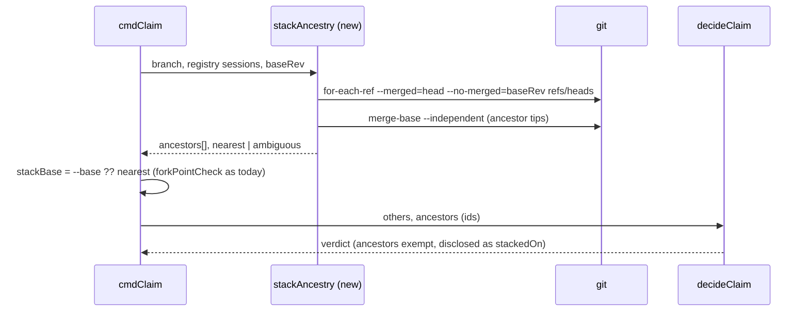

# Plan: Fleet claims — base from the real fork point, ancestors never block, appendOnlyGlobs is land-time only
- **Date**: 2026-11-27
- **Status**: In Progress
- **Author**: Claude + Louis
- **Scope**: backend (stack `js-ts`)
- **Target domain(s)**: `fleet`
- **Depends on**: the "Fleet: classify tier failures" PR (shares `scripts/lib/fleet/overlap.mjs`); rebase onto main after it merges.

## 1. Context Summary

A work consumer reported (2026-11-27) that sessions claimed on branches stacked over an UNLANDED parent recorded base
`main` and were BLOCKED by the parent's own claim, holding three sessions up for hours. They had also set
`appendOnlyGlobs` expecting it to stop an append-only file blocking claims; it does not.

**Code Trace** (all at `888b11e5`):
- `cmdClaim` `scripts/lib/fleet/commands.mjs:372` → `stackBaseFrom` `:342` returns `null` without `--base` → a new
  record's `source.baseRef: stackBase?.name ?? ctx.config.baseBranch` `:435`, so a stacked branch records `main`.
- `forkPointCheck` `:365` refuses to record a fork point when the branch and its base are at the same commit (a fresh
  branch with no commits): the base NAME is still recorded, the oid is not.
- `decideClaim` `scripts/lib/fleet/overlap.mjs:335` skips only `!o.live || isTerminalState || self` (`:345`); a `ready`
  or `working` parent's `paths` intersect the child's and block a `new` claim (`:373`).
- `--base` only changes how the child's OWN changed files are measured: `stackedEvidence`
  `scripts/lib/fleet/facts.mjs:250` → `stackBaseFor` `scripts/lib/fleet/stack-bases.mjs:57` → `fork..tip`. It never
  touches the parent's claimed paths.
- `appendOnlyGlobs` is read only at land/restack/rollup (`scripts/lib/fleet/config.mjs:117` schema,
  `scripts/lib/fleet/union-merge.mjs:55`). The only claim-time advisory key is `hotFiles` (`hotLiteralOf`/`splitHotFiles`
  `overlap.mjs:202,235`, `isBlockingConflict` `:246`). Worse, `sharedFilesHint` `scripts/lib/fleet/render.mjs:230`
  goes SILENT once `appendOnlyGlobs` is set, so the consumer who set the wrong key lost the one hint naming the right one.

**Neighbourhood considered**: coverage `verified`. Top hit `landedReason` (`overlap.mjs:919`, `precedent`,
above-floor-cluster) answers "has this branch landed" from ahead-counts — a different question (no ancestry between
sessions); not reused. `liveness` (`review`). No existing "which registered branches does this branch descend from"
helper; `git for-each-ref --merged/--no-merged` is used once for archive tags (`unregistered.mjs:519`), the pattern
followed.

## 2. Proposed Architecture

- **One git fact, two consumers (#5 single source of truth).** `stackAncestry` returns the set of registered, non-terminal
  branch sessions whose tip is reachable from this branch's head and NOT from the base. That set is both the candidates
  for the inferred base and the sessions exempt from blocking. A session at the base's tip (a fresh sibling) is excluded
  by `--no-merged=baseRev`, so two fresh siblings never exempt each other.
- **Nearest** = the single tip `merge-base --independent` keeps, held by exactly one session. Two independent tips
  (a branch that merged two parents) or two sessions on one tip is AMBIGUOUS: base falls back to the configured base with
  a warning naming them (`--base` picks one). Exemption still covers every ancestor — ancestry, not the recorded base,
  decides it (#13).
- **Base resolution** (`cmdClaim`): explicit `--base` wins, unchanged. Without it, a branch claim takes `nearest`:
  `mode new` always; `mode adopt` only when the record is not stacked (`baseRef` is the repo base) or is stacked on that
  same branch (re-records the fork point after a fresh branch's first commit). A record stacked on another branch is
  never silently re-pointed. No ancestor ⇒ the configured base, as today.
- **Fresh branch (no commits)**: its head equals the parent's tip, which `--merged=head` includes, so the parent is found
  and recorded as `baseRef`; `forkPointCheck` still records no oid (same commit), and the warning now says a plain
  re-`claim` after the first commit records it.
- **Exemption** (`decideClaim`, pure): new `ancestors` input (ids). An ancestor is skipped like a terminal session and
  disclosed as `stackedOn: [{with}]`; every other session is judged exactly as before (#11, #16). Unknown ancestry
  (git failed, detached claim) ⇒ empty set ⇒ today's behaviour, the safe side.
- **appendOnlyGlobs**: NOT made advisory for claims. It only guarantees a merge inside fleet's own land/restack; a
  pr-mode train or a GitHub merge still conflicts (`skills/fleet/references/landing.md` §Append-only files), so treating
  it as non-overlap at claim would be a false promise. Instead: docs say so, and `sharedFilesHint` names the blocking
  files that match `appendOnlyGlobs` but not `hotFiles`, pointing at `hotFiles`.

Right-sizing: **band-aid** — default `baseRef` to the parent named in the branch name, or tell users to pass `--base`.
**Over-built** — a persisted stack graph / new registry field for parentage. **Chosen** — derive both facts from git at
claim time with two git calls, no new record field (the record schema is shared across bundles).

## 6. Sustainability Notes

- Ancestry is read before the lock like every other claim fact; a session registered after the read is not in the set
  and so is not exempt (safe side).
- Only local `refs/heads` tips are read; a PR-kind session (no local branch) is never an ancestor (conservative).

## 7. File-Level Plan

**Phase 1 — ancestry fact + inferred base**: `stackAncestry(cwd, {branch, sessions, selfId, baseBranch, baseRev})` and the
pure `nearestOf(ancestors, independentOids)`; `cmdClaim` resolves the base from it. Files:
`scripts/lib/fleet/stack-ancestry.mjs` (create), `scripts/lib/fleet/commands.mjs` (modify),
`tests/fleet-claim-ancestry.test.mjs` (create).

**Phase 2 — ancestors never block**: `decideClaim({…, ancestors})`, passed from both `cmdClaim` call sites
(`blockingHolderBranches` and the in-lock verdict); `renderClaimVerdict` prints a `stacked on` note. Files:
`scripts/lib/fleet/overlap.mjs` (modify), `scripts/lib/fleet/render.mjs` (modify), `tests/fleet-overlap.test.mjs`
(modify), `tests/fleet-claim-ancestry.test.mjs` (modify).

**Phase 3 — appendOnlyGlobs vs hotFiles**: `sharedFilesHint` names append-only-but-not-hot blocking files; docs.
Files: `scripts/lib/fleet/render.mjs` (modify), `skills/fleet/references/config.md` (modify),
`skills/fleet/references/landing.md` (modify), `tests/fleet-claim-ancestry.test.mjs` (modify).

**Close-out (not a phase)**: `npm run skills:regenerate`, `npm run skills:check`, `npm run bundle:deps`,
`npm run plans:index`, targeted fleet tests.

## 8. Risk & Trade-off Register

- A branch accidentally cut from another session's branch is now treated as stacked on it: its claim is not blocked by
  that session, and it is measured from the fork point. That is what git says it is; landing it carries the parent.
- `status` keeps its "inherited from declared stack base" wording; the inferred base is verified at claim (ancestry), the
  wording "declared by claim --base" is broadened to "recorded at claim".
- Deferred: the PARENT re-claiming still sees the child as an advisory overlap (adopt mode never blocks).

## 9. Testing Strategy / Proof plan

| Behaviour | Oracle | Pass condition |
|---|---|---|
| stacked claim without `--base` records the parent | CLI test, real repo | `source.baseRef === 'parent'`, fork point written |
| fresh child (no commits) | CLI test | `baseRef === 'parent'`, no fork oid, warning; re-claim after a commit writes it |
| ready parent does not block its child | CLI test: parent claims `p/**` + ready; child claims `p/**` | exit 0, `stackedOn` names parent |
| unrelated session still blocks | same fixture, sibling off main claims `p/**` | BLOCKED (negative control) |
| fresh siblings at main never exempt each other | CLI test | BLOCKED |
| two independent parents ⇒ ambiguous | CLI test (merge commit) | base = main + warning; both exempt |
| `decideClaim` ancestors input | unit | ancestor skipped, others unchanged |
| hint names append-only file | unit on `sharedFilesHint` | text names file + `hotFiles` |

Each red-then-green against the pre-change code.
