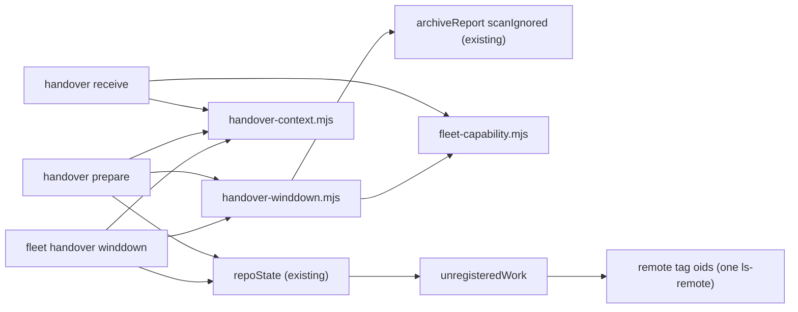

# Plan: fleet handover — structured wind-down, coordinator context, and three probe fixes
- **Date**: 2026-10-21
- **Status**: Draft
- **Author**: Claude + Louis
- **Scope**: backend (CLI + skill prose; no UI) · stack `js-ts`
- **Target domain(s)**: `fleet`, `skills-content`
- ⚠ **Cross-domain work**: the verbs are `fleet`; the operator prose is `skills-content` (`skills/fleet/references/`). Intentional: every behaviour change here is also an instruction change.
- **Proposals folded**: `p-20261021043238-844d` (wind-down stage), `p-20261021043414-0e8f` (gitignored-only state), `p-20261021043847-55ee` (coordinator context), `p-20261021050935-66b7` (remote tag holds commits), `p-20261021064951-f17b` (`--unwait` on an older consumer bundle), `p-20261021065456-93b1` (a worktree shared with a live session is never safe to archive; folded in by the coordinator after the first draft).
- **Decided, not open**: the wind-down is a `fleet handover winddown` STAGE inside `/fleet`, not a new skill (Louis, 2026-10-21: "keep it simple").

## 1. Context Summary

The 2026-10-21 account switch was run by hand. `fleet handover prepare` and `receive` (docs/plans/fleet-handover.md, Complete) carried the disk and account state, but everything BEFORE prepare was improvised, and three probes gave wrong answers on the day:

- Each coordinator got a bespoke brief. "READY" came back as prose under the 10-message cap. Handover files were free-form. In-session timers were invisible to prepare. Each worktree was checked against its PR head by hand before archiving.
- The chat-only coordinator context (open decisions, rulings, peer handovers, do-not-lose paths) survived only because it was written by hand to `~/.claude/evidence/claude-engineering-skills/ces-handover-2026-10-21.md`. That file is the template for §2.3.
- Wine WP5's worktree held the only copy of a labelling journal, a queue key and a stage dir, all in gitignored files. The stale-session sweep's "uncommitted work" test is `git status`, so it reads such a worktree as clean.
- Storyline pushed `archive/*` tags for 16 branches. A detached worktree at a tagged commit still read BLOCKING ("commits no remote-tracking ref holds") and needed a manual claim.
- Receive printed `fleet touch --id X --unwait human:account-switch` for an ai-organiser claim. That consumer's synced fleet (bundle 5df1ade5) predates `--unwait` (#260, 57d284cf) and refused the flag.

**Code Trace** (all pinned at `47321e8f`):
- `cmdHandover` `scripts/lib/fleet/handover.mjs:911` → `prepareHandover` `:513` → `resolveRepoScope` `:267` (invoking repo + consumers + `--repo`) → `repoState` `:355` per repo → `gatherLive` `:309` (`gatherFacts` + `buildStatusFrom`) and `unregisteredFields` `:325` → `unregisteredWork` `scripts/lib/fleet/unregistered.mjs:204`.
- Prepare's not-ready gate: the `reasons` array `handover.mjs:931` (memory errors, blocking unregistered work, scheduler unconfirmed) → `refused` (exit 3) with the artefacts already written.
- A live claim's worktree risks: `repoState` calls `archiveReport(ctx, {branch, worktree})` `handover.mjs:381` with the default `scanIgnored: true`, so ignored files ARE counted for claimed worktrees. The unregistered scan calls it with `scanIgnored: false` (`unregistered.mjs:293`), so an UNCLAIMED worktree whose only state is ignored files classifies as `null` (not listed) in `classifyUnregistered` `unregistered.mjs:75`.
- `archiveReport` `scripts/lib/fleet/lifecycle.mjs:146`: ignored entries come from a collapsed `git status --ignored` call, filtered by the config's `archiveIgnore` (`isIgnoredByConfig` `lifecycle.mjs:125`). Its default is `DEFAULT_ARCHIVE_IGNORE = ['node_modules/**', 'scripts/.claude-skills/**']` `scripts/lib/fleet/config.mjs:56`, overridable per repo.
- Unpushed commits: `archiveReport` runs `rev-list HEAD --not --remotes` `lifecycle.mjs:195`; branch-only candidates use `rev-list <tips> --not --remotes` (`localOnlyCommits` `unregistered.mjs:333`). A tag is not under `--remotes`, so a commit held only by a pushed tag counts as unpushed → row 4, `blocks: true` `unregistered.mjs:99`.
- Prior art for remote tags: `scanArchiveTags` `unregistered.mjs:401` already makes ONE bounded `ls-remote --tags origin` per scan and verifies the same name at the same oid (`preserved: 'remote'`). It judges `archive/*` tags. It never feeds the worktree or branch verdicts.
- The sweep is prose: `sweepStep` `scripts/lib/fleet/handover-render.mjs:233`, "any session holding uncommitted work no claim covers (git status in its worktree)". It also says "never archive sessions on the DEPARTING account".
- The waits recipe: `receiveHandover` `handover.mjs:849-861` builds `touch --id <id> --unwait human:<ref>` from `r.fleetCli` (`fleetCliFor` `handover.mjs:286`). The flag table is `VERBS.touch` `scripts/lib/fleet/argv.mjs:21` (exported).
- Rendering: `renderHandoverMarkdown` `handover-render.mjs:114`, `coordinationPrompt` `:65`, `coordinationStep6` `:31`, `renderReceiveText` `:255`. Manifest schema `HandoverManifestSchema` `handover.mjs:422` is strict, schemaVersion 1, and every later field was added as `.optional()`. This plan follows that precedent.

**Patterns reused**: the fail-closed "unknown is never empty" verdicts; the not-ready gate with written artefacts (scheduler step); optional manifest fields under schemaVersion 1; `archiveReport` and `archiveIgnore`; `scanArchiveTags`' verified `ls-remote`; `cliCommand` and `renderCommand` quoting; `fleet propose` for durable cards.

**Neighbourhood considered**: one `precedent`: `inspectLegacySurfaces` (`scripts/lib/install/legacy-surfaces.mjs`, domain `install`). It reports installed surfaces, not handover readiness, so this plan writes a sibling, not a reuse. All others were `review` (`checkReadiness` in `phase7-check.mjs`, `sweepStaleSandboxes`, `assessWatchList`), and none is in `fleet`. No security incidents overlap these paths.

## 2. Proposed Architecture

### 2.1 The wind-down stage (`fleet handover winddown`) — proposal 844d

A third subcommand beside `prepare` and `receive`, run by the departing coordinator from any repo with the bundle. It uses the same repo scope as prepare (`resolveRepoScope`) and the same per-repo derivation (`repoState`), so the two never disagree about a repo (#1, #5). It is read-only towards repos, with one exception: it writes a context SKELETON (§2.3) where none exists, into fleet's own `<git-common-dir>/fleet/handover/` directory, and never overwrites one.

It prints, per scoped repo:

1. **The standard directive.** ONE text block per repo, to paste into that repo's coordinator session (one cross-session message each, inside the 10-per-turn cap). It is fixed text with repo-specific values filled in. Nobody writes a brief by hand:
   - finish merges already approved; start no new work (no `/plan`, audit or chip);
   - commit and push WIP to feature branches;
   - claim unclaimed work from inside its worktree, then park every live claim: `<cli> touch --id <id> --waiting-on human:account-switch`;
   - file every pending New-task card as a proposal (cards die with the account; proposals are on disk). The command depends on `fleetSupports(repo, 'propose')` (§2.5):
     - `true`: `<cli> propose --what … --theme …`;
     - `false`: the repo's bundle has no `propose`, so the step names the SOURCE repo's CLI (`node scripts/fleet.mjs` run in the resolved source repo) with `--theme <repo basename>`, and says the proposal lands in the source repo's queue;
     - `'unknown'`: the repo's own command first, then "if it refuses `propose`: <the `false` command>". A refused verb mutates nothing, so trying it first is safe.
   - fill the context file at `<path>`, including in-session timers (ScheduleWakeup, CronCreate, /loop) and the proposal ids from the step before;
   - reply with ONE line, `<REPO> winddown done`. Readiness is MEASURED by the next `winddown` run, never taken from the reply.
   
   `<cli>` is that repo's own invocation (`fleetCliFor`). When the capability probe (§2.5) says the repo's bundle lacks `propose`, the card step says so and names the source repo's CLI with `--theme <repo>` as the fallback. That is the same mechanism as the `--unwait` fix.
2. **Readiness**, measured (§2.2), one line per repo: `READY` or `NOT READY: <reasons>`. That is the OVERALL verdict: the wind-down prerequisites plus every blocker prepare would refuse on.
3. **Safe to archive before the switch** (§2.4).

Exit 0 when every repo's overall verdict is READY, 3 when not, with the same envelope shape as prepare. Run it repeatedly: it doubles as the wind-down progress check. A READY here means prepare will not refuse for any repo-state reason. The scheduler step and memory measurement are prepare's own and are named as "still to do at prepare".

**Why a printed directive, not a directive RECORD.** Fleet's directive store has a closed vocabulary (`pause|resume|rebase|release|rerun-ready`, `directives.mjs`), and the recipients here are coordinator CHAT sessions, which act on messages, not on checkpoint reads. A new `winddown` kind would be collected as `unsupported` by every consumer on an older bundle. A record would add nothing the message does not already carry (#12 right-sizing; see §6).

### 2.2 Readiness: measured, not reported — proposal 844d (2) + 55ee

`winddownReadiness(repoState, context)` is pure, in `handover-winddown.mjs`. It is shared by `winddown` and `prepare`, so both reach one verdict (#5).

A repo **requires** wind-down when it is the invoking repo (its coordinator holds the cross-repo context) or it needs coordination (live sessions, unregistered work, or unmeasured state: the existing `reposNeedingCoordination` predicate, which moves to an exported helper). Other scoped repos are reported as `not required` and never block. A context file that exists anyway is still embedded.

It returns ONE readiness object per repo, `{required, prerequisites: {r1, r2}, blockers: [...], ready}`.

The wind-down **prerequisites** (only for a required repo):
- **R1 context**: the context file is complete for THIS switch (§2.3): it exists, every required section has a substantive body, no placeholder is left, and it is not stale (not byte-identical to a context already handed over and received).
- **R2 parked**: every live claim waits on `human:account-switch` (the existing `normaliseWaitRef` fold). Merged-unreleased records are exempt: they are listed for `release`, not resumed. R2 is evaluated only when the live state was MEASURED. A repo with `fleet: 'error'` or an incomplete registry has R2 = `unknown`, which is not ready. It never passes vacuously over an empty list.

The **blockers** are the existing repo-state refusals, read from the same `repoState` and never re-probed: blocking unregistered work, `unregisteredUnknown`, `fleet: 'error'`. They apply to every scoped repo, required or not, exactly as prepare applies them today. `ready` = (not required, or both prerequisites pass) AND no blockers.

The two consumers read different parts of this one object:
- `winddown` prints and exits on `ready`: the overall verdict (M2).
- prepare keeps its existing reasons for the blockers (`handover.mjs:931`), unchanged, and adds ONE reason from the prerequisites only, so no failure is printed twice (#1).

**Prepare's gate.** Prepare's added reason is `not ready: winddown incomplete in <repo>: <failed prerequisite, …>`. It exits 3 with the artefacts written, exactly like the scheduler step. The override is `--winddown-waived "<reason>"`, a value flag whose text is recorded in the manifest (`winddown.waived`) and printed in the handover. The emergency case (prepare at 2% credits) stays one flag away, and the waiver is visible to the arriving coordinator, never silent (#16). Decision D1 below asks Louis to confirm refuse over warn.

What cannot be measured stays declared, inside the context file: timers, cards filed, CI state. R1 checks only that those sections were filled in.

### 2.3 Coordinator context as a standard handover part — proposal 55ee

New module `scripts/lib/fleet/handover-context.mjs`:
- `contextPath(repo)` → `<git-common-dir>/fleet/handover/context.md` (beside the handover artefacts; on disk, so it survives the account; never tracked).
- `CONTEXT_SECTIONS`: the required `##` headings, taken from the 2026-10-21 template plus proposal 55ee:
  1. Peer handovers
  2. Waiting on the user
  3. Decided this stint (do not re-ask)
  4. In flight (repo state)
  5. CI state at the switch
  6. Leftovers on disk (do not lose)
  7. In-session timers
  8. Pending cards filed as proposals
  9. Working-style notes

- `contextSkeleton(repo)`: the headings, each with one `<!-- winddown: fill this in -->` placeholder line.
- **Section-body validation** (M1). A section's body is the text between its heading and the next `##`. HTML comments are stripped, and so is whitespace. A section is:
  - `missing`: no heading;
  - `placeholder`: the winddown marker is still present;
  - `empty`: nothing left after stripping;
  - `filled`: anything else.

  `none` (any case, alone on its line) is the explicit, valid declaration of nothing. Only `filled` passes. The skeleton is therefore all-`placeholder`, and deleting the markers without writing anything is all-`empty`. Neither reads as written.
- `readContext(repo)` → `{state:'absent'} | {state:'unreadable', reason} | {state:'too-large', bytes} | {state:'ok', path, sha256, bytes, text, sections: {<name>: 'missing'|'placeholder'|'empty'|'filled'}}`. Text over `CONTEXT_MAX_BYTES` (64 KiB) is unready, never silently truncated. R1's reason names each section that is not `filled`.

**Lifecycle: one context per switch** (H2). The file persists between switches, and a context completed for the LAST switch must not satisfy R1 for the next. The cycle boundary is a fact the tooling already observes, the RECEIVE of a handover, so no cycle record is invented:
- `receive` (not under `--dry-run`) writes `handover-<id>.received.json` (`{receivedAt, destConfigDir}`, exclusive create) beside the manifest it received. That directory is the source repo's `fleet/handover/`, which receive already reads for the newer-manifest check.
- `contextStale(repo, sha256, scopeRepos)` is true when any RECEIVED manifest in any scoped repo's `fleet/handover/` embedded a context with this repo's path and the same sha256. A context already handed over and received, and not changed since, is stale. R1 reports `stale: identical to the context handed over in <id>; update it for this switch`.
- Re-running prepare within one switch is unaffected. Its earlier manifests are not received, so they never make the context stale.
- Nothing is moved or deleted. The previous switch's context stays readable, embedded in that manifest. The coordinator edits the carried-forward file (any change of bytes is the deliberate act), or replaces it with the skeleton by deleting the file and re-running `winddown`.
- Manifests received before this change carry no marker, so the first switch after shipping cannot read as stale. That is the safe direction for adoption: it never refuses on missing history.

**Manifest**: an optional per-repo `context` field (the `readContext` result, text included) and an optional top-level `winddown: {ready, repos:[{path, required, ready, reasons[]}], waived?}`. Both are optional, so every older manifest still parses (§1 precedent).

**Prepare** embeds each repo's context in the handover `.md`, under a `## Coordinator context — <repo>` section per repo, ahead of "Sessions to resume", so a chip reading its repo section meets it first.

**Receive** prints the invoking repo's context FIRST: in the text, immediately after the one-line header and before the memory lines; in JSON, as `handover.context`. Each other repo then gets a one-line pointer to its section of the `.md`. The coordination prompt gets one line ("receive prints the coordinator context first: read it before anything else, and never re-ask what it lists as decided"). `coordinationStep6`'s chip prompt names the repo's "Coordinator context" section. Receive prints the text as recorded at prepare (the hash travels with it), never a re-read: the context is what the departing coordinator knew.

### 2.4 Safe to archive before the switch — proposal 844d (4) + 0e8f

`safeToArchive(repo, live)` in `handover-winddown.mjs` returns, per non-main worktree of the repo:
- **safe**: no live (non-merged) claim covers it. Its HEAD is LANDED (merged evidence at that same tip, from `gatherLive`'s facts; for a detached HEAD, `merge-base --is-ancestor HEAD <base>`). `archiveReport` with `scanIgnored: true` shows no staged, unstaged, untracked, or ignored-outside-`archiveIgnore` entries, and nothing unverified. It is not locked.
- **held remotely, unlanded**: clean (as above), with its commits held by a pushed branch or a verified pushed tag (§2.6). Removable without loss, but the work is not on base. It is listed apart, "confirm with the user", never mixed into `safe`.
- everything else is omitted. The verdicts already in `status` and prepare cover it.

The CLI cannot map a worktree to a host session id (`list_sessions` is host-side). So the list is worktree paths plus branch, and the instruction is: "archive a session only if its cwd is on this list".

**A worktree is not a session** (93b1). The desktop app places NEW sessions in OLD sessions' worktrees: the new STO coordinator sits in the old "Matched-input test" worktree, and this chip in the old CES coordinator's. `archive_session` removes the worktree and cascades to the session's finished side sessions. A worktree that is safe by every git measure can still be the live cwd of another session. The CLI cannot see that, so the safe list's instruction carries a mandatory host-side check, in this order, before each `archive_session`:
1. `get_session` on the candidate, then `list_sessions` (paged): collect every NON-archived session whose `worktreePath` equals the candidate's. Paths are compared case-insensitively on win32, after resolving separators.
2. Also collect each of the candidate's side sessions, because the cascade reaches them, together with any non-archived session sharing THEIR worktree paths.
3. If any session other than the candidate is live in one of those worktrees, or a side session is not finished, do NOT archive. List it for the user as `shared worktree: <path> (live: <title>)`.
4. The cascade is the unit of safety (R2-H6). Every DISTINCT worktree the cascade reaches must itself be on the safe list: the candidate's, each side session's, and their side sessions' in turn, while the host reports more. A side-session worktree that is absent from the list, outside the scoped repos, or unmeasured blocks the archive. It is listed as `cascade reaches unchecked worktree: <path> (<session title>)`. Archiving a parent therefore never deletes a worktree that `safeToArchive` did not measure as safe.

The same three steps are added to `sweepStep`'s exception list (the arriving account's sweep). The arriving coordinator itself runs in a reused worktree, so the sweep can otherwise archive its own checkout. The check is prose a model follows, and it is pinned by a string test (§9). A stronger guard needs host data the CLI does not have; see §8. The `sweepStep` line "never archive sessions on the DEPARTING account" becomes "never archive on the departing account EXCEPT a session whose worktree `fleet handover winddown` lists as safe". Decision D2 below asks Louis to confirm that exception.

**Gitignored-only state** (0e8f) is closed on three surfaces:
1. The safe list above uses `scanIgnored: true`, so WP5's worktree would read AT RISK and never be listed.
2. The unregistered scan, on the HANDOVER path only (prepare, receive, winddown): one extra collapsed `git status --ignored` (no size walk), filtered by `archiveIgnore`, runs for every worktree candidate whose verdict is non-blocking or `null` AFTER the tag credit of §2.6 has been applied. The stages are ordered (H1):
   1. Light probe and classification (as today).
   2. Tag credit (§2.6), which can turn a blocking `unpushed` item into a non-blocking `pushed` one.
   3. The ignored probe, over every worktree candidate that is now `null` or non-blocking.
   4. Final classification.
   
   The ignored count is a measurement of its own, carried in `risks.ignored`, and it never depends on why commits are preserved. A worktree the ignored probe did not reach (the deadline passed) gets `unverified: ['ignored files not measured']` and is blocking. No later stage can clear an outstanding measurement. Any remaining ignored entry makes the item `unlanded`, row 2, blocking, with reason `N gitignored file(s) outside archiveIgnore — the only copy may be here`. `fleet status` keeps the light scan: its cost was the reason the light mode exists (plan M2 of the unregistered work), and status is not the moment before deletion. The deadline already bounds the extra calls. A worktree the deadline never reached is `notProbed`, which is NOT MEASURED and refuses. It is never read as clean.
3. The sweep prose (`sweepStep`) replaces "git status in its worktree" with `fleet archive-check <worktree>`. That verb already counts ignored files outside `archiveIgnore`; its verdict must be `CLEAN`.

**Derived or declared?** The regenerable-path list is DECLARED, and it already exists: `archiveIgnore`, defaulting to `node_modules/**` and `scripts/.claude-skills/**`, per-repo overridable in the fleet config. "Ask what already knows" was applied:
- git knows only *ignored*. WP5 is the counter-example: ignored is not regenerable.
- No oracle knows that a build output can be rebuilt.
- The two default entries are the ones a tool does know: npm owns `node_modules`, and the sync owns `scripts/.claude-skills`.

A second derived list would be a second source of truth for the same question (#5). So this plan adds no list; it makes the surfaces that skipped `archiveIgnore` use it.

### 2.5 Consumer capability probe — proposal f17b

New module `scripts/lib/fleet/fleet-capability.mjs`: `fleetSupports(repo, verb, flag?)` → `true | false | 'unknown'`. It asks the target's OWN flag table, `VERBS` from the `argv.mjs` that the repo's fleet CLI loads (AGENTS.md: "ask the parser for its own capability"). The path is derived from the CLI path `fleetCliFor` already returns, by replacing `fleet.mjs` with `lib/fleet/argv.mjs` in the same directory, so no consumer path is hand-computed a second way. The call is `spawnSync(process.execPath, ['--input-type=module', '-e', <import + print>])`, bounded at 10 s and memoised per repo. `receiveHandover` stays synchronous, so its tests are unchanged.

The three results are kept distinct (H4):
- `true` / `false`: the table LOADED, and it does or does not list the verb (and the flag, when asked). A verb absent from a loaded table is `false`: the table is the CLI's own refusal list (`assertKnownFlags`), so absence there is authoritative.
- `'unknown'`: the table could not be read (missing file, failed import, no `VERBS` export, timeout).

Receive's `waits` recipe (`handover.mjs:860`). No branch prints a clear-all command (H3): `--clear-waiting` acts later than receive observed the waits, so it would delete a wait added in between, the race D10 removed.
- `true` → the current `touch --id X --unwait human:<ref>` (unchanged).
- `false` → "this repo's fleet predates `--unwait`: sync it first (`npm run sync -- --target <name>` from the source repo), then run `touch --id X --unwait human:<ref>`". It applies whatever the claim's other waits are.
- `'unknown'` → the `--unwait` command, plus "if it refuses `--unwait`: sync first, as above". An unknown flag is refused before any mutation, so trying it is safe.

`winddown` reuses `fleetSupports(repo, 'propose')` for the card step (§2.1).

### 2.6 A pushed tag holds commits — proposal 66b7

In `unregisteredWork`, after the light probes and BEFORE the ignored probe (stage 2 of the order in §2.4): if any item has `committed: 'unpushed'`, ONE bounded `ls-remote --tags origin` runs. This is the same call shape and timeout as `scanArchiveTags`, extracted into a shared `remoteTagOids(repo, g)` that both use (#1). It takes the peeled oid of each tag, and keeps only oids present locally (`cat-file -e`), because a commit cannot be shown to be contained in an object that is not here.

For each such item, it counts `rev-list --count --stdin <tip> --not --remotes`, with one `^<oid>` line on stdin per verified tag oid. The negated oids go through `--stdin`, so the argv stays under the Windows limit with hundreds of tags. *Measured* (git 2.x, this machine, 2026-10-21, a throwaway repo: one commit pushed, then one tagged and unpushed):
- `rev-list --count T --not --remotes` → 1;
- with `^T` on stdin and `--stdin` placed before the positionals → 0;
- with a bare `T` on stdin after `--not` → 1.

`--not` does NOT carry over to stdin lines, so every stdin line must carry its own `^`. Phase 1's real-git test pins exactly this. When the count is 0, the item is re-classified with `committed: 'pushed'` and `heldBy: 'tag'`, plus `heldByTags`: the tag names whose oid equals the tip, at most 3, and a count otherwise. `classifyUnregistered` uses `heldBy` only for the reason text: "commits a pushed tag holds (verified by ls-remote now), not on base". The rows, `blocks` and `preserved: 'remote'` stay as they are for `pushed`.

- An `ls-remote` failure or a passed deadline changes nothing. The item keeps today's blocking verdict and gains an `unverified` note (fail closed).
- Every tag counts, not only `archive/*`: any tag on origin holds a commit as durably as a branch. That is the proposal's wording.
- `UnregisteredEntry` gets optional `heldBy`/`heldByTags` fields, and its `risks` object an optional `ignored` count (§2.4). `RISK_KINDS` keeps its four required keys, so a manifest written before this change still parses under the strict schema.
- `archive-check` is NOT changed. It reports risk for one target and does not feed the handover verdicts. Its unpushed line stays literally true: no remote-tracking ref holds the commit.

### 2.7 Execution model

Every operation here is a read, except three writes, each an exclusive create (`wx`) that never touches an existing file:
- winddown's context skeleton;
- receive's `.received.json` marker, written last, after receive's verdict is computed, and only when not `--dry-run`. It is written on every non-dry-run receive, including exit 3: the context reached the new account, which is the fact staleness keys on. A marker that cannot be written is a `warning:` line, never a failed receive;
- prepare's existing artefact publication. The checks are independent per repo. Ordering matters in exactly one place: prepare computes readiness from the SAME `repoState` it records, never from a second derivation, so the gate and the manifest cannot disagree. No transactions are needed. The context file is read once per prepare, and the hash recorded is the hash of the bytes embedded.

## 6. Sustainability Notes

- **Right-sizing.**
  - *Band-aid*: append the five fixes as prose to `handover.md` and leave the wind-down manual. The bespoke-brief and READY-as-prose failures recur at the next switch.
  - *Over-engineered*: a wind-down state machine in the registry (new record type, per-repo `ready` writes from every consumer, a directive kind). Every consumer would need a new bundle before the stage worked anywhere.
  - *Chosen*: one subcommand that MEASURES readiness from what prepare already derives, plus one markdown file per repo that the coordinator writes. Consumer coordinators need only verbs their bundles already have (`touch --waiting-on`, `propose`, probed where missing).
- **Assumptions that could change**:
  - The context section list. It is a constant, so a new section is a one-line edit, and older handovers still parse because the field is optional.
  - Host session ids staying invisible to the CLI. If a host API ever exposes them, the safe list can name sessions instead of worktrees.
- **`handover.mjs` sits at 945 lines** against the 1000-line ratchet (`NEW>LIMIT` fails). All new logic goes to the three new modules. `handover.mjs` gains only wiring, budgeted at ≤ 40 lines net.
- **`skills/fleet/references/handover.md` is 10,252 characters** against the 12,000 skill-markdown limit, and `skills/fleet/SKILL.md` is baselined (may not grow). The wind-down prose goes to a NEW reference, `skills/fleet/references/handover-winddown.md`. Its SKILL.md index row is paid for by tightening existing SKILL.md text by at least the row's length. `handover.md` gets only short pointers.

## 7. File-Level Plan

| File | Intent | What |
|---|---|---|
| `scripts/lib/fleet/unregistered.mjs` | modify | `remoteTagOids` extracted from `scanArchiveTags` (shared); tag re-classification post-pass; handover-only ignored probe (`deps.scanIgnoredFor` flag); `heldBy` in `classifyUnregistered` reason |
| `scripts/lib/fleet/fleet-capability.mjs` | create | `fleetSupports(repo, verb, flag?)`, memoised, spawn-bounded |
| `scripts/lib/fleet/handover-context.mjs` | create | `contextPath`, `CONTEXT_SECTIONS`, `contextSkeleton`, `readContext` (section-body states), `contextStale`, `writeReceivedMarker`, `renderContextSection` |
| `scripts/lib/fleet/handover-winddown.mjs` | create | `winddownReadiness` (one object: prerequisites + blockers), `safeToArchive`, `renderDirective`, `cmdWinddown` body |
| `scripts/lib/fleet/handover.mjs` | modify | subcommand dispatch + flag contract (`winddown`, `--winddown-waived`); manifest fields; prepare readiness reason; receive context-first, received marker, capability-aware waits recipe; handover-path scan flag |
| `scripts/lib/fleet/handover-render.mjs` | modify | context sections in the `.md`; receive text prints context first; `sweepStep` uses `archive-check`, the departing-account exception and the shared-worktree check; prompt lines; export `reposNeedingCoordination` |
| `scripts/lib/fleet/argv.mjs` | modify | `handover` verb: `--winddown-waived` value flag |
| `scripts/fleet.mjs` | modify | usage lines for `handover winddown` |
| `skills/fleet/references/handover-winddown.md` | create | the stage, the directive, readiness, the context file, the safe list |
| `skills/fleet/references/handover.md` | modify | pointers; the sweep's `archive-check` and departing-account wording; receive prints context first; `--unwait` fallback |
| `skills/fleet/SKILL.md` | modify | usage line + reference row (net zero growth) |
| `tests/fleet-unregistered.test.mjs` | modify | tag-held and ignored-only cases (real git) |
| `tests/fleet-capability.test.mjs` | create | probe against fixture argv modules |
| `tests/fleet-handover-context.test.mjs` | create | context parse, readiness R1/R2, manifest round-trip |
| `tests/fleet-handover-winddown.test.mjs` | create | the verb end-to-end in a temp repo, the safe list, the prepare gate |
| `tests/fleet-handover-receive.test.mjs` | modify | context printed first; `--unwait` fallback branches |
| `tests/fleet-handover-sweep-delta.test.mjs` | modify | sweep wording |

### 7b. Implementation Phases

**Phase 1 — Pushed tag holds commits (66b7)**: `remoteTagOids` shared with `scanArchiveTags`; post-pass re-classification; optional `heldBy` fields in `UnregisteredEntry`. Files: `scripts/lib/fleet/unregistered.mjs` (modify), `scripts/lib/fleet/handover.mjs` (modify), `tests/fleet-unregistered.test.mjs` (modify).

**Phase 2 — Gitignored-only state in the handover scan (0e8f, scan part)**: handover-path ignored probe filtered by `archiveIgnore`; `notProbed` stays not measured. Files: `scripts/lib/fleet/unregistered.mjs` (modify), `scripts/lib/fleet/handover.mjs` (modify), `tests/fleet-unregistered.test.mjs` (modify).

**Phase 3 — Capability probe + `--unwait` fallback (f17b)**: Files: `scripts/lib/fleet/fleet-capability.mjs` (create), `scripts/lib/fleet/handover.mjs` (modify), `tests/fleet-capability.test.mjs` (create), `tests/fleet-handover-receive.test.mjs` (modify).

**Phase 4 — Coordinator context (55ee)**: module (section-body states, staleness), manifest field, `.md` embed, receive prints first and writes the received marker, prompt lines. Files: `scripts/lib/fleet/handover-context.mjs` (create), `scripts/lib/fleet/handover.mjs` (modify), `scripts/lib/fleet/handover-render.mjs` (modify), `tests/fleet-handover-context.test.mjs` (create), `tests/fleet-handover-receive.test.mjs` (modify).

**Phase 5 — Wind-down stage (844d)**: `winddown` subcommand, readiness R1/R2, prepare gate + `--winddown-waived`, safe-to-archive list, directive text, skeleton write. Files: `scripts/lib/fleet/handover-winddown.mjs` (create), `scripts/lib/fleet/handover.mjs` (modify), `scripts/lib/fleet/argv.mjs` (modify), `scripts/fleet.mjs` (modify), `tests/fleet-handover-winddown.test.mjs` (create).

**Phase 6 — Operator prose and the sweep wording (844d, 0e8f sweep part, 93b1)**: Files: `scripts/lib/fleet/handover-render.mjs` (modify), `skills/fleet/references/handover-winddown.md` (create), `skills/fleet/references/handover.md` (modify), `skills/fleet/SKILL.md` (modify), `tests/fleet-handover-sweep-delta.test.mjs` (modify).

**Close-out (not a phase)**: `npm run skills:regenerate`, `npm run skills:check`, `npm run skills:size:gate`, `npm run size:ratchet:gate`, `node scripts/lib/plan-paths.mjs docs/plans/fleet-handover-winddown.md`, then the branch-tier pre-push (`npm run guards:preflight`).

## 8. Risk & Trade-off Register

- **Prepare gets stricter.** A prepare that passed yesterday now exits 3 until the coordinator context is written and claims are parked. Mitigation: the reason names each repo and what is missing, `winddown` prints the fix, and `--winddown-waived "<reason>"` is the escape hatch, recorded. D1 below.
- **The extra ignored probe costs time on big repos** (wine has 200+ branch-only candidates, but far fewer worktrees; only worktrees pay). It is bounded by the existing deadline. Overflow fails closed (NOT MEASURED), so the cost risk is a refusal, never a false clean. Phase 2 records the measured wall time of prepare on this machine before and after (proof plan).
- **The context file lives under `.git/`.** Some hosts prompt before an agent writes inside `.git`. Mitigation: the directive names the exact path; the skeleton is already there to edit. If writes there are refused, the fallback is to write the file elsewhere and copy it in (named in the reference doc). It needs no new flag.
- **The context text is user prose copied into a local handover `.md`.** It may name keys (the template names which key is the credits key), but must never hold key VALUES. The handover directory is in the git common dir, never pushed. The reference doc says "names, never values". No secret scanner is added: the artefact never leaves the machine (right-sizing).
- **`spawnSync` per consumer in receive and winddown.** Only repos with a switch wait (receive) or with a card step to render (winddown) pay. It is memoised and 10 s-bounded, and a failure is `'unknown'`, which still prints a working recipe.
- **The shared-worktree guard (93b1) is prose, not code.** Host session data (`worktreePath`, side-session cascade) is not visible to the CLI, so the check is an ordered instruction in the safe list and the sweep. A model can skip it. Mitigation: it is the first step of each list, named by the incident, and string-pinned. The structural fix needs the host to refuse `archive_session` on a worktree another live session uses, which is outside this repo. It goes to the coordinator as a host-feedback item, not as code here.
- **Remote-tag credit needs the tag object locally.** A tag pushed from another clone and never fetched here gives no credit. That is the fail-closed direction (still blocking, with a note).
- **Deliberately deferred**:
  - `archive-check`'s unpushed line ignoring tags. Independence: it does not feed `blocksHandover`, the safe list (which needs LANDED), or any handover verdict.
  - Posting the directive automatically. The CLI cannot message sessions; the coordinator sends it.

## 9. Testing Strategy

Tier 1 (deterministic, test-first) throughout. Every git-facing case runs against a real temporary repo with a bare `origin`, not a git mock, because the bug classes here are git-semantics bugs.

| Behaviour | Oracle | Pass condition | Evidence in the report |
|---|---|---|---|
| Tag-held detached worktree no longer blocks (66b7) | real-git test: detached worktree at a commit held only by a pushed tag | before: `verdict unlanded, blocks true` (red on `main`); after: `blocks false, heldBy 'tag'`, tag named | test name + red/green output |
| Negative control for 66b7 | same, tag created but NOT pushed | stays blocking | test |
| `ls-remote` failure | injected failing git | blocking + `unverified` note, never credit | test |
| Ignored-only unclaimed worktree blocks prepare (0e8f) | real-git: a clean worktree with one ignored file outside `archiveIgnore` | red before (`null`, not listed), green after (row 2, blocks) | test |
| Tag credit cannot bypass the ignored probe (H1) | real-git: detached worktree, commit held only by a pushed tag, PLUS an ignored file | blocks (row 2, ignored); the same without the ignored file → non-blocking, `heldBy 'tag'` | test |
| Ignored probe past the deadline | injected clock past the deadline at stage 3 | blocking, `unverified` names the ignored measurement | test |
| `archiveIgnore` respected | same with only `node_modules/x` | not listed | test |
| `fleet status` unchanged | the existing status scan test | no ignored call made | test asserts the light path's git call list |
| `--unwait` unsupported (f17b, H3) | fixture repo whose loaded `argv.mjs` lacks `--unwait` | sync instruction then `--unwait`; output contains no `--clear-waiting` in any branch | test |
| Probe unknown | fixture with an unimportable `argv.mjs` | `'unknown'` → `--unwait` + "if refused: sync first" | test |
| Absent verb is `false`, not unknown (H4) | fixture table without `propose` | `fleetSupports → false`; directive names the source CLI with `--theme`; unknown fixture names both | test |
| Context R1 sections (M1) | skeleton untouched / markers deleted, bodies empty / comment-only body / one section missing / `none` bodies / complete | placeholder / empty / empty / missing → NOT READY; `none` and complete → READY | test |
| Context lifecycle (H2) | two consecutive handovers in a temp repo: complete context → prepare → receive (marker) → winddown again | second winddown: NOT READY `stale`; after one edit → READY; re-running prepare before receive never reads stale | test |
| Overall readiness (M2) | complete context + parked claims + an ignored-only unregistered worktree; and a repo with an incomplete registry | winddown NOT READY (blocker; R2 `unknown`), exit 3; prepare prints the blocker once, not twice | test |
| Shared-worktree and cascade guard (93b1, R2-H6) | `sweepStep` and the safe-list text | both contain the `get_session`/`worktreePath`/side-session check as the first step, and the rule that every cascade worktree must be on the safe list | string test |
| Context printed first | receive text from a manifest with context | context block index < first `memory` line index | test |
| Old manifest still parses | a stored pre-change manifest fixture | `loadManifest` ok | test |
| Prepare gate | temp repo, no context file | exit 3, reason names the repo; with `--winddown-waived x` exit 0 and `winddown.waived === 'x'` | test |
| Safe list | landed+clean / landed+ignored file / unlanded+pushed / claimed | safe / omitted / "held remotely" / omitted | test |
| Skeleton never overwrites | existing context file | bytes unchanged after `winddown` | test |
| Scan cost | `prepare` wall time on this machine, before vs after Phase 2 | recorded, `measured`, with the command; no threshold (a refusal is the failure mode, not a slowdown) | PR body |

The sweep wording has a string-level test only. It is prose a model follows, so the oracle is that `sweepStep` names `archive-check` and the departing-account exception.

## 11. Execution Clustering

- **Cluster A** — Phases 1–3 — fix-gate: yes
  - Coupling: three probe-correctness fixes on the unregistered-work and receive paths that the 2026-10-21 switch hit. They are independent of B and C, small, and ship as their own PR (the quickest value; nothing waits on the stage).
  - author-tier: standard
- **Cluster B** — Phases 4–6 — fix-gate: final
  - Coupling: the wind-down's readiness R1 IS the context file's completeness test, and prepare's gate, the `.md` embed and receive's context-first output all read one `readContext` result. Splitting them would leave a gate checking a file no surface shows, or a section no gate requires. The prose phase documents exactly these verbs. One PR, after Cluster A merges (not stacked).
  - author-tier: standard
- **Final gate**: the consolidated Gemini final review over each PR's union diff.

## Decisions for Louis

- **D1 — prepare refuses (exit 3) until wind-down readiness holds**, overridable with a recorded `--winddown-waived "<reason>"`. The alternative is a warning only. Recommendation: refuse. The 10-21 failures were all steps that were skipped silently.
- **D2 — pre-switch archiving on the departing account** is allowed for worktrees on the winddown safe list, after the shared-worktree check (93b1) passes. Today `handover.md` says never archive on the departing account, yet 10-21 did archive merged-and-clean sessions by hand. Recommendation: allow, limited to the measured list plus the host-side check.

## Audit trail

- `/audit-plan` 2026-10-21, session `audit-plan-1792565861089-64300`.
  - GPT R1: H4 M2, 6 of 6 accepted and fixed: probe ordering, context lifecycle, the clear-all race, the absent-verb verdict, section bodies, overall readiness.
  - Proposal 93b1 folded in between rounds.
  - GPT R2: H1, accepted and fixed (the cascade is the unit of safety).
  - Stopped after R2: findings fell from 6 to 1, at 100% acceptance.
  - Gemini final gate (`gemini-4-argon`, plan mode): APPROVE, disposition `approve`, no findings.
