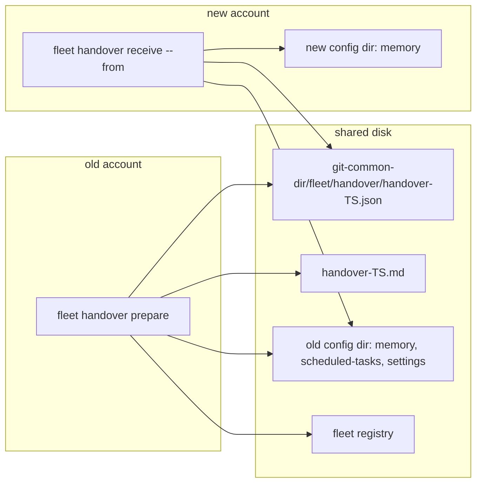

# Plan: fleet handover — move coordination to another Claude Code account on this machine
- **Date**: 2026-10-11
- **Status**: Approved
- **Author**: Claude + Louis
- **Scope**: backend (CLI + skill prose; no UI) · stack `js-ts`
- **Target domain(s)**: `fleet`, `shared-lib`
- ⚠ **Cross-domain work**: the account-aware path resolver is a `shared-lib` seam (it already serves friction memory), and the handover verb is `fleet`. This boundary crossing is intentional.

## 1. Context Summary

The owner is moving to another Claude Code account on the same Windows machine. Most state already lives on disk and carries over:
- the repos, worktrees, branches and uncommitted files;
- fleet's registry under `<git-common-dir>/fleet`;
- the `gh` login and `~/.audit-loop.env`.

Some state is tied to the account's **config dir** and would silently stay behind:
- the harness memory dir (`<config>/projects/<slug>/memory`);
- scheduled tasks (`<config>/scheduled-tasks/<id>/SKILL.md`; 10 exist today, including the 2026-10-24 telemetry review);
- the user-level `settings.json` / `.claude.json` (MCP servers, permissions).

The rest is per-account and cannot be moved: session transcripts, cross-session messaging (messages were already being held between permission modes on 2026-10-10), and task chips.

Nothing checks any of this today. A handover done from memory is exactly the "assumed, not measured" failure this repo's verification discipline exists to prevent.

**Code Trace** (read at `56eb0459`):
- `scripts/lib/memory-paths.mjs:43 (56eb0459)` `harnessProjectSlug`, plus `:53` `resolveHarnessMemoryDir`. This is the one existing resolver of the harness memory path. It **hard-codes `os.homedir()/.claude`** (`:59`) and ignores `CLAUDE_CONFIG_DIR`, so it would resolve the wrong dir for any account using a non-default config dir. The module also imports `config.mjs`, `yaml` and `zod` at load time (its friction parser), which is too heavy for fleet's path-only need.
- `scripts/fleet.mjs:115 (56eb0459)`: the verb dispatch (`case 'prune'`). `scripts/lib/fleet/argv.mjs:15-36 (56eb0459)`: the per-verb flag tables (`VERBS`).
- `scripts/lib/fleet/facts.mjs:107 (56eb0459)` `gatherFacts` and `:417` `buildStatusFrom`. Items carry `worktree`, `branch`, `state`, `ready`, `waitingOn` and `uncommittedFiles` (`:472`), with an explicit `uncommittedUnknown` when the probe could not run. `cmdClaim` uses the `uncommitted: 'all'` profile.
- `scripts/lib/fleet/lifecycle.mjs:136 (56eb0459)` `archiveReport`: per-worktree loss evidence (staged, unstaged, untracked, ignored-not-listed, unpushed, unverifiable). `archive-check` uses it.
- `scripts/lib/fleet/render-train.mjs:177 (56eb0459)` `renderChipPrompt` plus `:159` `renderParticipantRules`: the canonical chip-prompt and participant-block renderer that `start` prints.
- `scripts/lib/fleet/directives.mjs:121 (56eb0459)` `readDirectives` and `scripts/lib/fleet/registry.mjs:399 (56eb0459)` `listTrains`: open directives and trains, which are coordination state a successor needs.
- `scripts/lib/fleet/registry.mjs:150 (56eb0459)` `fleetDir`: `<git-common-dir>/fleet`, shared by every worktree and never committed. This is where the handover files go.
- `scripts/lib/file-io.mjs:23 (56eb0459)` `atomicWriteFileSync`, and `scripts/lib/cli-io.mjs` `emit` / `finishAndExit` (the stdout-drain rule).

**Reused, not rebuilt** (the owner asked what else is reusable): `gatherFacts`/`buildStatusFrom` for session state, `archiveReport` for per-worktree loss evidence, `renderChipPrompt` for resume prompts, `readDirectives`/`listTrains` for open coordination items, `fleetDir` for location, `atomicWriteFileSync` for writes, and `emit`/`finishAndExit` for output. The existing `check-setup.mjs` is *named* in the coordination prompt as the receiving account's environment check, not reimplemented.

**Neighbourhood considered**: 8 candidates, all `review` (below this repo's noise floor). The nearest are `resolveHarnessMemoryDir` and `harnessProjectSlug` in `memory-paths.mjs`, which this plan **extends** (through an extracted module), not duplicates.

## 2. Proposed Architecture

**New `scripts/lib/harness-paths.mjs` (shared-lib, zero heavy deps).** It holds three functions:
- `claudeConfigDir(env)`: `CLAUDE_CONFIG_DIR` if set and non-empty, else `os.homedir()/.claude`. This is the one place the config root is decided (#5 single source of truth).
- `harnessProjectSlug(absRoot)`, moved verbatim from `memory-paths.mjs`.
- `harnessMemoryDir({repoRoot, env})` → `{dir, configDir, exists}`, where `repoRoot` is the **main checkout** (the parent of `git-common-dir`), because the harness keys worktree sessions to the main repo's memory (observed: this session's memory lives under the main checkout's slug).

`memory-paths.mjs` re-exports `harnessProjectSlug` and its `resolveHarnessMemoryDir` delegates to `harnessMemoryDir`, keeping `FRICTION_MEMORY_DIR` precedence. That fixes the latent `CLAUDE_CONFIG_DIR` bug for the friction mirror as well, with one resolver and no duplicate (#1 DRY, #5).

**New `scripts/lib/fleet/handover.mjs` (fleet).**
- `cmdHandover(ctx, sub, flags)` dispatches `prepare` | `receive`.
- `prepare` is read-only towards repos:
  1. Memory manifest: walk the memory dir (no symlink following), recording `{rel, sha256, bytes}` per file. The hash is over **exact bytes**, deliberately not EOL-canonicalised, because the bytes are the contract (AGENTS.md hashing rule).
  2. Sessions: `gatherFacts` with the claim profile (`uncommitted: 'all'`), then `buildStatusFrom`. For each tracked claim it records id, intent, paths, state, ready/readyStale, waitingOn, branch, worktree, `uncommittedFiles`/`uncommittedUnknown` and, for a worktree, the `archiveReport` risks. It flags, never fixes: no commits and no pushes.
  3. Open directives (`readDirectives`) and open trains (`listTrains`).
  4. Scheduled tasks: each `<config>/scheduled-tasks/<id>/SKILL.md`, with its first heading and frontmatter description. All are flagged "re-create if the new account does not see them".
  5. User-level settings: the presence and sha256 of `<config>/settings.json` and the account file `~/.claude.json`. Contents are **never copied or embedded**; they may hold account tokens.
  6. Writes **two** files atomically under `<fleetDir>/handover/`: `handover-<ISO>.json` (the zod-strict manifest, `schemaVersion: 1`) and `handover-<ISO>.md` (human-readable). The markdown carries a resume prompt per claim (from `renderChipPrompt`, plus waitingOn and the last state) and the coordination prompt.
- `receive --from <json> [--dry-run]`:
  1. Parse plus zod `.strict()` validation. A missing, unreadable, malformed or version-mismatched manifest is `ok:false` with exit 1 and a specific reason, **never** a clean report (#16; the AGENTS.md "unmeasured must not wear a clean result's clothes" rule).
  2. Resolve **its own config root** (`claudeConfigDir`) and compare it with the manifest's source config root by canonical path, case-insensitively on win32. "Same dir" is decided **per config root**, never per repo. Each memory target is then `<ownConfigRoot>/projects/<slug>/memory`, computed straight from the manifest's slug, so receive needs **no checkout path** for any repo (Gemini gate G1). `harnessMemoryDir({repoRoot})` stays the *prepare*-side helper for the invoking repo; prepare enumerates `projects/*/memory` directly.
  3. **Same dir:** verify every manifest hash, and report `same-dir`, `verified N` and `changed-since-prepare K` (drift is reported, not an error).
  4. **Different dir:** for each manifest file:
     - target missing: copy from the source path, then re-hash the copy. A copy that matches the manifest counts as `copied`; one that differs (the source was edited after prepare) counts as `copied-source-changed`;
     - target present with the same hash: `present`;
     - target present with a different hash: **conflict**. It is never overwritten, and the result lists both paths.
     If the source dir is unreadable, that is an error, not a skip.
  5. It reports scheduled tasks that are absent from its own config dir, user-settings differences (present/absent/hash-differs, with a review hint only), and which claims are still live, so they can be adopted with `fleet add`/`claim` or resumed from the prompts.
  6. Exit codes: 0 clean; 3 = needs a human (conflicts, missing scheduled tasks, or a settings difference); 1 = error. These are fleet's existing exit codes.

### 2c. Filesystem safety and the receive decision table (audit-plan R1)

**Artifact IDs (R1-H3).** IDs come from one function, `handoverId(now, rand)`: a colon-free UTC stamp `YYYYMMDDTHHMMSSmmmZ`, a `-`, and 6 hex characters from `crypto.randomBytes`. Both files share the ID: `handover-<id>.json` and `.md`. Each is reserved with `fs.openSync(path, 'wx')` before writing, so an EEXIST retries with a new suffix, at most 3 attempts. The names are valid on win32, and a same-millisecond or concurrent run cannot overwrite another's output.

**Path containment (R1-H1).** One `handover-paths` contract, used by both prepare and receive, applies these rules:
- **Slugs** must match `^[A-Za-z0-9-]+$` and be a single component (the harness slug alphabet). Anything else is refused.
- **Relative memory paths** are split on `/`. Each segment must be non-empty, not `.` or `..`, and contain no `\`, `:` or NUL. The path must not be absolute. The joined destination must stay inside the canonical destination root, checked after resolution.
- **Entries**: prepare records regular files only. Symlinks, junctions and special files are listed as `skipped` with a reason and are never followed.
- **Receive refuses to write through a link below the canonical config root.** Before publishing, it `lstat`s every existing component under the canonical root; any symlink or junction there refuses that file (`unsafe-destination`). The config root itself may be a link (G2).
- **Roots**: the source root is canonicalised once (realpath), and every source read is checked to stay inside it, so a manifest edited to point elsewhere is refused.

**Fresh-destination resolution (R1-H4).** A new account usually has no `projects/<slug>/memory` dir, and may have no config root at all. Identity is resolved by realpath-ing the **nearest existing ancestor** and appending the validated remaining components (lexically normalised; case-insensitive comparison on win32). The errors are distinct: `ENOENT` means absent, which is expected and fine; `EACCES`/`EPERM` or any other failure is `destination-unreadable`, an error, never treated as absent. Directories are created only by a non-dry-run receive, after every file in that slug has passed validation.

**Atomic additive publication (R1-H2; R2-H1/M1).** A receive that writes (not `--dry-run`) runs inside **one destination-scoped lock**: `withFileLockSync(<destConfigRoot>/.fleet-handover.lock)` from `scripts/lib/file-lock.mjs`, the lock fleet's registry already uses.
- **Contention** returns `lock-contention`, so the receive exits 3 ("another receive is running").
- **A stale lock** (dead owner, past the stale threshold) is recovered once by the helper itself.

Each receive mints an operation ID (`handoverId`) and stages under `<destConfigRoot>/.fleet-handover-staging/<opId>/`. That is on the destination's filesystem, so a hard link can publish across directories, and it is **outside** every `projects/*/memory` tree, so `prepare` can never record a staging file as memory (it only scans `projects/*/memory`). Per file:
1. Copy the source into `<staging>/<seq>.tmp`, opened with `wx`.
2. Hash the staged bytes and check them against the decision table.
3. Publish with `fs.linkSync(staged, target)`. An **EEXIST** means the target appeared from outside this lock, for example the user writing memory, so it is re-classified through the table (`present` or a conflict) and **never** overwritten.
4. Unlink the staged file, then remove the empty `<opId>` dir when the run ends.

**Bootstrap order (R3-M1).** These steps run in order:
1. Validate the manifest and every path, with **no writes**.
2. Dry-run: stop here and report.
3. Otherwise, create the destination config root if it is absent (`mkdir` recursive). The config root is canonicalised **once**, and it **may itself be a symlink or junction**. A `~/.claude` linked to another drive or a synced folder is a normal setup and is followed, not refused (Gemini gate G2). Link refusal applies only to components **below** the canonical config root (`projects/<slug>/memory/...`, the staging root and the lock file): a link there aborts with `unsafe-destination`.
4. Acquire the lock inside the now-existing root. `withFileLockSync` does not create parents, so step 3 is what makes this safe.
5. Re-validate the destination paths **under the lock**, because the layout may have changed between steps 1 and 4.
6. Publish.

**Private storage is inside the safety contract too (R3-H1).** The staging root `<destConfigRoot>/.fleet-handover-staging` gets the same checks as memory paths:
- it must resolve inside the canonical config root;
- every component is `lstat`ed, and a symlink or junction refuses the run;
- each `<opId>` dir is created with a plain non-recursive `mkdir`, which fails if it already exists, so it is exclusively ours.

**Sweeping (R2-H1/R3-H1).** This happens only while holding the lock. With the lock held no other receive can be live, so every `<staging>/<otherOpId>/` left behind is provably from a run that died. Only children that match the opId pattern (`^\d{8}T\d{9}Z-[0-9a-f]{6}$`), are real directories (`lstat`), and contain only regular files named `<n>.tmp` are removed, file by file then the dir, and reported as `swept`. Anything else under the staging root is **reported, never deleted**. No sweep ever happens without the lock, and `--dry-run` takes no lock and never sweeps. A partially written target can never exist, because targets only appear through `linkSync` of a fully verified staged file.

**Receive decision table (R1-M1; R2-M2).** Each filesystem probe returns exactly one of `absent` (ENOENT), `file(hash)` (a regular file, hashed) or `error(reason)` (EACCES/EPERM, not-a-regular-file, outside its root, or any other failure). Per file: P is the manifest hash, D the destination probe and S the current-source probe. The rules are evaluated **in this order** and the first match wins:

| # | Condition | Outcome | Writes? | Human? |
|---|---|---|---|---|
| 1 | D = error | `destination-unreadable` (error) | no | yes |
| 2 | D = file(P) | `present` (S is **not read**: nothing to decide) | no | no |
| 3 | S = error | D absent: `source-unreadable`; D differs: `undetermined` (whether D is current cannot be decided). Both are errors, never a conflict and never a skip | no | yes |
| 4 | D = absent, S = absent | `source-missing` (error) | no | yes |
| 5 | D = absent, S = file(P) | `copied` | yes | no |
| 6 | D = absent, S = file(≠P) | `copied-source-changed` (it reports P→S) | yes (S) | no |
| 7 | D = file(S), S ≠ P | `present-source-changed` (drift already adopted; reported) | no | no |
| 8 | otherwise (D differs from both P and S, or S absent) | `conflict` (paths and all three probe results listed) | no | yes |

A source-root containment failure is an `error(outside-root)` and goes to rule 3. A re-run after a `copied-source-changed` lands on rule 7, which makes it stable and idempotent.

**Scheduled tasks (R1-M2).** These have two separate states:
- *file presence* in the receiving config dir, which is measured;
- *scheduler registration*, which is **always `unverified`**: the CLI cannot see the app's scheduler.

Receive lists every task as "confirm in this account's scheduler". A *missing* file is a human action (exit 3). A present file is listed in the confirmation checklist but does not by itself change the exit code, because its unverified status is stated, not hidden. The coordination prompt tells the new session to confirm each task with its scheduling tool.

**Per-subcommand flag contract (R1-M3).** This is validated after argv parsing and **before any discovery or I/O**, and a violation exits 2:

| subcommand | required | allowed | forbidden |
|---|---|---|---|
| `prepare` | — | `--json`, `--repo` (repeatable) | `--from`, `--dry-run` |
| `receive` | `--from` | `--json`, `--dry-run` | `--repo` |

### 2a. Scope across repos: run from ANY repo with the bundle

The owner asked whether the move must always run from claude-engineering-skills. It need not. The state splits into two layers.

- **Account-wide layer, independent of the repo.** Every `<config>/projects/*/memory` dir, the scheduled tasks, and the user settings. `prepare` enumerates **all** memory dirs under the config root, not only the invoking repo's. Measured 2026-10-11: 4 dirs carry memory (wine-cellar-app 379 files, claude-engineering-skills 200, storyline 123, ai-organiser 7); the other ~337 project dirs are per-worktree session transcripts with no `memory/`. One `prepare` therefore moves memory for every repo, and its result is the same whichever repo runs it.
- **Per-repo layer.** Fleet claims, directives and trains live in each repo's own `<git-common-dir>/fleet`. The repos in scope are:
  1. the invoking repo;
  2. every registered consumer, when the source repo is resolvable. In the source repo that is direct: `CONSUMER_REPOS` from `scripts/lib/consumer-repos.mjs`, public plus `consumer-repos.local.json`. From a consumer it goes through the synced `resolveSourceRepo` (`scripts/lib/shared-cloud-config.mjs:320 (56eb0459)`, the same sentinel scan the consumers' managed pre-push hook uses), then a dynamic import of the source's `consumer-repos.mjs`, which is source-only and never synced;
  3. any `--repo <path>` (repeatable).

  A repo with no `fleet/` dir is reported as `no fleet state`, not as an error. An unresolvable source repo (`ambiguous`/`invalid-override`/`none`) is reported **loudly** in the output and the JSON (`scope.sourceRepo: {type, reason}`), with the per-repo layer limited to the invoking repo plus `--repo`. It never silently presents itself as the whole machine.
- **Where the files go.** The handover pair is written under the **invoking** repo's `<git-common-dir>/fleet/handover/`, and the path is printed. `receive --from <that json>` can run from any repo: memory targets come from the manifest's slugs and the receiver's own config root, not from where `receive` runs.

### 2b. Harmonised folder conventions (the owner asked to standardise them)

- **One resolver.** Every path in this feature comes from `harness-paths.mjs`: the config root (`CLAUDE_CONFIG_DIR`, else `~/.claude`), `projects/<slug>/memory`, `scheduled-tasks/<id>`, and `harnessProjectSlug` for the slug. The friction mirror moves onto the same resolver. No other module concatenates a `.claude` path.
- **Case.** The slug rule lowercases the drive letter (`c--GIT-…`), but one existing dir is `C--GIT-storyline`. Windows is case-insensitive, so it resolves, but string comparisons would not. Every comparison of slugs or memory dirs is **case-insensitive on win32**. `receive` creates a target dir under the **source's exact folder name**, so it can never produce a near-duplicate on a case-sensitive filesystem.
- **Anomaly report.** `prepare` lists folder anomalies:
  - two memory dirs whose names differ only by case;
  - a `memory/` under a worktree-shaped slug (`…--claude-worktrees-…`), which means memory fragmented away from its repo;
  - a memory dir with no `MEMORY.md` index.

  None exist today; the report catches future drift. These are **reported with a suggested merge**, never auto-merged, because memory content is the user's.
- **Handover location.** Always `<git-common-dir>/fleet/handover/`, which is next to the fleet registry, shared by every worktree, never committed and never synced.

**argv**: `handover: { bool: ['--json', '--dry-run'], value: ['--from'], repeat: ['--repo'], positionals: [1, 1] }`, with the subverb validated to `prepare|receive` (Object.hasOwn, never an `in` lookup).

**Principles**: #5 one config-root resolver; #11 every decision a pure function with injected `env`/`fs` roots (tests use temp dirs only, never the real `~/.claude`); #12 zod-strict manifest; #13 receive is idempotent (a re-run copies nothing new); #15 errors are named; #16 cloud and account state stay untouched, and absence is reported, never assumed.

## 3. UX / 4. Technical (frontend): n/a (backend scope).

## 6. Sustainability Notes
- **Assumptions that could change:** that the harness keys memory by the main-checkout slug; the scheduled-task layout; the name of the `CLAUDE_CONFIG_DIR` env var. Each lives in exactly one function in `harness-paths.mjs` or `handover.mjs`, so a change is one edit.
- **Right-sizing:**
  - *Band-aid*: a hand-written handover note plus a manual `cp -r` of the memory folder. It overwrites conflicting files, checks nothing, and is redone from memory next time.
  - *Over-engineered*: a general account-migration tool that syncs settings, MCP servers, scheduled-task schedules and transcripts.
  - *Chosen*: an evidence-only `prepare` plus an additive, hash-verified `receive` for memory, with **flags only** for scheduled tasks and settings. Settings may hold account secrets, and scheduled tasks are recreated through the app's own tool, so nothing here writes them. The current requirement it serves is the owner's account switch today, with the memory carry-over *measured* on the receiving side.

## 7. File-Level Plan

| File | Intent | Purpose |
|---|---|---|
| `scripts/lib/harness-paths.mjs` | create | `claudeConfigDir`, `harnessProjectSlug`, `harnessMemoryDir`; no heavy imports |
| `scripts/lib/memory-paths.mjs` | modify | re-export `harnessProjectSlug`; `resolveHarnessMemoryDir` delegates to the shared resolver (now honours `CLAUDE_CONFIG_DIR`) |
| `scripts/lib/fleet/handover.mjs` | create | `cmdHandover`, `buildManifest`, `planReceive`, `applyReceive`, `renderHandoverMarkdown`, plus the zod `HandoverManifestSchema` |
| `scripts/lib/fleet/argv.mjs` | modify | `handover` verb table |
| `scripts/fleet.mjs` | modify | dispatch `case 'handover'` and the header usage line |
| `skills/fleet/SKILL.md` | modify | a usage line, plus one paragraph on when to use it |
| `skills/fleet/references/coordination.md` | modify | a handover section: what carries, what doesn't, and the receive semantics |
| `tests/fleet-handover.test.mjs` | create | behavioural tests (§9) |
| `tests/harness-paths.test.mjs` | create | resolver tests (`CLAUDE_CONFIG_DIR` set/unset/empty; slug parity with the old function) |
| `tests/memory-paths.test.mjs` | modify | only if delegation changes an expectation (`FRICTION_MEMORY_DIR` precedence must hold) |

`.claude/skills/fleet/**` and `skills.manifest.json` are regenerated in close-out.

### 7b. Implementation Phases
- **Phase 1 — shared resolver**: extract the config-root plus slug resolver, and make memory-paths delegate to it. Files: `scripts/lib/harness-paths.mjs` (create), `scripts/lib/memory-paths.mjs` (modify), `tests/harness-paths.test.mjs` (create), `tests/memory-paths.test.mjs` (modify).
- **Phase 2 — prepare**: manifest, sessions, directives/trains, scheduled tasks, settings evidence and the two output files. Files: `scripts/lib/fleet/handover.mjs` (create), `tests/fleet-handover.test.mjs` (create).
- **Phase 3 — receive plus CLI wiring**: same-dir verify, different-dir additive copy and conflicts, exit codes, the argv table, dispatch, and the skill prose. Files: `scripts/lib/fleet/handover.mjs` (modify), `scripts/lib/fleet/argv.mjs` (modify), `scripts/fleet.mjs` (modify), `skills/fleet/SKILL.md` (modify), `skills/fleet/references/coordination.md` (modify), `tests/fleet-handover.test.mjs` (modify).

**Close-out (not a phase)**: `npm run skills:regenerate`, `npm run bundle:deps`, `npm run cli:flags:gate`, `npm run stdout:flush:gate`, `npm run knip:gate`, `npm run size:ratchet:gate`, plus the golden envelope capture if the cross-skill surface is touched (it is not expected to be).

## 8. Risk & Trade-off Register
- **Memory slug for worktree sessions.** If the new account's harness keyed memory by worktree path instead, the files would land in a dir the harness never reads. Mitigation: `receive` prints the exact target dir, and the coordination prompt tells the new session to confirm its own memory path against it.
- **Settings and `.claude.json` are not copied.** This is deliberate (they may hold tokens and the account identity); only differences are reported.
- **Scheduled tasks are flagged, not recreated.** The CLI cannot drive the app's scheduler. The coordination prompt asks the new session to recreate them with its own scheduling tool.
- **A live session mid-work at handover time.** `prepare` records its uncommitted files and waitingOn. Getting it to a checkpoint (a WIP commit by that session) is a coordination step named in the handover, never automated.
- **Consumer repos.** The fleet bundle is synced, so consumers get `handover` too. The paths are generic (config dir plus git-common-dir); nothing is specific to this repo.

## 9. Testing Strategy
All tests run on temp dirs, with `CLAUDE_CONFIG_DIR` and `HOME` injected. They never touch the real `~/.claude`.
- **Resolver:** `CLAUDE_CONFIG_DIR` set wins; unset or empty falls back to `homedir/.claude`; the slug is byte-identical to the old `harnessProjectSlug` across drive-letter and separator cases; and `FRICTION_MEMORY_DIR` still takes precedence in memory-paths.
- **Multi-repo scope:** in a source-repo fixture, the registered consumers are included; in a consumer fixture, the source is resolved and its registry read; an unresolvable source is reported (`scope.sourceRepo.type`) and the scope is limited, never presented as complete; a `--repo` without `.git/fleet` reads `no fleet state`; the account layer enumerates **all** `projects/*/memory` dirs regardless of which repo invoked it.
- **Folder conventions:** a case-only duplicate pair, a worktree-slug memory dir and a missing `MEMORY.md` are each reported as anomalies; a clean layout reports none (control); `receive` preserves the source folder's exact name.
- **prepare** (a real fixture repo with fleet claims):
  - the manifest lists every memory file with the correct sha256;
  - symlinks are not followed;
  - a claim's uncommitted file appears;
  - an unprobed worktree shows `uncommittedUnknown`, not "clean";
  - scheduled tasks and settings presence are listed;
  - output goes to `fleetDir/handover`, and running it again writes a new timestamped pair rather than overwriting.
- **receive:**
  - *same dir*: verified, and an edit after prepare shows as drift;
  - *different dir*: missing files are copied and their hashes verified;
  - an existing identical file is `present`;
  - an existing differing file is a conflict, left byte-identical (the negative control), with exit 3;
  - an unreadable source is an error, not a skip;
  - `--dry-run` writes nothing;
  - a re-run is idempotent (0 copied).
- **Fail-loud:** a missing, malformed (bad JSON), wrong-schemaVersion or extra-key (strict) manifest returns `ok:false`, exit 1, with a specific reason. Each is paired with a well-formed control that passes.
- **CLI:** an unknown subverb, or `toString`, exits 2; the JSON envelope shape; stdout drains before exit.
- **Filesystem safety (R1):** a manifest slug `../x`, an absolute rel path, a `..` segment, a destination symlink/junction component, and a source path outside the canonical source root are each refused, and nothing is written; a target that appears between planning and publishing (simulated via an injected hook) is re-classified, never overwritten; an interrupted copy leaves no partial target.
- **Decision table (R1-M1/R2-M2):** one case per numbered rule, including a source probe that errors while D differs (`undetermined`, not a conflict) and D = P with an unreadable source (`present`, source not read), plus a re-run after `copied-source-changed` landing on rule 7.
- **Gemini gate (G1/G2):** receive resolves each memory target from the manifest slug alone; a manifest naming a repo that is not checked out on the machine still copies its memory; a config root that is itself a symlink or junction is followed, and receive succeeds; a link *below* the root is still refused.
- **Bootstrap and private storage (R3):** an absent config root is created only by a non-dry-run receive, and only before the lock is taken; a junction or symlink at the staging root or the config root refuses the run; a non-matching child under the staging root survives a sweep (reported, not deleted).
- **Concurrency and staging (R2-H1/M1):** a second receive while the lock is held exits 3 and touches nothing; a dead run's staging dir is swept only under the lock; `--dry-run` takes no lock and never sweeps; a staging file never appears under `projects/*/memory`, and a `prepare` run during a receive records no staging artifact.
- **Fresh destination (R1-H4):** an absent config root and an absent memory dir resolve through the nearest ancestor; an unreadable ancestor is `destination-unreadable`, not absent.
- **Artifact IDs (R1-H3):** IDs contain no `:`; two prepares in the same millisecond (injected clock) produce distinct pairs.
- **Flag contract (R1-M3):** `prepare --from`, `prepare --dry-run`, `receive --repo` and `receive` without `--from` all exit 2 before any I/O (asserted by an fs spy).
- Every guard is seen red with its fix reverted.
