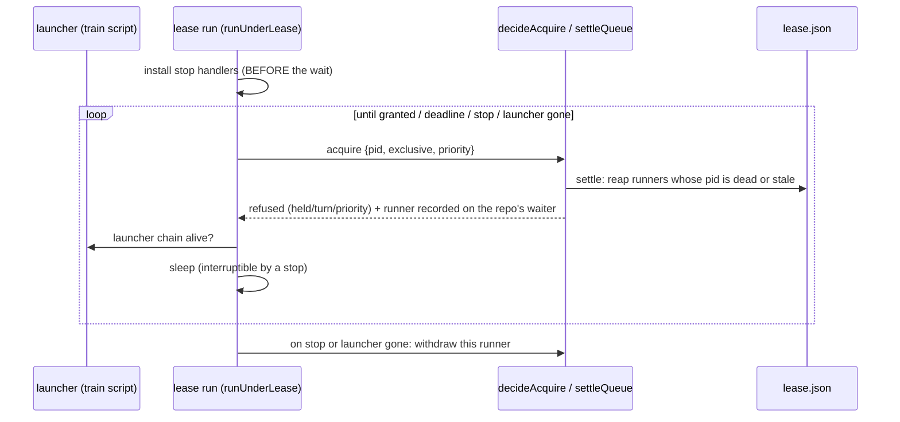

# Plan: fleet lease — orphaned `lease run` waiters, and a train ahead of a targeted run
- **Date**: 2026-11-27
- **Status**: Complete
- **Author**: Claude + Louis
- **Scope**: backend (stack `js-ts`)
- **Target domain(s)**: `fleet`

Two consumer reports (2026-11-27) against `/fleet`'s machine-slot lease, both verified against `main` at 888b11e5.

## 1. Context Summary

**What exists today.** `fleet lease run -- <cmd>` (and `sync:pr`) call `runUnderLease`, which acquires the machine's
one heavy slot EXCLUSIVELY, waits in the queue when refused (`--wait`), runs the job, and releases on every catchable
exit. A refused acquire opens (or joins) its REPO's single waiter entry; turns between repos are ordered by that entry.

**Code Trace** (all at 888b11e5):
- `fleet.mjs` → `cmdLease` → `cmdRun` `scripts/lib/fleet/lease-cmd.mjs:97` → `runUnderLease` `scripts/lib/fleet/lease-run.mjs:105`.
- Wait loop `scripts/lib/fleet/lease-run.mjs:119-132`: `runDecision(decideAcquire)` → on a RETRYABLE refusal `await sleep(wait)`
  until `deadline` (`waitMin`, at most 720). Nothing in the loop asks whether the process that launched it still exists.
- Stop-signal handlers are installed only after the grant, `scripts/lib/fleet/lease-run.mjs:139`. During the wait a SIGINT/SIGTERM
  takes Node's default (exit) and the waiter entry it opened stays; a `TerminateProcess`/`taskkill` of the PARENT on Windows
  does not reach the child at all, so the runner keeps polling and, when finally granted, RUNS its command for nobody.
- Refusal → `waitRefusal` `scripts/lib/fleet/lease.mjs:58` → `openWait` `scripts/lib/fleet/lease-model.mjs:330`. The waiter record
  (`WaiterSchema` `scripts/lib/fleet/lease-model.mjs:149`, built at `:343-347`) has `by/since/forMin/refusals` and no pid, so
  nothing can tell a live waiter from a dead one; it is dropped only when served, cancelled, lapsed or after
  `maxWaitMs` = 12 h (`settleQueue` `scripts/lib/fleet/lease-turns.mjs:376`).
- Queue order: `turnRule` `scripts/lib/fleet/lease-turns.mjs:395-417` orders REPOS by `since`; inside one repo there is one entry
  (`openWait` joins it), so two jobs of one repo have no order at all: whichever polls first after a release wins. A train
  (the one full-suite run under `fullSuite: "train"`) waits behind every targeted run its sessions keep starting.
- Liveness precedent: `classifyHeavy` `scripts/lib/fleet/lease-model.mjs:269` — a pid in the SAME scope that is dead is proof; a
  pid in another scope is unverifiable. `isPidAlive` `scripts/lib/file-lock.mjs:84` (`process.kill(pid, 0)`, works on Windows).
  Process table: `readProcessTableAsync` `scripts/lib/fleet/lease-cpu.mjs:110` (PowerShell `Win32_Process` with `ParentProcessId` on
  Windows, `ps` elsewhere).
- Work-gone precedent (`scripts/lib/fleet/lease-workgone.mjs`): a pure decision (`endTurnWorkGone`) applied inside one
  `transactLease`, idempotent, settled before and after. Reused as the shape here.

**Neighbourhood considered** (`get-neighbourhood`, coverage verified): every `precedent` hit is a lease-turns /
lease-model symbol already read above (`bySince`, `openWait`, `endWait`, `settleOffers`). Decision: EXTEND those modules;
no parallel queue abstraction.

## 2. Proposed Architecture

**D1 — the waiter records its runners (#5 SSOT, #13 idempotency, #18 backward compat).** A waiter gains an optional
`runners: [{holder, pid, scope, priority, forMin, at}]` (at most 10) and an optional `pidless: true`. A refused acquire
from `runUnderLease` (the only caller that is `exclusive` with its own long-lived `pid`) upserts its runner by `holder`,
refreshing `at`. A pid-less touch (a one-shot `lease acquire`, `lease wait`) sets `pidless: true`, because nothing can ever
prove that one gone. Both are additive passthrough keys inside `waiters[]`; an older checkout keeps and ignores them
(`openWait`'s `{...cur}` preserves them), exactly the D1 rule of plan `fleet-lease-turns-and-journal`.

**D2 — the queue reaps (#16 graceful degradation, #11 testability).** `settleQueue` gains one first step,
`reapRunners`: a runner is dropped when its pid is in THIS scope and dead (the `classifyHeavy` evidence rule), or when it
has not refreshed for `LIMITS.runnerStaleMs` (10 min — 20 polls at the default 30 s; it covers another scope's pid,
which this process cannot probe). A waiter whose runners were all reaped and that is not `pidless` ends its episode
(`wait-ended`, reason `abandoned`). Pure over the injected probe and clock; returns the SAME object when nothing changed.

**D3 — the runner stops waiting for nobody (#15 error handling).** In `runUnderLease`:
- the stop-signal handlers are installed BEFORE the wait loop, and a stop during the wait aborts the sleep, withdraws
  the runner (`decideWithdrawRunner`: drop this runner; end the episode as `cancelled` when that empties a non-pidless
  waiter) and returns `{ran:false, outcome:'not-granted', code:'stopped', signalled}` — the command never runs; `lease run`
  exits 128+n;
- each poll asks whether its LAUNCHER CHAIN still exists: the parent and up to two further ancestors, read once from the
  process table at the first refusal (lazy: an immediate grant costs nothing; a failed read degrades to `process.ppid`
  alone). The chain, not the parent alone, because a Windows launcher usually spawns through `cmd.exe`/`npm.cmd`, which
  survive their killed parent. On POSIX a changed `process.ppid` (reparented) also counts. Gone → withdraw, return
  `outcome:'not-granted', code:'orphaned'`, `lease run` exits 75 like any not-granted;
- the grant path is unchanged (a job that has STARTED is governed by the existing stop/heartbeat rules, not this one).

**D4 — priority inside a repo (#2 open/closed, #4 no hardcoding).** `lease run --priority high` (and
`runUnderLease({priority:'high'})`) marks a run as one that goes ahead of its own repo's normal runs. A FRESH grant
(not a renewal) to a run of rank lower than a runner already waiting in the SAME repo's entry — another holder, not
reaped, and able to take the slot now (`admissionCheck` for its `forMin`) — is refused `priority`, which `runUnderLease`
treats as retryable. The ranks are one table (`PRIORITY_RANK`); `normal` is the default, so every existing caller is
unchanged. Cross-repo order (turns, `since`) is untouched: priority never jumps another repo's queue place.

**Right-sizing (D4).**
- *Band-aid*: shorten the train's poll interval so it usually wins the race — still a race, and the next targeted run
  that starts while the slot is free still goes first.
- *Over-built*: a second, lighter slot class for targeted runs, or a per-job global priority queue across repos. Both
  change rule 14 (one heavy job per machine) or the user's 2026-10-14 cross-repo turn policy — plan decisions that are
  not mine, and the report needs neither: the starvation is INSIDE one repo.
- *Chosen*: an explicit per-run priority, ranked only among the waiting runners of one repo — the smallest thing that
  gives the train an order (it needs the runner list anyway, which D1 adds for the orphan fix). Priority is an
  explicit flag, not inferred from `--kind`: `kind` describes the resource (a train may be `gate` or `test`; the default
  is `gate`, which targeted runs also carry), and adding a `train` kind would make an older checkout read the shared
  file as corrupt (`HeavySchema.kind` is an enum).

**Manual vs scripted**: manual — five files of policy, no repeated sites.

## 3. Execution model

Every decision is one `transactLease` read-decide-write; the new steps live inside the existing transactions
(settle, acquire, withdraw), so there is no new atomicity boundary. A withdraw that fails (lock contention) is logged
and the runner returns anyway: the reaper removes its entry within one settle once the pid is dead.

## 6. Sustainability Notes

- Assumes a waiting runner polls at most every ~30 s (`runnerStaleMs` is 20 polls). A caller with a far longer poll
  would be reaped; the poll is a test seam only today.
- Windows pid reuse: the launcher chain's start times are re-read every 5 minutes (exact on Windows, 3 s tolerance on POSIX,
  whose start is the read clock minus `ps` elapsed time); a missing row or start time is unknown, never reuse.
- Hardened in audit (see the audit summary): a runner is (holder, pid, scope); capacity eviction is rank-aware and any
  runner that cannot stay recorded turns the entry `pidless`; an older checkout's refusal newer than every runner poll is
  kept as `pidless` on join, reap and withdraw; the launcher is checked before EVERY re-acquire and raced against a stop;
  the default sleep is cancellable; a lease error after registration withdraws the runner.
- A detached `lease run --wait` whose launcher exits on purpose (`nohup … &`) now stops waiting. Documented; nothing
  in the repo or the skill launches one that way.

## 7. File-Level Plan

- `scripts/lib/fleet/lease-model.mjs` (modify) — `WaiterSchema` gains optional `runners[]`, `pidless`; `LIMITS.maxRunners`,
  `LIMITS.runnerStaleMs`; `PRIORITIES`/`PRIORITY_RANK`; `openWait` upserts a runner / marks `pidless`;
  `reapRunners(lease, now, probe)`; `withdrawRunner(lease, req, now)`.
- `scripts/lib/fleet/lease-turns.mjs` (modify) — `settleQueue` reaps first.
- `scripts/lib/fleet/lease.mjs` (modify) — `decideAcquire`: validate `priority`, the in-repo priority rule for a fresh grant;
  `decideWithdrawRunner`; `renderStatus` shows a waiting high-priority run.
- `scripts/lib/fleet/lease-run.mjs` (modify) — handlers before the wait, interruptible sleep, launcher watch, withdraw,
  `priority` passed through, `priority` retryable.
- `scripts/lib/fleet/lease-cpu.mjs` (modify) — `launcherChain(rows, pid, depth)`: the ancestors of a pid from one table read.
- `scripts/lib/fleet/lease-cmd.mjs` (modify) — `run` accepts `--priority high|normal`; `leaseRunResult` maps `stopped`
  (128+n) and `orphaned` (75).
- `scripts/lib/fleet/argv.mjs` (modify, one token) — `--priority` in the `lease` verb's value-flag list (the lease verb's flag
  table lives there; outside `lease*.mjs`, called out in the PR).
- `tests/fleet-lease-runners.test.mjs` (create) — D1, D2, D4 decisions.
- `tests/fleet-lease-run.test.mjs` (modify) — D3 with injected signals, sleep, launcher probe.
- `skills/fleet/references/lease.md` (modify) — waiting runners, reaping, `--priority`, the exit for a stopped wait.

## 8. Risk & Trade-off Register

- An older checkout's `openWait` keeps `runners` but never refreshes `at`; a same-repo session on an older checkout can
  therefore have its sibling's runner reaped as stale — harmless (it re-registers on its next poll).
- Priority can be claimed by any caller (cooperative, like everything in the lease). Documented as "for the train".
- Deferred: priority across repos — a policy change for the user, not needed by this report.

## 9. Testing Strategy

Unit (pure, injected clock/probe), each red before the change:
- a runner's refusal records `{holder,pid,scope,priority,forMin,at}`; a second refusal refreshes, never duplicates;
  pid-less touch sets `pidless`.
- settle reaps a dead same-scope pid; keeps an other-scope pid until stale; ends a non-pidless empty waiter `abandoned`;
  keeps a pidless one; returns the same object when nothing changed.
- `decideAcquire` refuses a normal fresh grant `priority` while a live high runner of the same repo waits and could go;
  grants it when the high runner is reaped, belongs to another repo, cannot fit, or is the requester itself; renewals
  unaffected.
- `runUnderLease`: a stop during the wait never runs the job, withdraws the runner and reports `stopped`; a launcher that
  dies mid-wait ends the wait `orphaned` without running the job; a `priority` refusal is retried.
- `leaseRunResult` maps the two new codes.

**Proof plan**: each behaviour above has a red test on the pre-change code (oracle: `node --test` on the new cases);
pass condition is green on the change with the existing lease suites unchanged; the report quotes both runs.
