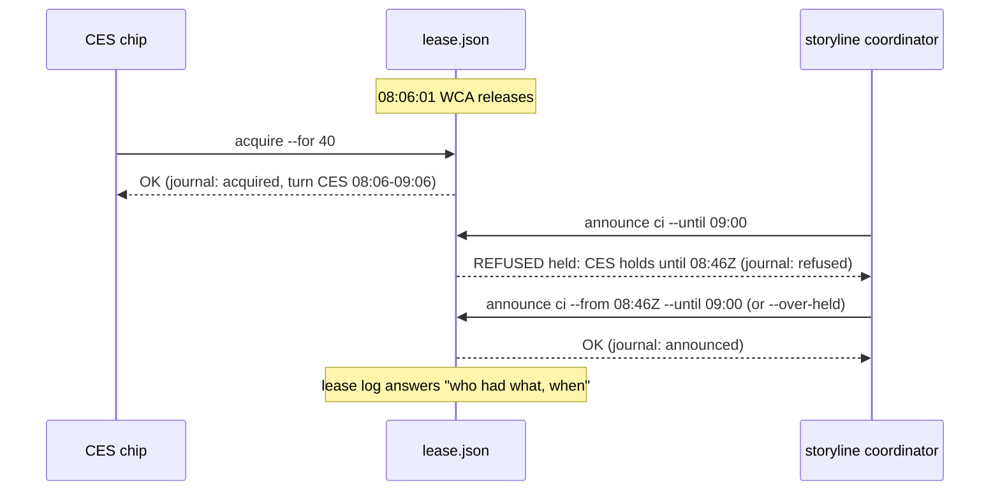

# Plan: fleet lease — announce race, transition journal, turns, gaps, sync:pr on the lease
- **Date**: 2026-10-14
- **Status**: In Progress
- **Author**: Claude + Louis
- **Scope**: backend (stack `js-ts`; engineering principles apply)
- **Target domain(s)**: `fleet`, `scripts`, `shared-lib`, `tests`
- ⚠ **Cross-domain work** — `fleet` (lease) plus `scripts`/`shared-lib` (sync:pr). Intentional: sync:pr becomes a lease client.
- **Depends on**: branch `claude/rule14-turns` (commit `ca17acde`, the user's turn policy text in rule 14 + coordination-rationale.md) — PR 2's docs extend that text; land it first or carry it.
- **Theme**: coordinator rule 13, three sequential PRs. Findings: p-20261014082917-9eaa, p-20261014082803-0dc2, p-20261014103957-4acc, p-20261014092409-d052 (PR 1); p-20261014080650-b921, p-20261014092503-a3b9 (PR 2); p-20261014123044-9d07, p-20261014080352-35d6 (PR 3).

## 1. Context Summary

### 1.1 What exists today (all `(97b449e0)`)

`fleet lease` (#243, plan `docs/plans/fleet-machine-lease.md`) keeps ONE machine-wide file, `~/.claude-fleet/lease.json`, shared by every repo's fleet: the heavy slot (`heavy`), announced quiet/CI `windows[]`, `peakHours[]` and an `events[]` ring of 20 exceptional changes. Policy is pure (`decide*` over an injected clock and pid probe); the CLI runs each sub-command as one read-decide-write under `lease.lock`. It is cooperative: nothing enforces it.

What went wrong on 2026-10-14:
- **08:06Z race (9eaa).** WCA released 08:06:01; a CES chip acquired ~08:06 for 40 min; storyline announced window `bca4` at 08:06:29 and got `OK`. `decideAnnounce` never reads `lease.heavy`, so a window was recorded over a live gate. `decideAcquire` is correct in the other direction (replayed: REFUSED `window`).
- **No history to settle it (0dc2, 4acc).** Same-repo window clears are not recorded (only other-repo clears are), and acquire/refuse/release/announce are not recorded at all. The coordinator could not reconstruct whether the window was briefly absent, and doctor's fit check cannot measure slot-wait time ("unmeasured" on every run).
- **Per-call tests miss interleavings (d052).** Every rule has a unit test; the bug is a sequence.
- **Gaps by message (b921).** STO granted WCA a gap, WCA's acquire was refused by STO's own window, and STO had to clear the whole window.
- **No turns (a3b9).** One repo's back-to-back CI windows held the machine ~05:57-10:50Z while another's pushes waited 1-2 h; workers grabbed a FREE slot out of turn twice. The user decided the policy (branch `claude/rule14-turns`): when several repos wait, ~60-min batched turns, longest-waiting next, a repo's own CI windows count as its time.
- **sync:pr bypasses the lease (9d07).** It runs each consumer's pre-push hook (a heavy job) and relied on its caller checking the lease; a wrapper ignored a REFUSED acquire at 12:30Z and pushed two consumers beside wine's live gate.
- **`touch --clear-waiting` resets other waits' `since` (35d6)**; handover.md documents the reset as expected.

### 1.2 Code Trace (pinned `97b449e0`)

- `fleet lease announce` → `cmdLease` `scripts/lib/fleet/lease-cmd.mjs:151` → `decideAnnounce` `scripts/lib/fleet/lease.mjs:359` (validates times, limits, id; **no `lease.heavy` read**) → `transactLease` `lease.mjs:186` → `writeLease` `lease.mjs:169`.
- `fleet lease acquire` → `lease-cmd.mjs:109` → `decideAcquire` `lease.mjs:269`: bad request → `conflictingWindows` `lease.mjs:259` (other repos' windows overlapping `[now, end)`) → slot rules → `pruneWindows` + optional `appendEvent` `lease.mjs:251`.
- Refusals are never written: `lease-cmd.mjs:193` writes only when `d.ok`.
- `decideClearWindow` `lease.mjs:392` appends `window-cleared` only when `w.repoKey !== req.identity.repoKey` (`lease.mjs:399`).
- `EventSchema` `lease.mjs:115` pins `kind` to the `EVENT_KINDS` **enum** (`lease.mjs:37`); `LeaseSchema` `lease.mjs:116` is `.passthrough()` at every level.
- `fleet touch --clear-waiting --waiting-on …` → `waitingFromFlags` `scripts/lib/fleet/commands.mjs:99` stamps `since: now` on every `--waiting-on` → `applyWaiting` `commands.mjs:110` empties the list then pushes the new entries; the handover line that tells operators to run it is built at `scripts/lib/fleet/handover.mjs:756-759`.
- `npm run sync:pr` → `main` `scripts/sync-pr.mjs:139` loops targets → `runConsumerPr` `scripts/lib/sync-pr.mjs:859`: `switch -c` → commit → **`git push` (consumer pre-push hook runs here)** `sync-pr.mjs:897` → `gh pr create` → supersede → `gh pr merge --auto` `sync-pr.mjs:935`. No lease call anywhere.

### 1.3 Patterns reused vs new

Reused: the pure `decide*` + one-transaction CLI shape; `refuse(code, reason)`; `clip()` for generated text; `.passthrough()` forward compatibility (D2); `appendEvent`'s ring idiom; the `fleet` exit map (0 ok, 3 refused, 1 error, 2 argv).
New: a second ring (`journal`) and three optional top-level keys (`waiters`, `turn`, `slotFreedAt`, `turnMin`); two optional window fields (`overHeld`, `gaps`); a frozen v1 schema fixture for compatibility tests; one small sync:pr lease module.

### 1.4 Neighbourhood considered

`get-neighbourhood` (5 target paths, intent "lease journal ring, waiter queue and turns, granted gaps"): every candidate `review` band (top: `appendSession` brainstorm session-store 0.63, `tieredShadowWindow` 0.63) — nothing above this repo's noise floor. Greenfield inside `lease.mjs`, which already owns this space.

## 2. Proposed Architecture

### 2.1 Right-sizing (the three lines)

- **Band-aid**: a warning line on `announce`, and coordinators keep relaying turns and gaps by message.
- **Over-engineered**: an enforcing scheduler (a daemon or the pre-push hook consulting the lease), priority classes, per-job duration estimates, a separate append-only event store with rotation.
- **Chosen**: the smallest additions that make the lease say no when it must and remember what happened, all inside the existing pure decide/transaction shape: one refusal rule on `announce`, one bounded `journal` ring, a per-repo waiter list with one turn record, gaps as a window field, and sync:pr calling the same `decideAcquire`. Still cooperative (no enforcement, `hold`/directives outrank it). Every piece serves a named incident above.

### 2.2 Decisions

- **D1 — Compatibility is the first constraint (#18, #10).** Checkouts of different ages (CES worktrees AND consumers' synced fleet copies) share the one file. `EventSchema.kind` is an enum in every shipped checkout, so **a new kind written into `events[]` makes every older checkout read the file as `unreadable`**, and its `release --force --reason` would then "recover" (wipe) the live lease. Therefore: `events[]` keeps exactly its v1 kinds and meaning; everything new lives in NEW optional top-level keys and NEW optional window fields, which older checkouts preserve verbatim through `.passthrough()` and every spread in their decide functions (verified at `lease.mjs:317`, `:345`, `:388`, `:397`, and `peak`'s spread `lease-cmd.mjs:174`). `schemaVersion` stays 1. A frozen copy of the #243 schema (`tests/fixtures/fleet-lease-v1-schema.mjs`) must parse every lease this plan's code writes — that is the D2 proof, not a reading of the code.
  - New keys validate leniently for forward compatibility too: journal `kind` is a bounded string, not an enum, so a still-newer kind never makes THIS checkout call the file corrupt.
  - Stated limit: an older checkout ignores the new rules (it can announce over a held slot, acquire out of turn, and journals nothing). The rules take effect per repo once it runs this code (CES on merge; consumers on their next `sync`). `lease log` marks a slot holder whose acquisition has no journal entry as `unjournaled (older checkout)` rather than leaving a silent gap.

- **D2 — `announce` refuses a window over another repo's live heavy slot (9eaa) (#11, #13).** If `lease.heavy` belongs to another repo and is `held` (or `expired` with verdict `pid-alive`/`unverifiable` — its job may still run; end treated as open), and the window `[from, until)` overlaps the slot's `[startedAt, expiresAt)`, refuse with code `held`: "the heavy slot is held by `<holder>` (`<repo>`) for `<kind>` until `HH:MMZ`; announce `--from <expiresAt>`, or pass `--over-held` to record a window that is already running over it". A refused announce changes nothing but the journal.
  - **Why an override exists:** a CI window often records something already triggered (a dispatched run cannot be un-dispatched). Hiding it would make the lease lie. `--over-held` records the window with `overHeld: {holder, repoKey, repo, until}` and the output and `status` say so; the journal records who acknowledged the overlap.
  - Acquire's direction is unchanged (it already refuses on windows), so after D2 neither order of the race can produce an unacknowledged overlap.

- **D3 — The journal: every transition, bounded, one ring (0dc2, 4acc) (#19, #20).** New optional top-level `journal[]` (ring, newest `LIMITS.maxJournal` = 200 kept; ~40 KB). The exceptional `events[]` ring is still written as today, so older readers lose nothing. `attach`/`peak`/`turn` config are not journaled (no slot or window ownership change).
  - **Envelope**: `{at, kind, by: "<holder>@<repo>", repoKey, …}` where **`kind` is only ever the transition**. Resources are nested so nothing collides (audit R1 H3): `job: {kind, forMin, until}`, `window: {id, kind, repo, from, until}`, `refusal: {op, code}`. The reader schema validates the known kinds' fields and accepts any other `kind` string with a passthrough body (a newer checkout's kind never makes this one call the file corrupt).

    | `kind` | Fields | Written by |
    |---|---|---|
    | `acquired` | `mode: granted\|renewed\|rotated\|taken-over`, `job`, `basis` (PR 2), `episode?` | acquire |
    | `released` | `forced`, `job` (the released one), `endTurn?` | release |
    | `announced` | `window`, `overHeld?`, `overTurn?`, `releasedJob?` (sync:pr release-to-window) | announce, `decideReleaseToCiWindow` |
    | `window-cleared` | `window`, `ownRepo: true\|false` (**same-repo clears included**) | announce --clear-window |
    | `refused` | `refusal`, `job?`/`window?` (what was asked) — only refusals NOT absorbed by a wait episode (announce, grant, a refused acquire that could not be queued) | announce, grant, acquire |
    | `waiting` | `episode` (= `<repoKey>@<since>`), `opener: wait\|refusal`, `refusal?`, `job.forMin` | wait, refused acquire |
    | `wait-ended` | `episode`, `reason: served\|cancelled\|expired\|lapsed`, `refusals` (count), `lastRefusal?` | acquire, announce (served by a window), wait --cancel, settle |
    | `gap-granted`, `turn-started`, `turn-ended` | PR 2 (D5, D6) | grant, settle |
  - **Refusals are written.** Today a refusal is not persisted (`lease-cmd.mjs:193`); a refusal now returns `{ok:false, code, reason, lease}` and the CLI writes that lease (journal and waiter list only, nothing else changes — invariant I3). `bad-request` refusals are argv errors and write nothing.
  - **Wait episodes, not refusal floods (audit R1 M1).** A refused acquire opens (or joins) its repo's wait episode in `waiters[]` (D3b); the episode's further refusals only bump `refusals` and `lastRefusal` on the waiter entry, so polling never grows the ring. The journal records the episode's opening (`waiting`) and its end (`wait-ended` with a reason).
  - **Reader:** `measureSlotWaits(journal, now)` (pure, exported for doctor's fit check, `adoption-fit-check` session) pairs `waiting` with `wait-ended` by `episode` → `{repo, from, until?, waitedMs?, reason}`; an episode still open is `open: true`; an episode whose `waiting` fell off the ring is reported as `truncated`, never paired with an unrelated acquire; `cancelled`/`expired`/`lapsed` are separate from `served`. Returns `{measured: journal.length > 0, coverageFrom, waits}`; an empty or absent journal is `measured: false`, never "no waits".
  - **Surface:** new `fleet lease log [--limit N] [--json]` prints the journal oldest-first; `status --json` includes `journal`; `status` text adds one line `journal: N entries since HH:MMZ (lease log)`.

- **D3b — The waiter list (record only in PR 1; admission in PR 2) (a3b9, 4acc).** `waiters[]`, one entry per **repo** (turns are per repo; sessions of one repo batch): `{repoKey, repo, by, since, forMin, refusals, lastRefusal?, offeredAt?}`. Opened by `fleet lease wait [--for <min>] [--note]` or **automatically by a refused acquire** (`held`, `window`, `turn`, `expired-*`, `unverifiable`) — the only way to know someone waits is that they asked; `forMin` is the asked duration (default 30). Repeat calls keep `since`. Ended: **served** when any session of the repo is granted the slot or announces a window starting now; **cancelled** by `lease wait --cancel` (own repo only); **expired** after `LIMITS.maxWaitMs` (12 h); **lapsed** (PR 2, D6). Each end is a `wait-ended` entry.
  - **Capacity (audit R1 M2):** at most 20 entries. Expired entries are reclaimed first. Full: a refused acquire still returns its refusal, now with `queued: false, queueFull: true` and a journal `refused` entry (nothing evicted); an explicit `wait` is refused with code `limit`; sync:pr prints "deferred, NOT queued (queue full)". A repo already queued is never refused for capacity.
  - In PR 1 the list has **no admission effect**: it exists so waits are measured and visible (`status`/`next`: `waiting: <repo> since HH:MMZ (n refusals)`).

- **D4 — Interleaving property test (d052) (#11).** A seeded PRNG (mulberry32; no new dependency) generates 400 sequences × 40 operations over 3 repos (2 sessions each): `acquire`, `release`, `announce` (random from/until, sometimes `--over-held`), `clear-window` (own or other's), `wait`, `wait --cancel`, `advance clock`; PR 2 adds `grant`, `release --end-turn`, `announce --over-turn`. After every step:
  - **I1** the lease parses under the current `LeaseSchema` AND the frozen v1 schema (D1);
  - **I2** if the slot is `held` by repo X, no window of another repo overlaps `[heavy.startedAt, heavy.expiresAt)` unless that window carries a matching `overHeld` (same repoKey + holder) or the overlap lies inside a gap granted to X (PR 2);
  - **I3** a refused decision leaves `heavy` and `windows` byte-identical to the pre-state and `turn` identical to the settled baseline (`settleQueue(pre)`), changing only `journal` and `waiters`; a `bad-request` changes nothing;
  - **I4** every successful mutation appends the journal entry its kind requires (the history can always answer "what happened"), and every `waiting` episode ends at most once;
  - **I5** (PR 2) every grant's recorded `basis` is true of the pre-state: `in-turn` ⇒ R's turn was active; `head`/`backfill` ⇒ no repo that waited longer than R was eligible; `gap` ⇒ the request lay inside a gap naming R; and no repo lapses unless it was continuously eligible for `claimMs`.
  On failure it prints the seed and the operation prefix up to the violation, so the case is replayable. **Red evidence:** written first and run against `97b449e0`; it must find the 08:06Z shape (an `announce` over a held slot) before D2 lands. A deterministic replay of the real 08:06Z timeline sits beside it as a named regression test.

- **D5 — Granted gaps (b921) (#5, #13).** `fleet lease grant --window <id> --from <iso|+Nm> --until <iso|+Nm> [--to <repo label>]`: only the window's own repo may grant (another repo can still clear the window, recorded — unchanged). The gap must lie inside the window; at most 5 gaps per window. Stored as `window.gaps[] = {from, until, toRepoKey?, toRepo?, grantedAt, by}`.
  - `--to` resolves a label to a **repoKey** from identities already in the lease (heavy, windows, waiters, journal), because identity is the repoKey pair and labels are display-only (`lease.mjs:79`): 0 matches → refused ("`<label>` has not used the lease on this machine; it can `lease wait` first"), >1 distinct keys → refused as ambiguous. No `--to` = an open gap (the window pauses for anyone).
  - `conflictingWindows` skips a window when the request `[now, end)` lies wholly inside one of its gaps that is open or granted to the requester. A request that runs past the gap end is still refused, with "shorten `--for` to end by `HH:MMZ` (the gap's end)".

- **D6 — Turns when several repos wait (a3b9) (#13, #14).** Implements the user's 2026-10-14 policy on top of D3b's waiter list with one turn record and one admission rule, evaluated lazily inside the existing decisions (no daemon). One pure `settleQueue(lease, now, probe)` runs first in every mutating decision and applies the time-driven transitions below (journaled).
  - **Records.** `turn = {repoKey, repo, startedAt, endsAt, lastReleasedAt?}` or absent; `slotFreedAt` (set on every release); `turnMin` (default 60; `fleet lease turn --minutes <15-240>|--clear`, the knob doctor's fit check recommends). Constants: `LIMITS.batchGapMs` 10 min, `LIMITS.claimMs` 15 min.
  - **Eligible.** Repo W is *eligible now* when an acquire by W for its waiter's `forMin` would pass every non-turn check: the slot is free (or expired `pid-dead`), and no other repo's window conflicts with `[now, now + forMin)` (gaps counted, D5). One side-effect-free function answers it, `admissionCheck(lease, {repoKey, holder}, forMin, now, probe) → {ok} | {ok:false, code, reason}` — slot and window/gap checks only, no settlement, no waiter or journal writes, no turn rule. **Acyclic call graph (audit R2 H1):** `decideAcquire` → `settleQueue` → `admissionCheck`; then `decideAcquire` → `admissionCheck` → turn rule. `admissionCheck` imports nothing that settles, so offer, lapse and admission share one policy without recursion (a test asserts `admissionCheck` leaves its input deep-equal and never reaches `settleQueue`).
  - **Turn transitions (audit R1 H1).**

    | Event | Turn of repo A becomes |
    |---|---|
    | A is granted the slot (no active turn of A) or A announces a window starting within `turnMin` | **started**: `{A, now, now + turnMin}`; journal `turn-started` |
    | A's job is released | **between jobs**: kept, `lastReleasedAt = now` |
    | A re-acquires within `batchGapMs` of `lastReleasedAt` and before `endsAt` | **continues** (batching) |
    | `now ≥ endsAt` | **ended** (`reason: expiry`); a job still running is never cut — it finishes, and the next release hands over |
    | between jobs for more than `batchGapMs` | **ended** (`reason: idle`) — no ready job, so the queue moves |
    | `lease release --end-turn` | **ended** (`reason: yield`) — the coordinator knows nothing else is ready |
    | another repo is granted by the rule below | **ended** (`reason: handover`); the new repo's turn starts |
    | a named-gap acquire by C (D5) | **unchanged**: C borrows the gap; no turn starts for C, A's turn is not ended (journal `basis: gap`) |
  - **Admission rule.** After the existing window and slot checks, an acquire by repo R is granted when: no other repo is waiting; or R has an active turn (started, or between jobs within `batchGapMs`) — **the incumbent has precedence** over the head while its turn is active; or the request lies in a gap granted to R by name; or no OTHER repo that has waited longer than R (earlier `since`; R not waiting counts as `since = now`) is *eligible now* (backfill: a head that cannot fit before an imminent window does not block a shorter job that fits, and keeps its place). Otherwise refused with code `turn`, naming the repo that goes first and since when it has waited; R is queued (D3b). The `acquired` journal entry records `basis: no-waiters|in-turn|head|backfill|gap|lapsed:<repo>`.
  - **Announce.** An announce by R whose window overlaps `[now, now + turnMin)` is refused with code `turn` under the same condition, unless `--over-turn` (a running CI window is recorded, never hidden; journaled with the waiting repo it overrode). Windows starting further ahead (scheduled runs) are not turn-checked — they are commitments made before the waiters existed; stated in `references/lease.md`.
  - **No ghost blocks the machine; no one lapses while blocked (audit R1 H2).** A head is *offered* (`offeredAt = now`, journaled) when a decision observes it eligible with no active incumbent turn; any decision that observes it ineligible clears `offeredAt`. It **lapses** only when it has been continuously eligible for `claimMs`: `offeredAt ≤ now − claimMs`, the slot free since at most `now − claimMs` (`slotFreedAt`), no other-repo window (outside its gaps) overlapped `[now − claimMs, now)`, and it is eligible now. A lapsed head moves to the back (`since = now`, `wait-ended reason: lapsed` + a new `waiting` episode) — "its waiting clock restarts". Without the lapse, a waiter who stopped asking would block every other repo indefinitely.
  - `status`/`next` show the queue: `turn: <repo> until HH:MMZ (between jobs since HH:MMZ)` and `next: <repo> (waiting since HH:MMZ[, offered HH:MMZ])`.

- **D7 — sync:pr takes the lease per consumer (9d07) (#5, #15).** New `scripts/lib/sync-pr-lease.mjs` (keeps `scripts/lib/sync-pr.mjs`, 948 lines, under the 1000-line size ratchet): `withConsumerLease({repoRoot, consumerName, dir, now, probe, forMin, ciWindowMin}, fn)`.
  - Identity is the **consumer's** repo (`repoKeyOf(gitCommonDir(repoRoot))`, holder `sync-pr`), because the heavy job is the consumer's pre-push hook. Acquire `kind: gate`, `--for` default 45 (`--lease-for <min>`), `pid: process.pid` (sync:pr is the long-lived process that runs the hook, so a crash is verifiable). It runs through `decideAcquire`, so windows, turns and gaps apply unchanged; a refusal queues the consumer as a waiter (D3b).
  - Refused, unreadable, newer-version or lock contention → that target is **deferred**: no branch, no push, one line naming the reason and `fleet lease status`; the loop continues with the next target. Exit: 1 if any target errored, else 3 if any was deferred, else 0.
  - Held through `runConsumerPr` (push + PR open + supersede + merge arm); released in `finally` with its token.
  - **The held slot covers the remote work; one window covers the CI after it (audit R1 H4, R2 H3, R3 H1, R4 H6, R5 H1/H2 — see the right-sizing note).** sync:pr holds the consumer's slot (with its live pid) from before `switch -c` until the end of `runConsumerPr`, so the push, PR create, supersede and merge arm — every action that can start CI — all happen while the slot is held: no other repo can acquire it, and no other repo can announce a window over it (D2). The slot is then handed to a CI window **in one transaction**, `decideReleaseToCiWindow(lease, {identity, token, ciWindowMin, note}, now)`: announce a `ci` window for the consumer `[now, now + ciWindowMin)` and release the slot atomically, so nothing can interleave between "CI covered" and "slot freed". It runs in `finally`, whatever `runConsumerPr` returned or threw:

    | `runConsumerPr` outcome | At release |
    |---|---|
    | failed at `switch -c`, `add`, `commit` or `push` (the push was refused; nothing reached the remote) | plain release — no CI started, no window |
    | failed or threw at any later step (`gh pr create`, supersede, merge arm) | release **to a CI window** — CI may have started; the line says so |
    | ok | release **to a CI window** |
    | the release transaction fails (lock contention, unreadable file) | warning: the slot stays held until its `--for` expires and sync:pr's pid is then dead (taken over with evidence, #243 D4), the PR's CI is unprotected; it names `fleet lease announce --kind ci --until +<N>m` to record it by hand |
    | sync:pr crashes mid-run | the slot expires with a dead pid and is taken over with evidence; a CI run already started is unrecorded — stated limit, the next coordinator pass sees the open PR |

    The window is announced as reality: if the consumer's turn has ended while another repo waits (a hook that ran past `turnMin`), it is recorded with `overTurn` and the journal names the waiting repo (D2's rule: the lease records running work, it never hides it). It is an ordinary own-repo window, so the lease's existing prune, clear and limit rules apply unchanged. `ciWindowMin` comes from `--ci-window <min>`; without it the release is plain and a line reminds the operator to announce the PR's CI. `decideReleaseToCiWindow` has no CLI verb (YAGNI — sync:pr is its only caller). Draft PRs are **not** used: storyline's `phase-gates.yml` runs on draft PRs (no `draft == false` guard), so a draft would not hold its CI; `--no-merge` (existing) keeps a merge-triggered main CI in the target coordinator's hands.
  - **Right-sizing note (audit R5).** Rounds 1-5 grew a provisional-window reservation (announce before the push, re-anchor, survive pruning, tombstones for explicit clears, legacy ambiguity) to protect CI that starts *while sync:pr still holds the slot*. The slot already protects that interval, so the reservation was solving a problem the lease had already solved; it is deleted. What remains is one atomic release-to-window at the end.

- **D8 — `--clear-waiting` keeps re-added waits' age (35d6) (#12).** `applyWaiting` keeps the existing `since` of any `(kind, ref)` being re-added, cleared or not; only genuinely new waits get `since: now`. The handover comment `handover.mjs:756` and `skills/fleet/references/handover.md` stop saying their `since` restarts.

### 2.3 Execution model (Phase 1.5)

**Three stages inside one lock (audit R2 H2):** (1) **validate** the request — an argv/`bad-request` refusal writes nothing at all; (2) **settle** time-driven state with `settleQueue` — its transitions (wait expiry, turn end, offer set/clear, lapse) are facts about time, so they are **persisted even when the operation is refused**; settle touches only `waiters`, `turn` and `journal`, never `heavy` or `windows`; (3) **evaluate** the operation against the settled lease. A refusal then preserves `heavy` and `windows` relative to the disk and `turn` relative to the settled baseline, adding only its own waiter/journal change.

Each sub-command stays one read-decide-write under `lease.lock`; the new state (journal, waiters, turn, offeredAt, lapses, served/expired ends) is computed and written inside the same transaction, so concurrent repos still serialise and the loser re-reads. Time-driven housekeeping (12-h wait expiry in PR 1; turn expiry/idle end, offer, offer-clear and lapse in PR 2) runs at the start of every mutating decision via one pure `settleQueue(lease, now, probe)` and is journaled; read-only `status`/`next` show the settled view without writing. sync:pr's chain per target is acquire → `runConsumerPr` → in `finally`, a plain release (nothing reached the remote) or the atomic release-to-CI-window (`decideReleaseToCiWindow`); a release that fails leaves an expiring lease with sync:pr's pid — dead once it exits, so the next acquirer takes over with evidence (existing D4 rule of #243). Targets are serial.

### 2.4 Record shapes and limits (all additive, all optional)

| Where | Field | Shape | Limit |
|---|---|---|---|
| root | `journal` | `[{at, kind: string≤40, by, repoKey?, job?, window?, refusal?, …}]` passthrough (D3 table) | ring, newest 200 |
| root | `waiters` | `[{repoKey, repo, by, since, forMin, refusals, lastRefusal?, offeredAt?}]` | 1 per repo, ≤ 20 (D3b) |
| root | `turn` | `{repoKey, repo, startedAt, endsAt, lastReleasedAt?}` or absent | — |
| root | `slotFreedAt` | iso | — |
| root | `turnMin` | int 15-240 | default 60 when absent |
| window | `overHeld` | `{holder, repoKey, repo, until}` | — |
| window | `gaps` | `[{from, until, toRepoKey?, toRepo?, grantedAt, by}]` | ≤ 5 per window |

New flags: PR 1 — `announce --over-held`; `wait [--for <min>] [--cancel] [--note]`; `log [--limit]`. PR 2 — `announce --over-turn`; `release --end-turn`; `grant --window --from --until [--to]`; `turn --minutes|--clear`. PR 3 — sync:pr `--lease-for <min> --ci-window <min>`.

## 6. Sustainability Notes

- Assumption: one machine, a handful of repos. Waiter list and journal are small rings; a busier machine raises `maxJournal`, not the design.
- The turn length is data (`turnMin`), not code; doctor's fit check recommends it per machine.
- Turns are lazy and cooperative. If enforcement is ever wanted, the pre-push hook can call the same `decideAcquire` — the policy already lives in one pure function.
- The frozen v1 schema fixture is the template for any future additive change: add the field, prove the old reader still parses.

## 7. File-Level Plan

- `scripts/lib/fleet/lease.mjs` (modify) — schema additions (D1, §2.4); `decideAnnounce` heavy check + `overHeld` (D2); `appendJournal`, `measureSlotWaits` (D3); waiter list, `decideWait`, `settleQueue` (12-h expiry) (D3b); gaps in `conflictingWindows`, `decideGrant`, `resolveRepoLabel` (D5); turn record and transitions in `settleQueue`, `admissionCheck` (side-effect-free), admission rule in `decideAcquire`/`decideAnnounce`, `decideTurnConfig`, queue lines in `renderStatus`/`nextLines` (D6); `decideReleaseToCiWindow` (D7). Refusals return `{…, lease}`. Expected ~507 → ~800 lines (under the size ratchet).
- `scripts/lib/fleet/lease-cmd.mjs` (modify) — write the journaled lease on refusal; sub-commands `log`, `wait`, `grant`, `turn`; flags `--over-held`, `--over-turn`.
- `scripts/lib/fleet/argv.mjs` (modify) — `lease` bool/value flag sets.
- `tests/fixtures/fleet-lease-v1-schema.mjs` (create) — verbatim #243 schema (from `126efc14`), the older-checkout reader.
- `tests/fleet-lease-interleaving.test.mjs` (create) — D4 property test + 08:06Z replay.
- `tests/fleet-lease.test.mjs` (modify) — unit cases for D2, D3, D5, D6.
- `tests/fleet-lease-cli.test.mjs` (modify) — CLI: refusal persisted, `log`, `wait`, `grant`, `turn`, exit codes.
- `scripts/lib/sync-pr-lease.mjs` (create) — D7.
- `scripts/sync-pr.mjs` (modify) — flags, per-target lease wrap, deferred count + exit code.
- `tests/sync-pr-lease.test.mjs` (create) — D7 with a temp `FLEET_MACHINE_DIR` and the fake runner.
- `scripts/lib/fleet/commands.mjs` (modify) — `applyWaiting` keeps `since` (D8).
- `scripts/lib/fleet/handover.mjs` (modify) — comment at `:756`.
- `tests/fleet-cli.test.mjs` (modify) — D8 red/green.
- `skills/fleet/references/lease.md` (create) — the lease verbs, flags, journal, turns and gaps in one place (summary frontmatter + index row).
- `skills/fleet/SKILL.md` (modify) — lease usage lines collapsed to one line pointing at `references/lease.md`; net size must not grow (`skills:size:gate`, the file is already over 12,000 chars). `skills/fleet/gate-contract.json` (modify) if its bound usage line changes.
- `skills/fleet/references/coordination-rationale.md`, `skills/fleet/references/coordination.md`, `skills/fleet/references/participant-rules.md`, `skills/fleet/references/handover.md` (modify) — rule 14 now names the lease's turn support; participant step for `lease wait`; handover wording (D8). coordination.md stays under 12,000 chars.
- `docs/plans/fleet-machine-lease.md` (modify) — a forward pointer from D2/§2.2b to this plan.

### 7b. Implementation Phases

**Phase 1 — Compatibility harness and red property test**: frozen v1 schema fixture; interleaving test with the I1-I4 invariants and the 08:06Z replay, run red against the current code. Files: tests/fixtures/fleet-lease-v1-schema.mjs (create), tests/fleet-lease-interleaving.test.mjs (create)

**Phase 2 — Announce refusal, the journal and the waiter list**: D2 + D3 + D3b in the pure module and the CLI (refusals persisted, wait episodes, `wait`, `log`, `--over-held`, `measureSlotWaits`; no admission effect from waiters yet). Files: scripts/lib/fleet/lease.mjs (modify), scripts/lib/fleet/lease-cmd.mjs (modify), scripts/lib/fleet/argv.mjs (modify), tests/fleet-lease.test.mjs (modify), tests/fleet-lease-cli.test.mjs (modify)

**Phase 3 — PR 1 docs**: lease reference + SKILL.md usage compression + plan pointer. Files: skills/fleet/references/lease.md (create), skills/fleet/SKILL.md (modify), skills/fleet/gate-contract.json (modify), docs/plans/fleet-machine-lease.md (modify)

**Phase 4 — Gaps**: D5. Files: scripts/lib/fleet/lease.mjs (modify), scripts/lib/fleet/lease-cmd.mjs (modify), scripts/lib/fleet/argv.mjs (modify), tests/fleet-lease.test.mjs (modify), tests/fleet-lease-interleaving.test.mjs (modify)

**Phase 5 — Turns**: D6 (turn record and transitions, eligibility, admission rule with incumbent precedence and backfill, offer/lapse, `turn`, `release --end-turn`, `--over-turn`, queue lines) + rule 14 docs. Files: scripts/lib/fleet/lease.mjs (modify), scripts/lib/fleet/lease-cmd.mjs (modify), scripts/lib/fleet/argv.mjs (modify), tests/fleet-lease.test.mjs (modify), tests/fleet-lease-cli.test.mjs (modify), tests/fleet-lease-interleaving.test.mjs (modify), skills/fleet/references/lease.md (modify), skills/fleet/references/coordination.md (modify), skills/fleet/references/coordination-rationale.md (modify), skills/fleet/references/participant-rules.md (modify)

**Phase 6 — sync:pr on the lease**: D7. Files: scripts/lib/sync-pr-lease.mjs (create), scripts/sync-pr.mjs (modify), scripts/lib/fleet/lease.mjs (modify), tests/sync-pr-lease.test.mjs (create), tests/sync-pr.test.mjs (modify), tests/fleet-lease.test.mjs (modify)

**Phase 7 — `--clear-waiting` keeps since**: D8. Files: scripts/lib/fleet/commands.mjs (modify), scripts/lib/fleet/handover.mjs (modify), tests/fleet-cli.test.mjs (modify), skills/fleet/references/handover.md (modify)

**Close-out (not a phase)**: `npm run skills:regenerate && npm run skills:check`, `npm run skills:size:gate`, `npm run size:ratchet:gate`, `npm run plans:index`, `npm run guards:preflight` before each push.

## 8. Risk & Trade-off Register

| Risk / trade-off | Handling |
|---|---|
| An older checkout reads a new field and calls the file corrupt, then a `release --force` wipes it. | D1: nothing new in `events[]`; new data only in new optional keys; frozen v1 schema parses every written lease (I1, in the property test). |
| Older checkouts ignore the new rules during the rollout. | Stated limit (D1); `lease log` marks unjournaled holders; the coordinator syncs consumers after merge. |
| Refusals now write the file (lock + rewrite on each poll). | One small JSON rewrite under the existing lock; coalescing keeps the journal from growing on polls. |
| A ghost waiter blocks other repos. | Offer + lapse after 15 min of continuous eligibility, then moved to the back (D6); backfill when the head cannot fit; 12-h expiry (D3b). |
| An idle incumbent holds its turn. | The turn survives only `batchGapMs` (10 min) between jobs; `release --end-turn` ends it at once. |
| A waiter is lapsed while it could not have gone. | Lapse requires continuous eligibility over the whole claim period, recomputed from `slotFreedAt` and the windows; any ineligible observation clears the offer. |
| Turn rule bypassed by announcing ahead. | Deliberate: scheduled runs are commitments; ad-hoc windows within `turnMin` are turn-checked. Stated in lease.md. |
| `--over-held`/`--over-turn` become habits. | Each use is journaled with its actor and the overlapped holder/head; `status` shows `overHeld` windows. |
| Label-addressed gap goes to the wrong clone. | `--to` resolves to a repoKey from lease identities; ambiguity refuses. |
| sync:pr defers a consumer the operator expected to update. | Deferred is printed per target with the lease reason and exit 3; the consumer is queued as a waiter so its turn comes. |
| Draft PRs as STO asked. | Not used: storyline's PR workflow runs on drafts, so a draft would not hold CI. `--ci-window` records the CI instead; `--no-merge` keeps the merge in the target's hands. |
| Turn timing is a guess (60 min). | Data (`turnMin`), doctor recommends per machine. |

Deferred: enforcement in the pre-push hook; per-job duration estimates; removing another repo's waiter by force (the 15-min lapse covers ghosts).

## 9. Testing Strategy

- **Tier 1, test-first** (`tests/fleet-lease.test.mjs`): D2 — announce over another repo's held slot refused (inside, adjacent at `expiresAt` allowed, own repo allowed, expired `pid-dead` allowed, `unverifiable` refused, `--over-held` records `overHeld`); D3 — each transition appends its kind with `kind` as the transition and `job.kind`/`window.kind` surviving separately (R1 H3), same-repo clear recorded, ring keeps 200 and drops the oldest, a lease with a journal round-trips through the v1 reader; D3b — a refused acquire opens one episode, ten more refusals add no journal entry and bump `refusals`; `since` kept; served by acquire and by a window starting now; `wait --cancel` then a new refusal opens a NEW episode (R1 M1); 12-h expiry; capacity: the 20th repo queues, the 21st gets `queued:false, queueFull` and nothing is evicted, an already-queued repo at capacity is fine, an expired entry is reclaimed first (R1 M2); `measureSlotWaits` pairs by episode, reports open, cancelled, expired and truncated (its `waiting` fell off the ring) separately, and `measured:false` on an empty journal; D5 — gap inside window only, owner only, `--to` 0/1/2 matches, request inside gap granted, past gap end refused, open gap; stages (R2 H2) — an expired turn ended by settlement is persisted when the same call is refused `held`; an idle-ended turn plus a `window` refusal likewise; a `bad-request` writes nothing; `admissionCheck` returns its input deep-equal and never reaches `settleQueue` (R2 H1); D6 — no waiters → granted; incumbent and head both requesting a free slot during the incumbent's between-jobs gap, in either order → incumbent granted, head refused (R1 H1); after `batchGapMs` idle, `--end-turn`, or expiry → head granted and the turn hands over; a job running past `endsAt` is not cut; named-gap acquire leaves the turn unchanged; backfill: head blocked by an imminent window, a shorter job that fits is granted and the head keeps its place; offer then a scheduled window starting 5 min later → offer cleared and no lapse at +16 min (R1 H2); continuous eligibility 15 min → lapse to the back with a new episode; announce within `turnMin` refused unless `--over-turn`, ahead not checked; `turnMin` limits.
- **Property / interleaving** (`tests/fleet-lease-interleaving.test.mjs`): D4, I1-I4; red on `97b449e0` (output recorded in the Implementation Log), green after Phase 2; extended in Phases 4-5.
- **CLI** (`tests/fleet-lease-cli.test.mjs`): a refused acquire leaves a journal entry on disk and exits 3; `log` prints; `wait`/`grant`/`turn` round-trip; unknown flags refused.
- **sync:pr** (`tests/sync-pr-lease.test.mjs`, temp `FLEET_MACHINE_DIR`, fake runner, fixture git repos): held slot → target deferred, no `git push` issued, consumer queued, exit 3; queue full → "NOT queued"; granted → push runs inside the lease and the slot is free afterwards; with `--ci-window`: push refused → plain release, no window; push ok then `gh pr create` fails, or a throw after the push → released to a CI window; ok → released to a CI window `[return time, + ciWindowMin)` even when the hook ran longer than `--lease-for` (injected clock); the window and the release land in ONE write (a reader never sees the slot free without the window); a turn that ended while another repo waits records the window with `overTurn`; the release transaction failing prints the by-hand command; `decideReleaseToCiWindow` refuses a non-holder and a stale token; unreadable lease → deferred.
- **D8** (`tests/fleet-cli.test.mjs`): `touch --clear-waiting --waiting-on A` keeps A's original `since`, drops B, a new C gets `now` — red first.
- **Negative controls**: the property test's red run is the control for I2; for I1, a deliberately enum-widened `events` kind must fail the v1 reader (proves the fixture can fail).

## 11. Execution Clustering

- **Cluster A** — Phases 1-3 — fix-gate: yes
  - Coupling: the announce refusal (D2), the journal and waiter list (D3, D3b) and the property test (D4) share one seam — the decision functions' return contract (refusals now carry a lease) and the invariants that check it. Ships as PR 1.
- **Cluster B** — Phases 4-5 — fix-gate: yes
  - Coupling: gaps and turns both change `conflictingWindows`/`decideAcquire`'s admission rule and both extend the property test's operation set; turn bypass by named gap is the seam. Ships as PR 2.
- **Cluster C** — Phases 6-7 — fix-gate: final
  - Coupling: both are fleet-registry/lease clients outside `lease.mjs` (sync:pr acquires through `decideAcquire`; `--clear-waiting` is the remaining fleet wait-state fix). Ships as PR 3.
- **Final gate**: each cluster ships as its own PR, so the Gemini gate runs per PR over that PR's diff (`/audit-code --scope diff` then Gemini), not once over the union.

## Out of Scope (Future)

Pre-push enforcement; force-removing another repo's waiter; draft-PR CI holding (needs per-consumer workflow guards first).

## Audit Trail

### Plan audit (2026-10-14, SID audit-plan-1792004345050-8972)

| Reviewer | Round | Verdict | Outcome |
|---|---|---|---|
| GPT | 1 | H:4 M:2 | 6/6 accepted: turn transition table (H1), offer eligibility + lapse accounting (H2), journal `kind` collision (H3), sync:pr partial-failure CI handoff (H4), wait episodes (M1), waiter capacity (M2). Waiter list moved into PR 1. |
| GPT | 2 | H:3 | 3/3 accepted: side-effect-free `admissionCheck` (acyclic), validate/settle/evaluate stages with I3 against the settled baseline, CI window consumed by a long hook. |
| GPT | 3 | H:1 | accepted: provisional window could be pruned before finalization. |
| GPT | 4 | H:1 | accepted: bounded journal used as authority for explicit clears. |
| GPT | 5 | H:2 M:1 | 3/3 accepted and resolved by **deletion**: the provisional-window reservation (R1 H4 → R4) was protecting an interval the held slot already protects; replaced by one atomic `decideReleaseToCiWindow` in `finally`. |
| Gemini (`latest-pro`) | 1 | APPROVE, gate `approve` (blocking 0, debt 1) | G1 LOW stale §2.3 sentence from the deleted design: fixed. |

Stop decision: GPT reached its 5-round absolute cap with 100% acceptance every round (6 → 3 → 1 → 1 → 3); rounds 3-5 all concerned the sync:pr CI reservation, which round 5's simplification removed rather than patched. The R5 simplification was reviewed only by the Gemini gate, not by a further GPT round; `/audit-code` on PR 3 re-checks it against real code.

## Implementation Log

### PR 1 (clusters A: phases 1-3) - 2026-10-14
- **Red first.** `tests/fleet-lease-interleaving.test.mjs` was written and run against `c35dacc1` (no lease code changed): both tests failed. The 08:06Z replay failed on `announce must not silently record a window over a live slot` (`true !== false`); the random search failed at seed 2, step 3: `I2: main@o/c holds the slot 06:00..06:33Z while o/b's quiet window 06:00..07:57Z overlaps it, unacknowledged` (acquire by o/c, then announces by o/c and o/b). Green after D2 (same test files, no edits to the assertions).
- **The property test found a defect the unit tests missed (seed 11).** Two wait episodes opened in the same instant shared the id `repoKey@since`, so a closed episode read as the open one. The episode id is now stored on the waiter and made unique against the journal; regression test in `tests/fleet-lease-journal.test.mjs`.
- **Deviations from the plan text.** (1) Per-rule unit tests are in a new `tests/fleet-lease-journal.test.mjs` instead of growing `tests/fleet-lease.test.mjs` (the Adoption fit check session also touches lease tests). (2) Consecutive identical `refused` entries (same session, op, code) coalesce into one with `n`/`lastAt` - announce refusals only; acquire refusals are already absorbed by the wait episode. (3) `skills/fleet/gate-contract.json` needed no change: the contracted usage line (`lease acquire`) is unchanged. (4) The plan said SKILL.md's lease usage lines collapse; they went from four to three and SKILL.md ended 52 characters under its size baseline.
- **Vacuous-pass guard.** The property test asserts the random search actually reached the interesting states (>=200 grants, >=50 refused-held announces, >=20 over-held announces, >=200 queued, >=20 served, >=20 cancelled, >=50 clears) across the 400 sequences.
- **Code audit (PR 1, cluster A, base `c35dacc1`, scope pinned with `cycle-cluster-scope.mjs`, 14 files).** GPT round 1: 9 findings (H:1 M:7 L:0 + 1 enumeration bound) - M1/M2 are `deferred-declared` (`grant`/`turn` are PR 2, `sync-pr-lease` is PR 3); H1 (a wait served by an already-ended window), M3 (refusal coalescing ignored `repoKey`), M4 (journal payloads unvalidated), M5 (the property oracle's bad-request branch was vacuous), M6 (compat test did not assert preservation), M7 (announce ran without the injected probe) fixed; M8 (auditor `maxContainers` bound on a fixture) dismissed. Round 2: 3 findings (journal payload lookup hit `Object.prototype` for a kind named `constructor`; one dead test line) fixed. Round 3: PASS, 0 findings. Gemini gate: APPROVE (blocking 0, debt 0); its coverage line reads "Code: PARTIAL, changed lines unmeasured for 10 file(s)", i.e. the review saw the files but could not tie every changed line - stated here rather than rounded up.
- **Verification.** `guards:preflight` PASS (33 steps); lease suites 87 pure + 22 CLI tests green; `skills:check`, `skills:size:gate`, `size:ratchet:gate`, `context:check`, `cli:flags:gate`, `emit:exit:gate`, `stdout:flush:gate`, `knip:gate`, `plans:lint`, `docs:check` all exit 0. The full suite runs in GitHub Actions (`full-suite`), not here.
- **Shipped**: PR 1 as #252 (`/ship` 2026-10-15). Remaining: PR 2 (Phases 4-5, gaps and turns) and PR 3 (Phases 6-7, sync:pr and `--clear-waiting`).

### PR 2 (cluster B: phases 4-5) - 2026-10-15
- **Red first.** `tests/fleet-lease-turns.test.mjs` (23 tests) was written and run against `95d0230e` (the model split, no behaviour change): 22 failed, 1 passed (a control). The incident test failed at its first assertion - `THE INCIDENT: a FREE slot is not a turn` expected the early repo's acquire to be refused and got `true !== false`: a worker took a free slot although another repo had waited since 07:00. Green after D5/D6.
- **Refactor first, in its own commit (`95d0230e`).** `lease.mjs` would have crossed the 1000-line size ratchet, so the model (schema, store, time, slot classification, journal and waiter building blocks) moved to `lease-model.mjs` with the public API of `lease.mjs` unchanged (40 exports before and after); gaps, turns and the admission rule are in `lease-turns.mjs`. The call graph is acyclic as designed (audit R2 H1): decisions call `settleQueue`, then `admissionCheck` (side-effect-free, in the model), then `turnRule`.
- **Deviations from the plan text.** (1) `basis: no-waiters` means *no OTHER repo is waiting*; a repo that is the only waiter and is granted records `no-waiters`, and `head` is reserved for "others wait and none waited longer". (2) A repo that is not yet waiting joins the BACK of the queue: every waiter is ahead of it, even on a shared clock tick (found with a pinned test clock; the repoKey tie-break applies only between two queued repos). (3) The incumbent check applies whenever any repo waits (including the asking repo's own entry), so the head cannot take the slot during the incumbent's between-jobs gap. (4) New journal kinds `offered` and `gap-granted`. (5) The per-rule tests are in `tests/fleet-lease-turns.test.mjs`, not `tests/fleet-lease.test.mjs`.
- **Operational consequence to know about.** A plain `release` keeps the repo's turn for 10 minutes (so a batch can continue); while anyone waits, the next repo is told `turn` for those minutes. A session with nothing further ready must `lease release --end-turn`; participant step 4b now says so. Several existing CLI tests assumed the old "release frees it for the next repo at once" and now pass `--end-turn` or assert the new refusal.
- **Property test extended.** New ops (`grant`, `release --end-turn`, `announce --over-turn`) and three biased mixes (uniform, calm, gappy) because the uniform mix reached 0 gap acquires and 0 lapses in 16,000 steps. Invariants: I1-I4 as in PR 1 plus I5 (a grant's recorded `basis` is true of the lease the decision saw; a refusal for `turn` has a queue behind it; a lapse needs 15 minutes of being offered). It found two oracle faults of my own (a same-instant entry counted as new; the unqueued-repo ordering) and no product defect.
- **Code audit (PR 2, cluster B, base `423789e4`, 24 files).** GPT round 1: 14 findings. Fixed (11): label attribution from a cross-repo clear (H1, M6), the effective queue head so a blocked oldest waiter and a ghost behind it cannot hold the queue (H2), a repo's own windows keeping its turn busy (H3), expiry not taken as proof a job stopped (M2, M9), persisted gap invariants (M3), one window policy for current and historical eligibility (M4), grant refusals carrying the settled state (M5), the I4 oracle looking at what the step added (M8), CLI constants from `LIMITS` (L1). `deferred-declared` (1): M1, `sync-pr-lease` is PR 3. Pre-existing from #243, filed as fleet proposals p-20261015020254-4da4 and p-20261015020255-981b (2): H4 (process scope is platform:hostname), M7 (step 4b hydrate ordering). Round 2: PASS, one auditor enumeration bound (`maxContainers=20`) dismissed. Gemini gate: round 1 CONCERNS (1 blocking, G1: `--over-turn` started the overrider's turn and could end the incumbent's) - accepted, fixed, regression test; round 2 APPROVE (blocking 0, debt 0; coverage line "changed lines unmeasured for 17 file(s)").
- **Verification.** Lease suites: 31 turns + 25 journal + 59 model + 3 property (400 sequences x 40 ops, biased mixes, every coverage guard met) + 14 + 11 CLI, all green; `guards:preflight` PASS (33 steps); `fleet-cli` + `fleet-handover` 80 green. The full suite runs in GitHub Actions.
- **Shipped**: PR 2 as #253 (`/ship` 2026-10-15). Its `full-suite` run on GitHub failed one CLI test of mine (it assumed both fixture repos share a folder-derived label; CI's differ), fixed in the ship commit by giving the fixtures explicit origins. Remaining: PR 3 (Phases 6-7, `sync:pr` on the lease and `--clear-waiting`).
