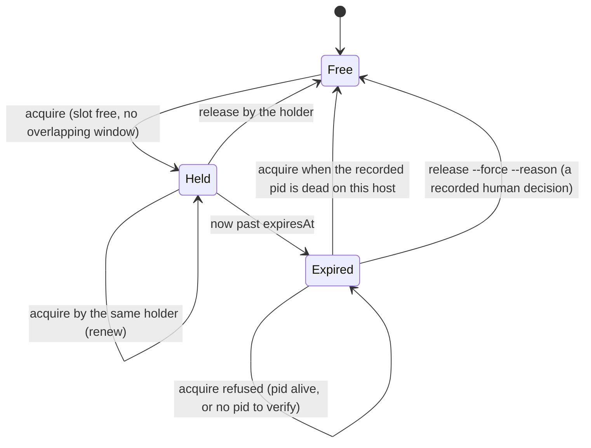

# Plan: fleet machine-wide lease (`fleet lease`)
- **Date**: 2026-10-13
- **Status**: Draft
- **Author**: Claude + Louis
- **Scope**: backend (a CLI verb over one shared state file; no UI) · stack `js-ts` (`detect-stack`: `js-ts`)
- **Target domain(s)**: `fleet`, `skills-content`
- ⚠ **Cross-domain work** — touches `fleet` (the verb) and `skills-content` (the coordination and participant rules that name it); the seam is documentation of a CLI that exists, so the crossing is intentional.
- **Depends on**: none. Part 2's `fleet propose` (#240) is merged; this plan folds in the participant step 9 wording that PR deferred.

Origin: theme CES: Coordination & gate throughput, Part 4. Coordination rule 14 says one heavy job at a time on a shared machine, and the only mechanism for "is the slot free" has been a message to the coordinator. Rule 15 records the cost: on 2026-10-13 cross-repo relays hit the host's 10-messages-per-turn cap. This plan gives the slot, the announced windows and the peak hours one shared, readable record, so a session asks a file instead of a person.

## 1. Context Summary

### 1.1 What exists today (all `(972e5077)`)

- **Coordination is per repo.** All fleet state lives under `<git-common-dir>/fleet/` (`fleetDir`, `scripts/lib/fleet/registry.mjs:150`), written under `fleet/.lock` by `transact` (`registry.mjs:285`). Two repos on one machine share nothing, which is exactly where rule 14 bites.
- **The slot is conversational.** `skills/fleet/references/coordination.md` rule 14 (the "gate slot"), participant step 4b (run `guards:preflight` before asking for a slot) and rule 15 (message budget) describe it; no file records who holds it.
- **`fleet hold on|off`** (`argv.mjs:22`) is a per-repo "hold heavy runs" flag for one repo's sessions. It is not machine-wide and carries no holder, expiry or end time.
- **`fleet next`** (`scripts/lib/fleet/coordination.mjs:157`) already relays derived FYI lines from caches (prune count, unregistered work, proposals) and is silent when a measured count is empty; `pruneNext` (`coordination.mjs:128`) is the pattern for "unmeasured is never zero".
- **Locking.** `withFileLockSync` (`scripts/lib/file-lock.mjs:431`) is the repo's sentinel-file lock; `isPidAlive` is exported (`file-lock.mjs:471`). `acquireRefreshLock` (`scripts/symbol-index/refresh-lock.mjs:131`) reclaims a stale holder by heartbeat, which needs a long-running holder process.
- **Verb plumbing.** `VERBS` (`argv.mjs:16`) declares flags; `scripts/fleet.mjs` dispatches in one `switch` (`fleet.mjs:133`-`139`); results are `ok`/`refused`/`failed` (`commands.mjs:57`-`59`) mapped to exit 0/3/1; `selfId` (`commands.mjs:87`) gives the session identity.
- **Tests spawn the real CLI** through `tests/helpers/fleet-cli-harness.mjs` and `scrubbedEnv` in `tests/helpers/fleet-repo.mjs:153`, so one place controls the environment of every fleet CLI test.

### 1.2 Code Trace

`fleet next` → `cmdNext` `coordination.mjs:157` → `pruneNext`/`unregisteredFooter`/`readProposalsSummary` → `fyi` lines `coordination.mjs:168` → printed. A lease line joins that array. `fleet lease acquire` → `parseVerbArgs` `argv.mjs:61` → new `cmdLease` → `withFileLockSync` on `<machine dir>/lease.lock` → read, decide, `atomicWriteFileSync` `lease.json` → `ok`/`refused`.

### 1.3 Neighbourhood considered

`get-neighbourhood` returned band **`review`** for every candidate (nothing cleared this repo's noise floor). Nearest, opened and decided on the code:

| Candidate | Decision |
|---|---|
| `scripts/lib/file-lock.mjs` `withFileLockSync`, `isPidAlive` | **Reuse** for the write lock and the liveness probe. |
| `scripts/symbol-index/refresh-lock.mjs` `acquireRefreshLock` | **Sibling, not reuse.** Its stale test is a heartbeat from a long-running process; our holder is a short CLI that exits, so the heartbeat has no writer. |
| `scripts/lib/azure-throttle.mjs` `acquire` | Different problem (in-process concurrency counter). Not reused. |

### 1.4 Past incidents to verify against

INC-001 (a path classified lexically while a symlink pointed elsewhere) and INC-002 (a destructive step gated on "a variable is set", not on "the target is safe"). Neither concerns fleet state, but both carry a lesson this plan applies: the lease directory is operator-supplied, so it is resolved to an absolute path and the lease file is refused when it is a symbolic link (D1); and `acquire` over an expired lease is gated on evidence about the process, never on the clock alone (D4).

## 2. Proposed Architecture

### 2.1 Right-sizing (the three lines)

- **Band-aid extreme**: keep relaying through the coordinator, or have each repo write a text note by hand. The cap incident repeats; nothing is checkable.
- **Over-engineered extreme**: a lock server or daemon with a fair queue, priorities, hook enforcement in `pre-push`, cross-host leases and a scheduler. The brainstorm (session 1791894535313) rejected a DAG scheduler, and fleet is cooperative by design.
- **Chosen**: one JSON file, six cooperative sub-commands, no queue and no enforcement. It serves the current requirement: *a session can read who holds the one heavy slot and which windows are announced without a message.* Everything else is deferred (section 8).

### 2.2 Decisions

- **D1 — Location and trust (#4, #13).** `machineDir(env)`: `FLEET_MACHINE_DIR` if set (must be absolute, else a config error naming it), otherwise `<os.homedir()>/.claude-fleet`. Files: `lease.json`, `lease.lock`. The default is the only directory every repo's fleet reaches with no per-repo configuration. A `lease.json` that is a symbolic link is refused, never followed. Known limit, stated in the runbook: two OS users, or WSL beside Windows, have different homes, so they must set `FLEET_MACHINE_DIR` to a shared path.
- **D2 — One record, schema v1 (#3, #12).** `lease.json` is a zod object: `schemaVersion` (1), `heavy` (null or the slot), `windows[]`, `peakHours[]`, `events[]` (last 20 forced or taken-over changes, so a forced release leaves evidence). **Versioning is explicit because checkouts of different ages share this one file (Gemini G1)**: within a `schemaVersion`, unknown keys are tolerated on read and preserved verbatim on rewrite (`.passthrough()`), so an additive field from a newer checkout never makes an older one call the file corrupt; a breaking change bumps `schemaVersion`. A file whose `schemaVersion` is newer than this checkout understands is `newer-version`: `status` and `next` still say what they can, every mutation is refused with "written by a newer fleet; update this checkout", and `release --force` does not touch it (it is not corrupt). A bad time, an over-long note or a wrong type still makes the file `unreadable`, never silently defaulted. Written with `atomicWriteFileSync` under `lease.lock`.
- **D3 — The heavy slot.** `heavy = { holder, repoKey, repo, kind, note, scope, pid?, token, startedAt, expiresAt }`. `kind` is `gate | test | timing | maintenance`. **Identity is the pair `(repoKey, holder)`**: `holder` is `selfId` (`--id` or the branch), and `repoKey` is a short hash of the checkout's real git common directory, so two repos that both use `main` or the same `--id` are different holders (a bare branch name is never an identity on a machine-wide record). `repo` is the origin slug (folder name, then `unknown`, as fallback), kept for display only and never compared. **`holder` and `repo` are each 1 to 80 characters with no control characters**, so `holder@repo` always fits an event's 200-character `by`; a longer session id is an argument error naming `--id` (truncating would make two long branches sharing a prefix one holder). `--for <minutes>` defaults to 30 and is capped at 180; `expiresAt` is `now + for` and is also the expected end (one field, so two clocks cannot disagree).
- **D4 — Expiry is not proof the process stopped (the brief's rule).** `acquire` against an existing slot decides in this order, all fail-closed:
  1. same `(repoKey, holder)` → **if `--token` is supplied it must match the current token, and the call renews** (new `expiresAt`, same token); **if it is omitted, the call is a fresh acquisition by the same identity: it extends the lease and ROTATES the token**, so any earlier job's token is stale from that moment (Gemini round-2 G1: an unauthenticated renewal must never inherit the previous token); a supplied token that does not match is refused;
  2. not expired → **refused**, naming holder, repo and end time;
  3. expired and `pid` recorded in **this scope** and `isPidAlive(pid)` → **refused** ("expired but its process is still running");
  4. expired and `pid` recorded in this scope and dead → **granted**, with a `taken-over (pid N dead)` event;
  5. expired and no `pid`, or a different scope → **refused** as `unverifiable`; the only way past it is `release --force --reason`, which is a recorded human decision, not an inference.
  **Scope** is `<os.platform()>:<os.hostname()>`, recorded with the pid: a pid means something only inside the process namespace that issued it, and Windows and WSL report different platforms, so a WSL-issued pid is never probed from Windows (it reads `unverifiable`, not dead). The residual limit, stated in the runbook: two containers or VMs that share both platform and hostname would share a scope without sharing pids; a pid dead in one and alive in the other would be granted wrongly. A pid that was reused reads as alive and refuses: the safe direction. The pid is only ever one the caller names: **the CLI's own pid is never recorded** (it exits at once, so it would read dead and open the slot to a takeover while the job runs). It is the long-lived job's (the gate or test runner), recorded by `acquire --pid <n>` or, because the job usually starts after the slot is taken, by `attach --pid` (D5b).
- **D5 — Release.** By the holder (its id or its token). `--force --reason <text>` is allowed only when the slot is expired or the file is corrupt, never on a live lease, and it appends an event. A corrupt file is recovered in an order that never leaves the path empty: its bytes are first COPIED to `lease.json.corrupt-<time>` (a failed copy aborts and leaves the original), then a fresh valid record is published over it by one atomic rename. Unlocked readers therefore see either the corrupt file (`unreadable`) or the fresh one, never no file.
- **D5b — Attaching the job's pid (audit M1).** The slot is taken before the job exists, so its pid is unknown at `acquire`. `lease attach --pid <n>` (holder only, slot not expired) records it after launch; `acquire --pid` remains for a caller that already has one. A slot with no pid attached stays valid until `expiresAt`, and only then reads `unverifiable` (D4 rule 5): the cost of forgetting is a recorded human decision, never a silent grant.
- **D6 — Announced windows.** `announce --kind quiet|ci [--from <iso>] --until <iso|+Nm> [--note]` records a window for this repo; `announce --clear-window <id>` removes one. Windows end by the clock and are pruned on write once an hour past. `acquire` is **refused** when the requested interval overlaps another repo's window (rule 14: a gate beside another repo's CI pushed it past its time cap twice); the holder shortens `--for` to end before the window, or waits. There is deliberately no override flag: a coordinator who must proceed clears the window.
- **D7 — Peak hours.** `peak --hours "09:00-12:00,14:00-17:00" | --clear` stores machine-local-time ranges. They are informational: `status` and `next` say "peak now" or the next range; `acquire` for `gate`/`test` during peak prints a warning line and still grants.
- **D8 — `status` and `next` (#16, #18).** `fleet lease status [--json]` prints the slot (free, held, expired with its verification verdict), windows ending after now, and peak state; **an unreadable or newer-version file prints `UNMEASURED` and exits 1**, so a script reading the exit code cannot take it for "free". `fleet next` adds FYI lines only when something is worth saying: slot held or expired, a window active or starting within 4 hours, peak now, or **unmeasured (reason)** when the file cannot be read. A measured free slot with nothing announced stays silent, like prune and proposals; an unreadable file is never rendered as free.
- **D9 — No enforcement, no hook.** `pre-push` is unchanged. The lease is read and written by cooperating sessions; the coordinator keeps priority through `hold` and directives (rule 14 still decides *who goes next*; the lease answers *is it free*).
- **D10 — Verb surface.** One verb, `lease`, with a required sub-command (`acquire | attach | release | status | announce | peak`), so `VERBS` gains one entry, not six. Exit codes follow the existing map: 0 ok, 3 refused, 1 error (lock contention, unreadable file), 2 argv.

### 2.2b Record shapes, limits and flag matrix (audit M2, M3)

- **Times** are ISO-8601 UTC strings ending in `Z`; `--from`/`--until` also accept `+<N>m` relative to now. **Ids**: `token` is 16 hex characters; a window id is `w-<yyyymmddhhmmss>-<4 hex>`. **Notes** are at most 200 characters with no control characters; `--reason` the same.
- **Shapes**: `window = { id, repoKey, repo, kind: 'quiet'|'ci', from, until, note? }`; `peakHours[] = { from: 'HH:MM', to: 'HH:MM' }` (machine-local; `from > to` means across midnight); `event = { at, kind: 'forced-release'|'taken-over'|'corrupt-recovered', by, reason }`.
- **Cardinality**, all limits inclusive maxima: at most 50 windows machine-wide and 10 per repo; `--until` at most 14 days ahead and a window at most 24 hours long; at most 8 peak ranges. A write that would exceed one is **refused**, never trimmed silently. **`events` is the one exception, because it is a ring and not input**: it keeps the newest 20 and drops the oldest on append, so a forced release or takeover is never refused for lack of room (that would block the recovery path it exists to record). Windows ended more than an hour ago are pruned on every successful write.
- **Flags**: `acquire [--kind] [--for <1-180>] [--pid <n>] [--token <t>] [--note] [--id]` · `attach --pid <n> [--token <t>] [--id]` · `release [--token <t>] [--id] [--force --reason]` · `status [--json]` · `announce --kind quiet|ci [--from] --until [--note] [--id]` or `announce --clear-window <id>` · `peak --hours <list>` or `peak --clear`. Every sub-command accepts `--json`. A holder is identified by `(repoKey, --id or the branch)`. **`acquire` prints the slot's `token` (and returns it in `--json`); `attach`, `release` and a renewing `acquire` also accept `--token <16 hex>`, and when it is supplied it must match the current token or the call is refused as a stale fence (Gemini G2, audit R1 H1).** A wrapper that holds the slot for a job passes the token it was given, so a zombie from an earlier acquisition by the same holder cannot release the current one. Omitting `--token` on `attach` or `release` falls back to identity alone, and omitting it on `acquire` rotates the token (D4 rule 1); those are the stated limits of a bare call, not hidden ones.
- **Exit codes**: 0 ok · 3 refused (slot held, window overlap, unverifiable, limit exceeded, not the holder) · 1 error (lock contention, unreadable file, write failure) · 2 argv.

### 2.3 Failure semantics (Phase 1.5)

Every mutating sub-command is one read-decide-write under `lease.lock` (`withFileLockSync`), so concurrent acquirers from different repos serialise; the loser re-reads and is refused by rule 2. Lock contention returns exit 1 and changes nothing. A write that fails after the decision returns an error and the file is unchanged (atomic rename). The clock is `ctx.now` (`FLEET_NOW` pins it in tests).

## 6. Sustainability Notes

- **Assumptions that could change**: one machine, one OS user, one heavy slot. Two slots would be a list under `heavy`; cross-host would need a different substrate (a lock server). Both are named in section 8 and neither is built.
- **Seams**: `lease.mjs` is pure over an injected clock, pid probe and filesystem root, so the policy (D4, D6) is tested without a process or a real home directory; `lease-cmd.mjs` only parses and renders.
- **Consumer sync (AGENTS.md Tier 3(b))**: `scripts/fleet.mjs` and `scripts/lib/fleet/**` are in the sync closure, so both new modules reach consumers and must survive relocation: imports stay inside `scripts/lib/**`, nothing resolves `import.meta.dirname/..`, and `tests/relocation-guard.test.mjs` imports them. The change lands with that test in the same commit. A consumer that never calls `fleet lease` sees only the new FYI line in `fleet next` when a lease exists.

## 7. File-Level Plan

| File | Intent | Purpose |
|---|---|---|
| `scripts/lib/fleet/lease.mjs` | create | Schema, `machineDir`, read/write, `classifyHeavy` (D4), `windowConflict` (D6), `parsePeak`, `leaseSummary`/`leaseLines` for `next`. Pure over injected `{now, isPidAlive, host, fs}`. |
| `scripts/lib/fleet/lease-cmd.mjs` | create | `cmdLease(ctx, flags, positionals)`: the six sub-commands, rendering, exit codes. |
| `scripts/lib/fleet/argv.mjs` | modify | `lease` entry in `VERBS`. |
| `scripts/fleet.mjs` | modify | import, `case 'lease'`, header usage line. |
| `scripts/lib/fleet/coordination.mjs` | modify | `cmdNext` appends the lease FYI lines and a `lease` field in `--json`. |
| `scripts/lib/fleet/telemetry.mjs` | modify | Register the verb and its sub-command as a mode (closed vocabulary), if the file's verb list requires it. |
| `tests/helpers/fleet-repo.mjs` | modify | `scrubbedEnv` sets `FLEET_MACHINE_DIR` to a throwaway directory so no fleet CLI test reads or writes the machine's real lease. |
| `tests/fleet-lease.test.mjs` | create | The policy and store, hermetic. |
| `tests/fleet-lease-cli.test.mjs`, `tests/fleet-lease-state-cli.test.mjs`, `tests/helpers/fleet-lease-world.mjs` | create | The real binary: two repos sharing one `FLEET_MACHINE_DIR`. Split in two files (slot, expiry and token / windows, peak, unreadable file, argv) because one file took 62 s, and fleet CLI files set the gate's wall time (`docs/runbooks/gate-cost.md`); the helper holds the shared two-repo setup. |
| `tests/relocation-guard.test.mjs` | modify | The two new modules are in the sync inventory, pass the relocation scans and import cleanly (the guard is inventory-driven, so this adds the explicit assertion). |
| `skills/fleet/references/coordination.md` | modify | Rule 14 names `fleet lease`; rule 15 notes the lease replaces most slot relays. |
| `skills/fleet/references/participant-rules.md` | modify | Step 4b: take the slot with `fleet lease acquire` and release it; step 9: record findings with `fleet propose`; the "why" paragraph. |
| `skills/fleet/SKILL.md` | modify | Verb table row for `lease`. |
| `docs/runbooks/gate-cost.md` | modify | One paragraph: the lease and its `FLEET_MACHINE_DIR` limit. |
| `.claude/skills/fleet/**`, `skills.manifest.json`, `docs/plans/README.md`, `scripts/lib/bundle-deps.json` | generated | Regenerated, never hand-edited. |

### 7b. Implementation Phases

**Phase 1 — Core**: the lease record, policy and `next` lines, tested without a CLI. Files: `scripts/lib/fleet/lease.mjs` (create), `tests/fleet-lease.test.mjs` (create).
**Phase 2 — Verb and wiring**: the six sub-commands, the dispatcher, `fleet next`, the hermetic test environment and the relocation test. Files: `scripts/lib/fleet/lease-cmd.mjs` (create), `scripts/lib/fleet/argv.mjs` (modify), `scripts/fleet.mjs` (modify), `scripts/lib/fleet/coordination.mjs` (modify), `scripts/lib/fleet/telemetry.mjs` (modify), `tests/helpers/fleet-repo.mjs` (modify), `tests/helpers/fleet-lease-world.mjs` (create), `tests/fleet-lease-cli.test.mjs` (create), `tests/fleet-lease-state-cli.test.mjs` (create), `tests/relocation-guard.test.mjs` (modify).
**Phase 3 — Rules and docs**: the participant and coordinator rules, including step 9's `fleet propose` wording. Files: `skills/fleet/references/coordination.md` (modify), `skills/fleet/references/participant-rules.md` (modify), `skills/fleet/SKILL.md` (modify), `docs/runbooks/gate-cost.md` (modify).
**Close-out (not a phase)**: `npm run skills:regenerate`, `npm run plans:index`, `npm run bundle:deps`, `npm run guards:preflight`.

The work is one cohesive unit (the policy in Phase 1 is the contract Phases 2 and 3 render), so there is no §11 clustering: one `/audit-code` over the union diff, then the consolidated Gemini gate.

## 8. Risk & Trade-off Register

| Risk | Disposition |
|---|---|
| A fleet CLI test reads the machine's real lease, so a live gate slot changes its output (flaky and non-hermetic). | `scrubbedEnv` sets `FLEET_MACHINE_DIR`; a test fails any fleet-spawning test file that does not route its env through it. |
| Two OS users or WSL beside Windows do not share a home directory. | `FLEET_MACHINE_DIR` override; the runbook states it; `status` prints the resolved directory so a split is visible. |
| A reused pid reads as a live holder. | Fail-closed by design; `release --force --reason` is the recorded way past it. |
| A holder that omits `--pid` leaves its expired lease unverifiable. | Refused as `unverifiable`; the step 4b wording tells the holder to pass the job's pid. |
| Sessions race to take the slot, bypassing the coordinator's ordering. | Cooperative by design (D9): the lease says free or not; `hold` and directives keep priority with the coordinator. Surfaced in the final report as a decision, not decided silently. |
| Checkouts of different ages share the file (an older one meets a newer field or `schemaVersion`). | D2: unknown keys tolerated and preserved within a version; a newer version is read-only for older checkouts and named as such, never called corrupt. |
| The lease file is edited by hand into an invalid shape. | `unreadable`: `next` says unmeasured, `acquire` refuses, `release --force --reason` moves it aside. |

**Deferred, and why that is OK**: a fair queue (the one-job rule needs only a yes/no), more than one slot, cross-host leases, a `pre-push` check of the lease (hooks stay unchanged), and an auto-renew heartbeat (the holder's `--for` plus a same-holder re-acquire covers a long run).

## 9. Testing Strategy

- **Tier 1, test-first** (`tests/fleet-lease.test.mjs`, deterministic): D4's five rules each with a red case (a fixture that must refuse, and the control that grants); renew by the same holder; expiry at the exact boundary; window overlap (inside, adjacent, other repo only, own repo allowed); cap on `--for`; schema strictness (unknown key, bad time, over-long note); symlinked `lease.json` refused; corrupt file moved aside; `events` capped at 20; `next` lines silent when quiet and `unmeasured` when unreadable; peak ranges including one that crosses midnight. Added by the plan audit: two repos using the same holder name are different holders (repo B cannot renew repo A's slot); a pid recorded under another scope reads `unverifiable`, never dead; corrupt-file recovery copies before it publishes and a reader between the two steps never sees a missing file; `attach` by a non-holder or on an expired slot is refused; every cardinality and horizon limit accepts a write that lands exactly on the maximum and refuses the one past it; the `events` ring accepts a 21st entry and drops the oldest. From the final review: a file with an unknown extra key is read, round-trips with the key intact and is not reported corrupt; a newer `schemaVersion` reads as `newer-version`, refuses every mutation and is not touched by `release --force`; a `release --token` with a superseded token is refused while the current token succeeds; an `acquire` by the same identity without `--token` rotates the token (the old one is then refused), with the matching token keeps it, and with a wrong token is refused; `acquire` never records its own pid (a lease acquired without `--pid` has no pid).
- **Tier 3(b), same commit**: `tests/relocation-guard.test.mjs` asserts both modules are in the consumer sync inventory, pass the relocation scans (no parent-resolve, no hard-coded spawn of `scripts/...`) and import cleanly from the source layout. The relocated-layout proof itself is the consumer-side verifier, `sync-isolation-verify.mjs`, run after a sync (`/ship` Step 6.8); `fleet.mjs` imports `lease-cmd.mjs` statically, so a module missing there also fails `fleet.mjs --selfcheck-relocation` in the smoke.
- **CLI** (`tests/fleet-lease-cli.test.mjs`): the real binary, two throwaway repos sharing one `FLEET_MACHINE_DIR`. Repo B's `acquire` is refused while repo A holds; A's `release` frees it; an expired lease with a live pid (the test's own process) refuses and with a dead pid (a spawned-and-exited child) grants; two concurrent `acquire`s grant exactly one; `fleet next` in repo B shows A's lease; `--json` shape; exit codes.
- **Negative controls**: each policy test is run once with its decision inverted and seen to fail.
- **Cleanup**: new tests remove directories with the retry form `{recursive:true, force:true, maxRetries:3, retryDelay:50}` (`tests/rmsync-retry-guard.test.mjs`).
- **Preflight**: `npm run guards:preflight` after Phase 3.

## Out of Scope (Future)

Fair queue; multiple slots; cross-host leases; hook enforcement; auto-renew heartbeat; a coordinator-facing `fleet lease` summary in `fleet status`.

## Audit Trail

`/audit-plan` session `audit-plan-1791917512211-55620` (2026-10-13), `--mode plan`.

| Reviewer | Round | Result | Disposition |
|---|---|---|---|
| GPT (`gpt-6.1-sol`) | 1 | NEEDS_REVISION, H:3 M:3 | 6 of 6 accepted and fixed (100%): H1 identity collision across repos (identity is now `(repoKey, holder)`), H2 pid probed outside its process namespace (a recorded `scope`), H3 non-atomic corrupt recovery (copy, then one atomic publish), M1 the job's pid is unknown at acquire (`attach`), M2 undefined record shapes and flags (section 2.2b), M3 unbounded growth (cardinality and horizon limits) |
| GPT | 2 | NEEDS_REVISION, H:1 M:1 | 2 of 2 accepted and fixed: both were inconsistencies in the round-1 wording (the `events` ring versus the refuse-over-limit rule; inclusive maxima in the boundary test) |
| GPT | 3 | **READY_TO_IMPLEMENT, H:0 M:0 L:0** | converged |
| Gemini (`gemini-pro-latest`) | 1 | CONCERNS, gate `blocked`: blocking 3, new 3, wrongly dismissed 1 | 4 of 4 accepted and fixed: G1 forward compatibility of a file shared by checkouts of different ages (`.passthrough()` within a version, `newer-version` read-only state), G2 and the wrongly-dismissed round-1 H1 (my handling was wrong: an optional `--token` that must match when supplied), G3 the CLI's own pid is never recorded |
| Gemini | 2 (`--prior` round 1) | CONCERNS, gate `blocked`: blocking 1, new 1, wrongly dismissed 0 | G1 accepted and fixed: a renewing `acquire` without `--token` must not inherit the previous token, so it rotates it (D4 rule 1). **The cap is two Gemini rounds, so this fix was not re-reviewed by Gemini.** It is a concrete, unit-testable design correction; the code audit checks it against the implementation |

Acceptance rate across the three GPT rounds: 8 of 8 findings accepted (100%), so the rigor-pressure stop did not apply; the loop stopped on a clean round 3.

### Code audit

`/audit-code` session `audit-code-1791919872176-65464` (2026-10-13), `--scope diff`.

| Reviewer | Round | Result | Disposition |
|---|---|---|---|
| GPT (`gpt-6.1-sol`) | 1 | SIGNIFICANT_ISSUES, H:6 M:10 | 15 of 16 accepted and fixed (94%), 1 dismissed (a tool coverage notice): H1 a renewal rebuilt the record and dropped the attached pid, H2 identity labels could make a generated event exceed its schema, H3 non-unique window ids, H4 a directory that is a file read as "nothing announced" (and on Windows reports ENOENT, not ENOTDIR), H5 `status` exited 0 on an unmeasured lease, H6 `repoKeyOf` fell back to the lexical path, M1 the recovery reason was dropped, M2 extra positionals ran the first sub-command, M8 this plan over-claimed a relocated-layout import, M9 file URLs built by hand |
| GPT | 2 (sustainability, backend) | **PASS, H:0 M:0** | converged |
| Gemini (`gemini-pro-latest`) | 1 | CONCERNS, gate `blocked`: blocking 1 | G1 (a long branch name crashing on the 80-character limit) **challenged with evidence**: `badIdentity` runs first in every decision, so it is an argument error (exit 2); a CLI test drives it and fails if the check is removed |
| Gemini | 2 (`--prior` round 1) | CONCERNS, gate `blocked`: blocking 2 | The reviewer accepted the challenge. G1 (an empty repo label at a filesystem root) accepted and fixed (`repoLabel`, never empty, clipped, no control characters), with unit tests. G2 (`--pid 0` reaching the schema) **challenged**: the decision functions already refuse a non-positive pid as an argument error; a CLI test now drives `attach`/`acquire` with `--pid 0` and `00`. **The cap is two Gemini rounds, so these two answers were not re-reviewed by Gemini.** |

## Remaining steps (checkpoint 2026-10-13, at the /ship handoff)

State: implemented, tested and audited; **not pushed, no PR**. Branch `claude/machine-lease`, one commit `04151c75` on main `972e5077`, tree clean, `guards:preflight` PASS (not the full gate). The claim `claude/machine-lease` is held, waiting on `human:/ship` (the user types the /ship command; the coordinator grants the gate slot, since the lease is not on main yet and cannot arbitrate its own landing).

1. **Rebase first.** `git fetch origin main`, then `git rebase origin/main`. If main moved under `skills/fleet/**`, `scripts/fleet.mjs`, `scripts/lib/fleet/argv.mjs` or `coordination.mjs`, resolve by hand; for the generated files (`skills.manifest.json`, `docs/plans/README.md`, `scripts/lib/bundle-deps.json`, `.claude/skills/**`) take either side and regenerate: `npm run skills:regenerate`, `npm run plans:index`, `npm run bundle:deps`. Re-run `npm run guards:preflight` and `node --test tests/fleet-lease.test.mjs tests/fleet-lease-cli.test.mjs tests/fleet-lease-state-cli.test.mjs tests/relocation-guard.test.mjs`.
2. **The user types `/ship docs/plans/fleet-machine-lease.md`.** It writes the status.md entry (set the Backlog line from `node scripts/backlog-snapshot.mjs`), fills this plan's Implementation Log, commits with `scripts/ship-commit.mjs` (`--gate converged`: the audited tree differs from the committed one after the rebase and the status entry) and pushes. The push needs a gate slot: ask the coordinator, or take it with `fleet lease acquire --kind gate --for 30` once this verb is on main.
3. **Expect the pre-push gate to be the first full run of the new tests.** Last session the first push of Part 3 was blocked by two whole-suite guards its new files tripped (`extension-list-drift`, `skill-command-portability`); `guards:preflight` does not cover those two, so run them by hand before the push: `node --test tests/extension-list-drift.test.mjs tests/skill-command-portability.test.mjs tests/skills-artifact-freshness-wiring.test.mjs`.
4. **Open the PR** (`gh auth` must be the Lbstrydom account), bind it with the ccd_pr tools, and report: branch, PR, files changed, red/green evidence, Findings. Do not merge; the coordinator merges, pinned to the audited head.
5. **After the merge**: release the claim (`fleet release --id claude/machine-lease`); confirm in each consumer's MAIN checkout that the next sync delivered `scripts/lib/fleet/lease.mjs` and `lease-cmd.mjs` (`node scripts/.claude-skills/lib/sync-isolation-verify.mjs`); the first real use is the coordinator taking the slot with `fleet lease acquire`.

Decisions still open for the user: (a) whether sessions may take a free slot without asking the coordinator (the plan keeps it cooperative; rule 14 says the coordinator still orders); (b) `FLEET_MACHINE_DIR` for two OS users or WSL beside Windows.

Findings to carry into the final report: `guards:preflight` omits `extension-list-drift` and `skill-command-portability`; the fleet gate contract needed an `ignoredCandidates` entry for the new SKILL.md verb row; a bash heredoc collapses `\\\\` and can write a literal NUL into a source file (write script files with the Write tool).
