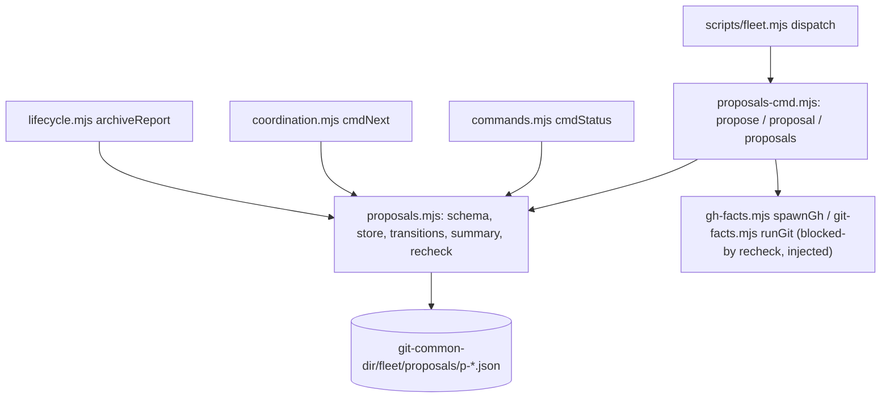

# Plan: fleet findings intake queue (`fleet propose`)
- **Date**: 2026-10-13
- **Status**: Draft
- **Author**: Claude + Louis
- **Scope**: backend (Node CLI, `scripts/lib/fleet/**`). Stack `js-ts`.
- **Target domain(s)**: `fleet`
- **Origin**: CES theme "Coordination & gate throughput", Part 2; coordinator rules 10-15 (merged as 03d81e74, #237); brainstorm session 1791894535313 ("queue findings, not sessions"; do not build a DAG scheduler).

## 1. Context Summary

**The problem.** Coordinator rule 10 says every finding gets exactly one recorded outcome (folded, queued, declined, done) and the open queue is shown to the user at each check-in. Today that queue is a table in a coordinator's private memory file (`project_ces_pending_findings.md`). It dies with that session's memory, no other session can add to it, and `fleet status`/`fleet next` cannot see it. Workers are told never to spawn chips (participant step 9) but have nowhere durable to put a finding except their final report.

**What exists** (Code Trace, pinned to `03d81e74`):
- `scripts/lib/fleet/directives.mjs` (`03d81e74`) is the same shape of problem already solved: one JSON file per record under `<git-common-dir>/fleet/directives/`, zod `strictObject` schema with `schemaVersion`, `classifyDirective` returning valid / `unsupported` / `invalid`, bounded reads that report `complete:false` past the cap instead of a short list, writes under the registry lock via `transact`, nothing deleted.
- `scripts/lib/fleet/registry.mjs` `fleetDir(cwd)`, `transact(dir, fn)`, `assertManaged(dir, p)` give the shared directory, the lock, and path containment.
- `scripts/lib/fleet/prune-summary.mjs` (#235) is the surfacing pattern to reuse: one `status` line, `next` relays it as FYI, **unmeasured is never zero**, a count known to be wrong is replaced not left. Its call sites: `commands.mjs` `statusPrune`/`cmdStatus` and `coordination.mjs` `pruneNext`/`cmdNext`.
- `scripts/lib/fleet/lifecycle.mjs` `archiveReport`/`renderArchive`/`cmdArchiveCheck` is where "what would archiving lose" is reported; the verdict derives from risks and `unverified`, and must not be changed by a proposal (a proposal is stored in the git common dir, so no worktree removal can lose it).
- `scripts/lib/fleet/argv.mjs` `VERBS` is the per-verb flag table; `scripts/fleet.mjs` dispatches.

**Known drift folded in:** the stale comment at `scripts/lib/fleet/lifecycle.mjs:28` ("participant rule 7", now step 9) is queued in the interim list as "fold into the next fleet change"; this is that change.

**Neighbourhood considered.** `get-neighbourhood` over `scripts/lib/fleet/directives.mjs` and `prune-summary.mjs` with intent "durable per-record store with outcome states and a status summary": nothing occupies the space as a proposal queue; `directives.mjs` and `prune-summary.mjs` are the precedents, reused as patterns (not extended: a directive is a time-boxed request addressed to a session, a proposal is an undated finding with a lifecycle; different schema, different reader).

## 2. Proposed Architecture



**Store** (`<git-common-dir>/fleet/proposals/`, one `p-<yyyymmddhhmmss>-<4 hex>.json` per proposal; a new sibling of `sessions/`, `directives/`, so an older bundle that opens only `sessions/` and `trains/` never sees it, as directives did):

```
{ schemaVersion: 1, id, what, where, why, evidence?, theme?,
  blockedBy?: { kind: 'pr', ref: '#N', repo?: 'owner/name' } | { kind: 'branch', ref },
  originator: { id, branch|null }, createdAt,
  state: 'pending'|'folded'|'queued'|'declined'|'done',
  history: [{ at, state, by, detail? }] }
```

- `what`/`where`/`why` required (1-600 chars, no control characters); `evidence` optional (<=1000); `theme` a slug (`^[a-z0-9][a-z0-9._-]{0,39}$`); `history.detail` <=500 and `by` <=200. **Bounded record**: `history` holds at most 50 entries, creation being the first. The last slot is **reserved for a final outcome**: a non-final transition (`queued`, `folded`) that would make the 50th entry is refused with "history nearly full; decide it with a final outcome (done or declined)", while `done`/`declined` are accepted up to and including the 50th entry, so a record can always be closed. And a file over 64 KiB is read as an unreadable record with a reason, never skipped silently. This bounds both the rewrite cost of a transition and the parse cost of a status read.
- **`blockedBy` identity.** A PR blocker is stored as `#N` plus, **only when the user supplied a PR URL**, the `owner/name` repository from it (`repoFromPrUrl` in `scripts/lib/fleet/gh-facts.mjs`); a bare `#N`/`N` means "a PR of this repository". The recheck passes `--repo owner/name` whenever a repo is stored, so a URL for another repository is queried against that repository and a same-numbered PR here is never consulted. A branch blocker is a bare branch name (no `refs/` prefix, no whitespace, not starting with `-`).
- **`originator.id` is the authoritative identity**: the same value `selfId` gives every other verb (`--id`, else the current branch). `originator.branch` is creation-time provenance only and is never matched on.
- `pending` means **untriaged** (no outcome yet). The four outcomes are the brief's: `folded <session>`, `queued <reason>`, `declined <reason>`, `done <PR>`. Each transition appends a history entry whose `detail` is **required and non-empty** (a session id, a reason, a `#N` PR ref); the record's `state` must equal its last history entry (schema refinement). Nothing is deleted or rewritten except by appending.
- Transitions: from `pending` or `queued` to any outcome; `folded` to `queued|declined|done`; `declined` and `done` are terminal (refused, naming the current state). A re-`queued` with a new reason is allowed.
- **Active and closed records are separate directories, so lifetime growth never starves the queue.** A record lives in `proposals/` while `pending`, `queued` or `folded`; the transition to `done` or `declined` is a **two-step with one commit point**: (1) the atomic replace of the record in `proposals/` with its terminal state is the commit; (2) moving it (rename, never delete) to `proposals/closed/<yyyy-mm>/` is an idempotent archival that follows at once. A crash or rename failure between the steps leaves a committed terminal record in the active directory, which is harmless and self-healing: readers count only non-terminal states as open, so a stranded terminal record never inflates a pending count; every mutating command first archives any terminal record still in `proposals/` (under the lock it already holds); and a reader that sees one id in both directories (an unlocked `--all` read straddling a move) keeps the `closed/` copy and drops the other. **Move-aware read order** (a record is only ever moved active -> closed, so reading in that order cannot miss one): enumerate and read `proposals/` first, then `closed/`, then reconcile by id with the `closed/` copy winning; an active file that vanishes between enumeration and open is looked up by id in the `closed/` scan, and if it is not found there either it is reported as an unreadable record (`complete:false`), never silently dropped. **Active-only reads (`status`, `next`, `archive-check`) do not scan `closed/`**, so for them an active file that vanishes between enumeration and open is skipped as not-open only once a bounded lookup (one file name per month directory) finds its closed copy; with no closed copy the read reports it unreadable and is `complete:false`, because a disappearance is not evidence of closure. (Gemini final review G1 first proposed skipping it silently; code-audit round 4 replaced that with this evidence-based rule.) Re-running a transition on a terminal record is refused naming its state, never re-archived twice. **Failure contract**: a failure before the terminal write is an error (exit 1, nothing committed). A rename failure after it is a **committed success**: exit 0, the result carries `archived:false` and `archivalPending:<reason>`, and the text says "recorded as done; archival to closed/ is pending (<reason>) and will be retried by the next proposal command". The pre-mutation sweep archives each stranded record independently (one failing record is reported as a warning and never blocks an unrelated `propose` or transition). Every surface reads only the active directory (`PROPOSALS_CAP = 2000` active records, far above any real queue); `fleet proposals --all` also reads `closed/`, with its own cap reported the same way. An active read past its cap is `complete:false` with `truncated:true`, never a short list.
- **One read-result contract for every surface**: `{ records, complete, truncated, unreadable: [{file, reason}], unsupported: [{file, reason}], reason? }`. A directory that cannot be listed (anything but ENOENT) is `{complete:false, reason}` with no counts, i.e. unmeasured. `complete` is false when anything is unreadable, unsupported, oversized or truncated. Text surfaces turn `!complete` into a lower bound (`≥N`) plus the count of unreadable records; `--json` surfaces carry `complete`, `truncated`, and the per-file diagnostics (at most 20 listed, the full count always present).

**Verbs** (additions to `VERBS`; flags validated by the existing `assertKnownFlags` + `parseVerbArgs`):
- `propose --what --where --why [--evidence] [--theme] [--blocked-by <#N|PR url|branch>] [--id] [--json]` — writes one record under the lock; prints the id.
- `proposal <id> --folded <session> | --queued <reason> | --declined <reason> | --done <PR> [--id] [--json]` — exactly one outcome flag; the value is required. `--id` names who is deciding (`history.by`), defaulting to the current branch like every other verb.
- `proposals [--all] [--json]` — the listing: open (pending + queued + folded) grouped by theme (`(no theme)` last), oldest first; `--all` adds the closed (done/declined) records. Prints each unreadable or unsupported record by file name and reason (first 20), then the count of the rest. Rechecks `blockedBy` against facts and prints the result next to each blocked item.

**Surfaces** (reuse the #235 pattern: one shared line builder so `status` and `next` cannot disagree):
- `fleet status`: a `proposals:` line after the `prune:` line, and `status.proposals` in `--json`.
- `fleet next`: the same line as FYI for the user/coordinator, and `proposals` in `--json`.
- Line grammar: `proposals: 3 pending, oldest 4d (2 queued) — 1 pending more than 3d: triage with fleet proposals`; none pending: `proposals: none pending (2 queued)`; an incomplete read: `proposals: ≥3 pending, oldest ≥4d (2 record(s) unreadable; fleet proposals names them)`; an unreadable directory: `proposals: unmeasured (<reason>)`. A missing `proposals/` directory is a **measured zero** (ENOENT on a directory only a `propose` creates), every other read failure is unmeasured. The 3-day stale flag counts **pending** (untriaged) items.
- `fleet archive-check` (and the advisory render after `release`): a section `open proposals you originated (N awaiting an outcome)` listing id and `what`, matched on `originator.id === <the target's session id, else its branch name>` (the `selfId` convention; the creation branch is never matched). An incomplete read prints `≥N` plus `(K record(s) unreadable, so attribution may be incomplete)`; an unreadable store prints `proposals: unmeasured (<reason>)`. It **does not change the verdict** and is not added to `unverified`.

**`blockedBy` is a field rechecked against facts, not a scheduler.** `proposals` resolves each distinct blocker once, bounded to 20 checks: a PR via `gh pr view <n> [--repo owner/name] --json state,mergedAt` (`MERGED` -> `resolved: PR merged`; `CLOSED` -> `blocker closed without merging`; `OPEN` -> `waiting on PR #n`), a branch via git. **Base**: `ctx.config.baseBranch`, the name `resolveConfig` already resolves (config, else `origin/HEAD`, else `main`; `scripts/lib/fleet/config.mjs`), compared as the fresher of `refs/heads/<base>` and `refs/remotes/origin/<base>` (both resolved to commit ids; merged means the blocker tip is an ancestor of either). **Branch namespace**: `refs/heads/<b>` then `refs/remotes/origin/<b>`; neither present -> `blocker branch is gone` (a fact, not "merged"); present and not an ancestor -> `waiting on branch b`. A blocker or base that cannot be resolved to a commit id, an ambiguous name, or a failed probe is `unknown (<why>)`, never "resolved". The result is a label on the listing; nothing is promoted, assigned, spawned or re-ordered automatically. The runners are injected so tests never touch the network.

**Right-sizing (Design right-sizing).**
- *Band-aid extreme*: keep a markdown/memory table and add a "show it at check-ins" instruction. It is what exists, it is private to one session, and it is how findings were nearly lost.
- *Over-engineered extreme*: a queue database or event log with dependency edges, auto-promotion when a blocker merges, worker assignment, WIP-limit enforcement. The brainstorm (OpenAI + Gemini, with a debate) rejected a DAG scheduler.
- *Chosen*: one JSON file per proposal in the registry directory that already survives worktrees, the directives store's read/write discipline, a summary line shared by two verbs. Serves the brief's current requirements (durable, outlives worktrees, outcomes never deleted, visible at status/next/archive-check, grouped listing, blocked-by as data). Nothing is added for "later".

**Principles cited.** #1 DRY (one line builder, one id/slug validation, directives' read discipline copied as a pattern not a second parser contract), #2 SRP (store separate from command handlers separate from surfaces), #4 no hardcoding (stale days, cap, slug shape are named constants), #7 validation (zod `strictObject`, closed state set, required `detail`), #9 transactions (all writes under `transact`, atomic file replace), #11 testability (injected clock, runners, directory), #13 error handling (unreadable is a reason, never a zero), #18 backward compatibility (new directory, new verbs, existing JSON shapes only gain a key), #19 observability (the surfacing is the feature).

## 3. Execution Model

Operations are independent per proposal. Concurrency: sessions in different worktrees share one common dir, so `propose` and `proposal` take the existing registry lock (`transact`); the id is generated inside the lock and an existing id is refused. A transition is read-validate-append-replace inside the lock using `atomicWriteFileSync`. Reads (`status`, `next`, `proposals`, `archive-check`) take no lock and tolerate a concurrent atomic replace.

## 4. Sustainability Notes

- Assumptions that may change: the 3-day stale threshold (`PROPOSAL_STALE_DAYS`), the read cap, the four-outcome vocabulary (a closed enum plus `schemaVersion`, so a future outcome is an `unsupported` record to an old reader, listed and never rewritten).
- Extension points deliberately built in: the schema version; the injected recheck runners; the line builder shared by every surface.
- Deliberately not built: automatic promotion on a resolved blocker, worker assignment, WIP enforcement, a web view, deletion, edit-in-place of `what/where/why`. Each can be added against the record without a migration; none is a current requirement.

## 5. File-Level Plan

- `scripts/lib/fleet/proposals.mjs` (create): `ProposalSchema`, id/slug/ref validation, `readProposals(dir, {cap, closed})` returning the read-result contract, `writeProposal`, `transitionProposal` (moves a final record to `closed/`), `proposalsSummary(read, now)`, `proposalsLine(summary, cmd)`, `groupByTheme`, `recheckBlockedBy(proposals, {ghRun, gitRun, baseBranch})`, `originatedBy(proposals, id)`. No import of `commands.mjs` (so `commands.mjs`, `coordination.mjs`, `lifecycle.mjs` can import it without a cycle).
- `scripts/lib/fleet/proposals-cmd.mjs` (create): `cmdPropose`, `cmdProposal`, `cmdProposals`, rendering of the grouped listing.
- `scripts/lib/fleet/argv.mjs` (modify): `propose`, `proposal`, `proposals` entries in `VERBS`.
- `scripts/fleet.mjs` (modify): import and dispatch the three verbs; header usage lines.
- `scripts/lib/fleet/commands.mjs` (modify): `cmdStatus` adds the `proposals:` line and `status.proposals`.
- `scripts/lib/fleet/coordination.mjs` (modify): `cmdNext` adds the FYI line and `proposals` in its result.
- `scripts/lib/fleet/lifecycle.mjs` (modify): `archiveReport` gains `proposals`, `renderArchive` renders it, the stale "participant rule 7" comment is corrected to step 9.
- `tests/fleet-proposals.test.mjs` (create): unit tests, store and transitions, summary and line grammar, recheck with injected runners, mutation controls.
- `tests/fleet-proposals-cli.test.mjs` (create): the real CLI against a throwaway repo (`tests/helpers/fleet-repo.mjs`): propose from one worktree and read from another, outcome commands, status/next/archive-check surfaces, unmeasured paths.
- `skills/fleet/SKILL.md` (modify): the three verbs in the verb table.
- `skills/fleet/references/coordination.md` (modify): rule 10 points at `fleet propose` / `fleet proposals` instead of "outside chat" prose, and names the interim memory list as retired.
- `skills/fleet/references/participant-rules.md` (modify): step 9 tells a worker to record an adjacent finding with `fleet propose` (still never a chip).
- `.claude/skills/fleet/SKILL.md`, `.claude/skills/fleet/references/coordination.md`, `.claude/skills/fleet/references/participant-rules.md`, `skills.manifest.json` (regenerate): `npm run skills:regenerate`.

##### 5b. Implementation Phases

**Phase 1 — Store and summary**: schema, id, read/write/transition, summary and line builder, theme grouping, originator match. Files: `scripts/lib/fleet/proposals.mjs` (create), `tests/fleet-proposals.test.mjs` (create).

**Phase 2 — Verbs**: argv tables, handlers, dispatch, blocked-by recheck wiring, the listing. Files: `scripts/lib/fleet/proposals-cmd.mjs` (create), `scripts/lib/fleet/argv.mjs` (modify), `scripts/fleet.mjs` (modify), `tests/fleet-proposals-cli.test.mjs` (create).

**Phase 3 — Surfaces**: status, next, archive-check. Files: `scripts/lib/fleet/commands.mjs` (modify), `scripts/lib/fleet/coordination.mjs` (modify), `scripts/lib/fleet/lifecycle.mjs` (modify).

**Phase 4 — Docs and regeneration**: skill docs, rules 10 and step 9. Files: `skills/fleet/SKILL.md` (modify), `skills/fleet/references/coordination.md` (modify), `skills/fleet/references/participant-rules.md` (modify).

**Close-out (not a phase)**: `npm run skills:regenerate`, `npm run skills:check`, `npm run guards:preflight` (once Part 1 has merged; otherwise the individual gates), the fleet test files.

## 6. Risk & Trade-off Register

- A reader that mis-handles a corrupt record could show a short list: mitigated by the one read-result contract above (`complete`, `truncated`, per-file diagnostics) on every surface, tested with an invalid record, an oversized record, an unsupported version and with the cap lowered.
- Lifetime growth: terminal records leave the active directory, so more than 2,000 closed proposals never hide a pending one (tested with the active cap lowered and closed records present). History is bounded at 50 entries per record.
- `status` is documented as strictly read-only: the proposals read takes no lock and writes no cache (a cache is unnecessary: a directory read of at most 2000 small files, no gh call).
- Forked outcome semantics: "folded" is not validated against live sessions (a coordinator may name a chip not yet registered); trade-off accepted, the detail is free text with a non-empty guard.
- Consumer sync: `scripts/lib/fleet/**` and `scripts/fleet.mjs` are synced to consumers (AGENTS.md Tier 3); the change lands with tests, and the sync/relocation tests run in close-out.
- Deferred: migrating the interim memory table into the store (a one-time coordinator action, offered in the final report, not code).

## 7. Testing Strategy

Tier 1 (deterministic modules, test-first): schema accept/reject (each required field, control characters, unknown key, state != last history entry), id format, slug, `blockedBy` parsing, transition matrix (every allowed and refused edge, terminal states), summary arithmetic (oldest, stale count, queued count), line grammar for every state including unmeasured and lower-bound, theme grouping order, `originatedBy`. Negative controls (red then green): the unmeasured-never-zero rule (an unreadable `proposals` path must not print `none pending`), the never-delete rule (record count and history length only grow), the vacuous-pass guard (a listing test asserts at least one record was found before asserting a filtered view is empty).
Tier 2 (orchestration): the real CLI end to end in a throwaway repo with two linked worktrees: a proposal written from worktree A is listed from worktree B and still listed after worktree A is removed; `status`/`next` lines and `--json`; `archive-check` warns for an originator and not for another session and leaves the verdict unchanged; outcome commands refuse an empty value, an unknown id, a terminal record; `blockedBy` recheck with the fake `gh` (`tests/helpers/fleet-repo.mjs` `installFakeGh`) for merged/open/closed/failed, and a local branch merged / present / gone.
Edge cases: a record written by a future `schemaVersion` is `unsupported` and never rewritten; two concurrent `propose` calls both land; a non-final transition that would take history to 50 entries is refused while `done` is still accepted at the 50th (exact boundary), and a record whose terminal write committed but whose move did not (an injected rename failure) exits 0 with `archivalPending`, is not counted open, is archived by the next mutation even when another stranded record keeps failing, and is not double-listed by `--all`; an active file that vanishes between enumeration and open is found in `closed/` or reported unreadable; a file over 64 KiB is reported unreadable; a PR URL for another repository is rechecked with `--repo` (the fake `gh` asserts the argv, and a same-numbered PR in this repository is not consulted); a blocker merged into `origin/<base>` but not the local base counts as merged, and one whose base cannot be resolved is `unknown`; archive-check attribution is by `originator.id` only (two sessions on the same branch name with different `--id` do not see each other's proposals); `--all` reads `closed/`, and a lowered active cap with closed records present still lists the pending ones.

## 8. Acceptance (backend)

- `fleet propose` from a linked worktree writes under `<git-common-dir>/fleet/proposals/` and the record survives `git worktree remove` of the originator.
- Every outcome command requires its reason/ref and appends history; no command removes or truncates a record.
- `fleet status` and `fleet next` print `N proposals pending, oldest Xd`, flag pending >3 days, and print `unmeasured (<reason>)` rather than `0`/`none` when the store cannot be read.
- `fleet archive-check` lists open proposals the session originated without changing its verdict.
- `fleet proposals` groups open items by theme and labels `blockedBy` from facts; a failed probe reads `unknown`.
