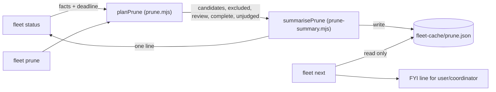

# Plan: fleet prune evidence reaches a person (upstream 56773c7c)
- **Date**: 2026-10-13
- **Status**: Complete — shipped in #235 (status reconciled against merged PRs 2026-10-25)
- **Author**: Claude + Louis
- **Scope**: backend (Node CLI, `scripts/lib/fleet/**`). Stack `js-ts`.
- **Target domain(s)**: `fleet`
- **Upstream report**: `56773c7c-9e05-4cef-b249-24c9480aa88d` (Lbstrydom/wine-cellar-app, MEDIUM, main store)

## 1. Context Summary

**The report, in three asks.** (1) `fleet prune` proves branches removable,
but nothing surfaces the result: `fleet next` never mentions it and `fleet status`
folds them into `N hidden (landed ...)`. Measured in wine-cellar-app on
2026-10-11: prune said "181 removable with nothing lost" and nobody had run it.
(2) A middle class prune excludes with no help: PR merged, branch tip AHEAD of
the merged head by post-merge commits (10 such branches there). Show the delta
per branch, and whether each file's tip content already equals base. (3) No-PR
scratch branches are never classified. Hint when every file the branch changed
already has base's content. Prune stays read-only towards both classes.

**Code Trace** (read at `be057735`):
- `planPrune` `scripts/lib/fleet/prune.mjs:67` (be057735): gathers facts (or takes
  them through the `facts` seam), builds status, and judges `inputs` from status
  items via `hideReason(...) && landedReason(item)` (`:104`), plus ahead-0
  branches (`:111`). Items failing the gates are silently NOT inputs: that is
  where both of the report's classes disappear.
- `landedReason` `scripts/lib/fleet/overlap.mjs:855` (be057735): `merged` (ahead 0)
  or `landed` (`merged.merged === true`); `'partially'` returns null.
- `mergedEvidenceFor` `scripts/lib/fleet/merged-facts.mjs:150` (be057735) already
  computes ask (2): a merged PR whose head is an ANCESTOR of the tip yields
  `{merged:'partially', via:'pr', pr, commit, extraCommits}`. It drops the PR's
  `headOid`, which the delta needs.
- `gatherFacts` `scripts/lib/fleet/facts.mjs:109` (be057735): `changed[branch]`
  holds the COMMITTED merge-base..tip files of every analysed branch, including
  branches no session registered (`untracked:true` means unregistered BRANCHES,
  not untracked files), which ask (3) needs and gets for free.
- `archiveReport` `scripts/lib/fleet/lifecycle.mjs` (be057735) already takes
  `deadlineAt` and clips every git call to the time left.
- `cmdStatus` `scripts/lib/fleet/commands.mjs:138` (be057735): gathers facts once,
  scans unregistered work under `UNREGISTERED_BUDGET.statusMs`, and writes the
  derived cache `writeUnregisteredCache(unregisteredCacheDir(cwd), ...)` that the
  checkpoint footer reads. That is the precedent this plan copies.
- `unregisteredFooter` / `cmdNext` `scripts/lib/fleet/coordination.mjs:88,121`
  (be057735): the footer reads the cache and never scans; its FYI line is worded
  "for the user/coordinator, not an action for this session". `cmdNext` prints
  obligations only; it does not print the footer.

**Neighbourhood considered**: `get-neighbourhood` over prune/commands/coordination
returned only `review`-band records (below the noise floor). Nothing to reuse
beyond the in-domain precedents named above. Security incident memory was not
consulted: the change is a local, read-only git display with no credential,
egress or input-parsing surface.

**Patterns reused**: the derived-cache pattern (`fleet-cache/` beside
`unregistered.json`, Category A, zod-validated, never throws), the deadline
pattern (`deadlineAt` as in `gatherMerged`), and the FYI wording rule.

## 2. Proposed Architecture

Key decisions:

1. **One classifier.** The review classes are produced INSIDE `planPrune`, from the
   same status items and the same gates it already applies (no registered
   session, no open PR, complete PR list). `summarisePrune` only counts what the
   plan holds; it never re-judges a branch. (#1 DRY, #5 single source of truth)
2. **Review classes are never candidates.** They carry no `steps`, so `--apply`
   cannot reach them by construction: `applyPrune` iterates `plan.candidates` only.
   Content-equality is weaker evidence than ancestry or a merged-PR head, and
   removal is irreversible. (#15 error handling: the safe side)
   - `postMerge`: status item with `merged.merged === 'partially'` and `via:'pr'`.
     Delta files = `git diff --name-only -z --no-renames <prHead> <tip>`. Per file,
     `onBase` = the path is absent from `git diff --name-only -z --no-renames
     <baseRev> <tip>` (tip content equals base, deletions included).
   - `noPr`: status item with `merged.known === true && merged.merged === false`
     and `ahead > 0`. Files = `facts.changed[branch].files` (committed
     merge-base..tip); `onBase` per file as above.
   - Both hints speak about COMMITTED content only. A review item with a worktree
     carries `worktreeClean` (`true` / `false` / `null` = not checked) from the
     status item, and the render says `worktree not clean` or `worktree not
     checked` beside an all-on-base hint, so uncommitted work is never implied
     to be on base. Named "no PR covers it", which is exactly what
     `known:false`-free evidence says (a reused branch name with an unrelated
     merged PR is also "no PR covers it").
   - A branch whose files cannot be read (a git failure, `changed` not queried, or
     past the deadline) is counted in `review.unjudged`, never listed as on-base.
   - Pathspecs are never passed: the whole `base..tip` diff is read and
     intersected in JS, so no command line grows with the file count (Windows
     32K limit).
3. **`complete` + `unjudged` on the plan.** `planPrune` returns `complete:false`
   when a global gate failed (PR list incomplete, worktree list unreadable): no
   count from it is a measurement. With `deadlineAt`, inputs judged after the
   deadline go to `unjudged` (candidates and review alike) instead of being
   dropped. The deadline is checked between branches, and every git call made
   for a branch is clipped to the time left through one wrapper, the shape
   `archiveReport` already uses: `left = deadlineAt - clock()`; when `left <= 0`
   the call is NOT made (it returns `{ok:false}` and the branch counts as
   `unjudged`), otherwise it runs with `timeoutMs: min(cap, left)`. `spawnSync`
   therefore never sees a zero or negative timeout (0 means "no timeout" there).
   `archiveReport` gets the same `deadlineAt`, so
   the real bound is the budget plus scheduling slack, not the budget plus one
   uncapped call. A candidate whose `archiveReport` came back unverified after
   the deadline passed counts as `unjudged`, not as kept. `fleet prune` itself
   passes no deadline: unchanged behaviour. (#16
   graceful degradation; AGENTS "an unmeasured round must not wear a clean
   round's clothes")
4. **`status` computes, `next` reads.** `cmdStatus` calls `planPrune(ctx, {facts,
   deadlineAt})` with the facts it already gathered (no second gh round trip) and
   a 30 s budget, writes `fleet-cache/prune.json`, and prints one line. `fleet
   prune` (read-only run) writes the same record without a deadline; `prune
   --apply` (and a status run whose planning threw) REPLACES the record with an
   unmeasured one (`invalidatePruneCache`), since its counts are now wrong; a
   failed write is a warning line. (Changed in /audit-code R1 from "deletes": a
   silent delete failure left the old count readable as ok.) The
   record's `at` is the facts' observation time (`status.observedAt`), not the
   write time, so its age is honest. Accepted race: a status that gathered facts
   before an `--apply` can publish its record after the delete. The count is FYI
   and never drives an action (`--apply` always re-plans from scratch), so the
   worst case is a stale number, labelled with its age, until the next status.
   `cmdNext` never computes (it runs at every checkpoint). (#17 performance,
   #20 observability)
5. **Wording.** Status: `prune: 12 removable with nothing lost (3 fresh) · review:
   4 post-merge (2 content on base), 7 no-PR (5 content on base) · 2 orphan
   directories: run `fleet prune` (read-only) for the list`. Unmeasured:
   `prune: unmeasured (<reason>): run `fleet prune``. Partial: counts prefixed
   `≥` plus `(N not judged within the status budget)`. All zero and complete:
   `prune: nothing removable, nothing to review`. `next`: `FYI for the
   user/coordinator, not an action for this session: <same counts> (as of status
   <age> ago)`; nothing when the record is complete and all zero; `prune count
   unmeasured: run `fleet status` (read-only) to refresh` when the record is
   missing, unreadable or older than 24 h. A count that could not be computed
   never reads as 0.
6. **`next` also relays the archivable count.** `cmdNext` appends the existing
   `unregisteredFooter` lines (abandoned unlanded work, `fleet archive`). Reuse,
   not a new scan: the brief asks for "prunable/archivable" in `next`.

**Right-sizing**:
- *Band-aid*: print `planPrune(...).candidates.length` in status and stop. Next
  would have to recompute (slow at every checkpoint) or stay silent; asks 2 and 3
  unanswered.
- *Over-engineered*: a configurable "trigger file" list for scratch branches, a
  scheduled prune report, or promoting content-equal branches to candidates.
- *Chosen*: one cached summary of the plan prune already computes, plus two
  read-only classes from evidence already gathered (one extra field on the
  partial evidence, one or two git diffs per review branch). The trigger-file
  half of ask 3 is deferred: it is repo-specific, and the content-on-base hint
  covers the report's examples (CI trigger branches whose files equal base).

## 2b. Contracts (field shapes)

`planPrune` return, new fields (existing ones unchanged):
- `complete: boolean`: false when a global gate failed (open-PR list
  incomplete, worktree list unreadable). Then no count is a measurement.
- `unjudged: number`: integer >= 0, candidate inputs not judged before the
  deadline. Always 0 without a deadline.
- `review: { postMerge: Item[], noPr: Item[], unjudged: number }`, where
  `review.unjudged` counts review-class branches whose files could not be read
  or were reached after the deadline. Disjoint from the top-level `unjudged`.
- `Item = { branch, oid, worktree: string|null, worktreeClean: boolean|null,
  pr?: number, extraCommits?: number|null, files: Array<{path, onBase}>,
  allOnBase: boolean }` (`pr`/`extraCommits` on `postMerge` only).

Cache record `fleet-cache/prune.json` (zod, `.strict()`):
`{ schemaVersion: 1, at: ISO string, complete: boolean, reason?: string,
removable: int, fresh: int, kept: int, unjudged: int, orphans: int,
review: { postMerge: int, postMergeOnBase: int, noPr: int, noPrOnBase: int,
unjudged: int } }`. `reason` is present iff `complete` is false.

Line states (status and next share one count renderer):

| State | Status line | Next |
|---|---|---|
| complete, all zero | `prune: nothing removable, nothing to review` | nothing |
| complete, counts | the counts | FYI line with the counts and the age |
| complete, unjudged > 0 | counts as `≥N` plus `(K not judged within the status budget)` | same, as FYI |
| `complete:false` | `prune: unmeasured (<reason>)` | FYI `prune count unmeasured (<reason>)` |
| cache missing / unreadable / over 24 h | n/a (status computes) | `prune count unmeasured: run fleet status (read-only) to refresh` |

JSON: `fleet status --json` gains `status.prune` = the cache record (or
`{complete:false, reason}` when planning threw); `fleet next --json` gains
`prune` = `{state: 'ok'|'missing'|'unreadable'|'stale', record?}`.

## 6. Sustainability Notes

- Assumes merged-PR head oids stay in the merged listing (`MERGED_PR_FIELDS`
  already requires `headRefOid`).
- The cache schema is versioned (`schemaVersion: 1`); a mismatch reads as
  `unreadable`, so `next` asks for a refresh instead of printing old shapes.
- The 30 s status budget is a constant beside `UNREGISTERED_BUDGET`; past it the
  line says how many were not judged.

## 7. File-Level Plan

- `scripts/lib/fleet/merged-facts.mjs` (modify): `mergedEvidenceFor`'s partial
  verdict carries `head: p.headOid`.
- `scripts/lib/fleet/prune.mjs` (modify): `planPrune(ctx, {facts, report,
  deadlineAt, git})` returns `complete`, `unjudged`, `review: {postMerge, noPr,
  unjudged}`; new `reviewOf(...)` helper; `renderPrune` prints a "review: not
  removable, look" section per class; `cmdPrune` writes / clears the cache.
- `scripts/lib/fleet/prune-summary.mjs` (create): `summarisePrune(plan, now)`,
  `PRUNE_CACHE_FILE`, `writePruneCache`, `readPruneCache`, `pruneStatusLine`,
  `pruneNextLines`, `PRUNE_STATUS_BUDGET_MS`.
- `scripts/lib/fleet/commands.mjs` (modify): `cmdStatus` computes the summary,
  writes the cache, prints the line, adds `status.prune` to the JSON.
- `scripts/lib/fleet/coordination.mjs` (modify): `cmdNext` appends the prune FYI
  and the unregistered-work lines; JSON gains `prune`.
- `tests/fleet-prune.test.mjs` (modify): review classes against a real fixture repo.
- `tests/fleet-prune-summary.test.mjs` (create): pure summary/line/cache tests
  plus status and next through the CLI.
- `skills/fleet/references/coordination.md` (modify), `skills/fleet/SKILL.md`
  (modify, one line); regenerated `.claude/skills/fleet/**`.

### 7b. Implementation Phases

**Phase 1 — Classify**: partial evidence carries the PR head; `planPrune` gains
`complete`, `unjudged`, the deadline and both review classes; `renderPrune` shows
them. Files: `scripts/lib/fleet/merged-facts.mjs` (modify),
`scripts/lib/fleet/prune.mjs` (modify), `tests/fleet-prune.test.mjs` (modify).

**Phase 2 — Surface**: summary + cache module; status line; next FYI lines.
Files: `scripts/lib/fleet/prune-summary.mjs` (create),
`scripts/lib/fleet/commands.mjs` (modify), `scripts/lib/fleet/coordination.mjs`
(modify), `scripts/lib/fleet/prune.mjs` (modify),
`tests/fleet-prune-summary.test.mjs` (create).

**Phase 3 — Document**: Files: `skills/fleet/references/coordination.md`
(modify), `skills/fleet/SKILL.md` (modify).

**Close-out (not a phase)**: `npm run skills:regenerate`, `npm run skills:check`,
the two test files, `npm run size:ratchet:gate`.

## 8. Risk & Trade-off Register

- **Status gets slower.** `planPrune` adds `archiveReport` per candidate
  worktree and one or two diffs per review branch. Bounded by the 30 s budget
  (every git call clipped to the time left);
  over it, `unjudged` is reported. Facts are reused, so no extra gh call.
- **A stale cache.** `next` shows the age and asks for a refresh past 24 h;
  a concurrent status can republish a pre-apply count (accepted: FYI only);
  `--apply` deletes it.
- **"no PR" mislabel.** A branch whose PR was merged under a different head
  name reads "no PR covers it". The hint is information only, never a candidate.
- **Deferred**: trigger/baseline file lists (repo-specific), a checkpoint-footer
  line (the footer is capped at three unregistered lines; `next` carries it), and
  desktop-session sweeps (fleet cannot see the desktop session list: the
  2026-10-12 "16 idle sessions" evidence is outside what fleet can measure).

## 9. Testing Strategy

Red first: each new assertion is run against the unchanged code and seen to fail.
- Unit: `summarisePrune` over hand-built plans (complete, incomplete, partial,
  zero); `pruneStatusLine` never prints `0` for an incomplete plan;
  `pruneNextLines` for missing / unreadable / stale / zero / counts;
  cache round trip and schema mismatch.
- Integration (fixture repo + fake gh, `tests/fleet-prune.test.mjs`): a branch
  with a merged PR at head H plus one commit after H whose file equals base
  (cherry-picked onto main) → `review.postMerge` with `onBase:true`; a second with
  a differing file → `onBase:false`; a no-PR branch cherry-picked onto main →
  `noPr` all on base; a no-PR branch with fresh work → not on base; none of these
  in `candidates`; `--apply` leaves them.
- CLI (`tests/fleet-prune-summary.test.mjs`): `status` prints the prune line and
  writes the cache; `next` before any status says unmeasured; `next` after status
  prints the FYI line; with `authFail` (the open-PR list unreadable) status says
  `unmeasured`, never `0 removable`.

## Audit trail

- /audit-plan 2026-10-13: GPT R1 H:1 M:3, all accepted (100%), fixed in §2 and §2b;
  GPT R2 READY_TO_IMPLEMENT H:0 M:0 L:0. Gemini R1 blocked on one MEDIUM (a
  zero/negative `spawnSync` timeout between sequential diffs), fixed in §2 item 3;
  Gemini R2 APPROVE. Stopped at R2: no findings left.
