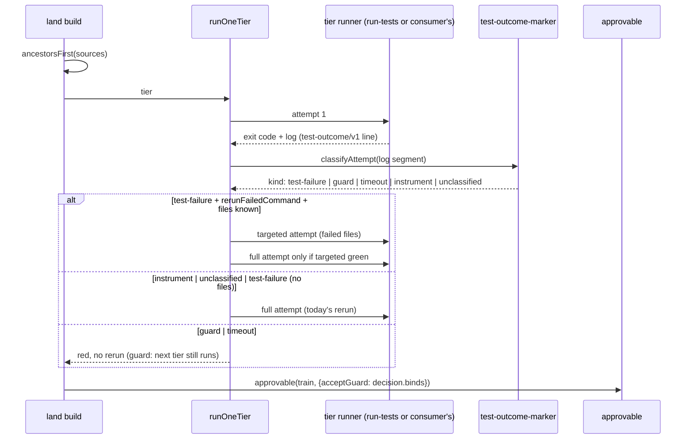

# Plan: fleet train landing friction — classified tier failures, kind-aware rerun, guard-only approval, git timeouts, contained branches, reason codes
- **Date**: 2026-11-27
- **Status**: In Progress
- **Author**: Claude + Louis
- **Scope**: backend (stack `js-ts`; CLI + library, no UI)
- **Target domain(s)**: `fleet`, `scripts`, `shared-lib`
- ⚠ **Cross-domain work** — `run-tests.mjs` (scripts) prints a new marker that `fleet/train.mjs` (fleet) reads through one shared-lib grammar module; that crossing is the point of the change.

> **GATE CHANGE — for Louis.** §2.3 adds a way for `land --approve` to land a train whose tier is RED. It is narrow
> on purpose: it covers only a tier whose runner said, in a structured marker, *zero tests failed and only a policy
> guard failed*; it needs a recorded human decision (`fleet decision record --scope accept-guard`) bound to that
> train id, that candidate sha and a fingerprint of that tier result; and it can never cover a test failure, a
> timeout, an instrument failure or an unclassified red. Nothing else about approval changes.
> It also narrows one standing invariant (`tests/fleet-suite-decision-cpu.test.mjs`, "no module that merges or pushes reads
> decisions"): `train-approve.mjs` now reads ONE decision view — `activeDecision(…, 'accept-guard', …)` — and the census pins
> exactly that import and that scope, so any other read still fails the test. A decision still grants no merge or push: the
> approve itself remains the user's go-ahead.
>
> **Not changed (left for Louis)**: a GREEN tier whose process reap failed (`cleanupWarning`) stays approvable, as at
> 888b11e5. This change only stops a rerun or the next tier from starting beside a possibly live process, and keeps such a
> red out of accept-guard. Whether a reap failure should block a green approval is a separate, stricter gate decision.

## 1. Context Summary

A consumer running the synced `/fleet` reported (2026-11-27) landing friction that cost several trains. Each claim was
verified at `888b11e5`:

| # | Claim | Where |
|---|---|---|
| 1 | A tier is red on exit code alone, so "every test passed, a slow-test guard exited 1" reads the same as a real failure | `scripts/lib/fleet/train.mjs:542-544 (888b11e5)` `verdict()` |
| 2 | Every red reruns the WHOLE tier once, though a deterministic guard cannot change (25-45 min lost) | `scripts/lib/fleet/train.mjs:549-557 (888b11e5)` |
| 3 | `land --approve` has no path past a guard-only red; decisions have no scope for it | `scripts/lib/fleet/overlap.mjs:437-478 (888b11e5)` `approvable`; `scripts/lib/fleet/decisions.mjs:28 (888b11e5)` `DECISION_SCOPES` |
| 4 | Train git calls use git-facts' hard-coded 15 s, and `worktree add` has no retry | `scripts/lib/fleet/git-facts.mjs:34 (888b11e5)`; `train.mjs:139,346 (888b11e5)` |
| 5 | A train holding a branch and its ancestor stops at "produced no commit" | `train.mjs:461-462 (888b11e5)`; `overlap.mjs:509-539 (888b11e5)` has no ancestry |
| 6 | The per-tier result has a prose `reason` only; a script cannot tell a git timeout from a cleanup warning | `train.mjs:534 (888b11e5)` `done()`; `reap.mjs:68 (888b11e5)` |

**Code Trace** (all `888b11e5`): `cmdLand` `scripts/lib/fleet/land.mjs:70` → `build` `land.mjs:180` (order from
`buildStatusFrom` → `proposeLandingOrder` `overlap.mjs:831`) → `withTrainLock` → `buildTrain` `train.mjs:284` →
`deps.git(worktree add)` `train.mjs:346` → `applySources` `train.mjs:419` (`retryTransient` `:392` around merge/commit)
→ `finishTrain` `:476` → `runTiers` `:571` → `runOneTier` `:528` (`verdict` `:542`, rerun `:551`) → `deps.runTier` =
`spawnTier` `:106` → `superviseTier` (stdout+stderr appended to the tier log). Approval: `land.mjs:119` →
`approveTrain` `scripts/lib/fleet/train-approve.mjs:217` → `approvable` `overlap.mjs:437`; serial: `serial.mjs:688-697`.
The red tier's printed summary is `tier-failure.mjs:56` (`redTierLines`, prose-only, unchanged here). The runner side:
`scripts/run-tests.mjs:472 finishRun` already prints ONE machine line on any failing run — `run-tests/v1 failed-files:`
(`failedFilesLine` `:492`, grammar in `scripts/lib/failed-files-marker.mjs`) — read today by the CI flake classifier
`scripts/lib/ci-flake-rerun.mjs`. `adjudicateRun` `:377` knows WHY a run failed (watchdog, per-test limit, hang-guard
instrument errors, a missing/garbled guard report, recorded test failures) but emits only an exit code and prose.

**Neighbourhood considered** (`get-neighbourhood`, coverage verified): `failedFilesLine` `run-tests.mjs` —
**precedent** (above-floor standout). Decision: **extend the same pattern, reuse the parser** — the new outcome marker
is a sibling grammar module next to `failed-files-marker.mjs`, and fleet reads the failing files through the existing
`parseFailedFilesPayload` rather than a second spelling. `runOneTier`, `adjudicateRun`, `finishRun` — `review`; they
are the sites being changed, not duplicates.

**Patterns reused**: the versioned one-line machine marker (`failed-files-marker.mjs`); `retryTransient`'s
"retry only when nothing happened" rule; decision records with `activeDecision`'s fail-closed read; `approvable` as the
single approval predicate; write-once manifest fields.

## 2. Proposed Architecture



### 2.1 Classify the failure from the runner's own structured output (#5 SSOT, #13 validation, #15 errors)

A new dependency-free grammar module `scripts/lib/test-outcome-marker.mjs` (sibling of `failed-files-marker.mjs`):

```
test-outcome/v1 {"testsFailed": <int ≥ 0 | null>, "guards": [{"id": "<slug>", "kind": "policy|timeout|instrument"}]}
```

- `testsFailed` = tests the runner itself recorded as failed (null = it could not count).
- `guards` = every non-test reason the run is red. `kind`: **policy** (a deterministic rule over a finished run —
  e.g. a slow-test budget, a coverage floor), **timeout** (a run or test stopped for time), **instrument** (the
  measuring apparatus failed — missing report, lost progress records, wrong file selection).
- The grammar is runner-neutral on purpose: a consumer's own runner (any language) prints this one line to support
  classification. CES's `run-tests.mjs` prints it on every failing run.

`classifyOutcome(payload, exitCode)` — the ONE reader — maps to a **kind**:

| Marker in the attempt's log segment | kind |
|---|---|
| absent, malformed, or **more than one** | `unclassified` (fail closed; also defeats a test printing a forged line) |
| `testsFailed > 0` | `test-failure` |
| `testsFailed === null` | `unclassified` |
| `0`, any `timeout` guard | `timeout` |
| `0`, any `instrument` guard | `instrument` |
| `0`, guards non-empty, all `policy` | `guard` |
| `0`, no guards (red with nothing named) | `unclassified` |

**Provenance (audit R1).** The marker is never read from the tier's output, where any test can print anything. Fleet names a
fresh file per attempt in `FLEET_TEST_OUTCOME_FILE` (`<log>.attempt-<n>.outcome`, removed before the attempt); the runner
writes its machine lines there (`writeOutcomeFile`) and removes the variable from the environment of the tests it runs
(`SCRUBBED_RUNNER_ENV`). No file → `unclassified`. A signal-killed tier is `unclassified` without reading anything. A
timeout guard outranks every other field (a run stopped for time is a timeout whatever else it counted). A green exit is
never read: classification only describes a red.

**`run-tests.mjs` mapping** (the "refuses a green it did not earn" rule is untouched; a signal-killed runner child adds
`runner-killed/instrument` — the marker is computed from the
same inputs AFTER the exit code and can never move it): watchdog → `idle-watchdog/timeout`; per-test limit →
`per-test-limit/timeout`; hang-guard gap/errors → `hang-guard/instrument`; guard report missing, unparseable, wrong
version or shape → `testsFailed: null` + `guard-report/instrument`; preflight/branch-tier selection failure on an
otherwise-clean run → `test-selection/instrument`; otherwise `testsFailed = report.failures.length`. CES's runner has
no `policy` guard today: a run that did not run every selected test is never "all tests green", so nothing in it is
eligible for §2.3. `run-tests.mjs` is 997 lines (`wc -l`, 888b11e5): the new logic lives in the marker module so it
does not cross the size ratchet's 1000-line line.

### 2.2 Rerun only what can be flaky; failed tests first (#16 graceful degradation, #19 observability)

| kind | rerun |
|---|---|
| `guard` (first attempt, no leftover process) | **none** — deterministic. The tier is `red` with `failureKind: 'guard'`, and **the next tier still runs**, so the train has every tier's verdict (an approver needs that; today a red stops the chain) |
| `timeout` (marker) | none — same rule as the existing tier-timeout (a stalled run under load stalls again, at the full cost) |
| `test-failure` | targeted first when possible, else full |
| `instrument`, `unclassified` | full rerun, as today |
| fleet's own tier timeout, refused spawn, could not start | none, as today |

**Targeted first**: a tier may declare `rerunFailedCommand` in `.fleet.json` — an argv with exactly one `{files}`
element, replaced by the failing files from the attempt's `run-tests/v1 failed-files:` marker (`parseFailedFilesPayload`,
reused). Restore + integrity check, run it; red → tier red (`rerun: 'targeted'`, full rerun skipped — the saving);
a targeted red keeps the FIRST attempt's kind (`test-failure`), its own result recorded under `targeted`; green → restore, run the **full** tier (`rerun: 'targeted-then-full'`); its verdict decides (`green-after-rerun` / `red`). Each file must be a
repo-relative safe token (no `..`, no leading `-`, `SAFE_SHELL_TOKEN`), at most 50; anything else, `unknown`, or no
`rerunFailedCommand` → the full rerun, with the reason recorded (`rerunFallback`). Only an argv tier may declare it
(a string `testCommand` is the `default` tier with no key).

### 2.3 Recorded human approval for a guard-only red (the gate change)

- New decision scope **`accept-guard`**, carrying a required `binds: {trainId, candidateOid, tiers: [{name, fingerprint,
  guards: [ids]}]}` (absent on every other scope; an older reader lists the scope as `unsupported`, never active).
- `fleet decision record --scope accept-guard --train <id> --words-file -` reads the train and **computes** the
  binding: every red pre-land tier must be `failureKind: 'guard'`, else it refuses, naming the tier and its kind
  ("accept-guard never covers a test failure"). The words are the user's, on stdin, as for every scope.
- `fingerprint` = sha256 over `{trainId, candidateOid, name, startedAt, endedAt, failureKind, testsFailed, guards}`
  of that tier result (first 16 hex). Tier results are append-only, so the fingerprint pins THE recorded result.
- `land --approve <id> --accept-guard <dec-id>` (also with `--serial`): `activeDecision(dir, id, 'accept-guard')`
  (fail closed: revoked, expired, unreadable registry → refuse), then `approvable(train, {acceptRerun, acceptGuard:
  binds})`. A red tier is admitted only when ALL hold: `failureKind === 'guard'`, `testsFailed === 0`, the binding's
  `trainId` and `candidateOid` equal the manifest's, and an entry with that name AND fingerprint exists. Every other
  red still refuses with today's reason. Block-level `checkResults` still refuse. Approval appends a note naming the
  decision; `approvable` returns `note` + `acceptedGuards`.
- **Head sha**: `candidateOid` is the combined commit that is pushed (direct modes); in `pr` mode the source oids are
  immutable in the manifest and `verifyPrsForPlan` already refuses a moved PR head, so binding the candidate binds them.
- Not available to `--rollup` / `--ship-batch` (their argv refusals already list `--accept-rerun`; `--accept-guard`
  joins it).
- `GRANTS_NOTE` changes from "never … --override" to name the one narrow exception honestly.

### 2.4 Configurable git timeout + bounded `worktree add` retry (#4 no hardcoding, #14 idempotency)

- `FLEET_GIT_TIMEOUT_MS` (env, per machine — wins) > `.fleet.json` `gitTimeoutMs` > default **60 000 ms**, bounded
  `1000..600000`; an out-of-range or non-integer value is a `ConfigError`, never silently the default. It applies to
  the train's own `deps.git` (worktree add, merge, commit, reset, clean, status, rev-parse in the candidate); git-facts'
  read-only 15 s default is unchanged. Explicit per-call timeouts (the 120 s push) still win.
- `worktree add` gets up to 2 retries (3 attempts, backoff 750 ms × n) when the failure is transient — the same
  predicate as `retryTransient` (spawn failure, a timeout, `index.lock`/`EBUSY`/`EPERM`). Before a retry the partial
  add is undone: `worktree remove --force --force <wt>` if git lists it, else remove the directory (it is the fresh
  train-named path under the worktree root that did not exist before the first attempt; checked), then `worktree
  prune`. Each retry is a manifest note.

### 2.5 A contained branch is skipped, ancestors land first (#11 testability)

- `ancestorsFirst(ids, isAncestor)` (pure, in `land.mjs` beside its one caller `orderAncestorsFirst`; `overlap.mjs` is at the 1000-line size ratchet): a stable reorder so a
  source that is an ancestor of another precedes it. `land` build calls it with `git merge-base --is-ancestor` over the
  selected sources (n ≤ the ready set; pairwise is fine at fleet scale).
- `applySources` (direct-merge only) checks `merge-base --is-ancestor <oid> HEAD` before merging; contained → skipped
  with `{sourceId, oid, reasonCode: 'already-contained'}` recorded in a new write-once manifest field `skipped`, plus a
  note. The candidate holds the branch, so landing it lands that branch too. `pr` mode squashes with `--allow-empty`
  and never reaches "no commit"; the old "produced no commit" stop stays for any other cause, now with
  `reasonCode: 'no-commit'`.

### 2.6 Machine-readable reason codes (#19)

Every tier result gains `reasonCode` from `TIER_REASON_CODES` (exported from `train.mjs`): `green`,
`green-after-rerun`, `test-failure`, `guard-failure`, `test-timeout`, `tier-timeout`, `instrument-failure`,
`unclassified-failure`, `spawn-refused`, `spawn-failed`, `dirty-before`, `dirty-after`, `restore-failed`; plus
`failureKind`, `testsFailed`, `guards` and `rerun: 'full'|'targeted'` when known; and `warnings: [{code:
'cleanup-warning', reason}]` beside the existing `cleanupWarning` string. The train-level failures get codes too
(`conflict.reasonCode`: `merge-conflict`, `merge-failed`, `conflict-list-unavailable`, `append-only-conflict`,
`no-commit`; an abandon result `reasonCode`: `git-timeout`, `worktree-add-failed`, `candidate-unreadable`; provisioning:
`provision-failed`). A git timeout is identified by a new `timedOut: true` on `runGit`'s result, not by its words.
`land --json` already serialises the train, so the codes reach a consumer's script with no new output path.

## 6. Sustainability Notes

- The marker grammar is the extension point: a consumer runner gains classification by printing one line; a new guard
  kind is a grammar version bump, not a fleet code path.
- Right-sizing gate: **band-aid** — grep the log for "slow" and skip the rerun. **Over-built** — a pluggable
  per-runner result-parser registry (JUnit, pytest, TAP …). **Chosen** — one versioned line any runner can print, read
  by one function: it serves the current requirement (tell guard from test failure without prose) for every runner.
- Assumption: a runner that prints the marker prints it once per run. Two lines → `unclassified`, which degrades to
  today's behaviour, never to an approval.

## 7. File-Level Plan

- `scripts/lib/test-outcome-marker.mjs` (create) — `TEST_OUTCOME_MARKER`, `outcomeLine(o)`, `parseOutcomePayload`,
  `outcomeFromRun({status, reportText, watchdog, hang, selectionFailed, guardReportVersion})`, `classifyOutcome`,
  `classifyAttemptLog(text)`. Dependency-free (the runner imports it). #5.
- `scripts/run-tests.mjs` (modify) — `finishRun` prints `outcomeLine(...)` beside `failedFilesLine` on a failing run.
- `scripts/lib/fleet/train.mjs` (modify) — `runOneTier` kind-aware rerun + targeted rerun + reason codes; `runTiers`
  continues past a guard-only red; `defaultDeps` git timeout; `buildTrain` worktree-add retry + reason codes;
  `applySources` contained-branch skip.
- `scripts/lib/fleet/overlap.mjs` (modify) — `approvable` `acceptGuard`.
- `scripts/lib/fleet/tier-acceptance.mjs` (create) — `guardOnlyRed`, `tierFingerprint`, `guardAcceptanceRefusal` (pure; shared by `approvable`, `decisions-cmd`, `render-train`).
- `scripts/lib/fleet/decisions.mjs` (modify) — `accept-guard` scope + `binds`; `GRANTS_NOTE`.
- `scripts/lib/fleet/decisions-cmd.mjs` (modify) — `--train` binding computation and refusal.
- `scripts/lib/fleet/train-approve.mjs` (modify) — `approveTrain` resolves `--accept-guard`.
- `scripts/lib/fleet/serial.mjs` (modify) — `approveSerial` threads `acceptGuard`.
- `scripts/lib/fleet/land.mjs` (modify) — flags, `ancestorsFirst` + `orderAncestorsFirst`, git timeout into `deps`.
- `scripts/lib/fleet/argv.mjs` (modify) — `--accept-guard` (land), `--train` (decision).
- `scripts/lib/fleet/config.mjs` (modify) — `gitTimeoutMs`, tier `rerunFailedCommand`, `resolveGitTimeoutMs`.
- `scripts/lib/fleet/contracts.mjs` (modify) — persisted `TierSchema.rerunFailedCommand`.
- `scripts/lib/fleet/registry.mjs` (modify) — `TrainSchema.skipped`.
- `scripts/lib/fleet/git-facts.mjs` (modify) — `timedOut` on `runGit`'s result.
- `scripts/lib/fleet/render-train.mjs` (modify) — show kind/reasonCode and the `--accept-guard` path.
- `skills/fleet/references/landing.md`, `skills/fleet/references/config.md` (modify) — the marker grammar, the
  approval path, the new keys.
- Tests (create): `tests/test-outcome-marker.test.mjs`, `tests/fleet-landing-friction.test.mjs`.

##### 7b. Implementation Phases

**Phase 1 — Outcome marker**: grammar module + runner emission. Files: `scripts/lib/test-outcome-marker.mjs` (create),
`scripts/run-tests.mjs` (modify), `tests/test-outcome-marker.test.mjs` (create).

**Phase 2 — Kind-aware tiers + reason codes**: classification, rerun policy, targeted rerun, codes, git timeout,
worktree-add retry, contained skip. Files: `scripts/lib/fleet/train.mjs` (modify), `scripts/lib/fleet/config.mjs`
(modify), `scripts/lib/fleet/contracts.mjs` (modify), `scripts/lib/fleet/registry.mjs` (modify),
`scripts/lib/fleet/git-facts.mjs` (modify), `scripts/lib/fleet/land.mjs` (modify), `scripts/lib/fleet/overlap.mjs`
(modify), `scripts/lib/fleet/tier-acceptance.mjs` (create), `tests/fleet-landing-friction.test.mjs` (create).

**Phase 3 — Guard-only approval**: decision scope, binding, approve. Files: `scripts/lib/fleet/decisions.mjs` (modify),
`scripts/lib/fleet/decisions-cmd.mjs` (modify), `scripts/lib/fleet/train-approve.mjs` (modify),
`scripts/lib/fleet/serial.mjs` (modify), `scripts/lib/fleet/argv.mjs` (modify), `scripts/lib/fleet/render-train.mjs`
(modify), `skills/fleet/references/landing.md` (modify), `skills/fleet/references/config.md` (modify).

**Close-out (not a phase)**: `npm run skills:regenerate`, `npm run check`, targeted fleet tests, push (CI full suite).

## 8. Risk & Trade-off Register

- **A forged marker**: output is never read for it (provenance above). A runner that does not scrub the variable from
  its tests could be written to by a test; then exactly-one still applies, a human decision is still required, and a
  test counted failed can never be accepted.
- **Continuing past a guard-only red** spends the later tiers' time; accepted, because an approver needs every
  verdict, and a guard-only red is the case where the tests did pass.
- **Marker timeouts are not rerun** — a genuinely flaky stall now needs a rebuild. Same rule the tier timeout already
  has; recorded as `test-timeout` so it is visible.
- **Deferred (independent scope)**: lease-queue orphaned waiters/priority and claim-base detection — separate sessions;
  this plan touches neither `lease*.mjs` nor claim code. `--rollup`/`--ship-batch` acceptance of guard reds — not
  requested; refused explicitly rather than silently ignored.

## 9. Testing Strategy

Unit (pure): `classifyOutcome` every row of §2.1's table incl. two markers and malformed; `outcomeFromRun` every
`adjudicateRun` branch, and that `finishRun`'s exit code is identical with and without the marker; `ancestorsFirst`;
`approvable` with/without binding, wrong oid/train/fingerprint, a test-failure tier, revoked decision;
`resolveGitTimeoutMs` precedence and bounds. Behavioural (fake `deps`, real temp git repo as existing fleet tests do):
guard red → no second attempt and next tier runs; test-failure with `rerunFailedCommand` → targeted argv emitted, full
rerun only after targeted green; unclassified → full rerun as today; worktree add transient twice then OK → 3 attempts,
notes; contained branch in direct-merge → skipped, `skipped[]` recorded, train tested.

**Proof plan**: each behaviour has a red-first test (written against `888b11e5` behaviour, failing before the change):
the guard-red rerun count (2 → 1), "produced no commit" conflict (→ skipped), the 15 s timeout (→ configured value in
the emitted `runGit` opts), `approvable` refusing a guard red (→ admitted only with a binding). Evidence: the test names
and their pass in `npm test`.
