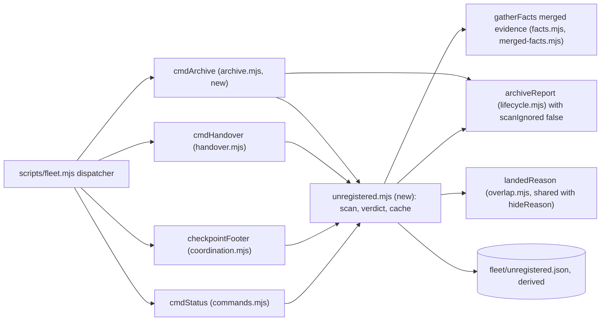
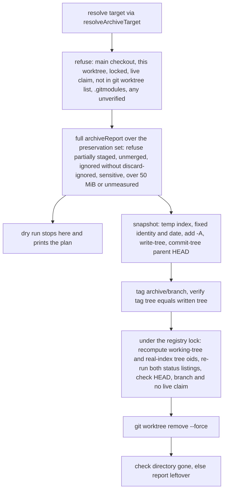

# Plan: fleet — catch abandoned worktree work regularly, and remove account-switch friction
- **Date**: 2026-10-11
- **Status**: Draft
- **Author**: Claude + Louis
- **Scope**: backend (fleet CLI + skill prose; no UI) · stack `js-ts` (`detect-stack`: `js-ts`)
- **Target domain(s)**: `fleet`, `shared-lib`
- ⚠ **Cross-domain work**: `fleet` imports one constant, `RECEIPT_PATH`, from `scripts/lib/sync-receipt.mjs` (`shared-lib`, no imports of its own). `fleet → shared-lib` is a declared edge (`allowedDeps.fleet = ["shared-lib"]` in `.audit-loop/domain-map.json`). Intentional.
- **Depends on**: docs/plans/fleet-handover.md — the unregistered-work predicate (#198) that this plan moves and extends; already landed.

**One word, everywhere: "unregistered work".** The brief called it "unclaimed". The persisted handover manifest field is `unregistered`, and receivers' prompts already say "Unregistered work", so every surface this plan adds uses that term. Only this file's name keeps "unclaimed".

## 0. Decisions at a glance

| Item | Decision | Phase |
|---|---|---|
| **h** live-session defect | Fix first. Handover reads the same merged evidence as `status`; merged-but-unreleased claims are listed as "release these" | 1 |
| **i, n, g** classification | One verdict per unregistered worktree from an ordered contract: `unlanded` · `superseded` · `unverified` · `sync-owned`. Candidates include clean, pushed, unlanded worktrees. Only work with no copy outside this worktree, and unmeasured work, blocks a handover | 2 |
| Part 1.1 status section | Added. Not subject to the 14-day idle hide, which today hides exactly the unlanded, clean, idle work. `status` writes a derived cache | 3 |
| Part 1.2 footer | Reads the cache only (no scan, so no bound to miss). Up to three lines: an FYI when abandoned work is known; a request to run `fleet status` when the scan is missing or more than 24 h old; a coverage notice (information only) when it was partial | 3 |
| Part 1.3 `fleet archive` | Dry run by default; `--apply` snapshots deterministically to a temporary index, tags, verifies, revalidates under the registry lock, then removes. Refuses anything it cannot preserve. Branch is never deleted | 4 |
| **a, b, j** binding | `claim --worktree`; `add` records the worktree; `release` resolves it by branch (the one reader that does not); warn when id ≠ bound branch | 5 |
| **c** stale tooling | Warn when a hydrated worktree's bundle stamp trails the main checkout's, and name `npm run skills:hydrate` on an unknown verb | 6 |
| **e** gh reachability | Free: reuse the merged-PR query's `queried`/`reason` already in `facts.merged.prs`. No extra `gh` call | 6 |
| **l** stale manifest | `receive` refuses when a newer manifest sits beside the one given, unless `--allow-older`. No "keep latest N" | 6 |
| **o** account identity | `prepare` records non-secret identity from `.claude.json` (`oauthAccount` account uuid, email, organisation uuid only); `receive` prints "source X → this Y" or "same account". The whole-file hash of `.claude.json` is dropped (it is rewritten every minute or two); MCP server **names** are compared instead. `settings.json` keeps its hash | 7 |
| **p** receive outcome | "Done, follow-ups remain" is `ok:true`, exit 0, with a `followUps` list. `refused` (exit 3) is kept for conflicts, blocking unregistered work, unmeasured memory and unknown live state | 7 |
| **q, d, k** scheduled tasks | The CLI cannot read a schedule, but the coordinating agent can (`list_scheduled_tasks`). The line is reworded to what it checks, and the coordination prompt tells the agent to diff ids against the scheduler and skip one-offs whose `fireAt` has passed. No date parsing and no regex hint | 7, 8 |
| **r** catch-up runs | Prose warning: relaunching under the new account fires overdue one-off tasks | 8 |
| **s** claims waiting on the switch | `receive` lists live claims waiting on `human:account-switch` as "unblock now", with the `touch --clear-waiting` command | 7 |
| **t** destination memory path | `receive` prints the destination memory dir per repo in every mode | 7 |
| **u** local-only work ranks first (CE coordinator 1) | Candidates also include local branches **with no worktree**; "possibly abandoned" is ordered local-only first, then most commits; `ready` warns when the branch has commits no remote ref holds; a participant rule says to push early | 2, 3, 5, 8 |
| **v** agent branches and archive durability (2) | Overlaps between two untracked items collapse to a count in the text view; archive tags are reported `local-only` (one disk) or `remote`. `fleet archive` still never pushes (public repo, path-only secret gate) | 3, 4 |
| **w** squash-merge evidence (3) | Already covered: `mergedEvidenceFor` and the squash patch-id window are the reason `landed` exists. No change; the coordinator's three techniques map onto it (§2.6) | — |
| **x** orphan directories and `[gone]` branches (4) | `prune` lists orphan directories under the worktree roots and shows an "upstream gone" hint; it stays read-only. `prune --apply` is declined | 3 |
| **y** liveness (5) | The CLI cannot see the desktop session list. `archive` refuses a **fresh** worktree unless `--include-fresh`, its dry run ends with the agent check, and SKILL.md makes that check a rule | 4, 8 |
| **z** pre-push lane for `archive/*` refs (6) | Declined here (it is `.githooks/pre-push` and `scripts/prepush-check.mjs`, not `fleet`); spun out. `fleet archive` never pushes, so it never needs `--no-verify` | — |
| **f** | Declined. Prepare stays a read-mostly verb; #198's coordinator chips replaced the pasted checkpoint message | — |
| **m** | Measured during planning (§1b). The cross-config-root copy path works; this machine's switch did not change the config root | — |
| 8 `archive/*` tags | Spin out as its own task. Part 1.1 makes them visible meanwhile | — |

## 1. Context Summary

The 2026-10-11 account switch swept every worktree by hand and found 17 that held work no claim covered: 9 superseded, 8 abandoned on 27 Sep to 3 Oct. Nothing in fleet catches that regularly. The Agent-tool worktrees are never claimed, and `fleet status` already lists them, but as undifferentiated untracked items.

### 1a. What exists today (Code Trace, read at `0e287fbd`)

- **The predicate.** `scripts/lib/fleet/handover.mjs:234` `unregisteredWork` lists worktrees no live claim covers (`:241`) that hold staged, unstaged or untracked files or unpushed commits. It probes each one with the full `archiveReport` (`:244`).
- **The probe.** `scripts/lib/fleet/lifecycle.mjs:136` `archiveReport` makes `status`, `status --ignored=traditional` (`:154`), `ls-files -v`, a size walk over untracked and ignored paths (`:164`), `rev-list HEAD --not --remotes`, and `stash list`. `unregisteredWork` then discards the ignored result (`RISK_KINDS` has no `ignored`).
- **The handover state.** `handover.mjs:255` `repoState` builds the live-session list with `gatherFacts({…, merged: false})` (`:272`). `facts.mjs:122` defaults `merged` to `'all'` for the full view that `status` renders. `overlap.mjs:546` `mergedDone` therefore never retires anything in the handover. `receiveHandover` reads the raw registry instead (`:563`).
- **Evidence helpers.** `merged-facts.mjs:154` `mergedEvidenceFor` is the one merged predicate. `overlap.mjs:836` `hideReason` and `prune.mjs:45` `planPrune` already use it (`ahead 0` → `merged`; evidence → `landed`).
- **The status hide.** `overlap.mjs:836-846` hides an untracked branch as `idle` when `ahead` is known, the tip is older than `hideIdleAfterDays` (default 14, `config.mjs:85`), there is no open PR and the worktree is clean. That is **unlanded, committed, idle work**, which the default view folds into "N hidden".
- **Registration.** `commands.mjs:177` `cmdClaim` always binds `currentBranch(cwd)` (`:184`) and the cwd's toplevel (`:225`). `cmdAdd` (`:249`) writes `worktree: null` (`:301`). `lifecycle.mjs:48` `cmdRelease` runs `archiveReport(ctx, { session })` (`:61`), which takes `session.worktree` as given.
- **Dispatch and footer.** `scripts/fleet.mjs:115` dispatches `archive-check`; `:127` appends `checkpointFooter` (`coordination.mjs:65`) after `claim`, `touch` and `ready`. Flag tables: `argv.mjs:16` `VERBS`.
- **Subprocess seam.** `git-facts.mjs:48` `runGit` sanitises git's environment and accepts no `env`.
- **Sync receipt.** `scripts/lib/sync-pr.mjs:20-24` records a decision: a receipt-only change never earns a PR. `sync-receipt.mjs:77` exports `RECEIPT_PATH`.

### 1b. Measured figures (2026-10-11, `0e287fbd`; scratch scripts, not committed)

| # | Figure | Label | Command / source |
|---|---|---|---|
| M1 | `unregisteredWork` wall time: CEE 13 worktrees 3.6 s; wine 23 → 17.2 s; storyline 15 → 13.8 s; ai-organiser 2 → 0.9 s (≈ 280 to 920 ms per worktree) | measured | in-process timing of `unregisteredWork(repo, …)` |
| M2 | On wine's main checkout `status --ignored=traditional` costs 3910 ms; the other five calls cost 31 to 63 ms each. On CEE: 775 ms vs 24 to 43 ms | measured | `spawnSync` timing of the git argv `archiveReport` runs |
| M3 | A light probe (no ignored scan, no size walk) ≈ 150 ms per worktree, so ≈ 3.5 s for wine's 23 | **derived** from M2; re-measure in Phase 2 | sum of M2's four remaining calls |
| M4 | `git tag -l 'archive/*'` → 8 tags | measured | git |
| M5 | 13 scheduled tasks; all 13 have frontmatter `name` + `description` only (no schedule); 6 of 13 descriptions say one-time/one-off | measured | scan of `~/.claude/scheduled-tasks/*/SKILL.md` |
| M6 | A date regex over those descriptions **missed** "Monday 5 October 2026" (an expired one-off). The instrument is unreliable, so no date parsing is planned | measured (instrument defect) | same scan |
| M7 | `CLAUDE_CONFIG_DIR` is unset; this session's memory dir is under `C:\Users\User\.claude`. `handover receive --dry-run` here ran in **`same-config-root`** mode: 713 verified, 0 changed | measured | `node scripts/fleet.mjs handover receive --from <manifest> --dry-run` |
| M8 | The same receive into a **scratch** config root ran in `copy` mode: 713 copied, 0 conflicts, 0 errors; 713 files on disk across 4 project dirs | measured | `CLAUDE_CONFIG_DIR=<scratch> node scripts/fleet.mjs handover receive --from <manifest>` |
| M9 | Defect h on live data today: raw non-terminal = handover-live = status-live in all three repos (2/2/2, 2/2/2, 5/5/5). The 21 stale claims were released by hand, so it **cannot be reproduced live**; it needs a fixture | measured | in-process `gatherFacts` with `merged:false` vs `'all'` |
| M10 | The receive just run flags 2 items: this session's harness worktree `elegant-volhard-cf100d` (4 "unpushed" — the same patch as my branch; `fleet status` prints `DUPLICATE patch`) and a storyline worktree (12 unpushed) | measured | same receive |
| M11 | `.git/fleet/handover/` holds 14 files, 1.6 MB | measured | `ls -la` |
| M12 | Registry record `drift-backlog-refresh-2026-10-11` has `source.branch` equal to its own id. No branch of that name exists; the real branch is `docs/drift-backlog-records-2026-10-11` | measured | `git branch -a --list '*drift-backlog*'` |
| M13 | `~/.claude.json` is rewritten every minute or two: backups at 17:20, 17:21, 17:22 and 17:24 on 2026-10-11, file mtime 17:24. `~/.claude/settings.json` has not changed since 15:35. So a whole-file hash of the first can never match, and the second is a sound check | measured | `ls -la --time-style` of `~/.claude/backups` and the two files |
| M14 | `receiveHandover` refuses (exit 3) whenever any of conflicts, missing tasks, settings differences, unknown live state, unmeasured memory or unregistered work remains, `--dry-run` included. My own dry run exits 3, but it is confounded by genuinely unregistered work, so the "follow-ups alone refuse" case is read from the code | derived | `handover.mjs:595` |
| M15 | The desktop scheduler (via `list_scheduled_tasks`, readable by an agent) holds 12 tasks, 11 of the manifest's 13; the two absent are `c2-stabilize-c3` and `cellar-analysis-soak-complete-promotion-prep`. 9 of 12 are disabled one-offs whose `fireAt` has passed. Each entry carries `fireAt`, `enabled`, `nextRunAt` and `lastRunAt`, which `SKILL.md` does not | measured | `mcp__scheduled-tasks__list_scheduled_tasks` |
| M16 | Catch-up runs on relaunch: `wine-gpt61-reviewer-timeout-check` (`fireAt` 2026-10-09) shows `lastRunAt` 2026-10-11T14:31:01.953Z, and `storyline-nightly-verdict-check` 14:31:02.026Z, minutes before the receive | measured | same tool |
| M17 | The account change happened inside the shared `~/.claude.json` (`oauthAccount` is now a different address than in a 2026-10-02 backup), and the manifest never recorded which account ran `prepare` | reported by the setup session; I did not read `oauthAccount` (the file also holds tokens) | cross-session message, 2026-10-11 |

### 1c. Where the brief is wrong or silent (corrections that change the design)

| Brief claim | What the code and measurements say | Consequence |
|---|---|---|
| a: "`status` and `claim` do not resolve a worktree for an adopted session" | `buildStatus` falls back to the branch's worktree (`worktree: s.worktree ?? wt?.path`) and `probeSessionWorktrees` does too (`facts.mjs:315`). **`release` is the one reader that does not** (`lifecycle.mjs:61`). With `worktree: null` it skips every worktree probe, so an adopted session with a dirty worktree reads **CLEAN** (derived; pin with a red test) | Fix the read side as well as the write side |
| j: "`claim` records the source branch whenever it differs from the id" | It **always** records the cwd's current branch. The failure is a claim run from the wrong worktree binding the wrong branch silently (M12: a branch that does not exist, so `mergedEvidenceFor` gets `tipOid: null` and never retires it) | Warn on id ≠ bound branch; `--worktree` binds the right one |
| Part 1.1: "reuse `unregisteredWork`" | Reuse, but its probe is the cost (M1, M2) and `status`'s `idle` hide must not apply to the new section | Light probe; section independent of the idle hide |
| g option A: commit receipt-only changes in a rolling PR | Contradicts `sync-pr.mjs:20-24`, which chose not to open a PR for a receipt that changes on every sync | Option B only: classify `sync-owned` |
| k: "from the task's own schedule metadata, where readable" | Not readable **by the CLI** (M5), and date parsing of the description is unreliable (M6). The scheduler itself is readable by the coordinating agent (M15) | Prose that sends the agent to the scheduler; no regex hint, no date parsing in the CLI |
| l: "keep the latest N" | 14 files, 1.6 MB (M11). Deleting handover artefacts adds risk for no gain | Receive guard only |
| m: "the first receive in the new account is the empirical check" | The new account shares the old config root (M7), so a real cross-root receive does not exist on this machine. The copy path was exercised against the real manifest anyway (M8) | Recorded here; nothing left to wait for |
| d: "list sessions whose permission mode differs, if the host exposes it" | Only the desktop app's MCP tools can read a mode; no CLI can | Prose only |

**Six more gaps (o to t) arrived after the first real `receive`, from the setup session.** Each was checked here before it was taken: o by M13, p by M14, q and r by M15 and M16, s by this claim itself (it still read "WAITING human:account switch" after the switch; cleared by hand with `touch --clear-waiting`), and t by `handover.mjs:711`, which prints a destination path only for a file that has a problem. One correction in return: the setup session counted 10 of 13 tasks registered and 3 absent; the scheduler now holds 11, so `fleet-telemetry-threshold-review` has been recreated since (M15).

### 1d. Neighbourhood considered

`get-neighbourhood` over `handover.mjs` and `status` paths returned 8 candidates, all `review` (below this repo's noise floor, `bandReason: fallback-normalization-uncalibrated`), none in `fleet`. The nearest are `sweepStaleSandboxes` (`prepush-sandbox-cleanup.mjs`, a swept-vs-failed outcome shape) and `checkRegistryParity` (a registered/stale/orphaned/unregistered classification). Both are in other domains and operate on directories and DB rows, not git worktrees, so this plan is greenfield inside `fleet` and borrows only the "report a failed removal as a failure" shape.

## 2. Proposed Architecture



### 2.1 One verdict per unregistered worktree (`scripts/lib/fleet/unregistered.mjs`, new)

`unregisteredWork` moves here from `handover.mjs` (one predicate; #1, #10) and returns items enriched with a pure verdict (#7, #11).

**Candidates.** Every worktree (not bare, missing or prunable) that no live claim covers, **and every local branch that is ahead of the measured base, is covered by no live claim and is checked out in no listed worktree** (u: `claude/queue-burndown` held 49 commits for 9 days with no worktree-level signal and no remote ref; a worktree-only scan cannot see it). A branch-only candidate has L empty by definition and is classified by the same contract: C from `facts.branches` (`ahead`) plus one `rev-list <oid> --not --remotes` for placement, E from the same merged evidence. Today's predicate only selects a worktree that is dirty or holds *unpushed* commits, so a clean worktree whose commits were pushed but never landed is invisible, and that is exactly the work the idle hide buries. Selection is therefore independent of push status: each candidate is described by three separate facts, and a candidate with nothing local and nothing off base is simply not listed.

- **L, local changes**: staged, unstaged and untracked paths, with `SYNC_OWNED_PATHS` (the receipt) split out.
- **C, committed work off base**: `none` (the tip is contained in the measured base), `pushed` (commits not on base, but a remote ref holds them), `unpushed` (no remote ref holds them), or `unknown`. `ahead` comes free from `facts.branches`; push placement is the existing `rev-list HEAD --not --remotes`.
- **E, evidence**: `landed` (`landedReason` on the exact tip), `duplicate` (the whole-diff patch-id equals that of a branch a **live claim** covers), `none`, or `incomplete` (`gh` not queried, squash window short).

**Ordered contract; the first matching row wins.**

| # | Condition | Verdict | Blocks handover? |
|---|---|---|---|
| 1a | Any probe failed or was skipped, so L is not known to be empty, **or** C is `unknown` | `unverified` | **yes**: a failed probe proves nothing, so nothing is assumed safe |
| 1b | L is known empty, C is `unpushed`, and E is `incomplete` | `unverified` | yes (the commits exist only here and their landing is unknown) |
| 1c | L is known empty, C is **known** `pushed`, and E is `incomplete` | `unverified` | no: a remote holds the commits; only whether they landed is unknown |
| 2 | L (receipt excluded) is non-empty | `unlanded`, reason "N uncommitted files", noting if the committed part is landed | yes (the files exist nowhere else) |
| 3 | C has commits and E is `landed` or `duplicate` | `superseded`, with `via` (L is already empty here, so a duplicate never rests on a dirty tree) | no. `via: landed` is listed as removable (the commands are `fleet prune`'s); `via: duplicate` is listed as covered by that claim and is **not** offered as removable |
| 4 | C has commits and E is `none` | `unlanded`, `preserved: remote` when C is `pushed` | yes only when C is `unpushed` |
| 5 | Only the receipt is dirty and C is `none` | `sync-owned` | no, listed with its reason |

The receipt discount applies to **L alone**: receipt-plus-unlanded-commits is row 4, not row 5. A receipt left dirty beside any other verdict is carried as `syncOwnedDirty: true`, so `fleet prune` and `archive` still see it. Rows 2 to 4 are *possibly abandoned* once idle longer than `staleWorktreeDays`; rows 1a and 1b are too, since they block. **Ranking (u):** within *possibly abandoned*, items whose work exists nowhere else (`preserved: none`: dirty files or unpushed commits) come first, then by commits ahead (descending), then by idle age; "local-only and N ahead and idle" therefore outranks a merely idle pushed branch, which is what the cleanup showed to be the highest-severity case. The status line for each says `local-only` or `on <remote>`.

- **Evidence.** Callers pass the `facts` they already gathered, so the module makes no extra git or gh call for evidence. Status has `merged:'all'`. Handover builds facts with `merged: <worktree branch names>`. Missing evidence yields row 1, never `superseded` (an unasked question is not an empty answer).
- **Shared landed predicate.** `hideReason`'s two lines become an exported `landedReason(item)` in `overlap.mjs`, used by `hideReason`, `planPrune` and the verdict, so "is this tip on base" has one spelling (#10).
- **Light probe.** `archiveReport` gains `scanIgnored = true` and `probeTimeoutMs = 30000`. The scan passes `scanIgnored:false`, which skips the `--ignored` status call and the size walk. The predicate never used their result, and they are the measured cost (M2). `ls-files -v` stays, so skip-worktree still makes an item `unverified`. Defaults leave `release`, `archive-check` and `prune` byte-identical.
- **Idle age.** `lastActivity = max(HEAD commit time, newest mtime among the first 200 dirty paths)`, run through `isIdleTip(…, staleWorktreeDays)`. An unknown or future-dated time is **not** stale, matching `isIdleTip`. Config key `staleWorktreeDays` (default 3, 1 to 3650) sits beside `hideIdleAfterDays`.
- **Bound: one absolute deadline.** The scan takes `deadlineAt` (status 60 s, handover 120 s from its start). Every subprocess gets `timeoutMs = min(its own cap, deadlineAt − now)`, and the mtime stats and the archive-tag scan stop when it passes, so a slow probe cannot overrun the budget it was started inside. There is **no worktree-count cap**. Candidates are probed **oldest tip first**, a heuristic that front-loads the likeliest abandoned work (the idle age also counts dirty-file mtimes, which are only known after a probe, so the order is not exact). **There is no progress or fairness guarantee, and none is claimed**: with an unchanged set that overflows the budget, the same suffix stays unprobed on every run. What is guaranteed is disclosure, never silence: `partial`, `notProbed` and the footer's refresh request all say so. The overflow is not realistic at the measured cost (≈ 0.15 to 1 s per worktree puts the 60 s budget at 60 to 400 worktrees; the largest estate measured has 23), and a persisted rotation cursor for it would be the over-built answer. What was not reached is returned as `notProbed: n` with `partial: true`; handover treats it as NOT MEASURED (fail closed). At the measured ≈ 0.15 to 1 s per worktree the budget covers 60 or more; an estate beyond that reports partial rather than pretending.
- **Archived, unlanded, and where it lives (v).** Each archive tag also carries `preserved`: `remote` when a remote-tracking branch contains the tag's commit (`git branch -r --contains`, local, no network) or one bounded `git ls-remote --tags origin 'archive/*'` lists it, `unknown` when that call fails (offline), otherwise `local-only`. A local-only archive tag is **one disk away from lost**, and the status line says so: `8 archive tags hold commits not on base (8 local-only)`. `fleet archive` itself still never pushes: this repo is public, the sensitive-path gate is path-based and cannot prove content safe, and a push is outward-facing, so publishing a reviewed tag stays the user's act. `git for-each-ref --no-merged=<base> refs/tags/archive` lists archive tags not contained in base. Each is checked by whole-diff patch-id against the squash window (`patchId`, `squashPatchIds`); a match is `superseded`, and so is a tag whose whole diff against its merge-base with base is **empty** (nothing left to land); otherwise `unlanded` (≤ 50 tags; overflow is reported). Without this, `fleet archive` would move work from a noisy place to a silent one.

### 2.2 Surfaces

- **Status section (Part 1.1).** After the items and the "N hidden" line:

  ```text
  Unregistered work — 7 worktrees hold work no live claim covers
    possibly abandoned (idle > 3d, unlanded) — 3
      worktree-agent-a17ae…  idle 8d · 4 unpushed, 2 untracked · C:/…/agent-a17ae…
    superseded, on base (removable — see fleet prune) — 2
    covered by a live claim (duplicate of <id> — not removable yet; leave it until that claim lands) — 1
    fresh (idle ≤ 3d) — 2
    archive tags holding commits not on base — 8
  ```

  The two `superseded` groups are split by `via` on purpose: only an item **on base** (contained, merged PR, or squash) is something `fleet prune` selects, and `prune`'s candidate set stays unchanged. A duplicate of a live claim is not on base, so calling it removable would send the reader to a command that silently ignores it. The handover document makes the same split. `possibly abandoned` and `unverified` items are listed in full; the other groups are counts (`--all` lists them). `--json` carries `status.unregistered`. The section ignores `hideReason`'s `idle`, and the "N hidden" line gains "(k of them unlanded — see Unregistered work)" so the two views agree. Fresh unclaimed desktop worktrees are counted, never alarmed.
- **Footer (Part 1.2): reads a cache, never scans.** `status` writes `fleet/unregistered.json`, a **derived Category-A file** beside `hold.json` (`{schemaVersion, at, staleDays, partial, notProbed, counts}`, zod `.strict()`, written with `atomicWriteFileSync`, never committed). `cmdStatus` still takes no lock and writes no registry state; the cache is a derived artefact like the telemetry spool `status` already writes, and a failed write is a `warning:` line, not a failure. `checkpointFooter` then prints up to three lines:
  - **FYI**, when `counts.abandoned > 0`: `FYI for the user/coordinator, not an action for this session: 3 worktree(s)/branch(es) idle >3d hold unlanded work, 1 of them local-only (no remote ref holds it) — fleet status (scan 2h old)`. The `counts` in the cache therefore carry `abandoned` and `localOnly`.
  - **Refresh request**, only when the cache is missing, unreadable or older than 24 h, the three states a `status` run actually clears: `unregistered-work scan is 2d old (or: missing / unreadable) — run \`fleet status\` (read-only) to refresh`.
  - **Coverage notice**, when the cache is `partial` (shown even with zero abandoned, so an unmeasured suffix is never silent): `unregistered-work scan covered 19 of 23 worktrees (4 not probed)`. It is information, not a request: with no rotation cursor a re-run on an unchanged estate overflows the same way, so asking for one would be a nag nothing can clear.

  Why no scan in `claim`/`touch`/`ready`: a scan there needs a deadline, rotation and a thundering-herd answer (several sessions crossing a TTL together), and the audit (M1, M2) showed each is real. Reading a file has none of them, and the refresh request turns the first checkpoint after 24 h into the trigger for one `status` run. A corrupt cache prints the refresh request and cannot change a verb's exit code. Archive tags stay out of the footer (they would nag for weeks).
- **Why the wording matters.** The user pre-authorises acting without asking only on `next`'s `DO` lines. A footer line that reads like an instruction would send chip sessions off to inspect other sessions' worktrees. The line says whose it is, and `participant-rules.md` states it is not a `DO`.

### 2.3 `fleet archive <worktree|branch|path|id> [--apply] [--discard-ignored] [--include-fresh]` (`archive.mjs`, new)



- **Preservation set and refusals (#12).** The set is every staged, unstaged and untracked path from the full `archiveReport`. The verb refuses, naming the paths and the remedy ("stage everything with `git add -A` in that worktree, or reset the index, then re-run"), when:
  - a path is **partially staged** (staged *and* changed again in the working tree): a working-tree snapshot would silently drop the staged version, so it cannot be preserved losslessly;
  - the index has **unmerged entries** (`git ls-files -u`);
  - **any** gitignored path outside `archiveIgnore` exists, in a mixed tree as much as an ignored-only one, unless `--discard-ignored` is given; the result lists every discarded path either way;
  - `.gitmodules` exists, any probe is `unverified`, or the preservation set is over 50 MiB or its size could not be measured (the size walk covers all dirty paths, not only untracked ones);
  - the worktree is **fresh**: its last activity (the scan's `max(HEAD commit time, newest dirty-file mtime)`) is within `staleWorktreeDays`, unless `--include-fresh` is given (y). A worktree the app created for a chip session may have no claim yet and looks abandoned only to a reader who ignores its age; freshness is the one liveness signal the CLI can compute. It is **not** proof of death for a dormant or pinned session, which no CLI can see (§2.6 y).
- **Snapshot without side effects, and deterministic (#13, #14).** `GIT_INDEX_FILE=<tmp>`, `read-tree HEAD`, `add -A`, `write-tree`, `commit-tree <tree> -p HEAD` with a **fixed identity** (`fleet archive <fleet-archive@localhost>`), a fixed message, and author and committer dates set to HEAD's commit date. The same tree, parent, identity and date give the same oid on every retry, and the run no longer needs `user.name` configured. **When the preservation set is empty there is no snapshot commit**: the tag points at HEAD itself, so archiving a clean worktree whose tip is already on base cannot mint a commit that the archive-tag scan would then call unlanded. No hook runs, and the branch and worktree are untouched until the removal step. `runGit` accepts an `env` limited to an allowlist (`GIT_INDEX_FILE`, `GIT_AUTHOR_*`, `GIT_COMMITTER_*`) (`git-facts.mjs:48`).
- **Tag.** `archive/<branch>` (a branch name is already a valid ref component). A **detached** worktree has only a directory name, which may hold spaces or characters git refuses in a ref (`~ ^ : ? * [ \`): the tag is `archive/<sanitised basename>-<short oid>`, where the sanitiser replaces every character outside `[A-Za-z0-9._-]` with `-`, collapses runs, trims, and falls back to `detached` when nothing is left; the name is checked with `git check-ref-format` before any object is written, and a name git still rejects is a refusal, not a mid-flight failure. If the name exists at another oid, append `-<short oid>`. A tag already at the same oid is reused, which the deterministic snapshot now makes a real case. Lightweight, matching the 8 existing tags. Tags are local; nothing pushes them.
- **Revalidate, then remove (#14).** Immediately before removal, inside `transact` (the registry lock, so no `claim` can register this worktree meanwhile), the verb re-checks four things, **in this order, because hashing writes objects**: item 2 first, then the sensitive-path and size gates over the (by then proven unchanged) path set, and only then item 1. `add -A` into a temporary index still writes blobs into the shared object database, so a sensitive or oversized file that appeared after the preflight must make the run abort *before* any hash, never after it has been copied in. A new path changes the listing, so item 2 catches it without writing an object; the re-applied `resolveAndClassify` and the size cap (a `stat` sum, no read) cover a changed file in an unchanged path set.
  1. **Content, in both places, not status text alone.** It recomputes two tree oids and requires each to equal its capture: the **working-tree snapshot** (a second temporary index, `read-tree HEAD`, `add -A`, `write-tree`, which must equal the tagged tree) and the **real index** (`git write-tree` on the worktree's own index, captured at snapshot time; it creates a tree object and moves no ref or index entry). Neither alone is enough. A `git status` string cannot see a second edit to an already-modified (` M`) or untracked (`??`) file, since the status code does not change; the working-tree oid catches that. The working-tree oid in turn cannot see someone staging a new version C and putting the file back to its captured content B: the snapshot tree is still B, but the real index now holds C, which only the second oid (and the status listing, now `MM`) reveals. Cost: one more hash of the dirty files and one `write-tree`.
  2. **Both status listings**, re-run with the identical argv (`worktree-status.mjs` exports `STATUS_ARGS` and `IGNORED_STATUS_ARGS` once, shared with `archiveReport`, so capture and revalidation cannot be spelled differently) and compared byte for byte against the captures; this is the cheap check that also names what moved in the abort message. A different command would fail every time on a tree with ignored files; with the same argv, a new ignored path appearing after `--discard-ignored` was agreed also aborts, because the operator was never shown it. Content changes inside ignored files are not preserved by design (the flag says so).
  3. **Identity**: HEAD oid and branch against the capture, and that no live claim covers the worktree or branch.
  4. That the tag still resolves to the verified tree. Any mismatch aborts with the tag and the worktree kept (exit 3, "changed since the snapshot"). Only then `git worktree remove --force`. The remaining window is edits in the milliseconds between that compare and the delete; coordination here is cooperative, not enforced, and the verb says so rather than claiming quiescence.
- **Outcomes and retries.** Artefacts left by stage: before the tag, none; after it, the tag only; after a failed removal, the tag plus the worktree (or a `leftover: <path>` directory when a file lock stopped the delete, the storyline case; exit 1, never "success"). A re-run with the worktree still there and unchanged recreates the same oid and reuses the tag. After a successful removal the target resolves to a branch with no worktree. The verb then lists **every** tag named `archive/<branch>` or `archive/<branch>-<short oid>` with its oid and date and prints `already archived — N tag(s)` (exit 0); it never claims which one the completed removal used, because a failed first attempt can leave an older tag beside the one that was current at removal (snapshot A tagged, removal failed, more edits, snapshot B tagged with a suffix and removed). With no such tag it refuses with "no worktree to archive". The branch is never deleted.
- **No restore verb, no expiry** (`git checkout archive/x` already restores).

### 2.4 Registration and handover (Phases 1, 5, 6, 7, 8)

- **h.** `repoState` passes `merged: [every worktree branch, every registered branch]`. Derived-done claims drop out of `sessions`. Claims whose branch is merged but whose registry record is still non-terminal are listed as `mergedUnreleased` with the exact `release --id …` command, and `receive` derives live sessions through the same function (`liveSessionsOf`). The manifest gains optional fields (the schema is `.strict()`, so each addition is declared): `mergedUnreleased`, `gh`, and per unregistered item `verdict`, `via`, `idleDays`.
- **e.** `gh: { queried, reason }` per repo is `facts.merged.prs` verbatim. A repo with `queried:false` prints "PR state unknown — sign in to gh with an account that can read `<owner>/<repo>`" (owner and repo from `origin`, one git call). `sync-pr.mjs`'s `parseGhAccounts` is not reused: it lives in a module whose imports would enlarge every consumer's synced closure. `receive` re-measures and lists it as a follow-up (§2.4 p).
- **l.** `receive` lists sibling `handover-*.json` in the `--from` directory; any id greater than the given one refuses (exit 3) unless `--allow-older`. Ids sort chronologically (`OP_ID_RE`); an unparseable sibling name is ignored.
- **a, b, j.** `claim --worktree <path>` must be a listed, present worktree of this repo (realpath compared); its checked-out branch becomes `source.branch`, and a detached one needs `--id` and binds no branch (warned). With no flag the behaviour is unchanged, plus a warning when the id ≠ the bound branch ("merged evidence retires a claim by its BRANCH"). An adopted session whose `worktree` is `null` can be filled once (never re-pointed). `add` records the branch's worktree (`gatherFacts` with `worktrees:true`). `release` resolves the worktree through `resolveArchiveTarget`'s branch fallback.
- **c.** `bundle-stamp.mjs`: when fleet runs from a `.claude-skills` tree inside a **linked** worktree, compare its `scripts/.sync-manifest.json` (`commitSha`, `generatedAt`) with the main checkout's. A missing or older stamp prints one stderr warning naming `npm run skills:hydrate`; an unknown-verb error repeats the hint (where `release` was missing). stderr only, so `--json` stays clean. The source repo runs tracked `scripts/` and is skipped.
- **d.** The coordination prompt gains "put coordinators in the same permission mode before posting anything".
- **o. Account identity, names not hashes.** `settingsFiles` (`handover.mjs:183`) hashes the whole `.claude.json`, which the app rewrites every minute or two (M13), so `receive` can never report "same". `prepare` now records, from `.claude.json` only, a **whitelist** read: `oauthAccount.accountUuid`, `oauthAccount.emailAddress` and `oauthAccount.organizationUuid`, plus the **names** (never values) of MCP servers, top-level and per project (projects with none are omitted). The file also holds tokens, so nothing outside those keys is read into the manifest, and the manifest and handover markdown are local files under `.git/fleet`. `receive` prints `account: source <email> → this <email> (different account)` or `same account`, and the MCP server names added or removed. The `.claude.json` entry stops carrying a hash (`sha256: null`, `volatile: true`); a manifest written before this change still parses, and its `.claude.json` hash is ignored. `settings.json` keeps its hash (M13: not volatile); extending name-level comparison to its permissions, hooks and plugins is declined until a false "differs" is actually seen there.
- **p. Receive outcome.** Three classes, worst first. **Failed** (`failed`, exit 1, **exactly as today**): any memory file that could not be decided, copied or verified (`errors > 0`: `unsafe-destination`, `destination-unreadable`, `source-changed-during-copy`, an unsafe path); this outranks everything below, so a follow-up-only run with a failed copy is still exit 1. **Blocking** (`refused`, exit 3, as today): memory conflicts, unregistered work whose verdict blocks, memory not measured at prepare, live state unknown, lock held. `changed-since-prepare` and `missing-since-prepare` stay what they are today: counted in the summary line, neither a refusal nor a follow-up (memory is live and legitimately moves after `prepare`). **Follow-ups** (`ok:true`, exit 0, a `followUps` array and a "follow-ups (not failures)" block in the text): scheduled tasks to confirm or recreate, settings or MCP differences, a repo whose `gh` cannot be read, an account change, and claims waiting on the switch (s). `--dry-run` follows the same rule. `prepare`'s exit 3 for blocking unregistered work is unchanged: that really is "not ready". The risk is a caller that used exit 3 to mean "human steps remain"; the JSON `followUps` and the coordination reference replace that signal.
- **q. The scheduled-task line says what it checked.** `scheduled tasks: 13 files present; scheduler registration not checked here` replaces "0 missing here", which only tested that `SKILL.md` exists. Step 4 of the coordination prompt becomes: call `list_scheduled_tasks`, diff the ids against this list, skip a one-off whose `fireAt` has passed (M15: 9 of 12 are disabled and spent), and recreate only what is still wanted. The CLI cannot do this (it cannot call an MCP tool), so it stays prose, and the regex one-off hint from the first draft is dropped.
- **r. Catch-up runs.** The handover document and prompt warn that relaunching the app under the new account fires overdue one-off tasks (M16: two ran minutes before the receive), so check the scheduler before relaunching.
- **s. Claims waiting on the switch.** The prompt and handover document name one token for it, `--waiting-on human:account-switch`. `receive` lists every live claim with a `human` wait whose ref, lower-cased with runs of spaces, `_` and `-` folded to `-`, equals `account-switch`, as "waiting on the switch itself — unblock now", with `fleet touch --id <id> --clear-waiting` (which clears all of that session's waits, and says so). Matching is on a documented token, not on prose. Any other live claim with a `human` wait gets one non-matching note line, so a claim worded differently is still shown rather than silent.
- **t. Destination memory path.** `receive` prints one line per memory dir in every mode: `memory <dirName> → <destination dir>`, using the spelling on disk (`C--GIT-storyline` against `c--GIT-ai-organiser` differ in drive-letter case), so step 3 of the prompt ("confirm the path matches the target receive printed") has something to compare.

### 2.5 Right-sizing (three lines each)

| New structure | Band-aid | Over-built | Chosen, and the current requirement |
|---|---|---|---|
| `unregistered.mjs` + `unregistered.json` | Print the "N hidden" line louder or cut `hideIdleAfterDays` | A scheduler/daemon, or a per-worktree registry record | One pure verdict, the moved predicate, and a derived cache. Requirement: the 2026-10-11 sweep took a coordinator round trip per item, and a footer at M1 cost per call is unusable |
| `fleet archive` | A runbook of four git commands (today's manual state) | Restore verb, expiry, remote archive repo | One verb: snapshot, tag, verify, remove. Requirement: 8 abandoned worktrees were rescued by hand |
| Footer cache | Recompute on every footer (3.6 to 17 s) | A background watcher, or a bounded scan with rotation inside `claim`/`touch`/`ready` | `status` writes the derived file; footers only read it and ask for a refresh when it is old or partial |
| `landedReason`, `scanIgnored` | Copy `hideReason`'s two lines; a second probe function | A general probe-plan abstraction | Extract one predicate; add one default-preserving option |

Principles: #1/#10 (one predicate, one `landedReason`), #2/#7 (verdict pure, probe injected), #8 (`staleWorktreeDays`, bounds as named constants), #11 (every probe and clock injectable), #12 (realpath and `git worktree list` membership at the boundary), #13/#14 (archive is create-then-verify-then-remove), #15 (closed verdict enum; failures are results), #16 (cache or probe failure degrades to a stated "not derived"), #18 (new manifest fields optional; defaults preserve `release`/`archive-check`/`prune`), #19 (every skipped worktree is counted).

### 2.6 Items from the CE coordinator's cleanup (2026-10-11)

The evidence is a manual sweep of this repo's 38 local branches and 13 worktrees. Six items; each is covered where stated or declined with its reason.

- **u. Unpushed local work is the highest-severity case.** Covered by §2.1: branch-only candidates, the `preserved: none` flag and the ranking. Two additions. `cmdReady` prints `warning: 12 commits on <branch> are held by no remote ref — push your branch (pushing the base still needs the user)` when the bound branch has such commits (one `rev-list --count`). `participant-rules.md` gains: push your branch when it first holds commits you would mind losing, and an integration or campaign branch is pushed when it is created. Enforcement at `claim` is declined: a new claim has no commits yet, so nothing can be tested there; the nudge lives at `ready` and in the scan.
- **v. Agent branches and archive durability.** `worktree-agent-*` branches never carry a claim, because the Agent tool does not know fleet; that is accepted, not fixed. They are classified by verdict like any unregistered work. The "wall of overlap noise" is a rendering problem: in the **text** view, overlaps between two *untracked* items collapse to `overlaps N other untracked branches (--all)`, while overlaps involving a live claim stay in full, which is what overlap detection is for. `--json`, `land` and the registry see the full data. "Archived should mean it has a remote ref" is adopted as a **report** (§2.1) and declined as an **action** (no push by `archive`).
- **w. Squash merges defeat ancestry and blob compare.** Already covered, and this is the reason `landed` exists. (a) PR head equals the tip: `mergedEvidenceFor` matches a merged PR's `headOid` against the tip, from `gh pr list --state merged`, not `--state all` (a closed, unmerged PR with the same head is not evidence of landing). (b) The whole-diff patch-id against base's first-parent window. (c) Containment by ancestry. Content compare against a base that moved on is deliberately not used (it reports false "differs"). Known limit: the window is 200 first-parent commits, so an older fork is `incomplete` (rows 1b/1c), never a false verdict. No change; §9 pins that a squash-merged branch on a moved base reads `landed` in all three consumers.
- **x. Orphan directories and `[gone]` branches.** `fleet prune` lists directories directly under each worktree root (`<main>/.claude/worktrees` and `config.worktreeRoot`) that are not `git worktree list` entries and have no `.git`: `empty`, `ignored-only` (every top-level entry matches `archiveIgnore`, such as `node_modules`), or `holds N files`. A removal command is printed for the first two (platform-quoted, never run); the third says to look. Neither `git worktree prune` nor today's `prune` can see these. A branch whose upstream is gone shows `upstream gone` (from `%(upstream:track)`), **display only**: a deleted remote is not evidence that the commits landed. **`prune --apply` is declined.** `prune.mjs` documents itself as read-only (removal is irreversible, so a person or an authorised coordinator runs the printed commands); what the cleanup cost was *finding* 38 branches, not typing the commands; and an executing mode needs its own revalidation, a second mutating verb to audit with no review round left. Revisit if running the printed commands proves error-prone.
- **y. Liveness.** The desktop session list (each session's cwd and branch, pinned or dormant) can be read only by an agent through the app's session tools, never by this CLI, so fleet cannot consult it. What fleet can do is bounded and stated: `archive` refuses claimed, locked, current, main and **fresh** worktrees; an app-created chip worktree with no claim yet reads `fresh`, so the section counts it without alarm; and every `archive` dry run ends with `Before --apply: confirm in the desktop session list that no session, pinned or dormant included, uses this directory or branch`. SKILL.md makes that check a rule for removing any worktree, `prune`'s printed commands included. A dormant pinned session is the hazard no freshness test can see, which is why the check is an agent step.
- **z. A sanctioned pre-push lane for `archive/*` refs.** Declined here and **spun out**. The hook already skips checks for a delete-only push (`.githooks/pre-push`), a precedent for a lane, but pushing `archive/*` publishes commits to a public repo, so a lane must keep the secret scan and skip only what cannot hold for an old commit (docs-ref drift, tests). That is the pre-push subsystem (`.githooks/pre-push`, `scripts/prepush-check.mjs`), not `fleet`, and it is not designed here. This plan's part: `fleet archive` never pushes, so it never creates the need for `--no-verify`. The coordinator's manual push of `archive/queue-burndown-2026-10-02` is the case the spun-out task must serve.

## 3. Execution Model

Dependencies: **1 → 2 → 3 and 4**; **5** is independent of 2 to 4 (touches `cmdClaim`, `cmdAdd`, `cmdRelease`); **6** and **7** edit `handover.mjs` after 1 and 2 (7 changes `receive`'s outcome classes and so follows 6); **8** documents every flag and behaviour added by 3 to 7, so it is last.

- **Archive chain**: resolve → refuse-checks → snapshot (temp index; worktree and refs untouched) → tag → verify → *lock, revalidate* → remove → leftover check. Each stage's failure leaves a defined artefact (§2.3 "Outcomes and retries"): nothing before the tag, the tag after it, the tag plus the worktree or a named `leftover` after a failed removal. The temp index is deleted in `finally`. A re-run reproduces the same oid (fixed identity and date), so tag reuse and "already archived" are real, not asserted (#13).
- **Cache.** Only `status` writes it, by atomic rename of derived content; two concurrent `status` runs are last-writer-wins and both correct. The scan runs outside any lock. Footers only read.
- **Registry lock.** Phase 5 changes how claims are written, inside the existing `transact` (validation for `--worktree` runs before the lock, like every other git fact). `archive` takes the same lock for its final revalidate-and-remove only: the one in-lock step is a filesystem delete that is fast after the snapshot, and it is what stops a `claim` registering the worktree being removed.

## 4. Security Considerations

The security-incident neighbourhood returned INC-001 (a symlink resolving into a sensitive path evades a lexical classifier). It applies to `archive` because the verb deletes a directory and copies untracked files into a git object:

- The removal target must be a `git worktree list` entry whose **realpath** equals the requested path's realpath. A symlinked or junctioned worktree root is refused (junctions *inside* a worktree, such as `node_modules`, are unlinked by `git worktree remove`; that is existing behaviour the fleet test helper already relies on).
- The **whole preservation set** (staged additions, modified tracked files and untracked paths alike) is classified with `resolveAndClassify` from `scripts/lib/sensitive-paths.mjs`, the single oracle (no fifth classifier). Any `sensitive` hit refuses before an object or a ref is created: a snapshot would copy a credential into the object database, and this repo is public (a stray `git push --tags` would publish it). A newly staged `.env` is no longer "untracked" but is in the set.
- `.gitmodules` present → refuse: a submodule's inner changes cannot be snapshotted.
- The size cap (50 MiB over the same set, or size unmeasured) keeps a build-artefact tree out of the object database.
- The fixed snapshot identity is a literal local string; no user identity or credential is read or written.
- **`.claude.json` holds OAuth material.** Item o reads it through a whitelist (three `oauthAccount` keys, plus MCP server *names*); the manifest and markdown never receive another key or any value, and a test seeds a fake token into the fixture and asserts it appears in neither (the same shape as the secret pre-write gate for incident text). The identity is an email address and two uuids, written only to `.git/fleet`, which is never committed.
- Nothing here sends data to a model or a network service.

## 6. Sustainability Notes

- **Assumptions that could change**: `gh` reaches the repos (every `gh` failure is `unverified`, never a verdict); Agent-tool worktrees stay unclaimed (they are listed, not special-cased); the receipt stays the only sync file left dirty on purpose (a second would be added to one list, `SYNC_OWNED_PATHS`).
- **Extension points**: the verdict enum is closed, with a `via` field; the bounds are named constants; a new surface calls the same `unregisteredWork` + `classify` pair.
- **Not built, on purpose**: a restore verb, archive expiry, mode listing, directive posting from prepare.

## 7. File-Level Plan

| File | Purpose | Key exports / change | Why |
|---|---|---|---|
| `scripts/lib/fleet/unregistered.mjs` (create) | Candidates, ordered verdict contract, idle age, one-deadline scan, archive-tag scan, cache read/write | `unregisteredWork`, `classifyUnregistered`, `scanArchiveTags`, `readUnregisteredCache`, `writeUnregisteredCache`, `UNREGISTERED_BUDGET` | One predicate (#1, #10); testable seams (#11) |
| `scripts/lib/fleet/archive.mjs` (create) | `fleet archive` (imports `transact` from `registry.mjs`) | `planArchive`, `applyArchive`, `cmdArchive` | Snapshot-tag-verify-revalidate-remove (#13, #14) |
| `scripts/lib/fleet/bundle-stamp.mjs` (create) | Stale hydrated tooling | `staleBundleWarning` | Friction c |
| `scripts/lib/fleet/handover.mjs` (modify) | Drop the moved predicate; merged evidence; `liveSessionsOf`; manifest fields (`mergedUnreleased`, `gh`, `account`, MCP names, per-item verdicts); `--allow-older`; blocking vs follow-up outcome classes; account line; waiting-on-switch list; per-repo memory destination lines; prompt and document prose | schema additions are optional | Friction h, i, e, l, d, o, p, q, r, s, t |
| `scripts/lib/fleet/lifecycle.mjs` (modify) | `archiveReport` options; `release` resolves the worktree | `scanIgnored`, `probeTimeoutMs` | Light probe; friction a |
| `scripts/lib/fleet/worktree-status.mjs` (modify) | Export the two `git status` argv lists once (`STATUS_ARGS`, `IGNORED_STATUS_ARGS`); `archiveReport` and `archive` both use them | | Capture and revalidation cannot spell the command differently (#10) |
| `scripts/lib/fleet/overlap.mjs` (modify) | Extract `landedReason` | `hideReason` calls it | Single predicate |
| `scripts/lib/fleet/prune.mjs` (modify) | `planPrune` calls `landedReason` instead of its own reading of `hideReason`'s reason; lists orphan directories under the worktree roots and shows `upstream gone` (x) | candidate set unchanged; still read-only | The third consumer of the predicate; leaving it out would keep a second spelling |
| `scripts/lib/fleet/commands.mjs` (modify) | Status section; `claim --worktree`; `add` records the worktree | | Part 1.1; a, b, j |
| `scripts/lib/fleet/render.mjs` (modify) | `renderUnregistered`; "k of them unlanded" in the hidden line; untracked-to-untracked overlaps collapse to a count in the text view (v) | pure text | Renderers live here |
| `scripts/lib/fleet/coordination.mjs` (modify) | Footer line | `checkpointFooter` | Part 1.2 |
| `scripts/lib/fleet/config.mjs` (modify) | `staleWorktreeDays` | zod int 1 to 3650, with `sources` | #8 |
| `scripts/lib/fleet/argv.mjs` (modify) | `archive` verb (`--apply`, `--discard-ignored`, `--include-fresh`); `claim --worktree`; `handover --allow-older` | flag tables | Unknown flags are refused otherwise |
| `scripts/lib/fleet/git-facts.mjs` (modify) | `runGit` accepts an `env` limited to `GIT_INDEX_FILE`, `GIT_AUTHOR_*`, `GIT_COMMITTER_*`; `listBranches` also reads `%(upstream:track)` | | Temp index and deterministic snapshot; the `upstream gone` hint |
| `scripts/fleet.mjs` (modify) | Dispatch `archive`; run the stamp check | | Entry point |
| `skills/fleet/SKILL.md`, `skills/fleet/references/coordination.md`, `skills/fleet/references/participant-rules.md`, `skills/fleet/gate-contract.json` (modify) | Usage lines and rules; FYI is not a `DO`; `archive --apply` needs the user's go-ahead | | The skill is the only carrier that reaches consumers |
| `tests/fleet-unregistered.test.mjs`, `tests/fleet-archive.test.mjs`, `tests/fleet-bundle-stamp.test.mjs` (create); `tests/fleet-handover.test.mjs`, `tests/fleet-lifecycle.test.mjs`, `tests/fleet-cli.test.mjs`, `tests/fleet-config.test.mjs`, `tests/fleet-coordination.test.mjs`, `tests/fleet-git-facts.test.mjs`, `tests/fleet-prune.test.mjs` (modify) | See §9 | | |

### 7b. Implementation Phases

**Phase 1 — Handover live-session defect (h)**: `repoState` passes merged evidence, so a merged, clean claim reads `done`; merged-unreleased claims are listed with their `release` command; `receive` derives its live list through the same `liveSessionsOf`. Red test first, on a fixture whose PR merged (M9). Files: scripts/lib/fleet/handover.mjs (modify), tests/fleet-handover.test.mjs (modify).

**Phase 2 — Shared unregistered-work module (i, n, g)**: create the module with the moved predicate (candidates no longer limited to dirty or unpushed worktrees, and now including branch-only candidates with the local-only-first ranking, u), the ordered verdict contract, idle age, the one-deadline scan and cache I/O; add `scanIgnored`/`probeTimeoutMs` to `archiveReport`; extract `landedReason`; handover consumes the verdicts and blocks only per the contract's last column. Files: scripts/lib/fleet/unregistered.mjs (create), scripts/lib/fleet/lifecycle.mjs (modify), scripts/lib/fleet/overlap.mjs (modify), scripts/lib/fleet/prune.mjs (modify), scripts/lib/fleet/handover.mjs (modify), tests/fleet-unregistered.test.mjs (create), tests/fleet-lifecycle.test.mjs (modify), tests/fleet-prune.test.mjs (modify), tests/fleet-handover.test.mjs (modify).

**Phase 3 — Status section, footer and config (Part 1.1, 1.2)**: render the section and have `status` write the derived cache; `checkpointFooter` reads it (FYI line with the local-only count, refresh request, coverage notice) and never scans; add `staleWorktreeDays`; archive tags reported `local-only` or `remote` (v); untracked-to-untracked overlaps collapse in the text view (v); `prune` lists orphan directories and shows `upstream gone` (x). Files: scripts/lib/fleet/commands.mjs (modify), scripts/lib/fleet/render.mjs (modify), scripts/lib/fleet/coordination.mjs (modify), scripts/lib/fleet/config.mjs (modify), scripts/lib/fleet/unregistered.mjs (modify), scripts/lib/fleet/prune.mjs (modify), scripts/lib/fleet/git-facts.mjs (modify), tests/fleet-unregistered.test.mjs (modify), tests/fleet-prune.test.mjs (modify), tests/fleet-git-facts.test.mjs (modify), tests/fleet-coordination.test.mjs (modify), tests/fleet-config.test.mjs (modify), tests/fleet-cli.test.mjs (modify).

**Phase 4 — `fleet archive` (Part 1.3)**: dry run by default, `--apply` runs the snapshot chain with its refusals (including a fresh worktree unless `--include-fresh`, y) and the revalidate-under-lock step; the dry run ends with the desktop-session-list check; `runGit` gains the allowlisted `env`. Files: scripts/lib/fleet/archive.mjs (create), scripts/lib/fleet/git-facts.mjs (modify), scripts/lib/fleet/worktree-status.mjs (modify), scripts/lib/fleet/lifecycle.mjs (modify), scripts/lib/fleet/argv.mjs (modify), scripts/fleet.mjs (modify), tests/fleet-archive.test.mjs (create), tests/fleet-git-facts.test.mjs (modify).

**Phase 5 — Registration binding (a, b, j)**: `claim --worktree`, the id ≠ branch warning, `add` records the worktree, `release` resolves it (the false-CLEAN fix), and `ready` warns when the bound branch has commits no remote ref holds (u). Files: scripts/lib/fleet/commands.mjs (modify), scripts/lib/fleet/lifecycle.mjs (modify), scripts/lib/fleet/argv.mjs (modify), tests/fleet-cli.test.mjs (modify), tests/fleet-lifecycle.test.mjs (modify).

**Phase 6 — Handover hardening and stale-tooling guard (c, e, l)**: gh reachability fields, the newer-manifest refusal, the bundle-stamp warning. Files: scripts/lib/fleet/handover.mjs (modify), scripts/lib/fleet/bundle-stamp.mjs (create), scripts/lib/fleet/argv.mjs (modify), scripts/fleet.mjs (modify), tests/fleet-handover.test.mjs (modify), tests/fleet-bundle-stamp.test.mjs (create).

**Phase 7 — Receive outcome and account identity (o, p, q, s, t)**: the whitelisted identity and MCP-name record at `prepare` and the account line at `receive`; blocking versus follow-up outcome classes (exit 0 with `followUps`); the reworded scheduled-task line; the waiting-on-switch list; per-repo destination memory lines. Files: scripts/lib/fleet/handover.mjs (modify), tests/fleet-handover.test.mjs (modify).

**Phase 8 — Skill prose**: usage lines for `archive`, `claim --worktree` and `--allow-older`; the footer FYI rule; `archive --apply` needs the user's go-ahead (deletion); a rule that removing any worktree (`prune`'s printed commands included) is preceded by a check of the desktop session list, pinned and dormant sessions included (y); a participant rule to push a branch early and push an integration branch when it is created (u); the coordination prompt and reference gain d (same permission mode), q and k (read the scheduler, diff ids, skip spent one-offs), r (catch-up runs on relaunch), s (the `human:account-switch` token) and the exit-0 follow-up semantics of p; regenerate gate-contract candidates if `skills:check` asks. Files: skills/fleet/SKILL.md (modify), skills/fleet/references/coordination.md (modify), skills/fleet/references/participant-rules.md (modify), skills/fleet/gate-contract.json (modify).

**Close-out (not a phase)**: `npm run skills:regenerate` then `npm run skills:check` and `npm run gates:check`; `npm run bundle:deps:check` (new imports: `sync-receipt.mjs`, `sensitive-paths.mjs`; both must be in the consumer closure); `npm run plans:index` + `npm run plans:lint`; `node --test tests/fleet-*.test.mjs`, then `npm test`; update the fleet claim to add `scripts/fleet.mjs` and `.claude/skills/fleet/**`; the empirical run in §9.

## 8. Risk & Trade-off Register

| Risk | Mitigation |
|---|---|
| The footer line sends chip sessions to inspect other worktrees | Worded "not an action for this session"; `participant-rules.md` says it is not a `DO`; a test pins the exact line |
| A false `superseded` gets real work removed | The contract reaches row 3 only after row 2 found no local changes, and needs exact-tip evidence or a whole-diff duplicate; incomplete evidence is row 1; removal commands are `prune`'s, run by a person |
| The light probe misses something the full probe caught | The predicate never counted ignored files; `ls-files -v` stays; paired controls (§9) |
| Duplicate-of-claim hides work if the twin is later abandoned | Counts only while the twin is a **live claimed** branch and the tree is clean; the next scan reclassifies |
| A stale cache gives false comfort, or nobody runs `status` | Footers print the scan age and, past 24 h or when partial, ask for a `status` run; `status` is always live |
| Footer refresh request becomes noise, or a request nothing can clear | It shows only when the cache is missing, unreadable or over 24 h old, and one `status` run clears it for 24 h; a `partial` scan is a coverage notice, never a request |
| Archive copies a secret, or a huge tree, into the object DB | Sensitive-path refusal over the whole preservation set and the 50 MiB cap (§4) |
| Archive races an active editor or a new claim | Revalidation under the registry lock (§2.3); the millisecond residual window is stated, not hidden |
| Archive silently drops a staged version or ignored data | Refuses partially staged paths, unmerged entries and any ignored data without `--discard-ignored` |
| Windows file lock leaves a directory behind | Reported as `leftover`, exit 1, tag kept |
| `receive` refusing an older manifest blocks a legitimate restore | `--allow-older` |
| A caller used `receive`'s exit 3 to mean "human steps remain", and now sees 0 | Documented in the coordination reference and SKILL.md; `--json` carries `followUps`; blocking classes still exit 3; only `receive` changes (`prepare` keeps exit 3 for blocking unregistered work) |
| Branch-only candidates add noise (every ahead branch) | Only branches ahead of the measured base that no claim covers and no worktree holds; superseded and pushed ones are counted, not listed; the ranking puts `preserved: none` first |
| A removal hits a worktree a dormant pinned session still uses | Not detectable by any CLI; fresh worktrees are refused, the dry run and SKILL.md put the desktop-session-list check in front of the user, and `prune` stays print-only |
| Orphan-directory listing prints a delete command for a directory that matters | Printed only for `empty` and `ignored-only` (by `archiveIgnore`); anything else is "look"; never run by fleet |
| The identity record leaks a token from `.claude.json` | Whitelist read of three keys plus MCP names; a test seeds a fake token and asserts it appears in neither manifest nor markdown (§4) |
| The `human:account-switch` token is not used by existing claims | `receive` also prints, as a non-matching note, any other live claim with a `human` wait, so a claim worded differently is still shown (one line each) |
| Extra scan makes `status` slower | Measured M3 ≈ 3.5 s on wine; the 60 s deadline reports a partial scan, oldest candidates first, never silence |

**Deferred, and why that is acceptable**: mode listing (d, no data source), directive posting (f, a registry write from a read-mostly verb), date parsing and any CLI-side schedule reading (k, q: unreliable by M6, and the scheduler is an MCP tool only an agent can call), name-level comparison of `settings.json` (o: not volatile by M13), `sync-pr` rolling PR (g, contradicts a recorded decision), keep-latest-N (l, 1.6 MB), a branch-only `archive` (it would be `git tag`), restore and expiry, `prune --apply` (x: keeps `prune` read-only), pushing from `archive` (v: public repo, path-only secret gate), a CLI check of the desktop session list (y: only an agent can call it), a sanctioned pre-push lane for `archive/*` refs (z: a different subsystem). **Spun out**: triaging the 8 `archive/*` tags (land or drop, one judgement per tag).

## 9. Testing Strategy

Tier 1 throughout: deterministic modules, no model calls. Tier 3(b) applies because the new modules join the consumer sync closure; add an import test for each new lib module wherever `tests/relocation-guard.test.mjs` covers library modules (it has no `lib/fleet` enumeration today, so verify, don't assume). Fixtures use `tests/helpers/fleet-repo.mjs` (throwaway repos, fake `gh`). Every "does not" case gets a paired control that fires the other way.

- **Red first.** (h) a claim whose PR merged reads live in `repoState` today → fixture. (a) an adopted session with pushed commits and one dirty untracked file: `release` prints CLEAN today, must print AT RISK. (j) a claim run from the wrong worktree binds the wrong branch.
- **Verdict contract**, one case per row with its inverse, including the order between rows: a **clean worktree whose commits are pushed but not landed** → `unlanded`, `preserved: remote`, listed, non-blocking (the case today's predicate misses), against the same worktree with its tip contained in base → not listed (control); dirty vs the same tree clean and merged → `superseded`; exact-tip PR evidence vs a tip one commit past it → not `superseded`; `gh` unreachable → row 1b or 1c, never `superseded`, and blocking exactly when the commits are unpushed; **a failed `status` probe, or an unknown ahead count, on an otherwise clean worktree → row 1a, blocking** (control: the same worktree with the probe succeeding and nothing off base is not listed); detached with unpushed → `unverified`, blocking; **receipt dirty plus unpushed unlanded commits → `unlanded`, not `sync-owned`**; receipt-only → `sync-owned`; receipt + one other file → `unlanded`; duplicate of a live claimed branch → `superseded, via duplicate` rendered in the **covered-by-a-claim** group and not offered as removable (control: `via: landed` is offered, and is the only `via` `fleet prune` selects) vs the same branch **with a dirty file → `unlanded`** vs the twin released → `unlanded`. A contract test pins `SYNC_OWNED_PATHS` against `RECEIPT_PATH`.
- **Light probe and deadline.** An injected `git` records its calls: with `scanIgnored:false` no `--ignored` call and no size walk, and unpushed/untracked/skip-worktree are still found; the default mode makes both calls (control). An injected clock and a **single slow subprocess** show its timeout clipped to the remaining budget (not its own 30 s cap); slow fact gathering and a slow tag scan likewise stop at the deadline. With 45 candidates (more than the old cap) and a deadline that fits 30, the 30 oldest tips are probed in oldest-first order, `notProbed: 15`, `partial: true`, and the section, the cache and the footer's refresh request each say so (the test asserts the disclosure and the order, **not** progress across runs); handover treats `notProbed` as NOT MEASURED.
- **Shared predicate.** After the `landedReason` extraction, `fleet prune`'s candidate and excluded sets are identical on its existing fixtures (the current suite is the control), `hideReason` returns the same reasons for the same items, and a branch landed by squash is `landed` in all three consumers.
- **Idle age.** Frozen clock (`FLEET_NOW`): exactly at, one second inside and one second past `staleWorktreeDays`; a future-dated commit and a missing mtime are not stale.
- **Footer.** No scan in `claim`/`touch`/`ready` (an injected `git` records zero worktree probes); FYI line when `abandoned > 0`; refresh request when the cache is missing, over 24 h or corrupt (and **not** when it is merely partial: a control that a partial, fresh cache prints the coverage notice and no request, even with `abandoned: 0`); the exact line texts are pinned; exit codes unchanged. `status` writes the cache (present after, absent before) and a write failure is a `warning:` not an error.
- **Archive.** Dirty + untracked: the tag's tree contains both, the branch tip did not move, the worktree is gone. **Clean worktree whose tip is on base**: the tag is HEAD itself (no synthetic commit), and the archive-tag scan then does not list it as unlanded (a dirty one whose only change is WIP still is). Refusals, each with a clean control: **partially staged path** (control: staged and unchanged since, which is accepted), **unmerged index entry**, **ignored data in a mixed tree** (control: the same tree with `--discard-ignored`, whose result lists the paths), live claim, locked, main checkout, symlinked root, **sensitive file that is untracked, newly staged or a modified tracked file**, `.gitmodules`, oversize. **Determinism**: two runs with an advancing clock and no `user.name` configured produce the same oid and reuse the tag. **Races**: an edit, a HEAD move, a new claim, or a **new ignored file** injected between the snapshot and the removal aborts with the tag and worktree kept, **including a second edit to a file that was already modified or already untracked at snapshot time** (its `git status` code is unchanged, so only the working-tree oid compare catches it; the test asserts the status listing is identical before and after, then that revalidation still aborts), **and staging a new version C after the capture, then restoring the file to its captured content B** (the working-tree snapshot is unchanged, so only the real-index oid and the `MM` status catch it; control: re-staging identical content passes), **and a sensitive untracked file, or growth past the size cap, appearing after the capture: the run aborts and the object database is unchanged** (the test counts objects with `git count-objects -v` and `git cat-file --batch-all-objects` before and after, which a hash-then-compare ordering would fail); and a tree that has ignored files and `--discard-ignored` **passes** revalidation when nothing changed (the control that catches a revalidation command spelled differently from the capture). **Detached worktree** whose directory name has spaces and `~ ^ : ? * [` characters → a valid tag name (control: a plain name is unchanged apart from the suffix), and a name that stays invalid refuses before any object is written. Other injected failures: tag creation fails → worktree intact; `worktree remove` fails → tag kept, `leftover`, exit 1. **Retry identity**: snapshot A tagged and removal failed, the worktree is edited, snapshot B is tagged with the suffix and removal succeeds; a later run lists both tags and claims neither as "the" archive. A run after a successful removal with no tag refuses.
- **Coordinator items (u to z).** *u:* a local branch with 49 unpushed commits and no worktree is a candidate, verdict `unlanded`, `preserved: none`, blocking, and sorts ahead of an idle pushed branch (control: the same branch with a remote ref is `preserved: remote`, non-blocking, ranked after); `ready` warns on unpushed commits and is silent when pushed. *v:* two untracked branches that overlap collapse to a count in the text view while an overlap with a live claim stays in full (control: `--json` carries both); an archive tag is `local-only` with no remote-tracking branch containing it, `remote` with one, `unknown` when `ls-remote` fails. *w:* a branch squash-merged onto a base that has since moved reads `landed` through the PR-head match, through the patch-id window, and as contained; a closed-unmerged PR with the same head does not. *x:* `prune` lists an empty directory, a `node_modules`-only directory and a directory holding files under the worktree root with `empty`, `ignored-only` and `holds N files`, prints a command for the first two only, and `git worktree list` entries are never listed as orphans (control); a branch with a gone upstream shows the hint and is not thereby a candidate. *y:* `archive` refuses a worktree idle less than `staleWorktreeDays` and accepts it with `--include-fresh`; the dry run always ends with the session-list check line.
- **Receive outcome, identity and waits (Phase 7).** Each outcome class has its inverse: only follow-ups (missing task, settings or MCP name difference, gh unreachable, account change) → `ok:true`, exit 0, `followUps` non-empty, both for a real run and `--dry-run`; the same plus one memory conflict, one blocking unregistered item, one unmeasured memory dir, or unknown live state → `refused`, exit 3; the same plus **one failed copy or an unsafe destination → `failed`, exit 1, outranking both** (control: `changed-since-prepare` alone stays exit 0 and is only counted). Identity: same account → "same account"; different → both addresses printed; a `.claude.json` without `oauthAccount`, or unparseable, → `account` unknown, a follow-up, never a throw. **A fixture `.claude.json` carrying a fake `accessToken` and an unrelated key yields a manifest and markdown that contain neither** (control: the whitelisted keys do appear). MCP names added and removed are listed by name, values absent. A manifest written before this change (with a `.claude.json` hash) still receives, and that hash is ignored. The scheduled-task line says "files present; scheduler registration not checked here". A live claim waiting on `human:account switch`, `human:account-switch` and `human:Account_Switch` is listed with the clear command; one waiting on `human:ci` is not (it appears only in the one-line note). Per-repo `memory <dir> → <path>` lines appear in same-root and copy modes, with the on-disk spelling.
- **Binding and handover.** `--worktree` accepts a listed worktree and refuses a path outside this repo; the id ≠ branch warning; manifest round-trip with the new optional fields **and** an old manifest without them; newer-manifest refusal vs `--allow-older`; the stamp warning only in a linked worktree with an older stamp.
- **Empirical run before calling it done** (the repo's pre-ship rule): run `status`, a `touch`, and `handover prepare` against CEE, wine, storyline and ai-organiser. Check no fresh worktree alarms, the 8 archive tags are counted, wall time ≤ 5 s on wine (M3), and the harness worktree of M10 reads `superseded (duplicate)`. Record the figures here with their commands.

## 11. Execution Clustering

- **Cluster A** — Phases 1-2 — fix-gate: yes
  - Coupling: both rework `repoState`/`receiveHandover` in `handover.mjs` and define the live-session and unregistered-work facts every later surface consumes; Phase 2's verdict is only as good as Phase 1's merged evidence, which comes from the same `gatherFacts` call.
- **Cluster B** — Phases 3-4 — fix-gate: yes
  - Coupling: the status section writes the cache the footer reads, and `archive` refuses on the same `archiveReport` evidence and the same verdict module, so a verdict change moves all three; both phases edit `argv.mjs` and `fleet.mjs`.
- **Cluster C** — Phases 5-6 — fix-gate: yes
  - Coupling: `claim`/`add`/`release` binding, the receive guards (gh reachability, newer-manifest refusal) and the stamp check share `commands.mjs`, `handover.mjs`, `argv.mjs` and `fleet.mjs`; Phase 6 adds the flags Cluster D then documents.
- **Cluster D** — Phases 7-8 — fix-gate: final
  - Coupling: Phase 7 changes what `receive` prints and what its exit code means, building on Phase 6's `handover.mjs` edits; Phase 8 documents that behaviour and every flag Phases 3 to 6 add, so it must follow them. Kept apart from C because the outcome-class change is the riskiest edit here and deserves its own audit boundary.
- **Final gate**: consolidated Gemini review over the union diff.

## 12. Out of scope

- Moving session transcripts, chips or messages between accounts: impossible by design.
- Auto-removing worktrees: never without `--apply` and a verified preserved tag.
- Changing `sync-pr`'s receipt rule.

## 13. Audit trail (/audit-plan, 2026-10-11, session `audit-plan-1791730557`)

| Round | Reviewer | Result | Triage |
|---|---|---|---|
| 1 | GPT | H:6 M:3 | 9 of 9 accepted and fixed (predicate selection, verdict precedence, staged-state loss, ignored data, archive race, secret gate, deadline, scan coverage, retry identity) |
| 2 | GPT | H:0 M:2 L:1 | 3 of 3 accepted (a false claim about scan progress, a synthetic-commit misclassification, a missed consumer file) |
| 3 | GPT | H:1 M:2 | 3 of 3 accepted (row 1 failed open on a failed probe; the progress claim was withdrawn; tag identity on retry) |
| Gate 1 | Gemini | CONCERNS, blocked (1 HIGH, 1 MEDIUM) | Both accepted: the revalidation argv differed from the capture; a `partial` scan raised a request nothing can clear |
| Gate 2 | Gemini | CONCERNS, blocked (1 HIGH, 2 MEDIUM) | All accepted: revalidating `git status` text cannot see a second edit to an already-modified file, so it now compares the tree oid; the duplicate group was labelled removable; detached tag names were not valid refs |

Acceptance was 100% every round, so the loop was productive rather than manufacturing work; it stopped at the caps (3 GPT rounds, 2 Gemini rounds), not on convergence. **The Gemini gate's last verdict was `blocked` on the text as it stood before the round-2 fixes, and those fixes have had no further review**: the cap allows no third round, so the round-2 result goes to the user with the three fixes listed above. Rounds 2 and 3 on the GPT side each turned up a flaw introduced by the previous round's fix (the scan-progress claim, the synthetic commit), which is the signal to expect the same of the first code audit on the archive chain.

**Added after the audit, same day.** The setup session's six findings (o to t) were verified, written into §0, §1b, §2.4, §4, §7, §7b, §8 and §9 and Phases 7 and 8, and Cluster C split into C and D. A fourth GPT round (the same session, ledger-suppressed; 5 is the absolute cap) read that text: **H:1, and it was not about the new items**. It found that replacing the final status compare with a working-tree-only tree compare lost the real index (a staged-only version could be dropped); the revalidation now compares both trees plus both status listings. At the user's request a fifth and final round followed (the absolute cap): **H:2**. One was again the revalidation (hashing writes objects, so a late sensitive or oversized file must abort before any hash: the order is now listings, gates, then hashes); the other asked where a failed memory copy lands in the new receive classes (it stays exit 1, as today, and outranks the rest). The six new items drew no finding in rounds 4 or 5. **The revalidation bullet, the most-amended text in this plan, has had no review after its fourth rewrite**, and no review round remains. The first code audit should aim its race tests at it, and the object-count assertion in §9 is the one that pins the ordering.

**Added after the fifth round: the CE coordinator's six items (u to z).** They arrived from a real cleanup of this repo (38 branches, 13 worktrees), were checked against the code (the delete-only pre-push precedent, the read-only contract in `prune.mjs`, `mergedEvidenceFor`), and are written into §0, §2.1 to §2.3, §2.6, §7, §7b, §8 and §9. **No review round remains, so none of that text has been audited.** The largest unaudited pieces are the branch-only candidates (§2.1), the orphan-directory listing (§2.6 x) and the `--include-fresh` refusal (§2.3). Two items were declined with reasons: `prune --apply` (x) and a pre-push lane for `archive/*` (z, spun out).
