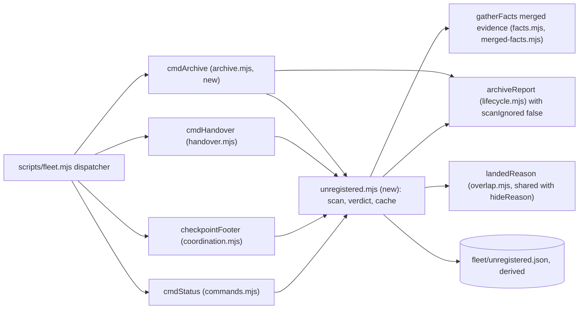
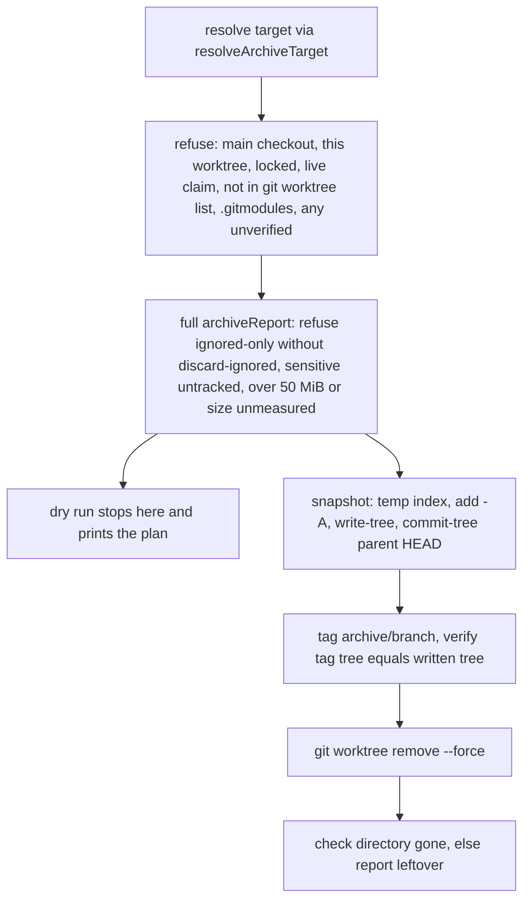

# Plan: fleet — catch abandoned worktree work regularly, and remove account-switch friction
- **Date**: 2026-10-11
- **Status**: Draft
- **Author**: Claude + Louis
- **Scope**: backend (fleet CLI + skill prose; no UI) · stack `js-ts` (`detect-stack`: `js-ts`)
- **Target domain(s)**: `fleet`, `shared-lib`
- ⚠ **Cross-domain work**: `fleet` imports one constant, `RECEIPT_PATH`, from `scripts/lib/sync-receipt.mjs` (`shared-lib`, no imports of its own). `fleet → shared-lib` is a declared edge (`allowedDeps.fleet = ["shared-lib"]` in `.audit-loop/domain-map.json`). Intentional.
- **Depends on**: docs/plans/fleet-handover.md — the unregistered-work predicate (#198) that this plan moves and extends; already landed.

**One word, everywhere: "unregistered work".** The brief called it "unclaimed". The persisted handover manifest field is `unregistered`, and receivers' prompts already say "Unregistered work", so every surface this plan adds uses that term. Only this file's name keeps "unclaimed".

## 0. Decisions at a glance

| Item | Decision | Phase |
|---|---|---|
| **h** live-session defect | Fix first. Handover reads the same merged evidence as `status`; merged-but-unreleased claims are listed as "release these" | 1 |
| **i, n, g** classification | One verdict per unregistered worktree: `unlanded` · `superseded` · `unverified` · `sync-owned`. Only the first and third block a handover | 2 |
| Part 1.1 status section | Added. Not subject to the 14-day idle hide, which today hides exactly the unlanded, clean, idle work | 3 |
| Part 1.2 footer | One FYI line, fed from a derived cache file refreshed by `claim`/`touch`/`ready` under a 3 s bound; `status` stays read-only | 3 |
| Part 1.3 `fleet archive` | Dry run by default; `--apply` snapshots to a temporary index, tags, verifies, then removes. Branch is never deleted | 4 |
| **a, b, j** binding | `claim --worktree`; `add` records the worktree; `release` resolves it by branch (the one reader that does not); warn when id ≠ bound branch | 5 |
| **c** stale tooling | Warn when a hydrated worktree's bundle stamp trails the main checkout's, and name `npm run skills:hydrate` on an unknown verb | 6 |
| **e** gh reachability | Free: reuse the merged-PR query's `queried`/`reason` already in `facts.merged.prs`. No extra `gh` call | 6 |
| **l** stale manifest | `receive` refuses when a newer manifest sits beside the one given, unless `--allow-older`. No "keep latest N" | 6 |
| **d, k** | Prose only (same permission mode; confirm one-offs). Schedule metadata is unreadable, so no date parsing | 7 |
| **f** | Declined. Prepare stays a read-mostly verb; #198's coordinator chips replaced the pasted checkpoint message | — |
| **m** | Measured during planning (§1b). The cross-config-root copy path works; this machine's switch did not change the config root | — |
| 8 `archive/*` tags | Spin out as its own task. Part 1.1 makes them visible meanwhile | — |

## 1. Context Summary

The 2026-10-11 account switch swept every worktree by hand and found 17 that held work no claim covered: 9 superseded, 8 abandoned on 27 Sep to 3 Oct. Nothing in fleet catches that regularly. The Agent-tool worktrees are never claimed, and `fleet status` already lists them, but as undifferentiated untracked items.

### 1a. What exists today (Code Trace, read at `0e287fbd`)

- **The predicate.** `scripts/lib/fleet/handover.mjs:234` `unregisteredWork` lists worktrees no live claim covers (`:241`) that hold staged, unstaged or untracked files or unpushed commits. It probes each one with the full `archiveReport` (`:244`).
- **The probe.** `scripts/lib/fleet/lifecycle.mjs:136` `archiveReport` makes `status`, `status --ignored=traditional` (`:154`), `ls-files -v`, a size walk over untracked and ignored paths (`:164`), `rev-list HEAD --not --remotes`, and `stash list`. `unregisteredWork` then discards the ignored result (`RISK_KINDS` has no `ignored`).
- **The handover state.** `handover.mjs:255` `repoState` builds the live-session list with `gatherFacts({…, merged: false})` (`:272`). `facts.mjs:122` defaults `merged` to `'all'` for the full view that `status` renders. `overlap.mjs:546` `mergedDone` therefore never retires anything in the handover. `receiveHandover` reads the raw registry instead (`:563`).
- **Evidence helpers.** `merged-facts.mjs:154` `mergedEvidenceFor` is the one merged predicate. `overlap.mjs:836` `hideReason` and `prune.mjs:45` `planPrune` already use it (`ahead 0` → `merged`; evidence → `landed`).
- **The status hide.** `overlap.mjs:836-846` hides an untracked branch as `idle` when `ahead` is known, the tip is older than `hideIdleAfterDays` (default 14, `config.mjs:85`), there is no open PR and the worktree is clean. That is **unlanded, committed, idle work**, which the default view folds into "N hidden".
- **Registration.** `commands.mjs:177` `cmdClaim` always binds `currentBranch(cwd)` (`:184`) and the cwd's toplevel (`:225`). `cmdAdd` (`:249`) writes `worktree: null` (`:301`). `lifecycle.mjs:48` `cmdRelease` runs `archiveReport(ctx, { session })` (`:61`), which takes `session.worktree` as given.
- **Dispatch and footer.** `scripts/fleet.mjs:115` dispatches `archive-check`; `:127` appends `checkpointFooter` (`coordination.mjs:65`) after `claim`, `touch` and `ready`. Flag tables: `argv.mjs:16` `VERBS`.
- **Subprocess seam.** `git-facts.mjs:48` `runGit` sanitises git's environment and accepts no `env`.
- **Sync receipt.** `scripts/lib/sync-pr.mjs:20-24` records a decision: a receipt-only change never earns a PR. `sync-receipt.mjs:77` exports `RECEIPT_PATH`.

### 1b. Measured figures (2026-10-11, `0e287fbd`; scratch scripts, not committed)

| # | Figure | Label | Command / source |
|---|---|---|---|
| M1 | `unregisteredWork` wall time: CEE 13 worktrees 3.6 s; wine 23 → 17.2 s; storyline 15 → 13.8 s; ai-organiser 2 → 0.9 s (≈ 280 to 920 ms per worktree) | measured | in-process timing of `unregisteredWork(repo, …)` |
| M2 | On wine's main checkout `status --ignored=traditional` costs 3910 ms; the other five calls cost 31 to 63 ms each. On CEE: 775 ms vs 24 to 43 ms | measured | `spawnSync` timing of the git argv `archiveReport` runs |
| M3 | A light probe (no ignored scan, no size walk) ≈ 150 ms per worktree, so ≈ 3.5 s for wine's 23 | **derived** from M2; re-measure in Phase 2 | sum of M2's four remaining calls |
| M4 | `git tag -l 'archive/*'` → 8 tags | measured | git |
| M5 | 13 scheduled tasks; all 13 have frontmatter `name` + `description` only (no schedule); 6 of 13 descriptions say one-time/one-off | measured | scan of `~/.claude/scheduled-tasks/*/SKILL.md` |
| M6 | A date regex over those descriptions **missed** "Monday 5 October 2026" (an expired one-off). The instrument is unreliable, so no date parsing is planned | measured (instrument defect) | same scan |
| M7 | `CLAUDE_CONFIG_DIR` is unset; this session's memory dir is under `C:\Users\User\.claude`. `handover receive --dry-run` here ran in **`same-config-root`** mode: 713 verified, 0 changed | measured | `node scripts/fleet.mjs handover receive --from <manifest> --dry-run` |
| M8 | The same receive into a **scratch** config root ran in `copy` mode: 713 copied, 0 conflicts, 0 errors; 713 files on disk across 4 project dirs | measured | `CLAUDE_CONFIG_DIR=<scratch> node scripts/fleet.mjs handover receive --from <manifest>` |
| M9 | Defect h on live data today: raw non-terminal = handover-live = status-live in all three repos (2/2/2, 2/2/2, 5/5/5). The 21 stale claims were released by hand, so it **cannot be reproduced live**; it needs a fixture | measured | in-process `gatherFacts` with `merged:false` vs `'all'` |
| M10 | The receive just run flags 2 items: this session's harness worktree `elegant-volhard-cf100d` (4 "unpushed" — the same patch as my branch; `fleet status` prints `DUPLICATE patch`) and a storyline worktree (12 unpushed) | measured | same receive |
| M11 | `.git/fleet/handover/` holds 14 files, 1.6 MB | measured | `ls -la` |
| M12 | Registry record `drift-backlog-refresh-2026-10-11` has `source.branch` equal to its own id. No branch of that name exists; the real branch is `docs/drift-backlog-records-2026-10-11` | measured | `git branch -a --list '*drift-backlog*'` |

### 1c. Where the brief is wrong or silent (corrections that change the design)

| Brief claim | What the code and measurements say | Consequence |
|---|---|---|
| a: "`status` and `claim` do not resolve a worktree for an adopted session" | `buildStatus` falls back to the branch's worktree (`worktree: s.worktree ?? wt?.path`) and `probeSessionWorktrees` does too (`facts.mjs:315`). **`release` is the one reader that does not** (`lifecycle.mjs:61`). With `worktree: null` it skips every worktree probe, so an adopted session with a dirty worktree reads **CLEAN** (derived; pin with a red test) | Fix the read side as well as the write side |
| j: "`claim` records the source branch whenever it differs from the id" | It **always** records the cwd's current branch. The failure is a claim run from the wrong worktree binding the wrong branch silently (M12: a branch that does not exist, so `mergedEvidenceFor` gets `tipOid: null` and never retires it) | Warn on id ≠ bound branch; `--worktree` binds the right one |
| Part 1.1: "reuse `unregisteredWork`" | Reuse, but its probe is the cost (M1, M2) and `status`'s `idle` hide must not apply to the new section | Light probe; section independent of the idle hide |
| g option A: commit receipt-only changes in a rolling PR | Contradicts `sync-pr.mjs:20-24`, which chose not to open a PR for a receipt that changes on every sync | Option B only: classify `sync-owned` |
| k: "from the task's own schedule metadata, where readable" | Not readable (M5); date parsing is unreliable (M6) | Prose + a labelled one-off hint |
| l: "keep the latest N" | 14 files, 1.6 MB (M11). Deleting handover artefacts adds risk for no gain | Receive guard only |
| m: "the first receive in the new account is the empirical check" | The new account shares the old config root (M7), so a real cross-root receive does not exist on this machine. The copy path was exercised against the real manifest anyway (M8) | Recorded here; nothing left to wait for |
| d: "list sessions whose permission mode differs, if the host exposes it" | Only the desktop app's MCP tools can read a mode; no CLI can | Prose only |

### 1d. Neighbourhood considered

`get-neighbourhood` over `handover.mjs` and `status` paths returned 8 candidates, all `review` (below this repo's noise floor, `bandReason: fallback-normalization-uncalibrated`), none in `fleet`. The nearest are `sweepStaleSandboxes` (`prepush-sandbox-cleanup.mjs`, a swept-vs-failed outcome shape) and `checkRegistryParity` (a registered/stale/orphaned/unregistered classification). Both are in other domains and operate on directories and DB rows, not git worktrees, so this plan is greenfield inside `fleet` and borrows only the "report a failed removal as a failure" shape.

## 2. Proposed Architecture



### 2.1 One verdict per unregistered worktree (`scripts/lib/fleet/unregistered.mjs`, new)

`unregisteredWork` moves here from `handover.mjs` (one predicate; #1, #10) and returns items enriched with a pure verdict (#7, #11):

| Verdict | Means | Blocks handover? |
|---|---|---|
| `unlanded` | Dirty files, or commits no evidence puts on base. A merged tip with dirty files is still `unlanded` | yes |
| `superseded` | The exact tip is on base (`landedReason`: `ahead 0` → contained; merged-PR or squash evidence → landed) **and** no staged/unstaged/untracked files; **or** the patch duplicates a branch a live claim covers. Gives `via` | no, listed as removable (the commands are `fleet prune`'s) |
| `unverified` | Evidence incomplete: `gh` unreachable, a probe failed, or a detached HEAD with unpushed commits | yes, as today's "check before claiming", now a state rather than free text |
| `sync-owned` | The only dirty path is `RECEIPT_PATH` (`.sync-receipt.json`) | no, listed with its reason |

- **Evidence.** Callers pass the `facts` they already gathered, so the module makes no extra git or gh call for evidence. Status has `merged:'all'`. Handover and the footer build facts with `merged: <worktree branch names>`. Missing evidence yields `unverified`, never `superseded` (an unasked question is not an empty answer).
- **Shared landed predicate.** `hideReason`'s two lines become an exported `landedReason(item)` in `overlap.mjs`, used by `hideReason`, `planPrune` and the verdict, so "is this tip on base" has one spelling (#10).
- **Light probe.** `archiveReport` gains `scanIgnored = true` and `probeTimeoutMs = 30000`. The scan passes `scanIgnored:false`, which skips the `--ignored` status call and the size walk. The predicate never used their result, and they are the measured cost (M2). `ls-files -v` stays, so skip-worktree still makes an item `unverified`. Defaults leave `release`, `archive-check` and `prune` byte-identical.
- **Idle age.** `lastActivity = max(HEAD commit time, newest mtime among the first 200 dirty paths)`, run through `isIdleTip(…, staleWorktreeDays)`. An unknown or future-dated time is **not** stale, matching `isIdleTip`. Config key `staleWorktreeDays` (default 3, 1 to 3650) sits beside `hideIdleAfterDays`.
- **Bound.** `{ timeoutMs, maxWorktrees: 40, deadlineMs }`, sequential, deadline checked before each probe (the `CLEAN_PROBE` shape). Status uses 20 s, the footer 3 s, handover 120 s. Unprobed worktrees are returned as `notProbed: n`, never dropped. Handover treats them as NOT MEASURED, which fails closed.
- **Archived, unlanded.** `git for-each-ref --no-merged=<base> refs/tags/archive` lists archive tags not contained in base. Each is checked by whole-diff patch-id against the squash window (`patchId`, `squashPatchIds`); a match is `superseded`, otherwise `unlanded` (≤ 50 tags; overflow is reported). Without this, `fleet archive` would move work from a noisy place to a silent one.

### 2.2 Surfaces

- **Status section (Part 1.1).** After the items and the "N hidden" line:

  ```text
  Unregistered work — 7 worktrees hold work no live claim covers
    possibly abandoned (idle > 3d, unlanded) — 3
      worktree-agent-a17ae…  idle 8d · 4 unpushed, 2 untracked · C:/…/agent-a17ae…
    superseded (on base — removable, see fleet prune) — 2
    fresh (idle ≤ 3d) — 2
    archive tags holding commits not on base — 8
  ```

  `possibly abandoned` and `unverified` items are listed in full; the other groups are counts (`--all` lists them). `--json` carries `status.unregistered`. The section ignores `hideReason`'s `idle`, and the "N hidden" line gains "(k of them unlanded — see Unregistered work)" so the two views agree. Fresh unclaimed desktop worktrees are counted, never alarmed.
- **Footer (Part 1.2).** One line from `checkpointFooter` when `abandoned > 0`: `FYI for the user/coordinator, not an action for this session: 3 worktree(s) idle >3d hold unlanded work — fleet status (scan 2h old)`. It is fed from `fleet/unregistered.json`, a **derived Category-A file** beside `hold.json` (`{schemaVersion, at, staleDays, probed, total, partial, counts}`, zod `.strict()`, written with `atomicWriteFileSync`, never committed). `claim`, `touch` and `ready` refresh it when it is missing or older than 6 h, under the 3 s bound, and a partial scan is cached as partial. `status` never writes it and stays live. A corrupt or unreadable cache prints `next: not derived (…)` and cannot change the verb's exit code. Archive tags stay out of the footer (they would nag for weeks).
- **Why the wording matters.** The user pre-authorises acting without asking only on `next`'s `DO` lines. A footer line that reads like an instruction would send chip sessions off to inspect other sessions' worktrees. The line says whose it is, and `participant-rules.md` states it is not a `DO`.

### 2.3 `fleet archive <worktree|branch|path|id> [--apply] [--discard-ignored]` (`archive.mjs`, new)



- **Snapshot without side effects (#13, #14).** `GIT_INDEX_FILE=<tmp>`, `read-tree HEAD`, `add -A`, `write-tree`, `commit-tree <tree> -p HEAD`. No hook runs, the branch and the worktree are untouched until the final step, and every failure before removal changes nothing. This needs `runGit` to accept an `env` limited to `GIT_INDEX_FILE` (`git-facts.mjs:48`).
- **Tag.** `archive/<branch>` (detached: `archive/<worktree basename>`); if that name exists at another oid, append `-<short oid>`. A tag already at the same oid is reused. Lightweight, matching the 8 existing tags. Tags are local; nothing pushes them.
- **Removal result.** If removal fails, or the directory is still there afterwards (the storyline file-lock case), the verb exits 1 with the tag kept and `leftover: <path>`, never "success". The branch is never deleted.
- **No restore verb, no expiry** (`git checkout archive/x` already restores).

### 2.4 Registration and handover (Phases 1, 5, 6)

- **h.** `repoState` passes `merged: [every worktree branch, every registered branch]`. Derived-done claims drop out of `sessions`. Claims whose branch is merged but whose registry record is still non-terminal are listed as `mergedUnreleased` with the exact `release --id …` command, and `receive` derives live sessions through the same function (`liveSessionsOf`). The manifest gains optional fields (the schema is `.strict()`, so each addition is declared): `mergedUnreleased`, `gh`, and per unregistered item `verdict`, `via`, `idleDays`.
- **e.** `gh: { queried, reason }` per repo is `facts.merged.prs` verbatim. A repo with `queried:false` prints "PR state unknown — sign in to gh with an account that can read `<owner>/<repo>`" (owner and repo from `origin`, one git call). `sync-pr.mjs`'s `parseGhAccounts` is not reused: it lives in a module whose imports would enlarge every consumer's synced closure. `receive` re-measures and lists it as a human step.
- **l.** `receive` lists sibling `handover-*.json` in the `--from` directory; any id greater than the given one refuses (exit 3) unless `--allow-older`. Ids sort chronologically (`OP_ID_RE`); an unparseable sibling name is ignored.
- **a, b, j.** `claim --worktree <path>` must be a listed, present worktree of this repo (realpath compared); its checked-out branch becomes `source.branch`, and a detached one needs `--id` and binds no branch (warned). With no flag the behaviour is unchanged, plus a warning when the id ≠ the bound branch ("merged evidence retires a claim by its BRANCH"). An adopted session whose `worktree` is `null` can be filled once (never re-pointed). `add` records the branch's worktree (`gatherFacts` with `worktrees:true`). `release` resolves the worktree through `resolveArchiveTarget`'s branch fallback.
- **c.** `bundle-stamp.mjs`: when fleet runs from a `.claude-skills` tree inside a **linked** worktree, compare its `scripts/.sync-manifest.json` (`commitSha`, `generatedAt`) with the main checkout's. A missing or older stamp prints one stderr warning naming `npm run skills:hydrate`; an unknown-verb error repeats the hint (where `release` was missing). stderr only, so `--json` stays clean. The source repo runs tracked `scripts/` and is skipped.
- **d, k.** The coordination prompt gains "put coordinators in the same permission mode before posting anything" and "a scheduled task's schedule is not in its file; confirm every one-off". Tasks whose description matches `/one[- ]?(time|off)|\bonce\b/i` are marked `(one-off — confirm it is still wanted)`: a labelled text hint, no date arithmetic.

### 2.5 Right-sizing (three lines each)

| New structure | Band-aid | Over-built | Chosen, and the current requirement |
|---|---|---|---|
| `unregistered.mjs` + `unregistered.json` | Print the "N hidden" line louder or cut `hideIdleAfterDays` | A scheduler/daemon, or a per-worktree registry record | One pure verdict, the moved predicate, and a derived cache. Requirement: the 2026-10-11 sweep took a coordinator round trip per item, and a footer at M1 cost per call is unusable |
| `fleet archive` | A runbook of four git commands (today's manual state) | Restore verb, expiry, remote archive repo | One verb: snapshot, tag, verify, remove. Requirement: 8 abandoned worktrees were rescued by hand |
| Footer cache | Recompute on every footer (3.6 to 17 s) | A background watcher | TTL file refreshed by the verbs that already run, 3 s bound |
| `landedReason`, `scanIgnored` | Copy `hideReason`'s two lines; a second probe function | A general probe-plan abstraction | Extract one predicate; add one default-preserving option |

Principles: #1/#10 (one predicate, one `landedReason`), #2/#7 (verdict pure, probe injected), #8 (`staleWorktreeDays`, bounds as named constants), #11 (every probe and clock injectable), #12 (realpath and `git worktree list` membership at the boundary), #13/#14 (archive is create-then-verify-then-remove), #15 (closed verdict enum; failures are results), #16 (cache or probe failure degrades to a stated "not derived"), #18 (new manifest fields optional; defaults preserve `release`/`archive-check`/`prune`), #19 (every skipped worktree is counted).

## 3. Execution Model

Dependencies: **1 → 2 → 3 and 4**; **5** is independent of 2 to 4 (touches `cmdClaim`, `cmdAdd`, `cmdRelease`); **6** edits `handover.mjs` after 1 and 2; **7** documents every flag added by 3 to 6, so it is last.

- **Archive chain** (atomic by construction): resolve → refuse-checks → snapshot (temp index; nothing mutated) → tag → verify → remove. A failure before removal leaves the repo as it was (the temp index is deleted in `finally`). A failure at removal leaves a verified tag and an honest `leftover`. Re-running with the tag at the same oid is idempotent (#13).
- **Cache.** Writes are atomic renames of derived content, so two concurrent refreshes (several sessions crossing the TTL together) are last-writer-wins and both correct. No registry lock is taken, and the refresh runs outside `transact` so a 3 s scan can never hold `fleet/.lock`.
- **Registry mutation.** Only Phase 5 changes how the registry is written, inside the existing `transact`. The validation for `--worktree` runs before the lock, like every other git fact (`commands.mjs` header).

## 4. Security Considerations

The security-incident neighbourhood returned INC-001 (a symlink resolving into a sensitive path evades a lexical classifier). It applies to `archive` because the verb deletes a directory and copies untracked files into a git object:

- The removal target must be a `git worktree list` entry whose **realpath** equals the requested path's realpath. A symlinked or junctioned worktree root is refused (junctions *inside* a worktree, such as `node_modules`, are unlinked by `git worktree remove`; that is existing behaviour the fleet test helper already relies on).
- Untracked paths are classified with `resolveAndClassify` from `scripts/lib/sensitive-paths.mjs`, the single oracle (no fifth classifier). Any `sensitive` hit refuses: a snapshot would copy a credential into the object database, and this repo is public (a stray `git push --tags` would publish it).
- `.gitmodules` present → refuse: a submodule's inner changes cannot be snapshotted.
- The size cap (50 MiB, or size unmeasured) keeps a build-artefact tree out of the object database.
- Nothing here sends data to a model or a network service.

## 6. Sustainability Notes

- **Assumptions that could change**: `gh` reaches the repos (every `gh` failure is `unverified`, never a verdict); Agent-tool worktrees stay unclaimed (they are listed, not special-cased); the receipt stays the only sync file left dirty on purpose (a second would be added to one list, `SYNC_OWNED_PATHS`).
- **Extension points**: the verdict enum is closed, with a `via` field; the bounds are named constants; a new surface calls the same `unregisteredWork` + `classify` pair.
- **Not built, on purpose**: a restore verb, archive expiry, mode listing, directive posting from prepare.

## 7. File-Level Plan

| File | Purpose | Key exports / change | Why |
|---|---|---|---|
| `scripts/lib/fleet/unregistered.mjs` (create) | Scan, verdict, idle age, bounds, cache I/O, `liveSessionsOf` helper inputs | `unregisteredWork`, `classifyUnregistered`, `scanArchiveTags`, `readUnregisteredCache`, `refreshUnregisteredCache`, `UNREGISTERED_PROBE` | One predicate (#1, #10); testable seams (#11) |
| `scripts/lib/fleet/archive.mjs` (create) | `fleet archive` | `planArchive`, `applyArchive`, `cmdArchive` | Snapshot-tag-verify-remove (#13, #14) |
| `scripts/lib/fleet/bundle-stamp.mjs` (create) | Stale hydrated tooling | `staleBundleWarning` | Friction c |
| `scripts/lib/fleet/handover.mjs` (modify) | Drop the moved predicate; merged evidence; `liveSessionsOf`; manifest fields; `--allow-older`; prose | schema additions are optional | Friction h, i, e, l, d, k |
| `scripts/lib/fleet/lifecycle.mjs` (modify) | `archiveReport` options; `release` resolves the worktree | `scanIgnored`, `probeTimeoutMs` | Light probe; friction a |
| `scripts/lib/fleet/overlap.mjs` (modify) | Extract `landedReason` | `hideReason` calls it | Single predicate |
| `scripts/lib/fleet/commands.mjs` (modify) | Status section; `claim --worktree`; `add` records the worktree | | Part 1.1; a, b, j |
| `scripts/lib/fleet/render.mjs` (modify) | `renderUnregistered`; "k of them unlanded" in the hidden line | pure text | Renderers live here |
| `scripts/lib/fleet/coordination.mjs` (modify) | Footer line | `checkpointFooter` | Part 1.2 |
| `scripts/lib/fleet/config.mjs` (modify) | `staleWorktreeDays` | zod int 1 to 3650, with `sources` | #8 |
| `scripts/lib/fleet/argv.mjs` (modify) | `archive` verb; `claim --worktree`; `handover --allow-older` | flag tables | Unknown flags are refused otherwise |
| `scripts/lib/fleet/git-facts.mjs` (modify) | `runGit` accepts `env: {GIT_INDEX_FILE}` only | | Temp index |
| `scripts/fleet.mjs` (modify) | Dispatch `archive`; run the stamp check | | Entry point |
| `skills/fleet/SKILL.md`, `skills/fleet/references/coordination.md`, `skills/fleet/references/participant-rules.md`, `skills/fleet/gate-contract.json` (modify) | Usage lines and rules; FYI is not a `DO`; `archive --apply` needs the user's go-ahead | | The skill is the only carrier that reaches consumers |
| `tests/fleet-unregistered.test.mjs`, `tests/fleet-archive.test.mjs`, `tests/fleet-bundle-stamp.test.mjs` (create); `tests/fleet-handover.test.mjs`, `tests/fleet-lifecycle.test.mjs`, `tests/fleet-cli.test.mjs`, `tests/fleet-config.test.mjs`, `tests/fleet-coordination.test.mjs`, `tests/fleet-git-facts.test.mjs` (modify) | See §9 | | |

### 7b. Implementation Phases

**Phase 1 — Handover live-session defect (h)**: `repoState` passes merged evidence, so a merged, clean claim reads `done`; merged-unreleased claims are listed with their `release` command; `receive` derives its live list through the same `liveSessionsOf`. Red test first, on a fixture whose PR merged (M9). Files: scripts/lib/fleet/handover.mjs (modify), tests/fleet-handover.test.mjs (modify).

**Phase 2 — Shared unregistered-work module (i, n, g)**: create the module with the moved predicate, verdict, idle age, bounds and cache I/O; add `scanIgnored`/`probeTimeoutMs` to `archiveReport`; extract `landedReason`; handover consumes the verdicts (only `unlanded` and `unverified` block). Files: scripts/lib/fleet/unregistered.mjs (create), scripts/lib/fleet/lifecycle.mjs (modify), scripts/lib/fleet/overlap.mjs (modify), scripts/lib/fleet/handover.mjs (modify), tests/fleet-unregistered.test.mjs (create), tests/fleet-lifecycle.test.mjs (modify), tests/fleet-handover.test.mjs (modify).

**Phase 3 — Status section, footer and config (Part 1.1, 1.2)**: render the section, refresh and read the cache in `claim`/`touch`/`ready`, add `staleWorktreeDays`. Files: scripts/lib/fleet/commands.mjs (modify), scripts/lib/fleet/render.mjs (modify), scripts/lib/fleet/coordination.mjs (modify), scripts/lib/fleet/config.mjs (modify), scripts/lib/fleet/unregistered.mjs (modify), tests/fleet-unregistered.test.mjs (modify), tests/fleet-coordination.test.mjs (modify), tests/fleet-config.test.mjs (modify), tests/fleet-cli.test.mjs (modify).

**Phase 4 — `fleet archive` (Part 1.3)**: dry run by default, `--apply` runs the snapshot chain; `runGit` gains the restricted `env`. Files: scripts/lib/fleet/archive.mjs (create), scripts/lib/fleet/git-facts.mjs (modify), scripts/lib/fleet/argv.mjs (modify), scripts/fleet.mjs (modify), tests/fleet-archive.test.mjs (create), tests/fleet-git-facts.test.mjs (modify).

**Phase 5 — Registration binding (a, b, j)**: `claim --worktree`, the id ≠ branch warning, `add` records the worktree, `release` resolves it (the false-CLEAN fix). Files: scripts/lib/fleet/commands.mjs (modify), scripts/lib/fleet/lifecycle.mjs (modify), scripts/lib/fleet/argv.mjs (modify), tests/fleet-cli.test.mjs (modify), tests/fleet-lifecycle.test.mjs (modify).

**Phase 6 — Handover hardening and stale-tooling guard (c, e, l, d, k)**: gh reachability fields, the newer-manifest refusal, the bundle-stamp warning, prompt prose and the one-off hint. Files: scripts/lib/fleet/handover.mjs (modify), scripts/lib/fleet/bundle-stamp.mjs (create), scripts/lib/fleet/argv.mjs (modify), scripts/fleet.mjs (modify), tests/fleet-handover.test.mjs (modify), tests/fleet-bundle-stamp.test.mjs (create).

**Phase 7 — Skill prose**: usage lines for `archive`, `claim --worktree` and `--allow-older`; the footer FYI rule; `archive --apply` needs the user's go-ahead (deletion); regenerate gate-contract candidates if `skills:check` asks. Files: skills/fleet/SKILL.md (modify), skills/fleet/references/coordination.md (modify), skills/fleet/references/participant-rules.md (modify), skills/fleet/gate-contract.json (modify).

**Close-out (not a phase)**: `npm run skills:regenerate` then `npm run skills:check` and `npm run gates:check`; `npm run bundle:deps:check` (new imports: `sync-receipt.mjs`, `sensitive-paths.mjs`; both must be in the consumer closure); `npm run plans:index` + `npm run plans:lint`; `node --test tests/fleet-*.test.mjs`, then `npm test`; update the fleet claim to add `scripts/fleet.mjs` and `.claude/skills/fleet/**`; the empirical run in §9.

## 8. Risk & Trade-off Register

| Risk | Mitigation |
|---|---|
| The footer line sends chip sessions to inspect other worktrees | Worded "not an action for this session"; `participant-rules.md` says it is not a `DO`; a test pins the exact line |
| A false `superseded` gets real work removed | Needs exact-tip evidence **and** no dirty files, the bar `prune` already uses; incomplete evidence is `unverified`; removal commands are `prune`'s, run by a person |
| The light probe misses something the full probe caught | The predicate never counted ignored files; `ls-files -v` stays; paired controls (§9) |
| Duplicate-of-claim hides work if the twin is later abandoned | Counts only while the twin is a **live claimed** branch; the next scan reclassifies |
| A stale cache gives false comfort | The footer prints the scan age; `status` is always live |
| Archive copies a secret, or a huge tree, into the object DB | Sensitive-path refusal and the 50 MiB cap (§4) |
| Windows file lock leaves a directory behind | Reported as `leftover`, exit 1, tag kept |
| `receive` refusing an older manifest blocks a legitimate restore | `--allow-older` |
| Extra scan makes `status` slower | Measured M3 ≈ 3.5 s on wine; the 20 s deadline reports a partial scan, never silence |

**Deferred, and why that is acceptable**: mode listing (d, no data source), directive posting (f, a registry write from a read-mostly verb), date parsing (k, unreliable by M6), `sync-pr` rolling PR (g, contradicts a recorded decision), keep-latest-N (l, 1.6 MB), a branch-only `archive` (it would be `git tag`), restore and expiry. **Spun out**: triaging the 8 `archive/*` tags (land or drop, one judgement per tag).

## 9. Testing Strategy

Tier 1 throughout: deterministic modules, no model calls. Tier 3(b) applies because the new modules join the consumer sync closure; add an import test for each new lib module wherever `tests/relocation-guard.test.mjs` covers library modules (it has no `lib/fleet` enumeration today, so verify, don't assume). Fixtures use `tests/helpers/fleet-repo.mjs` (throwaway repos, fake `gh`). Every "does not" case gets a paired control that fires the other way.

- **Red first.** (h) a claim whose PR merged reads live in `repoState` today → fixture. (a) an adopted session with pushed commits and one dirty untracked file: `release` prints CLEAN today, must print AT RISK. (j) a claim run from the wrong worktree binds the wrong branch.
- **Verdict table**, one case per row with its inverse: `unlanded` (dirty) vs the same tree clean and merged → `superseded`; exact-tip PR evidence vs a tip one commit past it → not `superseded`; `gh` unreachable → `unverified`, never `superseded`; detached with unpushed → `unverified`; receipt-only dirty → `sync-owned` vs receipt + one other file → `unlanded`; duplicate of a live claimed branch → `superseded` vs the twin released → `unlanded`. A contract test pins the literal receipt path in `SYNC_OWNED_PATHS` against `RECEIPT_PATH`.
- **Light probe.** An injected `git` records its calls: with `scanIgnored:false` no `--ignored` call and no size walk, and unpushed/untracked/skip-worktree are still found; the default mode makes both calls (control). A bounded run with a slow injected probe returns `notProbed`, never a clean list.
- **Idle age.** Frozen clock (`FLEET_NOW`): exactly at, one second inside and one second past `staleWorktreeDays`; a future-dated commit and a missing mtime are not stale.
- **Footer.** TTL boundary; partial scan cached as partial; corrupt cache → "not derived", exit code unchanged; `status` writes nothing (file absent before and after).
- **Archive.** Dirty + untracked: the tag's tree contains both, the branch tip did not move, the worktree is gone. Refusals each with a clean control: ignored-only without the flag, live claim, locked, main checkout, symlinked root, sensitive untracked file, `.gitmodules`, oversize. Injected failures: tag creation fails → worktree intact; `worktree remove` fails → tag kept, `leftover`, exit 1; second run is idempotent.
- **Binding and handover.** `--worktree` accepts a listed worktree and refuses a path outside this repo; the id ≠ branch warning; manifest round-trip with the new optional fields **and** an old manifest without them; newer-manifest refusal vs `--allow-older`; the stamp warning only in a linked worktree with an older stamp.
- **Empirical run before calling it done** (the repo's pre-ship rule): run `status`, a `touch`, and `handover prepare` against CEE, wine, storyline and ai-organiser. Check no fresh worktree alarms, the 8 archive tags are counted, wall time ≤ 5 s on wine (M3), and the harness worktree of M10 reads `superseded (duplicate)`. Record the figures here with their commands.

## 11. Execution Clustering

- **Cluster A** — Phases 1-2 — fix-gate: yes
  - Coupling: both rework `repoState`/`receiveHandover` in `handover.mjs` and define the live-session and unregistered-work facts every later surface consumes; Phase 2's verdict is only as good as Phase 1's merged evidence, which comes from the same `gatherFacts` call.
- **Cluster B** — Phases 3-4 — fix-gate: yes
  - Coupling: the status section, the footer and `archive` all read `unregistered.mjs`'s verdict and cache, and `archive` refuses on the same verdict plus the full `archiveReport`; both edit `argv.mjs` and `fleet.mjs`.
- **Cluster C** — Phases 5-7 — fix-gate: final
  - Coupling: `claim`/`add`/`release` binding, the receive guards and the stamp check share `commands.mjs`, `handover.mjs`, `argv.mjs` and `fleet.mjs`; Phase 7 documents every flag Phases 3 to 6 add, so it must follow them.
- **Final gate**: consolidated Gemini review over the union diff.

## 12. Out of scope

- Moving session transcripts, chips or messages between accounts: impossible by design.
- Auto-removing worktrees: never without `--apply` and a verified preserved tag.
- Changing `sync-pr`'s receipt rule.
