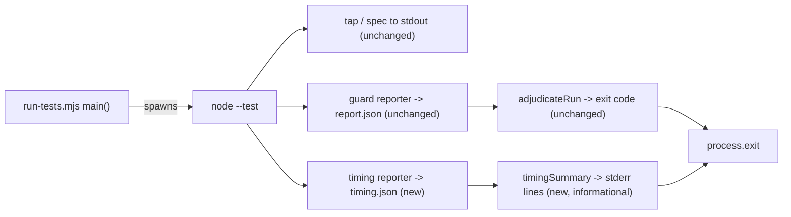

# Plan: pre-push gate cost, slice 1 — make per-file cost visible, add `test:preflight`
- **Date**: 2026-10-12
- **Status**: Draft
- **Author**: Claude + Louis
- **Scope**: backend (test runner + docs; no UI) · stack `js-ts` (`detect-stack`: `js-ts`)
- **Target domain(s)**: `scripts`, `shared-lib`, `docs`
- ⚠ **Untagged paths**: `package.json` matches no rule in `.audit-loop/domain-map.json` (a one-line script entry; no rule needed).
- **Depends on**: none. Path hold, not a plan dependency: `tests/fleet-*.test.mjs`, `tests/helpers/fleet-repo.mjs`, `scripts/lib/fleet/**`, `scripts/fleet.mjs` and `skills/fleet/**` belong to `claude/fleet-unclaimed-work-impl` (§8). This plan touches none of them.

Origin: a `/brainstorm` (SID `1791762981190`, two voices) on land-train and audit-chain efficiency, synthesised into "make the gate's cost visible and cut its dominant cause without changing what it verifies". This slice is the part of that which is unblocked.

## 1. Context Summary

### 1.1 The problem, measured

All figures *measured* 2026-10-11/12 unless marked. The commands are the evidence; rerun them before trusting a number.

| Fact | Figure | Command / source |
|---|---|---|
| One full pre-push gate, same branch, two runs | **1,647 s** and **2,416 s** | the `# duration_ms` line at the end of each push's TAP (`git push` logged to a file) |
| The suite without `tests/fleet-cli.test.mjs` | **159.6 s**, 6,860 tests, 928 files | `ls tests/*.test.mjs \| grep -v fleet-cli.test \| xargs node --test --test-reporter=tap` → `# duration_ms 159640.27` |
| So that one file is | **~85-90%** of gate wall time (*derived*: 1 − 160/1,647…2,416) | derived from the two rows above |
| `tests/fleet-cli.test.mjs` | 132 `it()` cases, 189 `fleet.mjs` spawns, a fixture built per test | `grep -c -E '^\s*it\(' …`, `grep -o -E '\bf\(\[' … \| wc -l`, `setup()` → `makeFleetRepo` at `tests/fleet-cli.test.mjs:46` (5157ff65) |
| Why a spawn is slow | node start **0.07 s**, `import fleet.mjs` **0.2 s**, `claim` **2.0 s** wall with **39** subprocesses, `status` **1.7 s** / **21**, `next` **0.37 s** / **4**; the cost is subprocess count × Windows spawn time × load, not interpreter start | a `--import` preload that wraps `child_process` and logs count and wall time per call, run against a throwaway fixture repo |
| A late failure doubles the cost | one chip's first full gate failed 2 of 18,747 tests after green targeted runs; the second gate was another 27 min | `tests/prepush-sandbox-honesty.test.mjs`, `tests/rmsync-retry-guard.test.mjs` |
| The land train adds a gate, it does not replace one | `.fleet.json` has no `testCommand`, so `fleet land` runs `package.json`'s `npm test` once per train, on top of each chip's own pre-push | `scripts/lib/fleet/config.mjs:149` (`testCommandSource = hasPackageTest ? 'package.json' : 'unset'`, 5157ff65) |
| Cheaper-audit lever sized | of 80 PRs merged since 2026-09-25, **72** touch code, **4** docs-only, **4** docs+tests | a first-parent classifier over `git log origin/main --since=2026-09-25` |

The last row is why impact-tiered audit depth is **not** in this slice: at most ~10% of PRs could skip an audit, and skill prose and gate docs change behaviour, so even those are not safe to skip.

### 1.2 Code Trace (all `(5157ff65)`)

- `package.json` `"test": "node scripts/run-tests.mjs"`; `npm run check` ends in `npm test`.
- `scripts/run-tests.mjs:213` `main()` builds `reportDir`, calls `buildReporterArgs` (`:137`), spawns `node --test <reporters> <args>` with `stdio: 'inherit'` (`:226`), reads the guard report (`:233`), then `adjudicateRun` (`:157`) decides the exit code.
- `adjudicateRun` **fails closed**: a missing, unparseable, wrong-version or malformed guard report is exit 1 (`:164-192`). That contract is the repo's false-green defence and must not move.
- `buildReporterArgs` appends the guard's `--test-reporter`/`--test-reporter-destination` pair **last and contiguous**; `tests/test-guard-false-green.test.mjs:246` pins that ("contiguous and last"). Node pairs reporters with destinations positionally.
- `scripts/lib/test-guard-reporter.mjs:84` is an async-generator reporter that yields one JSON line at end-of-stream.
- Default file set `DEFAULT_ARGS` (`:114`): `tests/*.test.mjs`, `tests/claudemd/*.test.mjs`, `tests/install/*.test.mjs`.
- Fixtures for end-to-end runs already exist: `tests/fixtures/test-guard/{healthy,construction-failure,failing-todo}.fixture.mjs`.

### 1.3 Neighbourhood considered

`get-neighbourhood` over `scripts/run-tests.mjs` and `scripts/lib/test-guard-reporter.mjs`, intent "per-file timing reporter and a preflight run that skips declared slow files", returned only the existing guard (`adjudicateRun`, `testGuardReporter`, `isExitCodeWorthyFailure`, `summariseFailure`), all band `review`: nothing occupies the timing space. **Decision: write a sibling reporter**, not an extension of the guard's report. Extending it would bump `GUARD_REPORT_VERSION`, couple a purely informational field to a fail-closed reader, and put the false-green defence one typo away from rejecting every run.

## 2. Proposed Architecture

### 2.1 Decisions

| # | Decision | Principle |
|---|---|---|
| D1 | A **separate** `test-timing-reporter.mjs`, its own destination file and its own version string `test-timing/v1`. The guard report, its version and `adjudicateRun` are untouched | #1 SRP, #15 fail-safe: informational data never rides a fail-closed channel |
| D2 | Timing is **test-body time**: per file, the sum of the `duration_ms` of its nesting-0 events (a suite's duration already covers its subtests). It excludes process start and import time, and the output says so | measure what the reporter can actually see; do not present it as wall time |
| D3 | The summary goes to **stderr**, after the run: `N slowest test files (test-body time, share of the total)`. stdout stays the TAP stream other tools read | #6 contract stability |
| D4 | A missing, unparseable or wrong-version timing report prints `timing unavailable (<reason>)` and **changes nothing else**. A pure `finishRun({status, reportText, timingText})` returns `{exitCode, lines}` and its exit code is `adjudicateRun`'s, by construction and by test | sandbox-honesty rule: absence must be visible, and must never be able to flip a verdict either way |
| D5 | `npm run test:preflight` = `node scripts/run-tests.mjs --preflight`: the default file set minus **one exported constant**, `PREFLIGHT_SKIPPED_FILES` (initially `tests/fleet-cli.test.mjs`, with the reason beside it). It prints, before running, that it is **not the gate** and names what it skips, and again in the summary. It cannot be combined with explicit file arguments (usage error) | #4 no hardcoding in two places; honest naming |
| D6 | Preflight expands the three default globs itself (`readdirSync`, `.test.mjs` suffix) because `node --test` has no exclude flag in the Node range this repo supports (Node 22). A listed file that does not exist, or an empty result, fails the run | a skip list that rots silently is the sandbox-honesty failure |
| D7 | No change to `npm test`, `npm run check`, the pre-push hook, or `.fleet.json` | the gate verifies exactly what it did |

### 2.2 Right-sizing (AGENTS.md "Design right-sizing")

- **Band-aid extreme**: `time npm test` in the runbook. It tells you the total, never the file, and nobody sees it on a failing push.
- **Over-built extreme**: a persisted timing history, a regression gate on per-file time, impact-based test selection from the import graph, sharded workers. None serves a *current* requirement; each needs a baseline we do not have yet.
- **Chosen**: print the slowest files every run (so the cost is visible where the cost is paid) and offer one honest shortcut for the pre-push habit that caused the 40-minute rework. Both in `run-tests.mjs` plus one small reporter. It serves the measured requirement: nobody could see that one file was ~90% of the gate.

## 6. Sustainability Notes

- The skip list is the one place a future slow file is named; the runbook says how it was found (the summary this slice adds), so it is a measure-then-skip habit, not a guess.
- Assumption that could change: `node --test` gains an exclude flag. Then D6's `readdirSync` can go; the constant stays.
- Deliberately not built: any attempt to *reduce* `fleet-cli`'s cost. That is held (§8) and is the larger lever.

## 7. File-Level Plan

| File | Intent | Purpose |
|---|---|---|
| `scripts/lib/test-timing-reporter.mjs` | create | `TIMING_REPORT_VERSION`, `testTimingReporter` (async generator; one JSON line at end), pure `accumulateFileTimes(events)` and `summariseTiming(reportText, {top})` |
| `scripts/run-tests.mjs` | modify | `buildReporterArgs` gains an optional `timingPath` (timing pair placed **before** the guard pair so the guard stays contiguous and last); `selectTestFiles({preflight, readdir})`, exported `PREFLIGHT_SKIPPED_FILES`; pure `finishRun`; `main()` wires them |
| `package.json` | modify | `"test:preflight": "node scripts/run-tests.mjs --preflight"` |
| `tests/run-tests-timing.test.mjs` | create | reporter, summary, degradation and verdict-independence |
| `tests/run-tests-preflight.test.mjs` | create | selection, skip-list integrity, usage errors, banner |
| `docs/runbooks/gate-cost.md` (planned) | create | the §1.1 table with commands, when to use preflight, follow-ups |

Close-out (not a phase): `npm run docs:check`, `npm run plans:index`, `npm run knip:gate`, `npm run cli:flags:gate`, `npm run size:ratchet:gate`, `npm run stdout:flush:gate`.

### 7b. Implementation Phases

**Phase 1 — Timing visible**: the reporter, `buildReporterArgs` option, `finishRun`, the summary on stderr. Files: `scripts/lib/test-timing-reporter.mjs` (create), `scripts/run-tests.mjs` (modify), `tests/run-tests-timing.test.mjs` (create).
**Phase 2 — Preflight and the record**: `selectTestFiles`, `PREFLIGHT_SKIPPED_FILES`, the `--preflight` flag and banner, the npm script, the runbook. Files: `scripts/run-tests.mjs` (modify), `package.json` (modify), `tests/run-tests-preflight.test.mjs` (create), `docs/runbooks/gate-cost.md` (planned) (create).

## 8. Risk & Trade-off Register

| Risk | Handling |
|---|---|
| The timing reporter throws and takes the run down | A reporter error is reported by node, not swallowed; the guard report is independent, and `finishRun` treats a missing timing report as `unavailable`. Test: a deliberately broken timing path leaves the exit code equal to `adjudicateRun`'s |
| Test-body time understates a file (import/start excluded) | Stated in the output header and the runbook; D2 |
| Preflight read as "the tests pass" | Banner before and summary after, both naming the skipped files and "not the gate"; it exits non-zero on any failure it ran; it never prints a bare pass |
| The skip list names a renamed file | D6: a missing listed file fails the run, and a unit test asserts every entry exists |
| Another session edits `scripts/run-tests.mjs` | It is in this chip's fleet claim; `fleet next` at each checkpoint |

**Deferred, with reasons** (each is a follow-up, none is a band-aid for this slice):
1. **`fleet-cli` fixture sharing and spawn memoisation** — the dominant cost (~85-90%). Held by `claude/fleet-unclaimed-work-impl` (`tests/fleet-*.test.mjs`, `tests/helpers/fleet-repo.mjs`, `scripts/lib/fleet/**`). Findings handed to the CE coordinator: build the fixture once per file from a template copy; memoise the duplicate `rev-parse` calls inside one command (9× `rev-parse --verify`, 6× `--path-format=absolute` in one `claim`); skip `gh pr list` in `claim` when nothing needs it.
2. **Train `testCommand` tiers in `.fleet.json`** — moves the trust boundary (what runs per push versus per train). Needs enforcement in the landing path, not prose; do it after (1) shrinks the number.
3. **Shadow train-interaction audit** — a read-only, human-invoked audit over a frozen batch, to measure whether cross-branch findings are worth building anything for. Not before there is a baseline.
4. **Impact-tiered audit depth** — sized in §1.1 at ≤10% of PRs; revisit only with a better classifier than file extension.

## 9. Testing Strategy

Tier 1 (deterministic seams; test-first):
- `accumulateFileTimes`: nesting-0 events only; sums per file; a file with only a failing test still appears; unnamed or fileless events are ignored rather than crashing.
- `summariseTiming`: top-N ordering, shares sum to ≤100%, N larger than the file count, **empty report → "no files recorded" (not a table of zeros)**, wrong version / unparseable / null → `timing unavailable (<reason>)`.
- **Verdict independence** (the control that matters): for every timing input (`null`, garbage, wrong version, valid) `finishRun(...).exitCode === adjudicateRun(...).exitCode`, across passing, failing and missing-guard-report cases.
- `selectTestFiles`: default returns the three globs unchanged and an empty skip list; preflight removes exactly `PREFLIGHT_SKIPPED_FILES`; **every skip-list entry exists on disk**; a skip list that empties the result throws; explicit files with `--preflight` is a usage error.
- `buildReporterArgs` with `timingPath`: the guard pair is still contiguous and last (the existing pin must stay green unedited).

Tier 2 (end to end, reusing `tests/fixtures/test-guard/*`): run the real runner on `healthy.fixture.mjs` (exit 0, summary on stderr, **vacuous-pass guard**: the summary names the fixture file) and on `construction-failure.fixture.mjs` (exit 1, the summary still printed).

Not tested by spawning the whole suite: that is the gate's job, and the preflight's file selection is covered purely.

## Remaining / follow-ups

See §8 "Deferred". Memory note for later sessions: the full-suite-before-first-push habit this slice automates is recorded in `feedback_run_whole_suite_before_first_push.md`.
