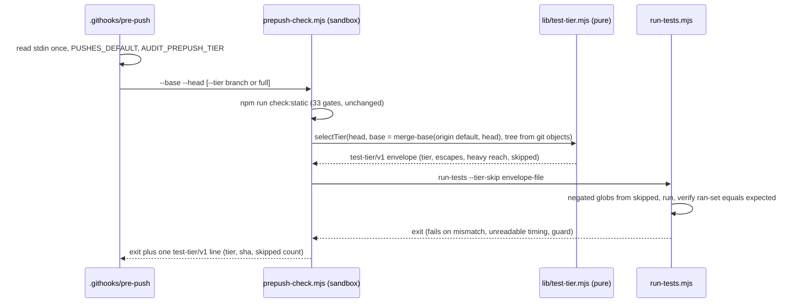

# Plan: pre-push gate cost, slice 2 — a cheaper branch-push test tier
- **Date**: 2026-10-13
- **Status**: In Progress (stages 0 and 1 built; stage 2 approved and built for CES ONLY by ci-full-suite-actions.md, 2026-10-14; for any other repo it still awaits a separate user decision)
- **Author**: Claude + Louis
- **Scope**: backend (pre-push hook, test runner, one CLI; no UI) · stack `js-ts` (`detect-stack`: `js-ts`)
- **Target domain(s)**: `scripts`, `shared-lib`
- ⚠ **Cross-domain work** — touches `scripts` (CLIs) and `shared-lib` (`scripts/lib/**`); the seam is one new pure module, so the crossing is intentional.
- ⚠ **Untagged paths**: `.githooks/pre-push`, `package.json` — no rule in `.audit-loop/domain-map.json`; the hook is wired by `core.hooksPath`, `package.json` gains script entries only.
- **Depends on**: docs/plans/gate-cost-slice-1.md — reuses its timing reporter, negated-glob selection and post-run selection check (Complete, #212).
- **Depended on by**: docs/plans/ship-trains.md §2.10 / Cluster D — the thinness metric calls the selection query this plan defines (§2.6).

Origin: `docs/plans/ship-trains.md` §2.10 (coordinator ruling 2026-10-12) gave the branch side of test cost to this plan: "a cheaper branch-push tier, its vacuous-pass guard, a full-suite escape hatch". **This plan designs and measures; it builds nothing.** Whether a branch push may run less than the full suite is the user's call — §12 POLICY DECISION.

## 1. Context Summary

### 1.1 The problem, measured

*measured* = a command was run and its output is quoted; *derived* = arithmetic on measured rows; *expected* = a forecast. Every figure carries its source.

| # | Fact | Figure | Label · source |
|---|---|---|---|
| F1 | One pre-push gate today, test step (post-#214 tree, 992 files) | **685 s** wall; Σ test-body **14,765 s** | measured · `# duration_ms 685449` and the timing summary in the 2026-10-13 11:20 gate log of `claude/loving-mcclintock-d57154` (61562fa8) |
| F2 | Slowest files in that run | `fleet-serial` 592 s, `fleet-cli-land` 574, `fleet-cli-approve` 563, `fleet-cli-pr-mode` 552, `fleet-cli` 494, `fleet-prune` 442, `fleet-handover` 437, `prepush-archive-lane-hook` 420 | measured · same log, "Slowest test files (8 of 992)" |
| F3 | Static gates (`check` minus `npm test`) | **191 s** including sandbox setup, inside one real gate run (M1: 1,153 s total − 962 s test step). Timed one by one outside the sandbox on a busy worktree they summed to 239 s + 49 s for `db:suites:gate`; `gates:poison` alone is 119 s of that | measured 2026-10-13 · M1 below; the per-gate timing is §9's command |
| F4 | A whole gate | ~12–13 min per run today (user's observation); 333–516 s for the test step on quiet runs, 1,647–2,416 s under load before #214 | measured · status.md entries 2026-10-11/12; `docs/runbooks/gate-cost.md` §2 |
| F5 | **The preflight no longer saves anything worth having** | it skips `tests/fleet-cli.test.mjs` only (627 s of 20,865 s Σ in M1, 3%); after #214 the cost is spread over ~40 fleet files, and wall tracks Σ (M3), so its saving is ~3% | derived from M1/M3 (slice 1's 274-vs-1,009 s saving was measured on the pre-#214 tree, where one file was the floor) |
| F6 | Merges to `main` today do NOT go through a train | all 10 merges on 2026-10-12 were `gh pr merge --squash --match-head-commit` "after CI or, when the path-filtered CI did not run, the local pre-push gate" | measured · status.md "Coordinator day" entry (#229); `skills/fleet/references/coordination.md` rule 8 |
| F7 | PR CI does not run the suite for most PRs | `postgres-parity.yml` is path-filtered to DB code, migrations and `package.json` | measured · `.github/workflows/postgres-parity.yml:37-96` (be057735) |
| F8 | How often a diff reaches the heavy files | of **109** first-parent commits on `main` since 2026-09-25: **64 (59%) reach none** of F2's 8 files; 36 (33%) reach the whole fleet family (the 7 fleet files move together); 18 (17%) reach `prepush-archive-lane-hook`; 9 (8%) reach all 8 | measured · the reach replay in §9 ("census"), graph from `origin/main`'s tree, each commit's own diff |
| F9 | Selection cost | **6–7 s** to compute reach for 992 test files from git objects | measured · `time` around the replay script |
| F10 | Machine | 32 logical CPUs, so `node --test` runs 31 files at once; Node v22.23.2 | measured · `os.availableParallelism()`, `node --version` |
| **M1** | **One full pre-push gate on current `main`** (`prepush-check.mjs --base be057735 --head ff3c790b`, clean sandbox, `TEST_TIMING_KEEP`), in a coordinator gate slot with no other CES-heavy job | **1,153 s** total (10:33:25–10:52:38Z), exit 0; test step **962 s**, 19,695 tests, 0 fail; Σ test-body **20,865 s** over 992 files. Machine load: CPU **84% average, 100% peak**, ~217 node processes (32 samples, every 30 s) | measured 2026-10-13 · the gate log and kept timing report |
| **M2** | **Tier (c) as first drafted: the suite minus the 8 files of F2**, same slot, straight after M1 (`node scripts/run-tests.mjs 'tests/!(…8 names…).test.mjs' 'tests/claudemd/*.test.mjs' 'tests/install/*.test.mjs'`) | **708 s** wall, 984 files, 19,499 tests, Σ 18,096 s; **1 fail**: `fleet-supervisor-lifecycle` "returns its result well inside a SHORT timeout" (15.8 s, a load-timing flake; it passed in M1). CPU **74% average, 95% peak**, ~215 node processes (19 samples) | measured 2026-10-13 |
| **M3** | **The machine is throughput-bound, not critical-path-bound** | in M1, Σ/31 = 673 s and the longest file is 810 s, with ~40 more fleet files at 300–580 s. If the longest file set the wall, removing the 8 longest would have dropped it to about the 9th (538 s); it fell to 708 s, by the same 26% as Σ (962 → 708 s). **Wall tracks Σ, not the longest file**, on a machine this loaded. The fleet family (`tests/fleet-*.test.mjs` + `tests/prepush-archive-lane*.test.mjs`, **48 files**) is **11,802 s = 57% of Σ**; the other 944 files are 9,063 s (Σ/31 = 292 s), longest 348 s (`dashboard-home-collectors`) | derived from M1/M2's kept reports |
| **F8b** | How often a diff reaches the 48-file fleet family (per file, each with its own reach) | of the same 109 commits: **38 (35%) reach none**, 35 reach 1–9 files, 36 reach 10+, none reach all 48. Fleet test-body **skipped per commit: median 11,747 s of 11,802, mean 8,107 s (69%)**, p25 1,300 s | measured · the census of §9 with the 48 files of M1 as the gated set |

**F6 + F7 are the load-bearing facts for the policy.** `ship-trains.md` §2.10 calls the train's combined run "the ONE authoritative full suite on the bytes that land". That is true of a train landing. It is not how PRs land today: for a PR with no DB paths, **the branch pre-push gate is the only full-suite run before merge.** A cheaper branch tier applied to that last push leaves `main` receiving bytes no full suite has seen.

### 1.2 Code Trace (all `(be057735)`)

- `.githooks/pre-push:194-241` reads git's stdin once, derives `PUSH_BASE`/`PUSH_HEAD` and `PUSHES_DEFAULT` (does this push update `main`?). For a branch already on the remote, `PUSH_BASE` is the remote sha, i.e. the **incremental** range.
- `.githooks/pre-push:399-417` runs `node scripts/prepush-check.mjs --base --head`; any non-zero exit blocks.
- `.githooks/pre-push:295-397` is the **archive lane** (#208): a cheaper path decided by ONE oracle (`scripts/lib/prepush-archive-lane.mjs`), reported as one `archive-lane/v1 <outcome>` token the hook acts on, with `AUDIT_PREPUSH_ARCHIVE_LANE=0` as the revert. That is the precedent this plan copies.
- `scripts/prepush-check.mjs:488-697` `main()`: builds a detached worktree at the pushed sha, provisions `node_modules`, exports `AUDIT_PUSH_RANGE_*`, `ARCH_COVERAGE_REQUIRE_ENVELOPE=1`, `AUDIT_PREPUSH_SANDBOX_ACTIVE=1`, then `spawnSync(NPM, ['run', 'check'])` (`:662`).
- `package.json` `check` = 33 static gates `&&` `npm test`; `test` = `node scripts/run-tests.mjs`.
- `scripts/run-tests.mjs:145` `PREFLIGHT_SKIPPED_FILES`; `:173` `selectTestArgs({preflight, skipped})` builds negated globs from a skip list (already parameterised); `:195` `expectedPreflightFiles({skipped})`; `:398` `finishRun({…, preflight})` compares the timing report's ran-set with the expected set and **fails** on a mismatch or an unreadable report; `:323` `adjudicateRun` fails closed on the guard report.
- `scripts/lib/module-graph.mjs:160` `parseImports` (regex, static + string-literal dynamic), `:212` `collectImportClosure` (pure, injected `readFile`). Used today by the sync inventory and the finding-verification gate.
- `scripts/lib/push-range.mjs` is the single resolver for "which commits does this push send" (AGENTS.md "One range, one resolver").
- `scripts/lib/fleet/train.mjs:283` `fleet land` reads `testCommand` tiers; `.fleet.json` sets none, so a train runs `package.json`'s `npm test` on the combined landing tree (`:497-504`).

### 1.3 Neighbourhood considered

`get-neighbourhood` over `scripts/prepush-check.mjs` and `scripts/run-tests.mjs`, intent "select tests impacted by a diff via the import graph for a cheaper pre-push branch tier, with a recorded selection": every hit band `review` (`prepush-check.mjs` `main`, `provisionNodeModules`, `provisionArtifacts`; `run-tests.mjs` `adjudicateRun`, `main`). Nothing occupies the selection space. The reach computation **reuses** `parseImports`/`resolveSpecifier` from `module-graph.mjs` rather than adding a second import parser (#1). `get-incident-neighbourhood` returned INC-002 (destructive DB tests against a production DSN); not touched by this plan (the tier changes which files run, never their environment), recorded so the audit can check that claim.

### 1.4 What the tiers would have caught: replay of the recent gate failures (Q4)

Every gate failure recorded in status.md and the gate logs for 2026-10-12/13, replayed against **the failing push's own tree and diff** (`reach-replay`, §9). "Reached" = the diff touches the test file or anything in its reach (imports, plus literal repo paths in test-side code such as a spawned CLI or a file read at test time).

| Push (failing head) | Failing test | Kind | (a1) import graph | (a2) imports + literal/spawn reach | (b) preflight | **(c) heavy-gated** | full |
|---|---|---|---|---|---|---|---|
| #231 `7a791e15` | `sync-stale-skill-detection` (pinned literal `process.exit(…)` line) | real | ✓ | ✓ | ✓ | ✓ | ✓ |
| #231 `7a791e15` | `rmsync-retry-guard` | real | ✗ | ✗ | ✓ | ✓ | ✓ |
| loving-mcclintock `61562fa8` (today) | `rmsync-retry-guard` (3 sites) | real | ✗ | ✗ | ✓ | ✓ | ✓ |
| #224 `2d7e8cdd` | `dashboard-cli` (CLI catalogue) | real | ✗ | ✗ | ✓ | ✓ | ✓ |
| #212 `09e4a14c` | `dashboard-home-status-entries` (reads `status.md`) | real | ✗ | ✓ | ✓ | ✓ | ✓ |
| #204 `40792a3a` | `check-status-log-integrity` | real | ✗ | ✓ | ✓ | ✓ | ✓ |
| #225 (pre-fix full run; squash `ee0779ca` diff as proxy) | `rmsync-retry-guard` ×2 | real | ✗ | ✗ | ✓ | ✓ | ✓ |
| #219 (first push; squash `f858beb9` diff as proxy) | `rmsync-retry-guard` | real | ✗ | ✗ | ✓ | ✓ | ✓ |
| #212 slice-1 first gate (squash `68570ae9` diff as proxy) | `prepush-sandbox-honesty` | real | ✗ | ✗ | ✓ | ✓ | ✓ |
| #212 slice-1 first gate | `rmsync-retry-guard` | real | ✗ | ✗ | ✓ | ✓ | ✓ |
| **real failures caught** | | | **1 / 10** | **3 / 10** | **10 / 10** | **10 / 10** (none of the ten is in the fleet family; each took 0.0–8.8 s in M1) | 10 / 10 |
| #220 `d9b30553` | `fleet-cli-approve` "push is issued to the recorded pushUrl" (null envelope at 66 s) | load flake | not run | runs (reached) | runs | runs (the diff reaches 40 of 48 fleet files) | runs |
| a status.md-only push (`83fc038a` as proxy) | `fleet-checks` H1/H3 timing | load flake | not run | not run | runs | **skipped** (reaches 0 of 48) | runs |
| `00db37e0` (hand-run gate) | `fleet-gh-batch` ×2 | load flake | runs | runs | runs | runs (reaches 33 of 48) | runs |
| M2's own run (`ff3c790b`) | `fleet-supervisor-lifecycle` short-timeout | load flake | — | — | runs | skipped for a diff that reaches no fleet code | runs |

**Reading it.** The real late failures are almost all **corpus guards**: tests whose subject is *repo content* reached by enumeration or by a runtime read inside an imported function (`rmsync-retry-guard` scans every test file; `dashboard-cli`'s catalogue check reads `package.json`, the catalogue and the skills through `auditCatalogCoverage(repoRoot)`; `prepush-sandbox-honesty` reads runner source). No import graph sees those edges, and a heuristic that tried (a "corpus guard" regex: readdir/glob/walk in the test file) still missed `dashboard-cli` and `prepush-sandbox-honesty` (measured, 8 / 10). **Tier (a) would have moved 7–9 of 10 real failures from the branch push to the train run or to `main`.** That is the "what the tier would have missed" answer, and it decides against (a).

Flakes: every named load flake of the window is a fleet-family test (`fleet-cli-approve`, `fleet-checks`, `fleet-gh-batch`, `fleet-supervisor-lifecycle`). Tier (c) skips each one exactly when the diff does not reach it (35% of commits reach no fleet file, F8b), and runs it otherwise, so a fleet change keeps all its flake exposure. Whether the rest of the run also flakes less with the family absent is *expected*, not measured.

## 2. Proposed Architecture

### 2.1 The tiers compared (Q1)

| Tier | What runs | Wall, test step | Misses (§1.4) | Verdict |
|---|---|---|---|---|
| **full** (today) | 33 static gates + all 992 files | **962 s** (M1; 685 s in F1's lighter-loaded run) | — | stays the default, and the tier every merged sha needs |
| **(a) impacted** | static + files whose import closure the diff touches | not measured: small, and irrelevant given the misses | **7–9 of 10 real failures** | rejected: blind to corpus guards, which are the measured late failures |
| **(b) preflight** | static + all files except `fleet-cli.test.mjs` | ≈ 935 s (derived, F5) | 0 of 10 | rejected as a tier: post-#214 it saves ~3% |
| **(c) heavy-gated** | static + **every file outside the fleet family** + **each fleet-family file the diff reaches** | **708 s measured** with only the 8 longest fleet files gated (M2); with all 48 gated, **≈ 355–420 s** when none is reached (35% of commits) and **≈ 500–590 s** on the census mean (derived, below) | 0 of 10 real failures; a fleet file is skipped only when unreached | **chosen, gating the whole 48-file family** |

**Why (c) is the right shape.** It inverts (a): selection is applied **only** to the few files whose cost justifies the risk, and everything cheap always runs. Corpus guards are cheap (sub-second to a few seconds), so the class of test the graph cannot see is never at the mercy of the graph. The graph's blind spots then matter only for the heavy files, whose subject is narrow and visible: the fleet tests import `scripts/lib/fleet/**` or spawn `scripts/fleet.mjs` (`tests/helpers/fleet-repo.mjs` `FLEET_CLI`), and the archive-lane tests drive `.githooks/pre-push` and `scripts/lib/prepush-archive-lane.mjs`. **The gated set is the family, not "the N slowest":** M2 showed that gating the 8 slowest leaves ~40 fleet files of 300–580 s that still saturate the machine (M3). And each heavy entry declares the reach the graph cannot compute (§2.3 D3), so an unseen edge is a declaration to fix, not a silent skip.

Cost. **Measured** for the 8-file variant (M2): test step 962 → 708 s (−26%), whole gate 1,153 → ≈ 899 s (−22%; 191 s static + 708 s). **Derived** for the 48-file family, from M3's observation that wall tracks Σ: wall/Σ was 0.046 in M1 and 0.039 in M2, so a run's wall ≈ Σ × 0.039–0.046, floored by its longest file (348 s for the non-family set in M1; 469 s for the same file under M2's load).

| Commit kind (share, F8b) | Σ test-body run | (c) test-step wall | full | saving, whole gate (191 s static + test step) |
|---|---|---|---|---|
| reaches no fleet file (35%) | 9,063 s | **≈ 355–420 s** | 962 s | ≈ 1,153 → 545–610 s: **47–53%** (~9–10 min) |
| census mean (skips 8,107 s of fleet test-body) | 12,758 s | **≈ 500–590 s** | 962 s | ≈ 1,153 → 690–780 s: **32–40%** (~6–8 min) |
| reaches 10+ fleet files (33%) | ≈ 20,000 s | ≈ 900–960 s | 962 s | ≈ 0–5% |

Both rows are one sample each, on one saturated machine, and **the 48-file variant itself has not been run**: the first act of stage 0 (§2.7) is to measure it in a gate slot before anyone relies on these figures.

### 2.2 The flow



### 2.3 Decisions

| # | Decision | Principle |
|---|---|---|
| D1 | **One oracle**: a pure `scripts/lib/test-tier.mjs` exports `selectTier({headTree, base, changed, heavy, env})` → a `test-tier/v1` envelope. The hook, `prepush-check.mjs`, `run-tests.mjs`, the query CLI (§2.6) and Cluster D all ask it; none re-derives a selection. Copies the archive lane's shape: one oracle, one token, one revert variable | #5 single source of truth |
| D2 | **Heavy list is committed data**, `.test-tiers.json`: `{version, heavyThresholdMs, heavy:[{file, why, measuredMs, measuredAt, reach:[globs]}]}`. Membership in v1 is **the fleet family**: every `tests/fleet-*.test.mjs` and `tests/prepush-archive-lane*.test.mjs` (48 files, 57% of Σ in M1), each listed explicitly with its measured time, plus the family's declared reach. A non-family file over the same cost (`dashboard-home-collectors` 348 s, `maintenance-checks` 315 s, `sync-failure-accounting-e2e` 263 s) is **not** gated in v1: their subjects are broad (status.md, every sync path), the corpus-guard shape §1.4 shows the graph cannot see. Adding one later needs its own reach declaration and a replay. It **replaces** `PREFLIGHT_SKIPPED_FILES`: `npm run test:preflight` becomes "skip every heavy file", the same list, so there is one place a slow file is named | #4 no hardcoding, #1 DRY |
| D3 | **Reach = computed ∪ declared.** Computed: transitive closure over ESM imports (`parseImports`/`resolveSpecifier`) plus literal repo paths in test-side files (`'scripts/x.mjs'`, `path.join/resolve(…, 'scripts', 'x.mjs')`, root files such as `'status.md'`), following a literal into that file's own imports. Declared: the entry's `reach` globs (e.g. fleet: `scripts/fleet.mjs`, `scripts/lib/fleet/**`, `tests/helpers/fleet-*.mjs`). A heavy file runs if the diff touches the file, its computed reach or its declared globs. Resolution has three outcomes, already separated by `resolveSpecifier` (`scripts/lib/module-graph.mjs:82`, be057735): **repo** (a local edge, traversed), **external** (a node builtin or an installed package: not traversed; a dependency change is caught by the `package.json`/`package-lock.json` escape, §2.5), **unresolvable** (path-like but no such file). An unresolvable edge, or a dynamic `import(…)` whose argument is not a string literal, marks the heavy file **reached**: an edge we cannot follow is an edge (R1 M2). Today's `parseImports` (`scripts/lib/module-graph.mjs:160`, be057735) matches only string-literal dynamic imports and silently drops the rest, so it gains an opt-in `{reportComputed: true}` that also returns a count of `import(` calls whose argument is not a single string literal; the selector treats any non-zero count as reached. One parser, extended, rather than a second regex in the selector (Gemini G2) | fail toward running more |
| D4 | **The selection base is the fork point, not the push range.** `base = git merge-base <origin default> <head>`, recorded in the envelope with its source. The hook's `PUSH_BASE` is incremental (remote sha) for a branch already pushed, so a re-push after a fix would select only the fix's reach. This is a different question from `push-range.mjs`'s ("which commits does this push send"), so it gets a distinct name (`selectionBase`) and does not re-infer a push range. A stale `origin/<default>` only makes the base older and the diff larger, the safe direction. **`resolveSelectionBase({head, base?})`** is the one resolver: it resolves `head` and any explicit `base` to full commit ids (refusing what `isSafeGitRevision` in `scripts/lib/vcs.mjs` refuses), requires `git merge-base --is-ancestor <base> <head>` to exit 0, and returns `{base, source: 'merge-base:<ref>' or 'explicit'}`. An explicit base that is malformed, unresolvable or not an ancestor is an error (the query exits 1; it does not degrade); an automatic base that cannot be computed is the `full` escape (§2.5); an ancestry check git cannot answer (an exit other than 0 or 1) is an error, never "assume ancestor" (R1 M1) | AGENTS.md "One range, one resolver": one question, one resolver |
| D5 | **The tree is read from git objects at `head`** (`git ls-tree` + `cat-file --batch`), never from the working tree; the sandbox already is a clean checkout, and the query CLI (§2.6) must answer for historical heads | pre-push clean-checkout model |
| D6 | **Light files are never selected against.** A file is skipped only if it is in `.test-tiers.json`, unreached, and no escape fired (§2.5). Nothing else is ever skipped | the measured failures are light |
| D7 | `check` is split without changing its meaning: `check:static` = the 33 gates; `check` = `npm run check:static && npm test` (byte-identical behaviour for `/ship` Step 4 and every manual run). Only `prepush-check.mjs` calls `check:static` then the tiered test step | #18 backward compatibility |
| D7b | **The sandbox's own tree decides whether the tiered path exists** (Gemini G1). `prepush-check.mjs` runs from the pushing checkout, but the sandbox is the pushed head, which may predate this plan (an old branch pushed from a new checkout). Before splitting the run it checks the **sandbox**: `package.json` has `check:static`, `scripts/lib/test-tier.mjs` and `.test-tiers.json` exist, and `scripts/run-tests.mjs` declares the tier flag (a `TIER_PROTOCOL` export, read from the file text, not by importing it into the running process). If any is missing it runs the legacy `npm run check` unchanged, prints `test-tier/v1 full <sha> reason=head-predates-tier`, and never passes an unknown flag. The reverse case (an old checkout pushing a new head) already runs the old hook and the old full `check`, so it is full too | #18 backward compatibility, fail toward more |
| D8 | The tier never reads as the gate. Before and after: `BRANCH TIER — not the full suite. Skipped N heavy file(s): …`; the hook's success line becomes `✓ checks passed (branch tier: N heavy files skipped)` or `✓ checks passed (full)`. A machine-readable `test-tier/v1 <tier> <head> skipped=<n> base=<sha>` line is printed once | honest naming (slice 1 D5) |

### 2.4 Vacuous-pass guard (Q2)

The tier must not be able to go green having checked nothing. Four checks, each fail-closed (exit 1, never a pass):

1. **Selection is non-empty and bounded below.** The expected set (all default files minus `skipped`) must contain every light file; `skipped ⊆ heavy list`; an envelope whose `skipped` names a file not in `.test-tiers.json`, or whose expected set is empty, is a hard error. (Reuses `expectedPreflightFiles`' empty-set throw, `run-tests.mjs:205`.)
2. **The ran-set equals the expected set**, from the timing report, as slice 1 does for preflight (`finishRun`, `run-tests.mjs:405-420`): a skipped file that ran, an expected file that did not, or an unreadable/partial timing report fails the run.
3. **The guard report must show the tests passed** (`adjudicateRun`, unchanged).
4. **The selector must have run.** A missing, unparseable or wrong-version envelope, a git error reading the tree, or a selector exception does **not** fall back to "skip nothing silently" or "skip as last time": it falls back to the **full** tier and says so (`test-tier/v1 full … reason=selector-failed: <why>`). Failure of the cheap path costs time, never coverage.

Two-direction proof in tests (§9): each guard is shown red on a mutation (an envelope that skips a light file; a run that omits a file; an empty selection; a thrown selector) and green on the real tree.

### 2.5 Escape hatch: when a branch push still runs everything (Q3)

The tier is `full` when **any** of these holds; the envelope lists every reason that fired (`escapes[]`):

| Trigger | Why |
|---|---|
| the push updates the default branch (`PUSHES_DEFAULT=1`) | the bytes that land |
| `AUDIT_PREPUSH_TIER=full` (the human override) | e.g. the merge-candidate push (§12) |
| no resolvable `selectionBase` (no `origin/<default>`, shallow clone) | cannot know what changed |
| the diff touches the selector or what it reads: `scripts/lib/test-tier.mjs`, `scripts/lib/module-graph.mjs`, `.test-tiers.json`, `scripts/run-tests.mjs`, `scripts/prepush-check.mjs`, `.githooks/**` | a change to the selector must not select its own tests |
| the diff touches the environment every test shares: `package.json`, `package-lock.json`, `.nvmrc`/`engines`, `tests/helpers/**` used by any heavy file **and** not covered by its reach | a dependency or harness change reaches everything |
| `.test-tiers.json` entry names a file that does not exist, or a heavy file's timing is older than `maxAgeDays` (30) | a stale list must not keep skipping |
| selector failure (§2.4 item 4) | fail toward more |
| the pushed head predates the tier (no `check:static`, no `test-tier.mjs`, no `.test-tiers.json` or no `TIER_PROTOCOL` in the sandbox) | legacy `npm run check`, D7b (Gemini G1) |

Human forcing: `AUDIT_PREPUSH_TIER=full git push` (one push) or `AUDIT_PREPUSH_TIER=full` in the environment (every push). Revert for everyone: change the default in one place (§2.7).

### 2.6 The selection query Cluster D needs (Q5)

Cluster D's thinness metric asks: *"the train's combined run failed on test T; would the branch tier have skipped T for this PR's head?"* That is a **counterfactual** question about the tier, and it is the only one this query answers. What a particular push actually did also depended on inputs that are not committed content (whether it updated the default branch, `AUDIT_PREPUSH_TIER`, the rollout default, the push-time `origin/<default>`, the clock). So it is **not reconstructible**, and the query never claims it. It is printed once in that push's gate output (`test-tier/v1 …`, D8) and nowhere else (R1 H1). No persisted record, in line with `ship-trains.md` §2.8.

```bash
node scripts/test-tier.mjs select --head <sha> --base <sha> --json
```

`selectBranchTier({head, base, asOf})` is pure over immutable inputs; every input that changes the answer is explicit:

| Input | Value | Why it does not move |
|---|---|---|
| `head` | full commit id | resolved once (D4) |
| `base` | full commit id, an ancestor of `head` (D4); defaults to `merge-base(origin/<default>, head)` and is reported back so the caller can pin it | an explicit sha does not move; Cluster D passes the train's base |
| tree, `.test-tiers.json` | read from git objects at `head` (D5) | committed content |
| `asOf` | `head`'s committer time, unless `--as-of` is given | so `maxAgeDays` (§2.5) gives the same answer tomorrow as today |
| tier policy | fixed: `branch` | the counterfactual; push-time overrides and `PUSHES_DEFAULT` are not inputs |

Returns:

```json
{ "version": "test-tier/v1", "kind": "counterfactual-branch", "measured": true,
  "head": "<sha>", "base": "<sha>", "baseSource": "explicit", "asOf": "<iso>",
  "selector": { "testTier": "<blob sha>", "moduleGraph": "<blob sha>" }, "manifest": "<blob sha of .test-tiers.json at head>",
  "escapes": [], "heavy": [ { "file": "tests/fleet-cli-land.test.mjs", "reached": false, "via": [] } ],
  "skipped": ["tests/fleet-cli-land.test.mjs"] }
```

- **Committed-content escapes still apply** (a diff touching `package.json`, the selector, `.githooks/**`, …): they are a function of `(head, base)`, so they are part of the counterfactual, and `skipped` is then empty.
- **Selector identity**: the blob shas of `scripts/lib/test-tier.mjs` and `scripts/lib/module-graph.mjs` at `head` versus at the querying checkout. If they differ, or `head` has no `.test-tiers.json` (it predates the tier), the query returns `{measured:false, reason}` and Cluster D reports `unmeasured`, never a zero (AGENTS.md "an unasked question must never render as an empty result").
- Exit codes: 0 measured, 3 unmeasured (repo convention: 1 = the CLI errored), 1 error, including a rejected `--base`. `assertKnownFlags`, `--selfcheck-relocation`, `finishAndExit` per AGENTS.md.

Cluster D's predicate is one line: `thin(T) = r.measured && r.skipped.includes(T)`.

**Replay is a separate operation** (R1 H3). The §1.4 heads predate the selector, so the production query rightly answers `unmeasured` for them. `replayCandidate({changed, manifest, tree})` evaluates an **explicitly supplied** candidate manifest and change list, with the current selector code, against an injected tree (the current one by default). It labels its output `kind: "counterfactual-candidate"` with the manifest's own blob sha. It is what §1.4 and the census measured and what the replay test pins; Cluster D never uses it. **It needs no historical git objects** (R3 H4): the failing PR heads were squash-merged and their branches deleted, so a fresh clone need not hold them; the test's inputs are committed fixtures instead.

### 2.6b Verifying a merge candidate that is already pushed (R1 H2)

An up-to-date branch cannot be re-verified by pushing it again: git sends no ref update, so the hook has no range to check. Full verification of an existing sha is therefore its own command, run in the same clean sandbox the hook uses (same worktree build, sanitized git environment, strict range variables):

```bash
node scripts/prepush-check.mjs --tier full --head <candidate sha> --base <merge-base sha>
```

It ends with `test-tier/v1 full <candidate sha> …` and exits non-zero on any failure. The merge recipe then binds the merge to exactly that sha: `gh pr merge <n> --squash --match-head-commit <candidate sha>`. A push of the candidate with `AUDIT_PREPUSH_TIER=full` is the other way to get the same line. This applies **from stage 1**, the first stage in which any push can skip a file (§2.7).

### 2.7 Rollout and revert (Q6)

| Stage | What changes | Default tier on a branch push | Exit criterion |
|---|---|---|---|
| **0 — build, shadow** | ship the oracle, the query CLI, `check:static`, the guards; the hook computes the envelope on every push and prints `test-tier/v1 shadow: would skip N (…)`, then runs **full** | full | merged; `replayCandidate` with the committed manifest reproduces §1.4's (c) column on every fixture case (a counterfactual, R1 H3, R3 H4); the 48-file variant measured in a gate slot beside a full run, and §12's figures replaced with it |
| **1 — opt-in** | `AUDIT_PREPUSH_TIER=branch git push` takes the tier. **From this stage the merge recipe requires a `test-tier/v1 full <sha>` verdict for the merged sha** (§2.6b), because this is the first stage in which a push can skip a file | full | ≥ 10 opt-in pushes; for each, the later full run on that branch (the merge-candidate push) found no failure in the skipped set — checked synchronously with the query, not by a collector |
| **2 — default for work-in-progress pushes** | **only if the user approves §12.** The default flips to `branch`; the merge-candidate push is `full` | branch | — |

**Revert**: one line, the default in `scripts/lib/test-tier.mjs` (`DEFAULT_BRANCH_TIER = 'full'`), or per machine `AUDIT_PREPUSH_TIER=full`. Stage 0 is itself the revert target: everything stays measurable, nothing is skipped. No data migration, no persisted state to clean up.

### 2.8 Right-sizing

- **Band-aid**: tell people to run `test:preflight` and push with `--no-verify`. Removes the gate.
- **Over-built**: affected-test selection over the whole suite with a dependency graph that understands fs reads, spawns and runtime path construction, a persisted per-sha verdict store, a learned flake model.
- **Chosen**: gate selection on the 48-file fleet family, which carries 57% of the test work (M3), run everything else always, and make the selection a recomputable pure function. It serves the measured requirement (a push that touches no fleet code waits for seven fleet files it cannot affect) and nothing beyond it.

## 6. Sustainability Notes

- **Assumption that will change: which files are heavy.** The list is data with a measured time and date per entry, a `maxAgeDays` escape (§2.5), and the runbook's re-measure command. A file that stops being heavy is removed; a new heavy file is added only from a `TEST_TIMING_KEEP` run.
- **Assumption: fleet tests reach their subject by spawning `scripts/fleet.mjs`.** If a heavy file starts reading a new path at runtime, the computed reach may miss it; the declared `reach` globs and Cluster D's thinness metric are the two backstops. A unit test asserts every heavy file's computed reach is non-trivial (contains at least one `scripts/**` file), so a parse regression cannot quietly make a heavy file unreachable-by-anything.
- **Static gates and sandbox setup are 191 s, 17% of M1's gate (F3)**, `gates:poison` ~119 s of it. Out of scope here; the same "gate by reach" idea would apply, listed as a follow-up. Once the family is gated they become ~25–35% of a tiered gate.
- **Extension point**: `.test-tiers.json` could later gain tiers for `.fleet.json` `testCommand` (slice 1's deferred item 2) with the same oracle.

## 7. File-Level Plan

| File | Intent | Purpose |
|---|---|---|
| `scripts/lib/module-graph.mjs` | modify | `parseImports(content, {dynamic, reportComputed})`: the computed-import count for D3 (Gemini G2); default behaviour and every existing caller unchanged |
| `scripts/lib/test-tier.mjs` | create | pure oracle: `readHeavyList`, `computeReach`, `selectTier`, `parseTierEnvelope`, `TEST_TIER_VERSION`, `DEFAULT_BRANCH_TIER`; reads git objects through an injected reader |
| `scripts/test-tier.mjs` | create | CLI: `select --head --base --json` (§2.6); `refresh-heavy --timing <file>` proposes `.test-tiers.json` from a kept timing report (report-only) |
| `.test-tiers.json` | create | the heavy list (D2) |
| `scripts/run-tests.mjs` | modify | `--tier-skip <envelope>`: feeds `selectTestArgs({skipped})`; `finishRun` generalises its preflight check to any skip list; `PREFLIGHT_SKIPPED_FILES` is read from `.test-tiers.json` |
| `scripts/prepush-check.mjs` | modify | `--tier`; runs `check:static`, asks the oracle, runs the tiered test step, prints the `test-tier/v1` line |
| `.githooks/pre-push` | modify | passes `--tier` from `AUDIT_PREPUSH_TIER` / `PUSHES_DEFAULT`; success line names the tier |
| `package.json` | modify | `check:static`; `check` = `npm run check:static && npm test`; `test:tier` alias for the CLI |
| `scripts/.cli-catalog.json` | modify | catalogue the new CLI (the `dashboard-cli` guard requires it) |
| `tests/test-tier.test.mjs` | create | oracle: reach, escapes, base, envelope, guards (§9) |
| `tests/fixtures/test-tier/replay-cases.json` | create | one entry per §1.4 row: `{case, sourceHead, changed:[paths], mustRun:[tests], mustSkip:[tests]}`, the change lists copied from `git diff --name-only` at the time of writing (provenance in `sourceHead`, informational only) |
| `tests/test-tier-replay.test.mjs` | create | `replayCandidate` over every fixture case with the committed manifest and the current tree; asserts `mustRun` ⊆ run set and `mustSkip` ∩ run set = ∅. Hermetic: no git history needed, no skip path. A fixture naming a test file that no longer exists, an empty case list or a case with neither assertion **fails**, so fixture rot cannot read as a pass (R3 H4) |
| `tests/run-tests-preflight.test.mjs` | modify | preflight now reads the shared list |
| `docs/runbooks/gate-cost.md` | modify | tiers, override, the re-measure loop |
| `skills/fleet/references/coordination.md` | modify | rule 8: merge only a sha with a `test-tier/v1 full` verdict (§2.6b), from stage 1 |
| `tests/test-tier-gate.test.mjs` | create | the orchestration end to end through the real hook against throwaway bare remotes (§9, R1 M3) |

### 7b. Implementation Phases

**Phase 1 — Oracle and query**: the pure selector, the heavy list, the CLI, their tests. Files: `scripts/lib/module-graph.mjs` (modify), `scripts/lib/test-tier.mjs` (create), `scripts/test-tier.mjs` (create), `.test-tiers.json` (create), `scripts/.cli-catalog.json` (modify), `tests/test-tier.test.mjs` (create), `tests/fixtures/test-tier/replay-cases.json` (create), `tests/test-tier-replay.test.mjs` (create).
**Phase 2 — Runner and gate wiring (stages 0 and 1)**: `--tier-skip`, the generalised selection check, `check:static`, the sandbox calling the oracle, `--tier full --head` for an already-pushed sha (§2.6b), the hook's tier line and `AUDIT_PREPUSH_TIER` opt-in, the merge-recipe rule that starts with stage 1. Files: `scripts/run-tests.mjs` (modify), `scripts/prepush-check.mjs` (modify), `.githooks/pre-push` (modify), `package.json` (modify), `tests/run-tests-preflight.test.mjs` (modify), `tests/test-tier-gate.test.mjs` (create), `docs/runbooks/gate-cost.md` (modify), `skills/fleet/references/coordination.md` (modify).
**Phase 3 — Policy flip (only on the user's approval, §12)**: `DEFAULT_BRANCH_TIER` becomes `branch` for work-in-progress pushes. Files: `scripts/lib/test-tier.mjs` (modify), `docs/runbooks/gate-cost.md` (modify).

Close-out (not a phase): `npm run skills:regenerate`, `npm run plans:index`, `npm run cli:flags:gate`, `npm run knip:gate`, `npm run size:ratchet:gate`, `npm run stdout:flush:gate`, `npm run emit:exit:gate`.

## 8. Risk & Trade-off Register

| Risk | Handling |
|---|---|
| A heavy file is skipped while the diff really affects it (a reach edge neither computed nor declared) | it runs in the merged sha's `full` verification (§2.6b) and in any train; Cluster D measures it; the fix is to widen `reach`, never to drop the full run |
| The selector itself is wrong and skips too much | the diff touching it forces `full` (§2.5); its own tests pin the §1.4 replay; selector failure falls back to `full` |
| A WIP push goes green on the tier and the author treats it as merge-ready | D8 wording; from stage 1 the merge recipe requires a `full` verdict for the merged sha (§2.6b) |
| **No full run before merge** (F6/F7) | the policy question itself (§12); from stage 1 every merged sha needs a `full` verdict, so merges keep one full run each |
| The heavy list rots | `maxAgeDays` escape, `refresh-heavy` report, runbook loop |
| Two runs of the light set and the heavy set would be slower than one | there is one run: the skipped heavy files simply are not in it |
| The 31-worker floor moves to Σ/workers once the heavy files leave | that is what M2 measures; if the saving is small, §12 says so with the number |

**Debt (Gemini G3, LOW, not release-blocking)**: the replay fixtures are evaluated against the current graph, so a refactor that deliberately removes an edge between a fixture's changed files and a fleet test will turn a `mustRun` red. The light-file assertions do not depend on the graph (light files always run); only the fleet cases do, and an edge removed on purpose *should* make someone re-read the case. The test's failure message names the case and says to update the fixture if the edge was removed on purpose. Revisit if it fires more than once for a non-defect.

**Deferred**: gate-by-reach for static gates (`gates:poison` 119 s); a fail-fast two-phase full run (light set first, heavy second; *derived* to add roughly the heavy floor to every green run, so it only pays above a red-push rate we have not measured); cutting the fleet tests' own spawn cost (slice 1 follow-up 2).

## 9. Testing Strategy

Tier 1 (deterministic, test-first):
- `parseImports(…, {reportComputed: true})`: ``import(`./x/${k}.mjs`)``, `import(name)` and `import('./a.mjs' + x)` are counted; `import('./a.mjs')` is not; without the option the return value is byte-identical to today's for every existing caller's fixture (Gemini G2).
- `computeReach`: an ESM import chain; a `path.resolve(HERE, '..', 'scripts', 'x.mjs')` spawn literal followed into `x.mjs`'s imports; a `'status.md'` root literal; computed ∪ declared globs. Resolution outcomes (R1 M2): `node:test` and an installed bare package are **external** and do not mark the file reached; a missing relative file, an extensionless specifier and a directory-index import (both of which ESM itself rejects) are **unresolvable** and do; a non-literal `import(x)` marks it reached.
- `resolveSelectionBase` (R1 M1): resolves to full ids; rejects a malformed, unresolvable or non-ancestor explicit base (exit 1); an automatic base that cannot be computed yields the `full` escape; moving `origin/main` after resolution does not change a result whose base was passed explicitly.
- `selectTier`: each escape in §2.5 fires alone and is listed; the default-branch push is `full`; a light file can never appear in `skipped`; `base` is the fork point not the incremental range (a re-push after a fix keeps the earlier commits' reach).
- Guards (§2.4), each seen red on a mutation: envelope skips a light file; envelope skips a file not in the list; empty expected set; ran-set mismatch; unreadable timing report; selector throws → `full` with the reason.
- Query (R1 H1): `--head` reads git objects, not the working tree (a dirty working-tree edit does not change the answer); the same `(head, base)` gives the same answer with a different `AUDIT_PREPUSH_TIER`, a different default, and a later clock (`asOf` is the head's committer time); a head with no `.test-tiers.json` or a selector blob mismatch → `measured:false`, exit 3. `replayCandidate` output carries `kind: "counterfactual-candidate"` and never `counterfactual-branch`.
- `check` still equals `check:static && npm test` (the 33 gates, in order).

Tier 2 (recorded history, hermetic): `tests/test-tier-replay.test.mjs` runs `replayCandidate` with the committed manifest over `tests/fixtures/test-tier/replay-cases.json` (the §1.4 cases' change lists) against the current tree and asserts the (c) column: every listed real-failure test is in the run set, and `fleet-cli-approve` and `fleet-checks` are skipped for the status.md-only case and run for #220's. No git history is read, so the result is the same in a fresh clone, a shallow CI checkout and the pre-push sandbox (R1 H3, R3 H4).

Tier 2 (orchestration, R1 M3): `tests/test-tier-gate.test.mjs` drives the **real** `.githooks/pre-push` against throwaway bare remotes under `C:/tmp` (the harness `tests/prepush-hook-fail-closed-on-signal.test.mjs` already uses, with `tests/helpers/git-bash.mjs`), with a stub `check:static` and a tiny fixture suite so each case is seconds. Cases: stage-0 shadow prints the would-skip line and runs everything; opt-in branch skips exactly the unreached heavy fixture file; a push to the default branch is `full`; a selector that throws is followed by a real full run with the reason printed; a failing static gate blocks before any test runs; a failing test in the tier blocks; a corrupt envelope is `full`; `--tier full --head <already-pushed sha>` verifies without a push (§2.6b); **a head that predates the tier** (a fixture commit with today's `package.json` and no `test-tier.mjs`) runs the legacy `npm run check` and passes, with the `head-predates-tier` reason printed (Gemini G1). Each asserts the order (static, then tests), the head sha the sandbox checked out, the exit code the hook returns, and that `GIT_DIR`/`GIT_WORK_TREE` do not reach the test step (the sanitized environment, `scripts/prepush-check.mjs:588-643`, be057735).

Measurements (`reach-replay`, `census`, gate timing, M1, M2) were scratchpad scripts; the commands are in the audit trail so they can be re-run. **Stage 0's first task** is the one measurement this plan could not make: the 48-file family variant of (c), in a gate slot, beside a full run at the same load.

## 11. Execution Clustering

- **Cluster A** — Phases 1–2 — fix-gate: yes
  - Coupling: the oracle's envelope is the contract the runner, the sandbox and the hook consume; the guards (§2.4) span both sides, so the wiring pass must see `selectTier` → `--tier-skip` → `finishRun` in one diff. Ships stages 0 and 1 only: nothing is skipped unless a pusher opts in.
- **Cluster B** — Phase 3 — fix-gate: final
  - Coupling: a one-constant policy flip plus its runbook text, built only if the user approves §12 option B and stage 1's exit criterion is met.
- **Final gate**: the mandatory consolidated Gemini review over the union diff of A (+B when built).

## 12. POLICY DECISION (for the user)

**The question.** May a branch push run less than the full suite?

**What the numbers say.**
- The only tier that would not have let any of the 10 measured real failures through is (c), heavy-gated (§1.4). Import-graph selection, the obvious design, would have let 7 to 9 of them through.
- **Measured**: gating only the 8 slowest fleet files cut a gate from 1,153 s to ≈ 899 s (−22%, M1/M2). **Derived** for gating the whole fleet family, the design chosen: **≈ 32–40% off an average push (~6–8 min)**, **≈ 47–53% (~9–10 min)** on the 35% of pushes that touch no fleet code, and ~0 on the third that touch a lot of it (§2.1). One sample each, on one saturated machine (84% CPU average).
- **Today no other full run protects `main`.** PRs merge by direct squash after the branch gate (F6), and PR CI runs only the DB-filtered tests (F7). The train run that `ship-trains.md` §2.10 calls authoritative applies only to train landings, which are not yet the merge path.

**The options.**

| Option | Branch push (work in progress) | Merge-candidate push | What protects `main` | Cost |
|---|---|---|---|---|
| **A. No change** | full | full | the branch gate | today's cost |
| **B. Tier for work in progress, full before merge** | (c) by default | **full**: a `test-tier/v1 full` verdict for the merged sha, by a full push or by §2.6b's command, required by the merge recipe | the full gate on the merge candidate; later also the train run | ~32–40% off each WIP push (derived); the merge-candidate push pays full |
| **C. Tier everywhere, trust the train** | (c) | (c) | the train's combined run only | most saving; **valid only once every PR lands through `fleet land`**, which is not true today (F6) |

**Recommendation: B, through stages 0 and 1 first.** Build the oracle and run it in shadow (stage 0, zero risk), then opt-in (stage 1). Flip the work-in-progress default (stage 2) only after the stage-1 check finds no real failure in a skipped file. The merged sha needs a `full` verdict (§2.6b) from stage 1 until trains are the only merge path, so `main` keeps exactly one full run per PR, as today. Option C becomes a separate decision once ship trains land every PR.

**The honest weakness of B.** Until trains are the merge path, "the merged sha has a full verdict" is a merge-recipe rule. The verdict is visible in gate output (`test-tier/v1 full <sha>`) and bound to the merge by `--match-head-commit`, but nothing mechanical stops a merge without it, and the hook cannot know which push is the last. If you want B without relying on the recipe, the alternative is a recorded per-head verdict. That is the persisted record `ship-trains.md` §2.10 option (b) rejected, and it would need its own plan.

**If ~6–8 minutes per work-in-progress push is not worth a policy change**, choose A and build stage 0 only. The shadow line still tells every pusher which heavy files their diff reaches, and the query still serves Cluster D, which needs it to report `unmeasured` honestly.

## Audit Trail

`/audit-plan` session `audit-plan-1791885034427-95540` (2026-10-13), `--mode plan`.

| Reviewer | Round | Result | Disposition |
|---|---|---|---|
| GPT (`gpt-6.1-sol`) | 1 | NEEDS_REVISION, H:3 M:3 | 6 of 6 accepted and fixed (100%): H1 the query cannot reconstruct what a push did (non-committed inputs), so it is now an explicit counterfactual with `asOf` pinned to the head's committer time; H2 an already-pushed candidate needs its own full-verification command (§2.6b), required from stage 1; H3 historical heads predate the selector, so replay is a separate `replayCandidate` with an explicit manifest and the replay test fails, not skips, inside the sandbox; M1 explicit base resolved and ancestry-checked; M2 three resolution outcomes named; M3 an orchestration test through the real hook |
| GPT | 2 | **READY_TO_IMPLEMENT, H:0 M:0 L:0**; whole plan in context (23.2k tokens in), 0 suppressed | converged |
| GPT | 3 (after M1/M2 replaced the derived figures and the gated set grew from 8 files to the 48-file family) | NEEDS_REVISION, H:1 | 1 of 1 accepted and fixed: H4 the replay depended on PR-head objects a fresh clone need not have; it now runs on committed fixtures against the current tree |
| Gemini (`gemini-pro-latest`) | 1 | **APPROVE**, gate `approve`: blocking 0, debt 0, new 0, wrongly dismissed 0 | none needed |
| Gemini | 2 (`--prior` round 1, over the plan after M1/M2 and GPT R3) | **CONCERNS**, gate `blocked`: blocking 2, debt 1, new 3, wrongly dismissed 0 | G1 HIGH accepted and fixed (D7b: a head that predates the tier runs the legacy `check`); G2 MEDIUM accepted and fixed (`parseImports` reports computed dynamic imports); G3 LOW recorded as debt (§8). **This was the capped last Gemini round**, so these fixes have not been re-reviewed by Gemini; both are concrete design corrections that only widen the full-suite path, and the code audit checks them against real code |

GPT round 2 was clean and Gemini approved. The coordinator's gate slot then produced M1/M2, which changed the gated set (D2) and the cost figures, so round 3 re-audited the plan; its one finding is fixed above. Stopped there: 3 rounds is the default cap, every round's acceptance was 100%, and round 3's finding was a test-hermeticity defect, not a design change.

**Measurement commands** (scratchpad scripts, Category A, re-runnable from this description): *reach replay*, for each failing head, reads the tree with `git ls-tree -r` + `git cat-file --batch`, computes each test file's reach with `parseImports`/`resolveSpecifier` plus the literal-path rule of D3, and intersects it with `git diff --name-only <base> <head>`; *census* does the same with `origin/main`'s graph over each of the 109 first-parent commits since 2026-09-25 (`git log origin/main --first-parent --since=2026-09-25`), diff `<sha>^..<sha>`; *static gates*, each `npm run -s <gate>` from `check` timed alone, in order, on this worktree at be057735.

## 13. Implementation notes for stages 0 and 1 (added 2026-10-13, before building Cluster A)

The user approved option B, stages 0 and 1, on 2026-10-13 (stage 2, the default flip, is **not** authorised and is not built). Building Cluster A surfaced five details the sections above leave open. They refine, never widen, what the plan decided.

1. **One extra module keeps the oracle pure.** `scripts/lib/test-tier.mjs` stays free of git and the filesystem (D1: it takes an injected tree `{files, read}`); the git adapters (`readTree` via `git ls-tree` + `git cat-file --batch`, `resolveSelectionBase`, `changedFiles`, `readBlobAt`) live in `scripts/lib/test-tier-git.mjs`, the module D4/D5 describe by behaviour. One module is added to §7's file list; nothing else about the contract moves.
2. **The CLI has three subcommands**, not two: `select` (the counterfactual of §2.6, for Cluster D), `plan` (the **push-time** envelope that `prepush-check.mjs` consumes: it adds the push-time inputs `select` deliberately excludes, `--tier`, `--pushes-default`, and writes the envelope to `--out`), and `refresh-heavy` (report-only). `plan` is the only place `AUDIT_PREPUSH_TIER` and `PUSHES_DEFAULT` are read, so the counterfactual stays a function of committed content.
3. **The push envelope** is `kind: "push"` with `tier` (`full`|`branch`), `requested`, `escapes[]` (push-time and content), `skipped[]` (empty unless `tier` is `branch`) and `wouldSkip[]` (what the branch tier would skip if no push-time escape fired: the shadow line's number, stage 0). Stage 0 is exactly "requested is the default `full`, so `tier` is `full`, and `wouldSkip` is printed".
4. **Hook protocol.** The hook passes `--tier "$AUDIT_PREPUSH_TIER"` (empty means the default), `--pushes-default` when `PUSHES_DEFAULT=1`, and `--summary-file <tmp>`; `prepush-check.mjs` writes the single `test-tier/v1 …` line there as well as to stdout, and the hook reads it back for its success line (D8). A value other than `full` or `branch` is `full`, with the reason printed (fail toward more).
5. **Stage 0's measurement of the 48-file variant stays open, and it gates stage 2 and §12's figures, not the opt-in.** Measuring it needs a coordinator gate slot beside a full run; this implementation ships the instrument (`test:tier`, the shadow line) and does not run the measurement. §12's figures stay *derived* until that is done, as §2.1 already says. The user approved stages 0 and 1 together on 2026-10-13, and the stage-1 opt-in is an explicit per-push act (`AUDIT_PREPUSH_TIER=branch`, or the same value in a pusher's environment), so shipping it before the measurement skips nothing for anyone who has not asked; the exit criterion that must be met before the DEFAULT changes is stage 1's (>= 10 opt-in pushes with no failure in a skipped file) plus this measurement, and flipping it stays a separate, user-approved change (stage 2).
6. **One list of selector dependencies (audit H1).** `SELECTOR_DEPENDENCIES` in `scripts/lib/test-tier.mjs` names every file whose change can alter a selection: `scripts/lib/test-tier.mjs`, `scripts/lib/test-tier-git.mjs`, `scripts/lib/module-graph.mjs`, `scripts/test-tier.mjs`, `.test-tiers.json`, `scripts/run-tests.mjs`, `scripts/prepush-check.mjs`, and `.githooks/**`. It is the ONE list behind (a) the selector-change escape (§2.5), (b) the selector identity of §2.6 (the blob shas of the first four code files at `head` versus at the querying checkout) and (c) the sandbox capability check (D7b: every listed file that must exist does).
7. **Summary grammar and lifecycle (audit M1).** The summary is exactly one line, `test-tier/v1 <tier> <40-hex head> skipped=<n> base=<40-hex|none> [reason=<token>]`, with `<tier>` in `full|branch` (stage 0's shadow figure rides on a separate stdout line and is not the summary). `prepush-check.mjs` writes it, replacing the file, only after the checks finished, and also in the legacy path (`reason=head-predates-tier`). The hook owns the file (created with `mktemp`, removed on every exit path) and, after a zero exit, reads it back and accepts it only if it is one line, matches the grammar and names the pushed head. Anything else (missing, truncated, malformed, duplicated, another sha) is reported as `✓ checks passed (tier NOT reported: <why>)` and never as `full` or `branch`: the checks did pass, but nothing in the output may be read as a `full` verdict for the merge recipe (§2.6b).

8. **Config files read at runtime belong in the declared reach (Gemini final review, round 1).** The fleet family's declared `reach` includes `.fleet.json`: `scripts/lib/fleet/config.mjs` reads it from disk, so it is an edge neither the import graph nor the test-side literal scan can see. A unit test asserts the declared reach of the fleet entries lists it, and that a diff touching only `.fleet.json` reaches every fleet file (the same shape of test the plan requires for the other declared globs).

9. **Measured deviation from D3 (implementation, 2026-10-13).** D3 says any non-literal `import()` marks a heavy file reached. Applied to every module in the closure, that made **40 of 48** heavy files "reached" by ANY diff, including a docs-only one: 14 `scripts/**` modules carry a non-literal `import()` (`anthropic-client.mjs`, `fleet/handover.mjs`, `sync-to-repos.mjs`, ...) and the fleet tests reach them, so the tier could never skip. The rule now applies to the TEST layer (`tests/**`: the test file and its helpers); a computed `import()` in a `scripts/**` module is returned as `blind` (named in `computeReach`'s result) and the declared reach plus the full verdict before merge are its backstops. Template-literal text that the import regex reads as a specifier (a string containing the word "from") is treated as a computed edge, not an unresolvable path. Measured after the change: a docs-only diff reaches 0 of 48, a change to `scripts/lib/fleet/prune.mjs` reaches 46 of 48, a change to `scripts/lib/cli-io.mjs` reaches 42 of 48.
10. **Added modules.** `scripts/lib/test-tier-git.mjs` (git adapters, item 1), `scripts/lib/prepush-tier.mjs` (the sandbox's tiered run over an injected `run`, so the order and every fallback are unit-tested), `scripts/lib/check-chain.mjs` (expands `check` = `check:static` + tests for readers that need every step: the archive-lane classification and the ratchet-wiring tests), and `scripts/lib/glob-match.mjs` joins `SELECTOR_DEPENDENCIES` because the oracle's declared-reach matching depends on it.

### Audit trail addendum

| Reviewer | Round | Result | Disposition |
|---|---|---|---|
| GPT | focused rounds 1-2 on §13 before implementing | R1 NEEDS_REVISION H:1 M:2 (2 accepted, 1 severity-adjusted, 100% acted on); R2 READY_TO_IMPLEMENT | items 6 and 7 added, item 5 clarified |
| Gemini | round 1 on §13 | CONCERNS, 1 MEDIUM blocking: `.fleet.json` is read at runtime and is in nobody's reach | accepted; item 8 added. The capped second round was not run: a concrete declared-reach correction, covered by a unit test and the code audit |

## Implementation Log

### 2026-10-13
- **Completed (Cluster A, stages 0 and 1).** The oracle (`scripts/lib/test-tier.mjs`, pure over an injected tree) with its git adapters (`test-tier-git.mjs`), the sandbox's tiered run (`prepush-tier.mjs`), the `test-tier` CLI (`select`, `plan`, `refresh-heavy`), the `--tier-skip` runner flag with the post-run guard in `finishRun`, the hook wiring (`.githooks/pre-push`), the 48-file heavy list (`.test-tiers.json`), and the split of `check` into `check:static` + `npm test` (`scripts/lib/check-chain.mjs`, which `guards:preflight` now expands). Every push prints the stage-0 shadow line and the one-line `test-tier/v1` summary; `AUDIT_PREPUSH_TIER=branch` opts a push into the branch tier; the default stays `full`.
- **Not built, by decision.** Cluster B (stage 2, flipping the work-in-progress default) is not authorised and is not in this change. Its entry condition stays as written in §12: stage 1's exit check finding no real failure in a skipped file.
- **Tests.** 112 new test cases in six files (`test-tier` 48, `test-tier-git` 19, `test-tier-replay` 8, `test-tier-gate` 16, `prepush-tier` 15, `pre-push-tier-label` 6), plus eight existing suites updated for the split `check` and the hook's new flags. The replay suite re-runs the oracle over the recorded failing heads.
- **Audit.** `/audit-plan` (see the Audit Trail): GPT 3 rounds, Gemini approve then concerns, all accepted and fixed. `/audit-code` on the implementation: R1 H8 M18, R2 H2, R3 H1 M1, R4 PASS H0 M0 L0, with 27 of 30 findings accepted and fixed and 3 dismissed with reasons (R1 H8 the computed-`import()` rule, R1 M11 the threshold, R1 M17 a coverage notice); Gemini final gate **APPROVE**, no new findings, nothing wrongly dismissed.
- **Deviations.**
  1. **Computed `import()` (D3), approved by the user 2026-10-13.** The rule applies only to the test layer; inside `scripts/**` a non-literal `import()` does not mark a heavy file reached. Measured: applied to every module in the closure, 40 of 48 heavy files were reached by any diff, so the tier could never skip. The backstops are enforced instead: every heavy file declares a `scripts/**` reach, no test-layer file may hold a computed or unresolvable import, blind spots ride in the envelope (`blind`, `blindCount`), and a merge candidate still needs a full verdict. See §13 item 9.
  2. **Three details beyond the plan text**, all in §13: items 6 and 7 (one dependency list; the summary grammar), item 8 (`.fleet.json` in the declared reach), and item 10 (three added modules).
- **Remaining.** (1) The 48-file stage-0 variant has not been timed beside a full run (§13 item 5); that measurement needs a coordinator gate slot and gates stage 2 and §12's figures, not the opt-in. (2) The stage-2 decision. (3) Cluster D (`ship-trains.md`) can now call the §2.6 selection query.

### 2026-10-14 — stage 2, for CES only
- **Approved by Louis for THIS repository only** (the full suite now runs in GitHub Actions, so the local push no longer has to carry it) and **built by** [`ci-full-suite-actions.md`](ci-full-suite-actions.md): `.test-tiers.json` gains `defaultTier: "branch"` beside `ciVerdict` (the default is legal only where the verdict workflow exists in the pushed tree), `scripts/test-tier.mjs ci-verdict` reads the merge verdict, and rule 8's recipe takes the CI source first. `DEFAULT_BRANCH_TIER` in code stays `full`; every other repo, including the consumers, is unchanged. §12's derived savings are superseded for CES by that plan's measured before/after.
