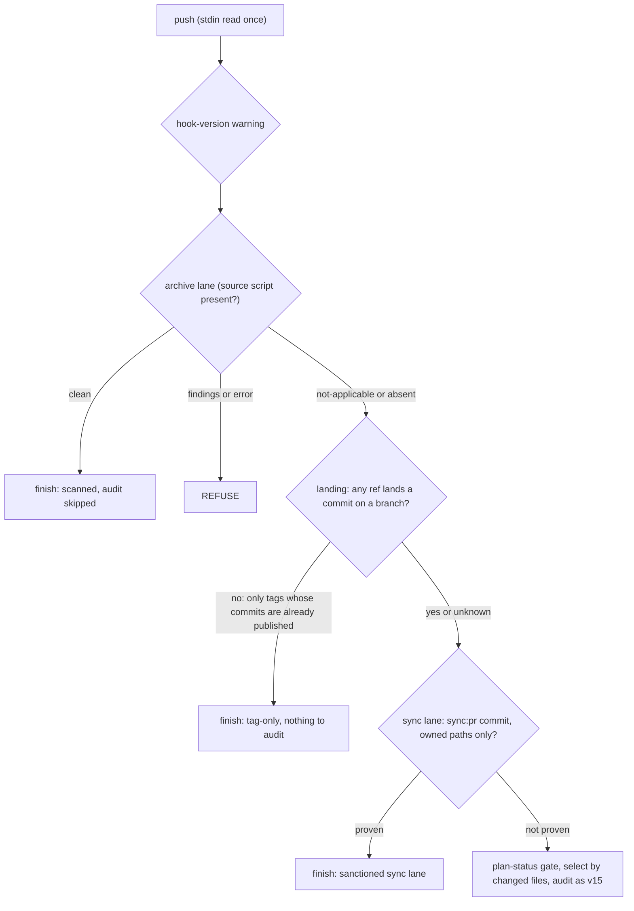

# Plan: Hook fidelity and the v15 field gaps (cluster C, hook v16)
- **Date**: 2026-10-25
- **Status**: Approved (audit-plan: GPT 3 rounds, H4 M2 -> H1 -> M1 -> 0; Gemini 2 rounds -> APPROVE)
- **Author**: Claude + Louis
- **Scope**: backend (consumer pre-push hook, plan selection, sync:pr, small CLI/doc fixes; no UI)
- **Fleet proposals**: 4146, ecff, 619c, fac2, 981b, a2b8 (+ test-helper duplication tail) · p-20261025170337-0927, p-20261025170756-2d68, plan-selection, rollout friction · brief: `docs/plans/backlog-triage-2026-10-25.md` §5-C
- **Migrations**: none. **Consumer impact**: audit libs and `prepush-step.mjs` sync (`scripts/lib/**`) AND hook v15→v16 (`hooks:install`; see §6 for how the stale install is now surfaced).

Scope: `backend`, stack `js-ts`. Principles cited as (#N) from `references/engineering-principles.md`.

## 1. Context Summary

**Code Trace** (all at `94aeee7c`):
- Consumer hook body `scripts/install-prepush-hook.mjs` `HOOK_BODY` (`HOOK_VERSION = 15`, line 177). It reads git's stdin once, then discovers the source checkout (`AUDIT_LOOP_DIR`), asks `prepush-step.mjs capabilities`, runs the plan-status gate, `--select`, v13 no-plan, v15 `no-code`, `own-files`, `audit-reuse`, the audit and `audit-outcome`. **The step CLI and every `scripts/lib/**` module it calls run from the SOURCE checkout, not from the consumer's copy** — only the shell body is frozen into `.git/hooks/pre-push`. So a step-CLI change reaches a consumer when the source checkout updates; only a change to the body needs `hooks:install`.
- CES's own hook `.githooks/pre-push` already has the archive lane (§0.97, `scripts/prepush-archive-lane.mjs`, plan `prepush-archive-lane.md`); the consumer body has none.
- Plan selection: `scripts/check-plan-status.mjs` `selectMode` → `selectAuditPlan` (`scripts/lib/plan-status.mjs`:350). One active plan, or one active plan touched by the push, selects; otherwise `null` → v13 `no-plan` → UNMEASURED.
- Plan-status gate: `check-plan-status.mjs` `lintMode --drift` and `selectMode` read plan files with `fs.readFileSync` from the **working tree** (`listPlanFiles`).
- `sync:pr`: `scripts/lib/sync-pr.mjs` `buildPrText` makes the single scoped commit; ownership evidence for supersession already exists (`collectSupersedeEvidence`, `decideSupersession`: every changed path owned by the head sidecar, receipt attests the bundle) and the `.gitignore` oracle is `classifyGitignoreTransition(baseText, headText) === 'block-only'` (`scripts/lib/sync-gitignore.mjs`:177).

### Measurements (derived unless stated)

| Figure | Value | Label / command |
|---|---|---|
| Code-bearing pushes with **no single plan** under the v15 selector, last 60 merge commits per consumer | wine **33 of 46 (72%)**, storyline **30 of 54 (56%)**, ai-organiser **59 of 59 (100%; 4 plan files, 2 or more active, so never a sole active plan)** | derived — `measure-selection.mjs` replays each commit's changed-file list through the current selector against the *current* plan set; historic plan statuses are not replayed, so read it as an upper-level estimate of the selector's reach, not a record of what the hook said |
| A sync PR push on a no-plan consumer | `UNMEASURED, 1 code file (.gitignore)`, needs the override every time | measured — `.claude/tmp/sync-pr/wine-cellar-app-chore_sync-94aeee7c-2026-10-25T17-03-18-638Z.log` (proposal 0927) |
| A 7-archive-tag push in storyline | ~10 min paid audit against the template plan | reported — proposal 2d68 |

**Neighbourhood considered** (reuse, do not write siblings): the sync-ownership oracle (`isUpstreamOwned`, `isUsableSidecar`, `latestReceiptEntry`, `classifyGitignoreTransition`, `parseNameStatus`) is reused by the new sync lane — no second ownership list (#2). `isArchiveRef`/the lane CLI is reused by the consumer hook — no second archive predicate. The `Depends on:`/path-token readers in `plan-status.mjs` are the home for the declared-paths reader.

**Target domains**: audit core (hook CLI + gate libs), plan-status, sync. Cross-domain: sync → hook is one-way (the sync-lane step imports sync-owned oracles; sync imports only the version constant).

## 2. Proposed Architecture

The v16 hook adds three early exits and one warning, all **before** the plan-status gate and the audit spend, each a *named, recorded* outcome (never a bare skip), each gated by a step-CLI capability so an older source checkout falls back to v15 behaviour:

### 2.1 Tag-only / archive push (2d68)
1. **Archive lane first.** If `$AUDIT_LOOP_DIR/scripts/prepush-archive-lane.mjs` exists, run it exactly as CES's hook does (`--remote="$1" --destination="$2"`, stdin = the captured push lines, cwd = the consumer) and decide on **exit status AND token together**: `clean` is accepted only on exit 0 with exactly one valid terminal token (a `clean` token with a non-zero exit, or two differing tokens, is `error`); `findings`/`error` → refuse; `not-applicable` (exit **3** — the lane CLI's `EXIT_FOR` — with exactly one `archive-lane/v1 not-applicable` token) → continue; an exit 3 with no valid token is a crash, not a classification (the exit-status table is read from the lane's exported `EXIT_FOR`, never re-spelled in bash, and a test pins the hook's case arms to it). A lane that is present but produced no valid result (crash, wrong protocol) is **not** read as not-applicable: if the push LOOKS archive-only (CES's `lane_looks_archive` predicate, ported byte-for-byte with its drift test) or cannot be classified, the push is **refused** — an unscanned archive publication; for a push that is positively not archive-only it continues with a loud warning, which is correct because the lane was never going to apply. Script absent (older source checkout) → continue as v15, said on stderr.
2. **`landing` step.** `prepush-step.mjs landing` reads the same stdin and prints `landing none <n> tag update(s) whose commits are already on <remote>` or `landing code <reason>`. `none` only when **every** published ref is under `refs/tags/` **and** each tagged commit is proven published **at the push destination**, not by local remote-tracking refs (which can be stale or belong to another URL): the step runs the lane's existing bounded `git ls-remote <destination>` (`$2`, the same `lsRemoteTimeoutMs` budget and helper the archive lane uses), keeps the advertised tips that exist locally, and requires `git rev-list <sha> --not <those tips>` to be empty. An `ls-remote` failure or timeout, a destination the step cannot resolve, or any unlocatable tip is `code`. Anything else — a branch update, a tag carrying an unpublished commit, an unreadable ref, a git error — is `code` and the audit runs as in v15. A non-archive tag that publishes new commits is deliberately *not* skipped: that is a push the audit has not seen.

### 2.2 Sanctioned sync lane (0927)
`sync:pr` already makes exactly one commit over a freshly fetched base touching only paths it has proven sync-owned. v16 makes that provable **at push time** instead of guessing from file types:
- **Provenance.** `buildPrText` adds a `Sync-Bundle: <40-hex bundle sha>` commit trailer (a non-`AI-*` name — that namespace is reserved for `ship-commit.mjs`).
- **`prepush-step.mjs sync-lane`** reads the captured push lines on stdin (git supplies one tuple per ref update; `resolvePushRange` takes only the first published one, so the lane proves the whole push itself) and prints `sync-lane <bundleSha> <n> files` only when ALL hold, else `not-sync <reason>`:
  0. the push is **exactly one ref update**, a non-deletion of `refs/heads/*` — any extra update (another branch, a tag) is `not-sync`; the endpoints are validated OIDs (`isSafeGitRevision`) and the range is proven **per case**: *update* (remote OID non-zero) — it equals the hook-exported base and is an ancestor of head; *creation* (remote OID all-zero, which is how a fresh `chore/sync-*` branch is pushed — the primary sync:pr path) — the hook-exported base is the merge-base with the default branch, and the step requires that base to equal head's **single parent** and to be an ancestor of a tip the destination advertises (the same bounded `ls-remote` snapshot as §2.1), so the one commit sits on published history. An `ls-remote` failure, a different parent, or a base not under an advertised tip is `not-sync`;
  1. the range is the trusted one git handed the hook and holds **exactly one** commit, a non-merge;
  2. its message carries one `Sync-Bundle:` trailer with a full OID;
  3. the **head tree's** `.sync-receipt.json` latest entry attests the same `source.commitSha` and a non-empty `source.repo`;
  4. every changed path (`git diff --name-status --no-renames -z base head`) is the receipt, the sidecar, owned by the **head** sidecar (`isUpstreamOwned`), a deletion owned by the **base** sidecar, or `.gitignore` **iff** `classifyGitignoreTransition(base:.gitignore, head:.gitignore) === 'block-only'`.
- The hook, on the token, prints `▸ SANCTIONED SYNC LANE: sync <sha8> … code audit skipped` and finishes. Not a growing allowlist (#2): the owned set is the sync's own output, read from the commit.
- **Residual risk, stated.** A hand-built commit forging the trailer, the receipt and a sidecar entry can pass non-audited changes to sync-owned paths (including `.claude/hooks/**`). That commit also bypasses today by `--no-verify` or the one named override; the lane widens no capability, it removes a forced override from the honest path. The next sync overwrites any such path and the divergence guard reports it.

### 2.3 Plan selection from the changed files (measured above)
`selectAuditPlan` gains a third tier after "touched" and "sole active": **declared paths**. A plan *covers* a changed file when the file appears in the plan's backticked path tokens (exact, or under a token ending in `/`). Over the active plans (or, when several changed in the push, over just those):
- `coverage(plan)` = changed code files covered (docs/`docs/plans/**`/sync bookkeeping excluded, so a plan edit does not score itself);
- select iff the top plan covers **at least 1 and strictly more than the runner-up and at least half of the changed code files**; otherwise stay `null`/UNMEASURED and say *why with the counts*;
- print `selected <plan> via declared-paths: covers 7/9 changed code files; next best <plan2> covers 2` — `sel.why` is printed by `check-plan-status.mjs` beside `boundBy`.
The majority requirement is the guard against a plan that merely mentions one shared file (`package.json`) winning. It is a stated threshold, not tuned on the measured pushes; §9 re-runs the replay and reports before/after.

### 2.4 Plan files are read from the pushed commit (4146)
When the range is trusted, `--drift` and `--select` read plans from `git ls-tree`/`git show <head>:docs/plans/<name>`, not the working tree. `plan-status.mjs` takes an injectable `source` (`{list(), read(name)}`); the fs source stays the default and the fallback when the range is not trusted. The comparison is made after `canonicalizeEol` (`lib/file-io.mjs`) on both sides — a CRLF working file under `core.autocrlf=true` is the same document as the LF blob. The audit takes a *path* and `openai-audit.mjs` reads the checkout, so a selected plan whose pushed content differs from (or is absent in) the checkout would be audited as a different document than the one selected. v16 **does not guess**: `selectMode` then selects nothing and prints `the pushed <plan> differs from this checkout's copy (or is absent) — the audit would read a different document`, which the hook already routes to the UNMEASURED no-plan refusal (override and `AUDIT_PREPUSH_PLAN` still apply). This is the honest outcome here: the audit also reads the *code* from the checkout, so pushing a commit that is not the checked-out tree was never auditable by this hook. Gate (`--drift`) reads are unaffected — they judge the pushed Status lines, which is what 4146 reported.

### 2.5 Rollout friction: pick the simpler honest option
**The hook warns; the sync stays read-only about git hooks.** `sync-to-repos.mjs` (line ~2209) deliberately never re-installs hooks ("never clobber an operator hook"); reversing that is the larger change and breaks for consumers synced by `npx` on other machines. Instead: (a) `prepush-step.mjs hook-version` prints the expected version (one constant in `scripts/lib/prepush-hook-version.mjs`, imported by the installer), and the v16 body prints a loud, non-blocking `installed hook v16 is older than the source's v17 — run: npm run hooks:install -- --target <name> (from the source repo)` on every push; (b) the sync's epilogue replaces its generic hint with a **per-consumer** line reading the marker of each target's **effective** hook — resolved by git (`git -C <target> rev-parse --path-format=absolute --git-path hooks/pre-push` — an ABSOLUTE path, required before any filesystem read, so a relative answer can never be resolved against the source repo's cwd, which honours `core.hooksPath` and a linked worktree's `.git` file, run with the repo-pointing env stripped via `GIT_LOCAL_ENV_VARS`), not by joining `.git/hooks`; the rule per state is single: an unresolvable path or an unreadable file prints `hook not inspected (<why>)`; a hook that exists but lacks the managed marker prints `hook not inspected (not managed by this installer)`; an absent hook prints `no hook installed`; only a managed hook at the current version is silent: `ai-organiser: hook v15 installed, bundle is v16 — npm run hooks:install -- --target ai-organiser` (read-only). (a) cannot reach the v15 bodies already installed (they carry no warning); (b) does — that one-time v15→v16 gap is why both ship.

### 2.6 Smaller items
- **ecff**: replace `kill -l "$SIG"` with `( trap '' "$SIG" ) 2>/dev/null || continue` in the marked fail-closed block of **both** `.githooks/pre-push` and `HOOK_BODY` (byte-identical, test-enforced). dash accepts `kill -l` only without a name, so XSI signals were never trapped on Ubuntu.
- **619c**: `assertRepoRoot` accepts a cwd that is a **linked worktree of the same repository** as the script's root (same `git rev-parse --path-format=absolute --git-common-dir`), not only the main checkout. Reproduce first (test: script root = a repo, cwd = a `git worktree add` of it → exit 1 today, passes after); a *different* repo's cwd and a subdirectory still refuse.
- **fac2**: `resolveConcernLinks` resolves a `sameConcernAs` against the persisted **debt ledger's** topicIds as well (`readPersistedDebtEntries`); and a link that resolves to nothing, is ambiguous or cyclic no longer discards the batch: the entry is written **without** `concernId`, the raw reference is kept on the entry as `unresolvedConcernRef`, and the CLI prints an `UNLINKED` block and returns it in its summary (`linked`/`unlinked`). Exit 0 — the ruling was written; the knowledge the field exists to keep (what the author said it repeats) is stored, not dropped. A later triage with a resolvable ref replaces the entry.
- **981b/a2b8**: `skills/fleet/references/participant-rules.md` step 4b reordered so a fresh worktree hydrates first (`npm run skills:hydrate` is a copy, not "heavy") and the lease check follows when the lease CLI exists; both wording sites fixed; `.claude/skills/**` regenerated.
- **Test-helper tail**: `tests/helpers/write-file.mjs` (`write`), `tests/helpers/ledger-fixtures.mjs` (`writeRoundLedger`, `seedLedger`), `tests/helpers/sha.mjs` (`sha12`); the duplicate declarations in the named tests are replaced by imports. Behaviour-preserving; `arch:duplicates` count is the measurement.

### 2.7 Measured effect of the selector (implemented; derived, same replay, current plan set)

| Consumer | code-bearing pushes | no plan before | no plan after | selected by declared paths |
|---|---|---|---|---|
| wine-cellar-app | 46 | 33 | 30 | 3 |
| ai-organiser | 59 | 59 | 22 | 37 |
| storyline | 54 | 30 | 23 | 7 |

The majority-and-margin rule leaves most wine pushes unmeasured (30 of 46): the remainder are pushes whose changed code no active plan declares, which stays UNMEASURED and says so. Read the numbers as the selector's reach on the current plan set, not as a record of the past hook's output.

## 3. Alternatives considered
- **Sync-bookkeeping "allowlist" growth** (add `.gitignore` to `SYNC_BOOKKEEPING_FILES`): rejected — `.gitignore` is the consumer's own file; the lane proves the *edit* is the managed block, which a filename cannot.
- **Sync reinstalls hooks** (rollout): rejected for now — see §2.5; revisit if the warning is still ignored after two rollouts.
- **Select by mtime / newest plan**: already rejected by the file's own comment; coverage is bound to the change.
- **Skip every tag push**: rejected — a tag can publish commits no branch gate saw; only already-published tags are skipped, the rest keep the lane or the audit.

## 6. Rollout and consumer actions
1. Merge → sync the three consumers (`npm run sync -- --target <name>`; `sync:pr` as usual — the new trailer appears from the first PR made after the merge).
2. `npm run hooks:install -- --target wine|storyline|ai-organiser` (v15→v16). Until then the step-CLI behaviours work on v15 bodies **except** the ones that need the new body: archive lane, `landing`, sync lane and the version warning. The plan-selection and 4146 changes reach v15 bodies at once (they live in `check-plan-status.mjs`).
3. No migrations; no store schema change (`unresolvedConcernRef` is an optional ledger field — see §7).

## 7. File-Level Plan

| File | Change |
|---|---|
| `scripts/install-prepush-hook.mjs` | `HOOK_VERSION` → 16 (constant moved to `lib/prepush-hook-version.mjs`); v16 changelog; body: archive-lane block, `landing`, `sync-lane`, `hook-version` warning, ecff probe |
| `.githooks/pre-push` | ecff probe in the marked block (byte-identical with the consumer block) |
| `scripts/prepush-step.mjs` | subcommands `landing`, `sync-lane`, `hook-version`; `CAPABILITIES` += them; usage header |
| `scripts/lib/prepush-lanes.mjs` (create) | pure deciders `decideLanding`, `decideSyncLane`, `parseSyncBundleTrailer` (injected git facts) |
| `scripts/lib/prepush-lane-steps.mjs` (create) | the git-touching half of `landing` / `sync-lane` (reuses the archive lane's `makeGit`, `peelToCommits`, `establishRoots`) |
| `scripts/lib/prepush-archive-lane.mjs`, `scripts/prepush-archive-lane.mjs` | `EXIT_FOR` exported (the hook's case arms are pinned to it) |
| `scripts/lib/prepush-hook-version.mjs` (create) | `PREPUSH_HOOK_VERSION`, `HOOK_MARKER`, the effective-hook inspector and the sync epilogue lines |
| `scripts/lib/plan-declared-paths.mjs`, `scripts/lib/plan-git-source.mjs` (create) | declared-paths selector; the pushed commit's plans via `git cat-file --batch` |
| `scripts/lib/sync-pr.mjs` | `buildPrText`: `Sync-Bundle:` trailer; export the owned-path predicate the lane shares |
| `scripts/sync-to-repos.mjs` | per-consumer stale-hook lines in the epilogue (read-only) |
| `scripts/lib/plan-status.mjs`, `scripts/check-plan-status.mjs` | declared-paths tier + `why`; git-source reader; divergence warning |
| `scripts/lib/assert-repo-root.mjs` | same-repo linked-worktree acceptance |
| `scripts/write-ledger-entries.mjs`, `scripts/lib/concern-identity.mjs`, `scripts/lib/schemas.mjs` | debt-id resolution; non-fatal unresolved links; optional `unresolvedConcernRef` |
| `skills/fleet/references/participant-rules.md` (+ regenerated `.claude/skills/**`) | bootstrap order |
| `tests/helpers/write-file.mjs` (create) and the six tests that each declared `write(dir, rel, body)` | shared helper. The `writeRoundLedger` / `seedLedger` / `sha12` entries of the triage were already consolidated on main (`tests/helpers/fixtures.mjs`; one `sha12` declaration left, not a duplicate): the triage's arch index was 165 commits stale |
| `tests/prepush-hook-v16.test.mjs`, `prepush-lanes.test.mjs`, `plan-selection-declared-paths.test.mjs` (create); extensions of `prepush-hook-fail-closed-on-signal`, `assert-repo-root`, `concern-identity` tests | see §9 |
| `docs/runbooks/prepush-sandbox.md` or `consumer-adoption.md` | one paragraph: v16 lanes, hook-version warning |

## 8. Risk & Trade-off Register

| Risk | Sev | Mitigation |
|---|---|---|
| A wrong skip is a green-without-measuring (AGENTS.md: audit success paths) | High | Every skip is a *positive* proof with a recorded line; every doubt (unreadable ref, git error, missing trailer, receipt mismatch, un-owned path) falls to v15 behaviour. Negative controls in §9: a real code push, a tag publishing an unpublished commit, a hand-edited file inside a "sync" commit, and a mixed tag+branch push are all still audited/refused |
| Archive lane in a consumer scans with CES's `sensitive-paths`, not the consumer's | Med | Same posture as CES's own lane; documented. A lane crash on an archive-looking push is REFUSED (an unscanned publication); on a positively non-archive push it warns and continues |
| Declared-paths selection picks a plan that only mentions shared files | Med | ≥ half of changed code files and a strict margin; counts printed; AUDIT_PREPUSH_PLAN still wins |
| Body change needs `hooks:install` | Med | §2.5 warning + per-consumer sync lines; step-CLI-only behaviours reach v15 bodies immediately |
| `unresolvedConcernRef` is a new ledger field | Low | optional, schema-allowed, never read by suppression; covered by a write-then-read test on the real ledger writer |
| Plan-from-commit reader diverges from the working-tree reader | Med | one `source` seam, both paths run the same classifier; a parity test over the same plan set |

## 9. Testing Strategy

Tier 1 (deterministic) test-first for the deciders and the plan reader; Tier-3 (consumer sync / relocation contract) tests land in the same commit as the code.
- `classifyLanding` / `decideSyncLane`: table tests incl. each failure direction; **negative controls**: a sync commit pushed together with a second ref (tag or branch) → `not-sync`; a clean-token lane with a non-zero exit → refused; a lane crash on an archive-only push → refused; an `ls-remote` failure → `landing code`; a stale local remote-tracking ref that the destination does not advertise → `landing code`; real code commit not treated as sync; sync commit + one extra hand-edited file → `not-sync`; trailer without matching receipt → `not-sync`; `.gitignore` edit outside the managed block → `not-sync`; tag with an unpublished commit → `landing code`; tag+branch mixed push → `landing code`.
- Sync lane integration: a test that actually creates a `chore/sync-*` branch with a sync-shaped commit and pushes it for the first time (zero remote OID) to a local bare remote through the real generated hook, plus the update case; both pass without the override, and each negative control above is refused.
- Hook-version inspection: the sync runs from the source repo against targets with an ordinary hook, a linked worktree and a relative `core.hooksPath`; the source repo's own hook and each target's carry DIFFERENT versions, so inspecting the wrong repository cannot pass.
- Plan comparison parity: a CRLF working-tree plan equal to the LF blob selects normally.
- Hook body: extend the `prepush-hook-v15` harness into `prepush-hook-v16.test.mjs` running the **real generated body** in a throwaway repo: tag-only push of an already-published commit skips with the named line; archive tag → lane `clean` skips, lane `findings` refuses; sync-shaped commit with no plan passes with the named line while the same push with a code file refuses UNMEASURED; the version warning prints for an older embedded version and is silent for current. A v15-capabilities fake step CLI proves the fallback.
- ecff: `prepush-hook-fail-closed-on-signal` gains the dash case (skipped, loudly, where `dash` is absent) and keeps the byte-identity assertion between the two blocks.
- Plan selection: replay fixtures (plans with declared paths) incl. tie → null, below-half → null, bookkeeping-only excluded; the measured replay re-run (`measure-selection.mjs`) is reported before/after in the PR. 4146: a repo whose working tree has a bad Status that the pushed commit fixed passes, and the reverse fails; parity test fs vs git source.
- 619c / fac2 / participant-rules: the reproductions first (red), then green; fac2's test runs the real `writeLedgerAtomically` and reads the entry back.
- `npm run skills:regenerate`/`skills:check`, `context:check`, `cli:flags:gate`, `size:ratchet:gate` (`install-prepush-hook.mjs` and `prepush-step.mjs` may be oversized files: no growth beyond re-baselining with a stated reason).

## 10. Acceptance (non-UI)
- A `sync:pr`-shaped push on a no-plan consumer passes through the sync lane with the named line and no override; adding one hand-edited code file to it is refused UNMEASURED.
- A tag-only push of published commits runs no plan selection and no audit; an archive tag with a planted secret is refused by the lane.
- Selector correctness is established by fixtures (a plan covering a majority of the changed code files is selected; a tie, a minority and a no-cover push are not). The replay is then reported **per consumer** and no improvement is promised where there are no eligible candidates (a consumer with no eligible candidate cannot improve by selector logic, and the report says so). A push covering no plan stays UNMEASURED and says why.
- Hook v16 keeps v15's `NO_CODE_IN_SCOPE`, `scopeOutcome` and recurrence behaviour (their v15 tests pass unchanged).
- A v15→v16 stale install is named, with the exact command, by the sync epilogue; a v16 body warns when the source expects a newer version.
- `npm test` green; `.audit/last-audit-run.json` names the reported head.
