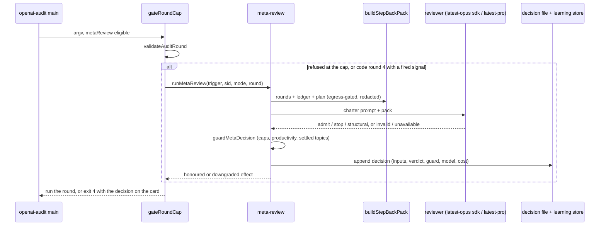

# Plan: Automatic meta step-back at the audit round cap (plan + code)
- **Date**: 2026-11-23
- **Status**: Draft
- **Author**: Claude + Louis
- **Scope**: backend (stack `js-ts`; CLI + library + skill prose)
- **Target domain(s)**: `audit-orchestration`
- **Work item**: 01a205ba-b1e4-7e0b-af5e-8004f530efca
- **Depends on**: none
- **⚠ Needs Louis's approval before merge** — three parts loosen a gate (fewer human calls, and in one case fewer
  rounds): **L1**, **L2**, **L3** in §8. Each is marked where it is designed.

## 1. Context Summary

**The ask (Louis, 2026-11-23, verbatim):** "a system that throws it to another llm for a meta perspective to decide if
more? Both applying to plan and audit. And meta then has interest of repo sustainability, efficiency and effectiveness and
stops rigour chasing and looks if there is a more structural reason stepping back to the repo that causes the findings."

**What exists today** (read at `f15aaab4`):

- The cap is enforced in code by `gateRoundCap` `scripts/lib/audit/round-cap-gate.mjs:73 (f15aaab4)`, called first in
  `openai-audit.mjs` `main()` `scripts/openai-audit.mjs:567 (f15aaab4)`, before any provider is built. A refused round
  (`validateAuditRound` `scripts/lib/audit/round-cap.mjs:125 (f15aaab4)`: plan 3/5, code 6/8) builds the
  structural-or-stop card (`buildStructuralCard`, `scripts/lib/audit/structural-card.mjs`) and exits 4. A human continues
  with `--past-cap "<reason>"`, which needs the card on disk (`CARD_REQUIRED`).
- The step-back reviewer is a separate, **manual** path: `scripts/audit-structural-card.mjs --step-back`, code audits only,
  at checkpoints 3 and 6 (`STEP_BACK_CHECKPOINTS` `scripts/lib/audit/step-back-card.mjs:30 (f15aaab4)`), and only when a
  round signal fires (`computeRoundSignals`, `scripts/lib/audit/round-signals.mjs`). It builds the egress-gated pack
  (`buildStepBackPack` `scripts/lib/audit/step-back.mjs:131 (f15aaab4)`: `resolveAndClassify` on every path, fail closed,
  `redactSecrets` on every body) and runs the v1 schema `structural|stop|defect` (no `continue`). Outcomes reduce onto a
  record (`applyStepBackOutcome`); a `stop` writes debt only after `approveStop`.
- Providers: `createStepBackProvider` `scripts/lib/audit/step-back-provider.mjs:43 (f15aaab4)` has arms `same`
  (`latest-gpt`), `different` (`latest-pro`), `higher` (`latest-opus`, pinned `{backend:'sdk'}`, gated on
  `claudeAvailability('sdk')`, never a cli fallback). The card exposes only `same|different`.
- Cap telemetry: `recordCapStop` `scripts/lib/audit/cap-productivity.mjs:144 (f15aaab4)` writes an observation-only
  `round_cap_reached` learning decision; `assessCapProductivity` gives last-round acceptance and `stillProductive`.
- Cost: `estimateCostUsd` `scripts/lib/audit/step-back-replay.mjs:44 (f15aaab4)` over `priceFor`.

**Why it shipped manual-only** (`docs/research/step-back-replay-v2-2026-11.md` §3, §5): on the 5-PR replay, all three arms
answered a stopping action 27 of 27 times, every R3 stop scored false (accepted HIGHs followed), and no arm separated
spinning runs from converging ones. The replay is saturated: re-running it cannot decide adoption. The only way to learn
whether an automatic meta-reviewer helps is to run it on organic audits **and record every decision**. That evidence is the
reason the design below records everything, and also the reason its automatic **stop** is bounded by a deterministic guard
(§2.4): the one thing the replay did measure is that models stop too early.

**Code Trace:** `openai-audit.mjs:567` → `gateRoundCap` (`round-cap-gate.mjs:73`) → `validateAuditRound`
(`round-cap.mjs:125`) → refusal → `emitCard` (`round-cap-gate.mjs:42`) → `buildStructuralCard` + `writeCardFile` +
`recordCapStop`. Manual path: `audit-structural-card.mjs:main` → `buildCheckpointSection` (`step-back-card.mjs:59`) →
`readRoundsWithSha` + `readLedgerEntries` → `computeRoundSignals` → `buildStepBackPack` → `runStepBack`
(`step-back.mjs:303`) → `parseStepBackOutput` → `applyStepBackOutcome`.

**Neighbourhood considered** (`get-neighbourhood`, coverage `verified`): every hit is `review` (below the noise floor), and
all are the step-back/round-cap symbols above. Decision: **extend these modules**; one new module (`meta-review.mjs`) holds
the decision orchestration so `round-cap-gate.mjs` stays an IO gate and `step-back.mjs` stays the contract.

## 2. Proposed Architecture



### 2.1 One system, two triggers (#1 DRY, #5 single source of truth)

The meta-review reuses the step-back's pack, provider seam, record and egress rules. It is not a second reviewer
system. What changes:

| | Today (step-back v1) | After (meta-review = step-back v2) |
|---|---|---|
| Audits | code only | **plan and code** |
| Trigger | manual `--step-back` | **automatic** inside `gateRoundCap`. The manual `--step-back` path is **kept on v1, unchanged** (same schema, record, `approveStop`), so no v2→v1 outcome mapping exists; the card CLI only *displays* the folded meta-review log and offers `--revoke-meta-admission` |
| Trigger points | code R3/R6 card, signal fired | **T1 cap**: a refused round (`PAST_CAP_REQUIRED`: plan 4–5, code 7–8). **T2 signal**: code round 4 (checkpoint 3) when a round signal fires. Checkpoint 6 is T1 (round 7). Plan audits have no signals (they need code hunks), so plan is T1 only. |
| Reviewer | `same` by default | **`higher` (latest-opus, sdk-pinned)**, falling back to **`different` (latest-pro)**; never `same` (the auditor's own family) |
| Verdicts | structural / stop / defect | **admit / stop / structural** (v2 schema, §2.3); `defect` folds into `admit` with one topic |
| Effect | advisory text | **decides within bounds** (§2.4), every decision recorded (§2.5), a human can override (§2.6) |

`ABSOLUTE_CAP` refusals do not trigger it: there is nothing left to decide. `PAST_CAP_UNNEEDED`, `MODE_CONFLICT` and
`BAD_ROUND` never reach it. **No prior round results for the sid → no meta-review** (nothing to review; the gate behaves
as today). That also keeps every existing refusal fixture that starts at round 4 with no results (the cap CLI tests, the
gate-honesty `round-cap-*-refusal` oracles) byte-identical, zero network attempts.

**Eligibility is per call** (the tiered-pipeline pattern, AGENTS.md §Tiered-Recall): `gateRoundCap(argv, {metaReview})`
defaults `metaReview: false`; only `openai-audit.mjs` `main()` passes `true`. Library and test callers never spend.
**Opt-out**: `--no-meta-review` on `openai-audit.mjs` (forwarded by `audit-loop.mjs`), or `AUDIT_META_REVIEW=off`. Opted
out, the gate behaves exactly as today (card, exit 4).

### 2.2 The reviewer (#4 no hardcoding, #16 graceful degradation)

`createMetaReviewProvider()` in `step-back-provider.mjs` walks the chain `['higher', 'different']` and returns the first
arm whose route exists: `higher` only when `claudeAvailability('sdk').available` (AGENTS.md: a call carrying `system`
must pin `{backend:'sdk'}` and gate on `isClaudeAvailableFor('sdk')`; never a cli fallback); `different` only when a
Gemini client exists. Sentinels only (`latest-opus`, `latest-pro`), resolved by `resolveModel`. No route →
`unavailable`, which **admits no automatic decision** and falls back to today's human card. The chain is a constant
(`META_REVIEW_ARM_CHAIN`), not config: no current requirement needs it configurable.

**Independence criterion.** The reviewer's vendor family must differ from the auditor's: `modelFamily(resolveModel(arm
sentinel)) !== modelFamily(auditorModel)`, where `auditorModel` is the model the audit rounds ran on (`openai-audit.mjs`
resolves it from `latest-gpt` / `OPENAI_AUDIT_MODEL`; the gate passes it in, and the last round result's recorded model
wins when present). `modelFamily` is AGENTS.md's one vendor-family oracle. An arm whose family equals the auditor's is
skipped; if no arm is independent, the result is `unavailable` with reason `no-independent-route` (human path). The
selected arm, its family and the auditor's family are recorded on the decision.

The `--step-back-arm` flag on the card CLI gains `higher` (already supported by the provider); the manual path stays v1
whichever arm is chosen.

**Request-sent detection.** Each provider `call` sets `sent = true` on its result (and on a thrown error, `err.sent`)
immediately before awaiting the SDK request, so a failure while constructing the client is `sent: false` and a failure
after it is `sent: true`. §2.5's spend rule keys on that flag, never on the error text.

### 2.3 The charter and the v2 schema (#12 validation)

`META_REVIEW_SYSTEM_PROMPT` (in `step-back.mjs`, beside v1, which stays frozen for the replay harness and its tests):

> You are a senior reviewer stepping back from an audit loop that has reached its round cap or shows a spinning signal.
> You are not another auditor. Your interest is the repository's **sustainability, efficiency and effectiveness**, not
> rigour for its own sake. Decide whether more rounds pay off.
> - **Rigour-chasing** is findings that polish wording or a spec, re-raise a concern the ledger already ruled, or trade
>   one marginal concern for another. Name it and stop it.
> - **Structural**: if several findings share a cause in the repository, such as a missing shared primitive, a seam that
>   keeps breaking, or a stale doc that misleads each round, name that cause with evidence (files and why) and propose
>   the structural fix as its own plan or PR. Fixing symptoms round by round is not effective.
> - **Admit** more rounds only when named open findings are real defects that the next round can close. Give the topics
>   and the smallest number of rounds (1 or 2).
> Every topicId you name must appear in the ledger or rounds you were given. Reply with ONLY one JSON object.

Schema (`MetaReviewSchema`, `z.discriminatedUnion('action', …)`, every object `strictObject`):

```text
assessment: {sustainability, efficiency, effectiveness}   required, non-empty strings (recorded, not acted on)
admit:      {action, rounds: 1|2, topics: [topicId] ≥1, reason}
stop:       {action, items: [{topicId, kind: rigour-chasing|settled|marginal|false-premise, premise}] ≥1, reason}
structural: {action, cause, evidence: [{file, why}] ≥1, proposedFix, reason}
```

`parseMetaReviewOutput` reuses v1's JSON/fence handling and the known-topic check. There is still no bare `continue`:
`admit` must name topics, so a reviewer with nothing to say fails validation instead of buying a round.

The pack is v1's `buildStepBackPack`, unchanged, plus a short header (mode, trigger, round, caps, the round signals,
`assessCapProductivity`'s line, and the **open-topic inventory**, §2.4) that passes through `redactSecrets`. The header's
inventory is a **provider-facing projection of `{topicId, severity}` only** — no path, no detail, no section text. A
finding's detail and files reach the reviewer only through the pack's existing `rounds` section and `<file>` parts, i.e.
through the same `buildStepBackPack` path and its rules, never through the header. No new field crosses the egress seam.

**Plan-audit data flow** (one path, no new egress seam). The plan path is `argv[1]`, the same value `gateRoundCap` already
hands the card (`emitCard`'s `planFile: argv[1]`). `runMetaReview` passes it to `buildStepBackPack({planFile})`, which
already classifies it with `resolveAndClassify` and reads it only through `redactSecrets`, and adds it as the `plan`
section, which is last in `TRUNCATION_ORDER`. Known topics come from the round results and ledger (`pack.topics`, derived
with the same `topicOf` as the rounds), never from section text, so plan findings that cite sections still have topics.
For a **plan audit the plan is required evidence**: if the pack reports the plan excluded or unreadable (`notes` carries
`plan file was excluded or unreadable`) or the `plan` section was truncated, the meta-review is `unavailable` (fail closed
to the human card) and no model is called. For a code audit the plan is optional, as in v1. `citedFilesOf` finds few paths
in a plan audit, so its pack is mostly plan, ledger and rounds; that is correct for a plan.

### 2.4 Decides within bounds: `guardMetaDecision` (pure, deterministic)

A valid verdict is not obeyed as-is. The guard maps it to an effect, and **only the guard** decides whether the effect is
`honoured` or `downgraded` to a proposal (today's human card, plus the verdict). The guard never raises a cap.

**The open-topic inventory** (the authoritative set a stop must account for): the topics of the last completed round's
findings, derived with `cap-productivity.mjs`'s `topicOf` (the one derivation `write-ledger-entries` uses), each with its
severity and finding object. It is computed by the guard from the round results, never taken from the reviewer, and is
printed in the pack header so the reviewer sees the same list.

A **stop is honoured only when it is complete and verifiable**:
1. its items cover **every** inventory topic (an omitted topic → downgraded, named in the guard reason);
2. every **HIGH** inventory topic's item is `kind: settled`, and `settled` is checked against the ledger: the topic has an
   entry ruled at an earlier round (`resolvedRound < lastRound`) with outcome `accepted`/`dismissed`/`severity_adjusted`.
   A HIGH that is merely `marginal`, `rigour-chasing` or `false-premise` is a judgement the guard cannot verify, so the
   stop is downgraded to a proposal;
3. MEDIUM/LOW items may be any kind; their `settled` claims are still ledger-checked.

A **structural route is honoured only when no open HIGH is left unaccounted**: every HIGH inventory topic must have a
ledger ruling at an earlier round (the same `settled` check as rule 2, applied by the guard without a reviewer claim). An
open, never-ruled HIGH → downgraded. A structural verdict does not name topics, so the MEDIUM/LOW inventory it leaves is
captured as debt with `deferredReason: "meta-review structural: <cause>"`.

**Every loop-ending honoured verdict (stop or structural) captures its inventory as debt** through the same command
(§2.7), so no finding leaves the loop unaccounted.

| Verdict | Trigger | Honoured when | Honoured effect | Downgraded effect |
|---|---|---|---|---|
| admit n | T1 | ≥1 named topic is in the inventory | **L1**: `admittedThrough = min(round − 1 + n, absolute)`; this round and later ones up to it run without `--past-cap`, stamped `pastCapReason: "meta-review <attemptId>: <reason>"` | exit 4, card shows the proposal |
| admit | T2 | always (the round is inside the cap anyway) | round runs, as today | — |
| stop | T1 | the stop is complete and verifiable (rules 1–3) | exit 4 with the decision on the card; **L3**: the inventory is captured as debt (§2.7) | exit 4, human card (today) |
| stop | T2 | **L2**: as T1, **and** `assessCapProductivity(...).stillProductive === false` (measured, not null) | exit 4: the loop stops before the soft cap; L3 debt capture | round runs, as today; the card shows the proposal |
| structural | T1 | every `evidence.file` is a file the pack showed, and no open HIGH is unaccounted | exit 4 routed to structural; proposal recorded; L3 debt capture of the inventory | exit 4, human card |
| structural | T2 | as T1, and the same productivity condition as stop | exit 4 routed to structural; L3 debt capture | round runs, as today |
| invalid / unavailable / truncated / provider failure | any | never | — | T1: exit 4, human card. T2: round runs, as today |

The productivity condition on T2 is the replay's lesson made mechanical: a stop while the last round's acceptance is still
≥ ⅔, or unmeasured, is exactly the false stop all three arms made. At T1 the cap already stops the run, so a stop there
loosens nothing about rounds.

**Admission carries across rounds, bound to the audit's identity.** An admission event records an **identity
fingerprint**: `{mode, planFile (repo-relative, original case), diffBase (the `--diff` value or null), changedSha256 (sha256
of the sorted `--changed` list or null), sid}` — the arguments that define *which change* is audited, all read from argv
in the gate. A later round passes without `--past-cap` and without `CARD_REQUIRED` only when (a) it is ≤ `admittedThrough`,
(b) its fingerprint equals the admission's, and (c) no later override event revoked it. Any mismatch → no admission
(T1 runs again, a fresh attempt). The ledger is not in the fingerprint: it grows every round by design, and the reviewer's
decision is about the change, not a ledger snapshot. A malformed or unreadable event log → no admission, the gate prints
why, and the human path applies (fail closed). **Opt-out wins**: with `--no-meta-review` / `AUDIT_META_REVIEW=off` the gate
neither calls the reviewer nor reads admissions; a past-cap round then needs a human `--past-cap`, exactly as today.

**Bounded spend.** Each trigger point has a stable **attempt id** `<sid>-r<round>-<T1|T2>-<fp8>`, where `fp8` is the first
8 hex of the sha256 of the canonical (sorted-key) fingerprint JSON. If the event log already holds a decision for that
attempt id, the gate reuses it and makes no call (a re-run of the same command is idempotent). A changed identity is a
different attempt id, so it gets a fresh decision; returning to the original identity reuses the original decision.
Overrides and revokes name the full attempt id, so they bind to that identity only. One
attempt is one provider call: **no retries** (a 429 or transient error is `unavailable`, the human path), a **120 s
deadline** (`AbortSignal.timeout`), the pack bounded at `PACK_LIMITS.totalChars` (600,000) and output at
`STEP_BACK_MAX_OUTPUT_TOKENS` (4,000; Gemini 7,000 incl. thinking). **A persisted per-session budget** bounds spend across identities: the fold counts decision events with `sent: true`
for the sid; at `META_REVIEW_SESSION_BUDGET` (code 3, plan 2 — one per trigger point of a single identity) no further
call is made, the decision is recorded `unavailable` with reason `session-budget`, and the human path applies. There is
no override flag for the budget: past it the human path is today's `--past-cap`, which needs no reviewer. At the
measured Opus cost of $0.975 a decision (replay v2 §2.2, `measured`), that is about $3 per code audit session at most
(`derived`); the gate prints `meta-review: attempt N of budget M` before each call. Concurrent invocations of the same sid and round are unsupported, as for audit rounds
themselves; the attempt id makes a duplicate visible, never a double admission (§2.5).

### 2.5 Every decision is recorded (#19 observability)

Two records, one source (`buildMetaDecisionRecord`):

1. **Event log** `.audit/<sid>-meta-review.jsonl` (local, under the gitignored `.audit/`), **append-only**: one JSON line
   per event (never a read-modify-write of an array). Event kinds: `decision`, `override`, `revoke`, `debt-capture`.
   State (current admission, overrides) is a **fold** over the log, so nothing is mutated in place. A `decision` line:
   `{event, attemptId, at, trigger, mode, round, caps, fingerprint, signals, productivity, inventory, pack: {sha256, chars,
   fileCount, excluded, truncationCount}, arm, sentinel, model, usage, costUsd, spendSource, state, verdict, guard:
   {effect, honoured, reason}, admittedThrough}`. **The log stores no finding text**: `inventory` is
   `[{topicId, findingId, severity}]`, and `--meta-decision` re-reads the finding objects from the round's own result file at
   capture time (§2.7). The verdict is stored as the reviewer returned it, after `redactSecrets`; the raw text of an
   **invalid** reply is kept the same way (redacted, truncated to 4,000 chars) for diagnosis, as v1 keeps `raw`.
   **Crash-safe append** (`appendMetaEvent`): (1) read the log; if it is non-empty and does not end in `\n`, the tail after
   the last `\n` is a torn write from a crash: truncate the file to that `\n` (`fs.truncateSync`) and carry
   `repairedTornTail: <bytes>` on the event being written; (2) append the whole line with `fs.appendFileSync`; (3) re-read
   and verify the last line parses and carries this event's id. Only a verified append counts as persisted. A line that
   is not JSON anywhere but the tail makes the log malformed (fail closed, §2.4). The repair and append run in one
   synchronous call, with no await between them.
   **Persist before act**: the gate appends the `decision` event and only then admits or stops. If the append or its
   verification fails, the decision is not acted on: the gate prints the failure and takes the human path (T1 exit 4
   card, T2 round runs).
2. **Learning decision** `meta_review_decision` via `recordDecision` + `flush` (the `recordCapStop` path; free-text
   `decision_type`, **no migration**), keyed `externalId: <attemptId>`. Its context is an **allowlisted projection**
   (`projectMetaDecisionForStore`), never "the decision minus X": `{attemptId, trigger, mode, round, softCap, absoluteCap,
   signalsFired: [name], acceptanceRate, stillProductive, inventory: {count, high, medium, low}, packChars, packFileCount,
   excludedCount, arm, sentinel, model, inputTokens, outputTokens, costUsd, spendSource, state, action, stopKinds:
   [kind], admitRounds, admittedThrough, guardEffect, guardHonoured, guardReasonCode}`. No path, no finding text, no
   premise, cause, evidence or proposal prose, no raw reply: everything free-text stays in the local log. `guardReasonCode`
   is a closed enum (`omitted-topic`, `unverified-settled`, `high-not-settled`, `productive`, `unmeasured`,
   `evidence-not-in-pack`, `topic-not-open`, `ok`). Overrides record `meta_review_override` keyed
   `<attemptId>-override-<n>` with `{attemptId, kind, by}` only. Best-effort, never throws; the gate prints whether it was
   recorded. The learning row is observability; the event log is authority.

**Cost is never reported as zero for a sent request.** Metered from provider usage with `estimateCostUsd` (moved from
`step-back-replay.mjs` to `step-back-provider.mjs`, re-exported for the replay). Three cases, by `spendSource`, decided
by the provider's `sent` flag (§2.2):
- `usage` — the provider returned both counts;
- `estimate` — `sent: true` and usage is missing (a throw after send, a timeout, a truncation without usage): charged at
  `ceil((system.length + user.length) / 2)` input tokens (the whole request text, system prompt included, at 2 chars a
  token, a deliberately high rate) plus the output ceiling. It is labelled an **estimate**, not a bound: tokenizers vary
  and the provider's own count was not returned;
- `none` — `sent: false`, or no request path was taken (no route, opt-out, no prior rounds, plan excluded): cost 0.
An unavailable reviewer is recorded too: a decision that did not happen is data.

No reader, dashboard or collector is added: the records are what a later synchronous evaluation reads (AGENTS.md
§Model Swap-In: do not add a collector).

### 2.6 A human can override

Every override is an appended `override` / `revoke` event naming the attempt it overrides, the operator (`--by`, else
`AUDIT_OPERATOR`, else `unknown`) and the reason (≥ 15 characters, the `MIN_PAST_CAP_REASON_CHARS` rule).

- **A T1 stop or structural**: re-run with `--past-cap "<reason>"`, exactly as today (the card is on disk from the
  refusal). The gate appends an `override` event against that round's T1 attempt.
- **A T2 stop or structural** (round 4, inside the soft cap, where `--past-cap` is refused as `PAST_CAP_UNNEEDED`): re-run
  the same round with `--meta-override "<reason>"`. Accepted only when the log holds an honoured T2 stop/structural for
  this sid, round and fingerprint; otherwise refused (`META_OVERRIDE_UNNEEDED`, exit 1), so it cannot become a general
  bypass. The gate appends the `override` event, then the round runs; the attempt id is unchanged, so the decision is not
  re-asked. With opt-out set, `--meta-override` is unneeded and refused the same way. `audit-loop.mjs` forwards it.
- **An admission**: `node scripts/audit-structural-card.mjs --sid "$SID" --mode code --revoke-meta-admission --by "<name>" --reason "<why>"`
  appends a `revoke` event; the fold then ends the admission at the last completed round.
- **Captured debt** (L3): resolved through the existing debt flow; each entry carries `deferredReason: "meta-review stop:
  <premise>"` and the attempt id.
- **Opt out entirely**: `--no-meta-review` / `AUDIT_META_REVIEW=off`.

### 2.7 Debt capture on an honoured stop (L3) — no second debt writer

`debt-auto-capture.mjs` states there is one debt writer. An honoured stop does not write debt inside the gate. The gate
prints the one command, naming the attempt explicitly:
`node scripts/debt-auto-capture.mjs --meta-decision .audit/<sid>-meta-review.jsonl --decision <attemptId> --run <sid>`.

`--meta-decision` is a third input beside `--ledger` and `--final-review`. It:
1. folds the log and refuses (exit 1, nothing written) unless `<attemptId>` is an honoured stop that no later override
   reversed, for the same sid as `--run`; a log with two decisions never guesses: `--decision` is required;
2. takes the candidates from the decision's recorded **inventory** and re-reads each finding object from that round's own
   result file (`.audit/<sid>-r<round>-result.json`, matched by `findingId` and re-checked by `topicId`), so every
   candidate has its real finding whether or not the ledger has an entry for it; a missing result file or an unmatched
   finding is a failed candidate (step 4), never a silent skip. Each is joined to its stop item for the premise;
3. projects each onto the ledger-entry shape (the `--final-review` projection's pattern) and flows through the SAME
   build/persist path;
4. reports `captured N of M`; any candidate it could not build or persist makes the run exit non-zero, and it appends a
   `debt-capture` event with the counts either way.

The skills run that command after an honoured stop and report it. A non-zero exit there is an **incomplete handoff**: the
skill says so in its report with the counts and the command to re-run, never "stopped clean" (this is L3: today a stop
needs a human before any debt is written).

## 3–5. (frontend sections — not applicable, backend scope)

## 6. Sustainability Notes

- **Assumption: the guard's productivity line (⅔) is right.** It is `PRODUCTIVE_ACCEPTANCE`, the one constant; the guard
  imports it, so a later change moves both.
- **Assumption: Opus is the better judge.** Not measured (replay v2 §3). The arm is recorded on every decision, so the
  chain can be changed on data. The chain is one constant.
- **If plan audits gain round signals later**, T2 extends by adding `plan` to the trigger table; nothing else changes.
- **v1 stays frozen** for the replay harness: its tests and dataset keep their meaning.

## 7. File-Level Plan

| File | Change | Why |
|---|---|---|
| `scripts/lib/audit/step-back.mjs` | add `META_REVIEW_SYSTEM_PROMPT`, `MetaReviewSchema`, `parseMetaReviewOutput`, `META_REVIEW_VERSION = 2`; v1 untouched | the contract lives in one module (#5) |
| `scripts/lib/audit/step-back-provider.mjs` | add `META_REVIEW_ARM_CHAIN`, `createMetaReviewProvider`; move `estimateCostUsd` here | the provider seam (#10) |
| `scripts/lib/audit/step-back-replay.mjs` | import `estimateCostUsd` from the provider, re-export it | no duplicate pricing (#1) |
| `scripts/lib/audit/meta-review.mjs` (create) | `metaTriggerFor`, `guardMetaDecision`, `runMetaReview`, `buildMetaDecisionRecord`, `readMetaDecisions`, `appendMetaDecision`, `admissionFor`, `recordMetaDecision`, `recordMetaOverride`, `revokeAdmission` | orchestration out of the IO gate (#3) |
| `scripts/lib/audit/round-cap-gate.mjs` | `gateRoundCap(argv, {metaReview, runMeta})`: T1 in the refusal branch, T2 before the within-cap return, admission carry, override record on `--past-cap` | the one chokepoint every host passes (#1) |
| `scripts/openai-audit.mjs` | `gateRoundCap(process.argv.slice(2), { metaReview: !argv.includes('--no-meta-review'), auditorModel })`; add `--no-meta-review` and `--meta-override` (value-taking) to the known flags; the gate reads `--meta-override`'s value with `readFlagValue` (a present flag without a value is refused, as `--past-cap` is). **No line growth** (`size:ratchet:gate`) | eligibility from `main()` only |
| `scripts/audit-loop.mjs` | forward `--no-meta-review` and `--meta-override` | opt-out reaches the loop |
| `scripts/audit-structural-card.mjs` | `--step-back-arm higher` (manual path stays v1); print the folded meta-review log for the sid; `--revoke-meta-admission --by --reason` | the operator sees and can revoke decisions |
| `scripts/debt-auto-capture.mjs` | `--meta-decision <decision file>` input projected onto the ledger-entry shape | one debt writer (§2.7) |
| `docs/audit/shared-references/meta-review.md` (create) | the trigger table, guard table, records, override, opt-out | detail out of SKILL.md (size gate) |
| `scripts/sync-shared-audit-refs.mjs` | register `meta-review.md` → `audit-plan`, `audit-code`, `cycle` | synced reference |
| `docs/audit/shared-references/round-cap-and-structural-card.md` | §Round signals: replace "never automatic" with a 3-line pointer to `meta-review.md`; stay ≤ 12,000 chars | the old text becomes false |
| `skills/audit-plan/SKILL.md`, `skills/audit-code/SKILL.md`, `skills/cycle/SKILL.md` | rewrite the cap paragraph: exit 4 now may carry a meta decision; what to do for admit / stop / structural / unavailable; reference row for `meta-review.md`. **No net growth** (`skills:size:gate`) | operators follow the new path |
| `scripts/run-tests.mjs` | child env defaults `AUDIT_META_REVIEW=off` (an explicit value is kept) | suite-wide isolation (§8) |
| `tests/meta-review.test.mjs` (create) | §9 | Tier 3 + controls |
| `tests/audit-round-cap-cli.test.mjs` | one spawned case with prior round results and meta ON under the no-network preload: exactly the reviewer's request is attempted, refused, recorded `unavailable` + `estimate`, exit 4 card; and the same with `--no-meta-review`: zero attempts | eligibility is real, opt-out is real |
| `tests/run-tests-env.test.mjs` (create) | the child env carries `AUDIT_META_REVIEW=off` unless set | the isolation default |
| `tests/sync-shared-audit-refs.test.mjs` (modify) | `meta-review.md` lands in all three skills' `references/` with the generated banner and re-spelled links, and the `.claude/skills/` copies match after `skills:regenerate` | Tier 3 (b): the sync contract, same commit |
| `tests/step-back-contract.test.mjs` | v2 schema cases | contract |
| `tests/debt-auto-capture-meta-stop.test.mjs` (create) | `--meta-decision` projection and refusal | one writer |

### 7b. Implementation Phases

**Phase 1 — Contract and provider**: v2 schema, charter, parser, provider chain, cost helper move. Files:
`scripts/lib/audit/step-back.mjs` (modify), `scripts/lib/audit/step-back-provider.mjs` (modify),
`scripts/lib/audit/step-back-replay.mjs` (modify), `tests/step-back-contract.test.mjs` (modify).

**Phase 2 — Decision core**: trigger, guard, runner, records, admission, override. Files:
`scripts/lib/audit/meta-review.mjs` (create), `tests/meta-review.test.mjs` (create).

**Phase 3 — Wiring**: the gate, the CLI flags, the card, debt capture. Files: `scripts/lib/audit/round-cap-gate.mjs`
(modify), `scripts/openai-audit.mjs` (modify), `scripts/audit-loop.mjs` (modify), `scripts/audit-structural-card.mjs`
(modify), `scripts/debt-auto-capture.mjs` (modify),
`tests/audit-round-cap-cli.test.mjs` (modify), `tests/audit-loop-round-cap.test.mjs` (modify),
`tests/debt-auto-capture-meta-stop.test.mjs` (create), `scripts/run-tests.mjs` (modify), `tests/run-tests-env.test.mjs` (create).

**Phase 4 — Prose**: the shared reference, the sync registry, the three SKILL.md files. Files:
`docs/audit/shared-references/meta-review.md` (create), `docs/audit/shared-references/round-cap-and-structural-card.md`
(modify), `scripts/sync-shared-audit-refs.mjs` (modify), `skills/audit-plan/SKILL.md` (modify),
`skills/audit-code/SKILL.md` (modify), `skills/cycle/SKILL.md` (modify), `tests/sync-shared-audit-refs.test.mjs` (modify).

**Close-out (not a phase)**: `node scripts/sync-shared-audit-refs.mjs`, `npm run skills:regenerate`,
`npm run skills:check`, `npm run skills:size:gate`, `npm run size:ratchet:gate`, `npm run help:readonly:gate`,
`npm run emit:exit:gate`, `npm run stdout:flush:gate`, targeted `node --test` of every touched test file.

## 8. Risk & Trade-off Register

**Gate-loosening items (each needs Louis's approval; the PR says so):**

- **L1 — automatic admission past the soft cap.** Today a round past the soft cap needs a human `--past-cap`. After, the
  meta-reviewer can admit 1–2 rounds. Bounded by the absolute cap (never raised), requires named open topics from the
  last round, and is stamped and recorded on the run like a human `--past-cap`. This adds rounds; it loosens the
  human-in-the-loop part of the cap, not the cap.
- **L2 — automatic stop before the soft cap (code T2 only).** Fewer rounds run without a human. Bounded: only when the
  last round is measured unproductive (< ⅔ acceptance) and every `settled` claim checks against the ledger. A productive
  or unmeasured round is never stopped automatically.
- **L3 — automatic debt capture on an honoured stop.** Today debt from a stop needs a human approval (`approveStop`).
  After, the skills run `debt-auto-capture --meta-decision`. Reversible through the debt flow; every entry names the decision.

If Louis approves only some: L2 can be turned off by making T2 record-only (its row in the guard table becomes
"downgraded always"); L3 by having the skills print, not run, the capture command. Both are one-line changes in the guard
and the prose; the PR offers them.

**Other risks:**

- **Spend inside a refusal.** The gate promised a refused round makes no audit-inference requests; T1 now makes one
  reviewer call. Stated in the gate's docstring and the reference; bounded at 2–3 calls per session (§2.4).
- **Tests spending.** 83 files under `tests/` name `openai-audit.mjs` (`Grep`, 2026-11-23), too many to opt out one by
  one. Three layers, each sufficient on its own for the common case: (1) **eligibility** — only `main()` passes
  `metaReview: true`, so in-process callers never reach a provider; (2) **no prior rounds → no meta-review**, so a spawned
  CLI at a fresh sid (every existing cap fixture) is unchanged; (3) **suite-wide default** — `scripts/run-tests.mjs`
  sets `AUDIT_META_REVIEW=off` in the child env unless the variable is already set, so `npm test` and the pre-push tiers
  never call the reviewer; dotenv does not override an existing variable, so a repo `.env` cannot re-enable it. The one
  test that exercises the enabled path sets it explicitly and runs under the no-network preload. A test asserts the
  injected provider factory is never called with the opt-out (a factory that throws if called).
- **An Opus key on the machine means real calls from real audits.** That is the intent. The cost is recorded per call.
- **The reviewer stops too eagerly** (the replay's finding). That is what the guard bounds; the records measure it.
- **Deferred:** a reader/report over `meta_review_decision` rows (no current consumer; the first evaluation is
  synchronous and reads the store directly); round signals for plan audits (they need a plan-shaped reopen measure).

## 9. Testing Strategy

Unit tests use injected providers only; no test makes a model call.

| Behaviour | Oracle | Pass condition |
|---|---|---|
| **Stops a rigour-chasing round** (positive) | T1, inventory = one HIGH ruled in round 2 + two MEDIUM; `stop` covers all three, HIGH `settled`, MEDIUMs `rigour-chasing` | `honoured`, gate exit 4, decision recorded with `costUsd`, the printed debt command names the log and `--decision <attemptId>` |
| Settled claim false (negative) | same, the HIGH never ruled | `downgraded`, human card |
| Stop omits a topic (negative) | inventory of 3, stop names 2 | `downgraded`, the reason names the omitted topic |
| HIGH judged only `marginal` (negative) | stop covers all, HIGH `kind: marginal` | `downgraded` |
| Admission identity | admit at round 4, then round 5 with a different `--diff` / plan path / changed set | round 5 not admitted (T1 runs again); same identity → admitted |
| Malformed / torn log | a non-JSON middle line; a torn last line, then two further appends | malformed → no admission, human path; torn tail truncated, both new events reread intact, `repairedTornTail` on the first |
| Idempotent attempt | the same T1 command run twice; then a different fingerprint at the same round; then the original again | provider called once, then once more for the new identity, then reused |
| Store egress (Tier 3) | an inventory finding citing an excluded path and secret-bearing detail; an invalid reply containing a fixture secret | the learning projection holds none of the path, detail or secret (allowlist keys only); the local log holds the reply redacted |
| Persist before act | the append throws | no admission, no stop; human path; reason printed |
| T2 override | honoured T2 stop, then `--meta-override "<reason>"`; and `--meta-override` with no such decision | round runs + `override` event; the second refused `META_OVERRIDE_UNNEEDED` |
| Opt-out ignores admissions | admission on disk, `AUDIT_META_REVIEW=off`, round 5 without `--past-cap` | refused exit 4 as today |
| Plan required for plan audits | plan path classified sensitive / missing / truncated | `unavailable`, no provider call, `spendSource: none` |
| Spend accounting | a throw before send; a throw after send; timeout; truncation without usage | before send: `none`, 0; the others: `estimate` from the whole request text, never 0 |
| **Admits a defect round** (positive) | T1 round 4 plan, `admit {rounds:1, topics:[open topic]}` | gate returns `ok`, `pastCapReason` starts `meta-review`, `admittedThrough: 4`; round 5 refused again → T1 again |
| Admit clipped to absolute | code round 7, `admit {rounds:2}` | `admittedThrough: 8`, never 9 |
| Admit of an unknown/closed topic (negative) | topic not in last round | `downgraded` |
| **Routes a structural pattern** (positive) | `structural` with evidence files the pack showed | exit 4, route `structural`, proposal recorded |
| Structural citing a file not in the pack (negative) | evidence file absent | `downgraded` |
| **T2 stop while productive** (negative control for L2) | code round 4, signal fired, last-round acceptance 0.8 | `downgraded`, round runs |
| T2 stop when unproductive (positive) | acceptance 0.3 | `honoured`, exit 4 |
| T2 with unmeasured productivity | no ledger | `downgraded` (null is never "not productive") |
| **Unavailable provider** | chain finds no route; also a provider that throws, truncates, or returns `failure` | no automatic decision, T1 human card exit 4 / T2 round runs; decision recorded `unavailable`, cost per the spend rule (0 only when nothing was sent) |
| Invalid reply | plain text / `{action:"continue"}` | `invalid`, raw kept, human card |
| Structural with an open HIGH (negative) | T1/T2 structural, inventory holds a never-ruled HIGH | `downgraded`; with the HIGH ruled earlier → `honoured` and the MEDIUM/LOW captured via `--meta-decision` |
| Header egress | an inventory finding citing an excluded path with secret-bearing detail | the pack header carries only `{topicId, severity}`; the path and detail are absent from the header |
| `--meta-override` CLI | spawned `openai-audit.mjs` and `audit-loop.mjs` with `--meta-override "<reason>"`: an eligible T2 stop, and no such decision; a bare flag with no value | eligible → gate passes + `override` event; none → `META_OVERRIDE_UNNEEDED` exit 1; bare → refused |
| Session budget | four distinct fingerprints at code round 7 | three calls, the fourth recorded `session-budget` with no call |
| Independence | auditor model in the `anthropic` family; then in `google` | `higher` skipped → `different` chosen; both equal → `unavailable: no-independent-route` |
| Opt-out | `AUDIT_META_REVIEW=off` and `--no-meta-review` | provider factory never called; behaviour byte-identical to today's card path |
| Eligibility | `gateRoundCap(argv)` without `metaReview` | provider factory never called |
| Sdk pin | `createMetaReviewProvider` with `sdkAvailability → false` | falls to `different`; with no Gemini → unavailable; `higher` client built with `{backend:'sdk'}` (assert the emitted request, not config) |
| **Egress (Tier 3)** | a fixture round cites `.env` and a symlink into a sensitive path | the meta path's pack excludes both and the skip log counts them; the pack text holds no fixture secret (redacted) |
| Override | `--past-cap` on a round with an honoured stop; `--revoke-meta-admission` | `override` set on the decision; `meta_review_override` recorded |
| Record shape | every state | the decision has inputs, verdict, model, arm, `costUsd`/`spendSource`; recording failure is reported, never thrown |
| `--meta-decision` | an honoured stop; a downgraded one; a log with two decisions and no `--decision`; an overridden stop; a candidate whose persist fails | entries built through the shared path with the attempt id; refusals exit 1 writing nothing; the persist failure exits non-zero with `captured N of M` and a `debt-capture` event |

**Proof plan:** each row above is a red test before its code (the guard rows first); the final report shows the test names
and counts per file, the `size:ratchet:gate` / `skills:size:gate` outputs, and one decision file produced by a test run.

## 10. (frontend acceptance criteria — not applicable)

## 11. Execution Clustering

- **Cluster A** — Phases 1–2 — fix-gate: yes
  - Coupling: the guard and runner consume the v2 schema and the provider chain directly; auditing them together lets the
    wiring pass check the schema↔guard seam.
- **Cluster B** — Phases 3–4 — fix-gate: final
  - Coupling: the prose describes exactly the gate behaviour and flags wired in Phase 3; a mismatch between them is the
    prose↔code seam AGENTS.md warns about.
- **Final gate**: consolidated final review over the union diff of A and B.

## Audit trail

| Round | Verdict | H/M/L | Acceptance | Notes |
|---|---|---|---|---|
| GPT R1 | SIGNIFICANT_GAPS | 7/1/0 | 100% (8/8) | stop guard, debt capture, admission identity, log concurrency, T2 override, plan data flow, spend, test isolation — all fixed |
| GPT R2 | NEEDS_REVISION | 4/1/0 | 100% (5/5) | store egress projection, torn-tail append, attempt-id identity, manual path, spend estimate — all fixed |
| GPT R3 | NEEDS_REVISION | 3/2/0 | 100% (5/5) | structural route + HIGHs, header egress, `--meta-override` wiring, session budget, independence — all fixed |

**Cap call (round 3, soft cap).** `audit-structural-card.mjs --mode plan --round 4` printed **⚠ AT THE CAP WHILE PRODUCTIVE**
(round 3 acceptance 100% of 5 · HIGH 7→4→3) with 0 structural clusters (3 unclassifiable, 4 polish). **The cap stopped
this audit, not convergence.** No round 4 was taken: `--past-cap` is outside this chip's authority to decide alone, and
the R3 findings are design-completion detail that the Phase 2 code audit verifies against real code. The new system
could not judge its own cap here: it does not exist until Phase 2 is built.
