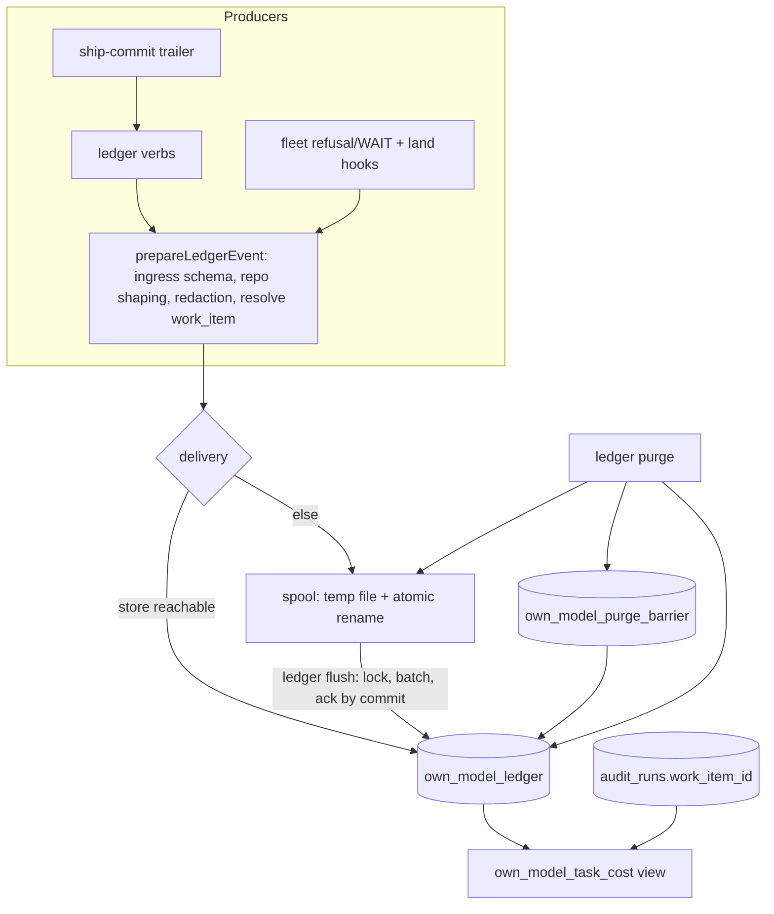

# Plan: Own-model decision ledger and coordinator capture points (PR 2 of 3)
- **Date**: 2026-10-26
- **Status**: In Progress (plan audited: GPT 3 rounds, 15 findings all accepted, Gemini final gate APPROVE)
- **Author**: Claude + Louis
- **Scope**: backend (store, CLI verbs, hooks; no UI)
- **Depends on**: docs/plans/own-model-telemetry-slice-1.md — PR 304 must land first (this PR is stacked on it): it reserves `audit_runs.work_item_id`, ships `audit_repos.training_eligible`, `scripts/lib/store/training-eligibility.mjs` and the adjudication/diff writers this plan joins to.
- **Source**: memo `docs/research/own-model-roadmap-2026-10.md` §6.1-§6.7 and §6.8, fleet proposals under theme `own-model-telemetry`.

## 1. Context

Today the coordinator's decisions, Louis's corrections, chip outcomes and per-task cost live in chat transcripts that die at an account switch (no table holds them; memo §2). Slice 1 fixed the audit-side gaps; this plan adds the **separate decision ledger** the memo specifies (§6.1): content-bearing, default-deny, written only through `cross-skill.mjs` verbs, with `fleet_events` left counts-only.

### Code trace (read at `e4bf096a`)
- Fleet has a proven outage-safe capture shape: `scripts/lib/fleet/telemetry.mjs` spools one JSON file per event beside the registry (`spoolDir`, `writeSpool`, `recordInvocation` called from `scripts/fleet.mjs:82`), and `scripts/lib/fleet/telemetry-drain.mjs` drains it idempotently by `eventId` into `fleet_events` (`scripts/lib/store/fleet-events.mjs`, `ON CONFLICT (event_id)`). The ledger reuses the SHAPE (spool + lock + idempotent drain + `LEARNING_DISABLE`), not the table: `fleet_events` rejects content by contract.
- Verbs register in `scripts/lib/cross-skill/registry.mjs` (e.g. `fleet-telemetry`, line ~538), implemented under `scripts/lib/cross-skill/commands/`; adding one touches the registry-ratchet fixtures (`tests/fixtures/cross-skill-inventory.json`, golden envelopes) and `KNOWN_FLAGS` in `scripts/cross-skill.mjs`.
- Commit trailers come from one renderer, `scripts/lib/commit-trailers.mjs` (closed key list at line 29), invoked by `scripts/ship-commit.mjs`.
- Secret handling: `scripts/lib/secret-patterns.mjs` (`redactSecrets`, `scanForSecrets`) is the shared-lib redactor; `scripts/lib/security/secret-classifier.mjs` `preWriteSecretGate` the security-domain refusal gate (store code may import it; audit/shared code may not — the layering finding PR 304 hit).
- Repo gate: `audit_repos.training_eligible` + `scripts/lib/store/training-eligibility.mjs` (PR 304). Session handles: `sessionHandle` in `scripts/lib/fleet/telemetry.mjs` (hash of a session id).
- `audit_runs.work_item_id` exists after PR 304 and nothing writes it; `recordConvergenceState` (`scripts/lib/store/learning-decisions.mjs`) is the keyed, replay-safe run patch writer.

## 2. Proposed architecture

Right-sizing. Band-aid: more `learning_decisions` rows with free-text `context` (no default-deny, purge or repo gate). Over-built: five tables with a writer each. Chosen: **one append-only table `own_model_ledger`**, `kind`-discriminated, ONE preparation pipeline, ONE writer, one verb family. Serves the current requirement "preserve decisions/corrections/outcomes/cost before the next account switch, default-deny, purgeable".

### Design decisions
1. **Migration** `supabase/migrations/20261027120000_own_model_ledger.sql` (idempotent, additive, public-only, no schema-qualified names). `own_model_ledger`: `id uuid pk`, `event_id uuid NOT NULL UNIQUE` (event identity, client-minted), `kind` CHECK `task|decision|correction|outcome|usage`, `work_item_id text`, `decision_id uuid`, `parent_decision_id uuid`, `parent_event_id uuid`, `repo_id uuid` (NO foreign key: the ledger has its own lifecycle and is purged explicitly, so deleting an `audit_repos` row can neither fail on the append-only trigger nor silently null provenance), `repo_name text`, `coordinator` CHECK `CES|WCA|STO|AIO|other`, `actor` CHECK `coordinator|louis|chip|system`, `event_at timestamptz NOT NULL` (when it happened), `purge_generation bigint NOT NULL` (the purge generation the producer last observed from the store, see decision 10; NOT a clock), `ingested_at timestamptz NOT NULL DEFAULT now()`, `schema_version int`, `redaction_version int`, `tool_sha`, `policy_version`, `session_ref text` (a hash, never a raw id), `content_state` CHECK `full|structural` , `training_eligible boolean NOT NULL DEFAULT false`, `eligibility_basis text`, `payload jsonb NOT NULL`. Indexes on `(work_item_id, event_at)`, `(repo_id, kind, event_at)`, `(parent_event_id)`. RLS on, no anon policy. Companion `own_model_purge_barrier(scope_kind CHECK work_item|repo, scope_value text, generation bigint NOT NULL, PRIMARY KEY (scope_kind, scope_value))`, with `generation` drawn from the sequence `own_model_purge_gen`.
2. **Envelope contract** (one place, `scripts/lib/ledger/schemas.mjs`): `event_id` = identity of THIS row; `decision_id` = a decision's own stable id (set on `decision` events; on `correction` it is the id of the decision being corrected, carried in the envelope ONLY, never repeated in the payload); `parent_decision_id` = the decision this one refines or overrides; `parent_event_id` = the specific earlier event an outcome observes (a `merged` outcome's follow-up `reverted`/`observed-clean` points at it). **Open decisions** (for handover) = `decision` events that are not snapshots and have no later `outcome` or `correction` referencing their `decision_id`; **pending outcomes** = `merged` outcomes with no event whose `parent_event_id` is theirs. Both are read-time derivations, never stored states.
3. **Append-only** by a `BEFORE UPDATE OR DELETE` trigger that raises unless the transaction set `own_model.purge = 'on'`, which only `own_model_purge()` does. Chosen over REVOKE because the runtime owns the table: the trigger is a tripwire against code defects, not a security boundary.
4. **One preparation pipeline** `prepareLedgerEvent(rawEvent, ctx)` in `scripts/lib/ledger/prepare.mjs`, called by EVERY producer before ANY persistence or spool write (verbs, fleet hooks, handover): (a) ingress schema validation (strict, bounded); (b) canonical repo resolution (`resolveRepoIdentity`, never a free-text name); (c) repo eligibility lookup; (d) shaping; (e) redaction; (f) stamping `purge_generation` (the last generation seen from the store, kept in the local cache file with the eligibility snapshot; 0 for a producer that has never reached the store), `schema_version`, `redaction_version`, `content_state`. The store writer re-validates the PERSISTED contract only (decision 5) and re-applies the CURRENT repo flag for events that carry content; it never re-inflates stripped content.
5. **Two contracts, not one**: `IngressEventSchema` (what a producer sends, content fields present) and `PersistedEventSchema` (what is stored and spooled: content fields are optional and valid ABSENT when `content_state = 'structural'`). A stripped event therefore validates on replay. A discriminator, not an optional-by-accident field, tells a reader which representation it holds.
6. **Eligibility without a database, failing closed.** The decision input is `{flag: true|false|null|'unknown'}`. `'unknown'` means the lookup could not run or failed (store unreachable, unresolvable repo, conflicting rows): it is NEVER read as NULL. Content survives only for `true` and for `null` (undecided, stored with `training_eligible=false`); `false` and `'unknown'` store STRUCTURE only. A small local cache `own-model-ledger/eligibility.json` (flag + checked-at per canonical repo, refreshed on every successful store contact, honoured for 24 h) lets the cloud-off spool path keep content for a repo it recently confirmed; beyond that it degrades to structure. Content lost to an outage is the safe direction and is counted in `ledger status`.
7. **Structural allowlist, not a content denylist.** Per kind, a persisted `structural` event may carry ONLY fields that are validated structure: ids (uuid/uuid7), enums, integers, booleans, timestamps, costs, token counts, hashes, and `ref` values matching a closed grammar (`pr:<int>`, `sha:<40-64 hex>`, `run:<uuid>`, `path:<repo-relative, no spaces>`). Everything narrative is dropped, including `brief_text`, `rationale`, `state_summary`, `options[].label` AND `options[].summary` (only `options[].id` and `chosen_option_id` survive), `proposal_text`, `revision_text`, and any `brief_ref` that does not match the grammar. `session_ref` is always stored as a hash. Secret redaction runs on every content string and is not relied on to remove proprietary narrative; a high-confidence classifier hit after redaction REFUSES the event.
8. **Writer** `scripts/lib/store/own-model-ledger.mjs`: `recordLedgerEvents(prepared[])` in one transaction per batch: first takes `pg_advisory_xact_lock_shared(<own_model_purge key>)`, THEN refuses events whose `purge_generation` is lower than the `generation` of a barrier matching their work item or repo, then inserts `ON CONFLICT (event_id) DO NOTHING`, and returns a per-event receipt `{event_id, state}` with `state ∈ persisted | duplicate | refused`. Registered in the writer-set oracle with a reason (operator/coordinator write, spooled on failure; intentionally not a run-scoped `durableWrite`).
9. **Delivery state machine** (shared receipt contract for every producer): `persisted`, `duplicate`, `spooled`, `refused` (schema, secret or barrier; never retried), `disabled` (`LEARNING_DISABLE=1` or `OWN_MODEL_LEDGER=off`), `failed-retryable` (store error: the event is spooled), `failed-permanent` (unspoolable: disk error). Spool files are written to a temp name and atomically renamed (`own-model-ledger/<event_id>.json`, ordered by the file's own event_id, which is UUIDv7). `ledger flush` takes a lock file (stale-lock takeover as in fleet's drain), reads files in event_id order in batches, and deletes a file ONLY after its batch committed or was classified `duplicate`/`refused`; a corrupt file is moved to `quarantine/`, never deleted and never blocks the batch. `ledger status` reports spool backlog, quarantine count, hook-error count and the content-lost-to-outage count; an empty or absent ledger reads UNMEASURED, never zero. A fleet hook failure appends a line to `own-model-ledger/hook-errors.log` (bounded) and never changes stdout or the exit code.
10. **Purge across every copy.** `own_model_purge(p_work_item text, p_repo text)` (plpgsql), in ONE transaction: takes `pg_advisory_xact_lock(<own_model_purge key>)` EXCLUSIVELY (so it waits for every in-flight writer batch, which holds the shared lock, and blocks new ones until it commits), draws `generation = nextval('own_model_purge_gen')`, upserts the barrier, sets the GUC `SET LOCAL`, deletes the rows and returns `{deleted, generation}`. The `ledger purge` verb then removes matching local spool and quarantine files. Ordering authority is the database sequence, never a producer clock: an event stamped with a generation lower than its scope's barrier generation is REFUSED, so a spooled event prepared before the purge cannot recreate its rows whatever the host clocks say (event-id dedup does not protect a deleted row, the barrier does), and the writer-versus-purge race is closed by the advisory lock. A producer learns the current generation on every store contact (writer receipt, `flush`, `status`); an offline host that has not seen it yet stamps an older generation and is refused after a purge, which is the safe direction (an event it prepared AFTER the purge but before its next contact is dropped and counted, never admitted wrongly). A repo hard stop is `training-eligibility set --eligible false` (PR 304) followed by `ledger purge --repo`. `audit_runs.work_item_id` is a structural join id and is left.
11. **Producer → field mapping** (nothing is guessed; a missing value is stored as NULL and counted as `uncorrelated` in `ledger status`):

| Capture point | work_item_id from | repo | decision / outcome reference |
|---|---|---|---|
| `ledger task` (chip launch) | `ledger mint` output (UUIDv7), also written into the brief, the branch name `wi-<id>` and the PR body footer `Work-Item: <id>` | canonical repo of the cwd | `task` event itself |
| chip wrap-up (`ledger outcome`/`usage`) | `--work-item`, else `OWN_MODEL_WORK_ITEM_ID`, else the `wi-<id>` segment of the current branch | canonical repo | `ref` = `pr:<n>` / `sha:` |
| `ship-commit` | `--work-item` flag → `AI-Work-Item` trailer (validated UUIDv7) | n/a (trailer only) | n/a |
| fleet refusal/WAIT hook | the `wi-` segment of the affected session's branch (fleet already reads it), else NULL | canonical repo of the registry | `decision` with `options[].id` chosen/not chosen |
| ship-train land (`scripts/ship-train.mjs`; `fleet land` only builds and approves a train, the merges happen in the train) | the landed PR's body footer `Work-Item:` via `gh pr view`, else the PR's head branch `wi-`, else NULL | repo of the PR | `outcome(merged)` with `ref = pr:<n>` and the merge sha |
| audit run | `OWN_MODEL_WORK_ITEM_ID` into the existing `audit.convergenceState` patch | the run's repo | `audit_runs.id` |
| handover | `--work-item` per open decision | canonical repo | snapshot `decision` (`snapshot:true`) |

12. **Cost accounting boundary.** Audit cost comes ONLY from `audit_runs.total_cost_estimate` (via `audit_runs.work_item_id`). The ledger's `usage` events cover the coordinator/chip LLM work and carry `source ∈ chip|coordinator|other`; the writer REFUSES `usage` with an audit source, so the two cannot overlap. `own_model_task_cost` aggregates each side independently in its own CTE (`SUM` per `work_item_id` over `usage`; `SUM`/`COUNT` per `work_item_id` over `audit_runs`) and then joins the two one-row-per-item results; a work item present in only one source still appears.
13. **Outcome windows keyed to the merged event.** An `outcome` carries a structured `ref` (`pr:<n>` plus `merge_sha`, canonical repo) and, for follow-ups, `parent_event_id` = the `merged` event observed. `ledger sweep-reverts` candidates = `merged` outcomes older than 7 days with NO event whose `parent_event_id` is theirs (so a second PR on the same work item never hides the first). Observation first runs `git fetch origin <default>` and reads the REMOTE-TRACKING ref (`origin/<default>`, never the local branch) ONCE per canonical repo and range (`git log origin/<default> --format=%H%n%B` over the window, parsed for `This reverts commit <sha>`), bounded to a page of 200 candidates per run with a cursor on `(event_at, event_id)` and a time budget; a failed fetch, an unreachable or shallow history, or a remote-tracking ref that does not contain the merge sha yields NO row (unobserved, retried), never `observed-clean`. **Idempotent by construction**: a derived observation's `event_id` is a deterministic UUIDv5 of `('observe', parent_event_id)`, so two concurrent sweepers, or a sweeper replaying after a spooled outage, mint the SAME id and the `event_id UNIQUE` constraint collapses them; a partial unique index on `(parent_event_id) WHERE kind = 'outcome' AND payload->>'kind' IN ('reverted','observed-clean')` additionally guarantees one terminal observation per merged event even if the two differ (the later insert is a counted conflict, never a second row). A found revert appends `reverted`; a covered, complete scan with no revert appends `observed-clean` with `observation_window_days`.
14. **Verbs** (one registry command `ledger`, positional verbs): `mint | task | record | correction | handover | outcome | usage | flush | purge | sweep-reverts | rollup | status`. Event JSON comes on STDIN, never argv. `correction` is passive by default (`--decision`, `--proposal-file`, `--revision-file`, `--class`; no mandatory rationale).
15. **work_item_id carriage**: `AI-Work-Item` in the closed key list of `scripts/lib/commit-trailers.mjs`, `--work-item` on `scripts/ship-commit.mjs`; chip launch is a desktop-app action, so this PR ships the verbs and the documented call points (`skills/fleet/SKILL.md`, `skills/ship/SKILL.md`), not an app hook.
16. **Not in this PR**: §6.8 columns with their own design (point-in-time input snapshots, propensity/randomised routing, per-LLM-call provenance, label history for `audit_findings.user_action`, the null-rate coverage gate, transcript archive): PR 3.

## 3. Files (repo-relative)
- `supabase/migrations/20261027120000_own_model_ledger.sql` (create)
- `scripts/lib/ledger/schemas.mjs`, `scripts/lib/ledger/prepare.mjs`, `scripts/lib/ledger/repo-shape.mjs`, `scripts/lib/ledger/work-item.mjs`, `scripts/lib/ledger/spool.mjs`, `scripts/lib/ledger/sweep.mjs` (create)
- `scripts/lib/store/own-model-ledger.mjs` (create)
- `scripts/lib/cross-skill/commands/ledger.mjs` (create); `scripts/lib/cross-skill/registry.mjs`, `scripts/cross-skill.mjs`, `tests/fixtures/cross-skill-inventory.json`, `tests/fixtures/cross-skill-envelopes.json` (modify)
- `scripts/lib/commit-trailers.mjs`, `scripts/ship-commit.mjs` (modify): `AI-Work-Item`
- `scripts/fleet.mjs`, `scripts/ship-train.mjs` (modify), `scripts/lib/fleet/ledger-hook.mjs` (create): refusal/WAIT decisions (fleet) and merged outcomes (ship-train land), both spool-only
- `scripts/lib/cross-skill/store-port.mjs` (modify): the only way a command reaches the store writer; `scripts/lib/ledger/submit.mjs` (create): the one producer entry point
- `skills/fleet/references/decision-ledger.md` (create) plus its index row (the SKILL.md files are size-ratcheted, so the call-point docs live in a reference)
- `scripts/lib/audit/run-persistence.mjs`, `scripts/lib/store/learning-decisions.mjs` (modify): `work_item_id` on the convergence state patch
- `skills/fleet/SKILL.md` (index row only), then `npm run skills:regenerate`
- `tests/own-model-ledger.test.mjs`, `tests/own-model-ledger-db.test.mjs` (create); DB suite enrolled in `scripts/db-test-container.mjs` and `.github/workflows/postgres-parity.yml`; `tests/audit-store-durability-call-site.test.mjs` (exemption reason)

Phases: **Phase A** migration + schemas + prepare/shape/redact + writer + barrier/purge + spool/flush/status; **Phase B** verbs + registry + trailer; **Phase C** fleet hooks, `run-persistence` carriage, SKILL docs, rollup, sweep. Close-out (not a phase): `npm run skills:regenerate`, `npm run db:local:regen`, `npm run plans:index`.

## 4. Risks and deferred
- A coordinator who never calls the verbs captures nothing: the fleet hooks make refusals/WAITs and landings automatic, and `ledger status` reports empty as UNMEASURED.
- The append-only trigger can be dropped by the table owner; it is a tripwire, not a boundary. The boundary is the prepare pipeline plus `training_eligible`.
- Content lost to an outage or an unknown eligibility is deliberate (safe direction) and counted.
- Chip launch/wrap-up are desktop-app actions; call points are documented, not hooked.
- Deferred to PR 3: §6.8 columns, coverage gate, transcript archive, brief-quality joins.

## 5. Testing and proof plan
- Pure: ingress vs persisted schemas (a stripped event validates; a full event with content on a `false` repo shapes to structure), structural allowlist (`options[].label` dropped, non-grammar `brief_ref` dropped, `session_ref` hashed), `'unknown'` eligibility never read as NULL, redaction refusal, UUIDv7 mint, trailer rendering, fleet hook never alters stdout/exit and writes only on refusal/WAIT, producer-to-field mapping incl. the NULL/`uncorrelated` fallbacks.
- Delivery: temp+rename atomicity, flush ack-after-commit, corrupt file quarantined without blocking, lock takeover, purge removes spool copies, barrier refuses a replayed pre-purge event (older generation) and accepts one stamped with the current generation, with host clocks deliberately skewed both ways in the test; a writer/purge interleaving test holds the shared lock open while purge is requested and proves purge waits and the late event is then refused.
- Real Postgres (`own-model-ledger-db.test.mjs`, enrolled in both lists): UPDATE and DELETE refused (negative control: the purge function succeeds), repo deletion does not touch the ledger, idempotent re-drain by `event_id`, repo-false event stored structural-only, cost view arithmetic with a work item present in one source only and with several PRs on one work item, `sweep-reverts` second-PR case, two concurrent sweeps and a spool replay producing exactly one child, a stale remote-tracking ref (fetch failure) producing none, default-deny on an omitted flag.
- Registry ratchets regenerate with the verb; the writer-set oracle carries the exemption reason.
- Mutation checks: remove the trigger, the barrier, the allowlist; each matching test must fail.
