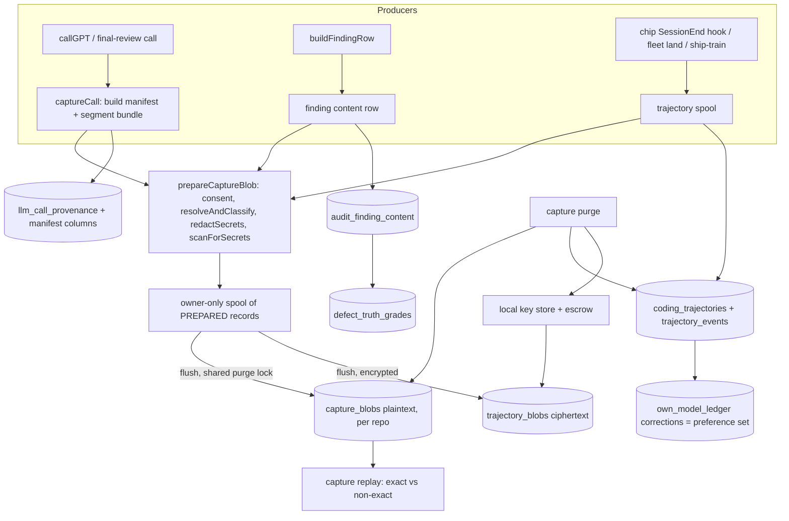

# Plan: Own-model full capture — every audit call, every finding, every chip trajectory, from day one
- **Date**: 2026-11-22
- **Status**: Draft
- **Author**: Claude + Louis
- **Scope**: backend (store, capture writers, hooks, CLIs; no UI). Stack `js-ts` + postgres.
- **Target domain(s)**: `shared-lib`, `stores` (plus `audit-orchestration`, `scripts`, `skills-content` at the call sites listed in §7)
- ⚠ **Cross-domain work**: the capture seam sits in `shared-lib`/`audit-orchestration` and hands rows to `stores` writers. The crossings are intentional and follow the existing `recordGptCall` → `recordLlmCalls` direction.
- **Depends on**: docs/plans/own-model-telemetry-pr3.md — extends its `llm_call_provenance`, coverage gate and transcript archive (shipped #312).
- **Depends on**: docs/plans/own-model-decision-ledger.md — extends `own_model_ledger` for coding trajectories and preferences (shipped #311).
- **Depends on**: docs/plans/policy-private-consumer-stores.md — its `upstreamReachable:false` declaration decides where a policy-private consumer's capture lands.
- **Source**: [own-model-roadmap-2026-10.md](../research/own-model-roadmap-2026-10.md) (its "dataset durable, model disposable" principle stands; its §7 "no transcript hoarding" is **overridden**, §0 below).

## 0. Louis's decisions (2026-11-22) — fixed inputs, not relitigated

> "if we do this let's do it properly and capture fully from the beginning. If we begin training the model we can always trim the scope into layers but the data we can never get back."

| # | Decision | What this plan does with it |
|---|---|---|
| L1 | **Full capture from day one**, no sampling; trimming happens at training time | Every audit and final-review call writes a manifest + bundle + raw output; every consented chip writes a trajectory. No sampling knob exists. |
| L2 | **Q1: both** defect truth (blind human grading) **and** Louis's preferences (overrides, handovers), **kept as separate datasets** | Two label stores with no shared table, no shared export (§3.2, §3.3). |
| L3 | **Q2: grade "as many as needed"** | Sized from the evaluation's statistics: **~2,120 grading events, ~110/week (~2 h/week, cap 150) over ~19 weeks**, paced by independent PRs (~35/week measured) rather than by grading hours (§3.2.6). |
| L4 | **Q3: full replayable bundles stored for every call**, not a sample | §2.2. |
| L5 | **Coding transcripts are captured.** This overrides the brainstorm consensus: GPT and Gemini both argued against capturing coding transcripts (privacy surface, hoarding without a defined use, low label quality) and the 2026-10 memo §7 said "no transcript hoarding". Louis decided otherwise; the counter-arguments are carried as risks (§11), not as a veto. | §4. |

Fixed limits (also inputs): secrets and sensitive paths are redacted at capture through the existing seams, **the one accepted loss**; consent is default-deny via `audit_repos.training_eligible`; a policy-private consumer's data never leaves its org; transcripts get separate tables, access control and a tested revocation and purge; Tier 3 egress rules apply; capture ships in **observe mode** first.

## 1. Context Summary

### 1.1 Measured gaps (re-measured 2026-11-22, store `d5a9d07b91225a93`, read-only `pg` queries; scratch script not committed)

| Gap | Brief said | Measured now | Query (abridged) | Label |
|---|---|---|---|---|
| Prompt content | 16-hex system-prompt hash only | **Confirmed.** `promptHash = sha256(system).slice(0,16)` and nothing else of the prompt; context files not stored anywhere | code read, `scripts/lib/telemetry/llm-call-log.mjs:141 (9865dc65)` | measured |
| R2+ rulings | not stored | **Correction:** ruling *rationale* IS stored per adjudication event (redacted, capped) via `outcome-sync.mjs:128,201` → `adjudication-events.mjs:293`; what is NOT stored is which rulings were *injected into which prompt* | code read | measured |
| Per-call cost | null | **0 of 4,126** calls in 7 days have `cost_usd`; `llm-call-log.mjs:147` hardcodes `costUsd: null`; `final-review-call.mjs:26-37` passes none | `count(cost_usd)` over `llm_call_provenance`, 7 d | measured |
| Findings truncation | 600 chars | `detail` only is cut (`runs-findings.mjs:641`); 40 of 3,164 findings (1.3%) in 7 d hit the cap, avg 230 chars; **`risk`, `recommendation` and the raw finding JSON are dropped for 100%** (`schemas.mjs:73-74` fields never reach `buildFindingRow`) | `count(*) filter (where length(detail_snapshot)>=600)` | measured |
| `adjudicator_kind` | 96.5% null (Oct) | **37% null in the last 30 d** (2,594 null / 4,337 `pipeline`): slice 1's writer works; the null remainder is the paths that still do not stamp | `group by adjudicator_kind`, 30 d | measured |
| `fix_commit_sha` | 3.5% filled | **0 of 10,381** findings in the last 30 d | `count(fix_commit_sha)`, 30 d | measured |
| Per-finding revert label | none | **Confirmed none.** Reverts exist only per work item (`own_model_ledger` outcome `reverted`, `scripts/lib/ledger/sweep.mjs:30-52`) | code read | measured |
| Work-item join | — | **0 of 529** audit runs in 7 d carry `work_item_id` | `count(distinct work_item_id)` over `audit_runs`, 7 d | measured |
| Decision ledger | — | **`own_model_ledger` has 0 rows ever** — shipped in #311, never fed in practice (chip launch and wrap-up have no hook; the verbs are documented, not invoked) | `select kind, count(*) from own_model_ledger` | measured |
| Consent flags | — | `training_eligible` is **NULL (undecided)** for CES, wine and ai-organiser on the NAS store; storyline's flag lives in its own Azure store (set `true` 2026-10-27 per memo §0.1) | `select name, training_eligible from audit_repos` | measured |
| Audited identity | — | `audited_sha` 524 / 529 runs (99%) in 7 d; but `audited_sha` is HEAD while `audited_tree` is the working tree (`scripts/lib/vcs.mjs:244-269`), so on a dirty tree only the tree is faithful; bake-off arms capture from `process.cwd()` | `count(audited_sha)` | measured |
| Coding | nothing captured | **Confirmed**, except the manual `scripts/transcript-archive.mjs` (local files, `~/.audit-loop/transcript-archive`) | code read | measured |

**Volume (7 d, measured):** 3,883 audit calls (avg 14,080 input tokens, p95 27,939; 841 output) over 439 runs; 243 final-review calls (avg 149,837 input, p95 415,558) over 137 runs; 91.1 M input tokens and 3.5 M output tokens in total. Daily call counts over 14 days range 62–1,244. **Chip transcripts (measured, `~/.claude/projects/**.jsonl` modified in the last 2 days):** 24 files, 574 MB raw, median 6.3 MB, p90 23 MB, max 165 MB.

### 1.2 Code Trace (all pinned to `9865dc65`)

- **What a call sends** is described in ONE place: `effectiveRequestFor` (`scripts/lib/audit/llm-helpers.mjs:248-271`) builds `requestParams` (`model`, `input`, `text.format` = Zod schema, `max_output_tokens`, `reasoning`) plus `route`; `_callGPTOnce` (`:277`) sends exactly that object. **This is the bundle seam.**
- **Content identity already exists**: `requestKeyFor` (`scripts/lib/audit/call-record.mjs`) hashes `{route, request-without-prompt, inputSha256(canonicalJson(prompt)), schemaName}`; `canonicalJson` + `sha256` are exported there. The `--resume` call records (`.audit/call-records/<auditedTree>/…`) store the result but **deliberately not the prompt** ("prompts hold source excerpts", `llm-helpers.mjs:436-443`). A replayed call returns before `recordGptCall` (`:447-453`), so it writes no provenance row today.
- **Per-call metadata**: `recordGptCall` (`llm-call-log.mjs:133-153`) → record builder (`:85-108`) → `recordLlmCalls` (`scripts/lib/store/llm-calls.mjs:41`, `ON CONFLICT (call_id) DO NOTHING`) at finalisation through the registered writer `audit.llmCalls`. Final review: `scripts/lib/telemetry/final-review-call.mjs:26-37`.
- **Pricing**: `costFromUsage` (`scripts/lib/model-pricing.mjs:392`), `PRICING_VERSION` (`:147`); already used per run by `usage-event.mjs:118` and `cost-budget.mjs:58,108`.
- **Findings**: `buildFindingRow` (`scripts/lib/store/runs-findings.mjs:627-680`) persists the listed columns and slices `detail` at `:641`.
- **Adjudication**: `adjudicator_kind` writers at `adjudication-events.mjs:130,297`, `campaign.mjs:1286,1379`, `outcome-sync.mjs:199`, `final-review/reviewer-events.mjs:192`. `fix_commit_sha` writers at `finding-disposition.mjs:87`, `runs-findings.mjs:1497`, `learning-decisions.mjs:220`.
- **Egress seams**: `classifyPath` / `resolveAndClassify` (`scripts/lib/sensitive-paths.mjs:187,241`), `redactSecrets` + `scanForSecrets` (`scripts/lib/secret-patterns.mjs:230`), `assertEgressSafe` (`scripts/lib/sensitive-egress-gate.mjs:296`). **The capture precedent** is `prepareDiffArtifact` (`scripts/lib/audit/diff-capture.mjs:24-75`): classify → redact → scan → refuse if a secret survives. Free text: `redactAndCapText` (`scripts/lib/store/capture-identity.mjs:72`).
- **Content-addressed storage** exists twice: `audit_run_diffs(diff_ref sha256 PK, diff_text, bytes)` (migration `20261026120000_own_model_telemetry_slice1.sql:40-50`, **global, not per repo**) and the local per-repo transcript blobs (`scripts/lib/telemetry/transcript-archive.mjs:14-16`).
- **Consent**: `audit_repos.training_eligible` (three-valued, default-deny), `training_eligibility_events` lineage, readers `assertTrainingEligible` / `checkReposEligibleForExport` (`scripts/lib/store/training-eligibility.mjs:25,50`).
- **Fleet / chip hooks**: `recordFleetDecision` (`scripts/fleet.mjs:174`, refusals only), `recordTrainLandings` (`scripts/ship-train.mjs:279` → `scripts/lib/fleet/ledger-hook.mjs:104,129`), `fleet land` (`scripts/lib/fleet/land.mjs:70`), spawn (`scripts/lib/fleet/lease-spawn.mjs:67`), wind-down (`scripts/lib/fleet/handover-winddown-cmd.mjs:31`). **No chip launch or wrap-up hook exists**; `.claude/settings.json` SessionStart only installs dependencies.
- **Evaluation assets**: known-defect corpus `docs/experiments/audit-effectiveness/known-defects.json` (v4) with `scripts/lib/model-eval/known-defect-corpus.mjs`; expect-clean adjudications `docs/experiments/audit-effectiveness/expect-clean-adjudication-v2-2026-11-20.{md,json}` with `scripts/lib/model-eval/expect-clean-adjudication.mjs`. **The step-back replay harness is NOT on main**: it is planned in `docs/plans/verification-lessons.md` §2.4 (`docs/research/step-back-replay-2026-11.md` "planned", line ~340), being built by a sibling session. This plan consumes its round-signal contract, it does not build one.

### 1.3 Neighbourhood considered (architectural memory, k=8)

All eight neighbours band `review` (below this repo's noise floor) — nearest are `persistKeptEmbeddings`, `applyRecordTimeSuppression`, `recordPassStats` in `runs-findings.mjs`. The real precedents are named by the code trace above (`effectiveRequestFor`, `requestKeyFor`, `prepareDiffArtifact`, `recordLlmCalls`, `own_model_ledger`, `transcript-archive`) and are **extended**, not duplicated.

### 1.4 Security incident neighbourhood

INC-001 (`manual-verification-required`): the lexical classifier missed symlinks resolving into sensitive locations. **Every capture path in this plan classifies with `resolveAndClassify` (realpath), never `classifyPath` alone**, and a resolution failure is `sensitive` (fail closed). See §6 Security Considerations.

## 2. Proposed Architecture

### 2.1 Two datasets, two label sets, one storage layer

- **Dataset A — audit role**: call manifests + bundles + raw outputs (§2.2), untruncated findings with typed provenance (§2.3), evidence links (§3.1).
- **Dataset B — coding**: chip trajectories (§4).
- **Label set DT — defect truth**: blind human grades (§3.2). Never derived from dispositions.
- **Label set PF — preferences**: Louis's overrides and handovers (§3.3). Never mixed with DT, never used as a validity label.
- **One storage layer** for all content: one blob module with two tables — `capture_blobs` (plaintext-redacted) and `trajectory_blobs` (encrypted transcripts) (§2.4) — and one preparation pipeline for every byte (`prepareCaptureBlob` / `prepareCaptureText`, §2.5), generalising `prepareDiffArtifact`, so redaction and consent are decided in one place (#1 DRY, #5 single source of truth).

### 2.2 Audit-call capture: manifest + bundle + raw output for every call

**Manifest** — extend `llm_call_provenance` (one row per call already; `call_id` identity already replay-safe), not a new table (#1, #18). New columns:

| Column | Content |
|---|---|
| `request_key` | `requestKeyFor(...)` from `call-record.mjs` — the existing content identity of the logical request (reused, not re-invented) |
| `audit_session_id`, `audit_round`, `pass_name` | joins to rounds and passes |
| `audited_tree`, `audited_sha`, `diff_base_sha` | tree identity at call time (copied from the run; see P0 fidelity fix) |
| `settings` jsonb | resolved model id, route `{transport, endpoint-class, deployment}` (never a key or full URL), `max_output_tokens`, reasoning effort, temperature when set, schema name + `schema_sha256` (of `z.toJSONSchema`) |
| `prompt_template_id`, `prompt_template_version` | the pass prompt identity: `prompt_revisions` id where the pass prompt comes from the learning store, else sha256 of the template source |
| `context_refs` jsonb | **ordered** list `[{ord, kind: file|diff|ruling|ledger|plan|rubric|other, ref (repo-relative path or id), blob_sha256, bytes, truncated, redactions, sensitive_omitted}]` |
| `ruling_ids` text[] (`pgArray`) | ids of the R2+ rulings injected into this prompt (from the rulings block builder) |
| `bundle_sha256`, `bundle_segments` jsonb | the request-as-sent, as an ordered segment recipe (below) |
| `output_sha256`, `output_state` | raw response body blob; `parsed` / `schema-reject` / `truncated` / `error` / `refused` |
| `capture_redacted`, `capture_state` | capture-side redaction happened; `captured` / `structure-only` (consent) / `refused-secret` / `lost` |
| `replay_class` | `exact` or `non-exact`, with `replay_reasons` text[] (§2.7) |
| `cost_usd`, `pricing_version` | from `costFromUsage` + `PRICING_VERSION` at record time (P0) |
| `replayed_from_call_id` | set when `--resume` replayed a stored result, so a replay is a row pointing at the original, not a missing row |
| `transport_family`, `sdk`, `schema_blob_sha256` | which request shape was sent (table below), `name@version` of the SDK, and the SDK-format schema as sent |
| `capture_reasons` text[] | why a manifest is partial (`context-unattributed`, `structure-only`, …), separate from `replay_reasons` |

Existing columns (`model_resolved`, `route`, tokens, `latency_ms`, `truncated`, `retried`, `fallback`, `prompt_hash`) keep their meaning; `prompt_hash` stays for backward compatibility and is now derivable from the bundle.

**Bundle = exactly the request object our code handed the SDK**, after egress redaction (the model saw the egress-redacted text, so that is the truth to store), recorded per **transport family** because the object differs by path:

| Family | Request object stored | Exactness ceiling |
|---|---|---|
| `openai-responses` | `requestParams` from `effectiveRequestFor` + `route` | `exact` possible |
| `openai-chat-fallback` | the `params` object `parseStructured` builds for `chat.completions.parse` (`llm-helpers.mjs:208-215`) — the fallback is decided mid-run, so the family is recorded per call, never assumed | `exact` possible |
| `gemini` | the request body `final-review-call.mjs` hands the Gemini client | `exact` possible |
| `anthropic-sdk` | the Messages request object | `exact` possible |
| `anthropic-cli` | the prompt and flags passed to `claude -p` | **always `non-exact`** (`cli-hidden-prefix`: the CLI adds a ~164K-token prefix we do not see) |

**Payload and route are stored apart**: `provider_payload` is exactly the object handed to the SDK method (for `openai-responses`, `requestParams`; no route inside it), and `route` (transport, endpoint class, deployment, api version) is separate manifest metadata. The SDK's own wire serialisation is outside our code, so `exact` is defined at the payload boundary plus the SDK identity: the manifest records `sdk = name@version` and the Zod-derived schema as the SDK receives it (`zodTextFormat(...)` / `zodResponseFormat(...)` output, stored as its own blob, so a historical schema is reproducible after the Zod source changes). **Proof, per family, in P1**: an instrumented `fetch` captures the outbound request; (a) its JSON body must equal `projectToWire(family, sdkVersion, provider_payload)`, a pinned, documented projection (identity plus whatever fields that SDK version adds or renames, e.g. the Zod format object's serialised form), and (b) separately, the request URL's host, path and deployment must match `route`. A family/SDK version without both passing tests is recorded `non-exact` with reason `family-unverified`.

It is stored as an **ordered segment recipe**: the canonical-JSON skeleton with each prompt content string replaced by a placeholder is one blob, and each content string is its own blob. Context files repeated across five passes and several rounds therefore dedupe to one blob each (the size win in §5). **Exactness is verified at write**: the writer reassembles the recipe and checks `sha256(reassembled) == sha256(canonicalJson(requestObject))` computed from the live object; on mismatch it stores the whole object as one blob and marks `replay_reasons += 'segmentation-fallback'` (counted, never silent).

**Raw output**: the response body before Zod parsing, plus failed and truncated calls — negatives are training data too. Source per path: the Responses result's `output` items as returned, and on the chat fallback the `choice.message.content` text `parseStructured` already surfaces (`llm-helpers.mjs:193-238`). A schema-reject or truncation throws an `LlmError`; P1 attaches the raw text to it (`err.rawOutput`, bounded by the same output cap) so the error path can capture it. A call that errors with no body records the error class and usage only (`output_state = 'error'`).

**The raw-output boundary is before SDK parsing**, because `responses.parse` / `chat.completions.parse` can throw on a malformed structured output before our code sees any text. `createOpenAIClient` (`scripts/lib/openai-client.mjs`, the one construction seam) passes the SDK a `fetch` wrapper that clones each response and tees its body (bounded to 2 MB, beyond which `raw_truncated = true`) into a per-call slot keyed by the call id held in an `AsyncLocalStorage` context that `callGPT` opens around the attempt. The capture step reads the slot on success AND on error, so every schema-reject, truncation and parse throw has its pre-parse payload. The same wrapper pattern goes on the Anthropic client seam (`createAnthropicClient`) and on the Gemini client where its SDK accepts a custom fetch; a family whose SDK does not is recorded `raw-output-unavailable` on parse failures (counted), never silently empty. The wrapper never alters the response the SDK receives (it reads a clone) and its failures are swallowed into a counter.

**Where context references and ruling ids come from (producer → manifest interface).** Pass prompts are assembled by `buildCachePrompt` → `buildAuditPassPrompt` (`llm-helpers.mjs:99-118`) from named segments: system rubric + focus, project brief, plan slice, file-list context, requirements rubric, code, history (CLI history + `buildRulingsBlock`, `scripts/lib/ledger.mjs:852`), round modifier. P1 makes the builder also return `contextRefs` (one entry per segment and, inside `code`, per file it concatenated) and `rulingIds` (`buildRulingsBlock` returns the ids it rendered alongside the text). **Each ref carries its exact span** `{message_index, start, end}` (character offsets in the content string it was concatenated into, recorded by the builder as it appends — nested file refs inside `code` included), and at write the capture step verifies `sha256(content.slice(start, end)) == ref.blob_sha256` for every ref; any mismatch sets `context_refs_verified = false` for the call (counted). The bundle's segment recipe splits content strings at these spans, so a ruling or ledger segment is its own placeholder even when the prompt was one string. The caller passes them as `opts.capture = {contextRefs, rulingIds, promptTemplate}` to `callGPT`. The plan audit's own prompt (`scripts/openai-audit.mjs:994-1049`) and the map-reduce scheduler (`scripts/lib/audit/map-reduce-scheduler.mjs:245`) pass the same object. A call without `opts.capture` still gets a full bundle (exactness does not depend on the refs) and records `context_refs = null` with `capture_reasons += 'context-unattributed'`; the census below counts those sites so they get fixed rather than tolerated.

**Finding ↔ call (many-to-many).** One finding can be emitted by several calls (passes, rounds, map-reduce units, retries), and semantic dedup merges re-raises. So provenance is a table, not a column: `finding_occurrences(finding_id, call_id, ordinal_in_output, raw_json_sha256, round, pass_name)`. At parse, each raw finding object becomes an **immutable occurrence record** `{callId, ordinal, rawJsonSha256, round, pass}` (the call id is minted before the request, so it exists on every path; the raw object's blob is prepared then) attached to the finding as `_occurrences: [...]`. Every dedup, merge and semantic-suppress path **concatenates** the arrays of the findings it merges and never drops or rewrites an entry; a suppressed re-raise keeps its occurrence on the canonical finding. `buildFindingRow`'s writer inserts one row per occurrence in the same transaction as the finding. `audit_finding_content.raised_by_call_id` is the FIRST occurrence (a convenience join), never the only one. A `--resume` replay mints a new call row with `replayed_from_call_id` and its occurrences point at the new row.

**Seams and durability.** The hot path must never throw or block the audit, AND a crash or kill must lose at most the call in flight, so capture is NOT an in-memory buffer:
- **Attempt line before send**: just before `_callGPTOnce` sends, the capture step prepares the request bundle (`prepareCaptureBlob` on each segment: hashing + redaction scan of a ~60 KB average request, milliseconds) and appends an `attempt` line `{call_id, run_id, producer, process_nonce, seq, attempted_at, manifest-without-output, prepared segments}` to a per-process spool file (`<spool>/calls/<process_nonce>.jsonl`, owner-only, flushed per write). **Result line after**: on return (success, error or replay) a `result` line `{call_id, output_state, prepared raw output, usage, cost, occurrences}` is appended. All inside try/catch; a failure increments `capture_failed` and continues.
- **Parents exist first, by construction**: the audit's `audit_runs` row is created by `recordRunStart` (`scripts/lib/store/runs-findings.mjs:255`) before any pass runs, and the call log is bound to it right after (`bindRun`, PR3 decision 4), so every attempt line carries a real `run_id`. When cloud was off at run start there is no run row: the lines carry the local identity (`audit_session_id`, round, nonce) and the drain parks them as `orphan-run` (reported, retried on the next drain once a run row with that identity exists), never inventing a parent.
- **One writer per row.** P1 makes `audit.callBundles` the **only** writer of `llm_call_provenance` rows for both producers: `recordGptCall` and `final-review-call.mjs` stop buffering their own metadata row and instead contribute their fields to the attempt/result lines (PR3's `audit.llmCalls` writer keeps writing only the `llm_call_log_summary` row until it is folded in, so no two writers race on a call row). **Merge contract**: the row is upserted from whatever lines are present, `ON CONFLICT (call_id) DO UPDATE SET col = COALESCE(llm_call_provenance.col, EXCLUDED.col)` per column; for the identity columns (`run_id`, `request_key`, `bundle_sha256`, `producer`, `seq`) a non-NULL existing value that differs from the incoming one **refuses that call's batch entry** and counts `conflict` (never a silent overwrite, never a silent keep). Tested in both line orders, with a duplicate drain and with a deliberately conflicting duplicate.
- **Drain order**: per batch, in one transaction: blobs + refs → the provenance row (merge contract) → occurrences (only when their finding row exists; otherwise kept in `pending_occurrences(run_id, finding_fingerprint, occurrence)` and attached when the finding is written, or counted `orphan-occurrence`). Re-draining the same file is a no-op.
- **Attempt state machine**: `attempted` → (`captured` | `structure_only` | `capture_failed`) from a result line; or → **`interrupted` (provisional)**, assigned only when a drain proves the producer dead. Each producing process holds `<spool>/calls/<process_nonce>.lock` (pid + start time, refreshed every 60 s); `capture flush` drains another process's file only when that pid is gone or the lock is older than 30 minutes, and the finalisation writer drains only its own. A later result line for an `interrupted` call **always supersedes it** (the result UPDATE matches `output_state IS NULL OR output_state = 'interrupted'`). Tested: drain between attempt and result, then the result arrives, then a second drain → the row ends `captured`.
- **Accounting that survives a failed append and a crash**: every attempt takes the next **contiguous per-process `seq`** before anything is written. If preparing or appending the attempt line fails, a minimal `attempt-failed` line `{call_id, seq, error_class}` is appended to a second file (`<nonce>.failures`); if that also fails, the seq is simply missing. Terminal categories are mutually exclusive: `captured`, `structure_only`, `interrupted`, `capture_failed`, and **`unaccounted`** (= a seq gap: no line of any kind). **One reconciliation formula**, shared by `capture status`, crash recovery and the P1 gate: `attempted = max(seq) + 1 = captured + structure_only + interrupted + capture_failed + unaccounted` per process; a process killed between taking a seq and writing any line leaves at most its final seq unknowable, counted once as `tail-unknown`. The summary row is rewritten from the drained lines, so a killed process's counts are recovered, not lost with its memory.
- **Call families** (P1 census, `npm run capture:census:gate`, derived from the filesystem like `db:enrolment:gate`): every call site of `callGPT`, `createOpenAIClient`, `createAnthropicClient`, the Gemini client and `embedText` is classified `captured` or `declared-out` with a reason in `.capture-families.json`. Captured in P1: GPT audit passes, plan audit, map-reduce units, rebuttal/deliberation, verify-findings (`scripts/verify-findings.mjs:196`), tiered Stage 0/1/2 calls, Gemini final review, the Claude final-review fallback. Declared out (not the audit role): brainstorm, symbol summarisation, embeddings, arm-eval/model-eval harness calls (they already store their own records). A new call site fails the gate until classified.

### 2.3 Untruncated findings and typed provenance

New table `audit_finding_content` (1:1 with `audit_findings.id`; `detail_snapshot` keeps its 600-char contract for every existing reader):
- `finding_id` PK, `repo_id`, `raw_json_sha256` (the model's finding object as emitted, in `capture_blobs`), `detail_full`, `risk`, `recommendation`, `evidence` jsonb (as emitted), `content_state`, `redactions`.
- **The inline text columns are sanitised by the same contract as blobs (§2.5)**: every string field (`detail_full`, `risk`, `recommendation`, every string leaf of `evidence`, and `primary_file` / any path) goes through `prepareCaptureText` before the row is built; a path field that classifies sensitive is replaced by `[redacted:<sha256-hex8>]`; a field with a surviving secret is stored NULL with `content_state = 'field-refused'` and its name listed in `redactions`. Nothing reaches the row or the spool unsanitised.
- **Typed provenance**: `raised_by_call_id` (→ `llm_call_provenance.call_id`), `pass_name`, `audit_round`, `source_model`, `prompt_template_version`, `producer` (`audit|final-review|linter|reviewer`).
- **Four axes kept apart** (never one column standing for another, memo §3 objective hygiene): **validity** lives ONLY in `defect_truth_grades` (§3.2); **severity** is three values with their own provenance — `severity_model` (as emitted), `severity_adjudicated` (from `verdict_severity`/adjudication events), `severity_graded` (DT); **disposition** is the workflow state in `finding_adjudication_events` (append-only, `finding_label_history` view); **remediation** is `remediation_state` + the evidence links (§3.1). A view `finding_axes` joins them for readers; nothing collapses them at write.

### 2.4 Storage: `capture_blobs`, content-addressed, per repo

- **Two blob tables, never one**, so a plaintext consumer can never be handed ciphertext and a transcript can never be stored in the clear by a dedup hit:
  - `capture_blobs(repo_id uuid, sha256 text, bytes int, stored_bytes int, compression text CHECK ('gzip'), redaction_version int, created_at, content bytea, PRIMARY KEY (repo_id, sha256))` — **plaintext-redacted** content only (bundle segments, outputs, finding raw JSON, schemas, context, commit diffs, test logs). The class of a use lives on the referencing row, not the blob (identical bytes are one blob whatever refers to them).
  - `trajectory_blobs(repo_id uuid, key_id text, sha256 text, nonce bytea, auth_tag bytea, stored_bytes int, created_at, ciphertext bytea, PRIMARY KEY (repo_id, key_id, sha256))` — **only** transcript content, AES-256-GCM, address = sha256 of the redacted plaintext inside one key's namespace (a key rotation starts a new namespace; nothing is shared across keys).
  - The `ON CONFLICT` path of each writer re-reads the existing row and asserts `compression` (or `key_id`) and `bytes` match; a mismatch is a refused write, counted, never a silent reuse.
- **Address = sha256 of the redacted, uncompressed bytes**; namespaced by `repo_id` so purging one repo can never delete another repo's blob (the lesson the transcript archive already encodes; `audit_run_diffs` is global and is left as-is, §11).
- **Reference tracking** (shipped with the first content write, P1): `capture_blob_refs(repo_id, sha256, owner_kind CHECK ('call','finding','trajectory-event','evidence'), owner_id, PRIMARY KEY (repo_id, sha256, owner_kind, owner_id))`. Every writer inserts the ref in the same transaction as the blob. A blob is deletable only when it has no ref.
- **Where — store routing, fail closed**: audit-call and finding capture rows are written **in the same store and the same flush as the `audit_runs` row they hang off** (they carry its `run_id`), so they can only land where the audit itself was recorded. Trajectories resolve the repo's own DSN through the existing store resolution (the repo's `.env` → `AUDIT_DB_URL`); an **empty DSN is the air-gap signal** (`airGapDbUrl`) and means spool-only, reported, never a fall-through to `~/.audit-loop.env`; a resolved store whose `audit_repos` has no row for the repo refuses (no auto-registration from capture). **A repo row in a store does not authorise that store**, so policy-private repos carry a binding: a repo declared `upstreamReachable:false` MUST have `CAPTURE_STORE_FINGERPRINT` (the expected `storeFingerprint`) in its own private config (its `.env`, gitignored), and before ANY content write or spool drain the writer compares it with the fingerprint of the store it actually resolved; absent or mismatched → refuse (records stay in the local spool, reported `store-binding-mismatch`). Other repos may set the binding too and get the same check. Every capture row stamps `store_fingerprint` (from `storeDescriptor`); `capture verify` fails on a row whose fingerprint is not the store it sits in. The NAS store holds CES, wine and ai-organiser; storyline's own Azure store holds storyline; a policy-private consumer's own store holds its data.
- Postgres `bytea` (TOASTed) is chosen over a filesystem or S3 bucket because purge, consent and the manifest then live in **one transaction** in **one place that already crosses no org boundary**, and the measured volume (§5) is small enough. The blob I/O sits behind two functions (`putBlobs`, `getBlob`) per table in one module, so moving bytes to object storage later changes one adapter file (#20). **Trigger to move**: blob tables > 50 GB on a store, or that host's disk under 30% free.
- **Write path**: prepared records (§2.5) → `putBlobs` + refs + owner rows in one transaction per batch, under the shared purge advisory lock (§2.6); cloud off or store error → the record stays in the spool for `capture flush`.

### 2.5 One preparation contract, applied before any durable write (spool included)

`prepareCaptureBlob(bytes, provenance)` / `prepareCaptureText(string, provenance)` in `scripts/lib/capture/prepare.mjs` are the only way content reaches a spool or a table. **They run at capture time, not at flush**, so the spool never holds unprepared content. Order: consent → provenance classification → secret redaction → scan → refuse-or-keep.

1. **Consent** (`training_eligible` via the ledger's local eligibility cache, 24 h, `unknown` when stale — the #311 rule): `true` → content; `null` (undecided) → content kept in the spool and store but `training_eligible=false` on the row (the #311 rule for undecided); `false` / `unknown` → **structure only** (ids, hashes, counts, timings; no content at all). Re-checked at flush against the store's current flag and the purge barrier generation: a record whose repo became `false`, or whose generation is below its scope's barrier, is stripped to structure (or dropped under a barrier) before insert.
2. **Provenance classification, fail closed**: each producer declares the sources of a string. *Known single path* (a context file, a `Read`/`Edit` result): `resolveAndClassify`; sensitive, escaped-repo or resolution failure (including a deleted path) ⇒ the content is replaced by `[REDACTED:sensitive-path:<sha256-hex8>]`. *Multiple or derived sources* (`Grep` over a directory, `Bash` output): every path-like token of the command/pattern is classified, and ANY sensitive or unresolvable token ⇒ redact the whole output; commands from a closed environment-dump list (`env`, `printenv`, `set`, `export -p`, `Get-ChildItem env:`, `cat`/`type` of any `.env*`) ⇒ redact regardless. *No attributable source* (model text, user messages, finding fields): secret redaction only — they did not read a file, so path classification has nothing to decide. Filenames in any field are classified like paths.
3. **Secrets**: `redactSecrets` (`secret-patterns.mjs`) on every string, then `scanForSecrets`; a surviving high-confidence hit refuses that string (field NULL / event structure-only / blob not written), counted per producer. A pipeline exception refuses (fail closed, INC-001 posture), never passes through.
4. **Spool hygiene**: spool root `~/.audit-loop/capture-spool/` (outside every repo), created owner-only (`0700`; on Windows an ACL limited to the current user, verified by `capture status`); transcript records in the spool are encrypted with the repo's data key before they touch disk (§4); files are written temp+rename; anything older than 14 days is deleted and counted as `lost-expired`.

### 2.6 Purge and revocation ship with the first content write (P1)

`capture purge --repo | --work-item | --session | --finding | --call` (one `cross-skill.mjs` verb, event JSON on stdin):
- One transaction: take the exclusive purge advisory lock (writers hold it shared, the #311 pattern, so no flush is mid-batch), draw a barrier generation, upsert `own_model_purge_barrier`, delete the owner rows in scope, delete their `capture_blob_refs`, then delete blobs left with **zero refs** (a blob still referenced by another work item in the same repo stays). Spool files in scope are deleted after commit. Receipt `{rowsDeleted, refsDeleted, blobsDeleted, blobsRetainedShared, spoolFilesDeleted, keysDestroyed, generation}`.
- Every purge appends to `capture_purge_log` (in the store) **and** to an out-of-band append-only copy `~/.audit-loop/capture-purge-log.jsonl` (plus its backup location, D-BACKUP), because a restored older backup does not contain later purges. **Restore procedure** (runbook, tested): after any restore, `capture purge --replay-log <file>` re-applies every logged purge newer than the backup before the store is used; `capture verify` refuses to report green until it has run.
- Revocation = `training-eligibility set --eligible false` then `capture purge --repo`. Transcripts additionally lose their key (§4), so even an un-reconciled backup cannot reveal them.

### 2.7 Replay keeps exact and non-exact apart

`npm run capture:replay -- --call <id> | --run <id> [--model <sentinel>]` (a pinned-revision, spend-bearing job → runs through `fixture:create`, AGENTS.md):
- **`exact`** = the stored recipe reassembles to the recorded `bundle_sha256`, no capture-side redaction changed it, no segment fell back, the schema hash matches a schema available at the pinned revision, and the model id is still served. Replaying an exact bundle re-sends byte-identical input (outputs still vary: provider non-determinism is reported as output variance, never as a fidelity reason).
- **`non-exact`** = anything else, with closed reasons: `capture-redacted`, `segmentation-fallback`, `structure-only`, `model-retired`, `schema-unavailable`, `context-blob-missing`, `family-unverified`, `cli-hidden-prefix`, `purged`, `pre-capture` (rows before P1).
- **Every replay report prints the two classes as separate populations**; a combined figure is refused by the report builder (the "unmeasured round must not wear a clean round's clothes" rule). Swapping the model (`--model`) is a third, labelled kind: `exact-input, different-model`.

## 3. Ground truth

### 3.1 Candidate fix and revert links — evidence, never truth

New append-only `finding_evidence_links(id, finding_id, kind CHECK in ('fix-candidate','revert-of-fix','recurrence','ci-failure-after','pr-merged','pr-reverted'), ref (sha:/pr:/run:), method, method_version, confidence numeric, observed_at, window_days)`.
- **Methods** (each named and versioned, so a better heuristic is a new version, never an overwrite): `same-file-next-commit` (a commit in the same work item touching the finding's `primary_file` lines after the round), `round-disappearance` (the concern absent at R+1 with the file changed), `ledger-merge` (work-item `merged` outcome), `revert-sweep` (the existing `sweep-reverts` grammar `This reverts commit`, applied per fix candidate).
- **Never truth**: no reader treats a link as validity; DT and evaluation read only `defect_truth_grades`. The links are features and challenge-slice selectors (§3.2.2).
- `fix_commit_sha` (0 of 10,381 in 30 d) is repaired in P2 by writing it from the highest-confidence `fix-candidate`, flagged `fix_commit_sha_source`, so the legacy column fills without pretending certainty.

### 3.2 Defect-truth dataset (DT): blind grading

1. **Unit and grouping**: an **emitted finding** (with a P1+ bundle), grouped by PR (fallback: `audit_session_id`). All splits are by group; no group appears in two splits. **Known-defect misses are a different unit** — there is no finding to grade; the defect is already curated truth — so they are measured as **recall** through the existing model-eval harness (`scripts/model-eval-auditor.mjs` over `known-defects.json`), reported beside DT, never inside it. Known-defect HITS that produced a finding are ordinary DT items.
2. **Slices** (each item carries its slice and its selection probability):
   - **safety** — the only slice the safety estimate reads: per severity stratum (HIGH, MEDIUM), **at most ONE finding per PR**, drawn uniformly from that PR's eligible findings of that stratum; PRs are taken in arrival order. One item per independent group makes the Wilson interval's independence assumption hold by design rather than by hope.
   - **validation** — the same one-per-PR-per-stratum rule as safety, but from PRs **before** `T_h`; the selection screen of §8 reads only this slice;
   - **dev** — uniform, at most 3 per PR, for calibration, prompt work and (conditionally) training (never validation or holdout groups);
   - **challenge** — dismissed HIGH/MEDIUM; final-gate `wrongly_dismissed`; GPT-vs-Gemini disagreements; findings with a `revert-of-fix` link; expect-clean false positives; step-back-flagged rounds (when that contract lands). Diagnostics and training signal only; **never in the safety estimate**.
3. **Blind worksheet** (`scripts/defect-grade.mjs`, rendered markdown, never raw JSON): finding text (full), file, emitted severity, the diff hunks and context **as the auditor saw them**, rebuilt from the bundle, through a **versioned blinding transform** (`blind_v1`): segments with `kind = ruling | ledger` are dropped entirely, by their verified spans (`context_refs_verified = true` is required; an unverified call's items are excluded as `context-unverified`), not by text search — adjacent non-ruling context is kept byte-for-byte; resolved model ids from the model-resolver catalog, provider names, pass names, `adjudicat*`/`dismiss*`/`accepted`/`wrongly_dismissed` tokens and `AI-*` trailers are masked in all remaining text; later commits and links are never loaded. **Incomplete context** (a non-exact bundle with `context-blob-missing`, `structure-only`, or `context-unattributed`) excludes the item with reason `context-incomplete`, counted in the dataset card — never graded on a partial view. Order randomised; seed written before sampling. A P4 test plants an identity leak and an adjudication leak in a fixture bundle and asserts neither survives the transform, and that the context immediately before and after a removed ruling span is preserved exactly.
4. **Labels**: `valid` / `invalid` / **`uncertain`** (an explicit option; uncertain items are excluded from hard labels and their rate is reported), `severity_if_valid`, reason code (wrong-premise, out-of-scope-for-diff, duplicate, style-only, already-handled, real-defect, needs-context), confidence 1–3, optional note. Stored in `defect_truth_grades(id, finding_id, grader, grade_round, slice, label, …, graded_at, worksheet_version)` — append-only; a re-grade is a new row.
5. **Double-grading**: 20% of the holdout and 10% of the dev set are re-shown to the same grader after ≥ 14 days (test–retest, Cohen's kappa), and to a second human where one is available; disagreements go to an adjudication pass that records both originals. Kappa below 0.6 on the pilot stops the campaign until reason codes are revised.
6. **Pre-registered estimand and sizing ("as many as needed", derived)**:
   - **Estimand** (per stratum): among safety-slice findings graded `valid` in the holdout, the proportion the candidate model labels `invalid` (or would flag for dismissal). **Denominator** = all graded-`valid` safety items in the stratum. A model **abstention** is a non-error for safety (it hides nothing) but counts against coverage; a **timeout, truncation, schema reject or missing prediction counts as an error** (worst case), so an unmeasured prediction can never help a pass. `uncertain` grades are excluded from the denominator and their rate is reported.
   - **Interval**: Wilson 95% upper bound, valid because the safety slice has one item per PR per stratum (item 2). **Certification bar (final holdout only)**: bound ≤ 5% (placeholder tolerance, memo decision D3). **Selection screen (validation only)**: ≥ 100 graded-`valid` items per stratum and Wilson upper bound ≤ 7.5% (n=100 tolerates at most 2 errors: x=2 → 7.0%, x=3 → 8.5%; computed). The screen only decides what is worth one final look; it never certifies.
   - **Size, holdout**: with an observed error rate of 2%, the certification bound reaches 5% at **~250 valid items per stratum** (Wilson: n=250, x=5 → 4.6%; n=200, x=4 → 5.03%; computed). At an expected 60% validity rate and 10% `uncertain`, that is **~460 graded safety items per stratum, ~920 in all, from ~460 distinct PRs with a HIGH finding and ~460 with a MEDIUM**. **Size, validation**: 100 valid per stratum → **~185 graded per stratum, ~370 in all**, from distinct pre-`T_h` PRs.
   - **Accrual is bounded by independent PRs, not grading hours**: measured 29–41 audit sessions per week with a HIGH and a MEDIUM finding (weeks of 2026-11-09 and 2026-11-16, `count(distinct audit_session_id)` over `audit_runs` ⋈ `audit_findings`; the column is filled only since early November). At ~35/week: validation needs **~5–6 weeks** of PRs after P1 starts capturing bundles (so `T_h` ≈ week 6), and the holdout **~13 weeks** after `T_h` — **~19 weeks of calendar** in all.
   - **Grading total**: ~920 holdout + ~370 validation + ~300 dev + ~260 double-grades (20% of holdout and validation) + ~270 challenge ≈ **~2,120 grading events**, ~39 h at the memo's measured pace (~290 label events in ~5 h ≈ 1.03 min/item; *expected* 1.1 min with full bundles). **Weekly number: ~110 items/week ≈ 2 h/week sustained over ~19 weeks, never more than 150/week** (the PR inflow, not the grader, sets the pace). The first two weeks measure the real validity rate and grading time; the sizing is recomputed then and the weekly number revised by a written note, not silently.
7. **Frozen later-time holdout**: every PR whose first audit is after a cutoff `T_h` (set when P4 starts, written into the dataset card; dev and challenge items come from before `T_h`) is holdout; frozen by a committed manifest (`docs/research/defect-truth-holdout-<date>.json`: group ids + sha256 of the item list, no content). Nothing trains on, tunes on or retrieves from it. It is evaluated once per verdict (§8).
8. **Contamination guard** (`scripts/lib/defect-truth/contamination.mjs`): before any training export, retrieval-index build or few-shot pool build, exclude every candidate that is a near-duplicate of a holdout item by ANY of: same `finding_fingerprint`; same normalised diff-hunk hash; same `finding_equivalence` cluster; embedding cosine above the repo's own `μ + 3σ` noise floor (the architectural-memory calibration, no absolute number). The guard emits `{checked, excluded, byRule}`; **zero checked is `unmeasured`, never clean**, and the export refuses on `unmeasured`.

### 3.3 Preference dataset (PF): overrides and handovers

- Source: `own_model_ledger` `correction` (proposal, revision, class `safety|scope|style|new-info`) and `decision` snapshots at handover. **0 rows today** — P2 makes the capture automatic at the points where it happens: the coordinator's question to Louis and his answer (`ledger record` + `ledger correction` called by the fleet coordinator playbook at every "Louis decides" step), `fleet` refusals (already hooked), handover wind-down (`handover-winddown-cmd.mjs`), and the chip wrap-up (§4).
- **Kept apart from DT**: separate export verb, separate dataset card; an override is a preference about workflow, never a validity label (memo §1).
- **Decision for Louis (D-PF)**: is a rationale mandatory on an override? Options: (a) optional and passive (current design; Gemini's concern that a mandatory rationale makes Louis stop overriding, and the bias it introduces toward overrides he can articulate); (b) **mandatory one-tap class (safety/scope/style/new-info), free-text rationale optional** — recommended: the class is what H3 ranking needs (memo §5 uses only safety and scope pairs), and one tap is low enough friction; (c) mandatory free text. The plan builds (b)'s plumbing either way; the switch is one config value.

## 4. Coding trajectory capture (Louis's decision L5)

**Per chip, behind consent**: captured only when the chip's repo has `training_eligible = true` AND the repo's `capture.transcripts` setting is not `off` (default **on** once the repo flag is true, per L1; a per-chip `OWN_MODEL_TRANSCRIPTS=off` opt-out exists). Undecided (NULL) repos store **structure only** (ids, counts, shas, timings) — no content — until Louis sets the flag. **The NULL flags measured in §1.1 for CES, wine and ai-organiser mean nothing is captured as content until Louis sets them; setting them is decision D-CONSENT and the first step of P3.**

**What a trajectory holds** (`coding_trajectories` row + `trajectory_events`, both keyed by `work_item_id`):

| Element | Source | Capture point |
|---|---|---|
| Brief | the launch prompt | chip launch: `ledger task` (mints `work_item_id`, writes it into the brief, branch `wi-<id>`, PR footer — the #311 contract, now actually invoked by the coordinator playbook and by `lease-spawn.mjs:67`) |
| Transcript + tool calls | the Claude Code session JSONL (`transcript_path`) | **`SessionEnd` hook** (`.claude/hooks/trajectory-capture.mjs`, Claude Code only) enqueues `{transcript_path, session_id, cwd, work_item_id}` to the spool; nothing heavy in the hook |
| Every commit diff | `git log`/`git diff` over the chip's branch range | wrap-up flush (reads git, never the transcript) |
| Tests | test commands and their results inside the transcript, plus `ci-verdict` | flush + land |
| Audit rounds and fix diffs | `audit_runs` / `llm_call_provenance` by `work_item_id` (P0 fills it), round-to-round diffs | join, not copy |
| CI attempts | `ci-verdict` per head sha (counts every attempt, `failed-then-rerun` kept) | land event |
| Merged / reverted within N days | ledger `merged` outcome (`ship-train.mjs:279`), `sweep-reverts` at **N = 7 and N = 30** | land + sweep |

**Transcript handling** (C3 data — Louis's instructions live here):
- Separate tables (`coding_trajectories`, `trajectory_events`), the separate encrypted `trajectory_blobs` table (§2.4), a separate export verb; no existing reader, view or export joins them.
- **The hook enqueues only a pointer** (`{transcript_path, session_id, cwd, work_item_id, enqueued_at, generation, source_size, source_mtime}`, no content). `size` + `mtime` are the source-version baseline: cheap (no read of a file that can be 165 MB inside a hook's time budget) and durable in the pointer. The transcript file is Claude Code's, not ours: we never move or delete it. At flush: missing or unreadable → `source-missing` outcome (counted); size or mtime differs from the baseline (a resumed session appends) → read as it is now, sha256 recorded, marked `source-changed` (the stored content is then a superset); a later pointer for the same session supersedes an earlier unflushed one. Consent and the purge barrier are checked at enqueue AND at flush (§2.5 step 1).
- **Redaction per tool event** follows §2.5 step 2 exactly (known path / multiple-or-derived / environment-dump / no attributable source), then secrets; a surviving high-confidence hit refuses **that event's content** (the event row stays, structure-only, counted) rather than the whole trajectory.
- **Access control by encryption, with keys that never enter the store.** The single-tenant runtime role can read every table (AGENTS.md: the credential is the access control), so encryption is what keeps a store dump, a backup or another tool from reading Louis's instructions. **One random data key per trajectory** (AES-256-GCM, node `crypto`), so a work-item or session purge can shred exactly its scope. Data keys are wrapped by a master key from `~/.audit-loop.env` (`OWN_MODEL_TRANSCRIPT_MASTER_KEY`, never printed, never in the store) and the **wrapped keys live only in a local key store** (`~/.audit-loop/capture-keys/<repo-hash>/<key_id>`, owner-only) **plus one key-escrow location** chosen by Louis (D-BACKUP), listed in `capture-keys/locations.json`. **Wrapped keys are never written to the database, so no database backup contains them.** Decrypt happens only inside the export and grading CLIs.
- **Revocation and purge**: `capture purge` (§2.6) on a trajectory scope also deletes the scope's wrapped keys from the live key store **and from every location in `locations.json`**, and records `keysDestroyed`. Because no copy of a wrapped key remains, the surviving master key decrypts nothing, and a restored pre-purge database backup holds only ciphertext. **Requirement on the escrow**: it must not keep version history longer than a stated window (or purge must also reach its versions); the runbook names the window and purge is reported complete only after it. **Key loss** (both copies) loses those transcripts — the accepted cost of real revocation, stated in the dataset card. Rotation of the master key re-wraps every key file (no data re-encryption). **Proof (P1 test for the mechanism, P3 for real trajectories)**: capture, take a database backup and an escrow snapshot, purge, then restore the pre-purge database backup and the current escrow with the unchanged master key: every purged blob must fail to decrypt.

**Reward diagnostics — stated as diagnostics, not rewards** (`trajectory_diagnostics` view): merged (y/n), merged within 7 d, reverted within 7/30 d, audit rounds to converge, R1 HIGH count, rework commits after first audit, CI attempts to green, human corrections count (from PF), cost (chip + audit, from the #311 cost view), wall-clock. Each is confounded (a trivial chip merges cleanly; memo §1 "decompose the outcome"); none is used as a training reward until an evaluation shows it tracks graded quality.

**Hosts**: the `SessionEnd` hook is Claude Code only. Copilot and Cursor sessions are not captured; the dataset card says so rather than implying coverage.

## 5. Storage and retention

**Sizing (derived from §1.1; *expected* where a factor is not yet measured):**

| Stream | Raw / week | Factor | Stored / week | Per year |
|---|---|---|---|---|
| Call bundles (input) | 91.1 M tokens × ~4 B ≈ **365 MB** (derived) | segment dedup 3–6× (*expected*; P1 measures it), gzip ~4× (*expected*) | **15–30 MB** | 0.8–1.6 GB |
| Raw outputs | 3.5 M tokens ≈ 14 MB | gzip ~4× | ~3.5 MB | ~0.2 GB |
| Findings content | 3,164 findings × ~2 KB | — | ~6 MB | ~0.3 GB |
| Chip trajectories | tonight's pace ~20 chips × 6–23 MB (measured median/p90) ≈ 130–460 MB/night; ~4 such nights/week → 0.5–1.8 GB | JSONL gzip 8–12× (*expected*) | **50–230 MB** | 2.6–12 GB |
| **Total** | | | **~75–270 MB/week** | **~4–14 GB/year** |

~15 PRs a night adds negligible diff volume beyond the trajectories. **Where**: the NAS store (CES, wine, ai-organiser), storyline's Azure store, a policy-private consumer's own store. **AWS is not needed as primary** at this volume; it is the recommended **off-NAS backup target** (an encrypted weekly dump; at < 15 GB, object-storage archive tiers cost well under $1/month, *expected*, price not researched). Because "the data we can never get back" is the premise, **an off-machine backup with a tested restore is a P1 go condition**; where it goes is Louis's decision (D-BACKUP).

**Retention tiers:**

| Tier | Holds | Retention |
|---|---|---|
| Hot | manifests, findings content, evidence links, grades, ledger rows | indefinite (L1), subject to purge |
| Warm | `capture_blobs` (bundles, outputs, findings raw), `trajectory_blobs` (encrypted transcripts) | indefinite (L1), subject to purge |
| Keys | wrapped per-trajectory data keys (local key store + one escrow) | until purged; never in the database |
| Spool | local capture/trajectory spool (§2.5 step 4) | deleted on flush; older than 14 days is deleted and counted `lost-expired` |
| Backups | weekly dumps | 12 weekly + 12 monthly; transcripts in backups are unreadable after purge (keys gone); for plaintext blobs the purge log is re-applied after any restore (§2.6) and the purge record lists backups that still hold them until they rotate out (stated, not hidden) |

**Purge**: §2.6 — one verb, every scope, reference-aware blob deletion, out-of-band purge log, restore reconciliation, key destruction for transcripts. It ships in P1 with the first content write.

## 6. Security Considerations

- **Tier 3 sensitive-path egress (testing doctrine)**: capture is not egress to an LLM, but bundles and transcripts later leave the store for training or evaluation hosts. Every blob passes `prepareCaptureBlob` (realpath classification, redaction, scan, refuse) at write, and every export re-runs `scanForSecrets` and checks `checkReposEligibleForExport`. **The redaction pipeline lands with its tests in the same commit** (Tier 3a).
- **INC-001**: `resolveAndClassify` only; symlink escape or resolution failure = sensitive.
- **Policy-private consumers**: capture routing is §2.4 "Where" (rows ride the run's own store; trajectories resolve the repo's own DSN; empty DSN = spool only; no fall-through). Exports and the grading CLI refuse to read a store whose consumer is declared `upstreamReachable:false` unless they run from inside that consumer's own checkout (the "ship the analysis to the data" rule), and every output carries the source `store_fingerprint`. P1 and P3 each test: a misrouted DSN (the repo row absent in the resolved store) refuses; an empty DSN spools and reports; a policy-private store is refused from a CES checkout.
- **No secrets in manifests**: `settings.route` stores the transport class and deployment name, never an endpoint URL with credentials or any key.
- **Provider APIs**: C3 data (transcripts, corrections) is excluded from provider fine-tuning APIs by default (memo §6.6); the export verb refuses a provider target for C3.
- **Logging**: capture logs aggregate counts through `formatSkipLog`; never basenames of sensitive files.

## 7. The narrow roles, for later (contracts only; nothing is trained here)

| Role | Input contract (decision-time only) | Output contract | Fed by | Guardrail |
|---|---|---|---|---|
| **Finding validity** | full finding (`audit_finding_content`), the bundle's diff hunks + context blobs, emitted severity | `{p_valid, abstain: bool, reason_code, rationale}` | DT grades (labels), bundles (inputs), challenge slices | **Shadow only; abstains; never hides a finding.** It may *flag* (add a marker the human sees); it may never downgrade severity or dismiss. |
| **Dedup** | a pair (or a finding + candidate set) of findings with their content and files | `{same_concern_p, abstain}` | `finding_equivalence`, semantic-suppress decisions, DT `duplicate` reason codes | suggests links into `finding_equivalence` with `method = model`; never suppresses |
| **Step-back trigger** | the round-signal vector R1..Rk (verification-lessons §2.4 contract) + ledger summary | `{fire: bool, p, abstain}` | captured rounds + manifests + the step-back replay outcomes (when that harness lands) | advisory: fires the existing structural card, never auto-stops a loop |
| **Finding → fix** | finding content + file context at the audited tree | a proposed patch + rationale | evidence links (`fix-candidate` diffs), trajectories' fix diffs, DT `valid` items | never auto-applied; scored by tests + regrade; its own patches are audited like any other |

**A model that acts on findings may flag them, never downgrade them** — written into each role's contract test when a role is built.

## 8. Evaluation before any training, with a pre-registered no-go

Pre-registered now, before any test data exists. "No training before evaluation" means **no training before the baseline evaluation and the data-sufficiency check**; a fine-tune is then an experiment run on development data only, and the frozen holdout is looked at once, at the end.

**Splits** (all by PR group, time-ordered, no group in two): **train** (pre-`T_h` dev and challenge slices plus captured bundles), **validation** (the pre-`T_h` one-per-PR-per-stratum slice, §3.2.2), **final holdout** (the post-`T_h` safety slice, §3.2.7).

1. **Data sufficiency first**: fewer than ~250 graded-`valid` holdout items per stratum or ~100 per validation stratum (§3.2.6), double-grade kappa < 0.6, or a contamination guard result of `unmeasured` → verdict **"not demonstrated"**; nothing is trained and nothing is claimed.
2. **Baselines on VALIDATION** through the model-eval harness (reused, with the explicit classifier contract memo §3 calls for): dismiss-nothing, current pipeline, prompted frontier (`latest-gpt`, `latest-pro`), prompted cheap (`latest-gpt-mini`, `latest-flash`), retrieval few-shot over train only (contamination guard applied). Thresholds and prompts are chosen on validation.
3. **Bars** (finding validity, per stratum, the §3.2.6 estimand): **screen** on validation (Wilson upper ≤ 7.5% with ≥ 100 valid); **certification** on the final holdout (Wilson upper ≤ 5%, tolerance D3); both with coverage ≥ 30% of findings classified without abstention; timeouts, truncations, schema rejects and missing predictions count as errors.
4. **Skip-the-fine-tune rule**: if a prompted arm passes the screen and meets the cost and latency targets, it goes to the final holdout alone; if it certifies there → stop, no training, verdict to `docs/research/`.
5. **Conditional fine-tune experiment** only if no prompted arm passes the screen on quality, cost or latency: train an open-weight model on **train only**, select checkpoint and threshold on **validation only**; it advances only if it beats the best prompted arm on validation by the pre-registered margin (placeholder: +5 points of correct-invalid recall at an equal safety bound, or ≥ 50% lower cost per 100 findings at equal quality).
6. **One final look**: the best prompted arm and (if any) the advanced fine-tune are scored once on the final holdout with the comparisons fixed above; pass = the certification bar holds there AND (for the fine-tune) the margin holds AND forward-in-time degradation vs validation ≤ 10 points. Any failure → **no-go**. A second look requires a newly frozen holdout from later PRs, never a re-use.
7. Evaluations are synchronous (AGENTS.md: a model swap is never a background window); no new collector.

## 9. Implementation phases (each ships in **observe mode** first)

**Observe mode** = capture failures are counted and reported (`capture status`, the run's summary row) but never make a run `incomplete` and never change an audit's result or exit code. **Enforce mode** (later, per phase, Louis's call) = a `lost` capture marks the run `incomplete`, like `durableWrite`.

| Phase | What | Engineering (*expected*) | Spend (*expected*) | Go / no-go measurement |
|---|---|---|---|---|
| **P0** — input and tree fidelity, per-call cost | `cost_usd` + `pricing_version` from `costFromUsage` in `recordGptCall` and the final-review record; `audited_tree` + `diff_base_sha` stamped per call; bake-off arms capture identity from the snapshot, not `process.cwd()`; `work_item_id` carried into every chip-run audit (env from the chip's branch `wi-`); diagnose and fix why `own_model_ledger` has 0 rows and why `fix_commit_sha` stopped filling (0/10,381) | 2–3 d | ≈$0 runtime; audits ≈$4 | **Go**: over 7 days of normal work, `cost_usd` ≥ 99% of new calls and its 7-day sum within 5% of `audit_runs.total_cost_estimate`; `audited_tree` ≥ 99% of new calls; `work_item_id` ≥ 95% of chip-run audits; ledger receives rows. **No-go**: any metric unmeasured (zero eligible rows) |
| **P1** — manifest, bundles, untruncated findings (observe) | migration (manifest columns, summary denominators, `capture_blobs`, `capture_blob_refs`, `audit_finding_content`, `finding_occurrences`, `capture_purge_log`); `prepareCaptureBlob`/`prepareCaptureText` (§2.5); per-call durable spool + `audit.callBundles` writer; prompt-builder `contextRefs`/`rulingIds`; raw output on `LlmError`; all transport families + instrumented-fetch tests; call-family census gate; **purge (every scope), refs, barrier, out-of-band purge log, restore reconciliation (§2.6)**; key store + crypto-shred mechanism (exercised on a fixture transcript); replay CLI; coverage entries; backup + restore | 9–12 d | ≈$0 runtime; audits ≈$8; replay smoke ≈$2 | **Go**: ≥ 99% of new calls have a manifest; over 7 days, by the §2.2 reconciliation formula, `unaccounted = 0`, `capture_failed ≤ 0.1%` of `attempted`, and every `interrupted` is matched to a killed process; ≥ 98% `exact` among families with a passing fetch test; 0 surviving secrets in a 200-blob re-scan; one exact replay re-sends an identical request object (hash match); stored size within 2× of §5; restore of one week of blobs verified, and the purge-log replay test passes. **No-go**: any audit result or exit code changed, or p95 audit wall-clock +5% |
| **P2** — provenance and labels | `finding_evidence_links` + methods; `fix_commit_sha` from fix candidates; per-finding revert sweep; remaining `adjudicator_kind` null paths; PF capture wired into the coordinator playbook and wind-down; D-PF switch | 4–5 d | audits ≈$6 | **Go**: `adjudicator_kind` ≥ 95% on new events; ≥ 1 evidence link on ≥ 60% of findings in merged PRs; ≥ 20 PF corrections in 2 weeks of coordinator work. **No-go**: PF still 0 rows after 2 weeks (capture point not reached — fix before P3) |
| **P3** — coding trajectories | D-CONSENT (Louis sets flags); `SessionEnd` hook (pointer only); trajectory spool + flush with enqueue/flush consent checks; per-event provenance redaction (§2.5); per-trajectory keys in the P1 key store; `trajectory_blobs`; diagnostics view; launch/land wiring | 5–7 d | audits ≈$8 | **Go**: ≥ 90% of consented chips have a trajectory with brief, transcript, commits and outcome; purge test (below) passes on a real store; 0 surviving secrets in a re-scan of 20 trajectories. **No-go**: any trajectory content stored for a NULL/false repo |
| **P4** — grading workflow | sampler (slices, seed), blind worksheet, grade CLI, double-grade scheduler, holdout freezer, contamination guard, dataset cards; 15-item pilot | 4–5 d | ≈$0; audits ≈$5 | **Go**: pilot kappa ≥ 0.6 and ≤ 1.5 min/item; contamination guard measured (not `unmeasured`) on the first export. **No-go**: kappa < 0.6 → revise reason codes, re-pilot |

Louis time: P0–P3 ≈ 1 h of schema and consent review; P4 ≈ 2 h/week (~110 items, cap 150) over ~19 weeks (§3.2.6).

**P4 is a measurement, so the grading campaign itself gets its own `/plan --campaign` document (the C1–C12 contract and a dress rehearsal) before the first real grade.** This plan builds the tooling and fixes the sizing and the no-go rules; the campaign plan fixes the run.

## 10. File-level plan

**Phase P0** — Files: `scripts/lib/telemetry/llm-call-log.mjs` (modify: cost, tree), `scripts/lib/telemetry/final-review-call.mjs` (modify), `scripts/lib/model-pricing.mjs` (modify only if a model lacks a price row; read otherwise), `scripts/bakeoff-collect.mjs` (modify: identity from snapshot), `scripts/lib/ledger/work-item.mjs` (modify), `scripts/lib/store/finding-disposition.mjs` (modify after diagnosis), `.own-model-coverage.json` (modify).

**Phase P1** — Files: `supabase/migrations/20261123120000_own_model_full_capture_p1.sql` (create), `scripts/lib/capture/prepare.mjs` (create: `prepareCaptureBlob`, generalises `prepareDiffArtifact`), `scripts/lib/capture/bundle.mjs` (create: segment recipe, reassembly check), `scripts/lib/store/capture-blobs.mjs` (create: `putBlobs`, `getBlob`), `scripts/lib/store/call-bundles.mjs` (create: `audit.callBundles` writer), `scripts/lib/audit/llm-helpers.mjs` (modify: per-call capture at `:471`, error path with `err.rawOutput`, replay branch, `buildCachePrompt` returns `contextRefs`, chat-fallback family), `scripts/lib/ledger.mjs` (modify: `buildRulingsBlock` returns rendered ruling ids), `scripts/openai-audit.mjs` (modify: plan-audit call passes `opts.capture`), `scripts/lib/audit/map-reduce-scheduler.mjs` (modify: passes `opts.capture`), `scripts/lib/store/runs-findings.mjs` (modify: `audit_finding_content` + `finding_occurrences` beside `buildFindingRow`), `scripts/lib/audit-store-writers.mjs` (modify: register writer), `scripts/lib/capture/purge.mjs` (create: every scope, refs, barrier, purge log, replay-log), `scripts/lib/capture/crypto.mjs` (create: key store, wrap/unwrap, escrow, shred), `scripts/capture-family-census.mjs` (create: the census gate) + `.capture-families.json` (create), `scripts/capture-replay.mjs` (create), `scripts/capture.mjs` (create: `status`, `flush`, `verify`), `tests/fixtures/expected-schema.json` (modify), `scripts/db-test-container.mjs` + `.github/workflows/postgres-parity.yml` (modify: enrol the new DB suite, both lists).

**Phase P2** — Files: `supabase/migrations/20261124120000_own_model_full_capture_p2.sql` (create), `scripts/lib/capture/evidence-links.mjs` (create), `scripts/lib/store/evidence-links.mjs` (create), `scripts/lib/ledger/sweep.mjs` (modify: per-fix revert), `scripts/lib/outcome-sync.mjs` (modify: null `adjudicator_kind` paths), `skills/fleet/references/coordinator-playbook.md` (modify: PF capture points), `scripts/lib/fleet/handover-winddown-cmd.mjs` (modify).

**Phase P3** — Files: `supabase/migrations/20261125120000_own_model_full_capture_p3.sql` (create), `.claude/hooks/trajectory-capture.mjs` (create), `.claude/settings.json` (modify: `SessionEnd` hook — project-portable values only), `scripts/lib/capture/trajectory.mjs` (create: parse JSONL, per-event provenance redaction), `scripts/lib/store/trajectories.mjs` (create: trajectories, events, `trajectory_blobs`), `scripts/lib/capture/purge.mjs` (modify: trajectory scopes), `scripts/lib/fleet/lease-spawn.mjs` (modify: `ledger task` at spawn), `scripts/ship-train.mjs` (modify: trajectory outcome).

**Phase P4** — Files: `scripts/defect-grade.mjs` (create: sample, worksheet, grade, double-grade), `scripts/lib/defect-truth/sampler.mjs` (create), `scripts/lib/defect-truth/contamination.mjs` (create), `scripts/lib/defect-truth/holdout.mjs` (create), `supabase/migrations/20261126120000_defect_truth_grades.sql` (create).

**Close-out (not a phase)**: `npm run skills:regenerate`, `npm run own-model:coverage:gate`, `npm run db:enrolment:gate`, `npm run check` (run by the pre-push hook in its sandbox, not on the host), Louis's admin script for storyline's Azure store before main advances past each migration (memory: migrate every store before ff).

## 11. Risks and trade-offs

| Risk / trade-off | Handling |
|---|---|
| **The brainstorm's case against transcripts** (GPT + Gemini): a large privacy surface holding Louis's instructions; hoarding without a defined use; transcripts are noisy labels | Accepted by Louis (L5). Mitigated by default-deny consent, encryption with crypto-shred, separate tables/exports, provider-API exclusion for C3, and diagnostics-not-rewards. The use is defined in §7 (finding → fix, chip success). |
| Capture slows audits | Per-call prepare + one spool append (milliseconds against a call of seconds); store writes at flush; P1 no-go on +5% p95 wall-clock |
| Segment dedup factor unknown | P1 measures it; the size go-condition (≤ 2× estimate) catches a bad assumption early |
| Postgres `bytea` growth on the NAS | adapter seam + 50 GB / 30%-free trigger |
| Key loss = transcripts unreadable | wrapped keys have exactly two homes (local key store + one escrow), the master key is backed up apart from both (D-BACKUP); the loss is the accepted price of revocation that reaches backups |
| Escrow with version history keeps purged keys | the escrow requirement (§4) names a history window; purge is reported complete only after it |
| `audit_run_diffs` is global, not per repo | left as-is (independent: the new capture never writes it); purge-by-repo deletes only diff rows no other repo's run references; unifying into `capture_blobs` is named debt |
| Grading fatigue drifts labels | 150/week cap, double-grades, kappa tracked per month |
| Evidence links mistaken for truth | no evaluation reader can read them; dataset cards say so |
| Capture over the cli backend | an `anthropic-cli` call is captured but always `non-exact` (`cli-hidden-prefix`); call sites outside the audit role are `declared-out` in `.capture-families.json` with a reason, and a new unclassified site fails the census gate |
| Deliberately deferred | historical back-fill of bundles (impossible: prompts were never stored — this is the loss L1 exists to stop); Copilot/Cursor transcripts (no hook); training itself |

## 12. Testing strategy and proof plan

- **Tier 3 (same commit as the code)**: redaction pipeline — a fixture bundle with a planted secret and a symlink into a sensitive path is refused/redacted (red before the code, green after); transcript per-event redaction; export refusal for a NULL/false repo and for a provider target with C3.
- **Sanitisation contract (§2.5), adversarial**: an indirect shell read (`Bash: cat $(ls ~/.ssh/*)`, a `Grep` over a directory holding `.env`), a deleted path, a symlink into a sensitive location, an environment dump, and a secret planted in each persisted finding field — each is redacted or refused, never stored, including in the spool file.
- **Bundle exactness**: property test — random request objects reassemble to the identical sha; a forced segmentation mismatch falls back and is counted; a capture-redacted bundle is `non-exact` with reason `capture-redacted`; per transport family an instrumented `fetch` shows the outbound body equals the stored object.
- **Completeness and crash recovery**: a process killed mid-run (after N calls, before finalisation and before any finding row) leaves a spool that a fresh process's `capture flush` drains to N call rows plus one `interrupted` row for the call in flight; a second drain changes nothing; the summary's `attempted` equals the attempt lines; pending occurrences attach when the findings are written later or are counted orphans; a cloud-off run's lines park as `orphan-run`. A retried and a resumed call each produce the right rows (`retried`, `replayed_from_call_id`).
- **Raw output on parse failure**: through the real SDK parse path, a stub server returns malformed structured output and a truncated (`max_tokens`) response; the pre-parse payload is captured by the fetch tee and linked to the failed attempt; a family without a tee records `raw-output-unavailable`.
- **Provenance**: two calls (two passes, different rounds) emitting differently worded versions of one finding produce two `finding_occurrences` rows with their own ordinals and raw-object hashes after dedup merges them.
- **Store binding**: a policy-private repo whose resolved store deliberately also contains its repo row but has the wrong fingerprint refuses; a missing binding refuses.
- **Source version**: a transcript appended to after enqueue is marked `source-changed`; one deleted after enqueue is `source-missing`.
- **Blob identity**: identical plaintext written as a capture blob and as a transcript lands in two tables (never shared); a conflicting representation on the same key is refused.
- **Spool and consent**: a repo flipped to `false` between enqueue and flush is stored structure-only; a barrier raised between them drops the record; spool files are owner-only; a 15-day-old spool file is deleted and counted.
- **Store routing**: a misrouted DSN refuses; an empty DSN spools and reports; a policy-private store is refused from a CES checkout.
- **Replay report**: a fixture with both classes; the report prints two populations and refuses a pooled figure (negative control: a pooled request exits non-zero).
- **Observe mode**: a store outage during flush leaves the audit result and exit code unchanged and `capture status` reports the loss (vacuous-pass guard: zero captured calls reads `unmeasured`).
- **DB suite (real Postgres, enrolled in both lists)**: migration idempotence; per-repo blob namespace (purging repo A leaves an identical blob of repo B); purge barrier refuses a spooled pre-purge event; crypto-shred makes a dumped transcript blob undecryptable; `finding_axes` keeps the four axes distinct.
- **Purge tests (P1 mechanism, P3 real trajectories)**: every scope (repo, work item, session, finding, call) deletes its rows and only its unshared blobs (a blob shared with another work item survives); an in-flight flush blocks the purge until it commits and a later pre-purge spool record is refused. **Revocation through backups**: capture, take a database backup and an escrow snapshot, purge, restore the pre-purge database backup and the current escrow with the unchanged master key → every purged transcript blob fails to decrypt; `capture purge --replay-log` on the restored database removes the plaintext rows, and `capture verify` refuses green until it has run.
- **Contamination guard**: a planted near-duplicate of a holdout item is excluded; an empty holdout yields `unmeasured` and the export refuses.
- **Coverage gate**: every new nullable column gets an `.own-model-coverage.json` entry or a reasoned exemption (the gate fails otherwise).

## Audit trail

- **/audit-plan R1 (GPT, SID `audit-plan-1795307116658-33656`)**: SIGNIFICANT_GAPS, 11 HIGH + 1 MEDIUM, all accepted and fixed — crypto-shred defeated by wrapped keys in DB backups (keys moved out of the store, escrow reached by purge, proven by restoring a pre-purge backup); dedup across plaintext and ciphertext (separate `trajectory_blobs`); purge arriving after content (moved into P1 with refs, barrier, purge log and restore reconciliation); path-only redaction (fail-closed provenance contract §2.5); unprotected spool; in-memory buffer loss (per-call durable spool, denominator, call-family census); unspecified context/ruling/raw-output/finding flow; exactness at the wrong boundary (per-family payload); Wilson independence (one item per PR per stratum); known-defect misses as a grading unit (moved to the recall harness) and blinding; contradictory evaluation sequence (train/validation/holdout, one final look); store routing.
- **R2**: NEEDS_REVISION, 4 HIGH + 1 MEDIUM, all accepted and fixed — store authorisation binding for policy-private repos; crash-recovery parent lifecycle; immutable occurrence records through dedup; pre-parse raw-output tee; transcript source-version baseline.
- **R3**: NEEDS_REVISION, 6 HIGH, all accepted and fixed — single writer + coalescing merge for call rows; provisional `interrupted` state superseded by a result and assigned only to proven-dead producers; contiguous-seq accounting with one shared formula; validation screen vs holdout certification (grading total recomputed to ~2,120, ~110/week over ~19 weeks); verified context spans for blinding; payload stored apart from route with a pinned wire projection.
- **Round cap**: the structural card (`audit-structural-card.mjs`) read "AT THE CAP WHILE PRODUCTIVE — round 3 acceptance 100%, HIGH 11→4→6": **the cap stopped the GPT loop, not convergence.** Call: STOP the GPT loop at R3 (the R3 findings were implementation-level detail — merge semantics, state transitions, sizing arithmetic — all folded in), then the mandatory final gate. A round 4 would need `--past-cap` and is the operator's call.
- **Final gate (Gemini `gemini-4-argon`, round 1 of 2)**: **APPROVE** — `gateDisposition: approve`, 0 blocking, 0 debt, 0 new findings, 0 wrongly dismissed, 0 over-engineering flags, coherence *Strong*; it judged the deliberation fair (no Claude bias, 0 GPT false positives). **Coverage, stated plainly**: the plan text was reviewed in full (envelope `scope: full`), but the cited code context hit the reviewer's fixed 100K-character code budget — of 47 requested files, 1 rendered whole, 12 head-cut at 8K and 34 omitted (246K chars dropped); the reviewer reported 0 thinking tokens. No flag raises that budget without a code change, so the code-level claims in §1.2 rest on the GPT rounds and the pinned code trace, and the implementing `/audit-code` rounds must re-verify them.
- **Spend (measured from `audit_runs.total_cost_estimate`)**: GPT R1 $0.054 + R2 $0.051 + R3 $0.057 = **$0.162**. Gemini gate: 78,583 input / 311 output tokens, unpriced by the local pricing table (*expected* ≈ $0.10–0.20). Total ≈ **$0.3**, against a $10 cap.
