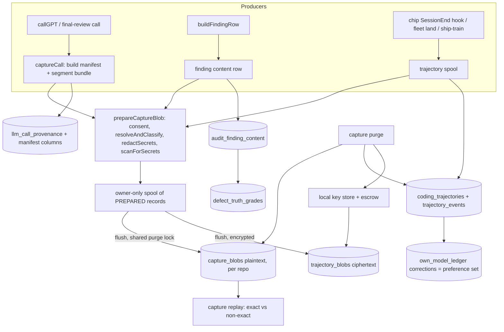

# Plan: Own-model full capture — every audit call, every finding, every chip trajectory, from day one
- **Date**: 2026-11-22
- **Status**: Draft
- **Author**: Claude + Louis
- **Scope**: backend (store, capture writers, hooks, CLIs; no UI). Stack `js-ts` + postgres.
- **Target domain(s)**: `shared-lib`, `stores` (plus `audit-orchestration`, `scripts`, `skills-content` at the call sites listed in §7)
- ⚠ **Cross-domain work**: the capture seam sits in `shared-lib`/`audit-orchestration` and hands rows to `stores` writers. The crossings are intentional and follow the existing `recordGptCall` → `recordLlmCalls` direction.
- **Depends on**: docs/plans/own-model-telemetry-pr3.md — extends its `llm_call_provenance`, coverage gate and transcript archive (shipped #312).
- **Depends on**: docs/plans/own-model-decision-ledger.md — extends `own_model_ledger` for coding trajectories and preferences (shipped #311).
- **Depends on**: docs/plans/policy-private-consumer-stores.md — its `upstreamReachable:false` declaration decides where a policy-private consumer's capture lands.
- **Source**: [own-model-roadmap-2026-10.md](../research/own-model-roadmap-2026-10.md) (its "dataset durable, model disposable" principle stands; its §7 "no transcript hoarding" is **overridden**, §0 below).

## 0. Louis's decisions (2026-11-22) — fixed inputs, not relitigated

> "if we do this let's do it properly and capture fully from the beginning. If we begin training the model we can always trim the scope into layers but the data we can never get back."

| # | Decision | What this plan does with it |
|---|---|---|
| L1 | **Full capture from day one**, no sampling; trimming happens at training time | Every audit and final-review call writes a manifest + bundle + raw output; every consented chip writes a trajectory. No sampling knob exists. "Day one" for a repo is the day Louis sets its `capture_consent` (D-CONSENT, §2.5): consent stays default-deny. |
| L2 | **Q1: both** defect truth (blind human grading) **and** Louis's preferences (overrides, handovers), **kept as separate datasets** | Two label stores with no shared table, no shared export (§3.2, §3.3). |
| L3 | **Q2: grade "as many as needed"** | Sized from the evaluation's statistics: **~2,120 grading events, ~110/week (~2 h/week, cap 150) over ~19 weeks**, paced by independent PRs (~35/week measured) rather than by grading hours (§3.2.6). |
| L4 | **Q3: full replayable bundles stored for every call**, not a sample | §2.2. |
| L5 | **Coding transcripts are captured.** This overrides the brainstorm consensus: GPT and Gemini both argued against capturing coding transcripts (privacy surface, hoarding without a defined use, low label quality) and the 2026-10 memo §7 said "no transcript hoarding". Louis decided otherwise; the counter-arguments are carried as risks (§11), not as a veto. | §4. |
| L6 | **Provider terms (2026-11-22, "Q1 yes")**: Louis checks whether training our own internal model on provider outputs is permitted. | **Gate G-TERMS**, owned by Louis. **Reviewed 2026-11-22; Louis accepted the unclear readings** ("I am ok to work with unclear and approve on that basis for now"): every reviewed source is store- and train-allowed with status `accepted-unclear`, under the §2.8 usage constraint on the trained model. The gate stays per source so any one source can be filtered out or retracted, and it is re-checked before every training run. |
| L7 | **Coding replay (2026-11-22, "q2 if possible both")**: capture BOTH the exact observations and tool outputs the model saw AND an environment manifest for re-running | §4.1: "replay what it saw" and "re-run what it did" are separate, each with its own fidelity class; where full re-execution is impossible (external services, drifted hosted model aliases) the replay is marked non-exact, said plainly. |

**Second brainstorm (GPT + Gemini, run by Louis on this plan's scope, 2026-11-22), folded in**: P0 completeness reconciliation against existing lifecycle start events (§2.9); a store / retrieve / train permissions model with fail-closed training exports (§2.8); exact as-delivered observations plus an environment manifest for coding, with failed attempts kept as evidence, not automatic negatives (§4.1); recall on the real-defect corpus plus a blind whole-PR review, and a timed worksheet pilot before slices are sized (§3.2); a separately versioned capture schema with write-time invariants (§2.10); holdout groups that span related PRs across repos (§3.2.7); and the bundle store must never become an egress path (§6).

Fixed limits (also inputs): secrets and sensitive paths are redacted at capture through the existing seams, **the one accepted loss**; consent is default-deny via `audit_repos.training_eligible`; a policy-private consumer's data never leaves its org; transcripts get separate tables, access control and a tested revocation and purge; Tier 3 egress rules apply; capture ships in **observe mode** first.

## 1. Context Summary

### 1.1 Measured gaps (re-measured 2026-11-22, store `d5a9d07b91225a93`, read-only `pg` queries; scratch script not committed)

| Gap | Brief said | Measured now | Query (abridged) | Label |
|---|---|---|---|---|
| Prompt content | 16-hex system-prompt hash only | **Confirmed.** `promptHash = sha256(system).slice(0,16)` and nothing else of the prompt; context files not stored anywhere | code read, `scripts/lib/telemetry/llm-call-log.mjs:141 (9865dc65)` | measured |
| R2+ rulings | not stored | **Correction:** ruling *rationale* IS stored per adjudication event (redacted, capped) via `outcome-sync.mjs:128,201` → `adjudication-events.mjs:293`; what is NOT stored is which rulings were *injected into which prompt* | code read | measured |
| Per-call cost | null | **0 of 4,126** calls in 7 days have `cost_usd`; `llm-call-log.mjs:147` hardcodes `costUsd: null`; `final-review-call.mjs:26-37` passes none | `count(cost_usd)` over `llm_call_provenance`, 7 d | measured |
| Findings truncation | 600 chars | `detail` only is cut (`runs-findings.mjs:641`); 40 of 3,164 findings (1.3%) in 7 d hit the cap, avg 230 chars; **`risk`, `recommendation` and the raw finding JSON are dropped for 100%** (`schemas.mjs:73-74` fields never reach `buildFindingRow`) | `count(*) filter (where length(detail_snapshot)>=600)` | measured |
| `adjudicator_kind` | 96.5% null (Oct) | **37% null in the last 30 d** (2,594 null / 4,337 `pipeline`): slice 1's writer works; the null remainder is the paths that still do not stamp | `group by adjudicator_kind`, 30 d | measured |
| `fix_commit_sha` | 3.5% filled | **0 of 10,381** findings in the last 30 d | `count(fix_commit_sha)`, 30 d | measured |
| Per-finding revert label | none | **Confirmed none.** Reverts exist only per work item (`own_model_ledger` outcome `reverted`, `scripts/lib/ledger/sweep.mjs:30-52`) | code read | measured |
| Work-item join | — | **0 of 529** audit runs in 7 d carry `work_item_id` | `count(distinct work_item_id)` over `audit_runs`, 7 d | measured |
| Decision ledger | — | **`own_model_ledger` has 0 rows ever** — shipped in #311, never fed in practice (chip launch and wrap-up have no hook; the verbs are documented, not invoked) | `select kind, count(*) from own_model_ledger` | measured |
| Consent flags | — | `training_eligible` is **NULL (undecided)** for CES, wine and ai-organiser on the NAS store; storyline's flag lives in its own Azure store (set `true` 2026-10-27 per memo §0.1) | `select name, training_eligible from audit_repos` | measured |
| Audited identity | — | `audited_sha` 524 / 529 runs (99%) in 7 d; but `audited_sha` is HEAD while `audited_tree` is the working tree (`scripts/lib/vcs.mjs:244-269`), so on a dirty tree only the tree is faithful; bake-off arms capture from `process.cwd()` | `count(audited_sha)` | measured |
| Coding | nothing captured | **Confirmed**, except the manual `scripts/transcript-archive.mjs` (local files, `~/.audit-loop/transcript-archive`) | code read | measured |

**Volume (7 d, measured):** 3,883 audit calls (avg 14,080 input tokens, p95 27,939; 841 output) over 439 runs; 243 final-review calls (avg 149,837 input, p95 415,558) over 137 runs; 91.1 M input tokens and 3.5 M output tokens in total. Daily call counts over 14 days range 62–1,244. **Chip transcripts (measured, `~/.claude/projects/**.jsonl` modified in the last 2 days):** 24 files, 574 MB raw, median 6.3 MB, p90 23 MB, max 165 MB.

### 1.2 Code Trace (all pinned to `9865dc65`)

- **What a call sends** is described in ONE place: `effectiveRequestFor` (`scripts/lib/audit/llm-helpers.mjs:248-271`) builds `requestParams` (`model`, `input`, `text.format` = Zod schema, `max_output_tokens`, `reasoning`) plus `route`; `_callGPTOnce` (`:277`) sends exactly that object. **This is the bundle seam.**
- **Content identity already exists**: `requestKeyFor` (`scripts/lib/audit/call-record.mjs`) hashes `{route, request-without-prompt, inputSha256(canonicalJson(prompt)), schemaName}`; `canonicalJson` + `sha256` are exported there. The `--resume` call records (`.audit/call-records/<auditedTree>/…`) store the result but **deliberately not the prompt** ("prompts hold source excerpts", `llm-helpers.mjs:436-443`). A replayed call returns before `recordGptCall` (`:447-453`), so it writes no provenance row today.
- **Per-call metadata**: `recordGptCall` (`llm-call-log.mjs:133-153`) → record builder (`:85-108`) → `recordLlmCalls` (`scripts/lib/store/llm-calls.mjs:41`, `ON CONFLICT (call_id) DO NOTHING`) at finalisation through the registered writer `audit.llmCalls`. Final review: `scripts/lib/telemetry/final-review-call.mjs:26-37`.
- **Pricing**: `costFromUsage` (`scripts/lib/model-pricing.mjs:392`), `PRICING_VERSION` (`:147`); already used per run by `usage-event.mjs:118` and `cost-budget.mjs:58,108`.
- **Findings**: `buildFindingRow` (`scripts/lib/store/runs-findings.mjs:627-680`) persists the listed columns and slices `detail` at `:641`.
- **Adjudication**: `adjudicator_kind` writers at `adjudication-events.mjs:130,297`, `campaign.mjs:1286,1379`, `outcome-sync.mjs:199`, `final-review/reviewer-events.mjs:192`. `fix_commit_sha` writers at `finding-disposition.mjs:87`, `runs-findings.mjs:1497`, `learning-decisions.mjs:220`.
- **Egress seams**: `classifyPath` / `resolveAndClassify` (`scripts/lib/sensitive-paths.mjs:187,241`), `redactSecrets` + `scanForSecrets` (`scripts/lib/secret-patterns.mjs:230`), `assertEgressSafe` (`scripts/lib/sensitive-egress-gate.mjs:296`). **The capture precedent** is `prepareDiffArtifact` (`scripts/lib/audit/diff-capture.mjs:24-75`): classify → redact → scan → refuse if a secret survives. Free text: `redactAndCapText` (`scripts/lib/store/capture-identity.mjs:72`).
- **Content-addressed storage** exists twice: `audit_run_diffs(diff_ref sha256 PK, diff_text, bytes)` (migration `20261026120000_own_model_telemetry_slice1.sql:40-50`, **global, not per repo**) and the local per-repo transcript blobs (`scripts/lib/telemetry/transcript-archive.mjs:14-16`).
- **Consent**: `audit_repos.training_eligible` (three-valued, default-deny), `training_eligibility_events` lineage, readers `assertTrainingEligible` / `checkReposEligibleForExport` (`scripts/lib/store/training-eligibility.mjs:25,50`).
- **Fleet / chip hooks**: `recordFleetDecision` (`scripts/fleet.mjs:174`, refusals only), `recordTrainLandings` (`scripts/ship-train.mjs:279` → `scripts/lib/fleet/ledger-hook.mjs:104,129`), `fleet land` (`scripts/lib/fleet/land.mjs:70`), spawn (`scripts/lib/fleet/lease-spawn.mjs:67`), wind-down (`scripts/lib/fleet/handover-winddown-cmd.mjs:31`). **No chip launch or wrap-up hook exists**; `.claude/settings.json` SessionStart only installs dependencies.
- **Evaluation assets**: known-defect corpus `docs/experiments/audit-effectiveness/known-defects.json` (v4) with `scripts/lib/model-eval/known-defect-corpus.mjs`; expect-clean adjudications `docs/experiments/audit-effectiveness/expect-clean-adjudication-v2-2026-11-20.{md,json}` with `scripts/lib/model-eval/expect-clean-adjudication.mjs`. **The step-back replay harness is NOT on main**: it is planned in `docs/plans/verification-lessons.md` §2.4 (`docs/research/step-back-replay-2026-11.md` "planned", line ~340), being built by a sibling session. This plan consumes its round-signal contract, it does not build one.

### 1.3 Neighbourhood considered (architectural memory, k=8)

All eight neighbours band `review` (below this repo's noise floor) — nearest are `persistKeptEmbeddings`, `applyRecordTimeSuppression`, `recordPassStats` in `runs-findings.mjs`. The real precedents are named by the code trace above (`effectiveRequestFor`, `requestKeyFor`, `prepareDiffArtifact`, `recordLlmCalls`, `own_model_ledger`, `transcript-archive`) and are **extended**, not duplicated.

### 1.4 Security incident neighbourhood

INC-001 (`manual-verification-required`): the lexical classifier missed symlinks resolving into sensitive locations. **Every capture path in this plan classifies with `resolveAndClassify` (realpath), never `classifyPath` alone**, and a resolution failure is `sensitive` (fail closed). See §6 Security Considerations.

## 2. Proposed Architecture

### 2.1 Two datasets, two label sets, one storage layer

- **Dataset A — audit role**: call manifests + bundles + raw outputs (§2.2), untruncated findings with typed provenance (§2.3), evidence links (§3.1).
- **Dataset B — coding**: chip trajectories (§4).
- **Label set DT — defect truth**: blind human grades (§3.2). Never derived from dispositions.
- **Label set PF — preferences**: Louis's overrides and handovers (§3.3). Never mixed with DT, never used as a validity label.
- **One storage layer** for all content: one blob module with two tables — `capture_blobs` (plaintext-redacted) and `trajectory_blobs` (encrypted transcripts) (§2.4) — and one preparation pipeline for every byte (`prepareCaptureBlob` / `prepareCaptureText`, §2.5), generalising `prepareDiffArtifact`, so redaction and consent are decided in one place (#1 DRY, #5 single source of truth).

### 2.2 Audit-call capture: manifest + bundle + raw output for every call

**Manifest** — extend `llm_call_provenance` (one row per call already; `call_id` identity already replay-safe), not a new table (#1, #18). New columns:

| Column | Content |
|---|---|
| `request_key` | `requestKeyFor(...)` from `call-record.mjs` — the existing content identity of the logical request (reused, not re-invented) |
| `audit_session_id`, `audit_round`, `pass_name` | joins to rounds and passes |
| `audited_tree`, `audited_sha`, `diff_base_sha` | tree identity at call time (copied from the run; see P0 fidelity fix) |
| `settings` jsonb | resolved model id, route `{transport, endpoint-class, deployment}` (never a key or full URL), `max_output_tokens`, reasoning effort, temperature when set, schema name + `schema_sha256` (of `z.toJSONSchema`) |
| `prompt_template_id`, `prompt_template_version` | the pass prompt identity: `prompt_revisions` id where the pass prompt comes from the learning store, else sha256 of the template source |
| `context_refs` jsonb | **ordered** list `[{ord, kind: file|diff|ruling|ledger|plan|rubric|other, ref (repo-relative path or id), blob_sha256, bytes, truncated, redactions, sensitive_omitted}]` |
| `ruling_ids` text[] (`pgArray`) | ids of the R2+ rulings injected into this prompt (from the rulings block builder) |
| `bundle_sha256`, `bundle_segments` jsonb | the request-as-sent, as an ordered segment recipe (below) |
| `output_sha256`, `attempt_outcome`, `capture_state` | raw response body blob; the provider-attempt outcome and the capture lifecycle state — two separate closed vocabularies with a transition table (§2.9) |
| `capture_redacted`, `capture_state` | capture-side redaction happened; `captured` / `structure-only` (consent) / `refused-secret` / `lost` |
| `replay_class` | `exact` or `non-exact`, with `replay_reasons` text[] (§2.7) |
| `cost_usd`, `pricing_version` | from `costFromUsage` + `PRICING_VERSION` at record time (P0) |
| `replayed_from_call_id` | set when `--resume` replayed a stored result, so a replay is a row pointing at the original, not a missing row |
| `transport_family`, `sdk`, `schema_blob_sha256` | which request shape was sent (table below), `name@version` of the SDK, and the SDK-format schema as sent |
| `capture_reasons` text[] | why a manifest is partial (`context-unattributed`, `structure-only`, …), separate from `replay_reasons` |

Existing columns (`model_resolved`, `route`, tokens, `latency_ms`, `truncated`, `retried`, `fallback`, `prompt_hash`) keep their meaning; `prompt_hash` stays for backward compatibility and is now derivable from the bundle.

**Bundle = exactly the request object our code handed the SDK**, after egress redaction (the model saw the egress-redacted text, so that is the truth to store), recorded per **transport family** because the object differs by path:

| Family | Request object stored | Exactness ceiling |
|---|---|---|
| `openai-responses` | `requestParams` from `effectiveRequestFor` + `route` | `exact` possible |
| `openai-chat-fallback` | the `params` object `parseStructured` builds for `chat.completions.parse` (`llm-helpers.mjs:208-215`) — the fallback is decided mid-run, so the family is recorded per call, never assumed | `exact` possible |
| `gemini` | the request body `final-review-call.mjs` hands the Gemini client | `exact` possible |
| `anthropic-sdk` | the Messages request object | `exact` possible |
| `anthropic-cli` | the prompt and flags passed to `claude -p` | **always `non-exact`** (`cli-hidden-prefix`: the CLI adds a ~164K-token prefix we do not see) |

**Payload and route are stored apart**: `provider_payload` is exactly the object handed to the SDK method (for `openai-responses`, `requestParams`; no route inside it), and `route` (transport, endpoint class, deployment, api version) is separate manifest metadata. The SDK's own wire serialisation is outside our code, so `exact` is defined at the payload boundary plus the SDK identity: the manifest records `sdk = name@version` and the Zod-derived schema as the SDK receives it (`zodTextFormat(...)` / `zodResponseFormat(...)` output, stored as its own blob, so a historical schema is reproducible after the Zod source changes). **Proof, per family, in P1**: an instrumented `fetch` captures the outbound request; (a) its JSON body must equal `projectToWire(family, sdkVersion, provider_payload)`, a pinned, documented projection (identity plus whatever fields that SDK version adds or renames, e.g. the Zod format object's serialised form), and (b) separately, the request URL's host, path and deployment must match `route`. A family/SDK version without both passing tests is recorded `non-exact` with reason `family-unverified`.

It is stored as an **ordered segment recipe**: the canonical-JSON skeleton with each prompt content string replaced by a placeholder is one blob, and each content string is its own blob. Context files repeated across five passes and several rounds therefore dedupe to one blob each (the size win in §5). **Exactness is verified at write**: the writer reassembles the recipe and checks `sha256(reassembled) == sha256(canonicalJson(requestObject))` computed from the live object; on mismatch it stores the whole object as one blob and marks `replay_reasons += 'segmentation-fallback'` (counted, never silent).

**Raw output**: the response body before Zod parsing, plus failed and truncated calls — negatives are training data too. Source per path: the Responses result's `output` items as returned, and on the chat fallback the `choice.message.content` text `parseStructured` already surfaces (`llm-helpers.mjs:193-238`). A schema-reject or truncation throws an `LlmError`; P1 attaches the raw text to it (`err.rawOutput`, bounded by the same output cap) so the error path can capture it. A call that errors with no body records the error class and usage only (`output_state = 'error'`).

**The raw-output boundary is before SDK parsing**, because `responses.parse` / `chat.completions.parse` can throw on a malformed structured output before our code sees any text. `createOpenAIClient` (`scripts/lib/openai-client.mjs`, the one construction seam) passes the SDK a `fetch` wrapper that clones each response and **streams** its body (no in-memory cap) into an **ephemeral encrypted staging file** (AES-256-GCM under a random per-process key that exists only in memory and is never written anywhere; owner-only file in the spool directory), keyed by the call id held in an `AsyncLocalStorage` context that `callGPT` opens around the attempt. Nothing is truncated: response size is already bounded by each call's `max_output_tokens`; a hard safety limit of 64 MB per response (far above any configured output cap) exists only to protect the disk, and reaching it marks the attempt `capture_failed` with reason `oversize` (counted, never a silent cut). The capture step decrypts, prepares (§2.5) and deletes the staging file on every terminal path (success, error, oversize, cancel) inside a `finally`; only the prepared result reaches the spool line. A crash leaves a staging file whose key died with the process: it is undecryptable by construction, and `capture flush` deletes such files and counts `raw-lost-crash` against that attempt. Consent and the purge barrier are re-checked at prepare, so a revocation during the call applies before anything durable is written. Tests: crash mid-stream, oversize, parse failure, and revocation during the call. With that, the capture step has the full pre-parse body on success AND on error, so every schema-reject, truncation and parse throw has its pre-parse payload. The same wrapper pattern goes on the Anthropic client seam (`createAnthropicClient`) and on the Gemini client where its SDK accepts a custom fetch; a family whose SDK does not is recorded `raw-output-unavailable` on parse failures (counted), never silently empty. The wrapper never alters the response the SDK receives (it reads a clone) and its failures are swallowed into a counter.

**One identity per physical request.** An SDK may retry inside one invocation (its own `maxRetries`), so one application attempt (`call_id`) can send several HTTP requests. SDK retry behaviour is left as it is, and the fetch wrapper itself owns physical identity: every `fetch` it sees mints an `http_attempt_id` linked to the `call_id` in the `AsyncLocalStorage` context (logical call → application attempt → HTTP attempts). Staging files are keyed by `http_attempt_id`, never by `call_id`, so two responses within one SDK invocation never share a file. Each HTTP attempt gets its own spool sub-record `{http_attempt_id, status, retry_after, staged}`, and only the HTTP attempt whose response the SDK returned (the last) is promoted as the attempt's raw output. Earlier ones are kept as structure (status, timing) and their staging files are deleted in the same `finally`. Each transport family's row in the family table declares its retry owner (SDK, application or both). A family whose SDK bypasses the custom fetch on retry is `family-unverified` until a test shows otherwise. Test: through the real SDK with a stub transport, a 429 followed by a 200 yields one `call_id`, two `http_attempt_id`s, one promoted output and no leftover staging file.

**Store rights are an input to preparation, decided before any content-bearing write.** `prepareCaptureBlob` / `prepareCaptureText` take the record's computed **store right**: consent (§2.5), purge barrier and the source's `.capture-agreements.json` entry (§2.8). Neither the attempt line nor a staging file holds content unless that right is `granted`:
- **Known before send and not granted** (an `azure-tenant:*` deployment, a source with no reviewed entry, a non-consenting repo): the attempt line is structure only and the tee stages nothing.
- **A source whose right is known only from the response.** OpenRouter's routed backend is known only once the response arrives. Under the 2026-11-22 decision every OpenRouter backend is `accepted-unclear` (store and train allowed), so its content is stored like any other source, and the backend is recorded from the response (`service_tier = openrouter:<backend>`, or `openrouter:unknown` when the response does not name one). The mechanism stays in place for any future source, or a retracted backend, whose right depends on the response. For such a call the attempt line is structure only, and the request and response are staged **only** in the ephemeral encrypted staging. They are promoted if the response resolves to a granted source; otherwise the staging file is deleted unread and the result line is structure only. A later grant never authorises content already discarded.
- Tests at the spool level: a granted OpenRouter backend, an `openrouter:unknown` backend, a backend marked `retracted` in a fixture agreements file, and an Azure deployment each leave exactly the expected bytes on disk, checked by scanning the spool and staging directories after the call.

**Where context references and ruling ids come from (producer → manifest interface).** Pass prompts are assembled by `buildCachePrompt` → `buildAuditPassPrompt` (`llm-helpers.mjs:99-118`) from named segments: system rubric + focus, project brief, plan slice, file-list context, requirements rubric, code, history (CLI history + `buildRulingsBlock`, `scripts/lib/ledger.mjs:852`), round modifier. P1 makes the builder also return `contextRefs` (one entry per segment and, inside `code`, per file it concatenated) and `rulingIds` (`buildRulingsBlock` returns the ids it rendered alongside the text). **Each ref carries its exact span** `{message_index, start, end}` (character offsets in the content string it was concatenated into, recorded by the builder as it appends — nested file refs inside `code` included), and at write the capture step verifies `sha256(content.slice(start, end)) == ref.blob_sha256` for every ref; any mismatch sets `context_refs_verified = false` for the call (counted). The bundle's segment recipe splits content strings at these spans, so a ruling or ledger segment is its own placeholder even when the prompt was one string. The caller passes them as `opts.capture = {contextRefs, rulingIds, promptTemplate}` to `callGPT`. The plan audit's own prompt (`scripts/openai-audit.mjs:994-1049`) and the map-reduce scheduler (`scripts/lib/audit/map-reduce-scheduler.mjs:245`) pass the same object. A call without `opts.capture` still gets a full bundle (exactness does not depend on the refs) and records `context_refs = null` with `capture_reasons += 'context-unattributed'`; the census below counts those sites so they get fixed rather than tolerated.

**Finding ↔ call (many-to-many).** One finding can be emitted by several calls (passes, rounds, map-reduce units, retries), and semantic dedup merges re-raises. So provenance is a table, not a column: `finding_occurrences(finding_id, call_id, ordinal_in_output, raw_json_sha256, round, pass_name)`. At parse, each raw finding object becomes an **immutable occurrence record** `{callId, ordinal, rawJsonSha256, round, pass}` (the call id is minted before the request, so it exists on every path; the raw object's blob is prepared then) attached to the finding as `_occurrences: [...]`. Every dedup, merge and semantic-suppress path **concatenates** the arrays of the findings it merges and never drops or rewrites an entry; a suppressed re-raise keeps its occurrence on the canonical finding. `buildFindingRow`'s writer inserts one row per occurrence in the same transaction as the finding. `audit_finding_content.raised_by_call_id` is the FIRST occurrence (a convenience join), never the only one. A `--resume` replay mints a new call row with `replayed_from_call_id` and its occurrences point at the new row.

**Seams and durability.** The hot path must never throw or block the audit, AND a crash or kill must lose at most the call in flight, so capture is NOT an in-memory buffer:
- **Attempt line before send**: just before `_callGPTOnce` sends, the capture step prepares the request bundle (`prepareCaptureBlob` on each segment: hashing + redaction scan of a ~60 KB average request, milliseconds) and appends an `attempt` line `{call_id, run_id, producer, process_nonce, seq, attempted_at, manifest-without-output, prepared segments}` to a per-process spool file (`<spool>/calls/<process_nonce>.jsonl`, owner-only, flushed per write). **Result line after**: on return (success, error or replay) a `result` line `{call_id, output_state, prepared raw output, usage, cost, occurrences}` is appended. All inside try/catch; a failure increments `capture_failed` and continues.
- **Parents exist first, by construction**: the audit's `audit_runs` row is created by `recordRunStart` (`scripts/lib/store/runs-findings.mjs:255`) before any pass runs, and the call log is bound to it right after (`bindRun`, PR3 decision 4), so every attempt line carries a real `run_id`. When cloud was off at run start there is no run row: the lines carry the local identity (`audit_session_id`, round, nonce) and the drain parks them as `orphan-run` (reported, retried on the next drain once a run row with that identity exists), never inventing a parent.
- **One writer per row.** P1 makes `audit.callBundles` the **only** writer of `llm_call_provenance` rows for both producers: `recordGptCall` and `final-review-call.mjs` stop buffering their own metadata row and instead contribute their fields to the attempt/result lines (PR3's `audit.llmCalls` writer keeps writing only the `llm_call_log_summary` row until it is folded in, so no two writers race on a call row). **Merge contract**: the row is upserted from whatever lines are present, `ON CONFLICT (call_id) DO UPDATE SET col = COALESCE(llm_call_provenance.col, EXCLUDED.col)` per column; for the identity columns (`run_id`, `request_key`, `bundle_sha256`, `producer`, `seq`) a non-NULL existing value that differs from the incoming one **refuses that call's batch entry** and counts `conflict` (never a silent overwrite, never a silent keep). Tested in both line orders, with a duplicate drain and with a deliberately conflicting duplicate.
- **Drain order**: per batch, in one transaction: blobs + refs → the provenance row (merge contract) → occurrences (only when their finding row exists; otherwise kept in `pending_occurrences(run_id, finding_fingerprint, occurrence)` and attached when the finding is written, or counted `orphan-occurrence`). Re-draining the same file is a no-op.
- **Attempt state machine** (on `capture_state`, §2.9 table): `attempted` → (`captured` | `structure_only` | `capture_failed`) from a result line; or → **`interrupted` (provisional)**, assigned only when a drain proves the producer dead. Each producing process holds `<spool>/calls/<process_nonce>.lock` (pid + start time, refreshed every 60 s); `capture flush` drains another process's file only when that pid is gone or the lock is older than 30 minutes, and the finalisation writer drains only its own. A later result line for an `interrupted` call **always supersedes it** (the result UPDATE matches `capture_state IN ('attempted','interrupted')`). Tested: drain between attempt and result, then the result arrives, then a second drain → the row ends `captured`.
- **Accounting, with its blind spot stated**: every attempt takes the next **contiguous per-process `seq`** before anything is written. If preparing or appending the attempt line fails, a minimal `attempt-failed` line `{call_id, seq, error_class}` is appended to a second file (`<nonce>.failures`); if that also fails, the seq is simply missing and shows as a gap. **Independent inventory**: at process start, before the first call, the capture module writes `<nonce>.start` `{run_id, pid, producer, started_at}` and registers the nonce in the run's `llm_call_log_summary` row when the store is reachable; PR3's in-memory call counter is still flushed at finalisation as a second, independent count. Reconciliation (`capture status`, crash recovery and the P1 gate use the same formula): per process, `observed = captured + structure_only + interrupted + capture_failed + gaps`, compared with the finalisation counter when one exists. **What cannot be observed is reported `unmeasured`, never as zero loss**: a killed process's final attempt whose two appends both failed (no seq can reveal it, so every killed process carries one `tail-unmeasured` flag), and a run whose start file and summary registration both failed (the run row exists with no process → `process-unmeasured`). Negative controls: break the last append of a run and delete a whole process spool; both must surface as `unmeasured`.
- **Call families** (P1 census, `npm run capture:census:gate`, derived from the filesystem like `db:enrolment:gate`): every call site of `callGPT`, `createOpenAIClient`, `createAnthropicClient`, the Gemini client and `embedText` is classified `captured` or `declared-out` with a reason in `.capture-families.json`. Captured in P1: GPT audit passes, plan audit, map-reduce units, rebuttal/deliberation, verify-findings (`scripts/verify-findings.mjs:196`), tiered Stage 0/1/2 calls, Gemini final review, the Claude final-review fallback. Declared out (not the audit role): brainstorm, symbol summarisation, embeddings, arm-eval/model-eval harness calls (they already store their own records). A new call site fails the gate until classified.

### 2.3 Untruncated findings and typed provenance

New table `audit_finding_content` (1:1 with `audit_findings.id`; `detail_snapshot` keeps its 600-char contract for every existing reader):
- `finding_id` PK, `repo_id`, `raw_json_sha256` (the model's finding object as emitted, in `capture_blobs`), `detail_full`, `risk`, `recommendation`, `evidence` jsonb (as emitted), `content_state`, `redactions`.
- **The inline text columns are sanitised by the same contract as blobs (§2.5)**: every string field (`detail_full`, `risk`, `recommendation`, every string leaf of `evidence`, and `primary_file` / any path) goes through `prepareCaptureText` before the row is built; a path field that classifies sensitive is replaced by `[redacted:<sha256-hex8>]`; a field with a surviving secret is stored NULL with `content_state = 'field-refused'` and its name listed in `redactions`. Nothing reaches the row or the spool unsanitised.
- **Typed provenance**: `raised_by_call_id` (→ `llm_call_provenance.call_id`), `pass_name`, `audit_round`, `source_model`, `prompt_template_version`, `producer` (`audit|final-review|linter|reviewer`).
- **Four axes kept apart** (never one column standing for another, memo §3 objective hygiene): **validity** lives ONLY in `defect_truth_grades` (§3.2); **severity** is three values with their own provenance — `severity_model` (as emitted), `severity_adjudicated` (from `verdict_severity`/adjudication events), `severity_graded` (DT); **disposition** is the workflow state in `finding_adjudication_events` (append-only, `finding_label_history` view); **remediation** is `remediation_state` + the evidence links (§3.1). A view `finding_axes` joins them for readers; nothing collapses them at write.

### 2.4 Storage: `capture_blobs`, content-addressed, per repo

- **Two blob tables, never one**, so a plaintext consumer can never be handed ciphertext and a transcript can never be stored in the clear by a dedup hit:
  - `capture_blobs(repo_id uuid, sha256 text, bytes int, stored_bytes int, compression text CHECK ('gzip'), redaction_version int, created_at, content bytea, PRIMARY KEY (repo_id, sha256))` — **plaintext-redacted** content only (bundle segments, outputs, finding raw JSON, schemas, context, commit diffs, test logs). The class of a use lives on the referencing row, not the blob (identical bytes are one blob whatever refers to them).
  - `trajectory_blobs(repo_id uuid, key_id text, sha256 text, nonce bytea, auth_tag bytea, stored_bytes int, created_at, ciphertext bytea, PRIMARY KEY (repo_id, key_id, sha256))` — **only** transcript content, AES-256-GCM, address = sha256 of the redacted plaintext inside one key's namespace (a key rotation starts a new namespace; nothing is shared across keys).
  - The `ON CONFLICT` path of each writer re-reads the existing row and asserts `compression` (or `key_id`) and `bytes` match; a mismatch is a refused write, counted, never a silent reuse.
- **Address = sha256 of the redacted, uncompressed bytes**; namespaced by `repo_id` so purging one repo can never delete another repo's blob (the lesson the transcript archive already encodes; `audit_run_diffs` is global and is left as-is, §11).
- **Reference tracking** (shipped with the first content write, P1), **one ref table per blob table** so a reference always names one stored representation: `capture_blob_refs(repo_id, sha256, owner_kind CHECK ('call','finding','evidence','trajectory-env','scripted-step'), owner_id, PRIMARY KEY (repo_id, sha256, owner_kind, owner_id), FOREIGN KEY (repo_id, sha256) REFERENCES capture_blobs)` and `trajectory_blob_refs(repo_id, key_id, sha256, owner_kind CHECK ('trajectory-event','scripted-step'), owner_id, PRIMARY KEY (...), FOREIGN KEY (repo_id, key_id, sha256) REFERENCES trajectory_blobs)`. The scripted-step owner is a persisted row, `scripted_steps(id, repo_id, invocation_id UNIQUE, step_name, content_class, session_id NULL, trajectory_id NULL REFERENCES trajectories, run_id NULL REFERENCES audit_runs, key_id NULL, capture_schema_version, ...)`, CHECKed so that `content_class = 'instruction'` has a `key_id` and `'artifact'` does not. Its refs go to `capture_blob_refs` (artifact class) or `trajectory_blob_refs` (instruction class, or any step with a `trajectory_id`, under that trajectory's key or its own per-invocation key). Every writer inserts the ref in the same transaction as the blob; a blob is deletable only when its own table's refs are empty. Tested: identical plaintext stored in both tables and under two trajectory keys, each owner purged independently.
- **Where — store routing, fail closed**: audit-call and finding capture rows are written **in the same store and the same flush as the `audit_runs` row they hang off** (they carry its `run_id`), so they can only land where the audit itself was recorded. Trajectories resolve the repo's own DSN through the existing store resolution (the repo's `.env` → `AUDIT_DB_URL`); an **empty DSN is the air-gap signal** (`airGapDbUrl`) and means spool-only, reported, never a fall-through to `~/.audit-loop.env`; a resolved store whose `audit_repos` has no row for the repo refuses (no auto-registration from capture). **A repo row in a store does not authorise that store**, so policy-private repos carry a binding: a repo declared `upstreamReachable:false` MUST have `CAPTURE_STORE_FINGERPRINT` (the expected `storeFingerprint`) in its own private config (its `.env`, gitignored), and before ANY content write or spool drain the writer compares it with the fingerprint of the store it actually resolved; absent or mismatched → refuse (records stay in the local spool, reported `store-binding-mismatch`). Other repos may set the binding too and get the same check. Every capture row stamps `store_fingerprint` (from `storeDescriptor`); `capture verify` fails on a row whose fingerprint is not the store it sits in. The NAS store holds CES, wine and ai-organiser; storyline's own Azure store holds storyline; a policy-private consumer's own store holds its data.
- Postgres `bytea` (TOASTed) is chosen over a filesystem or S3 bucket because purge, consent and the manifest then live in **one transaction** in **one place that already crosses no org boundary**, and the measured volume (§5) is small enough. The blob I/O sits behind two functions (`putBlobs`, `getBlob`) per table in one module, so moving bytes to object storage later changes one adapter file (#20). **Trigger to move**: blob tables > 50 GB on a store, or that host's disk under 30% free.
- **Write path**: prepared records (§2.5) → `putBlobs` + refs + owner rows in one transaction per batch, under the shared purge advisory lock (§2.6); cloud off or store error → the record stays in the spool for `capture flush`.

### 2.5 One preparation contract, applied before any durable write (spool included)

`prepareCaptureBlob(bytes, provenance)` / `prepareCaptureText(string, provenance)` in `scripts/lib/capture/prepare.mjs` are the only way content reaches a spool or a table. **They run at capture time, not at flush**, so the spool never holds unprepared content. Order: consent → provenance classification → secret redaction → scan → refuse-or-keep.

1. **Consent — storing and training are two decisions, both default-deny.** New `audit_repos.capture_consent` (three-valued like `training_eligible`, with the same append-only `training_eligibility_events`-style lineage) governs **store** and **retrieve**; `training_eligible` governs **train** only. Read through the ledger's local eligibility cache (24 h, `unknown` when stale — the #311 rule). `capture_consent = true` → content; **`null` (undecided), `false` or `unknown` → structure only** (ids, hashes, counts, timings, terminal states; no content at all). So nothing is stored as content for a repo until its `capture_consent` is set (D-CONSENT, a **P1 prerequisite**, §13 — decided 2026-11-22: `true` for CES, wine-cellar-app, ai-organiser and storyline; `training_eligible = true` for the same four, D-TRAIN; every other repo stays default-deny); the day it is set, full capture starts (L1). Re-checked at flush against the store's current flags and the purge barrier generation: a record whose repo is no longer `true`, or whose generation is below its scope's barrier, is stripped to structure (or dropped under a barrier) before insert. Tested across every state (`true`/`null`/`false`/`unknown`) at capture, spool, flush and revocation.
2. **Provenance classification, fail closed.** A string is kept only when its sources are proven safe; otherwise it is redacted. *Known single path* (a context file, a `Read`/`Edit` result): `resolveAndClassify`; sensitive, escaped-repo or resolution failure (including a deleted path) ⇒ replaced by `[REDACTED:sensitive-path:<sha256-hex8>]`. *Tools that report the files they touched* (`Grep`, `Glob`): every path in the RESULT is classified (that is the authoritative accessed-file set), and any sensitive or unresolvable one ⇒ redact the whole result. *`Bash`*: the source set is not provable from the command, so its output is kept only when ALL hold — every path-like token in the command and in the output classifies safe; the command is not a recursive or glob read (`-r`/`-R`, `rg`, `find … -exec`, `**`, `xargs cat`) over a directory that contains any sensitive-classified file; it is not on the closed environment-dump list (`env`, `printenv`, `set`, `export -p`, `Get-ChildItem env:`, `cat`/`type` of any `.env*`) — else the whole output is redacted. **Sensitive-content fingerprint, for every string including unattributed text** (model output, user messages, finding fields): at capture the module builds a per-repo index of normalised line hashes (lines ≥ 8 characters) of the repo's sensitive-classified files (`.env*`, key files, anything `classifyPath` flags inside the working tree; never their content stored); any string containing an indexed line has that line replaced by `[REDACTED:sensitive-content:<hex8>]`. This catches non-secret sensitive content echoed through model or user text, which secret patterns alone do not. Filenames in any field are classified like paths.
3. **Secrets**: `redactSecrets` (`secret-patterns.mjs`) on every string, then `scanForSecrets`; a surviving high-confidence hit refuses that string (field NULL / event structure-only / blob not written), counted per producer. A pipeline exception refuses (fail closed, INC-001 posture), never passes through.
4. **Spool hygiene**: spool root `~/.audit-loop/capture-spool/` (outside every repo), created owner-only (`0700`; on Windows an ACL limited to the current user, verified by `capture status`); transcript records in the spool are encrypted with the repo's data key before they touch disk (§4); files are written temp+rename; anything older than 14 days is deleted and counted as `lost-expired`.

### 2.6 Purge and revocation ship with the first content write (P1)

`capture purge --repo | --work-item | --session | --finding | --call | --scripted-step` (one `cross-skill.mjs` verb, event JSON on stdin). Scope cascade for scripted steps: `--repo` takes every step; `--session` and `--work-item` take the steps whose `session_id` or `trajectory_id` falls in scope; `--call` takes the steps bound to that call's run; `--scripted-step <invocation_id>` takes one. A step's rows, refs, unshared blobs and (instruction class) its own key go in the same transaction and key step as its owner:
- **A recoverable, write-ahead protocol** (each step idempotent, keyed by a client-minted `purge_id`): **(1) intent** — append `{purge_id, scope, requested_at}` to the out-of-band purge log `~/.audit-loop/capture-purge-log.jsonl` AND to its escrow copy (D-BACKUP), fsynced, **before anything is destroyed**; a purge whose intent cannot be written to both refuses. The escrow copy counts as durable only once `capture escrow verify` confirms it remotely (§5); until then the purge proceeds but stays `escrow: pending-remote`. **(2) database** — one transaction: take the exclusive purge advisory lock (writers hold it shared, the #311 pattern, so no flush is mid-batch), draw a barrier generation, upsert `own_model_purge_barrier`, delete the owner rows in scope and their `capture_blob_refs`, delete blobs left with **zero refs** (a blob still referenced by another work item in the same repo stays), insert `capture_purge_log(purge_id, generation)` and advance the store's `capture_purge_watermark` to this `purge_id`. **(3) keys** — delete the scope's wrapped keys from the local key store and, through the fenced `capture escrow update` (§5: one writer, generation check, tombstones), from each escrow location, recording a per-location receipt that is `pending-remote` until verified. **(4) spool** — for every spool file, take that file's lock (a live producer's append waits and retries; producers re-check the barrier generation after taking the lock), rewrite the file without the scope's lines (temp + rename), leaving every other scope's lines intact. **(5) completion** — append `{purge_id, completed_at, receipts}` to both logs. `capture purge --resume` completes every intent that has no completion record, from whichever step it reached; `capture status` lists incomplete purges. Receipt `{rowsDeleted, refsDeleted, blobsDeleted, blobsRetainedShared, spoolLinesRemoved, keysDestroyed, generation}`.
- **Restore gate**: a restored database knows only the purges up to its own `capture_purge_watermark`. After any restore, before the store is used, `capture purge --replay-log` must read the out-of-band log (or its escrow copy) **through its latest record**, re-apply every intent after the watermark (steps 2–5), and record the new watermark; if neither log copy is reachable, the restore gate fails and every export, replay and dataset build refuses (`restore-unreconciled`), so a restore can never silently resurrect purged content. Tests crash the protocol after each of steps 1–5, fail one escrow location, append concurrently from a live producer, and restore a pre-purge backup.
- Revocation = `training-eligibility set --eligible false` then `capture purge --repo`. Transcripts additionally lose their key (§4), so even an un-reconciled backup cannot reveal them.

### 2.7 Replay keeps exact and non-exact apart

`npm run capture:replay -- --call <id> | --run <id> [--model <sentinel>]` (a pinned-revision, spend-bearing job → runs through `fixture:create`, AGENTS.md):
- **`exact`** = the stored recipe reassembles to the recorded `bundle_sha256`, no capture-side redaction changed it, no segment fell back, the schema hash matches a schema available at the pinned revision, and the model id is still served. Replaying an exact bundle re-sends byte-identical input (outputs still vary: provider non-determinism is reported as output variance, never as a fidelity reason).
- **`non-exact`** = anything else, with closed reasons: `capture-redacted`, `segmentation-fallback`, `structure-only`, `model-retired`, `schema-unavailable`, `context-blob-missing`, `family-unverified`, `cli-hidden-prefix`, `purged`, `pre-capture` (rows before P1).
- **Every replay report prints the two classes as separate populations**; a combined figure is refused by the report builder (the "unmeasured round must not wear a clean round's clothes" rule). Swapping the model (`--model`) is a third, labelled kind: `exact-input, different-model`.

### 2.8 Permissions: store, retrieve and train are separate rights

Repo consent (`training_eligible`) is necessary, not sufficient. Every captured record (call, finding content, trajectory event) carries three rights, each `granted | denied | unresolved:<reason>`:
- **store** — may be kept at all (`audit_repos.capture_consent = true` + the §2.5 contract; a refused secret is `denied`);
- **retrieve** — may be read back for replay, evaluation, retrieval few-shot or a comparison-provider send;
- **train** — may enter a training export (`training_eligible = true`, the source's G-TERMS entry `allowed` or `accepted-unclear` and not stale, the usage constraint recorded on the export, no third-party content).

Recorded **per call at capture**: `provider`, `service_tier` (native API, Azure tenant deployment, OpenRouter backend, CLI subscription), and `agreement_version` — a key into the committed `.capture-agreements.json`, which lists each provider + tier with the terms version and date it was read, and its status (`allowed`, `accepted-unclear`, `denied`, `retracted`; a source with no entry is treated as `denied`; §2.8 table). **Rights are recomputed at dataset build** from the current agreements file, consent flags and purge log, never trusted from the stored value; the stored value is the capture-time snapshot for audit.

Rules (all fail closed):
- **Gate G-TERMS (L6), per source.** The unit of the gate is the **source** of each record, recorded per call at capture together with the routed backend. A training export filters by source, refuses any in-scope record whose source entry is not `allowed` or `accepted-unclear` (or is stale, below), and names the records and reasons. Any one source can be filtered out of an export, or retracted (entry status `retracted`: its records become `train = denied:provider-terms` and, if Louis says so, are purged by source) without touching the rest. Changing an entry is a committed edit to `.capture-agreements.json` with who, when and the terms version read.
  - **Louis's decision, 2026-11-22.** He reviewed the terms (his readings below) and then decided, verbatim: "I am ok to work with unclear and approve on that basis for now". So every source in his review is **store-allowed and train-allowed, status `accepted-unclear`, dated 2026-11-22**. This replaces the conservative reading in the earlier draft of this revision, under which provider outputs were stored but never trained and OpenRouter content was not stored.

  | Source (`.capture-agreements.json` key) | Louis's reading, 2026-11-22 | Status | store | train |
  |---|---|---|---|---|
  | `openai-api` (paid API) | store allowed; fine-tune unclear, forbidden if the model is an alternative or substitute outside an exception | `accepted-unclear` | content | allowed |
  | `gemini-api` (paid Gemini API) | store allowed, subject to the permitted-use purpose; fine-tune unclear, forbidden if competing | `accepted-unclear` | content | allowed |
  | `anthropic-cli-subscription` (`CLAUDE_BACKEND=cli`, Claude subscription login) | ordinary retention allowed; fine-tune unclear, forbidden if competing, with additional automated-harvesting restrictions | `accepted-unclear` | content | allowed |
  | `anthropic-api` (an actual Anthropic API key) | store allowed; fine-tune unclear, forbidden if competing, under commercial terms | `accepted-unclear` | content | allowed |
  | `openrouter:<backend>` | unclear for both until the backend's terms are identified | `accepted-unclear` (every backend, including `unknown`) | content | allowed |
  | `own-content` (Louis's own original code and his independently written prompts) | allowed, subject to ownership, licensing and privacy obligations | `allowed` | content | allowed |
  | `azure-tenant:<deployment>` (work profile) | Louis, 2026-11-22, verbatim: "its ok to use the azure outputs as well" (coordinator chat). Azure tenant outputs may fall under the tenant owner's agreement, which was not reviewed | `accepted-unclear`, reviewed_at 2026-11-22, same usage constraint | content | allowed |

  - **Usage constraint on any trained model.** This is the condition the "forbidden if competing / substitute" clauses imply, and the basis on which the unclear readings were accepted. A model trained on any provider source is **private and non-commercial, used only on Louis's own repos, and never offered as a service or as a substitute product**. Every training export and every checkpoint manifest (§2.8, checkpoints) records this constraint. **Any change to that use reopens G-TERMS**: exports refuse until the affected sources are reviewed again.
  - **Routed backend, recorded per call.** OpenRouter calls record the backend from the response, so a single backend can be retracted later. `openrouter:unknown` is recorded as such and can be filtered as a group.
  - **What counts as `own-content`**: text Louis wrote himself, meaning his chat instructions and prompts he wrote independently, and code he authored. **Model-written text is the output of the model's source, never `own-content`**, even when it is committed to his repo. That covers code a chip wrote, commits carrying an `AI-Models` trailer, and diffs produced inside a captured trajectory. The distinction matters for retraction, not for today's training right. A file whose authorship cannot be told apart is attributed to the provider source of the trajectory that last wrote it, or `unresolved:authorship` when there is none.
  - **Repo flags still apply.** D-CONSENT first set `training_eligible = false` for every repo "until G-TERMS clears". After the accepted-unclear decision Louis decided D-TRAIN (2026-11-22, verbatim: "yes switch it on"): `training_eligible = true` for CES, wine-cellar-app, ai-organiser and storyline. Every other repo (a new consumer, a policy-private consumer) stays default-deny, and third-party content stays denied whatever the repo flag says (the Azure tenant is `accepted-unclear` since G-TERMS-AZURE, §13).
  - **The subscription route and automated harvesting**: capture stores only what organic work already produced (§2.11). **It never issues a model call in order to collect data**, on any backend. The capture modules (`scripts/lib/capture/**`) may not import `anthropic-client.mjs`, `createOpenAIClient` or any provider SDK. An import-boundary test enforces this, with a positive control: a fixture capture module that imports the client fails it.
  - **Terms change.** Each entry records `reviewed_at` (2026-11-22) and the terms version or page date read. **Before every training run** the export re-checks every in-scope source: it flags and refuses any source whose terms version has changed since `reviewed_at`, or whose review is more than 90 days old, until Louis records a fresh review. G-TERMS is a recurring check, not a one-time clearance.
- **Third-party and vendored code is not cleared by repo consent**: content whose path classifies as vendored or third-party (`node_modules/`, `vendor/`, `third_party/`, lockfile-listed package sources, files carrying a foreign licence header — one classifier beside `sensitive-paths.mjs`, `scripts/lib/capture/provenance-class.mjs`) gets `train = unresolved:third-party` whatever the repo flag says.
- **Policy-private repos**: `retrieve` excludes any send outside the tenant; `train` requires a host inside the tenant (memo §6.6).
- **Checkpoints and revocation — decided up front** (recommended; Louis to confirm as D-REVOKE): every checkpoint (fine-tune, adapter, retrieval index) records its dataset manifest (record ids + content hashes + rights snapshot). A revocation or purge touching a manifest marks the checkpoint `tainted`; a tainted checkpoint is retired from use and, if still wanted, retrained without the revoked data — no "keep using it". Retrieval indexes rebuild on the next build. `capture purge` lists the checkpoints it tainted.
- **Restores respect revocations**: the §2.6 purge-log replay runs before any dataset build on a restored store, and the build re-derives rights, so a restored backup can never re-admit revoked data (tested, §12).

### 2.9 Completeness reconciliation (P0 for metadata, P1 for bundles)

Silent loss is made visible by reconciling **start events from the lifecycle sources that already exist** against completions and stored content — never by trusting the capture path to count itself:

| Start source (existing) | Completion expected | Reconciled against |
|---|---|---|
| audit dispatch: `recordRunStart` (`runs-findings.mjs:255`) | run completion + every pass call | `llm_call_provenance` rows + (P1) bundles |
| chip launch: `ledger task` (`lease-spawn.mjs:67`) | wrap-up (`SessionEnd`) and land or abandon | trajectory row + events |
| fleet land: `recordTrainLandings` (`ship-train.mjs:279`) | merged outcome per PR | ledger outcome rows |
| tool calls inside a transcript | one `tool_result` per `tool_use` | trajectory events |

- **Identity**: a **logical call** (one `callGPT` / final-review invocation) gets `logical_call_id`; each **attempt** inside its retry loop gets its own `call_id`. Retries are attempts of one logical call, so "one call, three attempts" is not three calls in a denominator.
- **Two typed fields, two closed vocabularies.** `attempt_outcome` (what the provider attempt did): `success`, `schema-reject`, `partial` (truncated / `max_tokens`), `timeout`, `cancel`, `refusal`, `error`, `missing-payload` (no body returned). `capture_state` (what capture did), with its transitions: `attempted` → `captured` | `structure_only` | `capture_failed` | `redaction-refused` (from a result line) ; `attempted` → `interrupted` (provisional, proven-dead producer only) → any result state when a result line arrives ; `unaccounted` and the `*-unmeasured` flags are derived at reconciliation, never written by a producer. A replayed call is `attempt_outcome = success`, `capture_state = captured`, with `replayed_from_call_id`. The migration CHECKs, the writers, the reports and the both-order recovery tests use these two lists and this table only.
- **Report**: `npm run capture:completeness` — per repo × `capture_schema_version` × producer: starts, completions, stored bundles, each terminal state, and the gaps; also a panel in the generated dashboard (`dashboard/*.html`, Category A). Zero starts is `unmeasured`, never 100%.
- **End-to-end canary**: the weekly local maintenance replica runs one synthetic call through a stub transport and the real capture pipeline into the store, reads it back, and checks its bundle, terminal state and rights; plus a weekly check that the most recent real audit run has a complete reconciliation. A canary failure is a maintenance failure line, not a warning.

### 2.10 Capture schema version and write-time invariants

- `capture_schema_version` (integer, one constant in `scripts/lib/capture/schema-version.mjs`, independent of migration timestamps and of the store's `schema_version`) is stamped on **every** capture row and spool line. A meaning-changing change bumps it, and readers report per version, never pooled (the contract-epoch rule).
- **Invariants checked by the writer before insert** (a violation refuses the record and counts `invariant-violation:<name>`): bundle recipe reassembles to `bundle_sha256`; every `context_ref` span verified or `context_refs_verified = false`; rights triple present; `store_fingerprint` equals the connected store; occurrence `call_id` exists in the batch or the store; no plaintext transcript content in `capture_blobs`; terminal state in the closed vocabulary.

### 2.11 Scripted steps log themselves; capture is a recorder, not a collector

- **A step moved from a model turn into a script logs its own inputs and outputs at the execution layer.** Once a CLI, hook or library call replaces work the model used to do through tool calls, the transcript carries only the invocation, not what the step read or produced. Each such script writes one `scripted_step` event per run through the same spool and `prepareCaptureText` seam (§2.5), gated by the same consent (§2.5 item 1). The event holds:
  - step name and `capture_schema_version`;
  - a script-minted `invocation_id` (UUID), process start time, pid and a per-session monotonic counter;
  - redacted argv;
  - input and output blob refs (never inline content);
  - exit code and duration;
  - the invoking session or trajectory id when one is present, and `null` when it is not.
- **Where scripted-step content is stored follows who invoked it, never a default to plaintext.** A step invoked inside a coding trajectory (a session id is present) may carry Louis's instructions or transcript text, so its blobs go to **`trajectory_blobs` under that trajectory's data key** (§4). They share its access, purge, backup and replay rules, and a session purge shreds them with the rest. A step with no invoking session is stored in `capture_blobs` only if its list entry declares `content_class: artifact` (diffs, code, structured tool output, no free human text). An unassociated step declared `content_class: instruction` is encrypted under its own per-invocation data key and is its own purge scope (`capture purge --call`). The writer refuses a plaintext write for any step whose entry declares no class, and the §2.10 invariant "no plaintext transcript content in `capture_blobs`" covers scripted steps. Test: a scripted step whose input carries an instruction, run inside a trajectory, lands only in `trajectory_blobs`, is unreadable in a backup after a session purge, and is not resurrected by a restore.
- **Correlation with the transcript.** The script prints one marker line `[capture:invocation <invocation_id>]` to stderr, which lands in the transcript's tool result, and observation replay (§4.1) joins on that id to splice the event at the right position. Two repeated or concurrent invocations of the same script are told apart by id, never by name and time. A tool call with no marker, an id seen twice, or an event no tool call claims replays as `non-exact` with reason `ambiguous-scripted-step`. A listed script invoked with no event at all replays with `unlogged-scripted-step`. Tests cover a repeated invocation, two concurrent invocations in one session, a missing marker and a duplicate id.
- **The list.** The set of such scripts is declared in one list (`scripts/lib/capture/scripted-steps.mjs`) with each entry's `content_class`. A test runs each listed CLI on a fixture and fails unless it emits the event with a marker (positive control: a fixture CLI on the list that does not log fails the test). A PR that moves a step out of a model turn adds the script to the list in the same commit.
- **Finding an omitted script: a census gate.** A test over listed entries cannot see a script nobody listed. So `npm run capture:scripted-steps:gate` (offline, in `check`, drift-only like the other ratchets) derives the in-scope population **from the filesystem**: every `scripts/*.mjs` that a `skills/**/*.md` file tells the model to run (a `node scripts/<x>.mjs` invocation in skill prose), plus every hook under `.claude/hooks/`. Each must be on the list or carry a reasoned exemption in the list file (for example a pure read whose output the transcript already carries in full). The gate fails on an unlisted, unexempted member. Negative control: a fixture skill citing an unlisted script fails the gate.
- **Initial inventory (expected; the P1 census confirms it).** The skill-invoked CLIs whose output feeds a model's next decision: `openai-audit.mjs` and `gemini-review.mjs` (artifact: already captured per call, §2.2, so their entry points to the call bundles rather than writing duplicates), `write-ledger-entries.mjs`, `audit-structural-card.mjs`, `ship-commit.mjs`, `ship-train.mjs` and the `cross-skill.mjs` verbs (artifact), `lease-spawn.mjs` (instruction: it carries a chip brief), and the `trajectory-capture.mjs` and quick-fix hooks (artifact). The census replaces this list with the measured one before the gate is switched on.
- **Missing session identity is never guessed.** The writer takes the session id only from an explicit source: the capture hook's per-session marker, which P3 provides and P3 measures for availability inside Bash-spawned scripts. When there is none, the step is recorded as unassociated: artifact class goes to `capture_blobs`, instruction class goes under its own key, and nothing is written plaintext that might be a transcript. When trajectory ingestion later finds the step's `[capture:invocation …]` marker in a tool result, it links the row (`trajectory_id`), and from then on session and work-item purges cascade to it. An artifact-class blob needs no re-keying because it holds no human text.
- **Phasing.** P1 adds the `scripted_steps` table and both ref kinds, the event writer, the marker, the list, the census gate and the artifact-class entries. P3 adds session-identity propagation, trajectory linking and the instruction-class entries (they need P1's key store and P3's trajectories). Go conditions: P1, the census gate is green with ≥ 1 listed artifact step emitting events on a real audit run. P3, ≥ 95% of listed-script invocations in consented trajectories are linked to their event, and 0 instruction-class steps are stored in plaintext (scanned).
- **Capture records organic work. It is a recorder, not a new shadow or background collector**, so the AGENTS.md rule "**Do not add a sixth collector**" is not violated. It writes down what audits, final reviews and chips already do in their normal course. It never triggers a model call, never runs a second model or arm, never waits on a window, and carries no stopping rule. The two open shadows (tiered-pipeline, final-review 2nd gate) stay the only two. The things this plan builds on top of the record are not collectors either: grading (§3.2) is Louis's synchronous human work, and evaluations (§8) run synchronously when a candidate exists.

## 3. Ground truth

### 3.1 Candidate fix and revert links — evidence, never truth

New append-only `finding_evidence_links(id, finding_id, kind CHECK in ('fix-candidate','revert-of-fix','recurrence','ci-failure-after','pr-merged','pr-reverted'), ref (sha:/pr:/run:), method, method_version, confidence numeric, observed_at, window_days)`.
- **Methods** (each named and versioned, so a better heuristic is a new version, never an overwrite): `same-file-next-commit` (a commit in the same work item touching the finding's `primary_file` lines after the round), `round-disappearance` (the concern absent at R+1 with the file changed), `ledger-merge` (work-item `merged` outcome), `revert-sweep` (the existing `sweep-reverts` grammar `This reverts commit`, applied per fix candidate).
- **Never truth**: no reader treats a link as validity; DT and evaluation read only `defect_truth_grades`. The links are features and challenge-slice selectors (§3.2.2).
- `fix_commit_sha` (0 of 10,381 in 30 d) is repaired in P2 by writing it from the highest-confidence `fix-candidate`, flagged `fix_commit_sha_source`, so the legacy column fills without pretending certainty.

### 3.2 Defect-truth dataset (DT): blind grading

1. **Unit and grouping**: an **emitted finding** (with a P1+ bundle), grouped by PR (fallback: `audit_session_id`), merged into cross-repo components per item 7. All splits are by group; no group appears in two splits. **Known-defect misses are a different unit** — there is no finding to grade; the defect is already curated truth — so they are measured as **recall** through the existing model-eval harness (`scripts/model-eval-auditor.mjs` over `known-defects.json`), reported beside DT, never inside it. Known-defect HITS that produced a finding are ordinary DT items.
2. **Slices** (each item carries its slice and its selection probability):
   - **safety** — the only slice the safety estimate reads: per severity stratum (HIGH, MEDIUM), **at most ONE finding per independent component** (item 7: PRs linked by work item, patch or sync are one component), drawn uniformly from that component's eligible findings of that stratum; components are taken in arrival order of their first PR. One item per component makes the Wilson interval's independence assumption hold by design rather than by hope. Most components are a single PR; sync PRs and cherry-picks collapse into their upstream's component, so the component count runs a little below the PR count (*expected* within ~10%; P4 measures it and re-sizes).
   - **validation** — the same one-per-PR-per-stratum rule as safety, but from PRs **before** `T_h`; the selection screen of §8 reads only this slice;
   - **dev** — uniform, at most 3 per PR, for calibration, prompt work and (conditionally) training (never validation or holdout groups);
   - **challenge** — dismissed HIGH/MEDIUM; final-gate `wrongly_dismissed`; GPT-vs-Gemini disagreements; findings with a `revert-of-fix` link; expect-clean false positives; step-back-flagged rounds (when that contract lands). Diagnostics and training signal only; **never in the safety estimate**.
3. **Blind worksheet** (`scripts/defect-grade.mjs`, rendered markdown, never raw JSON): finding text (full), file, emitted severity, the diff hunks and context **as the auditor saw them**, rebuilt from the bundle, through a **versioned blinding transform** (`blind_v1`): segments with `kind = ruling | ledger` are dropped entirely, by their verified spans (`context_refs_verified = true` is required; an unverified call's items are excluded as `context-unverified`), not by text search — adjacent non-ruling context is kept byte-for-byte; resolved model ids from the model-resolver catalog, provider names, pass names, `adjudicat*`/`dismiss*`/`accepted`/`wrongly_dismissed` tokens and `AI-*` trailers are masked in all remaining text; later commits and links are never loaded. **Incomplete context** (a non-exact bundle with `context-blob-missing`, `structure-only`, or `context-unattributed`) excludes the item with reason `context-incomplete`, counted in the dataset card — never graded on a partial view. Order randomised; seed written before sampling. A P4 test plants an identity leak and an adjudication leak in a fixture bundle and asserts neither survives the transform, and that the context immediately before and after a removed ruling span is preserved exactly.
4. **Labels**: `valid` / `invalid` / **`uncertain`** (an explicit option; uncertain items are excluded from hard labels and their rate is reported), `severity_if_valid`, reason code (wrong-premise, out-of-scope-for-diff, duplicate, style-only, already-handled, real-defect, needs-context), confidence 1–3, optional note. Stored in `defect_truth_grades(id, finding_id, grader, grade_round, slice, label, …, graded_at, worksheet_version)` — append-only; a re-grade is a new row.
5. **Double-grading**: 20% of the holdout and 10% of the dev set are re-shown to the same grader after ≥ 14 days (test–retest, Cohen's kappa), and to a second human where one is available; disagreements go to an adjudication pass that records both originals. Kappa below 0.6 on the pilot stops the campaign until reason codes are revised.
6. **Pre-registered estimand and sizing ("as many as needed", derived)**:
   - **Estimand** (per stratum): among safety-slice findings graded `valid` in the holdout, the proportion the candidate model labels `invalid` (or would flag for dismissal). **Denominator** = all graded-`valid` safety items in the stratum. A model **abstention** is a non-error for safety (it hides nothing) but counts against coverage; a **timeout, truncation, schema reject or missing prediction counts as an error** (worst case), so an unmeasured prediction can never help a pass. `uncertain` grades are excluded from the denominator and their rate is reported.
   - **Interval**: Wilson 95% upper bound, valid because the safety slice has one item per independent component per stratum (item 2). **Certification bar (final holdout only)**: bound ≤ 5% (tolerance D3, accepted by Louis 2026-11-22, to be revisited once P0 data exists). **Selection screen (validation only)**: ≥ 100 graded-`valid` items per stratum and Wilson upper bound ≤ 7.5% (n=100 tolerates at most 2 errors: x=2 → 7.0%, x=3 → 8.5%; computed). The screen only decides what is worth one final look; it never certifies.
   - **Utility (so "label everything valid" cannot pass)**: among graded-`invalid` safety items in the stratum, the share the model correctly labels `invalid`; the **Wilson 95% lower bound must be ≥ 20%** (screen and certification alike; placeholder, Louis may raise it). Dismiss-nothing scores 0% and fails by construction. Sizing: at the expected 40% invalid rate, the ~460 graded safety items per stratum give ~185 invalid items, enough for the lower bound to clear 20% at an observed 30% (n=185, x=56 → lower 24.1%; computed); the validation slice's ~74 invalid items per stratum clear it only just (n=74, x=22 → 20.5%), which is acceptable for a screen.
   - **Size, holdout**: with an observed error rate of 2%, the certification bound reaches 5% at **~250 valid items per stratum** (Wilson: n=250, x=5 → 4.6%; n=200, x=4 → 5.03%; computed). At an expected 60% validity rate and 10% `uncertain`, that is **~460 graded safety items per stratum, ~920 in all, from ~460 distinct PRs with a HIGH finding and ~460 with a MEDIUM**. **Size, validation**: 100 valid per stratum → **~185 graded per stratum, ~370 in all**, from distinct pre-`T_h` PRs.
   - **Accrual is bounded by independent PRs, not grading hours**: measured 29–41 audit sessions per week with a HIGH and a MEDIUM finding (weeks of 2026-11-09 and 2026-11-16, `count(distinct audit_session_id)` over `audit_runs` ⋈ `audit_findings`; the column is filled only since early November). At ~35/week: validation needs **~5–6 weeks** of PRs after P1 starts capturing bundles (so `T_h` ≈ week 6), and the holdout **~13 weeks** after `T_h` — **~19 weeks of calendar** in all.
   - **Grading total**: ~920 holdout + ~370 validation + ~300 dev + ~260 double-grades (20% of holdout and validation) + ~270 challenge ≈ **~2,120 grading events**, ~39 h at the memo's measured pace (~290 label events in ~5 h ≈ 1.03 min/item; *expected* 1.1 min with full bundles). **Weekly number: ~110 items/week ≈ 2 h/week sustained over ~19 weeks, never more than 150/week** (the PR inflow, not the grader, sets the pace). The first two weeks measure the real validity rate and grading time; the sizing is recomputed then and the weekly number revised by a written note, not silently.
   - **The sizes above are provisional until the worksheet pilot** (item 10) measures minutes per judgement; slices are sized from the pilot's measured rate, not from the memo's.
7. **Holdout groups span related work across repos**: the group key is the connected component over shared `work_item_id`, equal `git patch-id` (the same patch in two PRs, e.g. a CES fix and its consumer sync PR, or a cherry-pick) and sync receipts (`.sync-receipt.json` upstream sha → the consumer PR that carried it). A component is wholly in one split. **Linkage uses git metadata, never a second store**: patch-ids and sync receipts come from the repos' git history, so building components opens no store and copies no rows. **Datasets are built per store**: a policy-private consumer's findings never enter a CES-side dataset (its DT, if any, is graded and built inside its own store, ship-the-analysis-to-the-data), so CES's components need no private-store data. A linked repo whose git history is not available to the builder makes its links `unknown`: the affected PRs (any PR carrying a sync receipt or a cherry-pick marker to that repo) are excluded from the safety and validation slices and counted, and the dataset card says linkage was incomplete rather than claiming independence.
8. **Frozen later-time holdout**: every component whose FIRST PR's first audit is after a cutoff `T_h` (set when P4 starts, written into the dataset card; dev, validation and challenge items come from components entirely before `T_h`) is holdout; frozen by a committed manifest (`docs/research/defect-truth-holdout-<date>.json`: component ids + sha256 of the item list, no content). **Cross-cutoff links are quarantined, not reassigned**: a post-`T_h` PR that links (now or later) to a pre-`T_h` component is excluded from the holdout and counted as `quarantined`, because its sibling may already have been seen in training or tuning. Components are recomputed immediately before the final look; any newly discovered link drops the affected holdout items (reported). Nothing trains on, tunes on or retrieves from the holdout. It is evaluated once per verdict (§8).
9. **Recall, measured two ways (precision alone hides what the auditor missed)**: (a) on the **growing real-defect corpus** (`docs/experiments/audit-effectiveness/known-defects.json`, the sashiko known-defects, extended by `scripts/defect-harvest.mjs`) through `scripts/model-eval-auditor.mjs`, reported per corpus version; (b) a **small blind whole-PR review**: ~30 PRs per quarter sampled uniformly from merged PRs **including PRs on which the auditor raised zero findings**; Louis reviews each PR's diff at its pre-fix tree **without seeing any findings** and lists the defects he finds; matching them to the auditor's findings estimates recall on real work (and the zero-finding PRs measure what "clean" misses). ~10–15 min per PR (*expected*; the pilot measures it), ~6 h per quarter.
10. **Worksheet pilot before sizing**: the first 30 items are timed. The worksheet is built for speed — **single-keystroke labels** (`v`/`i`/`u`, severity `1`–`3`, reason codes on number keys), the **diff pre-fetched** and rendered at the **exact pre-fix tree** (`audited_tree`, a checkout link for context) — and records seconds per judgement. The pilot's median and p90 replace the 1.1 min assumption in item 6 before any slice is sized; a pilot above 2 min/item triggers a worksheet redesign, not a bigger time budget.
11. **Contamination guard** (`scripts/lib/defect-truth/contamination.mjs`): before any training export, retrieval-index build or few-shot pool build, exclude every candidate that is a near-duplicate of a holdout OR validation item by ANY of: same `finding_fingerprint`; same normalised diff-hunk hash; same `finding_equivalence` cluster; embedding cosine above the repo's own `μ + 3σ` noise floor (the architectural-memory calibration, no absolute number). The guard emits `{checked, excluded, byRule}`; **zero checked is `unmeasured`, never clean**, and the export refuses on `unmeasured`.

### 3.3 Preference dataset (PF): overrides and handovers

- Source: `own_model_ledger` `correction` (proposal, revision, class `safety|scope|style|new-info`) and `decision` snapshots at handover. **0 rows today** — P2 makes the capture automatic at the points where it happens: the coordinator's question to Louis and his answer (`ledger record` + `ledger correction` called by the fleet coordinator playbook at every "Louis decides" step), `fleet` refusals (already hooked), handover wind-down (`handover-winddown-cmd.mjs`), and the chip wrap-up (§4).
- **Kept apart from DT**: separate export verb, separate dataset card; an override is a preference about workflow, never a validity label (memo §1).
- **Decided 2026-11-22 (D-PF, §13): option (b)**, a mandatory class from the fixed one-tap list (safety / scope / style / new-info), free text optional. The options as weighed: Options: (a) optional and passive (current design; Gemini's concern that a mandatory rationale makes Louis stop overriding, and the bias it introduces toward overrides he can articulate); (b) **mandatory one-tap class (safety/scope/style/new-info), free-text rationale optional** — recommended: the class is what H3 ranking needs (memo §5 uses only safety and scope pairs), and one tap is low enough friction; (c) mandatory free text. The plan builds (b)'s plumbing either way; the switch is one config value.

## 4. Coding trajectory capture (Louis's decision L5)

**Per chip, behind consent**: captured only when the chip's repo has `training_eligible = true` AND the repo's `capture.transcripts` setting is not `off` (default **on** once the repo flag is true, per L1; a per-chip `OWN_MODEL_TRANSCRIPTS=off` opt-out exists). Undecided (NULL) repos store **structure only** (ids, counts, shas, timings) — no content — until Louis sets the flag. **The NULL flags measured in §1.1 for CES, wine and ai-organiser mean nothing is captured as content until Louis sets them; setting them is decision D-CONSENT and the first step of P3.**

**What a trajectory holds** (`coding_trajectories` row + `trajectory_events`, both keyed by `work_item_id`):

| Element | Source | Capture point |
|---|---|---|
| Brief | the launch prompt | chip launch: `ledger task` (mints `work_item_id`, writes it into the brief, branch `wi-<id>`, PR footer — the #311 contract, now actually invoked by the coordinator playbook and by `lease-spawn.mjs:67`) |
| Start snapshot | HEAD, working-tree hash, permitted dirty/untracked inputs, lockfile hashes, toolchain (§4.1) | **`SessionStart` hook** (`.claude/hooks/trajectory-capture.mjs start`) for every Claude Code session in a repo with `capture_consent = true`, fleet-launched or direct |
| Transcript + tool calls | the Claude Code session JSONL (`transcript_path`) | **incremental**: the same hook on **`Stop`** (every turn end) records a checkpoint pointer `{session_id, transcript_path, byte_offset, size, mtime}`; `SessionEnd` records the final one; a sweep recovers sessions that never ended (below) |
| Every commit diff | `git log`/`git diff` over the chip's branch range | wrap-up flush (reads git, never the transcript) |
| Tests | test commands and their results inside the transcript, plus `ci-verdict` | flush + land |
| Audit rounds and fix diffs | `audit_runs` / `llm_call_provenance` by `work_item_id` (P0 fills it), round-to-round diffs | join, not copy |
| CI attempts | `ci-verdict` per head sha (counts every attempt, `failed-then-rerun` kept) | land event |
| Merged / reverted within N days | ledger `merged` outcome (`ship-train.mjs:279`), `sweep-reverts` at **N = 7 and N = 30** | land + sweep |

**Transcript handling** (C3 data — Louis's instructions live here):
- Separate tables (`coding_trajectories`, `trajectory_events`), the separate encrypted `trajectory_blobs` table (§2.4), a separate export verb; no existing reader, view or export joins them.
- **Checkpoints, not one end-of-session read.** Each hook invocation enqueues only a pointer (`{transcript_path, session_id, cwd, work_item_id, byte_offset, source_size, source_mtime, generation}`, no content, so it stays inside a hook's time budget). The flush reads the JSONL **from the last ingested offset to the pointer's offset**, prepares (§2.5) and encrypts the new events, and appends them idempotently, keyed by `(session_id, source_version, start_offset, end_offset)`; overlapping or repeated ranges are no-ops, and a resumed session simply continues from its last offset. **Killed processes and hosts**: `capture sweep-transcripts` (run by `capture flush` and the weekly maintenance replica) lists sessions that have a start snapshot but no `SessionEnd`, and ingests their JSONL from the last offset to the file's current end, marking the trajectory `ended-unobserved`. **Remaining loss window, stated**: only content whose JSONL file is deleted or rotated before the next flush or sweep; such a trajectory is `source-missing` from its last offset (counted). The transcript file is Claude Code's, not ours: we never move or delete it. **Source versions**: `size` + `mtime` in the pointer are only a cheap change hint. The flush records `prefix_sha256` = sha256 of the bytes it has ingested so far for the current `source_version`; before extending, it re-hashes the file's first `last_offset` bytes and compares. To keep each checkpoint bounded rather than re-reading the whole prefix every turn, each version keeps a **chunk manifest** (consecutive 1 MB chunks: offset, length, sha256). Before extending, the flush re-reads and verifies **only the last ingested chunk** plus the size/mtime hint; a **full verification** of every chunk runs at `SessionEnd` and in the weekly sweep. Equal → append the new range to the same version. Different (a rewrite, a same-size rewrite, or a rewrite plus append) → a new `source_version` (n+1) is opened and the whole file is re-ingested under it; earlier versions are left untouched. A rewrite below the last chunk between full verifications is caught at the next full verification (stated window). Acceptance (P3, measured on a synthetic 165 MB, 500-turn transcript): total bytes read ≤ 3× the final file size and checkpoint flush p95 ≤ 2 s. Tested: same-size rewrite, rewrite plus append, and repeated ingestion of both versions.
- **Redaction per tool event** follows §2.5 step 2 exactly (known path / multiple-or-derived / environment-dump / no attributable source), then secrets; a surviving high-confidence hit refuses **that event's content** (the event row stays, structure-only, counted) rather than the whole trajectory.
- **Access control by encryption, with keys that never enter the store.** The single-tenant runtime role can read every table (AGENTS.md: the credential is the access control), so encryption is what keeps a store dump, a backup or another tool from reading Louis's instructions. **One random data key per trajectory** (AES-256-GCM, node `crypto`), so a work-item or session purge can shred exactly its scope. Data keys are wrapped by a master key from `~/.audit-loop.env` (`OWN_MODEL_TRANSCRIPT_MASTER_KEY`, never printed, never in the store) and the **wrapped keys live only in a local key store** (`~/.audit-loop/capture-keys/<repo-hash>/<key_id>`, owner-only) **plus one key-escrow location** (D-BACKUP: an `age`-encrypted escrow file under the backup folder's `key-escrow/` subfolder, §5, kept apart from the database archives), listed in `capture-keys/locations.json`. **Wrapped keys are never written to the database, so no database backup contains them.** Decrypt happens only inside the export and grading CLIs.
- **Revocation and purge**: `capture purge` (§2.6) on a trajectory scope also deletes the scope's wrapped keys from the live key store **and from every location in `locations.json`**, and records `keysDestroyed`. Because no copy of a wrapped key remains, the surviving master key decrypts nothing, and a restored pre-purge database backup holds only ciphertext. **Requirement on the escrow**: it must not keep version history longer than a stated window (or purge must also reach its versions); the runbook names the window and purge is reported complete only after it. With the Drive escrow (D-BACKUP), purge rewrites the escrow file without the scope's keys, and the old revision and any trashed copy survive for Drive's revision and trash retention: *expected* 30 days, **measured at P1** by writing, replacing and deleting a canary escrow file and recording when its old revision stops being retrievable. `capture purge` reports `keysDestroyed: pending-escrow-window` with the date it completes, and only then `complete`. **Key loss** (both copies) loses those transcripts — the accepted cost of real revocation, stated in the dataset card. Rotation of the master key re-wraps every key file (no data re-encryption). **Proof (P1 test for the mechanism, P3 for real trajectories)**: capture, take a database backup and an escrow snapshot, purge, then restore the pre-purge database backup and the current escrow with the unchanged master key: every purged blob must fail to decrypt.

**Reward diagnostics — stated as diagnostics, not rewards** (`trajectory_diagnostics` view): merged (y/n), merged within 7 d, reverted within 7/30 d, audit rounds to converge, R1 HIGH count, rework commits after first audit, CI attempts to green, human corrections count (from PF), cost (chip + audit, from the #311 cost view), wall-clock. Each is confounded (a trivial chip merges cleanly; memo §1 "decompose the outcome"); none is used as a training reward until an evaluation shows it tracks graded quality.

**Hosts**: the `SessionEnd` hook is Claude Code only. Copilot and Cursor sessions are not captured; the dataset card says so rather than implying coverage.

### 4.1 What it saw vs what it did (L7: both)

**Observations as delivered, in order.** The trajectory stores the ordered event stream the model received — user and system turns, hook outputs and system reminders injected into context, each tool call, and each tool result **as delivered to the model** (after Claude Code's own truncation), redacted per §2.5 — from the session JSONL, which records model-facing content. Each event carries `observation_fidelity`: `as-delivered` when the JSONL entry is the model-facing form, `as-logged` when it cannot be told apart (counted per trajectory). Redaction placeholders are deterministic, so a replay shows exactly where content was withheld.

**Environment manifest for re-running** (`trajectory_env`, one row per trajectory, non-secret only, through §2.5). **The start-time fields come from the `SessionStart` snapshot**, taken before the session's first tool call, so a session that later edits its initial dirty files or its lockfile still has its true starting state; a session with no start snapshot (hook absent or failed) records each start field as `unknown`, and replay fidelity reads those `unknown`s. Every field below is either observed or `unknown`, never guessed:
- toolchain: OS + version, `node`/`npm` versions, the package manager `package-manager.mjs` resolves, and an image digest when the chip ran in a container;
- lockfiles: sha256 of each lockfile at session start (`package-lock.json`, `pnpm-lock.yaml`, …), stored as `capture_blobs` content when the repo consents;
- starting tree: `git rev-parse HEAD` + the `audited_tree`-style working-tree hash at session start, plus **permitted dirty and untracked inputs** (files git reports as modified or untracked that are not ignored and do not classify sensitive, stored as blobs; ignored files and sensitive paths are listed by hash only);
- commands: every `Bash` command in order (from the tool events); cwd, exit code and duration where the tool result reports them, else `unknown` per field (the JSONL does not always carry them; nothing is inferred);
- non-secret config: the names (never values) of env vars that appear in the session's commands (which variables a process actually read is not observable, so that is recorded as `unknown`, not as an empty list), the `.claude/settings.json` hash, the CES `tool_sha` and `policy_version`.

**Two replay kinds, never merged in a report:**
- **observation replay** ("replay what it saw"): feed the recorded observations to a model, no execution. `exact` when every event is `as-delivered`, nothing was redacted, and the model id is still served; otherwise `non-exact` with reasons.
- **execution replay** ("re-run what it did"): rebuild the starting tree + permitted inputs, install from the lockfiles, re-run the commands. **Always at best `non-exact`** where the run touched anything we cannot reproduce, and the reasons are stated plainly: `external-service` (network calls, `gh`, a live store, a hosted CI run), `hosted-model-alias-drift` (a `latest-*` sentinel or provider alias that now resolves to a different model), `secret-dependent` (a step needed a credential we never store), `clock-or-random`, `host-state` (files outside the repo), `start-unknown` (no start snapshot). A run with none of these may be `reproducible`, which is still "same inputs", not "same outputs". **Safety boundary: execution replay re-runs recorded commands, so it is opt-in and runs only in an isolated, disposable environment** — a fresh container or VM with no inherited credentials (environment scrubbed to an allowlist, no `~/.audit-loop.env`, no git or `gh` auth), filesystem limited to the replay directory, **network denied by default**; commands on a deny list (`git push`, `gh` writes, `npm publish`, any store DSN, `curl`/`wget` to non-registry hosts) are skipped and reported `skipped-external`; any external access needs an explicit, reviewed capability grant per replay. **This host cannot run it today** (memory-tight, no Docker): P3 builds the manifest and observation replay; the execution-replay runner is a separately planned follow-up that needs a sandbox host, and until it exists execution replay is `unavailable`, not attempted on the operator's machine.

**Failed and abandoned attempts are evidence, not automatic negatives.** Every trajectory ends in a typed outcome (`merged`, `merged-then-reverted`, `abandoned`, `superseded`, `taken-over`, `stalled`) with a **fault attribution**: `agent-fault` (its own change failed tests or review), `flaky-ci` (`ci-verdict` reads `failed-then-rerun` green on the same head sha), `human-takeover` (Louis or a coordinator committed to the branch, or the session ended on a human instruction), `infra` (quota, outage, host), `unknown`. No export turns a failed or abandoned trajectory into a preference or DPO negative automatically; the attribution and the reason are inputs a later dataset build may filter on, explicitly.

## 5. Storage and retention

**Sizing (derived from §1.1; *expected* where a factor is not yet measured):**

| Stream | Raw / week | Factor | Stored / week | Per year |
|---|---|---|---|---|
| Call bundles (input) | 91.1 M tokens × ~4 B ≈ **365 MB** (derived) | segment dedup 3–6× (*expected*; P1 measures it), gzip ~4× (*expected*) | **15–30 MB** | 0.8–1.6 GB |
| Raw outputs | 3.5 M tokens ≈ 14 MB | gzip ~4× | ~3.5 MB | ~0.2 GB |
| Findings content | 3,164 findings × ~2 KB | — | ~6 MB | ~0.3 GB |
| Chip trajectories | tonight's pace ~20 chips × 6–23 MB (measured median/p90) ≈ 130–460 MB/night; ~4 such nights/week → 0.5–1.8 GB | JSONL gzip 8–12× (*expected*) | **50–230 MB** | 2.6–12 GB |
| **Total** | | | **~75–270 MB/week** | **~4–14 GB/year** |

~15 PRs a night adds negligible diff volume beyond the trajectories. **Where**: the NAS store (CES, wine, ai-organiser), storyline's Azure store, a policy-private consumer's own store. No cloud object store is needed as primary at this volume. Because "the data we can never get back" is the premise, **an off-machine backup with a tested restore is a P1 go condition**.

**Off-NAS backup (D-BACKUP, decided 2026-11-22)**: the Google Drive desktop sync folder, in Louis's PARA tree under `Areas/Own-model training data/backups/`, addressed by the per-machine `OWN_MODEL_BACKUP_DIR` (gitignored `~/.audit-loop.env`; never a committed path, the repo is public). At ~4–14 GB/year the size fits a personal Drive quota (*expected*; P1 checks the free quota before the first write and the job refuses below 2× the next archive). Layout under that folder:

- `archives/<store_fingerprint>/<yyyy-mm-dd>.age` — the weekly **whole-store** `pg_dump` (every table in `public`: repos, runs, findings, ledger, rulings and every other parent and identity row, plus the capture and blob tables). It is one dump, so one transactionally consistent snapshot (`pg_dump` runs in a single repeatable-read transaction), and its header records the store's `capture_purge_watermark`. It is **encrypted locally with `age` before it is written** to the sync folder, so Drive only ever receives ciphertext. Wrapped keys are never in an archive: they are not in the database (§4), and the job refuses if any `capture-keys/` path is in its input set.
- `key-escrow/<store_fingerprint>/<repo-hash>.age` — the escrow copy of the wrapped per-trajectory keys (§4).
- `purge-log/<store_fingerprint>/capture-purge-log.jsonl.age` — the escrow copy of the out-of-band purge log (§2.6), which the restore gate reads.
- **One escrow writer, generation-fenced.** Only one host may write the escrow: the capture host registered in `capture-keys/locations.json` (`writer_host_id`). Any other host keeps its new keys local, reports `escrow: not-writer`, and its trajectories count as escrow-pending until the writer host ingests them. Every escrow file carries a header `{generation, prev_sha256, tombstones[]}`.
  - Key creation and purge both go through one `capture escrow update` routine. It holds a host-exclusive lock across the whole read-modify-write. It reads the file, refuses unless the generation equals the last generation it recorded locally (`escrow-conflict`), applies the change, and writes generation + 1 by temp + rename.
  - A purge adds the destroyed `key_id`s to `tombstones`, and every later update refuses to re-add a tombstoned key. A stale offline host that reconnects therefore cannot restore a purged key: its write is refused by the generation check, and a re-add is refused by the tombstone.
  - A Drive conflict copy in the folder (a second file for the same logical name) is an `escrow-conflict`. Until a human resolves it, every escrow-dependent operation is incomplete.
  - Tests: capture against capture, capture against purge, and a stale host reconnecting with an old generation.
- **A local sync-folder write is not remote durability.** Drive desktop accepts a file before uploading it. So an escrow write is `pending-remote` until `capture escrow verify` reads the file back through Drive's API (read-only scope on the backup folder) and matches generation and hash. Purge step 1 (intent) and step 3 (keys) are not acknowledged on a local write alone: the purge reports `escrow: pending-remote`, and is never `complete` until verification passes. If remote verification is unavailable (offline, no API access), the status is `escrow: unverified` and is reported as incomplete, never as done. The restore gate takes the **highest verified generation** across the local log and the remote log. It refuses (`restore-unreconciled`) when the two disagree and neither is verified ahead, or when the newest generation it can establish is behind the archive header's watermark.
- **Destinations follow the store's tenant policy.** Archive, key escrow and purge-log escrow destinations are bound per `store_fingerprint` in `locations.json`. The personal Drive folder is allowed **only** for Louis's own stores: the NAS store holding CES, wine-cellar-app and ai-organiser, and storyline's store. A policy-private consumer's store must name an escrow inside its own org. Until it does, content capture of its trajectories is refused (structure only), and any purge in that store refuses to report complete. Test: a policy-private fixture store writes nothing, keys or purge metadata, under the Drive layout.
- **Keys**: the `age` identity that decrypts all three, and `OWN_MODEL_TRANSCRIPT_MASTER_KEY`, live **only in Louis's password manager** and on the capture host, **never in Drive**. A restore on a new machine starts from the password manager.
- **What does not go there**: a policy-private consumer's store (its data never leaves its org; it backs up inside that org). CES, wine-cellar-app, ai-organiser and storyline are Louis's own and go there, storyline's archive under its own store fingerprint.
- **Retention**: as the Backups row below, plus Drive's own revision and trash retention (*expected* 30 days, measured at P1, §4), which is why purge completion for keys waits out that window.
- **Restore test (P1 go condition)**: fetch the latest archive from the sync folder and decrypt it with the password-manager identity. Restore it into an **empty disposable store** (loopback only, `assertDisposableDbUrl`), on a host with the memory for it, since this capture host has none to spare. Then run the §2.6 restore gate, and check: every foreign key valid; representative end-to-end joins (run → call → bundle blob, finding → content → occurrence, trajectory → events → blobs) returning the source's rows; blob hashes matching; and the purge-log reconciliation re-applying every purge after the archive's watermark.

**Retention tiers:**

| Tier | Holds | Retention |
|---|---|---|
| Hot | manifests, findings content, evidence links, grades, ledger rows | indefinite (L1), subject to purge |
| Warm | `capture_blobs` (bundles, outputs, findings raw), `trajectory_blobs` (encrypted transcripts) | indefinite (L1), subject to purge |
| Keys | wrapped per-trajectory data keys (local key store + one escrow) | until purged; never in the database |
| Spool | local capture/trajectory spool (§2.5 step 4) | deleted on flush; older than 14 days is deleted and counted `lost-expired` |
| Backups | weekly `age`-encrypted dumps in the Drive backup folder (D-BACKUP) | 12 weekly + 12 monthly; transcripts in backups are unreadable after purge (keys gone); for plaintext blobs the purge log is re-applied after any restore (§2.6) and the purge record lists backups that still hold them until they rotate out (stated, not hidden) |

**Purge**: §2.6 — one verb, every scope, reference-aware blob deletion, out-of-band purge log, restore reconciliation, key destruction for transcripts. It ships in P1 with the first content write.

## 6. Security Considerations

- **Tier 3 sensitive-path egress (testing doctrine)**: capture is not egress to an LLM, but bundles and transcripts later leave the store for training or evaluation hosts. Every blob passes `prepareCaptureBlob` (realpath classification, redaction, scan, refuse) at write, and every export re-runs `scanForSecrets` and checks `checkReposEligibleForExport`. **The redaction pipeline lands with its tests in the same commit** (Tier 3a).
- **INC-001**: `resolveAndClassify` only; symlink escape or resolution failure = sensitive.
- **Policy-private consumers**: capture routing is §2.4 "Where" (rows ride the run's own store; trajectories resolve the repo's own DSN; empty DSN = spool only; no fall-through). Exports and the grading CLI refuse to read a store whose consumer is declared `upstreamReachable:false` unless they run from inside that consumer's own checkout (the "ship the analysis to the data" rule), and every output carries the source `store_fingerprint`. P1 and P3 each test: a misrouted DSN (the repo row absent in the resolved store) refuses; an empty DSN spools and reports; a policy-private store is refused from a CES checkout.
- **No secrets in manifests**: `settings.route` stores the transport class and deployment name, never an endpoint URL with credentials or any key.
- **Provider APIs**: C3 data (transcripts, corrections) is excluded from provider fine-tuning APIs by default (memo §6.6); the export verb refuses a provider target for C3.
- **Logging**: capture logs aggregate counts through `formatSkipLog`; never basenames of sensitive files.
- **The bundle store is never an egress path.** (a) One redaction seam: nothing reads stored content back out except through the export, replay and grading CLIs, and each re-runs `scanForSecrets` and the rights check (§2.8) on what it emits. (b) **No cross-store queries**: every reader connects to exactly one store, stamps its fingerprint on its output, and never joins or copies rows between stores (a policy-private store's content stays in it). (c) **Comparison-provider sends** — `capture:replay --model`, retrieval few-shot, baseline evaluation arms — are sends to a provider: each requires `retrieve = granted` for every record in the payload, re-runs `assertEgressSafe` (`sensitive-egress-gate.mjs:296`) on the assembled request, and refuses a policy-private record for any host outside its tenant.

## 7. The narrow roles, for later (contracts only; nothing is trained here)

| Role | Input contract (decision-time only) | Output contract | Fed by | Guardrail |
|---|---|---|---|---|
| **Finding validity** | full finding (`audit_finding_content`), the bundle's diff hunks + context blobs, emitted severity | `{p_valid, abstain: bool, reason_code, rationale}` | DT grades (labels), bundles (inputs), challenge slices | **Shadow only; abstains; never hides a finding.** It may *flag* (add a marker the human sees); it may never downgrade severity or dismiss. |
| **Dedup** | a pair (or a finding + candidate set) of findings with their content and files | `{same_concern_p, abstain}` | `finding_equivalence`, semantic-suppress decisions, DT `duplicate` reason codes | suggests links into `finding_equivalence` with `method = model`; never suppresses |
| **Step-back trigger** | the round-signal vector R1..Rk (verification-lessons §2.4 contract) + ledger summary | `{fire: bool, p, abstain}` | captured rounds + manifests + the step-back replay outcomes (when that harness lands) | advisory: fires the existing structural card, never auto-stops a loop |
| **Finding → fix** | finding content + file context at the audited tree | a proposed patch + rationale | evidence links (`fix-candidate` diffs), trajectories' fix diffs, DT `valid` items | never auto-applied; scored by tests + regrade; its own patches are audited like any other |

**A model that acts on findings may flag them, never downgrade them** — written into each role's contract test when a role is built.

## 8. Evaluation before any training, with a pre-registered no-go

Pre-registered now, before any test data exists. "No training before evaluation" means **no training before the baseline evaluation and the data-sufficiency check**; a fine-tune is then an experiment run on development data only, and the frozen holdout is looked at once, at the end.

**One split manifest governs every build.** `dataset_split_manifest(component_id, split CHECK ('train','validation','holdout','quarantined'), assigned_at, manifest_version)` assigns each component (§3.2.7). **Split reconciliation, versioned**: every build first recomputes components; ANY newly discovered link that joins components with different splits (train↔validation, train↔holdout, validation↔holdout, or across `T_h`) moves **all** affected components to `quarantined` in a new `manifest_version`, never re-assigning them to a side. Every artifact built from an older manifest version — training exports, retrieval and few-shot indexes, checkpoints (their dataset manifest records the split `manifest_version`), evaluation results — is marked `invalidated` and must be rebuilt or re-scored under the new version before it is used or reported. Tests: a late train↔validation link and a late train↔holdout link each quarantine both components and invalidate a checkpoint built before. Under that manifest, **every** train-side build — training exports, bundles, labels, retrieval pools, few-shot pools — joins through it and takes only `train` components, excluding validation, holdout and quarantined components and every record linked to them (findings, occurrences, bundles, evidence links, trajectories). The contamination guard (§3.2.11) checks near-duplicates against BOTH protected splits, not only the holdout. Negative test: a validation finding, its bundle, and a linked cross-repo component never appear in a training export or a retrieval pool.

**Splits** (all by component, time-ordered, no component in two): **train** (pre-`T_h` dev and challenge slices plus captured bundles), **validation** (the pre-`T_h` one-per-PR-per-stratum slice, §3.2.2), **final holdout** (the post-`T_h` safety slice, §3.2.8).

1. **Data sufficiency first**: fewer than ~250 graded-`valid` holdout items per stratum or ~100 per validation stratum (§3.2.6), double-grade kappa < 0.6, or a contamination guard result of `unmeasured` → verdict **"not demonstrated"**; nothing is trained and nothing is claimed.
2. **Baselines on VALIDATION** through the model-eval harness (reused, with the explicit classifier contract memo §3 calls for): dismiss-nothing, current pipeline, prompted frontier (`latest-gpt`, `latest-pro`), prompted cheap (`latest-gpt-mini`, `latest-flash`), retrieval few-shot over train only (contamination guard applied). Thresholds and prompts are chosen on validation.
3. **Bars** (finding validity, per stratum, the §3.2.6 estimand): **screen** on validation (safety: Wilson upper ≤ 7.5% with ≥ 100 valid; utility: Wilson lower ≥ 20% on graded-invalid); **certification** on the final holdout (safety: Wilson upper ≤ 5%, tolerance D3; utility: Wilson lower ≥ 20%); both with coverage ≥ 30% of findings classified without abstention; timeouts, truncations, schema rejects and missing predictions count as errors. Dismiss-nothing is evaluated against the same bars (it fails utility by construction).
4. **Skip-the-fine-tune rule**: if a prompted arm passes the screen and meets the cost and latency targets, it goes to the final holdout alone; if it certifies there → stop, no training, verdict to `docs/research/`.
5. **Conditional fine-tune experiment** only if no prompted arm passes the screen on quality, cost or latency: train an open-weight model on **train only**, select checkpoint and threshold on **validation only**; it advances only if it beats the best prompted arm on validation by the pre-registered margin (placeholder: +5 points of correct-invalid recall at an equal safety bound, or ≥ 50% lower cost per 100 findings at equal quality).
6. **One final look**: the best prompted arm and (if any) the advanced fine-tune are scored once on the final holdout with the comparisons fixed above; pass = the certification bar holds there AND (for the fine-tune) the margin holds AND forward-in-time degradation vs validation ≤ 10 points. Any failure → **no-go**. A second look requires a newly frozen holdout from later PRs, never a re-use.
7. Evaluations are synchronous (AGENTS.md: a model swap is never a background window); no new collector.

## 9. Implementation phases (each ships in **observe mode** first)

**Observe mode** = capture failures are counted and reported (`capture status`, the run's summary row) but never make a run `incomplete` and never change an audit's result or exit code. **Enforce mode** (later, per phase, Louis's call) = a `lost` capture marks the run `incomplete`, like `durableWrite`.

| Phase | What | Engineering (*expected*) | Spend (*expected*) | Go / no-go measurement |
|---|---|---|---|---|
| **P0** — input and tree fidelity, per-call cost | `cost_usd` + `pricing_version` from `costFromUsage` in `recordGptCall` and the final-review record; `audited_tree` + `diff_base_sha` stamped per call; bake-off arms capture identity from the snapshot, not `process.cwd()`; `work_item_id` carried into every chip-run audit (env from the chip's branch `wi-`); diagnose and fix why `own_model_ledger` has 0 rows and why `fix_commit_sha` stopped filling (0/10,381); **completeness reconciliation (§2.9) over the existing metadata**: `logical_call_id` vs attempt `call_id`, typed terminal states, start events from run dispatch / chip launch / land, `capture:completeness` report + dashboard panel, the end-to-end canary in weekly maintenance; `capture_schema_version` constant (§2.10) | 4–5 d | ≈$0 runtime; audits ≈$5 | **Go**: over 7 days of normal work, `cost_usd` ≥ 99% of new calls and its 7-day sum within 5% of `audit_runs.total_cost_estimate`; `audited_tree` ≥ 99% of new calls; `work_item_id` ≥ 95% of chip-run audits; ledger receives rows; every audit run start reconciles to its calls with 0 unexplained gaps; the canary passes and is seen to FAIL when its write is broken (negative control). **No-go**: any metric unmeasured (zero eligible rows) |
| **P1** — manifest, bundles, untruncated findings (observe) | **prerequisite: D-CONSENT (decided 2026-11-22, §13); first step applies it** — `capture_consent = true` and `training_eligible = true` (D-TRAIN, via `training-eligibility set --eligible true`) for CES, wine-cellar-app, ai-organiser and storyline (storyline's flag is already `true`, so it only gains the lineage event), **and, run on the work machine against the AWS store, for the work repos GDR, MIN and Global (D-CONSENT / D-TRAIN amendment, 2026-11-22)**, each with a lineage event citing the 2026-11-22 decisions; every other repo untouched (default-deny); migration (`audit_repos.capture_consent` + its lineage, manifest columns, summary denominators, `capture_blobs`, `capture_blob_refs`, `audit_finding_content`, `finding_occurrences`, `capture_purge_log`); `prepareCaptureBlob`/`prepareCaptureText` (§2.5); per-call durable spool + `audit.callBundles` writer; prompt-builder `contextRefs`/`rulingIds`; raw output on `LlmError`; all transport families + instrumented-fetch tests; call-family census gate; **purge (every scope), refs, barrier, out-of-band purge log, restore reconciliation (§2.6)**; key store + crypto-shred mechanism (exercised on a fixture transcript); **rights triple per record, `.capture-agreements.json` (seeded from the §2.8 table: each reviewed provider source `accepted-unclear` and `own-content` `allowed`, all `reviewed_at: 2026-11-22` and carrying the usage constraint (private, non-commercial, own repos only, never a service or substitute); `azure-tenant:*` an explicit `denied` entry), third-party/vendored classifier, fail-closed training-export check, checkpoint manifest + taint (§2.8)**; write-time invariants (§2.10); bundle reconciliation added to `capture:completeness`; replay CLI; coverage entries; backup + restore | 11–14 d | ≈$0 runtime; audits ≈$8; replay smoke ≈$2 | **Go**: ≥ 99% of new calls have a manifest; over 7 days, by the §2.2 reconciliation formula, 0 seq gaps among observed attempts, `capture_failed ≤ 0.1%`, every `interrupted` matched to a killed process, `unmeasured` windows reported (≤ 0.5% of runs) and both negative controls seen to surface as `unmeasured`; ≥ 98% `exact` among families with a passing fetch test; 0 surviving secrets in a 200-blob re-scan; one exact replay re-sends an identical request object (hash match); stored size within 2× of §5; restore of one week of blobs verified, and the purge-log replay test passes. **No-go**: any audit result or exit code changed, or p95 audit wall-clock +5% |
| **P2** — provenance and labels | `finding_evidence_links` + methods; `fix_commit_sha` from fix candidates; per-finding revert sweep; remaining `adjudicator_kind` null paths; PF capture wired into the coordinator playbook and wind-down; D-PF switch | 4–5 d | audits ≈$6 | **Go**: `adjudicator_kind` ≥ 95% on new events; ≥ 1 evidence link on ≥ 60% of findings in merged PRs; ≥ 20 PF corrections in 2 weeks of coordinator work. **No-go**: PF still 0 rows after 2 weeks (capture point not reached — fix before P3) |
| **P3** — coding trajectories | `SessionStart` snapshot + `Stop`/`SessionEnd` checkpoint pointers, offset-based incremental ingestion, `capture sweep-transcripts` for sessions that never ended; trajectory spool + flush with enqueue/flush consent checks; per-event provenance redaction (§2.5); per-trajectory keys in the P1 key store; `trajectory_blobs`; **as-delivered observation stream, `trajectory_env` manifest, observation vs execution replay with their non-exact reasons, typed outcomes + fault attribution (§4.1)**; tool_use ↔ tool_result reconciliation; diagnostics view; launch/land wiring | 7–9 d | audits ≈$8 | **Go**: ≥ 90% of consented chips have a trajectory with brief, transcript, commits, environment manifest and outcome; one observation replay of a real trajectory reports its fidelity class with reasons (execution replay waits for the sandbox follow-up, §4.1); a killed session is recovered by the sweep; purge test (below) passes on a real store; 0 surviving secrets in a re-scan of 20 trajectories. **No-go**: any trajectory content stored for a NULL/false repo |
| **P4** — grading workflow | sampler (slices, seed), single-keystroke blind worksheet with pre-fetched diff at the pre-fix tree, grade CLI, double-grade scheduler, cross-repo group builder, holdout freezer, contamination guard, dataset cards; **30-item timed pilot, then sizing**; recall on the known-defect corpus; blind whole-PR review sampler (incl. zero-finding PRs) | 5–7 d | ≈$0; recall runs ≈$5–10 (the harness's own caps); audits ≈$5 | **Go**: pilot kappa ≥ 0.6 and median ≤ 1.5 min/item (slices then sized from the measured rate); contamination guard measured (not `unmeasured`) on the first export; first whole-PR review batch (10 PRs) done. **No-go**: kappa < 0.6 or median > 2 min → revise the worksheet, re-pilot |

Louis time: P0–P3 ≈ 1 h of schema and consent review, plus the G-TERMS re-check before each training run (Louis); P4 ≈ 2 h/week (~110 items, cap 150) over ~19 weeks (§3.2.6, provisional until the pilot) plus ~6 h per quarter of whole-PR review (§3.2.9).

**P4 is a measurement, so the grading campaign itself gets its own `/plan --campaign` document (the C1–C12 contract and a dress rehearsal) before the first real grade.** This plan builds the tooling and fixes the sizing and the no-go rules; the campaign plan fixes the run.

## 10. File-level plan

**Phase P0** — Files: `scripts/lib/telemetry/llm-call-log.mjs` (modify: cost, tree), `scripts/lib/telemetry/final-review-call.mjs` (modify), `scripts/lib/model-pricing.mjs` (modify only if a model lacks a price row; read otherwise), `scripts/bakeoff-collect.mjs` (modify: identity from snapshot), `scripts/lib/ledger/work-item.mjs` (modify), `scripts/lib/store/finding-disposition.mjs` (modify after diagnosis), `scripts/lib/capture/schema-version.mjs` (create), `scripts/capture-completeness.mjs` (create: reconciliation report), `scripts/maintenance-checks.mjs` (modify: end-to-end canary), `scripts/lib/dashboard/` panel module (create; generated output stays Category A), `.own-model-coverage.json` (modify).

**Phase P1** — Files: `supabase/migrations/20261123120000_own_model_full_capture_p1.sql` (create), `scripts/lib/capture/prepare.mjs` (create: `prepareCaptureBlob`, generalises `prepareDiffArtifact`), `scripts/lib/capture/bundle.mjs` (create: segment recipe, reassembly check), `scripts/lib/store/capture-blobs.mjs` (create: `putBlobs`, `getBlob`), `scripts/lib/store/call-bundles.mjs` (create: `audit.callBundles` writer), `scripts/lib/audit/llm-helpers.mjs` (modify: per-call capture at `:471`, error path with `err.rawOutput`, replay branch, `buildCachePrompt` returns `contextRefs`, chat-fallback family), `scripts/lib/ledger.mjs` (modify: `buildRulingsBlock` returns rendered ruling ids), `scripts/openai-audit.mjs` (modify: plan-audit call passes `opts.capture`), `scripts/lib/audit/map-reduce-scheduler.mjs` (modify: passes `opts.capture`), `scripts/lib/store/runs-findings.mjs` (modify: `audit_finding_content` + `finding_occurrences` beside `buildFindingRow`), `scripts/lib/audit-store-writers.mjs` (modify: register writer), `scripts/lib/capture/purge.mjs` (create: every scope, refs, barrier, purge log, replay-log), `scripts/lib/capture/crypto.mjs` (create: key store, wrap/unwrap, escrow, shred), `scripts/lib/capture/rights.mjs` (create: rights triple, recompute at build, fail-closed export check, checkpoint manifest + taint), `scripts/lib/capture/provenance-class.mjs` (create: vendored / third-party classifier), `.capture-agreements.json` (create: source × terms version × status × `reviewed_at` × usage constraint, seeded from the §2.8 table: provider sources `accepted-unclear`, `own-content` `allowed`, `azure-tenant:*` `denied`), `scripts/lib/capture/invariants.mjs` (create: write-time checks), `scripts/capture-family-census.mjs` (create: the census gate) + `.capture-families.json` (create), `scripts/capture-replay.mjs` (create), `scripts/capture.mjs` (create: `status`, `flush`, `verify`), `tests/fixtures/expected-schema.json` (modify), `scripts/db-test-container.mjs` + `.github/workflows/postgres-parity.yml` (modify: enrol the new DB suite, both lists). Scripted steps (§2.11): `scripts/lib/capture/scripted-steps.mjs` (create: the list + content classes), `scripts/lib/capture/scripted-step.mjs` (create: event writer, invocation marker), `scripts/capture-scripted-steps-gate.mjs` (create: filesystem census gate), `scripts/lib/openai-client.mjs` (modify: per-physical-request `http_attempt_id`, store-right-gated staging).

**Phase P2** — Files: `supabase/migrations/20261124120000_own_model_full_capture_p2.sql` (create), `scripts/lib/capture/evidence-links.mjs` (create), `scripts/lib/store/evidence-links.mjs` (create), `scripts/lib/ledger/sweep.mjs` (modify: per-fix revert), `scripts/lib/outcome-sync.mjs` (modify: null `adjudicator_kind` paths), `skills/fleet/references/coordinator-playbook.md` (modify: PF capture points), `scripts/lib/fleet/handover-winddown-cmd.mjs` (modify).

**Phase P3** — Files: `supabase/migrations/20261125120000_own_model_full_capture_p3.sql` (create), `.claude/hooks/trajectory-capture.mjs` (create: `start` snapshot, `checkpoint` on Stop, `end`), `scripts/lib/capture/sensitive-fingerprint.mjs` (create: per-repo line-hash index; P1), `.claude/settings.json` (modify: `SessionStart`, `Stop`, `SessionEnd` hooks — project-portable values only), `scripts/lib/capture/trajectory.mjs` (create: parse JSONL, as-delivered event stream, per-event provenance redaction, tool_use ↔ tool_result reconciliation), `scripts/lib/capture/trajectory-env.mjs` (create: environment manifest), `scripts/lib/capture/trajectory-outcome.mjs` (create: typed outcome + fault attribution), `scripts/trajectory-replay.mjs` (create: observation vs execution replay), `scripts/lib/store/trajectories.mjs` (create: trajectories, events, `trajectory_blobs`), `scripts/lib/capture/purge.mjs` (modify: trajectory scopes), `scripts/lib/fleet/lease-spawn.mjs` (modify: `ledger task` at spawn), `scripts/ship-train.mjs` (modify: trajectory outcome). Scripted steps (§2.11): `scripts/lib/capture/scripted-step.mjs` (modify: session identity, trajectory linking, instruction-class keys).

**Phase P4** — Files: `scripts/defect-grade.mjs` (create: sample, worksheet, grade, double-grade), `scripts/lib/defect-truth/sampler.mjs` (create), `scripts/lib/defect-truth/contamination.mjs` (create), `scripts/lib/defect-truth/holdout.mjs` (create), `scripts/lib/defect-truth/groups.mjs` (create: cross-repo components from work items, `git patch-id`, sync receipts), `scripts/lib/defect-truth/pr-review.mjs` (create: blind whole-PR review sampler incl. zero-finding PRs), `supabase/migrations/20261126120000_defect_truth_grades.sql` (create).

**Close-out (not a phase)**: `npm run skills:regenerate`, `npm run own-model:coverage:gate`, `npm run db:enrolment:gate`, `npm run check` (run by the pre-push hook in its sandbox, not on the host), Louis's admin script for storyline's Azure store before main advances past each migration (memory: migrate every store before ff).

## 11. Risks and trade-offs

| Risk / trade-off | Handling |
|---|---|
| **The brainstorm's case against transcripts** (GPT + Gemini): a large privacy surface holding Louis's instructions; hoarding without a defined use; transcripts are noisy labels | Accepted by Louis (L5). Mitigated by default-deny consent, encryption with crypto-shred, separate tables/exports, provider-API exclusion for C3, and diagnostics-not-rewards. The use is defined in §7 (finding → fix, chip success). |
| Capture slows audits | Per-call prepare + one spool append (milliseconds against a call of seconds); store writes at flush; P1 no-go on +5% p95 wall-clock |
| Segment dedup factor unknown | P1 measures it; the size go-condition (≤ 2× estimate) catches a bad assumption early |
| Postgres `bytea` growth on the NAS | adapter seam + 50 GB / 30%-free trigger |
| Key loss = transcripts unreadable | wrapped keys have exactly two homes (local key store + the Drive escrow file), the master key and the backup decryption identity live in Louis's password manager, apart from both and never in Drive (D-BACKUP); the loss is the accepted price of revocation that reaches backups |
| Backup folder holds a key that opens it | the archive and escrow are encrypted locally to a recipient whose identity is only in the password manager; the backup job refuses to start if the identity file, the master key or any `capture-keys/` path resolves inside the backup folder, and a P1 test proves it |
| Escrow with version history keeps purged keys | the escrow requirement (§4) names a history window; purge is reported complete only after it |
| `audit_run_diffs` is global, not per repo | left as-is (independent: the new capture never writes it); purge-by-repo deletes only diff rows no other repo's run references; unifying into `capture_blobs` is named debt |
| Grading fatigue drifts labels | 150/week cap, double-grades, kappa tracked per month |
| Evidence links mistaken for truth | no evaluation reader can read them; dataset cards say so |
| Capture over the cli backend | an `anthropic-cli` call is captured but always `non-exact` (`cli-hidden-prefix`); call sites outside the audit role are `declared-out` in `.capture-families.json` with a reason, and a new unclassified site fails the census gate |
| Deliberately deferred | historical back-fill of bundles (impossible: prompts were never stored — this is the loss L1 exists to stop); Copilot/Cursor transcripts (no hook); training itself |

## 12. Testing strategy and proof plan

- **Tier 3 (same commit as the code)**: redaction pipeline — a fixture bundle with a planted secret and a symlink into a sensitive path is refused/redacted (red before the code, green after); transcript per-event redaction; export refusal for a NULL/false repo and for a provider target with C3.
- **Sanitisation contract (§2.5), adversarial**: an indirect shell read (`Bash: cat $(ls ~/.ssh/*)`, a `Grep` over a directory holding `.env`), a deleted path, a symlink into a sensitive location, an environment dump, and a secret planted in each persisted finding field — each is redacted or refused, never stored, including in the spool file.
- **Bundle exactness**: property test — random request objects reassemble to the identical sha; a forced segmentation mismatch falls back and is counted; a capture-redacted bundle is `non-exact` with reason `capture-redacted`; per transport family an instrumented `fetch` shows the outbound body equals the stored object.
- **Completeness and crash recovery**: a process killed mid-run (after N calls, before finalisation and before any finding row) leaves a spool that a fresh process's `capture flush` drains to N call rows plus one `interrupted` row for the call in flight; a second drain changes nothing; the summary's `attempted` equals the attempt lines; pending occurrences attach when the findings are written later or are counted orphans; a cloud-off run's lines park as `orphan-run`. A retried and a resumed call each produce the right rows (`retried`, `replayed_from_call_id`).
- **Raw output on parse failure**: through the real SDK parse path, a stub server returns malformed structured output and a truncated (`max_tokens`) response; the pre-parse payload is captured by the fetch tee and linked to the failed attempt; a family without a tee records `raw-output-unavailable`.
- **Provenance**: two calls (two passes, different rounds) emitting differently worded versions of one finding produce two `finding_occurrences` rows with their own ordinals and raw-object hashes after dedup merges them.
- **Store binding**: a policy-private repo whose resolved store deliberately also contains its repo row but has the wrong fingerprint refuses; a missing binding refuses.
- **Source version**: a transcript appended to after enqueue is marked `source-changed`; one deleted after enqueue is `source-missing`.
- **Blob identity**: identical plaintext written as a capture blob and as a transcript lands in two tables (never shared); a conflicting representation on the same key is refused.
- **Spool and consent**: a repo flipped to `false` between enqueue and flush is stored structure-only; a barrier raised between them drops the record; spool files are owner-only; a 15-day-old spool file is deleted and counted.
- **Store routing**: a misrouted DSN refuses; an empty DSN spools and reports; a policy-private store is refused from a CES checkout.
- **Replay report**: a fixture with both classes; the report prints two populations and refuses a pooled figure (negative control: a pooled request exits non-zero).
- **Observe mode**: a store outage during flush leaves the audit result and exit code unchanged and `capture status` reports the loss (vacuous-pass guard: zero captured calls reads `unmeasured`).
- **DB suite (real Postgres, enrolled in both lists)**: migration idempotence; per-repo blob namespace (purging repo A leaves an identical blob of repo B); purge barrier refuses a spooled pre-purge event; crypto-shred makes a dumped transcript blob undecryptable; `finding_axes` keeps the four axes distinct.
- **Purge tests (P1 mechanism, P3 real trajectories)**: every scope (repo, work item, session, finding, call) deletes its rows and only its unshared blobs (a blob shared with another work item survives); an in-flight flush blocks the purge until it commits and a later pre-purge spool record is refused. **Revocation through backups**: capture, take a database backup and an escrow snapshot, purge, restore the pre-purge database backup and the current escrow with the unchanged master key → every purged transcript blob fails to decrypt; `capture purge --replay-log` on the restored database removes the plaintext rows, and `capture verify` refuses green until it has run.
- **Contamination guard**: a planted near-duplicate of a holdout item is excluded; an empty holdout yields `unmeasured` and the export refuses.
- **Rights (§2.8)**: a training export refuses and names the source when an in-scope entry is `retracted` or `denied` (Azure, or a source with no entry), stale (> 90 days) or has a changed terms version, and an export with a source filtered out contains no record from it; a vendored file under a consenting repo is `train = unresolved:third-party`; a purge taints a checkpoint whose manifest holds a purged record; a restored backup + dataset build excludes a record revoked after the backup.
- **Completeness (§2.9)**: a run start with a missing call row shows as a gap; three retries of one logical call count as one logical call with three attempts; the canary is seen to fail when its store write is broken.
- **Invariants (§2.10)**: each invariant has a fixture that violates it and is refused; every row and spool line carries `capture_schema_version`.
- **Consent states (§2.5)**: for each of `capture_consent` = `true`/`null`/`false`/`unknown`, capture, spool and flush store content only for `true`; flipping to `false` between capture and flush strips to structure.
- **Sensitive content (§2.5)**: a recursive `grep -r` over a permitted directory that contains a nested `.env` is redacted; a model message that quotes a non-secret line of `.env` is redacted by the fingerprint index; a `Grep` result naming a sensitive file is redacted.
- **Trajectory checkpoints (§4)**: a session killed after three turns (no `SessionEnd`) is ingested to its last turn by the sweep; a repeated range is a no-op; a session that edits its initial dirty file and lockfile keeps its start snapshot values.
- **Purge protocol (§2.6)**: crash after each of steps 1–5 then `--resume` completes it; one escrow location failing leaves the purge incomplete and listed; a live producer appending during spool compaction keeps its unrelated lines.
- **Holdout (§3.2)**: a component spanning a CES PR and its consumer sync PR is sampled once; a post-`T_h` PR later linked to a pre-`T_h` component is quarantined; a repo with unavailable git history excludes its linked PRs and the card says so.
- **Coding replay (§4.1)**: a trajectory that called `gh` and used a `latest-*` sentinel replays (execution) as `non-exact` with `external-service` and `hosted-model-alias-drift`; an abandoned trajectory exports with its attribution and is never emitted as a negative by default.
- **Egress (§6)**: a comparison-provider replay of a record with `retrieve` not granted refuses; a policy-private record is refused for an out-of-tenant host; a reader never opens a second store.
- **Coverage gate**: every new nullable column gets an `.own-model-coverage.json` entry or a reasoned exemption (the gate fails otherwise).

## 13. Decisions (Louis, 2026-11-22)

Decided by Louis on 2026-11-22 unless marked open.

| ID | Decision | Status |
|---|---|---|
| **G-TERMS-AZURE** | **Louis, 2026-11-22, verbatim in the coordinator's chat: "its ok to use the azure outputs as well".** Amends G-TERMS and the §2.8 table: `azure-tenant:*` changes from `denied` to `accepted-unclear`, `reviewed_at` 2026-11-22, under the same usage constraint (private, non-commercial, own repos only, never a service or substitute). Note: Azure tenant outputs may fall under the tenant owner's agreement, which was not reviewed; the status stays `accepted-unclear`, never `allowed`. Wherever the rest of this plan says the Azure tenant is `denied` or structure-only by rule (§2.2 store-right examples, §2.8 repo-flags bullet, P1 `.capture-agreements.json` seed, §10), this row supersedes it; the policy-private repo rules (store binding, no out-of-tenant send) are unchanged | decided |
| **G-TERMS** | Do OpenAI / Google / Anthropic / OpenRouter terms permit training our own internal model on their outputs (per source)? Owner: Louis | **Decided 2026-11-22: "I am ok to work with unclear and approve on that basis for now".** Every reviewed source is store- and train-allowed, status `accepted-unclear` (§2.8 table); Azure tenant deployments were not reviewed and stay denied. The trained model is private, non-commercial, used only on Louis's own repos, never a service or substitute product; a change to that use reopens G-TERMS. Per-source filtering and retraction stay available; terms re-checked before every training run |
| D-CONSENT | **`capture_consent = true` for CES, wine-cellar-app, ai-organiser and storyline** (storyline is personal). Training was first set `false` for every repo "until G-TERMS clears"; superseded the same day by D-TRAIN. Applied as the first step of P1, once the column exists (the P1 migration adds it): `capture_consent` through its own lineage-recording setter. A repo not named here (any new consumer, any policy-private consumer) stays default-deny: structure only. **Amended 2026-11-22 (Louis, coordinator chat, verbatim: "Wartsila agrees to training so stop asking that."): the work repos GDR, MIN and Global also get `capture_consent = true`.** They live in the AWS store on the work machine, and capture for them runs on the work machine's CES mirror against that store. Storyline stays personal on the home NAS store for now and moves to the AWS store when development moves to work. Per-store datasets are unchanged: no cross-store queries, and consolidating for training is a deliberate export step | decided; P1 prerequisite met |
| D-TRAIN | Flip `training_eligible` now that G-TERMS is `accepted-unclear`? **Louis, 2026-11-22, verbatim: "yes switch it on".** `training_eligible = true` for CES, wine-cellar-app, ai-organiser and storyline, set in P1's first step through `training-eligibility set --eligible true` with a lineage event citing this decision (storyline already reads `true`, set 2026-10-27, and gets the lineage event only). Everything else stays default-deny: unnamed repos, third-party and vendored content (`train = unresolved:third-party`), and the Azure tenant (`denied`). Training still needs every in-scope source to pass the G-TERMS re-check and the usage constraint. **Amended 2026-11-22 (Louis, same words as D-CONSENT: "Wartsila agrees to training so stop asking that."): `training_eligible = true` for the work repos GDR, MIN and Global as well, set against the AWS store on the work machine; the employer's agreement is settled and is not asked again** | decided |
| D-PF | Override rationale is a **mandatory class from a fixed one-tap list** (safety / scope / style / new-info, §3.1); free text optional; no class means the override is recorded as `unclassified` and excluded from the H3 ranking set | decided (option b) |
| D-BACKUP | **Encrypted off-NAS backup to the Google Drive desktop sync folder**, in Louis's PARA tree under `Areas/Own-model training data/backups/` (ongoing, no end date, so Areas, not Projects). Archives are encrypted **locally** before they reach the sync folder (e.g. `age`); the decryption identity and `OWN_MODEL_TRANSCRIPT_MASTER_KEY` live in **Louis's password manager and never in Drive**. The plan and config name the folder by role only; the absolute path is per-machine config (gitignored `~/.audit-loop.env`, `OWN_MODEL_BACKUP_DIR`), never committed, because this repo is public. Layout and the escrow window: §5 | decided |
| D-REVOKE | Confirm the checkpoint rule (§2.8: tainted checkpoints are retired, retrained without the data) | open; the recommended rule applies |
| D3 | Safety tolerance **5%** | decided; **revisit once P0 data exists** (the P0 completeness report gives the first measured base rates) |
| Enforce | When each phase moves from observe to enforce mode | open; observe |

## Audit trail

- **/audit-plan R1 (GPT, SID `audit-plan-1795307116658-33656`)**: SIGNIFICANT_GAPS, 11 HIGH + 1 MEDIUM, all accepted and fixed — crypto-shred defeated by wrapped keys in DB backups (keys moved out of the store, escrow reached by purge, proven by restoring a pre-purge backup); dedup across plaintext and ciphertext (separate `trajectory_blobs`); purge arriving after content (moved into P1 with refs, barrier, purge log and restore reconciliation); path-only redaction (fail-closed provenance contract §2.5); unprotected spool; in-memory buffer loss (per-call durable spool, denominator, call-family census); unspecified context/ruling/raw-output/finding flow; exactness at the wrong boundary (per-family payload); Wilson independence (one item per PR per stratum); known-defect misses as a grading unit (moved to the recall harness) and blinding; contradictory evaluation sequence (train/validation/holdout, one final look); store routing.
- **R2**: NEEDS_REVISION, 4 HIGH + 1 MEDIUM, all accepted and fixed — store authorisation binding for policy-private repos; crash-recovery parent lifecycle; immutable occurrence records through dedup; pre-parse raw-output tee; transcript source-version baseline.
- **R3**: NEEDS_REVISION, 6 HIGH, all accepted and fixed — single writer + coalescing merge for call rows; provisional `interrupted` state superseded by a result and assigned only to proven-dead producers; contiguous-seq accounting with one shared formula; validation screen vs holdout certification (grading total recomputed to ~2,120, ~110/week over ~19 weeks); verified context spans for blinding; payload stored apart from route with a pinned wire projection.
- **Round cap**: the structural card (`audit-structural-card.mjs`) read "AT THE CAP WHILE PRODUCTIVE — round 3 acceptance 100%, HIGH 11→4→6": **the cap stopped the GPT loop, not convergence.** Call: STOP the GPT loop at R3 (the R3 findings were implementation-level detail — merge semantics, state transitions, sizing arithmetic — all folded in), then the mandatory final gate. A round 4 would need `--past-cap` and is the operator's call.
- **Final gate (Gemini `gemini-4-argon`, round 1 of 2)**: **APPROVE** — `gateDisposition: approve`, 0 blocking, 0 debt, 0 new findings, 0 wrongly dismissed, 0 over-engineering flags, coherence *Strong*; it judged the deliberation fair (no Claude bias, 0 GPT false positives). **Coverage, stated plainly**: the plan text was reviewed in full (envelope `scope: full`), but the cited code context hit the reviewer's fixed 100K-character code budget — of 47 requested files, 1 rendered whole, 12 head-cut at 8K and 34 omitted (246K chars dropped); the reviewer reported 0 thinking tokens. No flag raises that budget without a code change, so the code-level claims in §1.2 rest on the GPT rounds and the pinned code trace, and the implementing `/audit-code` rounds must re-verify them.
- **Revision 2 (2026-11-22)**: folded in the second brainstorm's additions and Louis's answers (G-TERMS, L7) — §2.8 rights, §2.9 completeness, §2.10 schema version, §4.1, recall + whole-PR review + pilot, cross-repo components, the egress rule — then a **fresh** `/audit-plan` (SID `audit-plan-1795308204551-89072`): R1 10 HIGH + 1 MEDIUM (consent default-deny contradicted by storing undecided repos → new `capture_consent`; sensitive-content bypass through recursive reads and unattributed text → result-path classification + line-fingerprint index; non-atomic purge → write-ahead protocol + restore gate; SessionEnd-only trajectories → checkpoints + sweep; unobservable loss → start file + `unmeasured`; one state field for two meanings → `attempt_outcome` + `capture_state`; no start snapshot → `SessionStart`; unsafe execution replay → sandbox-only, deferred; independence across linked PRs → component sampling + quarantine; cross-store linkage → git metadata only, per-store datasets; no utility bar → correct-invalid lower bound ≥ 20%); R2 4 HIGH (2 MB raw cap, transcript version identity, ambiguous blob refs, validation leakage → one split manifest); R3 2 HIGH + 1 MEDIUM (plaintext staging → encrypted ephemeral staging, late cross-split links → versioned reconciliation, quadratic re-hashing → chunk manifest). All accepted and fixed. **Cap again stopped it while productive** (HIGH 10→4→2, acceptance 100%); STOP at R3, then the final gate.
- **Spend (measured from `audit_runs.total_cost_estimate`)**: first audit GPT R1 $0.054 + R2 $0.051 + R3 $0.057 = **$0.162**. Gemini gate: 78,583 input / 311 output tokens, unpriced by the local pricing table (*expected* ≈ $0.10–0.20). Revision 2: GPT R1 $0.073 + R2 $0.062 + R3 $0.058 = **$0.193**; its Gemini gate **APPROVE** (0 blocking, 0 debt, 0 new, 0 wrongly dismissed, coherence *Strong*; 85,041 input / 462 output tokens, unpriced, *expected* ≈ $0.10–0.20), with the same coverage caveat — plan in full, cited code budget-cut (36 files omitted, 12 head-cut). Total for both audits ≈ **$0.6–0.7**, against a $10 cap.
- **Revision 3 (2026-11-22)**: Louis's decisions folded in (§13): D-CONSENT (`capture_consent` on for CES, wine-cellar-app, ai-organiser, storyline; `training_eligible` off everywhere, storyline's flipping from `true`), G-TERMS stays closed (Louis reviews the terms himself), D-PF option (b), D-BACKUP (locally `age`-encrypted archives, key escrow and purge-log escrow in the Google Drive sync folder's `Areas/Own-model training data/backups/`, keys only in Louis's password manager, folder named by role; §5 layout, §4 escrow window measured at P1), D3 5% revisit after P0; plus §2.11 (scripted steps log at the execution layer; capture is a recorder, not a sixth collector). Then /audit-plan R4 (5 HIGH + 1 MEDIUM) and R5 (4 HIGH) past the cap, which Louis approved directly (5 rounds total). All were accepted and fixed: scripted-step blobs follow the invoker's encryption; one fenced escrow writer with tombstones; whole-store consistent archives and a disposable-store restore test; remote-verified escrow durability; escrow bound to the store's tenant; invocation correlation; store rights decided before any content write; per-physical-request identity; a persisted scripted-step owner and purge scope; a census gate, inventory and phasing for scripted steps. Gemini final gate round 2/2: **APPROVE**, 0 blocking, 0 debt (97,402 input tokens; the cited-code budget caveat still applies). **After the gate**, G-TERMS was rewritten per source from Louis's 2026-11-22 decision ("I am ok to work with unclear and approve on that basis for now"), with the usage constraint and per-source retraction. No reviewer has seen that last edit: the GPT cap (5) and the Gemini cap (2) are both spent. **Last edits, after the gate (unreviewed):** `.capture-agreements.json` seeded explicitly (Azure `denied`), and D-TRAIN decided ("yes switch it on": `training_eligible = true` for the four repos).

- **P0 part 2 diagnosis (2026-11-23, measured against the home store with `node scripts/cross-skill.mjs ledger status` and a read-only `audit_findings` query)**: (1) `own_model_ledger` had 0 rows because events are spooled locally and delivered only by a manual `ledger flush`, which no scheduled path ran (14 events spooled, 0 quarantined, 0 hook errors); the weekly `capture-canary` check now runs the flush first, and a failed flush fails the check. (2) `fix_commit_sha` is filled only by `close-finding` / `final-review-record-fix --commit`, both manual; the automatic lifecycle transition (`finding-assembly`'s `markFindingsRemediation`) never has a commit, so it cannot stamp one. By month, fixed findings with a sha: 2026-07 212/802, 2026-08 630/1789, 2026-09 0/1035, 2026-10 0/6336, 2026-11 0/2952, i.e. manual use stopped in September; the 0/10,381 figure above is the post-August population. Not a writer bug, so nothing to fix in code: it stays **`unmeasured`** as a capture metric and the P0 Go criteria must not count it. The honest automatic substitute (the audited tree at which a finding stopped appearing) is a new column and is left to P1.
