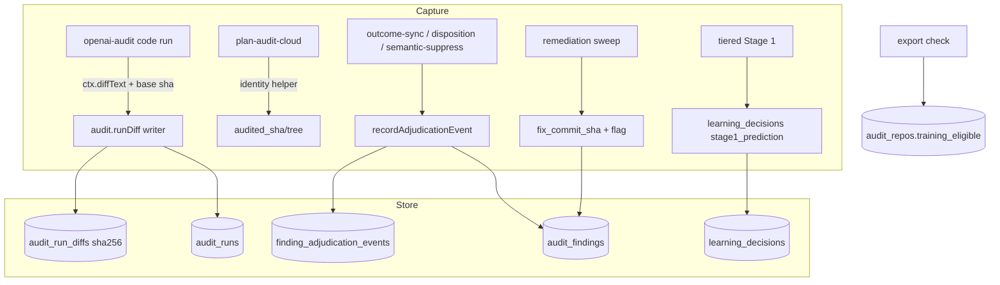

# Plan: Own-model telemetry slice 1 (H1 capture gaps)
- **Date**: 2026-10-25
- **Status**: In Progress (plan audited: GPT 2 rounds, 10 findings all accepted; Gemini final gate APPROVE)
- **Author**: Claude + Louis
- **Scope**: backend (store writers, migration, CLI; no UI)
- **Source**: [`docs/research/own-model-roadmap-2026-10.md`](../research/own-model-roadmap-2026-10.md) §2.1 (gap audit) and §6 (ledger spec), memo branch `docs/own-model-roadmap-2026-10`.
- **Stack**: js-ts (ESM). Target domain: audit store (`scripts/lib/store/**`, `scripts/lib/audit/**`, `supabase/migrations/**`).

## 1. Context

Louis wants telemetry capture to start now so the H1 distillation corpus (finding + diff + decision + outcome) accrues while the model decision waits. §2.1 lists seven gaps; the census below was re-measured 2026-10-25 with `scripts/own-model-telemetry-census.mjs` (read-only, committed with this plan) and matches the memo.

| # | Gap | Before (measured 2026-10-25) | Target after |
|---|---|---|---|
| 1a | `audit_runs.audited_sha` | 3,906 / 6,092 | code-mode runs 100%; plan-mode runs captured too |
| 1b | persisted diff (`audit_runs.diff_ref`) + `diff_base_sha` | column absent | every `scope=diff` code run |
| 2 | `finding_adjudication_events.adjudicator_kind` / `_model` | 453 / 15,426 and 314 / 15,426 | kind on every NEW event; model where known |
| 3 | `dismiss_reason` (+ new `dismiss_reason_class`) | 136 / 652 | class on every new dismissal; 105 control-marker backfilled |
| 4 | `fix_commit_sha` + `fixed_before_adjudication` | 842 / 9,361 fixed or verified; flag absent | flag on every newly-fixed or newly-adjudicated finding; sweep fills sha |
| 5 | Stage-1 prediction per finding | `audit_findings.stage` / `arm` null on 23,797; no prediction rows | one `learning_decisions` row per Stage-1 verdict (tiered/shadow runs) |
| 6 | `audit_repos.training_eligible` | column absent | column + export check (default-deny) |
| 7 | `time_to_resolution_ms` | 0 / 15,711 decided | backfilled + written at decision |

### Code trace (all read at `6d3b34e1`)
- Capture of `audited_sha`: `scripts/openai-audit.mjs:475-494` runs only inside `runMultiPassCodeAudit`. A split of the last 2 weeks by `mode`/`scope_mode` shows **every NULL is a plan-mode run** (1,175 runs, 0 with sha) while code/diff runs are 2,567 / 2,599. Plan audits go through `scripts/lib/audit/plan-audit-cloud.mjs:130` and never capture identity.
- The diff text lives on `ctx.diffText`; run completion is `scripts/lib/audit/run-persistence.mjs` (`durableWrite('audit.convergenceState', …)` at line ~325 is the sibling writer pattern).
- Adjudication write: `recordAdjudicationEvent` (`scripts/lib/store/runs-findings.mjs:2301`) is called by `scripts/lib/outcome-sync.mjs:187` (the bulk), `scripts/lib/store/finding-disposition.mjs:91`, `scripts/semantic-suppress.mjs:175`. It writes **no** `adjudicator_*`; only `scripts/lib/store/campaign.mjs:1280/1373` do, with kinds `agent` / `human`.
- Hazard on the path being changed: `recordAdjudicationEvent` does `deleteWhere('finding_adjudication_events', {finding_id})` (all kinds), so a re-record would erase campaign `agent`/`human` provenance, and `idx_fae_one_live_agent_verdict` (migration `20260811000000`) makes `agent` mean "campaign verdict". The normal path therefore **must not** reuse `agent`.
- `fix_commit_sha`/`dismiss_reason` are written only by `finding-disposition.mjs` (`stampEvidence`) and the control-marker UPDATEs; `projectRemediationState` (`runs-findings.mjs:2496`) sets `remediation_state`/`user_action` with no commit.
- `audit_findings.stage`/`arm` are the model-A/B scorer's PRODUCING-stage tags (`20260701120000`, `20260701140000`; NULL = baseline provenance in the scorer view, plus a CHECK). Writing Stage-1 predictions there would corrupt that view. Stage-1 verdicts exist only in `runStage1CheapTriage` (`scripts/lib/audit/stage1-triage.mjs:473`, called at `scripts/lib/audit/tiered-pipeline.mjs:403`), i.e. tiered/shadow runs; legacy runs have no prediction to record.
- `learning_decisions` (`scripts/lib/store/learning-decisions.mjs`, `scripts/lib/learning/decision-logger.mjs`) already holds audit-level decisions keyed by `decision_key`; `decision_type` is validated in JS (`VALID_DECISION_TYPES`), not by a DB CHECK (no CHECK in migrations).
- `audit_runs.author_model` is NULL on ~all rows, so `adjudicator_model` is honestly unknown for orchestrator rulings.

## 2. Proposed architecture

Right-sizing. Band-aid: add free-text columns and hope callers fill them. Over-built: a new `own_model_*` ledger schema now. Chosen: ALTER existing tables, one new content-addressed table for diffs (the only content-bearing artefact), reuse `learning_decisions`, enforce vocabularies in one JS module and a DB CHECK. Serves the current requirement "stop losing H1 data this week". The §6 decision ledger (tasks/decisions/corrections) is explicitly NOT in this slice.

### Design decisions
1. **Migration** `supabase/migrations/20261026120000_own_model_telemetry_slice1.sql`, idempotent (`ADD COLUMN IF NOT EXISTS`, `DROP CONSTRAINT IF EXISTS` + `ADD`, `CREATE TABLE IF NOT EXISTS`), public-schema only, no schema-qualified names. New columns: `audit_runs.diff_ref, diff_base_sha, diff_bytes, diff_truncated, diff_redactions, diff_capture_status, work_item_id`; table `audit_run_diffs(diff_ref PK = sha256 of stored text, diff_text, bytes, created_at)` holding ONLY content-intrinsic attributes (truncation, redaction count and capture status describe a capture attempt, so they live on `audit_runs`, never on the shared content row); `audit_findings.dismiss_reason_class, fix_recorded_at, first_decided_at, fixed_before_adjudication, fix_verified_commit`; `finding_adjudication_events.event_origin`; `audit_repos.training_eligible, training_eligibility_reason`. `work_item_id` is the ledger join key (NOT `task_id`, which is the arm-eval task-text hash). All NULLABLE, no defaults, so absence never reads as a value. Backfills are pure functions of existing columns only: `dismiss_reason_class='control-marker'` where `dismiss_reason LIKE 'control-marker:%'`; `event_origin='campaign'` where `method IS NOT NULL` (every campaign writer sets `method`, enforced by `verdictRowRefusal` in `scripts/lib/store/campaign.mjs`) else `'audit'` (every pre-migration non-campaign row came from the normal path); and `time_to_resolution_ms = decided_at - created_at` (when `>= 0`; for pre-migration rows `decided_at` is the LATEST decision time, an approximation recorded in the column COMMENT). `first_decided_at`, `fix_recorded_at` and `fixed_before_adjudication` are NOT backfilled: the chronology is unknowable for legacy rows, so NULL means unknown.
2. **Gap 1.** New module `scripts/lib/audit/diff-capture.mjs`: `prepareDiffArtifact(diffText, {maxBytes})` returns a discriminated result `{status, ref?, text?, bytes?, truncated?, redactions}` with `status` in `captured | refused-secret | empty-after-filter | oversize-section | not-applicable`, persisted as `audit_runs.diff_capture_status` so a NULL `diff_ref` is never ambiguous (a store write failure is the durable-write `lost`/`spilled` outcome, not a DB status, since the DB is what failed). Behaviour: drops sections for paths the one oracle `scripts/lib/sensitive-paths.mjs` classifies `sensitive`/`generatedNoise`, runs `redactSecrets` (`scripts/lib/secret-patterns.mjs`), refuses (stores nothing, records reason) if `classifySecrets` still reports high confidence (`scripts/lib/security/secret-classifier.mjs`), truncates at a section boundary to 256 KiB of UTF-8 (`Buffer.byteLength`; a first section that alone exceeds the cap is `oversize-section`, never a partial hunk), and hashes the stored text (`ref = sha256`). New durable writer `audit.runDiff` (keyed on `run_id`, idempotent: `INSERT … ON CONFLICT (diff_ref) DO NOTHING` + `UPDATE audit_runs`), registered in `scripts/lib/audit-store-writers.mjs`, called from `scripts/lib/audit/run-persistence.mjs` beside `audit.convergenceState`. `diff_base_sha` = resolved sha of `auditBaseCommit`. A shared `scripts/lib/audit/target-identity.mjs` factors the capture block out of `openai-audit.mjs:475-494` so `scripts/lib/audit/plan-audit-cloud.mjs` calls it too (plan runs get `audited_sha`/`audited_tree`, `diff_ref` stays NULL by design).
3. **Gap 2.** Event ORIGIN (which workflow owns the row) is separate from adjudicator KIND (who decided). `recordAdjudicationEvent` gains required `adjudicatorKind` (validated against `ADJUDICATOR_KINDS` in new `scripts/lib/adjudication-vocab.mjs`: existing `agent`, `human` plus new `pipeline`, `rule`; the migration widens `fae_adjudicator_kind_chk`) and optional `adjudicatorModel`, and ALWAYS writes `event_origin='audit'`. EVERY insertion boundary stamps its origin, with a CHECK (`event_origin IN ('audit','campaign')`, NULL allowed only for rows predating nothing: the backfill leaves none): the two campaign writers in `scripts/lib/store/campaign.mjs` (agent verdict ~L1280, human override ~L1373) stamp `'campaign'`, and a test enumerates every `insertReturning('finding_adjudication_events'` call site under `scripts/**` and fails if one omits `event_origin`, so a future writer cannot create a NULL-origin row unnoticed. Callers: `outcome-sync` → `pipeline`; `semantic-suppress` and control-marker writers → `rule`; `finding-disposition` → `human`. The delete-then-insert (same `withTx`, same lock order) is scoped to `event_origin='audit'`, so campaign rows (`event_origin='campaign'`) of any kind survive, and legacy rows were backfilled to the right origin (decision 1), so no unknown-origin row is deleted by guess. No new live-uniqueness index: legacy data already holds more than one event per finding (15,426 events over 15,282 findings, measured), so the rule stays "one audit-origin event per finding by transactional replace", asserted in the DB test. Campaign `idx_fae_one_live_agent_verdict` is untouched.
4. **Gap 3.** Closed vocabulary `DISMISS_REASON_CLASSES` (`false-positive`, `not-actionable`, `duplicate`, `out-of-scope`, `accepted-risk`, `already-fixed`, `control-marker`, `other`, `unclassified`) in the same vocab module, DB CHECK `afd_dismiss_class_chk`. **Enforced at the common boundary**: `recordAdjudicationEvent` refuses (`{ok:false, reason:'bad-input'}`) an `adjudicationOutcome:'dismissed'` event without a vocabulary-valid `dismissReasonClass`, and `buildFindingAdjudicationPatch` writes it in the same UPDATE as the outcome (atomic). Producers: `finding-disposition` requires `--reason-class`; `semantic-suppress` → `duplicate`; control-marker writers → `control-marker`; the bulk producer `outcome-sync` passes the class carried by the ledger entry (`dismissReasonClass`, a new optional ledger field documented in the audit skills' `references/ledger-format.md`, the prose producer) and falls back to the explicit `unclassified` (never NULL, never silently `other`), so the unclassified share is itself measured by the census. `accepted-permanent` in `finding-disposition` stamps the class too. Free-text `dismiss_reason` stays.
5. **Gap 4.** The flag is defined against the FIRST decision and first-transition timestamps, never current state. "Not yet occurred" is told apart from "occurred before we recorded it" using the pre-migration columns themselves: `first_decided_at` is assigned ONLY by a write that finds `decided_at IS NULL` (the first decision, provably), and `fix_recorded_at` ONLY by a write that finds `remediation_state` not yet terminal (the first fix transition, provably). A legacy finding already decided or already fixed at migration time therefore keeps the corresponding stamp NULL forever, its flag stays NULL (unknown), and a later re-adjudication or re-projection can never invent a first timestamp (the decided-then-fixed-then-re-adjudicated legacy case yields NULL, not `true`). `first_decided_at` is set once (COALESCE) by `recordAdjudicationEvent` under that gate; `fix_recorded_at` is set once (COALESCE) when `projectRemediationState` first lands a terminal fix (or when the first adjudication event itself carries a terminal `remediationState`, in which case both stamps are equal). Pure `fixOrderFlag({fixRecordedAt, firstDecidedAt})` in the vocab module yields `true` iff `fix_recorded_at <= first_decided_at`, `false` iff the fix came strictly after, and `null` while either is unknown; it is evaluated by whichever write supplies the second timestamp and stored only while the column is NULL (immutable, so retries, repeated projections and a later re-adjudication never rewrite it: decision, fix, re-adjudication stays `false`). `fix_commit_sha` is reserved for an explicitly identified fix (the CLI stamp); the remediation sweep (`applyRemediationVerificationResults`) writes its `checkedAtCommit` to the SEPARATE `fix_verified_commit` (an upper bound, COALESCE), so no existing `fix_commit_sha` reader can mistake it for the fix commit.
6. **Gap 5.** `stage1_prediction` added to `VALID_DECISION_TYPES`; `tiered-pipeline.mjs` logs one decision per Stage-1 envelope via the existing decision logger. Identity: the audit-bound key `<audit_run_id>:stage1_prediction:r<round>:s<sequence>`, where `sequence` is the envelope's index in the Stage-1 input order (deterministic and run-scoped, so two runs never collapse and a retry of one run is an idempotent `decision_key` conflict). context = envelope id, canonical fingerprint, severity, category, primary file; choice = outcome, reasonCode, triager model. Every envelope is recorded, including those that never become a final finding (their fingerprint has no matching `audit_findings` row, which the export join reports as unmatched rather than dropping). `stage`/`arm` are deliberately left alone (see trace). Outcome join is by `(audit_run_id, fingerprint)` at export.
7. **Gap 6.** `scripts/lib/store/training-eligibility.mjs`: `assertTrainingEligible(repoRows)` default-deny (only `training_eligible === true` passes; NULL refuses), plus the standalone operator CLI `scripts/training-eligibility.mjs list|set` (reason required; a standalone script rather than a cross-skill verb, since it touches no per-run state and adds no registry/inventory surface). The migration sets NO repo true. **Enforcement boundary**: no content exporter exists yet (H1 is unbuilt), so this slice ships the guard plus an executable check that no unguarded reader can appear: the static guards in `tests/own-model-telemetry.test.mjs` scan `scripts/**` and fails if any module other than the writer, the census and `scripts/lib/store/training-eligibility.mjs` reads `audit_run_diffs`; the guard fails closed on an unresolvable repo identity or a lookup error. The future exporter (H1 step 1) must call `assertTrainingEligible` and is where its integration test belongs. Louis approved storyline/CES/AIO/wine in scope on 2026-10-25 while the memo and the brief say storyline stays false by default: left as an explicit operator decision (NULL refuses); flagged in the PR body.
8. **Gap 7.** `time_to_resolution_ms = first_decided_at - created_at` is written once, in the same UPDATE that sets `first_decided_at`, plus the migration backfill (approximate for legacy rows, see decision 1).
9. **Stores.** The NAS store takes the migration via `node scripts/setup-postgres.mjs --migrate`; the storyline store (Azure) takes the same migration with its own DSN; per `feedback_ff_ces_main_is_a_live_deploy`, both are migrated before `main` is fast-forwarded. Verified by `--check-drift` against each. Writers degrade loudly on an unmigrated store via `columnExists`, matching the existing stage/arm precedent.
10. **Counts-not-content.** Fleet telemetry is untouched. The only content added is the redacted diff in `audit_run_diffs` and it is class P/C2 gated by `training_eligible` at export.

## 3. Files (repo-relative)
- `supabase/migrations/20261026120000_own_model_telemetry_slice1.sql` (create)
- `scripts/lib/adjudication-vocab.mjs` (create): vocabularies + `fixOrderFlag`
- `scripts/lib/audit/diff-capture.mjs` (create)
- `scripts/lib/audit/target-identity.mjs` (create); `scripts/openai-audit.mjs`, `scripts/lib/audit/plan-audit-cloud.mjs` (modify)
- `scripts/lib/audit/run-persistence.mjs`, `scripts/lib/audit-store-writers.mjs`, `scripts/lib/store/learning-decisions.mjs` (modify): `audit.runDiff`
- `scripts/lib/store/campaign.mjs` (modify: stamp `event_origin='campaign'` at both event inserts)
- `scripts/lib/store/runs-findings.mjs` (modify): `recordAdjudicationEvent`, `buildFindingAdjudicationPatch`, `projectRemediationState`
- `scripts/lib/outcome-sync.mjs`, `scripts/semantic-suppress.mjs`, `scripts/lib/store/finding-disposition.mjs` (modify)
- `docs/audit/shared-references/ledger-format.md` (modify the CANONICAL: document `dismissReasonClass`), then `node scripts/sync-shared-audit-refs.mjs` and `npm run skills:regenerate`
- `tests/own-model-telemetry.test.mjs`, `tests/own-model-telemetry-db.test.mjs`, `tests/own-model-outcome-sync.test.mjs` (create)
- `scripts/lib/learning/decision-logger.mjs`, `scripts/lib/audit/tiered-pipeline.mjs` (modify)
- `scripts/lib/store/training-eligibility.mjs` (create); `scripts/training-eligibility.mjs` (create); `scripts/lib/cross-skill/registry.mjs` + `scripts/lib/cross-skill/commands/ship.mjs` (modify: `close-finding --reason-class`)
- `scripts/own-model-telemetry-census.mjs` (create, done), run the census as `node scripts/own-model-telemetry-census.mjs` (no npm alias: it would add a CLI-catalog entry for a one-off instrument)
- Tests under `tests/` for each module; DB-gated suite enrolled in `scripts/db-test-container.mjs` and `.github/workflows/postgres-parity.yml` (two edits, lockstep).

Phases: **Phase A** migration + vocab + census; **Phase B** gap 1 (diff + identity); **Phase C** gaps 2,3,7 (adjudication path); **Phase D** gaps 4,5,6. Close-out (not a phase): `npm run skills:regenerate` if a skill changes, `npm run check`.

## 4. Risks and deferred
- Event-row fan-out: surviving campaign events beside a normal-path event could double count in views reading `finding_adjudication_events` (previously a normal re-record erased them). Mitigation: enumerate every view/reader of the table at implementation time, filter on `event_origin` where the reader means normal-path events, assert counts on a real Postgres.
- The sweep's commit is an upper bound and lives in its own column, `fix_verified_commit`.
- Diff size: 256 KiB cap x ~100 runs/day is bounded by content addressing; retention/purge belongs to capture point 10 (deferred).
- Deferred (out of slice): decision ledger tables (§6.3), `work_item_id` minting, Stage-1 outcome backfill, historical diff reconstruction.

## 5. Testing and proof plan
- Unit (pure): `prepareDiffArtifact` (sensitive section dropped, secret redacted, refusal on residual high-confidence secret, truncation boundary, stable hash), vocab validators, `fixOrderFlag` truth table, `buildFindingAdjudicationPatch`, `assertTrainingEligible` (NULL refuses, false refuses, true passes, mixed set refuses naming the repo).
- Real Postgres (`npm run db:local`): migration idempotent twice; `recordAdjudicationEvent` writes kind/model/time_to_resolution and preserves a campaign `agent` row; `audit.runDiff` write + replay idempotent; CHECK rejects a bad class; census script reports each gap; **negative control**: census on the pre-migration schema reports UNMIGRATED rather than zero.
- Oracle per gap = the census query, run before (saved in the session notes) and after on the NAS store; pass = populated count for NEW rows rises, denominators unchanged semantics.
- Mutation check: revert the `adjudicatorKind` plumbing in outcome-sync and confirm the DB test fails.

## 6. Scope widening (2026-10-25, Louis via CES: own-model brainstorm) and the PR split

Louis widened slice 1 to the coordinator-side ledger and to the memo's §6.8 data-mining checklist (branch `docs/own-model-roadmap-addendum`, PR 299), and asked that collection be IMPLEMENTED, not only planned, with the first PR shipped as soon as migration + writers are green. That is too large for one reviewable change, so it is split, in this order:

| PR | Content | State |
|---|---|---|
| **1 (this PR)** | The seven §2.1 H1 gaps above, plus `work_item_id` reserved on `audit_runs`, plus the census instrument. Repo gate: a diff is never persisted for a repo whose `training_eligible` is explicitly `false` (coordinator rule 2026-10-25: no storyline content). | implemented |
| **2** | Coordinator decision ledger: `task` / `decision` / `correction` / `outcome` / `usage` as `learning_decisions` types plus content columns only where unavoidable, default-deny `training_eligible`, secret-redacted, written ONLY through `cross-skill.mjs` verbs; chip launch mints `work_item_id` into brief, branch and PR footer; chip wrap-up; `ship-commit` `AI-Work-Item` trailer + merged/revert outcomes; fleet verbs attach `work_item_id` and record a decision on WAIT/refusal; handover snapshot; one-command correction capture; cost-per-task rollup; purge by `work_item_id`. `fleet_events` stays counts-only. Maps to fleet proposals `p-20261025124239-8d3d` .. `-bc17`. | planned, own session |
| **3** | §6.8 columns and gates: append-only label history (`event_at` / `ingested_at`; `audit_findings.user_action` is overwritten today), point-in-time input snapshots, negatives and denominators, propensity / `randomised` on routing, per-LLM-call provenance, `tool_sha` / `policy_version`, `schema_version` / `redaction_version`, consent lineage (approver, date), the weekly drift-only per-column null-rate coverage gate, plus the transcript archive (durable, access-controlled, tagged by repo / coordinator / eligibility) and a dated null-rate baseline of `learning_decisions`, `finding_adjudication_events`, `fleet_events`. | planned, own session |

PR 1 deliberately does not pre-build PR 2's tables: its writers and the `work_item_id` column are the only coupling, and adding `work_item_id` minting before the ledger exists would create a join key nothing writes.

Proposal `p-20261025124241-56a4` ("add task_id to audit_runs") is superseded in naming: the column is `work_item_id`, because `audit_runs.task_id` is the arm-eval task-text hash.

### Stores
The migration is idempotent and additive. NAS store: `node scripts/setup-postgres.mjs --migrate`. The storyline Azure store (`gd-ai-dev-psql`) needs Louis's admin script (`.git/fleet/handover/migrate-storyline-store.sh`); neither store may be left behind before `main` advances, because consumer pre-push hooks run the audit from the CES main checkout.
