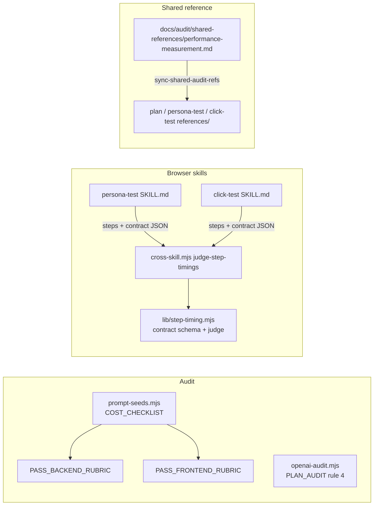

# Plan: Performance checklist, step timings, performance-measurement reference
- **Date**: 2026-11-28
- **Status**: In Progress
- **Author**: Claude + Louis
- **Scope**: backend (CLI scripts, pass-prompt seeds, skill markdown) · stack `js-ts`
- **Target domain(s)**: `cross-skill-bridge`, `scripts`, `shared-lib`
- ⚠ **Cross-domain work** — intentional: a prompt seed (`shared-lib`), one new cross-skill command (`cross-skill-bridge`) and the shared-reference sync (`scripts`).

Three small changes. **No new skill, no new audit wave, no performance gate,
no load harness or profiler inside a skill.**

## 1. Context Summary

A survey of three consumer repos since 2026-06-01 found 58 performance issues:
27 readable from code, 16 visible only under live timing or load, 15 only by
profiling. Existing skills caught 12 (`/audit-code`: nested timeouts, unbounded
SAX accumulation, a list-endpoint N+1, an attachment size guard, quadratic
duplicate references; `/persona-test`: a 30–60 s provenance query and a home
hero refetch). The 27 code-readable ones are what change 1 targets; the 16
live-timing ones are what change 2 targets; change 3 holds the method for the
rest. Consumers are named only generically here (CES is public).

**Code Trace** (all at `273caa08`):
- Backend pass rubric `scripts/lib/prompt-seeds.mjs:76` (`PASS_BACKEND_RUBRIC`) names
  "N+1 queries" at `:78`; frontend rubric `:123` (`PASS_FRONTEND_RUBRIC`). Both
  compose into `PASS_BACKEND_SYSTEM`/`PASS_FRONTEND_SYSTEM` (`:116`, `:150`) → `PASS_PROMPTS` (`:309`).
- R1 reads the seed through the registry: `bootstrapFromConstants(PASS_PROMPTS)`
  `scripts/lib/audit/llm-helpers.mjs:66` → `getPassPrompt` `:73` →
  `scripts/lib/audit/legacy-production-audit.mjs:189-190`. R2+ reads the RUBRIC
  constant directly (`legacy-production-audit.mjs:1118`, `:1268`). Editing the
  rubric therefore reaches both rounds.
- Plan-audit one-liner: `scripts/openai-audit.mjs:300` (`PLAN_AUDIT_SYSTEM` rule 4).
- Findings schema: `ProducerFindingSchema` `scripts/lib/schemas.mjs:88`;
  `detail: z.string().max(600)` `:57`. No cost/size field exists.
- Shared references: `EXPECTED_CONSUMERS` `scripts/sync-shared-audit-refs.mjs:57`;
  canonical dir `docs/audit/shared-references/`.
- Browser skills: `/persona-test` saves via `record-persona-session`
  (`skills/persona-test/SKILL.md` Phase 6); `/click-test` renders its report in
  Phase 6 (`skills/click-test/SKILL.md`). Neither records any time today.
- Cross-skill registry `scripts/lib/cross-skill/registry.mjs` (`REGISTRY`); a
  `kind:'local', payload:'json', cloud:'none'` precedent exists (`compute-target-domains`).

**Neighbourhood considered**: `get-neighbourhood` (coverage `verified`) returned
only `review` bands (`commands/persona.mjs` handlers, `buildV2PassPrompt`) —
nothing above the noise floor; the step-timing judge is greenfield.
**Incident neighbourhood**: INC-001 (symlink sensitive-path) surfaced; the new
command reads **no file path** (the contract arrives inline in the payload), so
it does not touch that path.

## 2. Proposed Architecture



### Change 1 — cost checklist in the existing passes (#1 DRY, #5 SSoT)

One constant `COST_CHECKLIST` in `prompt-seeds.mjs`, interpolated into BOTH
`PASS_BACKEND_RUBRIC` (replacing the bare "N+1 queries," — it moves into the
block) and `PASS_FRONTEND_RUBRIC`. Not a new pass, not a `MECHANICAL_WAVES`
entry, not a second home. `PLAN_AUDIT_SYSTEM` rule 4 gets a short extension
naming the same classes plus the measurement rule for latency targets.

Items, each with the measured instance(s) it comes from:

| # | Item | Measured instance(s) |
|---|---|---|
| C1 | cost growing faster than linear with input | a regex re-scanning all earlier text per item, 59 s → 0.24 s; quadratic duplicate-reference detection |
| C2 | work repeated every request/render/rerun/remount that could run once | home hero refetch on every visit; a model call re-running on remount (~$19 per project) |
| C3 | independent I/O awaited in series | a web app ran 8 independent data-warehouse reads one after another: 19.3 s → 2.5 s run in parallel |
| C4 | a statement prepared / client built per item; N+1 | SQL prepared per row, 230 → 95 µs per row once hoisted; list-endpoint N+1 |
| C5 | no caching of, or back-off after, a failure | a failed read not cached, so every rerun retried all 8: 144 reads per area per day vs 4 after the fix; unpaced egress → 429 storms; research bought twice |
| C6 | input with no size limit; extract-then-truncate; a result cap that truncates silently | memory ceilings blown by large inputs; unbounded SAX accumulation; a 521k-token single call; attachment size guard |
| C7 | nested timeouts equal or inverted; timeout below real latency or above a proxy's idle cutoff; a cancel signal no handler reads | equal nested timeouts and an outer limit below its inner one (180 s vs 300 s); a gateway dropping silent connections at 230 s under a 480 s timeout; a 400 ms deadline overrun; a document importer whose timeout-raised cancel signal no handler read, so imports failed instead of stopping cleanly (operator-reported, confirmed in code) |
| C8 | one shared row/pointer every concurrent write must update | concurrent saves raced on one head pointer: at 60 virtual users 59 of 555 saves succeeded, save p90 31.6 s; one writer per table → 100% success, p90 8.9 s (writer-path load harness) |
| L1 | fixed output-token cap / thinking budget not sized to input, or no `stop_reason` check | silent truncation from a fixed `max_tokens` on 4.9% of calls; pairing calls where thinking used up to 46% of the budget |
| L2 | a model call that can repeat (remount, retry, re-bought research) | ~$19 per project on remount; research bought twice |
| L3 | no prompt cache on a repeated prefix | missing prompt caching on a repeated system prefix |
| L4 | model egress not paced to rate limits | unpaced provider egress and 429 storms |
| K | a cache / parallel read / memo is a correctness change: every input in the key, memory bounded, shared state published only once decided | applies to the fixes C1–C5 and L2–L3 propose (a memo keyed on a subset of inputs is the classic follow-on bug) |

**Size is `expected`, never measured.** Each cost finding states its size in
`detail` behind a fixed label: `Expected cost: <estimate> at <input size>`.
Why `detail` and not a new field: the legacy passes emit
`ProducerFindingSchema` (V1); a new required field must be filled by every
non-LLM constructor of a finding (mechanical waves, bouncer mappers, the
canary) — a multi-file change nothing would read. `detail` is a field the
**emitted** schema already carries (`z.toJSONSchema(ProducerFindingSchema)
.properties.detail`, `type:"string"`, `maxLength:600`), so the prompt asks
only for something representable. The test asserts that against the emitted
JSON schema, not the Zod source.

**Prompt cost.** *Measured* (characters, `PASS_PROMPTS[p].length` at HEAD vs
this change): backend 4571 → 5891 (**+1320, +28.9%**); frontend 3405 → 4738
(**+1333, +39.1%**); the R2+ rubric constants grow by the same amounts; the
other six passes **+0**; `PLAN_AUDIT_SYSTEM` 2195 → 2460 (**+265**).
*Derived*: ≈ +330 tokens per pass at ~4 chars/token (not tokenizer-counted). Both passes sit in the cached system
prefix, so the marginal per-round cost after the first call is the cached-input
rate.

**Rollout scope, exactly.** In scope: the legacy production pipeline, both
rounds — R1 reads the registry's active revision (`getPassPrompt`), R2+ reads
the RUBRIC constant. On a consumer's next sync `bootstrapFromConstants` saves
the new seed and promotes it when the active revision is absent, dangling or
`bootstrap`-sourced (every machine that never hand-promoted); a hand-promoted
(non-bootstrap) active revision is **preserved** and keeps its own R1 prompt
until its owner re-promotes — R2+ still gets the checklist there. Out of
scope: the default-off tiered V2 pipeline (`buildV2PassPrompt`) and the shadow
arms, which run the seeds unchanged and so pick it up with no extra code;
V2's own obligation list is not extended (no V2 consumer is enabled). The
rollout is accepted deliberately: there is no A/B path that does not touch the seed.

### Change 2 — step timings in `/persona-test` and `/click-test` (#11, #13, #16, #19)

The model already drives the live app. It records, per step it takes:
- `navigate` steps: navigation → **ready**;
- `action` steps: action → **settled**.

**Flow (two calls, contract resolved BEFORE measuring).**
1. `node scripts/cross-skill.mjs step-timing-ready --json '{"contractPath"?: …}'`
   loads and validates the contract and returns ONLY its validated ready
   settings `{selector, quietMs, timeoutMs, contractDeclared}` — never the
   budgets, never raw file text. With no contract it returns the defaults
   `{selector: null, quietMs: 500, timeoutMs: 10000}`, where `selector: null`
   means "ready = `document.readyState === 'complete'`". click-test's
   `--ready-selector` / `--ready-timeout` override the returned values. On a
   non-zero exit (bad contract) the skill measures with the defaults and the
   report states the error (step 3).
2. The model measures each step with those settings (instrumentation below).
3. `judge-step-timings` loads the same contract again, judges, and returns
   per-step statuses. Step 1 also returns `contractDigest` (sha256 of the
   validated contract's canonical JSON, `null` when none); the skill passes it
   back, and the judge refuses (`BAD_INPUT`, "contract changed between calls")
   when its own reload digests differently — timings taken under one ready
   predicate are never judged against another contract's budgets. On a non-zero exit the skill **still finishes its run**
   and renders `STEP TIMINGS — unmeasured (judge refused: <error.message>)`;
   the message is safe to show by construction (it never contains file text).

**Instrumentation (executed by the model through the driver's `evaluate`; the
exact snippet lives in the shared reference §Step timings, one copy for both
skills).** Three cases, decided by what the step does to the document:

| Case | Start | End | Clock |
|---|---|---|---|
| `navigate` step (the skill loads a URL) | the new document's `timeOrigin` | ready predicate true, then the quiet rule below | `performance.now()` in the NEW document |
| same-document route change or in-page action (SPA) | epoch `performance.timeOrigin + performance.now()` returned by the arming `evaluate` immediately before the action | settled: ready predicate true AND in-flight request counter 0 AND no DOM mutation, both for `quietMs` | epoch, same document |
| action whose document is replaced mid-step | the same arming epoch (the model holds it; the old document's state is not needed) | ready predicate true in the NEW document, then the same quiet rule | epoch in the NEW document — both ends are `timeOrigin + now()` on one machine's clock, so the difference spans the documents and includes the delay before navigation |

**Action-correlated settle — request tracking, not resource timing.**
`PerformanceResourceTiming` lists only completed resources, so it cannot say
what is still in flight. The arming `evaluate` instead wraps `window.fetch`
and `XMLHttpRequest.prototype.send` (idempotently) with a counter that
increments on start and decrements on settle/`loadend`; the counter starts at
0 at arming, so requests started before the action never hold settle open.
Every start resets the quiet clock. A `fetch` promise settles when HEADERS
arrive, before the body is read and rendered — so request quiet alone is not
"settled": a `MutationObserver` on `document` resets the same quiet clock on
every DOM mutation, which covers body download and the render that follows.
A streaming response that keeps mutating the DOM never goes quiet and hits the
bound (`timeout`) — the honest reading of a step that never settles. Counted: `fetch` and XHR (what an app's
own data calls use). Not counted: images, scripts, styles, WebSocket/SSE
frames — a long-lived stream would otherwise never settle. If wrapping fails
(a frozen `fetch`, a driver without `evaluate`), the step is
`no-in-page-timing`, never a guessed number.

**Every wait is bounded** by `timeoutMs`. On a bound being hit, or on
navigation failure, a driver without `evaluate`, or a page error during the
wait, the step is sent with `durationMs: null` and an `unmeasuredReason` from
a closed enum (`timeout`, `navigation-failed`, `no-in-page-timing`,
`page-error`); the run continues — a timing failure never aborts the skill. A
step sent with no duration and no reason reads `not-recorded`.

**Step inventory — one definition for both skills.** A *timed step* is every
navigation the skill performs and every action it performs, attempted or
failed. Each gets one entry with a stable unique id, and `attemptedIds` lists
the id of every attempt from the skill's own log, kept apart from the entries:
persona-test — each Act step is exactly one navigation or one action, so there
are `stepCount.completed` ids; click-test — it performs no actions except
opening modal/dropdown triggers under `--with-modals`, so one id per route
navigation attempted per device plus one per trigger attempted — a trigger
that failed to open still gets an id and an entry (`unmeasuredReason` set). A
duplicate id (in either list) is `BAD_INPUT`; an attempt with no entry is
`missing` (named in `missingIds`) and the run reads `unmeasured`; an entry no
attempt names is `BAD_INPUT`. *(R1 of /audit-code replaced an earlier
`stepsCompleted` count, which two wrong ids could satisfy.)*

**Contract.** The ready predicate and budgets come from an optional
app-declared contract, `step-timing-contract.json` at the repo root, or
`contractPath` in the payload. **Code loads it, not the model**
(`loadStepTimingContract`): the path is resolved with `resolveAndClassify`
(realpath, repo containment, sensitive-path refusal — the INC-001 seam), must
be a regular file ≤ 64 KiB, and parse as JSON. Only an ABSENT default file is
"no contract"; an explicit path that is missing, a sensitive/escaping path, an
oversized file, malformed JSON or a schema failure is `BAD_INPUT`, with a
reason that never echoes the file's contents. The model receives only the
validated ready settings (flow step 1) and the judged statuses with each
matched budget and its basis (step 3) — never raw file text. Shape (Zod, `scripts/lib/step-timing.mjs`):

```json
{
  "version": 1,
  "ready": { "selector": "[data-app-ready]", "quietMs": 500, "timeoutMs": 10000 },
  "budgets": [
    { "route": "/wines*", "kind": "navigate", "budgetMs": 1800,
      "basis": { "percentile": "p90", "measuredMs": 1200, "factor": 1.5,
                 "measuredAt": "2026-11-20", "remeasureWhen": ["new list query", "dataset 10x"] } }
  ]
}
```

Validation (strict objects, unknown keys refused): `percentile ∈ {p50,p90,p99}`;
`measuredMs` in (0, 600000]; `factor` in [1, 10]; `budgetMs` must equal
`round(measuredMs × factor)` — a hand-tuned budget is refused;
`measuredAt` an ISO date `YYYY-MM-DD`; `remeasureWhen` ≥ 1 non-empty entry;
`quietMs` integer in [0, 10000]; `timeoutMs` integer in [1000, 120000];
`route` a pathname starting `/`, either exact or ending in a single trailing
`*` (prefix); steps' routes are matched as pathnames (query/hash stripped by
the skill). Two budgets with the same `(route, kind)` are refused.
**Matching**: an exact route beats every prefix; among prefixes the longest wins.

Two new cross-skill commands, both `kind:'local'`, `payload:'json'`,
`cloud:'none'`: `step-timing-ready` (`{contractPath?}` → ready settings +
`contractDigest`, above) and `judge-step-timings`: `{steps:[{id, route, kind,
durationMs, unmeasuredReason?}], attemptedIds, ready, contractDigest, contractPath?}` → per-step `status`, `counts` (incl.
`missing`), `overall`, and `contract: {declared, path}`. Closed per-step enum:

| Step condition | `status` |
|---|---|
| `durationMs` missing / null / non-finite / negative | `unmeasured` (+ `unmeasuredReason`, default `not-recorded`) |
| timed, no contract or no matching budget | `reported` |
| timed, ≤ budget | `within-budget` |
| timed, > budget | `over-budget` |

`overall` precedence: any `over-budget` → `over-budget`; else any `unmeasured`,
any `missing`, or zero steps → `unmeasured`; else any `reported` → `reported`;
else `within-budget`. **Green (`within-budget`) only when every executed step
was sent, timed and budgeted.**

Both skills render a **STEP TIMINGS** report section from the command's output
(report-only: no new finding kind, no change to either skill's OVERALL verdict
rules, no persistence change — `record-persona-session` is untouched). One
sample against a p90 budget is a signal to measure again, not a regression
verdict; the section says so.

### Change 3 — `performance-measurement.md` shared reference (#5)

Canonical at `docs/audit/shared-references/performance-measurement.md`,
registered in `EXPECTED_CONSUMERS` for `plan`, `persona-test`, `click-test`,
synced byte-identically by `sync-shared-audit-refs.mjs` (edit the canonical,
never a copy). Sections: budgets (percentile × factor, named re-measure
triggers); CPU time not wall time for algorithm guards on a shared machine;
interleaved before/after runs on one machine under a lease; see the guard fail
on its injected defect; assert the workload's size; warm cold dependencies;
step timings (the snippet + contract); a load-harness **recipe** (isolated
context per virtual user, ramp-up, ready predicate + action-correlated settle,
p50/p90/p99, timeouts counted as failures, non-zero exit over budget,
production refused, sign-in left to a person). `/plan`'s reference row
triggers on a plan naming concurrent users, a pilot, a load test or a latency target.

## 6. Sustainability Notes
- Budgets live in the app's contract, not in CES: no CES-side ratchet.
- The checklist is one constant; a later V2 pipeline adopts it by import.
- A future persistence of step timings is an additive `record-persona-session` field; deferred (no current reader).

## 7. File-Level Plan

##### 7b. Implementation Phases

**Phase 1 — Cost checklist**: add `COST_CHECKLIST`; interpolate into both rubrics; extend plan-audit rule 4; tests. Files:
`scripts/lib/prompt-seeds.mjs` (modify), `scripts/openai-audit.mjs` (modify),
`tests/prompt-seeds-cost-checklist.test.mjs` (create).

**Phase 2 — Step-timing judge**: contract schema + `judgeStepTimings`; cross-skill command. Files:
`scripts/lib/step-timing.mjs` (create), `scripts/lib/cross-skill/registry.mjs` (modify),
`scripts/lib/cross-skill/commands/persona.mjs` (modify), `tests/step-timing.test.mjs` (create),
`tests/fixtures/cross-skill-inventory.json` (modify), `scripts/lib/bundle-deps.json` (modify).

**Phase 3 — Shared reference + skill pointers**: canonical ref; consumer registration; SKILL.md rows and step-timing steps (net-zero size: detail moved to the reference). Files:
`docs/audit/shared-references/performance-measurement.md` (create),
`scripts/sync-shared-audit-refs.mjs` (modify),
`skills/plan/SKILL.md` (modify), `skills/persona-test/SKILL.md` (modify), `skills/click-test/SKILL.md` (modify),
`skills/plan/references/performance-measurement.md` (create),
`skills/persona-test/references/performance-measurement.md` (create),
`skills/click-test/references/performance-measurement.md` (create).

**Close-out (not a phase)**: `node scripts/sync-shared-audit-refs.mjs`; `npm run skills:regenerate`; `npm run skills:check`; `npm run skills:size:gate`; `npm run bundle:deps`; `npm test`.

## 8. Risk & Trade-off Register
- **Global rollout of a seed edit** — accepted; stated above.
- **Prompt growth dilutes other checks** — bounded by one shared ~1.3k block; items are one line each.
- **Model-recorded timings can be skipped** — `attemptedIds` (the run's own log) names a step not sent as `missing`; a missing `durationMs` reads `unmeasured`. A fabricated number is not detectable by the judge; the in-page snippet is the only sanctioned source, named in the report.
- **No browser integration test of the snippet** — deliberate: the snippet is prose a model executes through whichever driver resolves (the browser-driver contract), CI has no live app, and AGENTS.md's pre-ship empirical rule covers it instead: it is run once against a live local page in a real browser (full navigation, an in-page action firing two overlapping delayed fetches, one with prompt headers and a delayed body, a request started before the action, an action that waits before navigating, a never-ready selector hitting the bound) before the PR is called done, and that run is recorded in the PR.
- **Deferred**: persistence of timings; a finding kind for slow steps; a load harness (recipe only).

## 9. Testing Strategy
- `tests/prompt-seeds-cost-checklist.test.mjs`: every checklist item reaches `PASS_PROMPTS.backend`, `.frontend`, `PASS_BACKEND_RUBRIC`, `PASS_FRONTEND_RUBRIC` (the R2+ path); **R1 path through an isolated registry** (a temp cwd, spawned): a fresh registry's `getPassPrompt('backend')` carries the checklist; a registry whose active revision is an older `bootstrap` seed is advanced to it; a registry whose active revision is hand-promoted (`source:'manual'`) is preserved. **Negative control**: the item predicate reports every item missing from `PASS_PROMPTS.sustainability`. The emitted `z.toJSONSchema(ProducerFindingSchema)` carries `detail` (string, required) — the field the `Expected cost:` label lives in. The plan-audit line names the classes.
- `tests/step-timing.test.mjs`: untimed step (absent / null / NaN / negative `durationMs`) reads `unmeasured` with reason `not-recorded`, or the sent reason; zero steps → `unmeasured`; one unmeasured among within-budget → overall `unmeasured`, never `within-budget`; `stepsCompleted` above the sent count → `missing` and `unmeasured`; below it, or a duplicate id → error; no contract → `reported`; within/over; exact beats a longer prefix; `step-timing-ready` returns the defaults with no contract, the validated ready settings (and no `budgets` key) with one, and exits non-zero on a malformed one; a contract replaced between the two calls is refused by the judge (digest mismatch); contract refusals (budget ≠ round(measured×factor), empty `remeasureWhen`, out-of-range factor, bad date, duplicate `(route, kind)`, unknown key); loader: absent default → no contract, absent explicit path / sensitive path / path escaping the repo via a symlink / oversized file / malformed JSON → error whose text does not contain the file body; the cross-skill command end-to-end via spawn.
- Proof plan: each behaviour has a red-then-green test (written failing against the unmodified seed / absent module first).
- No live provider spend: all tests are pure or spawn the local command.

## Audit trail
- **/audit-plan**: 3 GPT rounds (R1 H4 M2, R2 H4, R3 H3 M1); 14 findings, 12 accepted and 2 accepted in part (browser-level CI tests declined: covered by the recorded empirical run). Gemini final gate round 1: **APPROVE** (blocking 0, debt 0).
- **/audit-code**: 4 GPT rounds (R4 PASS H:0 M:2, both fixed); — R1 H7 M8 L1 (14 accepted, 2 dismissed), R2 H1 M1 (one defect, fixed), R3 H1 M2 (2 fixed, the H1 race dismissed). Gemini final gate round 1: **APPROVE** (blocking 0, debt 0), **Code: FULL** over the 17 authored files; a first run over all 29 changed files read Code: PARTIAL (the generated `.claude/skills/**` and synced reference copies, fixtures and the plans index, all byte-verified by `skills:check` / the golden suite), also APPROVE.

## Implementation log
- **Empirical run of the §7 snippet** (2026-11-28, built-in browser, a local test page; the ARM/WAIT code extracted byte-for-byte from the canonical reference). *Measured*: navigate step 334–348 ms (page sets its ready marker at 300 ms) while a pre-action request stayed in flight 3 s — not counted, as designed; in-page action with two overlapping fetches, one sending headers at once and its body 900 ms later: 926–931 ms (DOM quiet, not fetch resolution, ended it); action that waits 700 ms then navigates to a page ready 15 s after load: 15 737 ms vs 15 710 ms expected (+27 ms, polling); never-ready selector: `unmeasuredReason: timeout` at the 2 s bound.
- **Defect found by that run and fixed**: a navigate step already ready at WAIT's first look read 11 272 ms (the page had loaded 11 s earlier). A retroactive bound from navigation/resource timing was tried and rejected — it reads SHORT (it missed a timer-driven render), which could turn an over-budget page green. The reference now states the first look is an upper bound (reads long, never short) and that ARM + WAIT must run immediately after navigate returns.
- **C3, C8 and C7's cancel-signal clause**: briefly cut for want of a cited instance, then restored when the coordinating session supplied the measured instances now in the §Change 1 table. C3 and C8 are mostly found by timing; the checklist line makes the pattern visible in a diff.
- **/audit-code R1 fixes** (GPT H7 M8 L1): the judge now takes the skill's attempt log as `attemptedIds` (replacing `stepsCompleted`: an omitted step is named, an entry no attempt names is refused) and the `ready` settings actually measured with (budgets apply only when they equal the contract's; otherwise `readyOverridden` and times are `reported`); a step carrying an `unmeasuredReason` is unmeasured whatever its duration; completeness outranks over-budget in `overall`; `timeoutMs ≥ quietMs + 1000`; a dangling default symlink is an error; input capped at 2000 steps / 200 budgets; the output basis omits `remeasureWhen`; the digest no longer imports from the audit domain. Snippet: body reads (`text`/`json`/…) are counted; an older generation's completion no longer touches the quiet clock; the pre-ARM request limit is documented with the init-script remedy. Plan-audit rule 4 admits a sourced objective with a measurement plan. Declined: browser regression tests in CI (as at plan audit) and the angle-bracket placeholder nit (report templates, not CLI examples).
- **/audit-code R2–R3**: R2 (H1 M1, one defect) — contract validation errors now carry only schema-defined path keys, Zod issue codes and fixed messages, never contract keys or values. R3 (H1 M2): `measuredAt` must be a real calendar date; step ids/routes are length-capped and unknown step fields stripped; the H1 TOCTOU race between classification and read was dismissed — it needs an actor with write access to the repo, who can edit the contract itself, and the contract is read locally and never leaves the machine.
- **/audit-code R4** (backend + sustainability over the post-R3 changes, `--base 273caa08`): **PASS, H:0 M:2** — both fixed in the reference: the judge payload carries the same `contractPath` as `step-timing-ready` (end-to-end test with a negative control), and an action that settled before the driver returned is documented as an upper-bound reading.
