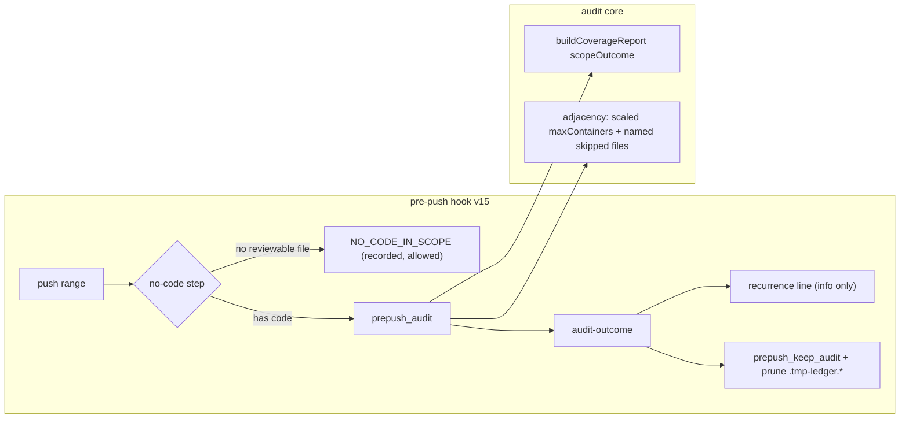

# Plan: Pre-push convergence and scope honesty (cluster A)
- **Date**: 2026-10-25
- **Status**: Approved (audit-plan: GPT 2 rounds -> READY; Gemini 2 rounds -> APPROVE)
- **Author**: Claude + Louis
- **Scope**: backend (audit core + consumer pre-push hook; no UI)
- **Fleet proposals**: 484f, df45, 70b5, 5c16 · brief: `docs/plans/backlog-triage-2026-10-25.md` §5-A
- **Migrations**: none. **Consumer impact**: audit libs sync (`scripts/lib/**`) AND hook v14→v15 (`hooks:install` rollout, all three consumers).

Scope: `backend`, stack `js-ts`. Principles cited as (#N) from `references/engineering-principles.md`.

## 1. Context Summary

**Code Trace** (all at `ac94d9b6`):
- Hook body `scripts/install-prepush-hook.mjs` (`HOOK_VERSION = 14`, line 168): v7 bookkeeping-only short-circuit → v11 `own-files` merge scope (`--files`, no `--base`) → v12/13 `audit-reuse` → `prepush_audit` → `audit-outcome` → `prepush_keep_audit` (prunes only `*.report.json`, `*.output.log`, `.tmp.*`).
- Outcome mapping `scripts/lib/prepush-audit-gate.mjs` `classifyAuditOutcome` / `decideAuditGate`; CLI seam `scripts/prepush-step.mjs` (`CAPABILITIES`, line 49 — the hook asks capabilities before relying on a subcommand).
- Audit scope: `scripts/lib/audit-scope.mjs` `auditSubjectFileGuard` (:454, throws "0 implementation files reached the prompt" → exit 1 → the hook reads UNMEASURED and refuses). `scripts/lib/plan-paths.mjs` `mergeScopeFiles` = plan ∪ scope; passes are then filtered by `scopeToFileFilter` (`scripts/lib/audit/legacy-production-audit.mjs`:218, applied :819-826).
- Coverage ledger `scripts/lib/audit/file-coverage.mjs` `buildCoverageReport` :381-565; status/gate derivation :522-535; wording `scripts/lib/coverage-format.mjs` `formatCoverageSuffix`; convergence `scripts/lib/audit/convergence.mjs`.
- Adjacency: `scripts/lib/audit/adjacency-detector.mjs` :599 (`maxChangedFiles`) and :642 (`maxContainers`); bounds `scripts/lib/config.mjs` `adjacencyConfig` :668-682.

### Investigation results (the brief asked `/investigate` first; these are `measured` against the AIO run logs and the code)

| # | Claim in the proposal | Verdict | Evidence |
|---|---|---|---|
| 484f(b) | merge push audited 94 files, not 29 — scope widened | **Refuted as a scope defect; real defect is a misleading log line** | `c375d97d…output.log` (AIO worktree): `94 files in scope (92 from the plan…)` is plan ACCOUNTING; the next lines read `File scope: 29 files → 28 BE + 1 FE in scope`, `[map-reduce] 29 files → 21 audit units`. The audit read 29. The "94" is printed before the filter. |
| 484f(a) | a persisted ledger would give cross-push memory | **A carried ledger suppresses nothing today** | All 23 entries of `.tmp-ledger.Sbg7V8` are `pending/pending`. `suppressReRaises` (`scripts/lib/ledger.mjs`:577) only suppresses `dismissed`, `fixed`, `verified` entries; nothing adjudicates on a pre-push. Persisting the ledger by itself is inert. |
| 484f(a) | re-reports are reworded | **Confirmed** (diagnosis note: 0/32 exact file+category overlap) | concern-level identity (`scripts/lib/concern-identity.mjs`) is the only comparator that survives rewording. |
| 5c16 | empty change set reads `complete`/`pass` | **Confirmed by reading the code** | `buildCoverageReport`: `required` counts only reviewable classes; with `required === 0` and `violations` empty it reaches `status = 'complete'`, `gate = 'pass'` (:531, :535) with `changedTotal: 0`. Under `--scope plan|full` there is no diff contract, so `changed` is empty BY DESIGN: the ledger describes changed files, and "complete" there is a vacuous claim over an empty universe. The audit did read the plan's files, so convergence on findings is legitimate; only the ledger's claim is false. |
| 70b5 | diff with no implementation files | **Today: exit 1 UNMEASURED → push refused** | `auditSubjectFileGuard` throws; hook v12 classifier reads exit 1 as "did not run". A package.json-only push cannot pass without `AUDIT_PREPUSH_ALLOW_UNMEASURED=1`. |
| df45 | `maxContainers=20` caps a 26-file diff | **Confirmed** | `adjacency-detector.mjs`:642 reports only the FIRST skipped file (`target.newPath`) and a fixed bound that does not scale with the diff. |

**Neighbourhood considered**: reuse, do not write siblings — `classifyNoPlanPush` (`scripts/lib/prepush-audit-gate.mjs`:238) is the existing "push carries nothing a code audit reads" oracle (docs / bookkeeping) and is extended, not duplicated; `buildConcernIndex`/`matchConcern` (`scripts/lib/concern-identity.mjs`) is the one concern comparator; `classifyFileCoverage` (`scripts/lib/language-profiles.mjs`:314) is the one "is this code" oracle (AGENTS.md: derive from the taxonomy, no extension list).

**Target domains**: audit core, consumer hook. Cross-domain: no. Cluster C edits `scripts/install-prepush-hook.mjs` after this merges.

## 2. Proposed Architecture

### Right-sizing (three lines per structural choice)

**Cross-push memory (484f a).**
- Band-aid: persist the ledger per branch and pass `--ledger`/`--round 2`. Measured inert (all entries pending) and R2 prompts say "not find all issues", which would cut recall on a *different* diff.
- Over-engineered: a pre-push adjudication UI/dismissal channel plus learned suppression.
- **Chosen**: no suppression. Report **recurrence** — which of this push's findings concern the same thing as the previous kept report for the branch, by concern identity — beside the counts, informationally, and prune the orphans. Current requirement: the operator reading `H:28 → 11 → 22` cannot tell new from re-raised. A dismissal channel is a separate design (recorded in §8), not needed to answer that.

**NO_CODE_IN_SCOPE (70b5).**
- Band-aid: treat A1's abort as pass. A green without measuring.
- Over-engineered: a new `audit_runs.verdict` value + migration.
- **Chosen**: decided hook-side, pure, from the pushed file list using the one taxonomy oracle, before any audit spend; a recorded envelope `{outcome:'NO_CODE_IN_SCOPE', files}` and a distinct printed line. No store verdict, no migration.

**Coverage honesty (5c16).** Chosen: an additive derived field `scopeOutcome` on the ledger (`code` | `no-code-in-scope` | `no-change-set`) and `gate: 'warn'` (never `pass`) for the two non-`code` outcomes. No new `status` enum value (every status reader is a closed list).

**Adjacency (df45).** Chosen: the default bound scales with the diff (`max(configured, 3 × changed files)`, hard ceiling 500; `measured` 1.94 containers/file on this branch's own 18-file diff, so 3 leaves headroom where 2 sits on the edge) unless the operator pinned `ADJACENCY_MAX_CONTAINERS`; when a cap still bites, the incompleteness names the skipped files (bounded list + count). Over-built alternative (per-file budgets) rejected: no current requirement.

### Contracts added by audit round 1

**Temp-ledger lifecycle (H1).** The orphan is `.tmp-ledger.<suffix>`, named from the audit's `--out` file (`path.parse('.tmp.<suffix>')` ⇒ name `.tmp`, ext `.<suffix>`; `scripts/lib/robustness.mjs` `resolveLedgerPath`). Ownership is by **exact path**, never by prefix:
- *Own run*: `prepush_keep_audit` removes exactly `$AUDIT_KEEP_DIR/.tmp-ledger.${AUDIT_REPORT##*.}` — the one derived from this invocation's own `$AUDIT_REPORT` mktemp name. Nothing else is touched on the success path, so a concurrent invocation's live ledger is untouchable by construction.
- *Orphans from killed runs* (the 6 seen in the AIO worktree): the same age rule the hook already applies to `.tmp.*` (`-mmin +1440`, 24 h against a 45-min budget cap, `BUDGET.capSec = 2700`), extended to `.tmp-ledger.*`. No lock protocol is invented: a run cannot be live at 24 h.
- Tests: two simulated concurrent invocations (distinct suffixes) — A's cleanup leaves B's ledger; an unrelated `.tmp-ledger.*` younger than 24 h survives; one older than 24 h is removed.

**NO_CODE_IN_SCOPE bypass contract (H2).** `prepush-step.mjs no-code` reads the pushed range itself (`resolvePushRange`, as `own-files` does) and prints exactly ONE line:
`no-code <N> <record-path>` | `code <reason>`.
- It writes the record **before** printing `no-code`: `.audit/prepush/<pushed-tree>.no-code.json` = `{outcome:'NO_CODE_IN_SCOPE', tree, base, head, files[], classifiedAt}`, via `atomicWriteFileSync` (temp + rename), keyed to the same tree identity as the kept audit report. A failed write ⇒ it prints `code record-write-failed`.
- Every failure direction means *measure*: unknown range, unlistable files, any `uncovered`/reviewable file, classifier throw, write failure ⇒ `code <reason>`.
- The hook bypasses only when **all three** hold: the step exits 0, stdout starts with the exact token `no-code `, and the named record exists and is non-empty. Exit 124 ⇒ `exit 1` like every bounded step; any other non-zero, malformed or empty output, or a missing record ⇒ the audit runs exactly as in v14. A capability-absent source checkout ⇒ same. Tests assert each of these rows by spawning the real CLI.

**Gate propagation decision table (M1).** Readers measured by grep (`scripts/`, excluding the synced copy): the **only** code that reads `coverage.gate` is `=== 'fail'` — `scripts/lib/audit/finding-assembly.mjs`:860, `scripts/lib/audit/findings-pipeline.mjs`:411, `scripts/lib/audit/tiered-pipeline.mjs`:494. Nothing branches on `'pass'` vs `'warn'`, so pass→warn changes wording only. `convergence.mjs` reads counts, never the gate.

| `scopeOutcome` | `status` | `gate` | convergence | audit verdict | hook outcome |
|---|---|---|---|---|---|
| `code` | as today | as today | as today | as today | as today |
| `no-change-set` (plan/full scope) | `complete` | `warn` (was `pass`) | unchanged — findings decide; the audit DID read the plan's files | unchanged | unchanged (the hook only runs diff/`--files` audits) |
| `no-code-in-scope` (diff, only non-code changed) | `complete` | `warn` | unchanged | unchanged | n/a — the A1 guard aborts first; the hook's `no-code` step decides before spending |

Integration test: a `--scope plan` ledger with findings 0 still converges, and prints the not-measured suffix; a `code` ledger with one unaudited reviewable file is still `partial`/`none` (negative control).

**Persisted-schema compatibility (M2).** `scopeOutcome` is `.optional()` in `CoverageSchema` (reads of legacy serialized `_coverage` validate unchanged) and always written by `buildCoverageReport` (canonical write). It is **derived** from `files[]`/`counts`, never an independent input, so `validateCoverage`'s re-derivation also checks it. Persistence/cache paths traced: `_coverage` is consumed in `transcript.mjs`, `run-finalization.mjs`, `finalization-contract.mjs`, `required-subjects.mjs`, `map-reduce-scheduler.mjs` (all read-only of a freshly built ledger within one run); no cross-run cache stores it, so there is nothing to invalidate; an old persisted result simply lacks the field and reads as today. Test: an actual legacy serialized report (fixture captured from `.audit/…-result.json` shape) through `validateCoverage` then `formatCoverageSuffix`.

**Size ratchet (M3).** `scripts/install-prepush-hook.mjs` is 870 lines — under the 1000-line ratchet — so the constraint is a budget, not a baseline: the hook edit must stay under 1000 lines and the decision logic lives in `scripts/lib/prepush-audit-gate.mjs` / `scripts/prepush-step.mjs`, not in the shell template. **No re-baselining** of any file is an option in this plan; if a ratcheted file would grow, extract instead.

### Contracts added by the Gemini final gate (round 1)

**One subject predicate (G1 — supersedes the §8 wording "declarative is reviewable ⇒ audited").** Measured 2026-10-25 against the real functions: the taxonomy (`classifyFileCoverage`) calls `package.json`, `tsconfig.json`, workflows, `Dockerfile` and `README.md` all `declarative`; `resolveReferenceExtension` ADMITS them; and yet a `package.json`-only diff aborts, because `classifyFiles` (`scripts/lib/audit-scope.mjs`:416) files every `*.json` and every `/config/ /schemas/ /types/ /shared/` path under **`shared`**, and `auditSubjectFileGuard` counts only backend+frontend files ("shared files are context, not the subject"). So the oracle for "will the audit have a subject?" is the **guard's own bucketing**, not the taxonomy class. `classifyNoCodePush` therefore calls `classifyFiles` itself (exported, one spelling) and defines, per file:

| File | No-code? | Why |
|---|---|---|
| sync bookkeeping (`SYNC_BOOKKEEPING_FILES`) | yes | machine-written |
| taxonomy `non-code` (lockfile, image, asset) | yes | nothing to read |
| `classifyFiles` ⇒ `shared` AND taxonomy class is data (`declarative`: any `*.json`, yaml, …) | yes | the guard would count 0 subjects for it, and it is data |
| `classifyFiles` ⇒ `shared` AND taxonomy class is source (`profiled`/`model-only`, e.g. `src/config/x.ts`, `src/types/t.ts`) | **no** | `shared` is a prompt-context grouping, not an exemption (final-audit M1): real code lives in those dirs. The audit refuses or reads it exactly as v14 did |
| `classifyFiles` ⇒ `backend`/`frontend` (source, `.md`, `.yml`, `Dockerfile`, `.jsonl`, …) | **no** | the audit reads it as a subject today |
| taxonomy `uncovered`, an infra path (`isAuditInfraFile`), unresolvable, unlisted | **no** | falls through to today's behaviour (audit or A1 refusal) — never a bypass |

A push is `NO_CODE_IN_SCOPE` iff **every** pushed file is "yes". Doc-only pushes with a plan keep today's behaviour (audited as backend subjects) — changing that is a separate decision, not a requirement of 70b5. Tests carry a **parity test**: for a table of paths, `classifyNoCodePush` says no-code exactly when `auditSubjectFileGuard` over `classifyFiles` would refuse, in both directions (so the two cannot drift apart), plus the explicit rows `package.json`, `tsconfig.json`, `package-lock.json`, `src/config/x.yml` ⇒ no-code; `src/a.mjs`, `src/config/x.ts`, `src/types/t.ts`, `README.md`, `Dockerfile`, `a.jsonl` ⇒ code. §9/§10 "package.json-only" stays valid; the §8 sentence is superseded by this table.

**Recurrence comparator and CLI (G2).** The concern index filters to dismissed entries (`countsTowardHardSuppress`), so over unadjudicated pre-push findings it is empty — AND its key is `category|file`, which the 484f diagnosis shows reworded away (0/32 exact category+file overlap). Neither is usable. `summariseRecurrence({previous, current})` (pure, in `scripts/lib/prepush-audit-gate.mjs`) uses two tiers, both over the reports' `findings[]`:
- **same-file**: a current finding whose `findingFiles(f)` (exported from `scripts/lib/concern-identity.mjs`, no change to that module) intersects a previous finding's files;
- **same-file + similar**: additionally `ledgerFindingSimilarity(f, p) > 0.35` (exported from `scripts/lib/ledger.mjs`; the threshold `suppressReRaises` already calibrates for paraphrased re-raises).
`concern-identity.mjs` is NOT modified. Output is a count line only (never a gate, never suppression): `recurrence vs <prev-tree-12>: <S> of <N> findings on files already flagged in the previous push (<T> also textually similar)`.
`prepush-step.mjs recurrence --report <current report path>`: stdout is exactly that line or `recurrence unavailable: <reason>` (rc 0 in both; rc non-zero only for argv errors). Prior-report selection: the newest `*.report.json` in `.audit/prepush/` other than the current tree's, **whose recorded head is an ancestor of the current head** (the hook has no branch name; a rebased branch honestly reads `unavailable: no earlier report on this lineage` rather than inventing a baseline). It runs **after** `audit-outcome` and **before** `prepush_keep_audit`'s prune, so the baseline cannot be deleted first (the prune retains `AUDIT_PREPUSH_KEEP_REPORTS`≥2 newest; a value below 2 ⇒ `unavailable`). The head is recorded by the CLI itself into the sidecar `<tree>.head` beside the kept report (atomic write; sidecars whose report was pruned are removed by the same call), so the hook shell stays unchanged.
Tests: reworded same-file pair ⇒ same-file counted, similar counted only above threshold; unrelated files ⇒ 0; corrupt/empty previous report ⇒ `unavailable`; the real AIO envelope pair (`7ca4e676…`, `c375d97d…` `report.json` shapes) as a fixture for the 0/32 exact-overlap vs file-overlap claim.

### Execution model (Phase 1.5)
All steps independent. One ordering constraint: the hook (cluster 2) calls two new `prepush-step.mjs` subcommands and gates on `capabilities`, so an older source checkout degrades to "run the audit as before" rather than breaking (#13).

## 7. File-Level Plan

| File | Change | Principle |
|---|---|---|
| `scripts/lib/audit/file-coverage.mjs` | derive `scopeOutcome`; `gate:'warn'` when not `code`; add to `CoverageSchema` (strict) | #7, #11 |
| `scripts/lib/coverage-format.mjs` | suffix wording for the two non-`code` outcomes; `scopeOutcome` absent (old ledger) reads as today | #7 |
| `scripts/lib/config.mjs` | `adjacencyConfig.maxContainersPinned` | #4 |
| `scripts/lib/audit/adjacency-detector.mjs` | scaled bound; skipped files named | #19 |
| `scripts/lib/audit/legacy-production-audit.mjs` | the "files in scope" line states plan accounting vs audited count | #19 |
| `scripts/lib/prepush-audit-gate.mjs` | `classifyNoCodePush`, `decideNoCodeGate`, `summariseRecurrence` | #1, #11 |
| `scripts/prepush-step.mjs` | subcommands `no-code`, `recurrence`; `CAPABILITIES` += both | #13 |
| `scripts/install-prepush-hook.mjs` | v15: call the two steps, prune `.tmp-ledger.*`, bump | #14 |
| `.githooks/pre-push` | **audited, expected unchanged** — consumers' managed hook is the installer's `HOOK_BODY`; this repo's own file is separate. Implementation phase confirms and records. | — |
| tests | see §9 | — |

### 7b. Implementation Phases

**Phase 1 — Ledger scope honesty**: `scopeOutcome` + `gate` + wording. Files: `scripts/lib/audit/file-coverage.mjs` (modify), `scripts/lib/coverage-format.mjs` (modify), `tests/coverage-scope-outcome.test.mjs` (create)
**Phase 2 — Adjacency bound**: scale and name the skipped files. Files: `scripts/lib/config.mjs` (modify), `scripts/lib/audit/adjacency-detector.mjs` (modify), `tests/adjacency-container-scaling.test.mjs` (create)
**Phase 3 — Scope accounting line**: Files: `scripts/lib/audit/legacy-production-audit.mjs` (modify), `tests/audit-scope-accounting-line.test.mjs` (create)
**Phase 4 — NO_CODE_IN_SCOPE and recurrence (pure + CLI)**: Files: `scripts/lib/prepush-audit-gate.mjs` (modify), `scripts/prepush-step.mjs` (modify), `tests/prepush-no-code-scope.test.mjs` (create), `tests/prepush-recurrence.test.mjs` (create)
**Phase 5 — Hook v15**: Files: `scripts/install-prepush-hook.mjs` (modify), `tests/prepush-hook-v15.test.mjs` (create), `tests/prepush-hook-v14.test.mjs` (modify: version pin)

**Close-out (not a phase)**: `npm run skills:regenerate && npm run skills:check`, `npm run docs:architecture-intent:check`, `npm run size:ratchet:gate` (no growth of any ratcheted file; a SHRINK must be re-baselined because the gate fails on it — that is the only permitted baseline edit), `npm run guards:preflight`.

## 11. Execution Clustering

- **Cluster A1** — Phases 1-3 — fix-gate: yes
  - Coupling: all three change what the audit REPORTS about its own scope; one ledger/suffix vocabulary.
- **Cluster A2** — Phases 4-5 — fix-gate: final
  - Coupling: Phase 5 is the only caller of Phase 4's subcommands; the `capabilities` handshake is the seam the audit must inspect.
- **Final gate**: consolidated Gemini review over the union diff.

Shipping: **two PRs** — A1 (audit libs; consumer `sync` only) then A2 (hook; `hooks:install` rollout). Cluster C starts when A2 merges.

## 8. Risk & Trade-off Register

- **A wrong NO_CODE_IN_SCOPE is green-without-measuring.** Mitigations: fail closed — any file the taxonomy cannot classify (`uncovered`, e.g. an unrecognised extension), any resolve error, an unknown push range, or an unreadable file list is **not** no-code and falls through to the audit; no-code requires a positive classification of EVERY pushed file as a non-subject. The per-file rule is the table in the Gemini-gate contract (G1): a file is a subject iff `classifyFiles` puts it in backend/frontend. Both directions tested.
- **Recurrence is informational**: it can neither suppress nor gate, so a wrong match is a wrong sentence, not a wrong verdict. Unreadable previous report ⇒ the line is omitted with a reason, never "0 recurring".
- **`gate:'warn'` instead of `pass`** for non-`code`: readers enumerated (decision table above); none branches on pass/warn.
- **Hook rollout reaches every consumer on sync.** Capability-gated; older source ⇒ today's behaviour.
- **Deferred, on purpose**: a pre-push dismissal channel (what would let a carried ledger actually suppress). It needs a design of its own; recording it here is the honest scope boundary, not a defer-because-harder: the new code does not depend on it.
- **Open probe (Phase 3)**: whether `--files` + `--base` supplies hunk text so the 29 files get hunk-centred windows. Probe first; change the hook's merge branch only if it is honoured and tested.

## 9. Testing Strategy

Tier 1 (deterministic, test-first, red-then-green):
- `scopeOutcome`: empty `changed` → `no-change-set`, `gate:'warn'`; only non-code files → `no-code-in-scope`; one reviewable file → `code` and today's gate; **negative control**: a ledger with a reviewable-but-unaudited file must stay `partial`/`none`, never relabelled.
- Suffix: old ledger without the field prints byte-identical to today; `{status:'complete'}` alone still `LEDGER INVALID`.
- Adjacency: 26 changed files with enough containers → none skipped; pinned env wins; cap that still bites names the skipped files (bounded) and the count; ceiling 500.
- `classifyNoCodePush`: package.json-only, lockfile-only, image-only → no-code; mixed with one `.mjs` → code; `.jsonl`/unknown extension → NOT no-code; `null` list → NOT no-code; docs-only and bookkeeping behave as `classifyNoPlanPush`.
- Recurrence: reworded same-concern pair matches; unrelated pair does not; missing/corrupt previous report → omitted with reason.
- Hook (Tier 3, same commit): `HOOK_VERSION` 15 marker, capability-absent fallback runs the audit, the no-code branch `finish`es with the distinct line and writes the record, `.tmp-ledger.*` prune never touches this run's kept report. Spawned CLI tests scrub `AZURE_*`.

**Proof plan**: oracle = red test per row above; pass = suite green and the one real-store-shaped fixture: the AIO `c375d97d` `output.log` first lines are used (as text fixture) to assert the new accounting line names both counts.

**Pre-ship empirical verify**: run the new hook in a scratch consumer clone (not a mocked shell): a package.json-only push → `NO_CODE_IN_SCOPE`, allowed; a one-`.mjs` push → audits.

## 10. Acceptance (non-UI)

- [ ] Plan/full-scope audit with no changed files prints a ledger that is not `complete/pass` and a suffix saying not measured.
- [ ] package.json-only push: distinct `NO_CODE_IN_SCOPE`, allowed, recorded; never reported PASS or UNMEASURED.
- [ ] 26-file diff: no `maxContainers` incompleteness at defaults; when it does fire the files are named.
- [ ] `94 files in scope` line no longer readable as the audited count.
- [ ] Hook v15 installed in the three consumers' clones after `hooks:install`; older source checkout degrades safely.
