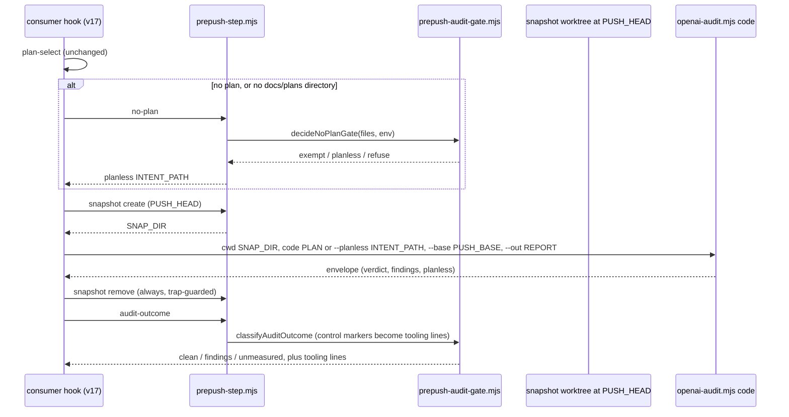

# Plan: Pre-push gate — stop teaching the bypass (consumer feedback 2026-11-11, theme 1)
- **Date**: 2026-11-11
- **Status**: Complete — shipped as hook v17 (#338, fd19c356) and v18 (#339, dda8bab6). Item 1c (changed-chunk scoping) is split out to its own campaign plan.
- **Author**: Claude + Louis
- **Scope**: backend (consumer pre-push hook body, `scripts/lib/**`, `scripts/openai-audit.mjs` CLI entry) · stack `js-ts`
- **Source**: [`docs/research/consumer-feedback-2026-11-11.md`](../research/consumer-feedback-2026-11-11.md) theme 1
- **Target domain(s)**: `audit-orchestration`, `fleet`, `scripts`, `shared-lib`
- ⚠ **Cross-domain work** — touches >1 domain; the crossings are intentional: the hook (`scripts`) calls the audit CLI (`audit-orchestration`) and the gate library (`fleet`); `vcs.mjs` (`shared-lib`) changes only in one error message.

**Neighbourhood considered**: `get-neighbourhood` over the touched files returned 8 records, all band `review`
(`isManagedHook`, `openai-audit.mjs main`, `runMultiPassCodeAudit`, `printCostPreflight`, …), so nothing cleared this
repo's noise floor. No security incident matched (`get-incident-neighbourhood`, k=3; the top hit, INC-002, is the
DB-wipe incident and unrelated).

## 0. Verification of the five reports (done before designing)

Every item was checked against source at `6598878d` (main tip; the hook body is unchanged since `4a6662f1`) and against
the consumers' kept evidence on 2026-11-11. Only verified items are in build scope.

| # | Claim | Verdict | Evidence | In scope? |
|---|---|---|---|---|
| 1a | A plan-less code push is refused in a repo whose plans are untracked | **Verified, plus a second hole** | `check-plan-status.mjs` `selectMode` reads plans from the **pushed commit** when git supplied the range (`pushedPlanFiles`, `scripts/check-plan-status.mjs:73-86` (6598878d)). AIO gitignores `docs/plans/*` (`ai-organiser/.gitignore:35`), so the pushed commit never contains a plan, the selector returns nothing, and `decideNoPlanGate` refuses (`scripts/lib/prepush-audit-gate.mjs:254-288` (6598878d)). **Second hole:** in an AIO worktree with no `docs/plans/` directory (2 of 10 measured: `admiring-shtern-e496f7`, `gtasks-settings`) the hook reaches `[ ! -d "$PLANS_DIR" ] && finish` (`scripts/install-prepush-hook.mjs:403` (6598878d)) and passes without auditing anything or printing UNMEASURED. | **Yes** |
| 1b | The hook hangs on a draft plan (storyline) | **Not reproducible against current source** | Storyline's installed hook is v16 (`.git/hooks/pre-push:3`), so it has v11's bounded steps: a "hang" is now a bounded audit (≤2700s) with a 30s heartbeat. Across 67 kept `.audit/prepush/*.output.log` files (10-25..11-11, main checkout + 5 worktrees) the maximum is 959s, 12 runs exceed 600s, and none shows a refusal or an expired budget. No logs exist for the 10-18/10-22 sessions (hooks before v14 kept nothing) or for #526's commits. The report describes the defect v11 fixed. | **No** — §8 |
| 1c | 16 of 17 findings on AIO #109 were about pre-existing code | **Verified** | Report `ai-organiser/.audit/prepush/8fb7ea5d….report.json` (head `da0a834b`, base `ad68b7cd`) has 17 findings. The diff changed 1 line in `en.ts`, 1 in `types.ts` and 6 in `styles.css`. Only M2 concerns changed lines. 15 point at unchanged code; one of those, M9, is a false positive on the pushed content. M13 is the adjacency control marker. Mechanism: `buildAuditUnits` (`scripts/lib/code-analysis.mjs:224-260` (6598878d)) chunks an oversized file by function boundary and sends **every** chunk without consulting the diff. | **No** — split out to its own campaign plan, §8 |
| 1d | `ADJACENCY_INCOMPLETE: WORKING_TREE_UNREADABLE` is reported as a MEDIUM | **Verified; cause inferred** | `buildAdjacencyIncompleteFinding` hard-codes `severity: 'MEDIUM'` (`scripts/lib/audit/adjacency-report.mjs:197-216`). The gate's `countBySeverity` counts every entry (`prepush-audit-gate.mjs:40-49`), so a PASS whose only finding is the marker becomes `kind: 'findings'` (2 of 9 AIO reports: `e7bade77`, `wt/sweep-review-labels/f3a5f2…`). The gate does not consult `CONTROL_MARKER_PREFIXES` (`scripts/lib/audit/control-markers.mjs:23`). Cause: `gitUnifiedDiffWithWorkingTree` runs with a 2 MB `maxBuffer` (`vcs.mjs:626-650`). An overflow raises `ENOBUFS`, which `classifyChildError` (`vcs.mjs:153-176`) does not recognise, so it falls through to `WORKING_TREE_UNREADABLE` (the ENOBUFS shape was confirmed by a probe). That AIO's 2.7 MB `docs/architecture-map.md` was the overflowing file is **inferred**, not measured. The overflow is possible at all because the hook audits **base..working tree**, so an uncommitted, regenerated map lands in scope although it is not in the push. | **Yes** |
| 1e | A stale shared `node_modules` junction fails pre-push as if the diff were broken | **Mechanism real; not a CES defect** | 29 of 50 WCA worktrees have a `node_modules` junction to main's. Nothing in CES or WCA tooling creates them; their creation times fit links made by hand. The failing step is WCA's own `.githooks/pre-push.local:94-101`, which runs `npm run test:unit` through the junction and hits `vendoredBrowserLibsMatchLockfile.test.js:66-67`. The cited PRs do not match: #1315 has no such failure, and the DOMPurify PR is #1295, whose one failure was a timeout. The direct evidence is #1303's body. The CES managed hook never touches `node_modules`. | **No** — WCA-owned, §8 |

## 1. Context Summary

**What exists today.** The consumer hook body is the `HOOK_BODY` template in `scripts/install-prepush-hook.mjs` (v16,
`PREPUSH_HOOK_VERSION` in `scripts/lib/prepush-hook-version.mjs:16`). Every decision the hook makes is a pure function in
`scripts/lib/prepush-audit-gate.mjs`, called through `scripts/prepush-step.mjs` subcommands under a wall-clock budget.
CES's **own** hook already audits a clean checkout of the pushed commit rather than the working tree
(`scripts/prepush-check.mjs:511-572` (6598878d): `git worktree add --detach <tmp>/ces-prepush-<sha>-<pid> <head>`, lock
retry, and a stale-sandbox sweep in `scripts/lib/prepush-sandbox-cleanup.mjs`). The consumer hook does not.

**Code Trace** (all at `6598878d`):

- Push range: hook stdin loop (`install-prepush-hook.mjs:271-312`). The **first published ref** wins the range (v8
  simplification); fast-forward ⇒ `REMOTE_SHA..LOCAL_SHA`; new branch or rewritten history ⇒ merge-base with
  `origin/main`. It is exported as `AUDIT_PUSH_RANGE_BASE/_HEAD`, and every step reads it through
  `scripts/lib/push-range.mjs` `resolvePushRange` (`trusted` only when git supplied it).
- Plan selection: `PLAN_FILE=$(prepush_bounded plan-select … --select "$PLANS_DIR")` (`install-prepush-hook.mjs:662`)
  → `selectMode` (`check-plan-status.mjs:94-130`) → the `AUDIT_PREPUSH_PLAN` override (`:99-106`), otherwise
  `pushedPlanFiles()` (`:73-86`) → `selectAuditPlan`.
- No plan: `if [ -z "$PLAN_FILE" ]` (`install-prepush-hook.mjs:672-677`) → `prepush_no_code` (v15) → `prepush-step.mjs
  no-plan` → `noPlanExit` (`prepush-step.mjs:129-140`) → `decideNoPlanGate` (`prepush-audit-gate.mjs:254`).
- No plans directory: `[ ! -d "$PLANS_DIR" ] && finish` (`install-prepush-hook.mjs:403`), which runs before source
  discovery.
- Audit call: `prepush_audit` (`install-prepush-hook.mjs:721-735`), in the consumer checkout's cwd → `node
  openai-audit.mjs code "$PLAN_FILE" --scope diff --base "$PUSH_BASE"` (or `--files "$AUDIT_OWN_FILES"` on a merge
  push) → `main()`: `readFileOrDie(planFile)` (`openai-audit.mjs:762`), then the diff scope is resolved against the
  **working tree** (`:810-830`, dirty-aware) → `runMultiPassCodeAudit(openai, planContent, …, {planFile, …})` (`:944`).
  The run is recorded with `recordRunStart(cloudRepoId, planFile || 'ad-hoc', 'code', …)`, and a plan row is upserted
  only `if (planFile)` (`scripts/lib/audit/legacy-production-audit.mjs:427-459`).
- Uses of `planContent` on the legacy path (`legacy-production-audit.mjs`): `extractPlanPaths` (`:365`, used for
  plan-scope discovery and the A1 guard's `referencedCount`), `extractPlanForPass` (`:1069`), and plain prompt context
  for every pass (`:905-1435`). It also reaches `adjacency-pass`, `orphan-pass`, `duplication-pass`,
  `event-wiring-pass`, `architecture-pass`, `deferral-classifier`, `finalization-contract` and `run-telemetry`, all
  through the same parameter.
- Outcome: `classifyAuditOutcome` (`prepush-audit-gate.mjs:70-94`) → `countBySeverity` over `report.findings`.
- Diff read failure: `gitUnifiedDiffWithWorkingTree` (`vcs.mjs:626-650`) → `classifyChildError` (`:153-176`).
- Reuse marker: `.audit/last-audit-run.json`, written relative to the audit's cwd by `scripts/lib/audit/run-persistence.mjs`
  and read by the hook's `audit-reuse` step (`prepush-step.mjs`) and by `/ship`'s gate evidence
  (`scripts/lib/audit/gate-evidence.mjs`).

**Patterns reused**: the pure-decision + `prepush-step.mjs` subcommand + capability-token shape (v13/v15/v16); CES's own
snapshot-worktree sandbox (`prepush-check.mjs`), its lock retry (`lib/git-lock-retry`) and its sweep
(`prepush-sandbox-cleanup.mjs`); control-marker identity from `control-markers.mjs`; the gentle redactor
`lib/secret-patterns.mjs`. **New**: one CLI mode (`code --planless`), one gate outcome field, and one shared
snapshot module.

## 2. Proposed Architecture

### D1 — A plan-less audit instead of a plan-less refusal (1a) (#11, #15, #16)

The refusal exists because "the audit is plan-keyed, so it cannot run plan-less" (v13 changelog,
`install-prepush-hook.mjs:153-157`). At the library layer that premise is false (Code Trace above): only the CLI requires
a plan file. So the honest answer for a code push with no selectable plan is to **measure it without a plan**. Refusing
it is wrong, and so is resolving some other plan for it.

**CLI contract** — `openai-audit.mjs code --planless <intent-file> [flags]`:
- `--planless` takes the place of the positional plan argument. Passing both, or `--planless` with no value, or
  `--planless` with `mode !== 'code'`, is refused at the CLI door with exit 2, before any read, store write or model
  call (the same door as `--require`, `tests/required-subjects-cli.test.mjs`). An unreadable intent file is also exit 2.
  The hook already reads exit 2 as UNMEASURED ("refused its arguments").
- `--planless` requires a diff or `--files` scope (`--scope plan` is refused with exit 2), because only a plan can
  supply plan scope. In the hook the scope is always `--scope diff --base PUSH_BASE` or `--files`, so the audited files
  come from git and never from plan text. The A1 guard (`audit-scope.mjs` `auditSubjectFileGuard`) still refuses a
  scope with zero subject files.
- `planFile = null` ⇒ the run is recorded as `ad-hoc` and no plan row is upserted (existing behaviour).
  `planContent` = `PLANLESS_HEADER` + the redacted intent text. Every `planContent` consumer listed in the Code Trace
  receives it unchanged. `extractPlanPaths` finds no paths in commit prose (or finds incidental ones, which are
  informational under a diff scope). The header tells every pass that there is no plan, that the stated intent is the
  pushed commits' messages, and that plan conformance and plan completeness must **not** be judged.
- The envelope carries `planless: true`, and the store row's existing `plan_file` stays null. Parsing and the header
  live in a new `scripts/lib/audit/planless-intent.mjs`, so `openai-audit.mjs`, which is already over the size ratchet,
  does not grow.

**Intent document** — `prepush-step.mjs no-plan` builds it from `git log --format=%s%n%n%b` over the branch's **own**
commits in the trusted push range (the same set `branchOwnedChangedFiles` uses, so a merge from main contributes no
foreign messages). It passes the text through `redactSecrets` (`lib/secret-patterns.mjs`) and caps it at 8 KB. It
writes the result to a **per-invocation** file, `.audit/prepush/<tree12>-<base12>-<head12>-<pid>.intent.md`: the
content goes to an exclusive temp file (`wx`) first and is then renamed into place, so two pushes with the same tree
but different ranges or messages never share or overwrite an intent. The file is retained under the v14 rule, and its
absolute path is printed beside the report's. An empty message set (git succeeded, no messages) still produces a file
that says so. A `git log` failure or a failed write is **not** an empty intent: `no-plan` exits non-zero and the push is
refused UNMEASURED, naming the failure. (The v14
report files are keyed by tree alone, which has the same collision class. That is pre-existing and does not affect
this plan's correctness, because the hook reads its own report through the path it passed. It is noted under §Out of
Scope.)

**Gate decision** — `decideNoPlanGate` returns one of three results:
- `exempt`: docs or bookkeeping only (unchanged).
- `planless`: code files present and the range trusted.
- `refuse` (UNMEASURED): the range is unknown (`files === null`); or `AUDIT_PREPUSH_PLAN` names a file that does not
  exist, because a typo must not quietly become a plan-less audit; or the source checkout lacks the `planless`
  capability.

**Selection outcomes are typed, and only a successful no-match falls back to plan-less:**

| Selector result | Meaning | Hook action |
|---|---|---|
| rc 0, a path printed | selected (override or automatic) | plan-keyed audit |
| rc 0, nothing printed, override unset | successful no-match | `planless` |
| rc 0, nothing printed, override set | the override names no file | refuse UNMEASURED (existing message) |
| rc ≠ 0 (and not 124) | operational failure: git, read or Status validation | refuse UNMEASURED under the existing `--selector-failed` wording; `AUDIT_PREPUSH_ALLOW_UNMEASURED=1` remains the one override |
| 124 | budget expired | refuse (unchanged) |

A selector that failed has not established that no plan applies, so it never downgrades to plan-less.

**What the operator sees**: `[prepush-hook] no plan selected (<why>) - auditing WITHOUT a plan: intent = N commit
message(s) (<path>); plan conformance is NOT checked`, followed by a verdict line labelled `code audit (plan-less):
<verdict> …`. A plan-less verdict never shares the plan-keyed line's wording.

**The no-plans-directory hole**: `[ ! -d "$PLANS_DIR" ] && finish` is removed. The selector still runs whenever
`AUDIT_PREPUSH_PLAN` is set, because the override is resolved by the selector (`check-plan-status.mjs:99-106`) and does
not depend on the directory, so an explicit plan always wins. The selector is skipped only when the directory is absent
**and** no override is set. That case is a successful no-match and flows into the same `no-plan` decision. The only
early `finish` that remains is "source checkout not found", which already says it skipped.

**Rejected alternatives**:
- *(b) Resolve plans from the main checkout.* Untracked plans are mutable shared state and can never be "touched in the
  push". Choosing one by heuristic audits the change against an unrelated plan, and measuring the wrong thing reads as
  measuring.
- *(c) A declared per-repo "plans untracked" mode.* It is a config surface whose only effect would be D1's behaviour.
  D1 also fixes the refusal that tracked-plan repos hit when several plans are active and none was touched (storyline
  #431). A declaration serves no current requirement (YAGNI).

### D2 — The audit reads the pushed commit, not the working tree (1d root cause) (#1, #13, #16)

The audit runs with its cwd inside a **detached snapshot worktree of `PUSH_HEAD`**, using the mechanism CES's own gate
already uses (AGENTS.md §"Pre-push runs against a clean checkout").

- `prepush-step.mjs snapshot create` runs `git worktree add --detach --quiet <tmp>/ces-consumer-snap-<tree12>-<pid>
  PUSH_HEAD` under `lib/git-lock-retry`, applies the same worktree-scoped `core.bare=false` pin, and prints the path.
  `snapshot remove <path>` removes it and **stats** the result (`prepush-sandbox-cleanup.mjs` doctrine: an exit code is
  not evidence). The hook calls `remove` on every exit path after `create`: success, refusal, and the signal trap's
  `prepush_killed`. The cleanup module's sweep is extended to the `ces-consumer-snap-` prefix (24h rule), so a husk left
  by a SIGKILL is removed by a later push and never blocks one.
- `create` and `remove` are extracted from `scripts/prepush-check.mjs` into `scripts/lib/prepush-snapshot.mjs`, and
  **both** callers use it (#1: one implementation). `prepush-check.mjs`'s `node_modules` provisioning stays in
  `prepush-check.mjs`, because the consumer audit runs CES's scripts from the source checkout and reads the consumer
  tree only as data.
- Effects:
  - Every reader (plain reader, map-reduce chunker, adjacency diff) sees exactly the pushed bytes, so the
    working-tree audit, the uncommitted-file overflow and a concurrent edit mid-audit are all removed by construction.
  - Deleted files are absent, as in git.
  - The range contract is unchanged. `--base PUSH_BASE` against a clean `HEAD = PUSH_HEAD` gives exactly the pushed
    diff, and merge pushes keep `--files "$AUDIT_OWN_FILES"`.
  - The multi-ref "first published ref" simplification is inherited, not changed.
- **Paths across the boundary are absolute.** The hook resolves `AUDIT_KEEP_DIR` once, in the consumer checkout, to a
  native absolute path (`pwd -W || pwd`, the v-anchor rule at `install-prepush-hook.mjs:432-447`). It passes the
  intent file, `--out` report and step output log as absolute paths, so nothing the hook reads after the audit lives
  in the snapshot. If the directory cannot be created, the push is refused, as in v14.
- **Selected plan across the boundary.**
  - The selector runs in the consumer checkout (unchanged) and returns a repo-relative path.
  - If that path exists in the snapshot with bytes identical to the checkout copy (`canonicalizeEol` compare, as
    `planMatchesCheckout` does), it is passed **relative**, so the plan's store identity is unchanged. Every plan the
    selector picks from the pushed commit is in this case already: `check-plan-status.mjs:116-121` refuses a selection
    whose pushed bytes differ from the checkout.
  - Otherwise (an `AUDIT_PREPUSH_PLAN` override naming an untracked, absolute or locally edited plan), the checkout
    copy is passed by **absolute path**, and the output says `plan read from the checkout, not the pushed commit:
    <path>`. The store then records the override path as given, as it does today.
- **Gitignored inputs — census done 2026-11-11** over ai-organiser, wine-cellar-app and storyline. A snapshot holds only
  tracked files (sandbox honesty), so each audit input from cwd has a declared policy:

  | Input | Tracked in consumers? | Affects | Policy in the snapshot | Fail direction |
  |---|---|---|---|---|
  | `.audit-loop/domain-map.json` | tracked (all 3) | architecture pass | present (pushed bytes) | — |
  | `.requirements/ledger.json` | tracked (AIO, WCA); absent (STO) | requirements rubric | present when tracked | absent ⇒ rubric off, as today |
  | `.auditignore` | absent in all 3 | scope exclusions | tracked ⇒ present; untracked ⇒ **copied in** (it narrows scope; omitting it would audit files the operator excluded) | copy failure ⇒ refuse UNMEASURED |
  | `.audit/tech-debt.json` | untracked (AIO, STO) | debt suppression | **not copied**; passed as `--debt-ledger <abs checkout path> --read-only-debt` (existing flags, `openai-audit.mjs:717-722`) | read failure ⇒ no suppression, so more findings, never fewer |
  | `.audit-loop/arm-eval-toggle.json` | untracked (AIO, WCA) | spend-bearing capture | **not copied**; absent ⇒ `enabled:false` (`arm-eval/toggle.mjs:80-96`, fail-closed) | spend off |
  | `.audit/` local learning state (FP patterns, bandit, session cache) | untracked | suppression and arm selection | **not copied**: a hook audit runs with fresh local state and its writes are discarded | can only add findings; a push audit no longer mutates learning state no one adjudicated |
  | `.env` | untracked | credentials | **not copied**: `lib/load-env.mjs` resolves the main worktree's `.env` from a linked worktree | no route ⇒ the audit exits 1 ⇒ UNMEASURED, as today |

  **Repository identity** survives the snapshot. A linked worktree shares the consumer's `.git` common dir, so its
  `origin` remote is the same, and `generateRepoProfile` / `resolveRepoForStore` resolve the same `owner/repo` row.
  `LEARNING_REPO_NAME` arrives through the main worktree's `.env`. The census test asserts that the profile's repo
  slug inside the snapshot equals the slug from the checkout, so a mismatch fails the test instead of writing to a
  second repo row (the "two repo ids → false zero" class).

  **How the census is observed**:
  - The **real** `openai-audit.mjs code` runs in a snapshot with providers and the store scrubbed, under `node --import
    tests/helpers/fs-trace.mjs` (a preload that records every `fs` open, `exists` and `stat` relative to cwd). It runs
    up to the point where it needs a provider and exits 1 there. That covers every input read before the first model
    call: argument door, plan or intent, `.auditignore`, repo profile, project context, `.env` resolution and the
    requirements rubric. The test fails on any cwd-relative path that is not in the table.
  - Inputs read only **after** a model call (the domain map in the architecture pass, debt suppression) cannot be
    reached without a provider. Each has a direct contract test instead: the hook passes `--debt-ledger` as an absolute
    path with `--read-only-debt`; `domain-map.json` is tracked in all three consumers.
  - What this cannot see: a future post-provider read of a new gitignored input. The sandbox-honesty rule (AGENTS.md)
    remains the guard for that, and the limit is stated here, not hidden.
- **Reuse evidence (planless runs)**: the audit writes `.audit/last-audit-run.json` relative to its cwd, which is now the
  snapshot, and the snapshot is discarded. A hook-run audit, plan-less or not, therefore can never become a reuse marker
  or `/ship` gate evidence in the consumer's tree. Until now the hook's own audit could overwrite the marker a
  converged `/audit-code` loop had left; that stops too. `decideAuditReuse` is unchanged.
- Rejected: comparing the working tree with `PUSH_HEAD` and refusing on a difference. That bounds one reader, not all
  of them, leaves a race between the check and the read, and adds a new refusal that would itself teach a bypass.

### D3 — Tooling status is not a finding (1d) (#15, #19)

- `control-markers.mjs` exports the one predicate `isControlMarkerFinding(f)`: `detail` **starts with** a
  `CONTROL_MARKER_PREFIXES` entry, the same prefix rule the store applies to `detail_snapshot`.
- `classifyAuditOutcome` excludes markers from the H/M/L counts and returns them as `tooling: string[]`. Each entry is
  the marker's own `detail` (first 200 chars), so no prefix needs a hand-written template. Today
  `ADJACENCY_INCOMPLETE` is the only prefix, and a future prefix renders through the same path.
- Verdict semantics are unchanged. An `INCOMPLETE` verdict, a non-zero exit, or a missing envelope stays `unmeasured`
  exactly as now (`prepush-audit-gate.mjs:72-83`). A marker never upgrades or downgrades that. `PASS` + marker(s) only
  ⇒ `clean`, and the line reads `ran clean, except: N tooling notice(s) below`, with each notice on its own
  `[prepush-hook] tooling:` line saying that part of the audit measured nothing. `NEEDS_FIXES` + marker ⇒ `findings`
  with the marker removed from the counts.
- `vcs.mjs`: `classifyChildError` recognises `ENOBUFS` / `ERR_CHILD_PROCESS_STDIO_MAXBUFFER` and **keeps** the code
  `WORKING_TREE_UNREADABLE`, but the message becomes `git output exceeded the <N>-byte buffer (ENOBUFS)`, with `<N>`
  taken from the call's own `maxBuffer` option, passed through `ctx`. The closed enum, `exitCodeFor` and the
  requirements ledger are untouched. The misleading message is what this fixes. D2 removes the **uncommitted-file**
  overflow source (AIO's map), but a **committed** diff over 2 MB still overflows. That case now surfaces as a named
  tooling notice (`ADJACENCY_INCOMPLETE: … git output exceeded the 2097152-byte buffer`) under a counted verdict,
  never as a MEDIUM. Streaming the adjacency diff is out of scope (§Out of Scope).

### D4 — Count the bypasses (theme premise) (#19)

The theme's premise, that sessions reach for the bypasses, is not measured today: `AUDIT_PREPUSH_DISABLE=1` exits before
the hook writes anything. The hook appends one line per invocation to `.audit/prepush/invocations.log` (the directory is
already gitignored):

- Fields: ISO time, pushed head sha (12), and `outcome` (`disabled` / `allowed-unmeasured` / `clean` / `findings` /
  `refused` / `no-code` / `exempt` / `lane`), plus `overrides=` naming the override variables that were **set**.
- An override counts as exercised only when it changed the outcome. `allowed-unmeasured` is written only when the
  unmeasured branch allowed the push because of it; a variable that was set but had no effect appears only in
  `overrides=`.
- The disable line is written before the `exit 0`, and is the only work done on that path. Stdin has not been read
  there, so its head field is `-` (the push sha is not known on that path, by design).
- Every invocation writes a line, so the log carries its own denominator.
- Best-effort: `2>/dev/null`, and a failed append never changes the hook's exit. Each line is written by a single
  `printf … >> file` of under 200 bytes; concurrent hooks may interleave lines but do not split them. There is no
  truncation. When the file exceeds 256 KB, the writer renames it to `invocations.log.1` (overwriting the previous
  `.1`) before appending. Two hooks racing on that rename can lose a few lines, a loss the runbook documents. No
  content beyond sha and outcome is recorded.
- What it can and cannot show: the share of **hook invocations** that were disabled or allowed-unmeasured, **from v17
  onward**, per consumer. No pre-v17 baseline of disables exists, because the kill switch left no trace, so the first
  two weeks are the baseline. The kept `.audit/prepush/*.output.log` files give a pre-v17 count of audits that did run,
  as a separate series. `git push --no-verify` never runs the hook and is **unobserved**; the runbook says so. This is
  not a "bypass rate".

## 6. Sustainability Notes

- **Assumption that could change**: commit messages are usable intent. If a consumer writes empty messages, the
  plan-less audit still measures the code and says the intent was empty. It degrades without lying.
- **Plan-keyed stays primary**: a selected plan always wins, and plan-less is only the fallback.
- **One snapshot implementation** serves both gates. A fix to its cleanup or lock behaviour lands once.
- The hook body is at the size edge: `scripts/install-prepush-hook.mjs` is 998 lines (6598878d), and the ratchet applies
  above 1000. The v1–v16 changelog comment block (lines ~40–185) moves to `docs/reference/prepush-hook-changelog.md`,
  leaving a one-line pointer, so v17 does not create a new oversized file.

## 7. File-Level Plan

| File | Change |
|---|---|
| `scripts/lib/audit/control-markers.mjs` (modify) | Export `isControlMarkerFinding(finding)`, the single predicate. |
| `scripts/lib/prepush-audit-gate.mjs` (modify) | `classifyAuditOutcome` returns `tooling`; `decideAuditGate` renders tooling lines and the plan-less label; `decideNoPlanGate` returns `exempt / planless / refuse`. |
| `scripts/lib/vcs.mjs` (modify) | ENOBUFS message inside `classifyChildError`; `maxBuffer` passed via `ctx`. |
| `scripts/lib/audit/planless-intent.mjs` (create) | `parsePlanlessArgs(args, mode)` (door refusals), `buildIntentDocument({messages, cap})` (redacted), `PLANLESS_HEADER`. |
| `scripts/openai-audit.mjs` (modify) | Wire `--planless` through `planless-intent`; `planless:true` in the envelope. Net line growth ≤ 0 (size ratchet). |
| `scripts/lib/audit/legacy-production-audit.mjs` (modify) | Carry `planless` into the envelope; no behavioural change for plan-keyed runs. |
| `scripts/lib/prepush-snapshot.mjs` (create) | `createSnapshot({repoRoot, head})`, `removeSnapshot(path)` (stat-verified), extracted from `prepush-check.mjs`. |
| `scripts/prepush-check.mjs` (modify) | Use `prepush-snapshot.mjs` for create/remove; behaviour unchanged. |
| `scripts/lib/prepush-sandbox-cleanup.mjs` (modify) | Sweep both prefixes. |
| `scripts/prepush-step.mjs` (modify) | `no-plan` prints `planless <intent-path>` or refuses; new `snapshot create|remove`; capabilities `planless`, `snapshot`. |
| `scripts/install-prepush-hook.mjs` (modify) | Body v17: no-plans-dir → no-plan path; planless branch; audit inside the snapshot with trap-guarded removal; invocations log; changelog moved out. |
| `scripts/lib/prepush-hook-version.mjs` (modify) | `PREPUSH_HOOK_VERSION = 17`. |
| `docs/reference/prepush-hook-changelog.md` (create) | The v1–v17 changelog moved out of the installer. |
| `docs/runbooks/consumer-adoption.md` (modify) | Plan-less audits, the snapshot, the invocations log and what `--no-verify` hides. |
| `.audit-loop/domain-map.json` (modify) | Give `scripts/lib/prepush-snapshot.mjs` the same domain as `scripts/prepush-step.mjs` and `prepush-check.mjs`, then `npm run arch:refresh`. Retag both directions per AGENTS.md (`tests/arm-vocabulary-layering.test.mjs`). |
| `tests/prepush-audit-gate.test.mjs` (modify) | Tooling partition; the three no-plan results. |
| `tests/vcs.test.mjs` (modify) | ENOBUFS message, code unchanged. |
| `tests/planless-intent.test.mjs` (create) | Door refusals; intent document: redaction, cap, empty case, header. |
| `tests/planless-audit-run.test.mjs` (create) | Library-level run with a stub client: envelope `planless:true`, no plan upsert, and an unchanged plan-keyed envelope. |
| `tests/prepush-snapshot.test.mjs` (create) | Real git repos: create/remove, stat-verified removal, sweep of both prefixes. |
| `tests/prepush-hook-v17.test.mjs` (create) | Tier 3 hook contract in both directions (§9). |

### 7b. Implementation Phases

**Phase 1 — Tooling status is not a finding (D3)**. Files: `scripts/lib/audit/control-markers.mjs` (modify),
`scripts/lib/prepush-audit-gate.mjs` (modify), `scripts/lib/vcs.mjs` (modify), `tests/prepush-audit-gate.test.mjs`
(modify), `tests/vcs.test.mjs` (modify).

**Phase 2 — Plan-less audit mode in the audit CLI (D1, audit side)**. Files: `scripts/lib/audit/planless-intent.mjs`
(create), `scripts/openai-audit.mjs` (modify), `scripts/lib/audit/legacy-production-audit.mjs` (modify),
`tests/planless-intent.test.mjs` (create), `tests/planless-audit-run.test.mjs` (create).

**Phase 3 — Shared snapshot module (D2)**. This phase carries the input-census test that pins D2's policy table. Files:
`scripts/lib/prepush-snapshot.mjs` (create), `scripts/prepush-check.mjs` (modify),
`scripts/lib/prepush-sandbox-cleanup.mjs` (modify), `tests/prepush-snapshot.test.mjs` (create).

**Phase 4 — Hook v17 (D1 and D2 hook side, D4)**. Files: `scripts/prepush-step.mjs` (modify),
`scripts/lib/prepush-audit-gate.mjs` (modify), `scripts/install-prepush-hook.mjs` (modify),
`scripts/lib/prepush-hook-version.mjs` (modify), `docs/reference/prepush-hook-changelog.md` (create),
`docs/runbooks/consumer-adoption.md` (modify), `tests/prepush-hook-v17.test.mjs` (create).

**Close-out (not a phase)**: `npm run skills:check`, `npm run size:ratchet:gate`, `npm run stdout:flush:gate`, `npm run
check`. After merge: sync to the consumers, then `npm run hooks:install -- --target <alias>` per consumer.

## 8. Risk & Trade-off Register

**Right-sizing (D1)**:
- *Band-aid*: tell AIO to set `AUDIT_PREPUSH_ALLOW_UNMEASURED=1` in its env, which makes the bypass permanent.
- *Over-engineered*: a per-repo plan-source config (tracked / main-checkout / external directory) with resolution
  strategies.
- *Chosen*: one CLI mode the library already supports, used as the no-plan fallback. The requirement it serves is that
  every code push that can be measured is measured, in tracked- and untracked-plan repos alike.

**Right-sizing (D2)**:
- *Band-aid*: raise the 2 MB buffer.
- *Over-engineered*: a content-addressed virtual file layer that every reader is rewritten to consume.
- *Chosen*: a git snapshot of the pushed commit, the mechanism this repo already trusts for its own gate, extracted so
  both gates share it.

| Risk | Mitigation |
|---|---|
| Plan-less audits spend money where pushes were refused or bypassed before. | The same diff-scaled budget and reuse as plan-keyed runs. The invocations log and kept reports measure the change. That spend is the price of a measurement replacing a bypass. |
| A plan-less verdict is read as plan-keyed evidence. | The envelope says `planless:true`; the verdict line is labelled; the store row has no plan link; the run's marker dies with the snapshot (D2). |
| Commit messages carry secrets to the LLM. | `redactSecrets` runs before the intent file is written. The egress path is the one the diff already takes, and sensitive-path classification is unchanged. |
| Snapshot creation adds time, and on a large repo checkout is not free. | The same cost CES pays on every push. Creation runs under the step budget and a timeout refuses (never skips). It is measured in the kept output log. |
| A gitignored input the audit relied on is absent in the snapshot. | The Phase 3 census copies or names each one. A silently missing input is the sandbox-honesty failure this plan must not add. |
| A worktree husk is left by a SIGKILL. | Trap-guarded removal, plus the 24h sweep across both prefixes. A cleanup failure warns and never blocks. |
| The installer crosses 1000 lines. | The changelog moves out first (Phase 4). |

**Deferred or dropped, and why**

- **1b — dropped from build scope (not reproducible).** Current source has no hang mechanism. What remains is audit
  duration: 12 of 67 storyline runs exceeded 600s, max 959s. D4's log will show whether `AUDIT_PREPUSH_DISABLE` is still
  used weekly; revisit with that data.
- **1c — split out to its own campaign plan.** Independence: D1–D4 never call `buildAuditUnits` or the map-reduce
  scheduler, and they change neither what a pass is sent nor how findings are counted by location. The snapshot changes
  which bytes are read, not which chunks. The correct fix (send only chunks with changed lines, plus the enclosing and
  dependent context they need) has to be shown not to lose defects, which needs a labelled regression set with changed
  declarations, callers and cross-chunk dependencies. That is a measurement, so it belongs in a `--campaign` plan with
  its own controls. The design notes for that plan are recorded under §Out of Scope.
- **1e — not CES's to fix.** WCA owns `.githooks/pre-push.local` and the hand-made junctions. Recommendation for WCA:
  before `npm run test:unit`, compare the worktree's `package-lock.json` with `node_modules/.package-lock.json` and
  refuse, naming the drift. It must never run `npm ci` through a junction. A CES helper that exports `prepush-check.mjs`'s
  `installedTreeStale` to consumers is a possible later improvement, not a defect fix.
- **AIO's "PLAN + ALLOW_UNMEASURED both needed"** — not reproduced. With D1 the override is no longer needed in the
  common case, so it is not investigated further.

## 9. Testing Strategy

All Tier 3 (the consumer hook seam): each change lands with its test in the same commit, and every rule is tested in
both directions, covering what it must refuse and what it must not.

- **D1, hook** — `prepush-hook-v17.test.mjs` drives the generated body (bash, with the step-runner stub as v13–v16 do):
  - Untracked-plans repo, code push ⇒ the audit is invoked with `code --planless <path>`, and the intent file holds the
    branch's own commit messages, redacted. (Red against v16: refused UNMEASURED.)
  - No `docs/plans` directory, code push ⇒ the same plan-less path. (Red against v16: `finish`, exit 0, and the stub
    audit is **never called**. That call is the negative control.)
  - Docs-only push with no plan ⇒ still exempt; the audit is **not** called.
  - Unknown range, no plan ⇒ still refused UNMEASURED.
  - `AUDIT_PREPUSH_PLAN=missing.md` ⇒ refused naming the file, never plan-less.
  - A selected plan ⇒ plan-keyed, never plan-less.
- **D1, CLI** — `planless-intent.test.mjs` spawns the CLI with provider credentials scrubbed (the
  `required-subjects-cli` pattern):
  - `--planless` plus a positional plan, `--planless` with no value, `plan --planless`, `--planless --scope plan`, and
    an unreadable intent file ⇒ each exits 2 before any read.
  - `buildIntentDocument`: a secret in a message is redacted; output is capped at 8 KB; an empty message set produces
    the "no intent" text.
- **D1, run** — `planless-audit-run.test.mjs` runs `runMultiPassCodeAudit` with a stub `openai` client (the client is a
  parameter, `legacy-production-audit.mjs:283`) over a temp repo with the cloud store off:
  - the envelope carries `planless:true`, and every pass prompt contains `PLANLESS_HEADER`;
  - the same run with a plan produces an envelope without `planless`, and no `PLANLESS_HEADER` appears in any prompt.
  - **Spike risk**: if the stub cannot reach envelope creation without a provider, the test drops to the
    prompt-assembly seam. The plan does not claim end-to-end coverage until this is shown.
- **D2** — `prepush-snapshot.test.mjs` (real git):
  - The snapshot contains the pushed bytes even when the working tree has a dirty tracked file and an untracked 3 MB
    file. Neither appears in the audit's file scope inside the snapshot.
  - `removeSnapshot` stats the result.
  - The sweep removes a 25h-old `ces-consumer-snap-*` and keeps a fresh one.
  - The hook test asserts that `remove` runs on refusal and on a trapped signal, and that the consumer's
    `.audit/last-audit-run.json` is byte-identical before and after a hook audit.
  - **Boundary test (real subprocess, not the stub)**: the hook runs a recording fake audit script with cwd = snapshot.
    After the snapshot is removed, the intent file and the `--out` report are read back from the consumer's
    `.audit/prepush/`. Variants: relative `AUDIT_PREPUSH_PLAN`, absolute, untracked, and a tracked plan edited in the
    working tree. Each variant checks which path form the fake audit received, and that the "read from the checkout"
    line appears exactly when it should.
  - **Input census test**: in a stub run the fake audit records every cwd-relative path it is asked to open. The test
    fails on any path missing from D2's census table, and checks each row's policy (`.auditignore` copied when
    untracked; `--debt-ledger` absolute with `--read-only-debt`; toggle and learning state absent).
  - **Committed overflow**: a pushed commit whose diff exceeds the configured buffer ⇒ the verdict is counted, and the
    marker is a tooling line naming the buffer (with D3).
- **D3** — gate tests over the two real AIO report shapes (`e7bade77`, `f3a5f2…`), copied as fixtures:
  - `PASS` + marker ⇒ `clean`, M:0, and a tooling line; never the bare `ran clean`.
  - `NEEDS_FIXES` + a real MEDIUM + marker ⇒ `findings`, M:1.
  - `INCOMPLETE` + marker ⇒ `unmeasured` (unchanged).
  - A `detail` that mentions the prefix mid-text ⇒ counted as a finding.
  - `vcs.test.mjs`: `spawnSync` with a tiny `maxBuffer` ⇒ `WORKING_TREE_UNREADABLE` with the buffer message; other
    failures produce byte-identical messages.
- **D4** — one line per invocation:
  - `disabled` is written on the kill-switch path.
  - `allowed-unmeasured` is written only when that override decided the outcome.
  - An unwritable directory leaves the exit unchanged.
  - Retention, one contract: when the live file exceeds 256 KB, it is renamed to `.1` before the next append. At most
    two files exist (live ≤ 256 KB + one line, plus `.1`). Lines lost in a concurrent rename are the accepted,
    documented loss.
- **Selection outcomes** (hook, all five rows of D1's table):
  - a valid relative and a valid absolute `AUDIT_PREPUSH_PLAN` with **no** `docs/plans` directory ⇒ plan-keyed;
  - a missing override ⇒ refused;
  - a selector exiting non-zero ⇒ refused UNMEASURED, **never** plan-less;
  - two invocations with the same tree but different ranges and messages ⇒ two distinct intent files, each holding its
    own messages.

**Proof plan** (`references/proof-oracle.md`):

| Behaviour change | Oracle | Pass condition | Report evidence |
|---|---|---|---|
| 1a fixed | The v17 hook test, red-then-green against the v16 body | v16: refuse / `finish` without an audit call; v17: a `--planless` call | Test names, plus the v16 run's failing output |
| 1d fixed (counting) | Gate test on the two real AIO report shapes | `kind: 'clean'`, tooling line present | Fixture paths and the decision |
| 1d root cause removed | Snapshot test with a 3 MB untracked file and a dirty tracked file | Neither is in scope; the pushed bytes are read | Test output |
| D4 works | Hook test | One line per invocation, outcome correct | Log content |

## 11. Execution Clustering

- **Cluster A** — Phases 1 — fix-gate: yes
  - Coupling: a self-contained honesty fix in the gate and VCS layers. It ships value alone: AIO's PASS-with-marker
    reads clean.
- **Cluster B** — Phases 2-4 — fix-gate: final
  - Coupling: the hook's planless branch and snapshot calls rely on the CLI mode (Phase 2) and the snapshot module
    (Phase 3). The capability probe is the seam, and auditing them together lets the wiring pass see it.
- **Final gate**: a consolidated Gemini review over the union diff of Clusters A and B.

## Out of Scope (Future)

- **1c — changed-chunk scoping (its own `--campaign` plan).** Design notes carried from round 1 of this audit (H3, H6):
  - **Hunk producer**: a single `hunksFor` built from the same trusted push range, with new-side ranges in 1-based
    line coordinates. `null` means unavailable (send every chunk); `[]` means the file has no new-side change.
  - **Deletion-only hunk**: anchor at the deletion point, so the chunk that encloses it is kept.
  - **Renames**: key on the new path. **Binary or parse failure**: send every chunk.
  - **Context retention**: keep the enclosing declaration's chunk, module-level declarations, and chunks that define
    symbols a changed chunk references. When that cannot be determined, mark coverage incomplete.
  - **Acceptance**: defect recall on a labelled corpus is no worse than the every-chunk baseline, alongside the drop in
    out-of-diff findings (the AIO #109 shape: 15 of 17).
- **Per-ref audits for multi-ref pushes** — the v8 "first published ref" simplification is inherited unchanged.
- **Tree-keyed v14 report names** — two concurrent pushes of one tree with different ranges share
  `<tree>.report.json`. This plan passes and reads its own explicit path, so it does not depend on the name. Moving
  the reports to per-invocation names is a separate change to the v14 retention contract.
- **Streaming the adjacency diff** — a committed diff over the buffer is reported honestly (D3); reading it in full
  needs a streaming diff reader in `vcs.mjs`, which nothing in this plan's failure data requires yet.

## Audit trail

- **/audit-plan** (SID `audit-plan-1794408720783-94956`, GPT plan mode, 3 rounds):
  - R1 SIGNIFICANT_GAPS H6 M3, 9/9 accepted. The design moved to a snapshot worktree of the pushed commit; 1c was
    split out to its own campaign plan; the enum migration was dropped.
  - R2 NEEDS_REVISION H3 M2, 5/5 accepted: paths across the snapshot boundary, the override-plan rule, and the
    gitignored-input census done at plan time.
  - R3 NEEDS_REVISION H4 M1, 5/5 accepted: override precedence, typed selector outcomes, per-invocation intent files,
    real-CLI census under an fs-trace preload, and one retention contract.
  - Acceptance was 100% every round, with each round finding narrower defects in the previous round's fixes.
- **Round-cap call: STOP at 3**, round-3 fixes applied without a round 4. The structural card reported 0 structural, 0
  local, 1 unclassifiable and 15 polish clusters of 16; no shared capability would remove several clusters at once.
  The remaining risk is implementation-completeness, which belongs to the code audit.
- **Final gate (Gemini, `gemini-4-argon`, round 1 of 2): APPROVE**, `gateDisposition: approve`, 0 blocking, 2 LOW
  (non-release-blocking). Both were folded in: G1 adds a domain-map rule for the new snapshot module; G2 sets the
  disabled line's head to `-` and makes a `git log` or intent-write failure refuse UNMEASURED instead of producing an
  empty intent.
