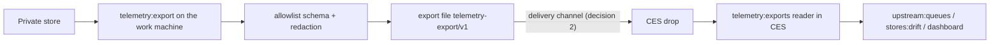

# Plan: a telemetry path from a consumer whose store CES cannot reach
- **Date**: 2026-11-20
- **Status**: Draft
- **Author**: Claude + Louis
- **Scope**: backend (a consumer-side export CLI, a CES-side reader, one schema; no UI). Stack `js-ts`. **Nothing here is built until Louis decides §6.**
- **Target domain(s)**: `scripts`, `shared-lib`

Origin: a work organisation moved its audit store from a public-endpoint Postgres to a **private** one reached
through a localhost port-forward ([runbook](../runbooks/moving-the-audit-store.md)). That repo is meant to feed
telemetry to CES, and the move silently ended it: CES can only read a store it can connect to. This plan decides
what replaces the read, without giving CES a route into the organisation's network.

## 0. Measurements (before any design)

*measured* = a command was run and its output observed this session (2026-11-20); *derived* = reasoning over measured
rows; *unknown* = nobody has looked.

| # | Question | Answer | Label · how |
|---|---|---|---|
| M1 | What does `npm run upstream:queues` report for a store it cannot reach? | the store goes to `unqueried`; with zero answering stores the card reads **"NOTHING WAS CHECKED … NOT an empty queue"**. Not a wrong empty. | measured · `queryStore` on a dead loopback DSN → `{ok:false, rows:[], reason:'spawn-failed'}`; `collectQueues` routes `ok:false` to `unqueried` (`scripts/upstream-queues.mjs`) |
| M2 | Same for `npm run stores:drift`? | same shape: `{ok:false, drift:null}` → `unqueried`, "NOTHING WAS CHECKED … NOT 'every store is current'" | measured · `queryStoreDrift` on the same DSN |
| M3 | Is the reason actionable? | **no.** Both report `spawn-failed`, because a non-zero child exit carries no `err.code`; "the store is down" and "the CLI crashed" read identically | measured · same two calls |
| M4 | What does CES read from a consumer's store today? | (a) open `upstream_issues` rows (`upstream-queues`), (b) migration/constraint drift (`store-drift`), (c) per-repo audit rows, but **only** when the consumer shares CES's own store | derived · `upstream-queues.mjs`, `store-drift.mjs`, `docs/reference/audit-telemetry-queries.md` |
| M5 | Which of those survive a private store? | none. (a) and (b) need a connection; (c) needs the same store. | derived from M4 |
| M6 | How many consumers are private today? | one known (the work repo). Whether others will follow is unknown. | unknown |

**Conclusion of M1–M3: there is no wrong-empty bug to fix.** The honest rendering already exists. The one defect is M3's
opaque reason, which is a two-line mapping and belongs in Phase 0 below, not in the store-move PR.

## 1. The problem, stated narrowly

CES wants to know, per consumer, a small set of facts: is the tooling healthy there, is the store current, how are
audits converging, which upstream reports are open. For a shared store it reads them. For a private store it cannot,
and today the absence renders as `unqueried` — correct, but permanent: nothing can ever turn it into an answer.

**Non-goals.** CES does not connect to the organisation's network, hold its credentials, or run a tunnel. The export
carries no source code, finding text, file paths, repo names, hostnames or DSNs. The work machine is not required to
reach anything outside the organisation unless the organisation permits it (§6 decision 1).

## 2. Design: the work machine pushes a redacted summary; CES ingests it

### 2.1 What is exported (an allowlist, never a denylist)

One JSON document, `telemetry-export/v1`, validated by a Zod schema with **`.strict()`** at every level (an unknown key
is a rejection, not a pass-through — a guard that is inert on its defaults is the failure this repo keeps closing):

| Field group | Contents |
|---|---|
| Envelope | `schema` (`telemetry-export/v1`), `exportId`, `generatedAt`, `window {from, to}`, `consumerAlias` (the registry alias, never a repo name), `storeFingerprint` (the existing 16-hex digest), `toolBundleSha` (the sync manifest hash) |
| Health | the `doctor` store-reachability verdict, `stores:drift` result (counts of unapplied / mismatched migrations, live-constraint status), migration ledger head |
| Audit | per skill and per round: counts of audit runs by verdict, rounds to convergence, finding counts by severity and category, adjudication outcome counts. **Counts and enumerations only.** |
| Upstream | open `upstream_issues` as `{id (8 hex), severity, category, ageDays}`. **Titles and bodies are not exported by default** (§2.2). |
| Measurement honesty | for every group, `measured: true|false` and a `reason` when false (e.g. the store was unreachable at export time). An export never writes a zero for a group it could not read. |

### 2.2 Redaction

Three layers, in this order, each independently tested:

1. **Allowlist by construction** — the exporter builds the document from named columns into the strict schema. Free
   text (finding detail, issue titles, rationale) has no field, so it cannot be exported by accident.
2. **Value scrub** — every remaining string passes `redactSecrets` (`scripts/lib/secret-patterns.mjs`), and any value
   that looks like a path is classified by `scripts/lib/sensitive-paths.mjs` (the single oracle; no fifth
   implementation) and dropped if sensitive. The export-time analogue of the existing egress gate, with **fail-closed**
   semantics: a classification error drops the value and records a `redactions` count, never passes it.
3. **Opt-in bodies** — upstream titles are useful to the CES maintainer but can carry organisation detail. They are
   exported only under `--include-upstream-titles`, **after** the CLI prints the exact outbound text and waits for a
   human to confirm. No flag, no titles.

This is **Tier 3** work in the testing doctrine (sensitive-path egress): the redaction tests land in the **same commit**
as the exporter, including a canary-secret fixture (a planted token, a planted `~/.ssh` path, a planted hostname) that
must not appear anywhere in the serialised export.

### 2.3 Cadence

Manual first: `npm run telemetry:export` writes the file and prints its path. Then two existing triggers, neither
new infrastructure: a `/ship` post-step when the store is reachable, and the **local weekly maintenance** replica
(`AUDIT_LOOP_WEEKLY_MAINTENANCE=1`, `docs/runbooks/local-maintenance-checks.md`). The export is idempotent, keyed by
`(consumerAlias, window)`, so a repeat overwrites rather than duplicates. A cadence is **observed, never trusted for
having been configured** (AGENTS.md): CES decides freshness from the newest `generatedAt` it holds, not from a
schedule it was told about.

### 2.4 How CES shows "no export received" — unmeasured, never zero

The CES-side reader keeps a list of **expected exporters** (the private entries of the gitignored consumer registry,
`scripts/lib/consumer-repos.local.json`) and renders each in exactly one of four states:

| State | Meaning | Rendered as |
|---|---|---|
| `received` | a valid export, newer than `2 × cadence` | its figures, with the export's age |
| `stale` | the newest valid export is older than that | the last figures **labelled with their age**, never as current |
| `rejected` | a file arrived and failed the schema or redaction re-check | "rejected: <reason>" — never silently dropped |
| `never received` | an expected exporter with no file | **"unmeasured — no export received"**; no count, no `0`, no "clean" |

A group inside a received export with `measured:false` renders as unmeasured too. This is the same rule as the existing
`unqueried` cards ("NOTHING WAS CHECKED … NOT an empty queue"), extended to the one case they cannot reach.
**An absent export is a missing measurement; it is never summed as zero** — the property the whole design exists to
keep, and the one a test pins in both directions (absent ⇒ unmeasured; a genuine `0` in a received export ⇒ `0`).

### 2.5 CES-side ingestion

The simplest thing that is a true function of the problem: **files, not a table.** The reader scans a configured drop
directory, validates each file against the same schema (re-running the redaction scrub — CES does not trust the sender),
and keeps the newest valid export per alias. No new migration, no new store write path, no new credential. If volume or
history ever demands a table, that is a separate, later decision with its own migration; building it now answers a
question nobody has asked.

## 3. Alternatives considered

| Option | Verdict |
|---|---|
| **A. Do nothing; document** | Honest but permanent: CES has no view of the work repo, ever. Acceptable only if Louis decides the telemetry is not worth the surface. |
| **B. Give CES read access to the private store** (VPN, a second tunnel, a read role) | **Rejected.** It moves an organisation's credential and network path onto the CES maintainer's machine, which is exactly what a private store exists to prevent. |
| **C. Replicate the store into one CES can reach** | **Rejected.** A copy of the private data outside the private network, to avoid a summary of it. Strictly worse than D on every axis but completeness. |
| **D. Push a redacted summary (this plan)** | **Recommended.** CES receives only what the organisation's own machine chose to emit, in a schema CES validates. |
| **E. A hosted ingestion endpoint** | Deferred. A service to run, authenticate and secure, for a volume of one export a week. Revisit only if consumers multiply (M6). |

## 4. Phases

| Phase | Deliverable | Gate |
|---|---|---|
| **0** | `queryStore` / `queryStoreDrift` map a non-zero exit carrying a connection-failure envelope to `store-unreachable` instead of `spawn-failed` (M3). Test with a dead port; negative control: a genuine CLI crash stays `spawn-failed`. | one small PR; independent of the rest |
| **1** | `telemetry-export/v1` schema + the exporter + redaction layers + canary-secret tests, **same commit** (Tier 3). Reads only; writes one file. | `npm run check`, the canary suite |
| **2** | CES reader + the four-state rendering in `upstream:queues` / `stores:drift`, with both absent-⇒-unmeasured and genuine-zero-⇒-zero tests. | tests above |
| **3** | The two triggers (`/ship` post-step, weekly maintenance) and a `doctor` line saying whether an export is overdue. | cadence observed over two real cycles, not assumed |

Phases 0 and 1 are independent; 2 needs the schema from 1; 3 needs both. Each is its own PR and each carries its own
audit. Nothing past phase 0 starts before §6 is answered.

## 5. Risks

- **The redaction is the product.** One leaked hostname in a file the organisation did not review is worse than no
  telemetry. Mitigation: allowlist-by-construction (a field that does not exist cannot leak), fail-closed scrub, the
  canary fixture, and human confirmation before any free text leaves the machine.
- **A plausible but stale picture.** A `stale` export rendered as current is the same defect as a wrong empty. Mitigation:
  age is part of the rendering, and `stale` is a distinct state with its own test.
- **Schema drift between exporter and reader** (the prose↔code seam in AGENTS.md). Mitigation: one schema module
  imported by both sides; the reader re-validates; a fixture derived from a real export, not a hand-written factory.
- **Scope creep toward "just a bit more detail".** The strict schema makes every addition a visible diff to review.

## 6. Decisions for Louis (nothing is built until these are answered)

1. **May the work machine send anything outside the organisation?** This decides whether delivery is possible at all.
   If not, the only path is a human carrying the file (still valid: the reader does not care how it arrived).
2. **Delivery channel**, given (1) is yes: a shared folder CES can read, a private repository, or email. The plan is
   channel-agnostic on purpose; the schema and the reader do not change.
3. **Titles**: are upstream report titles ever worth exporting (with the confirm step), or is `{id, severity, category,
   age}` enough?
4. **Is one private consumer enough to justify phases 1–3**, or is the documented `unqueried` state acceptable until a
   second private consumer appears (M6)?
5. **Cadence**: weekly via the maintenance replica, or only on demand?

## 7. Acceptance criteria

- A consumer whose store is unreachable from CES appears in CES's output as one of the four states in §2.4, never as
  zero and never absent from the list.
- A received export contains no key outside the schema, and the canary fixture (token, sensitive path, hostname) is
  absent from the serialised bytes.
- Deleting the drop directory turns every private consumer into `never received — unmeasured`, with no code change.
- `stale` is rendered with its age; a reader given an export older than `2 × cadence` never prints it as current.
