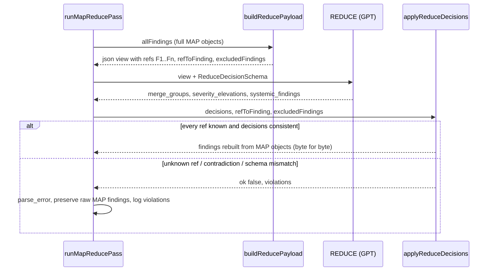

# Plan: REDUCE decides by reference, MAP findings survive byte for byte
- **Date**: 2026-11-28
- **Status**: In Progress
- **Author**: Claude + Louis
- **Scope**: backend — stack `js-ts`
- **Target domain(s)**: `audit-orchestration`, `shared-lib`
- ⚠ **Cross-domain work** — `scripts/lib/robustness.mjs` is `shared-lib`, the scheduler is `audit-orchestration`; the crossing (orchestration imports a pure shared helper) already exists and is not widened.
- **Upstream report**: `aa0298f2` (HIGH), confirmed at `067057e9`.

## 1. Context Summary

The map-reduce code audit runs one MAP call per audit unit, then one REDUCE
call to deduplicate, elevate patterns and flag cross-file issues. REDUCE
corrupts the findings it is given, and a consumer reproduced two real
findings coming back truncated.

**Code Trace** (all at `067057e9`):

- `scripts/lib/audit/map-reduce-scheduler.mjs:321-351` — MAP results are collected into `allFindings`, each tagged `_mapUnit = i`. Ids are unit-local (`H1` in unit 0 and `H1` in unit 3 are different findings).
- `scripts/lib/audit/map-reduce-scheduler.mjs:436` → `buildReducePayload(allFindings)` at `scripts/lib/robustness.mjs:162-197`.
  - `:168-172` `summarize` keeps 11 fields and slices `detail` to `MAX_DETAIL_CHARS = 200` (`:14`) with no marker. It drops `risk`, `recommendation`, `principle`, `is_mechanical`, `classification`, `lineQuote`, `is_reopened`.
  - `:175-191` drops tail findings, then cuts `detail`/`category`/`section` further, to fit `MAX_REDUCE_JSON_CHARS = 120_000`.
- `scripts/lib/audit/map-reduce-scheduler.mjs:458-466` — REDUCE is asked for `PassFindingsSchema` (`:49-54`): full findings, `max(15)`. The model must REGENERATE every finding from the truncated view.
- `scripts/lib/code-analysis.mjs:343-345` — `REDUCE_SYSTEM_PROMPT` says "PRESERVE the `classification` object on every finding". The payload never contained it, so the instruction asks for a field the model was never shown: a prose↔code contract with nothing on the giving end.
- `scripts/lib/audit/map-reduce-scheduler.mjs:505-506` — `result: reduceResult.result` replaces the findings wholesale. Nothing rehydrates them.
- `scripts/lib/audit/llm-helpers.mjs:350-353` — the only shape check on a parsed response is "`findings` is an array"; nothing validates the REDUCE response against its Zod schema in code.

**Patterns reused**: the scheduler's failure path (`:482-500`) already preserves raw MAP findings under a classified `ReduceStatus`; `normalizeFindingsForOutput` (scheduler wrapper over `robustness.mjs:205`) already sorts + semantically dedups the raw-preservation paths.

**Neighbourhood considered** (`get-neighbourhood`, coverage `verified`, 2522 eligible): `normalizeFindingsForOutput` (`precedent`, above-floor-standout) — opened; it is a sort/dedup normaliser that takes already-final findings, not a rehydrator. Decision: write a **sibling** pure function rather than extending the normaliser with REDUCE semantics it should not own; the success path reuses only its sort order and `_hash` identity, never its dedup (§2 decision 5a). Everything else banded `review`.

## 2. Proposed Architecture

REDUCE stops writing finding text. It returns DECISIONS keyed by an opaque
reference the payload assigns; code applies them to the full MAP findings.

**Key decisions**

1. **Opaque per-run refs, not finding ids** (#5 single source of truth, #13 validation). MAP ids collide across units, so `id` cannot key a rehydration. The payload assigns `F1..Fn` in its sorted order and returns the `ref → finding` map; REDUCE sees and answers only refs.
2. **REDUCE response is decisions only** — new `ReduceDecisionSchema` beside `PassFindingsSchema`:
   - `merge_groups[]`: `{keep_ref, duplicate_refs[], reason}` — duplicates of the same issue. Output = the `keep_ref` MAP finding, unchanged except `severity` = max over the group; duplicates leave the output but are kept WHOLE on `_reduce.mergedFrom` (`{ref, reason: 'reduce-merge', finding}`), appended to any provenance already there, so a merge is reversible. The gating tags take the conservative merge (`importance` important if any member is, `is_quick_fix` true if any member is), recorded as `_reduce.<tag>From`. *(Revised in /audit-code R1-R5.)*
   - `severity_elevations[]`: `{ref, severity, reason}` — raise only. A lowering is a contract violation (the old prompt already forbade it).
   - `systemic_findings[]` (max 5): `{source_refs[], severity, category, section, detail, risk, recommendation, is_quick_fix, principle}` — genuinely new cross-unit text, the one place REDUCE still writes prose. Source findings are KEPT: a systemic finding names the class, each instance is still a location to fix, and dropping them is exactly the text loss this fixes. **Construction contract** (code, deterministic):
     - sources: ≥ 2 **distinct** known refs, none merged away in the same answer, whose **effective groups** span ≥ 2 distinct `_mapUnit` values, else a violation. A source's effective group = the source, everything already merged into it (collapsed twins, recursively) and whatever this answer merges into it — the one derivation the unit check, tags and classification all read;
     - `id`: `S1`, `S2`, … skipping any id already used by a finding in this pass;
     - `category`: prefixed `[SYSTEMIC] ` unless already prefixed;
     - `is_quick_fix`: REDUCE's own judgement OR any effective-group member's (a model can raise the flag, never clear it); `is_mechanical`/`is_reopened`: `false`; `pre_existing`/`newly_reachable`: `false` (pre-existing findings never enter REDUCE); `importance`: `important` if any effective-group member is, else `nit`;
     - `classification`: `null` when no effective-group member has one; otherwise the "primary" is the highest-severity **classified** member (ties by payload order), which supplies `sonarType`; `effort` = max over classified members on `TRIVIAL < EASY < MEDIUM < MAJOR < CRITICAL`. The PRODUCER is the REDUCE model: `sourceKind: 'MODEL'`, `sourceName` = the model that served REDUCE. `_reduce.classificationDerivedFrom` = `{ref, id, _mapUnit}` of the primary, so inherited metadata is never presented as an independent assessment;
     - provenance: `_reduce.sourceRefs` = `[{id, section, _mapUnit}]` of the sources.
   - `quick_fix_warnings`, `summary` — unchanged meaning.
3. **Omitted refs are kept, not dropped** (#16 graceful degradation). A ref REDUCE never mentions passes through unchanged. Old REDUCE trimmed to 15 by regeneration; that cap is gone, deliberately — every raw-preservation path already returns all findings.
4. **Unknown refs fail loudly** (#15). Any unknown ref, a ref in two groups, a `keep_ref` also listed as a duplicate, an empty `duplicate_refs`, an elevation of a merged-away ref, a lowering, a systemic finding breaking its source rule, or a response that fails `ReduceDecisionSchema.safeParse` → `applyReduceDecisions` returns `{ok:false, violations}`. The scheduler logs each violation to stderr and takes the existing failure path with `ReduceStatus.PARSE_ERROR`, preserving raw MAP findings. That status reaches the run result through `reducePassStatuses`, so it is not silent anywhere. Array minimums are enforced in code, not as `minItems` in the provider schema.
   **Helper boundary** (`scripts/lib/audit/llm-helpers.mjs:350-353`, `:528`): `callGPT` rejects only a NON-array `findings` key and otherwise returns `output_parsed` unvalidated; the decision schema has no `findings` key, so the helper passes it through untouched. The scheduler therefore owns validation: it `safeParse`s `reduceResult.result` against `ReduceDecisionSchema` before applying anything. On `reduceResult.failed` the sentinel (a decisions-shaped empty object) is never applied — the existing classified-failure branch runs first, unchanged. The helper is not modified.
5. **Budget cuts are marked and logged** (#19). `detail` is no longer sliced by default. The budget is measured on the final serialized view (`JSON.stringify(view, null, 2).length`, the string actually sent). Over budget, tail findings are left out of the REDUCE *view*; they still pass through to the output unchanged, each marked `_reduce: {excluded: 'budget'}`, with the existing stderr line and a summary note. If a single finding alone still exceeds the budget, its view `detail` is cut with an explicit `…[truncated for REDUCE input]` marker (the view only, never the output); if the serialized view still does not fit, the existing `degraded` → `BUDGET_EXCEEDED` path runs and every raw MAP finding is preserved. Other view fields are bounded by the producer schema (`category` 80, `section` 120, `principle` 150), so they are not cut.
5a. **Identical-identity findings collapse LOSSLESSLY, before REDUCE and on every output path.** *(Revised in /audit-code R1/R4 — supersedes the plan-audit wording.)* `semanticId` (`scripts/lib/findings.mjs:27-39`) hashes only `category|section|detail`. The deduping `normalizeFindingsForOutput` DISCARDED a twin whose remedy differed; keeping both instead gave two findings one `_hash`, colliding in every consumer keyed on it. New `collapseIdenticalFindings` keeps one survivor per identity and the twins WHOLE on its `_reduce.mergedFrom` (`reason: 'identical-identity'`), promoting gating tags. The scheduler's wrapper (every output path: REDUCE applied, failed, skipped, over budget, pre-existing) uses it, and it runs BEFORE the payload is built, so every ref REDUCE sees is a settled survivor; the view's `_mapUnits` lists every contributing unit.
6. **Prompt and schema agree, checked on the EMITTED schema.** `REDUCE_SYSTEM_PROMPT` is rewritten around refs and the three decision lists; the "PRESERVE classification" line goes (code preserves it now). A test reads `z.toJSONSchema(ReduceDecisionSchema)` and asserts every field the prompt names is a property — never the Zod source.

**Right-sizing.** *Band-aid*: raise `MAX_DETAIL_CHARS` and add the five missing fields to the whitelist — REDUCE still regenerates text, so any field can still be paraphrased, cut by output caps, or dropped by the model. *Over-engineered*: a general finding-identity service with persisted cross-run ids. *Chosen*: per-run refs + a pure applier — the smallest thing that makes REDUCE unable to touch MAP text at all, which is the actual requirement.

## 6. Sustainability Notes

- New MAP finding fields survive REDUCE automatically: nothing whitelists output fields any more.
- The `_reduce` marker is one namespaced object, so new provenance (e.g. a future merge confidence) is additive.
- If REDUCE moves to another provider, only the schema handoff changes; the applier is provider-free.

## 7. File-Level Plan

- `scripts/lib/robustness.mjs` (modify) — `buildReducePayload` returns `{json, includedCount, totalCount, degraded, refToFinding, excludedFindings}`; view entries `{ref, id, severity, category, section, detail, recommendation, principle, _mapUnits}` (tail cut and lone-finding cut both binary-searched on the serialized length); `MAX_DETAIL_CHARS` removed (no current requirement). New pure `applyReduceDecisions(decisions, {refToFinding, excludedFindings}, {reducerName})` → `{ok:true, findings, stats}` | `{ok:false, violations}`; `collapseIdenticalFindings`, `contributingUnits`, `sortFindingsForOutput`.
- `scripts/lib/audit/map-reduce-scheduler.mjs` (modify) — `ReduceDecisionSchema`; REDUCE call uses it with a decisions-shaped empty sentinel; success path validates + applies, violations take the `PARSE_ERROR` preservation path; every output path goes through the lossless collapse (§2 decision 5a).
- `scripts/lib/code-analysis.mjs` (modify) — `REDUCE_SYSTEM_PROMPT` rewritten for the ref contract.
- `tests/reduce-rehydrate.test.mjs` (create) — the seam tests (§9).
- `tests/robustness.test.mjs` (modify) — payload tests updated; the `caps detail length at MAX_DETAIL_CHARS` test asserted the bug and is replaced by its inverse.
- `tests/legacy-production-audit-hardening.test.mjs` (modify) — REDUCE stubs answer in the decision shape.
- `tests/reduce-status-run-level.test.mjs` (modify) — clean-run negative control answers in the decision shape.

**Phase 1 — Payload + applier**: refs, unmarked-cut removal, pure applier with violation detection. Files: `scripts/lib/robustness.mjs` (modify), `tests/robustness.test.mjs` (modify), `tests/reduce-rehydrate.test.mjs` (create).

**Phase 2 — Wire REDUCE to decisions**: schema, prompt, scheduler success/violation paths, stub updates. Files: `scripts/lib/audit/map-reduce-scheduler.mjs` (modify), `scripts/lib/code-analysis.mjs` (modify), `tests/legacy-production-audit-hardening.test.mjs` (modify), `tests/reduce-status-run-level.test.mjs` (modify), `tests/reduce-rehydrate.test.mjs` (modify).

**Close-out (not a phase)**: the touched test files locally (`node --test`), then `npm run guards:preflight`. The full suite is this public repo's GitHub Actions `full-suite.yml` run on the PR (AGENTS.md §Testing) — its result on the pushed head is the full-suite evidence, reported as-is.

## 8. Risk & Trade-off Register

- **More output findings than before** (no regenerate-to-15). Accepted: matches every raw-preservation path; losing real findings to fit 15 was part of the defect.
- **Merged finding's `classification` is the kept finding's, not an effort-max blend.** The old blend rule never executed (the payload dropped `classification`), and the kept finding's effort estimate belongs to its own text.
- **Systemic findings add to the count** rather than replacing instances. Accepted: replacement was the text loss.
- **Violation ⇒ whole REDUCE discarded**, not partially applied. Partial application would silently mix trusted and untrusted decisions; all-or-nothing is the loud choice.

## 9. Testing Strategy

At the seam, same commit (Tier 3 doctrine):

1. **Byte-for-byte survival (subject)** — drive the REAL `runMapReducePass` with a stubbed client. A MAP finding whose `detail` is > 200 chars and which carries every field (`risk`, `recommendation`, `principle`, `is_mechanical`, `classification`, `lineQuote`, tags) comes back `deepEqual` to the MAP object on every original field, when REDUCE merges a duplicate into it and when REDUCE ignores it.
2. **Negative control** — the same assertion against the old behaviour (REDUCE response regenerated from the old 200-char payload view, i.e. `result: reduceResult.result`) must fail; recorded red at `067057e9` before the fix is applied.
3. Unknown ref → `reduceStatus: parse_error`, raw MAP findings preserved, violation on stderr.
4. Omitted ref survives; budget-excluded finding survives with `_reduce.excluded === 'budget'`.
5. Pure applier unit tests → violations: lowering, ref in two groups, empty `duplicate_refs`, systemic with a repeated ref, systemic whose sources share one `_mapUnit`; valid cross-unit systemic builds per the construction contract (ids, effort max, tie-break, null classification, derived marker).
6. Two unmerged MAP findings with identical `category|section|detail` but different `recommendation`/`classification` both survive (scheduler seam), as do a systemic finding's two sources. A systemic whose highest-severity source is unclassified takes its classification from the classified one.
7. Through the real `callGPT` boundary (stubbed client): a valid decision response applies; an old-shape `PassFindingsSchema` response fails `safeParse` → `parse_error`; a thrown provider error keeps its existing classified status.
8. Prompt↔schema: every field named in `REDUCE_SYSTEM_PROMPT` is a property of `z.toJSONSchema(ReduceDecisionSchema)` and in its `required`; `zodTextFormat(ReduceDecisionSchema, …)` converts without throwing (the provider handoff the scheduler actually makes).

**Proof plan**: oracle = test 1 + its negative control (red at `067057e9`, green after); pass = both directions observed; report evidence = the test names and the red run's failing assertion.

## Audit trail

- **/audit-plan** (SID `audit-plan-1795854519884-90992`): R1 SIGNIFICANT_GAPS H:4 M:3 — 6/7 accepted (H1 dismissed: misread of the skills/** edit rule); R2 NEEDS_REVISION H:2 — 2/2 accepted. Stopped at the requested 2-round cap.
- **Final gate** (gemini-4-argon, round 1): APPROVE, gate `approve`, 1 LOW (wording contradiction in §1/§7 vs §2 decision 5a) — fixed.
- **/audit-code** (SID `audit-code-1795855358174-32056`): 6 rounds, every finding accepted and fixed except one tooling-bound note (R1 M6). R1 H:6 M:6 → R2 H:1 M:3 → R3 H:1 M:1 → R4 H:1 → R5 H:2 M:2 → R6 H:1 M:1 (all R6 fixed after the round; the round cap stops further GPT rounds). Design revisions it drove are marked *(Revised in /audit-code …)* above.
