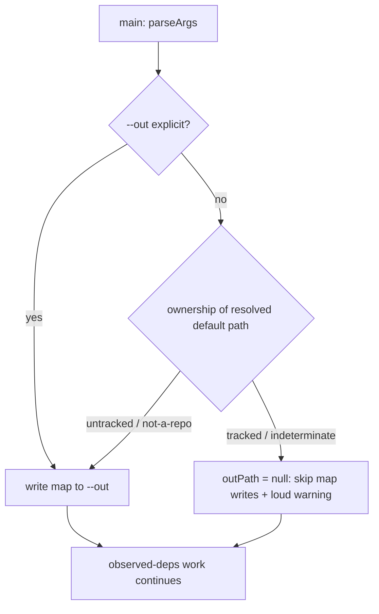

# Plan: render-mermaid must not overwrite a tracked architecture map
- **Date**: 2026-11-16
- **Status**: Draft
- **Author**: Claude + Louis
- **Scope**: backend (detect-stack: js-ts)
- **Upstream report**: c9ebd9f9 (ai-organiser; store: NAS)

## 1. Context Summary

ai-organiser TRACKS `docs/architecture-map.md`. Its pre-push hook backgrounds
`maintenance-checks.mjs --opportunistic`; the `arch-maintenance` check runs
`symbol-index/render-mermaid.mjs` with `args: []`, which rewrites the default
`docs/architecture-map.md` (stamped with the pushed commit sha). Every push dirties
the consumer's main checkout and the dirt blocks the next sync. In CES the file is
Category A (gitignored), so nothing is seen here.

**Code Trace** (read at 85cfbccd):
- `scripts/symbol-index/render-mermaid.mjs:58-87` `parseArgs` — `args.out` defaults to `docs/architecture-map.md`; `--out` indistinguishable from the default.
- `:250` `outPath = path.resolve(args.out)`; writes to `outPath` happen at `:186` (`writeAbortStub`, called at `:262,274,282` and via `handleRenderFailure`'s `writeStub` `:235`) and `:441` (final render).
- `scripts/maintenance-checks.mjs:187-199` — `arch-maintenance` step `render-mermaid.mjs`, `args: []`; comment at `:194-195` claims the map is gitignored (true in CES only).
- Neighbours: `scripts/lib/sync-untrack.mjs:85` already uses `git ls-files` as the ownership oracle (precedent: ask git, don't infer).
- Observed-deps envelope `.audit-loop/domain-deps-observed.json` is a separate output the sync's managed gitignore block covers; it is unaffected.

## 2. Proposed Architecture

Decision is made per write via `decideOut()` in `main()`; the write sites stay as they are but become no-ops for a null path.

Design decisions:
- `parseArgs` records `outExplicit` (#1 single source: one place knows the origin of the path).
- New exported pure-ish helper `resolveMapOutput({outPath, outExplicit, ownership})` → `{outPath|null, warning|null}`, plus `isTrackedByGit(absPath, exec)` (injectable, argv array, no shell; algorithm below). Both live in `render-mermaid.mjs` (no new synced module → no sync-closure change) (#11 testable).
- Only the DEFAULT path is guarded. An explicit `--out <path>` is the operator override and always writes (even a tracked path) — the operator named it.
- **Current algorithm (single authority; earlier wording in the audit trail is superseded).** `isTrackedByGit(absPath, exec)` returns `tracked | untracked | not-a-repo | indeterminate`, classified from exit code, stdout and the filesystem, never git's prose. Steps: (1) `owningDir` walks up to the nearest existing ancestor of `absPath`, realpath'd (symlinked `docs/`, nested repo, submodule), keeping the unresolved tail so a tracked map whose `docs/` is deleted from the working tree is still queried as `docs/architecture-map.md`; (2) run `git ls-files -z -- <real path>` with `cwd` = that ancestor, `LC_ALL=C`, and `GIT_INDEX_FILE`/`GIT_DIR`/`GIT_WORK_TREE`/`GIT_COMMON_DIR`/`GIT_PREFIX` removed so discovery comes from the destination, not from variables exported for another repo or index; (3) exit 0 + stdout → `tracked`, exit 0 + empty → `untracked`; spawn error → `indeterminate`; (4) non-zero → `not-a-repo` ONLY if `GIT_DIR`/`GIT_WORK_TREE` are unset in the process env and `lstat` of `.git` is ENOENT/ENOTDIR on every ancestor, otherwise `indeterminate` (dangling `.git`, access error, dubious ownership, corruption). `tracked` and `indeterminate` skip; `untracked` and `not-a-repo` write (CES unchanged).
- **Evaluation point**: `main()` resolves `absOut = path.resolve(args.out)` once and a `decideOut()` closure re-evaluates the guard at EVERY map write (render, abort stubs, failure stub) so a map staged while the slow store init runs is not overwritten on a stale verdict; the first skip warning is emitted once, up front, before the first `await`. Write seams return whether they wrote and every status message derives from that result. Residual: the window between the final re-check and the atomic rename.
- `resolveMapOutput` takes the state and returns `{outPath|null, warning|null}`. `writeAbortStub(null, …)` and a new exported `writeMapOutput(outPath, markdown)` (the final-render seam, `:441`) are no-ops for a null path, so every write site honours the decision through one value.
- **Exit/status contract** (audit R1 H2): the guard only nulls `outPath`; it never changes an exit code. Render/observed-deps failures keep exiting as today (1 via `handleRenderFailure`); cloud-off, no-repo and no-snapshot keep exit 0 (stub skipped, observed-deps cleanup still runs). A guarded skip is a success: the map is not a measurement and the observed-deps envelope — the thing `maintenance-checks` consumes — is still produced. The skip is distinguishable on stderr by a stable `arch:render: SKIPPED map write` line (tail captured by the maintenance runner).
- The stub-on-failure path: a tracked map is no longer replaced by a "render-failed" stub (consistent: tool never touches a tracked default).
- **Remedies in the warning** (audit R1 M1): (a) to stop tracking: `git rm --cached docs/architecture-map.md` AND add it to `.gitignore` — ignoring alone does not untrack a tracked file; (b) to refresh a deliberately tracked map by hand: `npm run arch:render -- --out docs/architecture-map.md` (the `--` is load-bearing) — this DOES modify the tracked file.
- `maintenance-checks.mjs` comment corrected: the map is gitignored in CES only; consumers may track it and the renderer then skips it.

Right-sizing: band-aid = make maintenance pass `--out` to a temp path (hides the problem for one caller, leaves `npm run arch:render` in consumers dirtying them); over-built = new config key / `.arch-render.json` opt-in. Chosen: one git-derived check keyed on the existing fact (tracked or not); no config. Current requirement: ai-organiser keeps the file tracked.

## 7. File-Level Plan
- `scripts/symbol-index/render-mermaid.mjs` (modify) — `outExplicit` in `parseArgs`; export `isTrackedByGit`, `resolveMapOutput`; null-path no-ops in `writeAbortStub` + final write; warning.
- `scripts/maintenance-checks.mjs` (modify) — comment only.
- `tests/render-mermaid-tracked-guard.test.mjs` (create) — unit + real-git temp-repo tests.
- `docs/plans/render-mermaid-tracked-output-guard.md` (create) — this plan.

## 8. Risks
- Consumer tracking the map now gets a map that goes stale silently → the warning says how to refresh (`--out`). Accepted: staleness of a tracked artifact is the consumer's choice.
- Warning noise on every backgrounded push run → one line.

## 9. Testing Strategy (proof plan)
Real `git init` temp repos (not mocks):
1. `isTrackedByGit` (real git): tracked → `tracked`; untracked and gitignored → `untracked`; non-git dir → `not-a-repo`; injected exec throwing ENOENT → `indeterminate`; injected non-zero `ls-files` inside a repo (a `.git` ancestor exists; stderr text irrelevant, incl. dubious-ownership wording) → `indeterminate`; non-zero `ls-files` with no `.git` ancestor → `not-a-repo`; subdirectory `repoRoot` with distinct tracked `sub/docs/architecture-map.md` and untracked root `docs/architecture-map.md` → each classified by its own absolute path.
2. `resolveMapOutput`: tracked → null + warning containing `git rm --cached`, `.gitignore`, `--out`; indeterminate → null + warning with the git error; untracked/not-a-repo → path, no warning (positive control); explicit `--out` on a tracked path → path, no warning, `isTracked` never consulted.
3. Write seams: `writeAbortStub(null, …)` and `writeMapOutput(null, …)` write nothing; with a path they write (positive control). `handleRenderFailure` with `outPath: null` and the REAL `writeAbortStub` re-throws the original error and leaves a tracked file's bytes unchanged (render-failure path).
4. CLI end-to-end, cloud-off (`AUDIT_DB_URL` empty, no DB needed → no suite enrolment): temp git repo with the map tracked → bytes unchanged, exit 0, stderr has `SKIPPED map write`; same repo untracked → stub written; `--out docs/architecture-map.md` on the tracked repo → stub written; a stale observed-deps file is still cleared in the tracked case (independent work continues).
Not covered, stated: the DB-backed successful final render. It goes through the same `writeMapOutput` seam tested in (3); enrolling a DB-gated CLI suite for one null-check is not proportionate.
Negative control: temporarily remove the guard → the tracked-repo CLI test (4) must fail.
