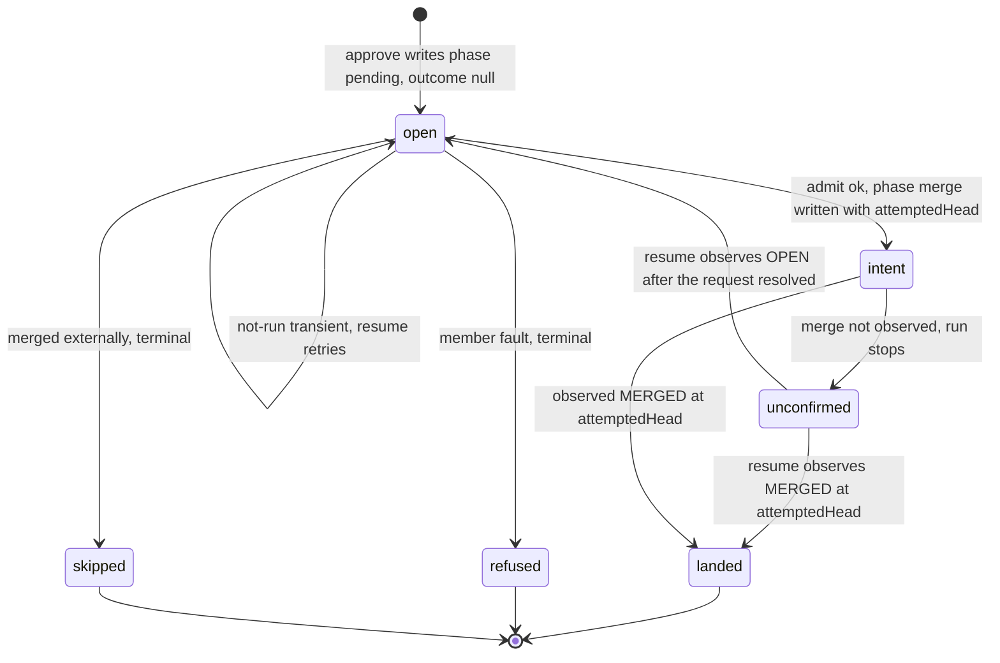

# Plan: Ship-batch per-member outcomes (PR B)
- **Date**: 2026-11-18
- **Status**: Draft
- **Author**: Claude + Louis
- **Scope**: backend (js-ts). Principle set: `skills/plan/references/engineering-principles.md`.
- **Depends on**: docs/plans/coordinator-aggregate-ship.md: PR A (the read-only half: `ship-commit.mjs --check-shipped-head`, `scripts/lib/fleet/coordinator-grant.mjs`, the archive-check refusal) must merge first. This plan calls both readers and edits neither.
- **Target domain(s)**: `fleet`, `tests`
- ⚠ **Cross-domain work**: the `tests` domain is touched only through test files.

**Neighbourhood considered** (`get-neighbourhood`, k=8): every candidate banded `review`, the nearest being
`classifyOutcome` (`scripts/model-eval-discovery.mjs:218`) and `computeGateDisposition`
(`scripts/lib/final-review/round-gate.mjs:91`). Neither is on this seam, so the outcome model is greenfield, written inside
`fleet`. Incident neighbourhood: only INC-001 (sensitive-path symlinks) came back, and it does not touch these paths.

---

## 1. Context Summary

### The problem, from the audit evidence

PR A's branch `claude/plan-coordinator-aggregate-ship-f258c2` (head `1cd2df21`) built `fleet land --ship-batch` on top of the
serial runner through three seams: `hooks.onMerged`, `hooks.noUpdate`, and a `messageFor` that may return `{skip}`. It then
ran `/audit-code` for six rounds, SID `audit-code-1794991985170-57032`, ledger and results in
`C:/GIT/claude-engineering-skills/.claude/worktrees/quirky-pare-95e715/.audit/`. GPT's HIGH count per round was
19, 7, 6, 5, 5, 1, and the loop hit the cap without converging. `scripts/lib/fleet/serial.mjs` and
`scripts/lib/fleet/ship-batch.mjs` were raised in **every** round. The structural card's reading
(`docs/plans/coordinator-aggregate-ship.md` §Code audit trail, `1cd2df21`) is that the serial runner has **no first-class
per-member outcome model**. Each round fixed the cited site, and the next round found the same mistake at another site.

The recurring findings fall into six classes. Each class needs the primitive to make the mistake **impossible to write**;
patching more sites will not close it.

| Class | What keeps recurring | Findings (round-id) | Sites at `1cd2df21` |
|---|---|---|---|
| **F1 Fault scope is decided at each call site** | Each failure chooses between `stop` (the whole run) and `memberFail` (one member) by hand, and every round found another site that still stops the whole batch for a one-member problem. | r1-M1, r1-M10, r2-H5, r4-H3, r5-H3 | `serial.mjs:274` (PR unreadable), `:292` (unverifiable update), `:298` (DIRTY), `:332` and `:335` (checks failed, or pending at the deadline), `:334` (inventory) |
| **F2 One member, two mutable records** | Per-member truth is split between the serial step (`serial/<t>.json`) and the sidecar state (`shipbatch/<t>.json`). They have two writers, two validators and no shared identity, and a write failure on one is swallowed. | r1-H2, r1-M7, r2-M4, r3-H3, r3-H5, r4-M1 | `serial.mjs:233` (the sidecar-existence discriminator), `ship-batch.mjs:46`, `:67`, `:94`, `:248`, `:364`, `:401` |
| **F3 A MERGED observation is classified in two places** | Whether a merged PR was merged by us, by someone else, at an unaccounted head, or without a merge oid is decided partly in the serial loop and partly in `onMergedInner`, and the two disagree on resume. | r2-H1, r2-H6, r3-H4, r3-M1, r4-H2, r6-H1 | `serial.mjs:256-266`, `:276`, `:371`; `ship-batch.mjs:335`, `:339`, `:343` |
| **F4 A failed read is treated as a measured defect** | A failed `rev-list` or an unreadable message was once recorded as a confirmed loss (`provenance-lost`, `landed-on-untested-base`), and it then stayed terminal on resume. | r1-M2, r1-M8 | `ship-batch.mjs:343-356` |
| **F5 The claim about the landed set** | After a member is skipped, the rest land while the docs and comments still say "the tested set is the merged set". | r2-H2, r4-H4 | `serial.mjs:243` (`skipMember`), `ship-batch.mjs:241` |
| **F6 The build check and the merge check differ** | The merge-time re-check was a different function from the build-time one, with other arguments: no full-suite verdict, a different remote, a 12-character head prefix, a sidecar identity of only id and oid. | r1-H9, r1-H12, r4-H1, r5-H4, r5-H5, r3-H3 | `ship-batch.mjs:236` (no remote at the build), `:304-329` (`messageFor`), `:321` |

Two findings are **not** structural, and this plan states how they are handled instead:

- **r1-H1, the base race.** `--match-head-commit` guards the head, not the base. Closing that gap needs a server-side merge
  queue, which is a GitHub setting and therefore Louis's. This plan keeps **detection**: a squash whose first parent is
  foreign is recorded `landed` with verdict `untested-base`. The deferral stays open as proposal `p-20261118092842`.
- **r5-H2, a merge queued past the observation timeout.** The approve step refuses to start on a base with a merge-queue
  rule (§2.6), and a merge that GitHub accepted but that has not been observed stops the run as `merge-unconfirmed` (§2.2).

### Tonight's incidents that set the required behaviour

These come from `ship-ci-verification-disciplines-for-ces-2026-11-18.md` §2.1-2.2 in the shared notes folder:

- **#609.** A cherry-pick silently dropped a commit, and the tree no longer matched the tested one.
- **#612.** The tested head `cd3f53ef` was not the PR head `cf6ab101`.
- **A hand-padded SHA.** GitHub refused the merge with "Head branch was modified".

The rules that follow:

- re-read the head at merge time, from the API;
- prove by **tree id** that it is the tested content;
- pin the merge to that full oid with `--squash --match-head-commit`, and never use `--auto`.

### What exists today (Code Trace)

Pinned to `origin/main` `e93ccd78` (`git show origin/main:scripts/lib/fleet/serial.mjs`) unless marked `1cd2df21`:

- `fleet land --approve <t> --serial` (`scripts/lib/fleet/land.mjs:77-80`) goes to `approveSerial` (`serial.mjs:357-389`).
  That function checks `approvable`, rejects a shallow clone, runs `verifyFacts`, writes `serial/<t>.json` (`SerialRunSchema`,
  `serial.mjs:68-77`) and then calls `runSerial` (`:207`), which runs `loop` (`:215`) under `serial/<t>.lock`.
- `loop`, for each step, does the following:
  - views the PR (`viewPr`);
  - stops the run when the PR is MERGED at an unaccounted head, closed, a draft, or retargeted;
  - stops on a new head, or proves it is the run's own update (`classifyUpdatedHead`, `:173`);
  - stops on DIRTY;
  - on BEHIND, runs update-branch;
  - waits for the required checks (`observeRequiredChecks`);
  - re-reads the PR, calls `messageFor` (ship-train only), and records the `merge` intent;
  - runs `gh pr merge --squash --match-head-commit h`, then observes MERGED.

  **Every failure is a `stop(i, reason)`** (`:224-228`). The whole run is the unit.
- `ship-train.mjs land` is the only other caller. It passes `messageFor` and sets `messageRequired` (`serial.mjs:71-74`).
  Its tests: `tests/ship-train-recovery.test.mjs`.
- At `1cd2df21`, `ship-batch.mjs` adds the following around that loop (`ship-batch.mjs:219-262`, `:297-421`):
  - `buildShipBatch`: partition, then `buildFn` over the ship-ok members, then a mutable sidecar;
  - `makeShipBatchHooks`: `messageFor` (the grant, base tip, child, CI and message), `onMerged` (the read-back), `onSkip` and
    `noUpdate`;
  - `withSummary`: folds the sidecar states into the result.
- Tests: `tests/fleet-serial.test.mjs` (282 lines), `tests/fleet-land-ship-batch.test.mjs` (890 lines at `1cd2df21`), and the
  shared fixture `tests/helpers/fleet-serial-fx.mjs`.

Reused unchanged:

- `observeRequiredChecks` and `requiredInventory` (`required-checks.mjs`);
- `runShippedHeadChild` and the child contract (PR A);
- `readShipBatchGrant` (PR A);
- `ciVerdict`;
- `parseMessageTrailers` and `AI_TRAILER_KEYS`;
- `splitCommitMessage` and `readBackReasons` (moved as they are from `1cd2df21`);
- `withFileLockSync`, `atomicWriteFileSync`, `patchTrain`, `withTrainLock`.

---

## 2. Proposed Architecture

### The one design idea

**One closed member-step result, one outcome per member on the serial step itself, and a policy object that answers
questions but never writes.** The serial loop stays the single writer of all per-member state. A policy is a set of **pure
decisions** that the loop asks at fixed points: admit this head? the message? classify this read-back? The loop records the
answer and the policy records nothing. This removes F2 by construction, because there is one record and one writer.

The plain runner is the default policy, and the default policy maps every fault to today's `stop(i, reason)` with today's
reason text. That is how the non-batch behaviour stays byte-identical (§2.5).

### 2.1 The persisted state: phase, outcome and stop reason are three fields (#5, #13)

A member's record is made of three separate fields:

- **`step`** is the **phase**. It is today's field, unchanged: `pending`, `update`, `wait`, `merge`, `merged`.
- **`outcome`** is new and optional. It is written only by a run that has a policy (§2.4). Null means "nothing decided yet".
- The run's **`outcome.reason`** says why the run stopped. It is today's field. A run stop never writes onto a member: the
  faulting member keeps its own specific code, and every other open member keeps `outcome: null`.

`step` also gains one optional field, `attempt: { head: Oid, ghExit: number|null, at }`. It is written before and after the
`gh pr merge` call, and it is what attribution is decided from (§2.3).

`outcome` is a **discriminated union on `status`**. Each variant has its own closed code enum and its own required evidence,
and every variant is a `z.strictObject`:

| status | terminal? | codes (closed per variant) | required evidence |
|---|---|---|---|
| `landed` | **yes** | `merged` | `verdict` (one of the four below), `mergeOid`, `attribution`, `gate` |
| `refused` | **yes** for this run | `pr-closed`, `pr-draft`, `pr-retargeted`, `conflict`, `behind-base`, `head-moved`, `checks-failed`, `shipped-head-refused`, `ci-refused`, `message-invalid` | `reason`, and `trees: {tested, seen}` for `head-moved` |
| `skipped` | **yes** | `merged-externally` | `mergeOid` (or `null`, which needs `reason`), `seenHead` |
| `not-run` | **no** | `pr-unreadable`, `checks-pending`, `tree-unreadable`, `message-unreadable`, `head-churn`, `merge-unconfirmed`, `awaiting-read-back` | `reason` |

The fields in the evidence column:

- `verdict` is one of:
  - `verified`;
  - `provenance-lost`: the squash dropped or changed an AI-* trailer, the subject or the body;
  - `untested-base`: the squash's first parent is not the chain tail;
  - `wrong-target`: the merged PR's base branch is not `run.base`.
- `attribution` is `this-run` or `unknown` (§2.3).
- `gate` is the AI-Gate value read back from the squash, or `null`.

**Load-time invariants.** These are checked by `validatePolicyRun(run)` on **every** read, before any remote action. A
violation refuses the run as `record-inconsistent` and merges nothing.

1. Step ids are unique. The `policy.members` keys equal the step ids exactly.
2. `step === 'merged'` holds if and only if the outcome is one of: `landed`, `skipped`, or `not-run/awaiting-read-back`.
3. The outcome `not-run/merge-unconfirmed` requires `step === 'merge'` and an `attempt`.
4. `policy.baseChain` equals `[B0, ...mergeOid of every landed member whose verdict is verified or provenance-lost, in step
   order]`. The `untested-base` and `wrong-target` verdicts never extend the chain.
5. A landed or skipped member's `mergeOid` is not repeated elsewhere in the run.

Rules a test pins, one test each:

1. **Terminal means never re-decided.** `--resume` skips a terminal member. A refusal is never re-run into a pass: "nothing
   retries a refused condition" (the chip preamble).
2. **Only a measurement can be terminal.** A read that failed is always `not-run`, whether it was a view, a tree, a fetch, a
   rev-list or a message. Only two values that were read successfully and differ give a terminal outcome. This closes F4.
   An empty subject that was read successfully is `refused/message-invalid`. An unreadable message is
   `not-run/message-unreadable`.
3. **`waived` and `not-run` gates are never laundered.** The child admits only `passed` or `converged` (PR A, C1). A child
   refusal can only become `refused/shipped-head-refused`. `gate` is copied from the read-back trailer. No aggregate gate value
   exists anywhere.
4. **A landed outcome and its chain extension are ONE `setStep` write**, so no crash can separate them.

### 2.2 The member step is a function that cannot stop the run: F1 made impossible (#11, #15)

The member loop body moves into a function, `stepMember(ctx, i)`. It **has no `stop` in scope**, and it returns one variant of
a closed result type:

- `{ kind: 'next' }`: the member advanced to a terminal outcome, or to `merged`;
- `{ kind: 'again' }`: re-verify from the top, for example when the head moved;
- `{ kind: 'fault', fault: { kind, reason, evidence } }`.

The loop, which is the only holder of `stop`, maps each variant in one `switch` that handles every case. A `fault` is looked
up in `FAULTS`, a frozen table in `scripts/lib/fleet/member-outcome.mjs` keyed by fault kind: `{ scope, status, code }`. The
mapping goes:

- **No policy:** `stop(i, reason)`, with the reason byte-identical to today's (§2.5).
- **A policy, with a `member` fault:** `setStep(i, { outcome })`, then the next member.
- **A policy, with a `run` fault:** the member's specific outcome is written if the table gives one (`merge-unconfirmed`,
  `awaiting-read-back`); then `stop(i, reason)`.

Two exits are structural:

- **A throw inside `stepMember`** is caught by the loop and becomes the run fault `internal-error`.
- **An unknown `fault.kind`** is itself `internal-error`. The test for it feeds one in.

So a new failure site cannot bypass classification: there is no way to stop the run from inside the member step except by
returning a fault. The **behaviour** tests cover each fault kind (§9 test 1). A source census remains only for a fact that
structure cannot express (§2.3, the `--auto` ban). That census has a positive control and states its limit: it reads argv
literals.

| fault kind | scope | under a policy | default = today's `stop` (line at `origin/main` `e93ccd78`) |
|---|---|---|---|
| `pr-unreadable` | member | not-run | `serial.mjs:248` |
| `pr-closed`, `pr-draft`, `pr-retargeted` | member | refused | `:255-257` |
| `head-unaccounted` (§2.3 decides between `head-moved` and admission) | member | refused `head-moved`, or admitted | `:261` |
| `head-churn` (more than `MAX_HEAD_CHURN` = 3 head changes for one member in one run) | member | not-run | n/a: policy only (today's loop is unbounded and stays so) |
| `update-unverifiable`, `update-foreign` | run | stop (unreachable under ship-batch: it never updates) | `:264`, `:265` |
| `conflict` (DIRTY) | member | refused | `:270` |
| `behind` | member | refused `behind-base` (the policy has `allowUpdate: false`) | the update-branch path, unchanged |
| `update-churn`, `update-failed`, `update-invisible` | run | stop (unreachable under ship-batch) | `:272`, `:276-277`, `:288` |
| `checks-failed` / `checks-not-run` | member | refused `checks-failed` | `:299` |
| `checks-inventory-unknown` | run | stop (repository configuration, not a member problem) | `:301` |
| `checks-pending-deadline` | member | not-run `checks-pending` | `:304` |
| `message-stop`, `message-required` (ship-train's `messageFor`) | run | n/a (a policy run never takes `messageFor`) | `:320`, `:321` |
| `merged-observed` | per the §2.3 table | §2.3 | `:251` and the observation loop |
| `merge-unconfirmed` (any gh merge whose result was not observed as MERGED: a non-zero exit, a timeout, a lost response) | **run** | not-run `merge-unconfirmed`, then stop | `:339`, both texts |
| policy run answers: `grant-revoked`, `base-moved`, `read-back-unmeasured`, `record-inconsistent`, `internal-error` | run | stop | n/a |
| policy member answers: `shipped-head-refused`, `ci-refused`, `message-invalid`, `message-unreadable`, `tree-unreadable` | member | refused or not-run, per §2.1 | n/a |

**There is no member-scope merge failure (R1-H1).** A failed `gh pr merge` proves nothing about whether the request landed, so
the run never advances past an unobserved merge.

### 2.3 Merge-time identity, attribution and the read-back: F3 and F6 in one place (#1, #13)

**Admission has two kinds of input (R1-M2).** `admitMember(invariant, candidate)` in `ship-batch.mjs` takes:

- **`invariant`**, fixed for the batch: the grant, `base`, `remote`, the tested oid `T`, the tested tree `TT`, the worktree
  path.
- **`candidate`**, bound to the head about to be judged: its full oid `C` (40 or 64 hex, from the API), `C^{tree}`, the child
  envelope **at `C`**, the CI verdicts at `C`, and the PR identity at `C`.

The build calls it with `C = T`. The merge calls it with the live head. Head-bound evidence is **never reused across heads**:
an envelope or CI verdict whose head is not exactly `C` is a refusal. The test asserts that the `invariant` object is
deep-equal between build and merge, `remote` included (r4-H1, r5-H4), and that every `candidate` field was obtained fresh at
`C`.

**The merge sequence under a policy** (the order is the contract):

1. **Admit:** `admitMember(invariant, candidate@h)`.
2. **Base chain:** the live base tip must equal `policy.baseChain.at(-1)`; otherwise the run fault `base-moved`.
3. **Final re-read** (R1-H7): `gh pr view --json state,isDraft,baseRefName,headRefOid,headRepository,mergeStateStatus`.
   - The PR must be OPEN, not a draft, `baseRefName === run.base`, from the same repository, and `headRefOid === h`.
   - A different head is `again`, counted toward `head-churn`.
   - Any other change gives that fault.
4. **Write the intent:** `setStep(i, { step: 'merge', attempt: { head: h, ghExit: null } })`.
5. **Merge:** `gh pr merge <n> -R <repo> --squash --subject … --body-file … --match-head-commit h`, never `--auto`.
6. **Record the call:** `setStep(i, { attempt: { …, ghExit } })`.
7. **Observe:** view until MERGED, or until the observation window ends, which gives `merge-unconfirmed`.

What GitHub guards, stated:

- `--match-head-commit` makes the head **server-side atomic**. The target branch and draft status are **not** guarded between
  step 3 and step 5, and no client can guard them.
- That window is therefore **detected, not prevented.** The observed MERGED document's `baseRefName` must equal `run.base`,
  or the member is `landed/wrong-target`, which never extends the chain and stops the run.

**The GitHub guarantee that reconciliation relies on (R1-H1).** The REST merge endpoint behind `gh pr merge` is synchronous
when there is no merge queue (refused at approve, §2.6) and no auto-merge (never requested). The request either merged when it
returned or it did not. GitHub does not complete a plain merge request later.

A PR that a **later** `--resume` observes still OPEN, with `step === 'merge'`, therefore did not merge:

- the member returns to admission from the top;
- a re-attempt still pins `--match-head-commit`;
- a PR that has merged cannot be merged a second time.

Within one run the loop never advances past an unobserved merge: `merge-unconfirmed` stops the run. A test kills the fake
`gh` after it performed the merge and before it answered, then resumes: the member ends landed, and the fake counts exactly
one merge.

**Head identity when the live head `L` is not accounted** (`head-unaccounted`), under a policy:

- Read `git rev-parse L^{tree}`. Fetch `refs/pull/<n>/head` first when `L` is absent locally.
- If the tree is **equal to `TT`**: `L` carries exactly the tested content (the #612 shape). Admission runs **again with
  `candidate@L`**, so the child proves `L`'s own provenance and the message is copied from `L`'s commit. `L` then joins
  `accounted`.
- If the tree is **not equal**: `refused/head-moved`, with `trees: {tested: TT, seen}` (the #609 shape).
- If the tree is **unreadable**: `not-run/tree-unreadable`.

Under no policy, today's stop applies, with the same text.

The **audited** head stays the child's job: `--check-shipped-head` judges the audited tree against the shipped head over the
branch's paths (PR A, C4). Admission proves two links: tested tree = merged tree, and audited tree ≈ shipped tree.

**Attribution and observed state are separate (R1-H2).** `classifyMerged({ step, doc })` in `member-outcome.mjs` is pure,
and it is the **only** reader of `state === 'MERGED'`:

| phase when observed | `doc.headRefOid` | outcome |
|---|---|---|
| `merge`, `attempt.ghExit === 0` | `=== attempt.head` | merged, `attribution: this-run`; the read-back follows |
| `merge`, `ghExit` non-zero or null (crash, lost response) | `=== attempt.head` | merged, `attribution: unknown`; the read-back follows. The content is the admitted head either way, and the read-back judges the message, so an external merge of the same head with another message reads `provenance-lost` |
| `merge` | `!== attempt.head` | `skipped/merged-externally` with `mergeOid` and `seenHead` recorded, then the run fault `base-moved` |
| `pending`, `wait` or `update` (no intent) | any | `skipped/merged-externally` with `mergeOid` and `seenHead`; the next member's base check then stops the run |
| any, with no merge oid reported | any | the outcome is `not-run/awaiting-read-back` when the phase is `merge`, else `skipped` with `mergeOid: null` and a reason; resume re-views |

`attribution: unknown` is printed in the summary and is never shown as `this-run`. Under no policy, the table collapses to
today's two branches, with the same texts.

**The read-back** is pure: `policy.readBack({ step, mergeOid, doc })`.

- `{ measured: false, why }` (a fetch, rev-list or message read failed) gives `not-run/awaiting-read-back` and the run fault
  `read-back-unmeasured`. The phase stays `merged`, and resume repeats the read-back.
- `{ measured: true, firstParent, reasons, gate, baseRefName }` gives `landed` with the first matching verdict:
  - `wrong-target`, when `baseRefName !== run.base`;
  - `untested-base`, when `firstParent !== chain tail`;
  - `provenance-lost`, when `reasons.length`;
  - `verified` otherwise.

  Only `verified` and `provenance-lost` extend the chain, in the same write. `wrong-target` and `untested-base` stop the run.

### 2.4 One record: F2 made impossible (#5, #14 transaction safety)

- **The build record is write-once.** `fleet/shipbatch/<train>.json` is v2, with a strict zod schema (r1-M7). It holds:
  `{schemaVersion: 2, trainId, grantVersion, checkedAt, base, remote, candidateTree, members: [{id, repo, prNumber, oid, tree,
  worktree}], excluded}`. Here `candidateTree` is `train.candidate.tree`, the integration tree the combined test ran on.
  Nothing patches the record after the build. If the train cannot be read back, the record is not written at all (r4-M1).
- **The approve step copies and then stops reading it.** `approveShipBatch` does the following:
  - validates the build record against the train: **every** identity field (`id`, `repo`, `prNumber`, `oid`) for every source,
    the source count, and `candidateTree === train.candidate.tree` (r3-H3, r3-H5);
  - calls `approveSerial` with a `policy`.

  `approveSerial` writes the optional run block:
  `policy: { name: 'ship-batch', grantVersion, remote, candidateTree, baseChain: [train.destination.expectedOid], members:
  {<id>: {tree, worktree}}, excluded }`. From then on the **serial record is the only mutable per-member truth**, with one
  writer (the loop) under one lock (`serial/<t>.lock`). `onSkip`, `patchBatch` and the swallowed write (r2-M4) are gone.
- **The discriminator is persisted** (r1-H2). A record with `policy.name === 'ship-batch'` refuses any driver that does not
  pass the ship-batch policy object, with today's resume hint (`serial.mjs:233-235`, `1cd2df21`). `messageRequired` keeps
  its meaning for ship-train, unchanged.
- **One seam each.** `runSerial` takes `{ messageFor }` (ship-train, unchanged) or `{ policy }` (ship-batch). Passing both
  throws. The `{skip}` answer and `hooks.*` are deleted.

### 2.5 What stays byte-identical (#18 backward compatibility)

The plain serial runner (`land --approve --serial`, `land --resume`) and `ship-train.mjs land` must keep, against
`origin/main`:

- the same `serial/<t>.json` bytes: `outcome`, `attempt` and `policy` are written only when a policy is present;
- the same result objects;
- the same stop reasons, character for character;
- the same `gh` argv sequence;
- the same `finishSerial` train patch.

**The proof is a golden test.**

- `tests/fleet-serial-golden.test.mjs` drives every scenario of `fleet-serial.test.mjs` and `ship-train-recovery.test.mjs`,
  re-expressed as table rows over the same fixture, through a recording fake `gh`.
- It snapshots three things: the argv list, the final serial record with timestamps normalised, and the result.
- The fixture `tests/fixtures/fleet-serial-golden.json` is **generated from `origin/main`'s `serial.mjs`**, in Phase 1, before
  any edit. The generating command and the source sha go in the fixture header.
- The negative control: a one-character change to one stop reason must turn the test red.

### 2.6 Resume and idempotency after a crash

Each step is written as an intent before the remote action and as a result after it. Under a policy, resume first runs
`validatePolicyRun` (§2.1), then re-reads the grant (`run/grant-revoked` refuses), then walks the steps in order. For each
step it decides by `(step, outcome)`:

| phase | outcome | resume does |
|---|---|---|
| any | terminal | nothing. A closed batch re-run prints the same summary and performs no remote action |
| `merged` | `not-run/awaiting-read-back` | re-view for the merge oid if it is missing, then repeat the read-back |
| `merge` | `not-run/merge-unconfirmed` or null | view, then `classifyMerged`. An OPEN PR goes back to admission (the synchronous-merge guarantee, §2.3); nothing is replayed without a fresh admission |
| `pending`, `update` or `wait` | not-run or null | full admission at the current head |

At approve, the base branch's rules are read (`gh api repos/{o}/{r}/rules/branches/{base}`). A `merge_queue` rule refuses the
batch as `merge-queue-present`, and an unreadable answer refuses it as `rules-unreadable`. Nothing merges in either case,
because the synchronous guarantee in §2.3 holds only without a queue (r5-H2). The grant path fails closed.

### 2.7 The landed set, stated honestly: F5 and R1-H3

Louis's rule is: "a member failing its re-check refuses alone and the rest still land". The landed set may therefore differ
from the combined-tested set, and individual tree equality cannot prove the combined result. The result's `combination` field
is computed **only** from measurements:

- **`tested`**: every member landed with verdict `verified`, AND `git rev-parse <last mergeOid>^{tree}` equals
  `policy.candidateTree`. The final base tree is the very tree the combined test ran on.
- **`different`**: every member landed and the trees were read, but they differ. An order effect or a squash nuance produced a
  tree nobody tested. It is reported loudly.
- **`subset`**: at least one member is not landed (refused, skipped or not-run). That combination was never tested.
- **`unverified`**: a tree could not be read.

`different`, `subset` and `unverified` are never shown as `tested`. In all three cases, each landed member still had its own
required checks green at the exact head that merged, and the base chain proves that only the batch's own merges sat under it.
The comment at `ship-batch.mjs:241` (`1cd2df21`) and the runbook sentence are rewritten to say this. The members came from
fleet claims whose paths are disjoint (`fleet claim` blocks overlaps), so the untested part is semantic interaction only. The
runbook says so.

### 2.8 Truth table: ok, exit code, train phase, summary (R1-M1)

Exit codes use fleet's existing mapping (`land.mjs`): 0 for ok, 3 for refused or stopped.

| case | `ok` | exit | train phase | `combination` | summary first line |
|---|---|---|---|---|---|
| every member landed `verified`, trees equal | true | 0 | `landed` (`finishSerial`) | `tested` | `landed n of n; final tree = the combined-tested tree` |
| every member landed `verified`, trees differ or unreadable | false | 3 | `landed` (the merges happened) | `different` / `unverified` | `landed n of n; final tree is NOT the combined-tested tree: verify by hand` |
| at least one landed `verified`; the rest terminal `refused` or `skipped`; no stop | true | 0 | `awaiting-merge` (unchanged from `1cd2df21`) | `subset` | `landed k of n: a SUBSET of the combined-tested set; m need the user (/ship in that session)` |
| any landed verdict other than `verified` | false | 3 | `awaiting-merge`, or `landed` if every member merged | as computed | `PROVENANCE: <member> <verdict>` leads the summary |
| a run-scope stop with members still not-run | false | 3 | `awaiting-merge` | `subset` | `stopped: <reason>; resumable: land --resume <t> --ship-batch` |
| every member terminal, none landed | false | 3 | `awaiting-merge` | `subset` | `nothing landed; every member needs the user` |

After the first line, the summary prints one line per member: status, code, attribution, the read-back AI-Gate, the merge
oid, and for needs-user members "type /ship in that session".

### Right-sizing

- **The band-aid** would be a seventh round of site patches: more `memberFail` calls and more sidecar states. Six rounds
  showed that this does not converge.
- **The over-built version** would be a general workflow engine: pluggable step graphs, an event log, a sidecar per policy,
  and an outcome model for every land mode.
- **Chosen:** optional `outcome`/`attempt` fields on the existing step, a closed member-step result with one fault table, one pure `classifyMerged`, one policy object with
  four decisions (`admit`, `baseCheck`, `message`, `readBack`) plus `allowUpdate`. That is exactly what the six structural
  classes need, and nothing the plain runner does not already have changes for it.

---

## 6. Sustainability Notes

- **An assumption that could change:** a second policy, say a wine-cellar strict-up-to-date mode that would allow updates.
  The policy object takes it without touching the loop, and the fault table keeps scope decisions in data.
- **The serial record stays at schema version 1.** The new keys are optional, and older code reading a policy run's record
  rejects it (strict schema), which is the correct direction. No run on main uses the sidecar, because PR A does not ship the
  batch verb, so nothing needs migrating.
- **`serial.mjs` is 452 lines at `1cd2df21`** and will be about 470. The pure parts move out to `member-outcome.mjs`, so it
  stays under the 1000-line ratchet (`.file-size-baseline.json`).

## 7. File-Level Plan

| File | Intent | What |
|---|---|---|
| `scripts/lib/fleet/member-outcome.mjs` | create | `FAULTS`, `OutcomeSchema` (a discriminated union), `classifyMerged`, `validatePolicyRun`, `combinationOf`, `summariseOutcomes`: pure, no I/O (#2, #11) |
| `scripts/lib/fleet/serial.mjs` | modify | optional `outcome`, `attempt` and `policy` in the schemas; `stepMember` (no `stop` in scope) and the one result `switch`; policy plumbing; the merge-time re-read and tree identity under a policy; remove `hooks`, `memberFail`, `skipMember`, the `{skip}` answer and the sidecar-existence probe |
| `scripts/lib/fleet/ship-batch.mjs` | modify | `admitMember` (one predicate for build and merge); the write-once v2 build record; `makeShipBatchPolicy` (pure decisions, no writes); `approveShipBatch`/`resumeShipBatch` pass `policy`; the summary reads the serial record only; delete `patchBatch`, `onSkip`, `MEMBER_STATES` and the sidecar mutation |
| `scripts/lib/fleet/land.mjs` | modify | the `--ship-batch` wiring as on `1cd2df21` (argv refusals, approve, resume, build) |
| `scripts/lib/fleet/argv.mjs` | modify | the `--ship-batch` flag, as on `1cd2df21` |
| `skills/fleet/references/ship-batch.md` | modify | the outcome table, the subset sentence, tree identity, the resume rules |
| `skills/fleet/SKILL.md` | modify | the one approval exception for `land --approve --ship-batch` (as on `1cd2df21`; within `skills:size:gate`) |
| `skills/fleet/gate-contract.json` | modify | bind the stated gates (`no --auto`, the tree identity, the member-step structure) to their code and tests |
| `tests/fleet-serial-golden.test.mjs` | create | the byte-identity proof (§2.5) |
| `tests/fixtures/fleet-serial-golden.json` | create | generated from `origin/main`, Phase 1 |
| `tests/fleet-serial-fault-census.test.mjs` | create | the `--auto` argv census (positive control, stated limit) and the `internal-error` structure tests |
| `tests/fleet-member-outcome.test.mjs` | create | every row of the `classifyMerged` table; the `OutcomeSchema` union negatives; the `validatePolicyRun` invariants |
| `tests/fleet-land-ship-batch.test.mjs` | modify | rebuilt on the public surface (§9); the old sidecar-state assertions go |
| `tests/helpers/fleet-serial-fx.mjs` | modify | a recording fake `gh`; tree-equal re-push and tree-differs fixtures |
| `.claude/skills/fleet/**` | regenerate | `npm run skills:regenerate` (close-out) |

Every path above is repo-relative. PR A's files (`scripts/lib/ship-shipped-head.mjs`, `scripts/lib/ship-preauth.mjs`,
`scripts/lib/fleet/coordinator-grant.mjs`, `scripts/lib/fleet/lifecycle.mjs`) are read, not edited. If merging `origin/main`
in shows that PR A also carried `land.mjs`, `argv.mjs` or the docs rows, this PR edits them in place and claims them.

### 7b. Implementation Phases

**Phase 1: Golden capture.** At `origin/main`, before any edit, write the golden harness and generate
`tests/fixtures/fleet-serial-golden.json`. Commit it on its own, so the commit proves the fixture predates the change.
Files: `tests/fleet-serial-golden.test.mjs` (create), `tests/fixtures/fleet-serial-golden.json` (create),
`tests/helpers/fleet-serial-fx.mjs` (modify).

**Phase 2: The outcome primitive.**
- Write the red tests first: `fleet-member-outcome`, and the census with its positive control.
- Then: `member-outcome.mjs`; schema fields; `stepMember` returning the closed result, with the loop the only holder of `stop`; `classifyMerged` at both MERGED sites;
  policy plumbing with the default policy. The golden test stays green throughout.

Files: `scripts/lib/fleet/member-outcome.mjs` (create), `scripts/lib/fleet/serial.mjs` (modify),
`tests/fleet-member-outcome.test.mjs` (create), `tests/fleet-serial-fault-census.test.mjs` (create).

**Phase 3: Rebuild ship-batch on the primitive.**
- `admitMember`, the v2 build record, the policy (admit, baseCheck, message, readBack, `allowUpdate: false`), the tree
  identity, the merge-queue refusal, the summary.
- The land and argv wiring.
- The F1-F6 behaviour tests.

Files: `scripts/lib/fleet/ship-batch.mjs` (modify), `scripts/lib/fleet/land.mjs` (modify), `scripts/lib/fleet/argv.mjs`
(modify), `tests/fleet-land-ship-batch.test.mjs` (modify), `tests/helpers/fleet-serial-fx.mjs` (modify).

**Phase 4: Docs and contract.**
Files: `skills/fleet/references/ship-batch.md` (modify), `skills/fleet/SKILL.md` (modify),
`skills/fleet/gate-contract.json` (modify).

**Close-out (not a phase):** `npm run skills:regenerate`, `npm run skills:check`, the targeted tests above plus
`tests/fleet-serial.test.mjs` and `tests/ship-train-recovery.test.mjs`, `npm run guards:preflight`. The full suite runs in
Actions for this repo (the AGENTS.md CES rule). The head sha goes to the coordinator, who pushes it.

### 11. Execution Clustering

- **Cluster A**: Phases 1-2, fix-gate: yes.
  - Coupling: the golden fixture is the oracle for the serial refactor, so it must exist before the first edit to
    `serial.mjs`, and Phase 2 is audited against it.
- **Cluster B**: Phases 3-4, fix-gate: final.
  - Coupling: ship-batch is the policy's only caller, and the runbook describes exactly that policy's outcomes.
- **Final gate**: the consolidated final review over the union diff, with the coverage note checked. Gemini saw only part of
  the diff last time, and the approval was scoped to what it was shown.

## 8. Risk & Trade-off Register

| Risk or trade-off | Handling |
|---|---|
| A merge request that failed or timed out may still have landed (R1-H1) | It never advances the run (`merge-unconfirmed`, then a stop). Resume relies on the synchronous merge API, with no queue (refused) and no `--auto` (never sent); the crash-mid-merge test counts the merge calls |
| A refactor of `serial.mjs` changes plain-runner behaviour without anyone noticing | The golden fixture comes from `origin/main` before the edit, and its negative control is proven |
| A subset lands a combination no test ran (F5) | Louis's explicit rule; it is labelled `subset` in the result, the summary and the runbook, never `tested` |
| A tree-equal head `L` merges while its own trailers are unaudited | Admission re-runs the child at `L`, the message is copied from `L`, and the read-back compares `L`'s trailers |
| The base race (r1-H1) | Detection only (`untested-base`, then the run stops). A server-side queue is Louis's setting (deferred, `p-20261118092842`) |
| A merge queue makes a merge unobservable (r5-H2) | Approve refuses on a merge-queue rule or an unreadable rules API |
| `refused` is terminal, so a transient-looking refusal (for example CI red, then re-run green) cannot land in this run | Deliberate: a refusal is never retried into a pass; the user's `/ship` or a rebuild is the path |
| A source census is brittle | The member-step structure enforces F1; the census only guards `--auto` in argv literals, has a positive control, and its limit is stated |
| A partial batch leaves the train `awaiting-merge` | Unchanged from `1cd2df21`; the summary names the remedy. A new train phase would be a `TrainSchema` change, out of scope |

**Deferred:**
- a server-side merge queue (Louis's GitHub setting);
- a strict up-to-date repository landing more than one member per build (the policy has `allowUpdate: false` by design,
  stated in the runbook);
- the final-review marker being local to the chip worktree (PR A's follow-up `p-20261118061826-7f07`).

## 9. Testing Strategy

- **Unit tests (pure):**
  - every row of the `classifyMerged` table;
  - every `FAULTS` row's scope, status and code;
  - the `OutcomeSchema` union. These are negative tests: a landed outcome without a verdict or merge oid; a refused outcome
    with a verdict; a code from another status;
  - `validatePolicyRun`, against every §2.1 invariant: a duplicate id, `merged` with a null outcome, a chain inconsistent
    with the landed records;
  - an unknown `fault.kind`, and a throw from `stepMember`, each give `internal-error`.
- **Integration** (fake `gh`, real git, `tests/helpers/fleet-serial-fx.mjs`). Each test runs through
  `approveShipBatch`/`resumeShipBatch`, so it can also be run against `1cd2df21`:
  1. **F1:** a three-member batch where member 2 hits, in three runs: an unreadable view, checks pending at the deadline,
     DIRTY. Members 1 and 3 land each time, and member 2 is `not-run` / `not-run` / `refused`. At `1cd2df21` the
     pending-deadline case is red (r5-H3).
  2. **F2:**
     - a write failure injected on the serial record makes the run stop loudly, with nothing swallowed;
     - a ship-batch run driven by a plain resume is refused;
     - the build record is byte-unchanged after a full run.
  3. **F3 and attribution:**
     - an external merge while `pending` gives `skipped/merged-externally` with its `mergeOid` (r6-H1);
     - a merge at a head other than `attempt.head` gives `skipped/merged-externally`, then a `base-moved` stop;
     - a fake `gh` that merges and then exits non-zero gives `merge-unconfirmed`, then a stop; resume gives
       `landed/attribution:unknown`, with exactly one merge call;
     - merged with no oid reported, then resume, gives the read-back, then `landed/verified`.
  4. **F4:**
     - a rev-list failure gives `not-run/awaiting-read-back`, and a resume where the read succeeds gives `verified`, never
       `untested-base` (r1-M8);
     - an unreadable message gives `not-run/message-unreadable`, and a resume gives `landed`;
     - an empty subject that was read gives `refused/message-invalid`.
  5. **F5 and R1-H3:**
     - all members landed with the final tree equal to the candidate tree gives `tested`;
     - a forced candidate-tree mismatch gives `different` and `ok: false`;
     - one member refused gives `subset` and `ok: true`.
  6. **F6:**
     - the `invariant` object is deep-equal at build and at merge (a spy), and the `candidate` evidence is fresh at the live
       head;
     - a full-suite verdict that turns red between build and merge gives `refused/ci-refused` (r1-H9);
     - a child envelope head that matches only as a prefix is refused.
  7. **Tree identity and R1-H7:**
     - an equal-tree re-push gives admission at `L`, `--match-head-commit L`, and the message from `L`;
     - the #609 shape (a dropped commit) gives `refused/head-moved` with both trees;
     - a retarget before the final re-read gives `refused/pr-retargeted`;
     - a retarget seen after the merge gives `landed/wrong-target`, then a stop;
     - a head that changes four times gives `not-run/head-churn`.
  8. **Gate honesty:** `AI-Gate: waived` on the head gives `refused/shipped-head-refused`, never merged, and there is no
     aggregate gate in the summary.
  9. **Merge argv:** every recorded `gh pr merge` argv has `--squash` and `--match-head-commit <full oid>`, and none has
     `--auto`. A source census of `serial.mjs` argv literals has a positive control, and it states its limit: it reads
     literals only.
  10. **Crash resume:** the fake `gh` dies at four points: after the intent, during the merge (merged but no answer), after
      the merge, and after `merged`. Each resume ends in the outcomes of a run that never crashed, and the per-PR merge counter
      is at most 1.
  11. **Merge queue:** a `merge_queue` rule gives `merge-queue-present`, and an unreadable rules answer gives
      `rules-unreadable`. Neither merges anything.
- **Byte identity:** `tests/fleet-serial-golden.test.mjs`, plus the unchanged `tests/fleet-serial.test.mjs` and
  `tests/ship-train-recovery.test.mjs`.

**Proof plan** (`skills/plan/references/proof-oracle.md`):

| Change | Oracle | Pass condition | Evidence in the report |
|---|---|---|---|
| Non-batch byte identity | the golden fixture generated at `origin/main` before the edit, plus a one-character negative control | the fixture is reproduced exactly; the control is red | the fixture commit sha (older than the first `serial.mjs` edit), and the control's red output |
| F1-F6 closed | integration tests 1-6, each run against `1cd2df21` first | the named cases are red at `1cd2df21` and green at the PR head | a table: test / red at `1cd2df21` / green at the head |
| F1 cannot recur | the structure (`stepMember` has no `stop`), plus the `internal-error` tests | a throw or an unknown fault inside the member step stops the run as `internal-error`, never as a silent skip | the test names and their output |
| Tree identity, pin, attribution | tests 3, 7, 9, 10 | they pass; each mutation turns one red: skip the tree compare, pin `h` without the final re-read, treat `ghExit != 0` as not merged | a mutation table |
| Never laundered | test 8, plus a mutation mapping `shipped-head-refused` to landed | red under the mutation | a mutation table |
| Combination honesty | test 5, plus a mutation dropping the tree compare | red under the mutation | a mutation table |
