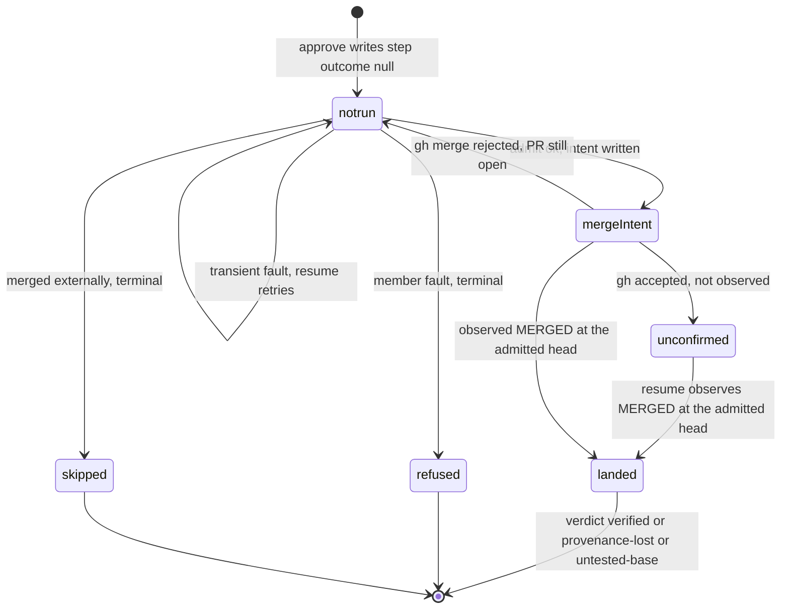

# Plan: Ship-batch per-member outcomes (PR B)
- **Date**: 2026-11-18
- **Status**: Draft
- **Author**: Claude + Louis
- **Scope**: backend (js-ts). Principle set: `skills/plan/references/engineering-principles.md`.
- **Depends on**: docs/plans/coordinator-aggregate-ship.md: PR A (the read-only half: `ship-commit.mjs --check-shipped-head`, `scripts/lib/fleet/coordinator-grant.mjs`, the archive-check refusal) must merge first. This plan calls both readers and edits neither.
- **Target domain(s)**: `fleet`, `tests`
- ⚠ **Cross-domain work**: the `tests` domain is touched only through test files.

**Neighbourhood considered** (`get-neighbourhood`, k=8): every candidate banded `review`, the nearest being
`classifyOutcome` (`scripts/model-eval-discovery.mjs:218`) and `computeGateDisposition`
(`scripts/lib/final-review/round-gate.mjs:91`). Neither is on this seam, so the outcome model is greenfield, written inside
`fleet`. Incident neighbourhood: only INC-001 (sensitive-path symlinks) came back, and it does not touch these paths.

---

## 1. Context Summary

### The problem, from the audit evidence

PR A's branch `claude/plan-coordinator-aggregate-ship-f258c2` (head `1cd2df21`) built `fleet land --ship-batch` on top of the
serial runner through three seams: `hooks.onMerged`, `hooks.noUpdate`, and a `messageFor` that may return `{skip}`. It then
ran `/audit-code` for six rounds, SID `audit-code-1794991985170-57032`, ledger and results in
`C:/GIT/claude-engineering-skills/.claude/worktrees/quirky-pare-95e715/.audit/`. GPT's HIGH count per round was
19, 7, 6, 5, 5, 1, and the loop hit the cap without converging. `scripts/lib/fleet/serial.mjs` and
`scripts/lib/fleet/ship-batch.mjs` were raised in **every** round. The structural card's reading
(`docs/plans/coordinator-aggregate-ship.md` §Code audit trail, `1cd2df21`) is that the serial runner has **no first-class
per-member outcome model**. Each round fixed the cited site, and the next round found the same mistake at another site.

The recurring findings fall into six classes. Each class needs the primitive to make the mistake **impossible to write**;
patching more sites will not close it.

| Class | What keeps recurring | Findings (round-id) | Sites at `1cd2df21` |
|---|---|---|---|
| **F1 Fault scope is decided at each call site** | Each failure chooses between `stop` (the whole run) and `memberFail` (one member) by hand, and every round found another site that still stops the whole batch for a one-member problem. | r1-M1, r1-M10, r2-H5, r4-H3, r5-H3 | `serial.mjs:274` (PR unreadable), `:292` (unverifiable update), `:298` (DIRTY), `:332` and `:335` (checks failed, or pending at the deadline), `:334` (inventory) |
| **F2 One member, two mutable records** | Per-member truth is split between the serial step (`serial/<t>.json`) and the sidecar state (`shipbatch/<t>.json`). They have two writers, two validators and no shared identity, and a write failure on one is swallowed. | r1-H2, r1-M7, r2-M4, r3-H3, r3-H5, r4-M1 | `serial.mjs:233` (the sidecar-existence discriminator), `ship-batch.mjs:46`, `:67`, `:94`, `:248`, `:364`, `:401` |
| **F3 A MERGED observation is classified in two places** | Whether a merged PR was merged by us, by someone else, at an unaccounted head, or without a merge oid is decided partly in the serial loop and partly in `onMergedInner`, and the two disagree on resume. | r2-H1, r2-H6, r3-H4, r3-M1, r4-H2, r6-H1 | `serial.mjs:256-266`, `:276`, `:371`; `ship-batch.mjs:335`, `:339`, `:343` |
| **F4 A failed read is treated as a measured defect** | A failed `rev-list` or an unreadable message was once recorded as a confirmed loss (`provenance-lost`, `landed-on-untested-base`), and it then stayed terminal on resume. | r1-M2, r1-M8 | `ship-batch.mjs:343-356` |
| **F5 The claim about the landed set** | After a member is skipped, the rest land while the docs and comments still say "the tested set is the merged set". | r2-H2, r4-H4 | `serial.mjs:243` (`skipMember`), `ship-batch.mjs:241` |
| **F6 The build check and the merge check differ** | The merge-time re-check was a different function from the build-time one, with other arguments: no full-suite verdict, a different remote, a 12-character head prefix, a sidecar identity of only id and oid. | r1-H9, r1-H12, r4-H1, r5-H4, r5-H5, r3-H3 | `ship-batch.mjs:236` (no remote at the build), `:304-329` (`messageFor`), `:321` |

Two findings are **not** structural, and this plan states how they are handled instead:

- **r1-H1, the base race.** `--match-head-commit` guards the head, not the base. Closing that gap needs a server-side merge
  queue, which is a GitHub setting and therefore Louis's. This plan keeps **detection**: a squash whose first parent is
  foreign is recorded `landed` with verdict `untested-base`. The deferral stays open as proposal `p-20261118092842`.
- **r5-H2, a merge queued past the observation timeout.** The approve step refuses to start on a base with a merge-queue
  rule (§2.6), and a merge that GitHub accepted but that has not been observed stops the run as `merge-unconfirmed` (§2.2).

### Tonight's incidents that set the required behaviour

These come from `ship-ci-verification-disciplines-for-ces-2026-11-18.md` §2.1-2.2 in the shared notes folder:

- **#609.** A cherry-pick silently dropped a commit, and the tree no longer matched the tested one.
- **#612.** The tested head `cd3f53ef` was not the PR head `cf6ab101`.
- **A hand-padded SHA.** GitHub refused the merge with "Head branch was modified".

The rules that follow:

- re-read the head at merge time, from the API;
- prove by **tree id** that it is the tested content;
- pin the merge to that full oid with `--squash --match-head-commit`, and never use `--auto`.

### What exists today (Code Trace)

Pinned to `origin/main` `e93ccd78` (`git show origin/main:scripts/lib/fleet/serial.mjs`) unless marked `1cd2df21`:

- `fleet land --approve <t> --serial` (`scripts/lib/fleet/land.mjs:77-80`) goes to `approveSerial` (`serial.mjs:357-389`).
  That function checks `approvable`, rejects a shallow clone, runs `verifyFacts`, writes `serial/<t>.json` (`SerialRunSchema`,
  `serial.mjs:68-77`) and then calls `runSerial` (`:207`), which runs `loop` (`:215`) under `serial/<t>.lock`.
- `loop`, for each step, does the following:
  - views the PR (`viewPr`);
  - stops the run when the PR is MERGED at an unaccounted head, closed, a draft, or retargeted;
  - stops on a new head, or proves it is the run's own update (`classifyUpdatedHead`, `:173`);
  - stops on DIRTY;
  - on BEHIND, runs update-branch;
  - waits for the required checks (`observeRequiredChecks`);
  - re-reads the PR, calls `messageFor` (ship-train only), and records the `merge` intent;
  - runs `gh pr merge --squash --match-head-commit h`, then observes MERGED.

  **Every failure is a `stop(i, reason)`** (`:224-228`). The whole run is the unit.
- `ship-train.mjs land` is the only other caller. It passes `messageFor` and sets `messageRequired` (`serial.mjs:71-74`).
  Its tests: `tests/ship-train-recovery.test.mjs`.
- At `1cd2df21`, `ship-batch.mjs` adds the following around that loop (`ship-batch.mjs:219-262`, `:297-421`):
  - `buildShipBatch`: partition, then `buildFn` over the ship-ok members, then a mutable sidecar;
  - `makeShipBatchHooks`: `messageFor` (the grant, base tip, child, CI and message), `onMerged` (the read-back), `onSkip` and
    `noUpdate`;
  - `withSummary`: folds the sidecar states into the result.
- Tests: `tests/fleet-serial.test.mjs` (282 lines), `tests/fleet-land-ship-batch.test.mjs` (890 lines at `1cd2df21`), and the
  shared fixture `tests/helpers/fleet-serial-fx.mjs`.

Reused unchanged:

- `observeRequiredChecks` and `requiredInventory` (`required-checks.mjs`);
- `runShippedHeadChild` and the child contract (PR A);
- `readShipBatchGrant` (PR A);
- `ciVerdict`;
- `parseMessageTrailers` and `AI_TRAILER_KEYS`;
- `splitCommitMessage` and `readBackReasons` (moved as they are from `1cd2df21`);
- `withFileLockSync`, `atomicWriteFileSync`, `patchTrain`, `withTrainLock`.

---

## 2. Proposed Architecture

### The one design idea

**One fault table, one outcome per member on the serial step itself, and a policy object that answers questions but never
writes.** The serial loop stays the single writer of all per-member state. A policy is a set of **pure decisions** that
the loop asks at fixed points: admit this head? the message? classify this read-back? The loop records the answer and the
policy records nothing. This removes F2 by construction, because there is one record and one writer. The plain runner is the
default policy, and the default policy maps every fault to today's `stop(i, reason)` with today's reason text. That is how the
non-batch behaviour stays byte-identical (§2.5).



### 2.1 The outcome model (#5 single source of truth, #13 validation)

`SerialStepSchema` gains one **optional** field, `outcome`. It is written only by a run that has a policy (§2.4); an absent
`outcome` means not-run, so a plain run never writes the key.

```js
outcome: z.strictObject({
  status: z.enum(['landed', 'refused', 'skipped', 'not-run']),
  code: z.string().regex(/^[a-z][a-z0-9-]{1,40}$/),   // closed per status, enforced by MEMBER_CODES below
  reason: z.string().max(900),
  verdict: z.enum(['verified', 'provenance-lost', 'untested-base']).optional(), // landed only
  mergeOid: Oid.optional(),                                                      // landed only
  gate: z.string().max(40).optional(),             // the AI-Gate value READ BACK from the squash; never computed
  at: Iso,
}).optional()
```

| status | terminal? | codes (closed set, `MEMBER_CODES` in `member-outcome.mjs`) | counts toward |
|---|---|---|---|
| `landed` | **yes** | `merged`, with `verdict`: `verified`, `provenance-lost` (the squash dropped or changed an AI-* trailer, subject or body), `untested-base` (the squash's first parent is not the recorded chain tip) | landed; a non-`verified` verdict makes the result not ok |
| `refused` | **yes** for this run | `pr-closed`, `pr-draft`, `pr-retargeted`, `conflict`, `behind-base`, `head-moved` (the tree differs from the tested tree), `checks-failed`, `shipped-head-refused` (the child refused; the reasons are carried), `ci-refused` (a full-suite or identity verdict), `message-unreadable` | needs-user: the user types `/ship` in that session |
| `skipped` | **yes** | `merged-externally` (MERGED, but this run never wrote the merge intent) | not landed by this batch, so it carries no batch provenance |
| `not-run` | **no** | `run-stopped`, `pr-unreadable`, `checks-pending`, `tree-unreadable`, `merge-rejected`, `merge-unconfirmed`, `awaiting-read-back` | resumable |

The rules a test pins, one test per rule:

1. **Terminal means never re-decided.** `--resume` skips a member whose outcome is terminal. It is never re-admitted, and a
   refusal is never re-run into a pass. This follows the chip preamble: "nothing retries a refused condition".
2. **Only a measurement can be terminal.** A read that failed, whether a view, a tree, a fetch, a rev-list or a message, is
   always `not-run`. Only two values that were read successfully and differ can produce `refused`, `provenance-lost` or
   `untested-base`. This closes F4.
3. **`waived` and `not-run` gates are never laundered.** The child admits only `passed` or `converged` (PR A, C1), and a
   child refusal can only become `refused/shipped-head-refused`. The `gate` field is copied from the squash's read-back AI-Gate
   trailer. The summary prints it for each member, and no aggregate gate value exists anywhere.
4. **`landed` is written in the same `setStep` that extends the base chain** (§2.3). A crash between the two cannot happen,
   because they are one atomic file write.

### 2.2 The fault table: F1 made impossible (#11 testability, #15 error handling)

`scripts/lib/fleet/member-outcome.mjs` (new, pure, no I/O) exports `FAULTS`, a frozen table keyed by fault kind:
`{ scope: 'run'|'member', status, code }`. Inside the member loop, every exit goes through **one** function,
`fault(i, kind, reason)`:

- **No policy (the plain runner and ship-train):** `return stop(i, reason)`, the same reason string as today. This is
  byte-identical, and §2.5 pins it.
- **A policy, with a `member`-scope fault:** `setStep(i, { outcome: {status, code, reason, at} })`, then the loop goes on to
  the next member.
- **A policy, with a `run`-scope fault:** that member gets `not-run/run-stopped`, then `stop(i, reason)`. Every member not
  yet terminal stays `not-run`.

| fault kind | scope | under a policy | default = today's `stop` (line at `origin/main` `e93ccd78`) |
|---|---|---|---|
| `pr-unreadable` (view failed) | member | not-run | `serial.mjs:248` |
| `pr-closed`, `pr-draft`, `pr-retargeted` | member | refused | `:255-257` |
| `head-unaccounted` (§2.3 decides `head-moved` vs admission) | member | refused `head-moved` or admitted | `:261` |
| `update-unverifiable`, `update-foreign` | run | stop (unreachable under ship-batch: it never updates) | `:264`, `:265` |
| `conflict` (DIRTY) | member | refused | `:270` |
| `behind` | member | refused `behind-base` (policy `allowUpdate: false`) | the update-branch path, unchanged |
| `update-churn`, `update-failed`, `update-invisible` | run | stop (unreachable under ship-batch) | `:272`, `:276-277`, `:288` |
| `checks-failed` / `checks-not-run` | member | refused `checks-failed` | `:299` |
| `checks-inventory-unknown` | run | stop (repo configuration, not a member) | `:301` |
| `checks-pending-deadline` | member | not-run `checks-pending` | `:304` |
| `message-stop`, `message-required` (ship-train's `messageFor`) | run | n/a (a policy run never takes `messageFor`) | `:320`, `:321` |
| `merged-unaccounted` | member | §2.3 table | `:251` and the observation loop |
| `merge-rejected` (gh failed AND PR still OPEN at the deadline) | member | not-run (the base did not move, so the next member is safe) | `:339` failure text |
| `merge-unconfirmed` (gh accepted, not observed) | **run** | stop (a merge may still land, so the chain is unknown) | `:339` accepted text |
| policy `run` answers: `grant-revoked`, `base-moved`, `read-back-unmeasured` | run | stop | n/a |
| policy `member` answers: `shipped-head-refused`, `ci-refused`, `message-unreadable` | member | refused | n/a |

**The census guard is the closure for F1.** `tests/fleet-serial-fault-census.test.mjs` reads `serial.mjs` source, finds the
`loop` body, and fails on any `return stop(` inside the member `for` loop that does not go through `fault(`. It also fails when
a `FAULTS` key is never raised, or a raised kind is not in `FAULTS`. A new failure site written as a bare `stop` is therefore
red at push, which the last six rounds lacked. The census is checked against a positive control: a fixture source with one
bare `stop` must be reported.

### 2.3 Merge-time head re-read and tree identity: F3 and F6 in one place (#1 DRY, #13)

**One admission predicate, used at build AND at merge.** `admitMember({ member, head, base, remote, deps, … })` lives in
`ship-batch.mjs`. It is today's `partitionMembers` body for one member, using the child, `ciAndIdentityReasons` and its full
oid check, called with the **same arguments** in both places, including `remote` (r4-H1, r5-H4). It returns
`{ ok } | { scope, code, reasons }`. The build stores, per member, `{ id, repo, prNumber, oid, tree, worktree }`, where
`tree = git rev-parse <oid>^{tree}`. Once approve has validated them (§2.4), these are the run's only reference values.

The merge sequence, under a policy (the order is the contract):

1. **Admit:** `policy.admit(step, h)`, which re-reads the grant and runs `admitMember` at the head `h` the loop is on.
2. **Base chain:** `policy.baseCheck(tip)`. The live base tip must equal `policy.baseChain.at(-1)`; otherwise
   `run / base-moved`.
3. **Final re-read** (`gh pr view --json headRefOid,state,mergeStateStatus`), immediately before the merge. `L` is the API's
   full oid (40 or 64 hex), never derived. `L !== h` means the head moved during admission: go back to the top.
4. **Merge:** `gh pr merge <n> -R <repo> --squash --subject … --body-file … --match-head-commit L`. There is never `--auto`.
   The census asserts that no merge argv in `serial.mjs` contains `--auto`, under either policy.

**Head identity when `L` is not an accounted head** (the `head-unaccounted` fault), under a policy:

- Read `git rev-parse L^{tree} T^{tree}`, where `T` is the tested oid. Fetch `refs/pull/<n>/head` first when `L` is absent
  locally.
- If **the trees are equal**, `L` carries exactly the content the train tested, as in #612. `L` is appended to `accounted` and
  admission runs **again at `L`**. The child then proves `L`'s own provenance, and the message is copied from `L`'s commit,
  never from `T`'s. This is the only way a head other than the tested one can merge.
- If **the trees differ**, the outcome is `refused/head-moved`, with both tree ids in the reason. That covers #609.
- If **a tree is unreadable**, the outcome is `not-run/tree-unreadable`.

Under the default policy, `head-unaccounted` stays today's stop, with the same text.

**The audited head** is the child's job, and stays so. `--check-shipped-head` compares the audited tree with the shipped
head's tree over every path the branch touches (PR A, C4). Admission therefore proves two links: tested tree = merged tree
(this section), and audited tree ≈ shipped tree (the child).

**A MERGED observation is classified by ONE pure function**, `classifyMerged({ step, doc, policy })` in
`member-outcome.mjs`. It is the only code that reads `state === 'MERGED'`, both in the loop head and in the post-merge
observation (F3):

| step when observed | `doc.headRefOid` | merge oid | outcome |
|---|---|---|---|
| `merge` (this run wrote the intent) | accounted | present | merged; the read-back follows |
| `merge` | accounted | absent | `not-run/awaiting-read-back`, run stop (resume re-views for the oid) |
| `merge` | not accounted | any | `refused/head-moved`, and the run stops: the base moved by a head this run never admitted |
| `pending`, `wait` or `update` (no intent) | any | any | `skipped/merged-externally`; the next member's base check will see the moved base and stop the run |
| `merged` with outcome `not-run/awaiting-read-back` (resume) | n/a | re-viewed | the read-back again (idempotent) |

Under no policy, the table collapses to today's two branches, with the same texts: an accounted head is adopted as `merged`,
and anything else stops.

**Read-back** (after `merged`) is pure, in `policy.readBack({ step, mergeOid })`, and returns one of:

- `{ measured: false, why }`, from a fetch, rev-list or message read that failed. This gives `not-run/awaiting-read-back`
  and `run / read-back-unmeasured`, so the step stays `merged` and resume repeats the read-back.
- `{ measured: true, firstParent, reasons, gate }`. The loop then writes, in **one** `setStep`, both
  `outcome: landed/<verdict>` and, when `firstParent === chain tail`, `policy.baseChain: [...chain, mergeOid]`:
  - `firstParent !== tail` gives the verdict `untested-base`, and a run stop. The member is landed, and the rest need a
    rebuild.
  - `reasons.length` gives `provenance-lost`. The chain still extends, because the first parent was verified, and the run
    continues.
  - Otherwise the verdict is `verified`.

### 2.4 One record: F2 made impossible (#5, #14 transaction safety)

- **The build record is write-once.** `fleet/shipbatch/<train>.json` is v2. It holds the build facts only:
  `{schemaVersion: 2, trainId, grantVersion, checkedAt, base, remote, members: [{id, repo, prNumber, oid, tree, worktree}],
  excluded}`. Nothing patches it after the build. It is validated by a strict zod schema (r1-M7), and if the train cannot be
  read back it is not written at all (r4-M1).
- **The approve step copies and then stops reading it.** `approveShipBatch` does the following:
  - validates the build record against the train, matching **every** identity field (`id`, `repo`, `prNumber`, `oid`) for
    every source **and** the source count (r3-H3, r3-H5);
  - calls `approveSerial` with a `policy`.

  `approveSerial` writes the run's optional block:
  `policy: { name: 'ship-batch', grantVersion, remote, baseChain: [train.destination.expectedOid], members: {<id>: {tree,
  worktree}}, excluded }`. From then on the **serial record is the only mutable per-member truth**, with one writer (the loop)
  under one lock (`serial/<t>.lock`). `onSkip`, `patchBatch` and the swallowed write (r2-M4) disappear.
- **The discriminator is persisted** (r1-H2). A run whose record has `policy.name === 'ship-batch'` refuses any driver that
  does not pass the ship-batch policy object. It refuses with today's resume hint (the text at `serial.mjs:233-235`,
  `1cd2df21`). A plain `--resume` on it is refused. `messageRequired` keeps its own meaning for ship-train, unchanged.
- **A policy run never takes `messageFor`.** The message comes from `policy.message(step, L)`. Both seams are one argument to
  `runSerial`: `{ messageFor }` (ship-train, unchanged) or `{ policy }` (ship-batch). Passing both throws. The `{skip}` answer
  and `hooks.*` are deleted.

### 2.5 What stays byte-identical (#18 backward compatibility)

The plain serial runner (`land --approve --serial`, `land --resume`) and `ship-train.mjs land` must produce the same results
as on `origin/main`:

- the same `serial/<t>.json` bytes (no new keys: `outcome` and `policy` are written only when a policy is present);
- the same result objects;
- the same stop reasons, character for character;
- the same `gh` argv sequence;
- the same `finishSerial` train patch.

**The proof is a golden test.**

- `tests/fleet-serial-golden.test.mjs` drives each scenario of `fleet-serial.test.mjs` and `ship-train-recovery.test.mjs`
  (re-expressed as table rows over the same fixture) through a recording fake `gh`.
- It snapshots three things: the gh argv list, the final serial record with timestamps normalised, and the result.
- The fixture `tests/fixtures/fleet-serial-golden.json` is **generated from `origin/main`'s `serial.mjs`**. That happens once,
  in Phase 1, before any edit, and the generating command is recorded in the fixture header.
- The new code must reproduce it exactly.
- The negative control: a one-character change to one stop reason must turn the test red.

### 2.6 Resume and idempotency after a crash

Each step is written as an intent before the remote action and as a result after it, as today. Under a policy, resume walks
the steps in order and decides by `(step, outcome)`:

- **Terminal outcome:** skip it. This makes resume idempotent: a closed batch re-run prints the same summary and performs no
  remote action.
- **Step `merged` with `not-run/awaiting-read-back`:** repeat the read-back. It is pure reads plus one write.
- **Step `merge`:** reconcile through `viewPr` and then `classifyMerged`. An OPEN PR goes back to admission from the top;
  nothing is replayed.
- **Anything else:** full admission at the current head (the grant, the base chain, the child, CI, the tree).

Before the loop, a policy run re-reads the grant. A refusal is `run/grant-revoked`, and nothing merges. At approve, the base
branch's rules are read with `gh api repos/{o}/{r}/rules/branches/{base}`. A `merge_queue` rule, or an unreadable answer,
refuses the batch (`merge-queue-present` / `rules-unreadable`) and merges nothing, because a queued merge could never be
observed or bounded (r5-H2). The grant path fails closed.

### 2.7 The landed set, stated honestly: F5

Under Louis's rule, "a member failing its re-check refuses alone and the rest still land", the landed set may be a strict
subset of the combined-tested set. That is landing a combination no single integration run tested. The plan stops claiming
otherwise:

- the summary line reads `landed k of n; the combined test covered all n` when nothing was refused, and
  `landed k of n: a SUBSET of the combined-tested set` otherwise;
- the result carries `combination: 'tested' | 'subset'`;
- each landed member still has its own required checks green at the exact head that merged (`observeRequiredChecks`,
  `expectHead: L`);
- the base chain proves that only the batch's own merges sat under it;
- the comment at `ship-batch.mjs:241` and the runbook sentence are rewritten.

A subset is not a failure: Louis chose it. It is never shown as `tested`. The members came from fleet claims whose paths are
disjoint (`fleet claim` blocks overlaps), so the untested part is semantic interaction only. The runbook says so.

### 2.8 The result and exit code

- `ok`: every member is terminal, at least one is landed, no landed member has a non-`verified` verdict, and no run-scope
  stop happened. Exit code 0.
- Anything else: `ok:false`, with fleet's existing mapping (3 for refused or stopped, resumable; `land.mjs`).
- A partial batch leaves the train `awaiting-merge`, as on `1cd2df21`. `finishSerial` sets the train to `landed` only when
  every member landed.
- The summary prints one line per member: status, code, the read-back AI-Gate value and the merge oid. Needs-user members
  carry "type /ship in that session".

### Right-sizing

- **The band-aid** would be a seventh round of site patches: more `memberFail` calls and more sidecar states. Six rounds
  showed that this does not converge.
- **The over-built version** would be a general workflow engine: pluggable step graphs, an event log, a sidecar per policy,
  and an outcome model for every land mode.
- **Chosen:** one optional field on the existing step, one fault table, one pure `classifyMerged`, one policy object with
  four decisions (`admit`, `baseCheck`, `message`, `readBack`) plus `allowUpdate`. That is exactly what the six structural
  classes need, and nothing the plain runner does not already have changes for it.

---

## 6. Sustainability Notes

- **An assumption that could change:** a second policy, say a wine-cellar strict-up-to-date mode that would allow updates.
  The policy object takes it without touching the loop, and the fault table keeps scope decisions in data.
- **The serial record stays at schema version 1.** The new keys are optional, and older code reading a policy run's record
  rejects it (strict schema), which is the correct direction. No run on main uses the sidecar, because PR A does not ship the
  batch verb, so nothing needs migrating.
- **`serial.mjs` is 452 lines at `1cd2df21`** and will be about 470. The pure parts move out to `member-outcome.mjs`, so it
  stays under the 1000-line ratchet (`.file-size-baseline.json`).

## 7. File-Level Plan

| File | Intent | What |
|---|---|---|
| `scripts/lib/fleet/member-outcome.mjs` | create | `FAULTS`, `MEMBER_CODES`, `OutcomeSchema`, `classifyMerged`, `isTerminal`, `summariseOutcomes`: pure, no I/O (#2, #11) |
| `scripts/lib/fleet/serial.mjs` | modify | optional `outcome` and `policy` in the schemas; `fault()`; policy plumbing; the merge-time re-read and tree identity under a policy; remove `hooks`, `memberFail`, `skipMember`, the `{skip}` answer and the sidecar-existence probe |
| `scripts/lib/fleet/ship-batch.mjs` | modify | `admitMember` (one predicate for build and merge); the write-once v2 build record; `makeShipBatchPolicy` (pure decisions, no writes); `approveShipBatch`/`resumeShipBatch` pass `policy`; the summary reads the serial record only; delete `patchBatch`, `onSkip`, `MEMBER_STATES` and the sidecar mutation |
| `scripts/lib/fleet/land.mjs` | modify | the `--ship-batch` wiring as on `1cd2df21` (argv refusals, approve, resume, build) |
| `scripts/lib/fleet/argv.mjs` | modify | the `--ship-batch` flag, as on `1cd2df21` |
| `skills/fleet/references/ship-batch.md` | modify | the outcome table, the subset sentence, tree identity, the resume rules |
| `skills/fleet/SKILL.md` | modify | the one approval exception for `land --approve --ship-batch` (as on `1cd2df21`; within `skills:size:gate`) |
| `skills/fleet/gate-contract.json` | modify | bind the stated gates (`no --auto`, the tree identity, the fault census) to their code and tests |
| `tests/fleet-serial-golden.test.mjs` | create | the byte-identity proof (§2.5) |
| `tests/fixtures/fleet-serial-golden.json` | create | generated from `origin/main`, Phase 1 |
| `tests/fleet-serial-fault-census.test.mjs` | create | the F1 closure plus the `--auto` census, with a positive control |
| `tests/fleet-member-outcome.test.mjs` | create | the `classifyMerged` table, every row; `isTerminal`; `MEMBER_CODES` closure |
| `tests/fleet-land-ship-batch.test.mjs` | modify | rebuilt on the public surface (§9); the old sidecar-state assertions go |
| `tests/helpers/fleet-serial-fx.mjs` | modify | a recording fake `gh`; tree-equal re-push and tree-differs fixtures |
| `.claude/skills/fleet/**` | regenerate | `npm run skills:regenerate` (close-out) |

Every path above is repo-relative. PR A's files (`scripts/lib/ship-shipped-head.mjs`, `scripts/lib/ship-preauth.mjs`,
`scripts/lib/fleet/coordinator-grant.mjs`, `scripts/lib/fleet/lifecycle.mjs`) are read, not edited. If merging `origin/main`
in shows that PR A also carried `land.mjs`, `argv.mjs` or the docs rows, this PR edits them in place and claims them.

### 7b. Implementation Phases

**Phase 1: Golden capture.** At `origin/main`, before any edit, write the golden harness and generate
`tests/fixtures/fleet-serial-golden.json`. Commit it on its own, so the commit proves the fixture predates the change.
Files: `tests/fleet-serial-golden.test.mjs` (create), `tests/fixtures/fleet-serial-golden.json` (create),
`tests/helpers/fleet-serial-fx.mjs` (modify).

**Phase 2: The outcome primitive.**
- Write the red tests first: `fleet-member-outcome`, and the census with its positive control.
- Then: `member-outcome.mjs`; schema fields; `fault()` replacing every loop exit; `classifyMerged` at both MERGED sites;
  policy plumbing with the default policy. The golden test stays green throughout.

Files: `scripts/lib/fleet/member-outcome.mjs` (create), `scripts/lib/fleet/serial.mjs` (modify),
`tests/fleet-member-outcome.test.mjs` (create), `tests/fleet-serial-fault-census.test.mjs` (create).

**Phase 3: Rebuild ship-batch on the primitive.**
- `admitMember`, the v2 build record, the policy (admit, baseCheck, message, readBack, `allowUpdate: false`), the tree
  identity, the merge-queue refusal, the summary.
- The land and argv wiring.
- The F1-F6 behaviour tests.

Files: `scripts/lib/fleet/ship-batch.mjs` (modify), `scripts/lib/fleet/land.mjs` (modify), `scripts/lib/fleet/argv.mjs`
(modify), `tests/fleet-land-ship-batch.test.mjs` (modify), `tests/helpers/fleet-serial-fx.mjs` (modify).

**Phase 4: Docs and contract.**
Files: `skills/fleet/references/ship-batch.md` (modify), `skills/fleet/SKILL.md` (modify),
`skills/fleet/gate-contract.json` (modify).

**Close-out (not a phase):** `npm run skills:regenerate`, `npm run skills:check`, the targeted tests above plus
`tests/fleet-serial.test.mjs` and `tests/ship-train-recovery.test.mjs`, `npm run guards:preflight`. The full suite runs in
Actions for this repo (the AGENTS.md CES rule). The head sha goes to the coordinator, who pushes it.

### 11. Execution Clustering

- **Cluster A**: Phases 1-2, fix-gate: yes.
  - Coupling: the golden fixture is the oracle for the serial refactor, so it must exist before the first edit to
    `serial.mjs`, and Phase 2 is audited against it.
- **Cluster B**: Phases 3-4, fix-gate: final.
  - Coupling: ship-batch is the policy's only caller, and the runbook describes exactly that policy's outcomes.
- **Final gate**: the consolidated final review over the union diff, with the coverage note checked. Gemini saw only part of
  the diff last time, and the approval was scoped to what it was shown.

## 8. Risk & Trade-off Register

| Risk or trade-off | Handling |
|---|---|
| A refactor of `serial.mjs` changes plain-runner behaviour without anyone noticing | The golden fixture comes from `origin/main` before the edit, and its negative control is proven |
| A subset lands a combination no test ran (F5) | Louis's explicit rule; it is labelled `subset` in the result, the summary and the runbook, never `tested` |
| A tree-equal head `L` merges while its own trailers are unaudited | Admission re-runs the child at `L`, the message is copied from `L`, and the read-back compares `L`'s trailers |
| The base race (r1-H1) | Detection only (`untested-base`, then the run stops). A server-side queue is Louis's setting (deferred, `p-20261118092842`) |
| A merge queue makes a merge unobservable (r5-H2) | Approve refuses on a merge-queue rule or an unreadable rules API |
| `refused` is terminal, so a transient-looking refusal (for example CI red, then re-run green) cannot land in this run | Deliberate: a refusal is never retried into a pass; the user's `/ship` or a rebuild is the path |
| A census by source regex is brittle | It is scoped to the `loop` function body and checked against a positive control; a false red costs a minute and a false green is what it prevents |
| A partial batch leaves the train `awaiting-merge` | Unchanged from `1cd2df21`; the summary names the remedy. A new train phase would be a `TrainSchema` change, out of scope |

**Deferred:**
- a server-side merge queue (Louis's GitHub setting);
- a strict up-to-date repository landing more than one member per build (the policy has `allowUpdate: false` by design,
  stated in the runbook);
- the final-review marker being local to the chip worktree (PR A's follow-up `p-20261118061826-7f07`).

## 9. Testing Strategy

- **Unit tests (pure):**
  - every row of the `classifyMerged` table;
  - every `FAULTS` row's scope and status;
  - `isTerminal`;
  - the `MEMBER_CODES` closure, both ways: a code used but not declared, and a code declared but never used.
- **Integration (fake `gh`, real git, `tests/helpers/fleet-serial-fx.mjs`)**, with one test per behaviour below. Each test
  runs through `approveShipBatch`/`resumeShipBatch`, so it can be written against `1cd2df21` too:
  1. **F1:** a three-member batch where member 2's PR view fails, then its checks are pending at the deadline, then it goes
     DIRTY. Members 1 and 3 land and member 2 is `not-run` or `refused`. Red at `1cd2df21` for the pending-deadline case
     (r5-H3).
  2. **F2:** a write failure injected on the record makes the run stop loudly; nothing is swallowed. A ship-batch run driven
     by a plain resume is refused.
  3. **F3:**
     - external merge while `pending` gives `skipped/merged-externally`, never `landed` (r6-H1);
     - merged without an oid, then resume, gives the read-back, then `landed/verified`;
     - merged at an unaccounted head gives `refused/head-moved` and a run stop.
  4. **F4:** a rev-list failure gives `not-run/awaiting-read-back`. Resume with the read succeeding gives `verified`, never
     `untested-base` (r1-M8).
  5. **F5:** a refused member, and the result says `combination: 'subset'`.
  6. **F6:**
     - the build and the merge call `admitMember` with identical arguments, `remote` included (a spy);
     - a full-suite verdict that turns red between build and merge gives `refused/ci-refused` (r1-H9);
     - a child envelope head that matches only as a prefix is refused.
  7. **Tree identity:**
     - a re-push with an equal tree and a new commit gives admission at `L`, a merge with `--match-head-commit L`, and a
       message from `L`;
     - a dropped commit (the #609 shape) gives `refused/head-moved` with both trees named.
  8. **Gate honesty:** a member whose head carries `AI-Gate: waived` is refused and never merged, and the summary carries no
     aggregate gate.
  9. **Merge argv:** every recorded `gh pr merge` argv has `--squash` and `--match-head-commit <40 hex>`, and none has
     `--auto`.
  10. **Crash resume:** kill points after the `merge` intent, after the gh merge, and after `merged` (simulated by truncating
      the fake's run). Each resume ends in the same outcomes as a run that never crashed, and no PR is merged twice. The fake
      counts merge calls per PR.
- **Byte identity:** `tests/fleet-serial-golden.test.mjs`; the unchanged `tests/fleet-serial.test.mjs` and
  `tests/ship-train-recovery.test.mjs` stay green.

**Proof plan** (`skills/plan/references/proof-oracle.md`):

| Change | Oracle | Pass condition | Evidence in the report |
|---|---|---|---|
| Non-batch byte identity | the golden fixture generated at `origin/main` before the edit, plus a one-character negative control | the fixture is reproduced exactly; the control is red | the fixture commit sha (older than the first `serial.mjs` edit), and the red output of the control |
| F1-F6 closed | integration tests 1-6, each run against `1cd2df21` first | red at `1cd2df21` (the red ones named), green at the PR head | a table of test, its red at `1cd2df21` and its green at the head |
| F1 cannot recur | the census plus its positive-control fixture | a bare `stop` in the loop is red | the census output on the control |
| Tree identity and pin | tests 7 and 9 | both pass; mutation (skip the tree compare, or pin `h` instead of `L`) turns one red | a mutation table |
| Never laundered | test 8, plus mutation (map `shipped-head-refused` to landed) | red under the mutation | a mutation table |
