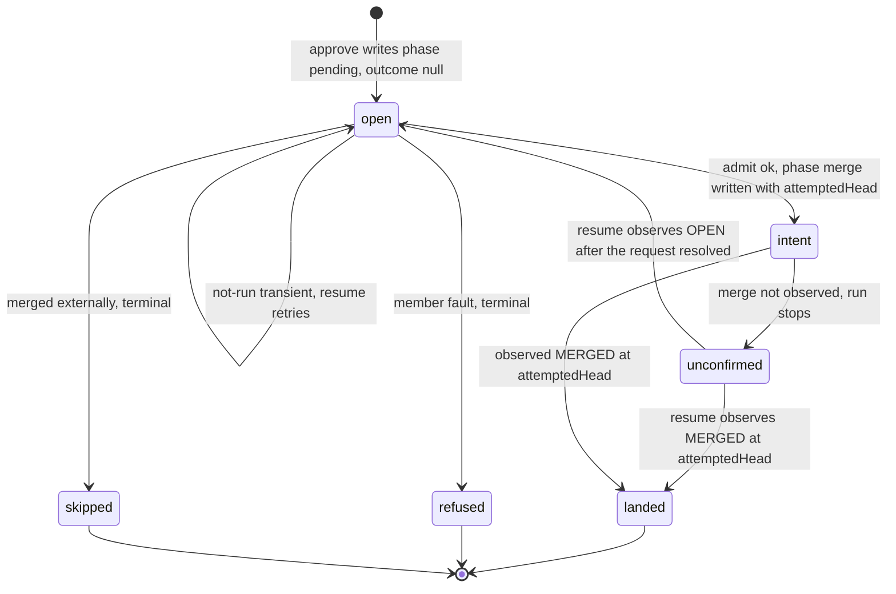

# Plan: Ship-batch per-member outcomes, and rollup landing (PR B)
- **Date**: 2026-11-18
- **Status**: In Progress
- **Author**: Claude + Louis
- **Scope**: backend (js-ts). Principle set: `skills/plan/references/engineering-principles.md`.
- **Depends on**: docs/plans/coordinator-aggregate-ship.md: PR A (the read-only half: `ship-commit.mjs --check-shipped-head`, `scripts/lib/fleet/coordinator-grant.mjs`, the archive-check refusal) must merge first. This plan calls both readers and edits neither.
- **Extended 2026-11-18** with `fleet land --rollup` (§2.9), on Louis's instruction: "Plan --rollup now, folded into PR B's plan, since PR B already rebuilds fleet land."
- **Target domain(s)**: `fleet`, `ship`, `tests`
- ⚠ **Cross-domain work**: the `tests` domain is touched only through test files. The one new `ship` edge,
  `scripts/lib/ship-record/entry.mjs` importing `scripts/lib/fleet/rollup.mjs`, is allowed (`.audit-loop/domain-map.json`
  `allowedDeps.ship` lists `fleet`) and has precedent (`ship-record/authority.mjs` and `facts.mjs` already import fleet).
  Nothing in `fleet` imports `ship`.

**Neighbourhood considered** (`get-neighbourhood`, k=8): every candidate banded `review`, the nearest being
`classifyOutcome` (`scripts/model-eval-discovery.mjs:218`) and `computeGateDisposition`
(`scripts/lib/final-review/round-gate.mjs:91`). Neither is on this seam, so the outcome model is greenfield, written inside
`fleet`. Incident neighbourhood: only INC-001 (sensitive-path symlinks) came back, and it does not touch these paths.

---

## 1. Context Summary

### The problem, from the audit evidence

PR A's branch `claude/plan-coordinator-aggregate-ship-f258c2` (head `1cd2df21`) built `fleet land --ship-batch` on top of the
serial runner through three seams: `hooks.onMerged`, `hooks.noUpdate`, and a `messageFor` that may return `{skip}`. It then
ran `/audit-code` for six rounds, SID `audit-code-1794991985170-57032`, ledger and results in
`C:/GIT/claude-engineering-skills/.claude/worktrees/quirky-pare-95e715/.audit/`. GPT's HIGH count per round was
19, 7, 6, 5, 5, 1, and the loop hit the cap without converging. `scripts/lib/fleet/serial.mjs` and
`scripts/lib/fleet/ship-batch.mjs` were raised in **every** round. The structural card's reading
(`docs/plans/coordinator-aggregate-ship.md` §Code audit trail, `1cd2df21`) is that the serial runner has **no first-class
per-member outcome model**. Each round fixed the cited site, and the next round found the same mistake at another site.

The recurring findings fall into six classes. Each class needs the primitive to make the mistake **impossible to write**;
patching more sites will not close it.

| Class | What keeps recurring | Findings (round-id) | Sites at `1cd2df21` |
|---|---|---|---|
| **F1 Fault scope is decided at each call site** | Each failure chooses between `stop` (the whole run) and `memberFail` (one member) by hand, and every round found another site that still stops the whole batch for a one-member problem. | r1-M1, r1-M10, r2-H5, r4-H3, r5-H3 | `serial.mjs:274` (PR unreadable), `:292` (unverifiable update), `:298` (DIRTY), `:332` and `:335` (checks failed, or pending at the deadline), `:334` (inventory) |
| **F2 One member, two mutable records** | Per-member truth is split between the serial step (`serial/<t>.json`) and the sidecar state (`shipbatch/<t>.json`). They have two writers, two validators and no shared identity, and a write failure on one is swallowed. | r1-H2, r1-M7, r2-M4, r3-H3, r3-H5, r4-M1 | `serial.mjs:233` (the sidecar-existence discriminator), `ship-batch.mjs:46`, `:67`, `:94`, `:248`, `:364`, `:401` |
| **F3 A MERGED observation is classified in two places** | Whether a merged PR was merged by us, by someone else, at an unaccounted head, or without a merge oid is decided partly in the serial loop and partly in `onMergedInner`, and the two disagree on resume. | r2-H1, r2-H6, r3-H4, r3-M1, r4-H2, r6-H1 | `serial.mjs:256-266`, `:276`, `:371`; `ship-batch.mjs:335`, `:339`, `:343` |
| **F4 A failed read is treated as a measured defect** | A failed `rev-list` or an unreadable message was once recorded as a confirmed loss (`provenance-lost`, `landed-on-untested-base`), and it then stayed terminal on resume. | r1-M2, r1-M8 | `ship-batch.mjs:343-356` |
| **F5 The claim about the landed set** | After a member is skipped, the rest land while the docs and comments still say "the tested set is the merged set". | r2-H2, r4-H4 | `serial.mjs:243` (`skipMember`), `ship-batch.mjs:241` |
| **F6 The build check and the merge check differ** | The merge-time re-check was a different function from the build-time one, with other arguments: no full-suite verdict, a different remote, a 12-character head prefix, a sidecar identity of only id and oid. | r1-H9, r1-H12, r4-H1, r5-H4, r5-H5, r3-H3 | `ship-batch.mjs:236` (no remote at the build), `:304-329` (`messageFor`), `:321` |

Two findings are **not** structural, and this plan states how they are handled instead:

- **r1-H1, the base race.** `--match-head-commit` guards the head, not the base. Closing that gap needs a server-side merge
  queue, which is a GitHub setting and therefore Louis's. This plan keeps **detection**: a squash whose first parent is
  foreign is recorded `landed` with verdict `untested-base`. The deferral stays open as proposal `p-20261118092842`.
- **r5-H2, a merge queued past the observation timeout.** The approve step refuses to start on a base with a merge-queue
  rule (§2.6), and a merge that GitHub accepted but that has not been observed stops the run as `merge-unconfirmed` (§2.2).

### Tonight's incidents that set the required behaviour

These come from `ship-ci-verification-disciplines-for-ces-2026-11-18.md` §2.1-2.2 in the shared notes folder:

- **#609.** A cherry-pick silently dropped a commit, and the tree no longer matched the tested one.
- **#612.** The tested head `cd3f53ef` was not the PR head `cf6ab101`.
- **A hand-padded SHA.** GitHub refused the merge with "Head branch was modified".

The rules that follow:

- re-read the head at merge time, from the API;
- prove by **tree id** that it is the tested content;
- pin the merge to that full oid with `--squash --match-head-commit`, and never use `--auto`.

### What exists today (Code Trace)

Pinned to `origin/main` `e93ccd78` (`git show origin/main:scripts/lib/fleet/serial.mjs`) unless marked `1cd2df21`:

- `fleet land --approve <t> --serial` (`scripts/lib/fleet/land.mjs:77-80`) goes to `approveSerial` (`serial.mjs:357-389`).
  That function checks `approvable`, rejects a shallow clone, runs `verifyFacts`, writes `serial/<t>.json` (`SerialRunSchema`,
  `serial.mjs:68-77`) and then calls `runSerial` (`:207`), which runs `loop` (`:215`) under `serial/<t>.lock`.
- `loop`, for each step, does the following:
  - views the PR (`viewPr`);
  - stops the run when the PR is MERGED at an unaccounted head, closed, a draft, or retargeted;
  - stops on a new head, or proves it is the run's own update (`classifyUpdatedHead`, `:173`);
  - stops on DIRTY;
  - on BEHIND, runs update-branch;
  - waits for the required checks (`observeRequiredChecks`);
  - re-reads the PR, calls `messageFor` (ship-train only), and records the `merge` intent;
  - runs `gh pr merge --squash --match-head-commit h`, then observes MERGED.

  **Every failure is a `stop(i, reason)`** (`:224-228`). The whole run is the unit.
- `ship-train.mjs land` is the only other caller. It passes `messageFor` and sets `messageRequired` (`serial.mjs:71-74`).
  Its tests: `tests/ship-train-recovery.test.mjs`.
- At `1cd2df21`, `ship-batch.mjs` adds the following around that loop (`ship-batch.mjs:219-262`, `:297-421`):
  - `buildShipBatch`: partition, then `buildFn` over the ship-ok members, then a mutable sidecar;
  - `makeShipBatchHooks`: `messageFor` (the grant, base tip, child, CI and message), `onMerged` (the read-back), `onSkip` and
    `noUpdate`;
  - `withSummary`: folds the sidecar states into the result.
- Tests: `tests/fleet-serial.test.mjs` (282 lines), `tests/fleet-land-ship-batch.test.mjs` (890 lines at `1cd2df21`), and the
  shared fixture `tests/helpers/fleet-serial-fx.mjs`.

Reused unchanged:

- `observeRequiredChecks` and `requiredInventory` (`required-checks.mjs`);
- `runShippedHeadChild` and the child contract (PR A);
- `readShipBatchGrant` (PR A);
- `ciVerdict`;
- `parseMessageTrailers` and `AI_TRAILER_KEYS`;
- `splitCommitMessage` and `readBackReasons` (moved as they are from `1cd2df21`);
- `withFileLockSync`, `atomicWriteFileSync`, `patchTrain`, `withTrainLock`.

---

## 2. Proposed Architecture

### The one design idea

**One closed member-step result, one outcome per member on the serial step itself, and a policy object that answers
questions but never writes.** The serial loop stays the single writer of all per-member state. A policy is a set of **pure
decisions** that the loop asks at fixed points: admit this head? the message? classify this read-back? The loop records the
answer and the policy records nothing. This removes F2 by construction, because there is one record and one writer.

The plain runner is the default policy, and the default policy maps every fault to today's `stop(i, reason)` with today's
reason text. That is how the non-batch behaviour stays byte-identical (§2.5).



### 2.1 The persisted state: phase, outcome and stop reason are three fields (#5, #13)

A member's record is made of three separate fields:

- **`step`** is the **phase**. It is today's field, unchanged: `pending`, `update`, `wait`, `merge`, `merged`.
- **`outcome`** is new and optional. It is written only by a run that has a policy (§2.4). Null means "nothing decided yet".
- The run's **`outcome.reason`** says why the run stopped. It is today's field. A run stop never writes onto a member: the
  faulting member keeps its own specific code, and every other open member keeps `outcome: null`.

`step` also gains one optional field, `attempt: { head: Oid, at: Iso, ghExit: number|null, doneAt: Iso|null }`:

- the intent write sets `head`, `at` (when the merge was about to be requested), `ghExit: null` and `doneAt: null`;
- the result write keeps `head` and `at` and sets `ghExit` and `doneAt`.

Attribution is decided from it (§2.3).

`outcome` is a **discriminated union on `status`**. Each variant has its own closed code enum and its own required evidence,
and every variant is a `z.strictObject`:

| status | terminal? | codes (closed per variant) | required evidence |
|---|---|---|---|
| `landed` | **yes** | `merged` | `verdict` (one of the verdicts below), `mergeOid`, `parent` (the measured first parent), `chainIndex` (an integer, or `null` when the verdict does not extend the chain), `attribution`, `gate`; optional `ci` and `trees` (see below) |
| `refused` | **yes** for this run | `pr-closed`, `pr-draft`, `pr-retargeted`, `conflict`, `behind-base`, `head-moved`, `checks-failed`, `shipped-head-refused`, `ci-refused`, `message-invalid` | `reason`, and `trees: {tested, seen}` for `head-moved` |
| `skipped` | **yes** | `merged-externally` | `mergeOid` (always non-null), `seenHead` |
| `not-run` | **no** | `pr-unreadable`, `checks-pending`, `tree-unreadable`, `message-unreadable`, `head-churn`, `merge-unconfirmed`, `awaiting-read-back`, `awaiting-merge-evidence` | `reason` |

The fields in the evidence column:

- `verdict` is one of:
  - `verified`;
  - `provenance-lost`: the squash dropped or changed an AI-* trailer, the subject or the body;
  - `untested-base`: the squash's first parent is not the chain tail;
  - `wrong-target`: the merged PR's base branch is not `run.base`;
  - `tree-mismatch` (rollup policy only, R2-H5): the parent is the chain tail, but the squash tree is not `candidateTree`.
    The outcome carries `trees: {expected, observed}`.
- `attribution` is `this-run` or `unknown` (§2.3).
- `gate` is the AI-Gate value read back from the squash, or `null`.
- `ci` (R3-H4) is the strict object `{head, tree, checks: [{name, conclusion}], observedAt}`. The zod variant allows it, and
  `validatePolicyRun` decides presence by policy: **required** on a rollup step's `landed` outcome and equal, field for
  field, to that step's `attempt.ci`; **rejected** on any ship-batch outcome. `attempt` gains the matching optional
  `ci` and `messageSha256`, with the same rule: present only under the rollup policy, and written in the intent.
- `trees: {expected, observed}` is required with the `tree-mismatch` verdict and rejected with every other verdict.

**Load-time invariants.** These are checked by `validatePolicyRun(run)` on **every** read, before any remote action. A
violation refuses the run as `record-inconsistent` and merges nothing.

1. Step ids are unique. **`policy` is a discriminated union on `name`** (R1-H1), and each variant has its own identity
   invariant:
   - `ship-batch`: the `policy.members` keys equal the step ids exactly (one step per member);
   - `rollup`: exactly one step, whose id equals `policy.rollup.branch` and whose `testedOid` equals `policy.rollup.candidate.oid`;
     `policy.members` is an ARRAY of member evidence records (§2.9.3), none of which is a step.
   A record of one variant driven with the other variant's policy object refuses as `policy-mismatch`.
2. **Phase and outcome are written together, as one pair** (R1-H8). The legal pairs are exactly:
   - `step === 'merged'` with `landed`, `skipped`, or `not-run/awaiting-read-back`;
   - `step === 'merge'` with `null` or `not-run/merge-unconfirmed`;
   - `step` in `pending`, `wait`, `update` with `null`, a `refused` outcome, or a not-run code other than
     `merge-unconfirmed` and `awaiting-read-back` (so `awaiting-merge-evidence` lives here).
   Every classification in §2.3 returns a `{step, outcome}` pair from this list and is persisted by ONE `setStep`.
3. The outcome `not-run/merge-unconfirmed` requires `step === 'merge'` and an `attempt`.
6. **`finalized`** (R1-H6), an optional run field `{at, result}`, is written only after the final base read and the result
   computation of §2.6, in one write. It requires every step to be terminal, or a `halt`. The train patch comes after it,
   is a pure function of `finalized.result`, and is idempotent, so it can be repeated (R2-H2).
7. **`halt`** (R2-H6), an optional run field `{code, member, at}`, is the persisted, non-resumable disposition of a
   chain-invalidating observation: an external merge (`skipped/merged-externally`), or a landed verdict of `wrong-target`,
   `untested-base` or `tree-mismatch`. It is written in the SAME `setStep` as that member's outcome. Once present, no
   step may enter `merge`, the result is `ok: false`, and resume never processes another member: it finalizes. The remaining
   members land only through a NEW train, built against the base as it now is. A halt cannot be cleared.
4. **The chain is merge chronology, never step order.** A not-run member may land after later members, on a resume.
   `policy.baseChain[0]` is `B0`. For every k ≥ 1, exactly one landed member has `chainIndex === k`; its `mergeOid` equals
   `baseChain[k]`, and its `parent` equals `baseChain[k-1]`. Only the `verified` and `provenance-lost` verdicts take a
   `chainIndex`. `untested-base`, `wrong-target` and `tree-mismatch` have `chainIndex: null` and never extend the chain. The final landed
   tree is always read from `baseChain.at(-1)`.
5. A landed or skipped member's `mergeOid` is not repeated elsewhere in the run.

Rules a test pins, one test each:

1. **Terminal means never re-decided.** `--resume` skips a terminal member. A refusal is never re-run into a pass: "nothing
   retries a refused condition" (the chip preamble).
2. **Only a measurement can be terminal.** A read that failed is always `not-run`, whether it was a view, a tree, a fetch, a
   rev-list or a message. Only two values that were read successfully and differ give a terminal outcome. This closes F4.
   An empty subject that was read successfully is `refused/message-invalid`. An unreadable message is
   `not-run/message-unreadable`.
3. **`waived` and `not-run` gates are never laundered.** The child admits only `passed` or `converged` (PR A, C1). A child
   refusal can only become `refused/shipped-head-refused`. `gate` is copied from the read-back trailer. No aggregate gate value
   exists anywhere.
4. **A landed outcome and its chain extension are ONE `setStep` write**, so no crash can separate them.

### 2.2 The member step is a function that cannot stop the run: F1 made impossible (#11, #15)

The member loop body moves into a function, `stepMember(ctx, i)`. It **has no `stop` in scope**, and it returns one variant of
a closed result type:

- `{ kind: 'next' }`: the member advanced to a terminal outcome, or to `merged`;
- `{ kind: 'again' }`: re-verify from the top, for example when the head moved;
- `{ kind: 'fault', fault: { kind, reason, evidence } }`.

The loop, which is the only holder of `stop`, maps each variant in one `switch` that handles every case. A `fault` is looked
up in `FAULTS`, a frozen table in `scripts/lib/fleet/member-outcome.mjs` keyed by fault kind: `{ scope, status, code }`. The
mapping goes:

- **No policy:** `stop(i, reason)`, with the reason byte-identical to today's (§2.5).
- **A policy, with a `member` fault:** `setStep(i, { outcome })`, then the next member.
- **A policy, with a `run` fault:** the member's specific outcome is written if the table gives one (`merge-unconfirmed`,
  `awaiting-read-back`); then `stop(i, reason)`.

Two exits are structural:

- **A throw inside `stepMember`** is caught by the loop and becomes the run fault `internal-error`.
- **An unknown `fault.kind`** is itself `internal-error`. The test for it feeds one in.

So a new failure site cannot bypass classification: there is no way to stop the run from inside the member step except by
returning a fault. The **behaviour** tests cover each fault kind (§9 test 1). A source census remains only for a fact that
structure cannot express (§2.3, the `--auto` ban). That census has a positive control and states its limit: it reads argv
literals.

| fault kind | scope | under a policy | default = today's `stop` (line at `origin/main` `e93ccd78`) |
|---|---|---|---|
| `pr-unreadable` | member | not-run | `serial.mjs:248` |
| `pr-closed`, `pr-draft`, `pr-retargeted` | member | refused | `:255-257` |
| `head-unaccounted` (§2.3 decides between `head-moved` and admission) | member | refused `head-moved`, or admitted | `:261` |
| `head-churn` (more than `MAX_HEAD_CHURN` = 3 head changes for one member in one run) | member | not-run | n/a: policy only (today's loop is unbounded and stays so) |
| `update-unverifiable`, `update-foreign` | run | stop (unreachable under ship-batch: it never updates) | `:264`, `:265` |
| `conflict` (DIRTY) | member | refused | `:270` |
| `behind` | member | refused `behind-base` (the policy has `allowUpdate: false`) | the update-branch path, unchanged |
| `update-churn`, `update-failed`, `update-invisible` | run | stop (unreachable under ship-batch) | `:272`, `:276-277`, `:288` |
| `checks-failed` / `checks-not-run` | member | refused `checks-failed` | `:299` |
| `checks-inventory-unknown` | run | stop (repository configuration, not a member problem) | `:301` |
| `checks-pending-deadline` | member | not-run `checks-pending` | `:304` |
| `message-stop`, `message-required` (ship-train's `messageFor`) | run | n/a (a policy run never takes `messageFor`) | `:320`, `:321` |
| `merged-observed` | per the §2.3 table | §2.3 | `:251` and the observation loop |
| `merge-unconfirmed` (any gh merge whose result was not observed as MERGED: a non-zero exit, a timeout, a lost response) | **run** | not-run `merge-unconfirmed`, then stop | `:339`, both texts |
| policy run answers: `grant-revoked`, `base-moved`, `read-back-unmeasured`, `record-inconsistent`, `merge-queue-present`, `rules-unreadable`, `merge-queued`, `internal-error` | run | stop | n/a |
| policy member answers: `shipped-head-refused`, `ci-refused`, `message-invalid`, `message-unreadable`, `tree-unreadable` | member | refused or not-run, per §2.1 | n/a |

**There is no member-scope merge failure (R1-H1).** A failed `gh pr merge` proves nothing about whether the request landed, so
the run never advances past an unobserved merge.

### 2.3 Merge-time identity, attribution and the read-back: F3 and F6 in one place (#1, #13)

**Admission has two kinds of input (R1-M2), and a mode (R1-H5).** `admitMember(mode, invariant, candidate)` in
`ship-batch.mjs` checks the evidence common to both modes (the grant, the full head oid, `head^{tree}`, the child envelope AT
that head) and then the mode's own, as a zod discriminated union on `mode` with strict objects, so evidence cannot be borrowed
across modes:

- `ship-batch`: the PR identity at the head, and the member's CI verdicts at the head;
- `rollup`: the remote branch tip equal to the head (`ls-remote`), and NO CI field: a candidate that carries one is
  rejected. The rollup's CI is evidence about the CANDIDATE, bound to the one serial step at the candidate oid (§2.9.3),
  never to a member.

In `ship-batch` mode it takes:

- **`invariant`**, fixed for the batch: the grant, `base`, `remote`, the tested oid `T`, the tested tree `TT`, the worktree
  path.
- **`candidate`**, bound to the head about to be judged: its full oid `C` (40 or 64 hex, from the API), `C^{tree}`, the child
  envelope **at `C`**, the CI verdicts at `C`, and the PR identity at `C`.

The build calls it with `C = T`. The merge calls it with the live head. Head-bound evidence is **never reused across heads**:
an envelope or CI verdict whose head is not exactly `C` is a refusal. The test asserts that the `invariant` object is
deep-equal between build and merge, `remote` included (r4-H1, r5-H4), and that every `candidate` field was obtained fresh at
`C`.

**The merge sequence under a policy** (the order is the contract):

1. **Admit:** `admitMember(invariant, candidate@h)`.
2. **Base chain and rules:**
   - the live base tip must equal `policy.baseChain.at(-1)`; otherwise the run fault `base-moved`;
   - the branch rules are re-read, which can give `merge-queue-present` or `rules-unreadable` (§2.6).
3. **Final re-read** (R1-H7): `gh pr view --json state,isDraft,baseRefName,headRefOid,headRepository,mergeStateStatus`.
   - The PR must be OPEN, not a draft, `baseRefName === run.base`, from the same repository, and `headRefOid === h`.
   - A different head is `again`, counted toward `head-churn`.
   - Any other change gives that fault.
4. **Write the intent:** `setStep(i, { step: 'merge', attempt: { head: h, at: now(), ghExit: null, doneAt: null } })`.
5. **Merge:** `gh pr merge <n> -R <repo> --squash --subject … --body-file … --match-head-commit h`, never `--auto`.
6. **Record the call:** `setStep(i, { attempt: { ...attempt, ghExit, doneAt: now() } })`.
7. **Observe:** view until MERGED, or until the observation window ends, which gives `merge-unconfirmed`.

What GitHub guards, stated:

- `--match-head-commit` makes the head **server-side atomic**. The target branch and draft status are **not** guarded between
  step 3 and step 5, and no client can guard them.
- That window is therefore **detected, not prevented.** The observed MERGED document's `baseRefName` must equal `run.base`,
  or the member is `landed/wrong-target`, which never extends the chain and stops the run.

**The GitHub guarantee that reconciliation relies on (R1-H1).** The REST merge endpoint behind `gh pr merge` is synchronous
when there is no merge queue (refused at approve, §2.6) and no auto-merge (never requested). The request either merged when it
returned or it did not. GitHub does not complete a plain merge request later.

A client that died or timed out cannot prove its request has finished server-side (R1-H2). So OPEN is read as "did not
merge" only when it is **observed at least `MERGE_WAIT_MS` (120 s, `serial.mjs:52`) after `attempt.at`**. An earlier OPEN
keeps `merge-unconfirmed` and stops the run again. A re-attempt is safe even if the first request were still executing,
because of two fences that GitHub enforces, not the client:

- **a PR merges at most once**: of two requests for one PR, at most one merges, and the other fails;
- **every request for the member pins the same admitted head** with `--match-head-commit`, so whichever request merges, it
  merges the admitted content.

A failed replay (for example "already merged") is never itself a verdict: the loop re-views and `classifyMerged` decides,
with `attribution: unknown`. Then:

- the member returns to admission from the top;
- a re-attempt still pins `--match-head-commit`.

Within one run the loop never advances past an unobserved merge: `merge-unconfirmed` stops the run. A test kills the fake
`gh` after it performed the merge and before it answered, then resumes: the member ends landed, and the fake counts exactly
one merge.

**Head identity when the live head `L` is not accounted** (`head-unaccounted`), under a policy:

- Read `git rev-parse L^{tree}`. Fetch `refs/pull/<n>/head` first when `L` is absent locally.
- If the tree is **equal to `TT`**: `L` carries exactly the tested content (the #612 shape). Admission runs **again with
  `candidate@L`**, so the child proves `L`'s own provenance and the message is copied from `L`'s commit. `L` then joins
  `accounted`.
- If the tree is **not equal**: `refused/head-moved`, with `trees: {tested: TT, seen}` (the #609 shape).
- If the tree is **unreadable**: `not-run/tree-unreadable`.

Under no policy, today's stop applies, with the same text.

The **audited** head stays the child's job: `--check-shipped-head` judges the audited tree against the shipped head over the
branch's paths (PR A, C4). Admission proves two links: tested tree = merged tree, and audited tree ≈ shipped tree.

**Attribution and observed state are separate (R1-H2).** `classifyMerged({ step, doc })` in `member-outcome.mjs` is pure,
and it is the **only** reader of `state === 'MERGED'`:

Each row is the `{step, outcome}` pair written in one `setStep` (§2.1 invariant 2):

| phase when observed | `doc.headRefOid` | written pair |
|---|---|---|
| `merge`, `attempt.ghExit === 0` | `=== attempt.head` | merged, `attribution: this-run`; the read-back follows |
| `merge`, `ghExit` non-zero or null (crash, lost response) | `=== attempt.head` | merged, `attribution: unknown`; the read-back follows. The content is the admitted head either way, and the read-back judges the message, so an external merge of the same head with another message reads `provenance-lost` |
| `merge` | `!== attempt.head` | `merged` + `skipped/merged-externally` with `mergeOid` and `seenHead` recorded, then the run fault `base-moved` |
| `pending`, `wait` or `update` (no intent) | any | `merged` + `skipped/merged-externally` with `mergeOid` and `seenHead`, then the run fault `base-moved` |
| `merge`, no merge oid reported | any | `merged` + `not-run/awaiting-read-back`, run stop; resume re-views for the oid |
| `pending`, `wait` or `update`, no merge oid reported | any | the phase unchanged + `not-run/awaiting-merge-evidence`, run stop; resume re-views and then applies the row above |

**An external merge always stops the run** (R3-H1), including on the last member, and writes the `halt` with its outcome
(R2-H6). The halt is what a resume reads first, so an external merge onto ANOTHER branch, which leaves the intended base
equal to the chain tail and would pass a base check, still ends the run. It put a commit on the base that the chain
does not hold, so no later merge and no `ok` result may rest on that chain. Independently, **before computing the result**,
the loop reads the live base tip once more. When it is not `baseChain.at(-1)`, the run fault is `base-moved`, and the summary
lists the observed tip next to the chain tail.

`attribution: unknown` is printed in the summary and is never shown as `this-run`. Under no policy, the table collapses to
today's two branches, with the same texts.

**The read-back** is pure: `policy.readBack({ step, mergeOid, doc })`.

- `{ measured: false, why }` (a fetch, rev-list or message read failed) gives `not-run/awaiting-read-back` and the run fault
  `read-back-unmeasured`. The phase stays `merged`, and resume repeats the read-back.
- `{ measured: true, firstParent, reasons, gate, baseRefName }` gives `landed` with the first matching verdict:
  - `wrong-target`, when `baseRefName !== run.base`;
  - `untested-base`, when `firstParent !== chain tail`;
  - `tree-mismatch`, under the rollup policy, when the squash tree is not `candidateTree`;
  - `provenance-lost`, when `reasons.length`;
  - `verified` otherwise.

  Only `verified` and `provenance-lost` extend the chain, in the same write that sets `chainIndex = baseChain.length`.
  `wrong-target`, `untested-base` and `tree-mismatch` write the `halt` (§2.1 invariant 7) in the same write and stop the run.

### 2.4 One record: F2 made impossible (#5, #14 transaction safety)

- **The build record is write-once.** `fleet/shipbatch/<train>.json` is v2, with a strict zod schema (r1-M7). It holds:
  `{schemaVersion: 2, trainId, grantVersion, checkedAt, base, remote, candidateTree, members: [{id, repo, prNumber, oid, tree,
  worktree}], excluded}`. Here `candidateTree` is `train.candidate.tree`, the integration tree the combined test ran on.
  Nothing patches the record after the build. If the train cannot be read back, the record is not written at all (r4-M1).
- **The approve step copies and then stops reading it.** `approveShipBatch` does the following:
  - validates the build record against the train: **every** identity field (`id`, `repo`, `prNumber`, `oid`) for every source,
    the source count, and `candidateTree === train.candidate.tree` (r3-H3, r3-H5);
  - calls `approveSerial` with a `policy`.

  `approveSerial` writes the optional run block:
  `policy: { name: 'ship-batch', grantVersion, remote, candidateTree, baseChain: [train.destination.expectedOid], members:
  {<id>: {tree, worktree}}, excluded }`. From then on the **serial record is the only mutable per-member truth**, with one
  writer (the loop) under one lock (`serial/<t>.lock`). `onSkip`, `patchBatch` and the swallowed write (r2-M4) are gone.
- **The discriminator is persisted** (r1-H2). A record with `policy.name === 'ship-batch'` refuses any driver that does not
  pass the ship-batch policy object, with today's resume hint (`serial.mjs:233-235`, `1cd2df21`). `messageRequired` keeps
  its meaning for ship-train, unchanged.
- **One seam each.** `runSerial` takes `{ messageFor }` (ship-train, unchanged) or `{ policy }` (ship-batch). Passing both
  throws. The `{skip}` answer and `hooks.*` are deleted.

### 2.5 What stays byte-identical (#18 backward compatibility)

The plain serial runner (`land --approve --serial`, `land --resume`) and `ship-train.mjs land` must keep, against
`origin/main`:

- the same `serial/<t>.json` bytes: `outcome`, `attempt` and `policy` are written only when a policy is present;
- the same result objects;
- the same stop reasons, character for character;
- the same `gh` argv sequence;
- the same `finishSerial` train patch.

**The proof is a golden test.**

- `tests/fleet-serial-golden.test.mjs` drives every scenario of `fleet-serial.test.mjs` and `ship-train-recovery.test.mjs`,
  re-expressed as table rows over the same fixture, through a recording fake `gh`.
- It snapshots three things: the argv list, the final serial record with timestamps normalised, and the result.
- The fixture `tests/fixtures/fleet-serial-golden.json` is **generated from `origin/main`'s `serial.mjs`**, in Phase 1, before
  any edit. The generating command and the source sha go in the fixture header.
- The negative control: a one-character change to one stop reason must turn the test red.

### 2.6 Resume and idempotency after a crash

Each step is written as an intent before the remote action and as a result after it. Under a policy, resume first runs
`validatePolicyRun` (§2.1).

**A finalized run** (`finalized` present, §2.1 invariant 6) is a **read-only historical summary** (R3-M1). A run whose
members are all terminal but which has no `finalized` (a crash after the last member write) is NOT: resume performs the
final base read and computes the result, both reads only, writes `finalized`, then repeats the idempotent train patch. A
finalized run repeats only the idempotent, local train patch from `finalized.result` (R2-H2), reads nothing remote for the
landing, re-checks neither the grant nor the rules, and prints the stored summary with the
stored exit code. A grant revoked after completion changes nothing, because no landing mutation is possible. The only
remote calls it may still make are the rollup's post-landing cleanup (§2.9.6), which closes member PRs and never merges.

**Otherwise**, before the first remote mutation, resume re-reads the grant (`run/grant-revoked` refuses) and the branch
rules, then walks the steps in order. For each step it decides by `(step, outcome)`:

| phase | outcome | resume does |
|---|---|---|
| any | terminal | nothing (see "A fully terminal run" below) |
| `merged` | `not-run/awaiting-read-back` | re-view for the merge oid if it is missing, then repeat the read-back |
| `merge` | `not-run/merge-unconfirmed` or null | view, then `classifyMerged`. An OPEN PR observed at least `MERGE_WAIT_MS` after `attempt.at` goes back to admission (§2.3); an earlier OPEN stops again; nothing is replayed without a fresh admission |
| `pending`, `update` or `wait` | not-run or null | full admission at the current head |

The base branch's rules (`gh api repos/{o}/{r}/rules/branches/{base}`) are read at approve, **again before every merge**
(merge sequence step 2), and on every resume. A `merge_queue` rule gives the run fault `merge-queue-present`, and an
unreadable answer gives `rules-unreadable`. Nothing further merges, because the synchronous guarantee in §2.3 holds only
without a queue (r5-H2).

When resume reconciles a `merge-unconfirmed` member, it also reads `gh pr view --json isInMergeQueue`:

- `true` stops the run as `merge-queued`. The PR is left in the queue for the operator and **never re-attempted**.
- An unreadable answer stops the run.
- Only `false`, together with a rules read that shows no queue, lets an OPEN PR return to admission.

What stays unguarded: a queue rule enabled in the moments between the per-merge rules read and the merge request. Repository
rules are Louis's settings, and no client read can close that window. The request then lands in the queue, is not observed
as merged, and stops the run as `merge-unconfirmed`. The `isInMergeQueue` reconciliation above keeps it from being
replayed. The grant path fails closed throughout.

### 2.7 The landed set, stated honestly: F5 and R1-H3

Louis's rule is: "a member failing its re-check refuses alone and the rest still land". The landed set may therefore differ
from the combined-tested set, and individual tree equality cannot prove the combined result. The result's `combination` field
is computed **only** from measurements:

`combination` describes **content only**: which members landed, and whether the trees match. Provenance verdicts are a
separate axis (§2.8, `ok`). The classification is exhaustive, and the first rule that matches wins:

1. **`subset`**: at least one member is not landed (refused, skipped or not-run). That combination was never tested.
2. **`unverified`**: every member landed, but `<baseChain.at(-1)>^{tree}` or `candidateTree` could not be read. A landed
   member off the chain (`untested-base`, `wrong-target`) also gives `unverified`, because the chain tail then does not
   hold every member.
3. **`tested`**: every member landed and the chain-tail tree equals `policy.candidateTree`. The final base tree is the very
   tree the combined test ran on.
4. **`different`**: every member landed and the trees were read, but they differ. An order effect or a squash nuance produced
   a tree nobody tested. It is reported loudly.

A `provenance-lost` member therefore leaves `combination` as `tested` when the trees match, and `ok` is false all the same
(§2.8).

`different`, `subset` and `unverified` are never shown as `tested`. In all three cases, each landed member still had its own
required checks green at the exact head that merged, and the base chain proves that only the batch's own merges sat under it.
The comment at `ship-batch.mjs:241` (`1cd2df21`) and the runbook sentence are rewritten to say this. The members came from
fleet claims whose paths are disjoint (`fleet claim` blocks overlaps), so the untested part is semantic interaction only. The
runbook says so.

### 2.8 Truth table: ok, exit code, train phase, summary (R1-M1)

Exit codes use fleet's existing mapping (`land.mjs`): 0 for ok, 3 for refused or stopped.

| case | `ok` | exit | train phase | `combination` | summary first line |
|---|---|---|---|---|---|
| every member landed `verified`, trees equal | true | 0 | `landed` (`finishSerial`) | `tested` | `landed n of n; final tree = the combined-tested tree` |
| every member landed `verified`, trees differ or unreadable | false | 3 | `landed` (the merges happened) | `different` / `unverified` | `landed n of n; final tree is NOT the combined-tested tree: verify by hand` |
| at least one landed `verified`; the rest terminal `refused` or `skipped`; no stop | true | 0 | `awaiting-merge` (unchanged from `1cd2df21`) | `subset` | `landed k of n: a SUBSET of the combined-tested set; m need the user (/ship in that session)` |
| any landed verdict other than `verified` (whatever the `combination`) | false | 3 | `awaiting-merge`, or `landed` if every member merged | as computed (§2.7) | `PROVENANCE: <member> <verdict>` leads the summary |
| a run-scope stop with members still not-run | false | 3 | `awaiting-merge` | `subset` | `stopped: <reason>; resumable: land --resume <t> --ship-batch` |
| every member terminal, none landed | false | 3 | `awaiting-merge` | `subset` | `nothing landed; every member needs the user` |
| the loop completed (no run stop) with at least one member still `not-run` (for example `checks-pending`, `pr-unreadable`, `head-churn`), with or without landed members | false | 3, resumable | `awaiting-merge` | `subset` | `landed k of n; m not yet decided: land --resume <t> --ship-batch re-checks them` |

**`landed` as a train phase means the content is on `run.base`** (R1-H6): it requires every member terminal and no landed
verdict `wrong-target` or `tree-mismatch` (R3-H1), and, under the rollup policy only, no `untested-base` (R4-H1; a ship-batch
member's `untested-base` stays as §2.3 states, because its own head was proven by tree identity). Either leaves the train `awaiting-merge`, so `deriveTrainDone` never
marks its sessions done. `untested-base` content IS on the base, so it may complete the train, and the summary leads with it.

After the first line, the summary prints one line per member: status, code, attribution, the read-back AI-Gate, the merge
oid, and for needs-user members "type /ship in that session".

### 2.9 Rollup landing: `fleet land --rollup` (Louis, 2026-11-18)

**Scope, verbatim** (Louis, typed in CES: Coordinator, relayed 2026-11-18): "Plan --rollup now, folded into PR B's plan,
since PR B already rebuilds fleet land." **Goal:** chips keep working in parallel, but a batch lands as ONE PR, so CI runs
once per batch instead of once per chip.

**Facts this design rests on** (measured by CES: Coordinator, 2026-11-18, from each repo's workflow triggers):

- A branch push triggers no full CI in any repo. CES `full-suite.yml`, storyline `phase-gates.yml`, wine's checks and AIO
  `ci.yml` run on `pull_request`, plus `push` to `main` for CES and storyline.
- So the saving comes from chips **not opening PRs**. A draft PR still triggers `pull_request`.
- Louis accepted, for every repo, one squash commit per batch on `main`; per-chip one-click revert is given up.
- Louis rejected anything that needs GitHub to accept a substitute status: no injected statuses, no ruleset bypass. **Nothing
  below needs a GitHub settings change.** The rollup PR passes the same required checks as any PR.

**The one idea.** A rollup is an ordinary train whose candidate is **pushed and landed as one PR**, run by the serial runner
of §2.2-§2.6 as a **one-step run under a `rollup` policy**. The members are not serial steps. They are the policy's
`members`, each with its own evidence, and they land or not together, because they share one tree.

```mermaid
sequenceDiagram
    participant C as coordinator
    participant L as fleet land --rollup
    participant G as git and gh
    C->>L: land --rollup [--hold a,b]
    L->>L: admit each ready member (admitMember); HOLD the ones that fail, with reasons
    L->>G: build the candidate (buildTrain, rollup messages); run the pre-land tiers
    C->>L: land --approve T --rollup
    L->>G: push candidate to refs/heads/rollup/DATE-N (must not exist)
    L->>G: gh pr create (body = the member manifest)
    L->>G: wait for the required checks on the candidate head
    L->>L: re-admit every member; base tip must equal the candidate parent
    L->>G: gh pr merge N --squash --match-head-commit CANDIDATE (body = manifest)
    L->>G: classifyMerged + tree read-back
    L->>G: after MERGED is confirmed: close member PRs "superseded by #N"
```

#### 2.9.1 Build: `fleet land --rollup [--select ids] [--hold ids]`

1. **Selection** is the existing `build()` selection (`scripts/lib/fleet/land.mjs:143-183` (`d53272aa`)): ready sessions in
   landing order, `--select` narrowing them. `--hold a,b` removes named members and records them held with code
   `held-by-coordinator`. A `--hold` id that is not ready is an argv error, like `--select`.
2. **Admission per member**, before anything is built, with the one predicate `admitMember` of §2.3 (F6: the build and the
   merge ask the same question):
   - the member branch on the remote (`git ls-remote origin refs/heads/<branch>`) is exactly the ready oid. A branch that was
     never pushed, or moved since `ready`, is held as `branch-not-pushed` or `head-moved`;
   - the PR A child `ship-commit.mjs --check-shipped-head --head <oid> --base <base> --remote origin --json` in the member's worktree
     is ship-ok. A refusal is held as `shipped-head-refused`, with the child's refusals copied. **`AI-Gate: waived` or
     `not-run` therefore never enters a rollup** (the child refuses it), so nothing is laundered into passed;
   - no member CI is asked for: in rollup mode there is none, and the rollup PR's checks replace it (§2.9.3).

   A member that fails admission is **HELD, not failed**: excluded, with its reason in `policy.excluded`, and the rollup is
   built without it. This is §2.1's per-member outcome at build time, recorded once, in the write-once build record.
3. **Overlap.** Two admitted members whose changed-path sets (`git diff --name-only <base>...<oid>`) intersect, outside
   `appendOnlyGlobs`, are **never in one rollup**. The later one in landing order is held as `overlap:<path>`. Each was
   audited against its own tree; the combined content of a shared file was audited by nobody, and a targeted review would be
   new machinery for a case `fleet claim` already blocks (claims are path-disjoint). The held member lands in the next
   rollup, after its own restack and, if the restack changed its tree, a re-audit, which its next admission enforces.
4. **One live rollup per repo, with supersession** (R1-H4). Under the train lock, and holding the older rollup's
   `serial/<t>.lock` without waiting (a held lock refuses as `rollup-in-progress`), the build classifies every other rollup
   train that is not `landed` or `abandoned`:
   - **supersedable**: approve never ran, or its serial run is stopped with the step in `pending`, `wait` or `update` and no
     `attempt` (nothing was ever requested). The build patches it `abandoned` with the note `superseded by <new train>`.
     Its worktree, manifest, branch and PR are kept; an abandoned train can no longer be approved or resumed (today's rule).
     Its PR is closed "superseded by #M" by the NEW rollup's approve, once its own PR exists (§2.9.2 step 5);
   - **blocking**: anything else (a step in `merge`, `merge-unconfirmed`, `awaiting-read-back`). The build refuses, naming
     it: a merge may be in flight, and only its own resume may settle it.

   A member therefore never sits in two live rollups.
5. **The candidate** is `buildTrain` (`scripts/lib/fleet/train.mjs:280` (`d53272aa`)) unchanged in shape: base worktree,
   sources applied in order, candidate `{oid, tree}` recorded before any test, then the pre-land tiers. Two small
   parameters, both off on every other path:
   - `landing: 'rollup'` is written into the train manifest (an optional `TrainSchema` key). `approveTrain`, `confirmTrain`,
     `reconcileTrain` and `approveSerial` refuse a train that carries it, so a rollup can never be pushed straight to the
     base by a plain `land --approve`;
   - each member is applied as `merge --squash` (as `pr` mode does, `train.mjs:392-393`) and committed with a **rollup
     message**: the member's subject, then a `Fleet-Rollup-Member: <id> <full oid>` trailer, and **no `AI-*` trailer**. `-C`
     is not used: it would copy the member's `AI-Gate` onto a commit whose tree nobody audited.

   Branch-only sources are allowed (rollup members need no PR). `appendOnlyGlobs` union resolution applies, as in the direct
   modes, because fleet pushes this very tree.
6. A red tier, a conflict, or a refused build leaves the train as today: candidate and logs kept, nothing pushed.

#### 2.9.2 Approve: `fleet land --approve <t> --rollup`

**The operation record** (R1-H7). Before the serial run exists, `approveRollup` persists its progress in an optional
`TrainSchema` block, `rollup: {branch, repo, candidate: {oid, tree}, phase, prNumber, closures}`, written by `patchTrain`
under the train lock. `branch`, `repo` and `candidate` are set once, at the first write, and never change. `phase` moves
`push-intent` → `pushed` → `pr-intent` → `pr-open` → `run-started`. Each remote action is reconciled from the remote before it
is retried:

| phase on resume | reconciliation | then |
|---|---|---|
| `push-intent` | `ls-remote` the branch | absent: push again; at `candidate.oid`: `pushed`; any other oid: refuse `rollup-branch-foreign` |
| `pr-intent` | `gh pr list --head <branch> --base <base> --state all --json number,state,headRefOid,baseRefName` | none: create; exactly one OPEN at `candidate.oid`: adopt its number; anything else (two, closed, merged, another head): refuse `rollup-pr-ambiguous` |
| `pr-open` | read `serial/<t>.json` | absent: `startPolicyRun`; present: validate it (schema and `validatePolicyRun`) and compare its immutable identity (train id, the step id equal to `branch`, `prNumber`, `testedOid` equal to `candidate.oid`, `policy.rollup`) with the operation record. Equal: adopt it and patch `run-started` (R2-H1). Different: refuse `rollup-run-mismatch` |
| `run-started` | none | `resumeRollup` (the serial resume, §2.6) |

**The entry points** (R1-H1): `approveSerial` refuses a train that carries `landing: 'rollup'`. The rollup serial run is
created only by `startPolicyRun({dir, trainId, run})`, a new export of `serial.mjs` and the one writer of a fresh policy run:
it validates the run with the schema and `validatePolicyRun`, refuses if a run file exists, and writes it. `approveShipBatch`
uses it too, so the plain path through `approveSerial` keeps its golden bytes. `resumeRollup` passes the rollup policy;
`land --resume <t>` without `--rollup` on a rollup run refuses with the hint, as §2.4 does for ship-batch.

**The lock contract** (R4-H2), the same order as `approveSerial` today (`serial.mjs:402-433`): the train lock
(`withTrainLock`) is held only for the short, local steps (the checks, the operation-record patches, writing the serial
run) and is **released before** `runSerial`, which takes `serial/<t>.lock`. Finalization reacquires the train lock for the
idempotent train patch (§2.6). The order is always train lock, then serial lock, and the serial lock is never held while
the train lock is taken. No lock is re-entered. A test uses the real lock implementation and drives approve, a crash in
each phase, and the resume without re-entry or inversion.

Under `withTrainLock` (released before the serial run), `approveRollup`:

1. checks that the train carries `landing: 'rollup'`, that it is approvable (`approvable`), and that the clone is not shallow;
2. re-admits every member (§2.9.1 step 2). **Any** member that fails now stops the approve as `member-refused:<id>`. A member
   inside the candidate tree cannot be dropped from it: the remedy is a rebuild with `--hold <id>`;
3. reads the base tip. It must equal `train.destination.expectedOid`, the candidate's parent; otherwise `base-moved`;
4. pushes the candidate to `refs/heads/rollup/<YYYYMMDD>-<n>` on the recorded `pushUrl` with
   `--force-with-lease=refs/heads/rollup/<YYYYMMDD>-<n>:` (the ref must not exist). `n` is the lowest free number read from
   `ls-remote`. The intent is written before the push and the result after it, as the direct modes do (`push-pending`);
5. runs `gh pr create --base <base> --head rollup/<YYYYMMDD>-<n> --title <subject> --body-file <provisional manifest>` and
   records the PR number (`pr-intent`, then `pr-open`, reconciled as in the table above). It then closes any rollup PR it
   superseded (§2.9.1 step 4), recording each attempt in `rollup.closures`;
6. writes the serial run: **one step**, `{id: 'rollup/<YYYYMMDD>-<n>', prNumber, repo, testedOid: candidate.oid, head:
   candidate.oid, accounted: [candidate.oid]}`, and the policy built by ONE constructor, `rollupPolicyFrom(train)`, from the
   immutable operation record (R3-H3). Its strict schema is `{name: 'rollup', grantVersion, remote, candidateTree,
   baseChain: [expectedOid], members, excluded, rollup: {branch, repo, prNumber, candidate: {oid, tree}}}`. The `pr-open`
   adoption of the table above compares exactly `rollup` (all four fields), `candidateTree` and the step identity, and
   both the creation and the adoption path call the same constructor, so they cannot drift;
7. hands the run to `runSerial` (§2.2-§2.6). The rollup policy answers:
   - `admit`: re-admit **every** member (the same `admitMember`), plus the PR head equal to the candidate oid and the head
     tree equal to `candidateTree`. A member failing is a run fault (`member-refused:<id>`), never a member skip;
   - `baseCheck`: the live base tip equals `baseChain[0]`, or `base-moved`;
   - `allowUpdate: false`. A behind PR is never updated: a rollup is rebuilt instead (§2.9.5);
   - `message`: the squash subject `fleet rollup <rollup id>: <k> members` and the FINAL manifest body (§2.9.3), rendered
     after the required checks are green at the candidate oid;
   - `readBack`: `classifyMerged` (§2.3) on the one step, then the tree read-back. `verified` needs the squash parent equal to
     `baseChain[0]` and the squash tree equal to `candidateTree`.

**The grant.** The rollup lands work the coordinator did not author, without the user's `/ship`, which is exactly what the
ship-batch grant covers. So `approveRollup` reads the same `readShipBatchGrant` (PR A) and refuses without it. Rollup does not
widen the grant: its members are self-shipped chips (§2.9.7), exactly the ship-batch members.

The merge argv is `gh pr merge <N> -R <repo> --squash --match-head-commit <candidate full oid> --subject ... --body-file ...`.
Never `--auto`; never `--delete-branch` (a deletion is Louis's, and `--delete-branch` closes stacked PRs).

#### 2.9.3 Evidence honesty: two records, never one composed verdict

- **The members' audit evidence**, each against its OWN head and tree, in `policy.members[i]`: `{id, branch, head, tree:
  head^{tree}, runId, gate, finalReview, sessionId}`. `runId`, `gate` and the final-review condition come from the child's
  `shipped-head/v1` envelope. The envelope has no audit SID field; `runId` is the store row that names it. This plan does
  not change PR A's contract to add one.
- **The rollup's CI evidence**, against the CANDIDATE: `ci: {head, tree, checks: [{name, conclusion}], observedAt}`, from the
  `observeRequiredChecks` result the loop already has. It is **persisted in the merge intent** (`attempt.ci`, written in
  the same `setStep` as `attempt.head` and `attempt.messageSha256`), so a crash after the merge loses nothing (R2-H4). The
  landed outcome copies `attempt.ci` byte for byte. `validatePolicyRun` requires `attempt.ci.head === step.testedOid ===
  policy.rollup.candidate.oid` and `attempt.ci.tree === candidateTree`, and allows `ci` only under the `rollup` policy.
  The final manifest is rendered from `attempt.ci`, so its pinned sha256 also covers the CI record.
- **The manifest has two stages** (R1-H3), both rendered by the pure `renderRollupManifest` from the records only:
  - **provisional**, the PR body at create: the members and the held, with `"ci": "pending"` and `"stage": "provisional"`.
    It is never edited afterwards, so no PR-body update can fail;
  - **final**, the squash body: the same members plus the CI record, `"stage": "final"`, rendered only after the required
    checks were observed green at exactly `candidate.oid` (the step's `head`). Its sha256 is written in the merge intent
    (`attempt.messageSha256`, rollup policy only), and the read-back compares the squash body against it: a mismatch is
    `provenance-lost`.
  Each stage is a human table, then one fenced block `fleet-rollup/v1` (JSON: rollup id, stage, base, candidate `{oid,
  tree}`, members, held, ci). It names each member's gate as that member's. Only a `final` manifest counts for the record
  (§2.9.6).
- **No `AI-*` trailer on the rollup commit, ever.** The squash carries `Fleet-Rollup: v1 <rollup id>` only. A single
  `AI-Gate` would claim one verdict for content no single audit read. The `AI-*` namespace stays reserved to
  `ship-commit.mjs` and `ship-train.mjs` (AGENTS.md §Commit provenance).
- Where provenance survives the squash: on `main`, the manifest; on GitHub, `refs/pull/<N>/head`, whose first-parent chain
  holds one rollup-message commit per member (§2.9.1 step 5), each naming its member's full oid. The member branches are not
  deleted.

#### 2.9.4 Red rollup

A required check that ends red stops the run as `checks-failed` (the existing fault). Nothing is cleaned up: the candidate
worktree and the train manifest stay, and the rollup branch and PR stay open with their logs. The summary says:

```
stopped: checks-failed on rollup/<...> #N. Eject a suspect and rebuild: land --rollup --hold <member>.
A green rebuild without <member> does NOT prove <member> at fault.
```

No automatic bisect. A rebuild is a new train, branch and PR (§2.9.5). The old PR is closed with "superseded by #M" once the
new one is open, and never deleted.

#### 2.9.5 The base race

`--match-head-commit` pins the head, not the base. If `main` moves after the build:

- before the merge, `baseCheck` stops the run as `base-moved`, and nothing merges. The remedy is a rebuild, which re-admits
  every member against the new base and re-runs the tiers and the PR's CI. `fleet land --rollup` prints that line;
- in the window between the last base read and the merge request, GitHub may squash onto a newer base. The read-back then
  sees a parent other than `baseChain[0]` and records `landed` with verdict `untested-base`, `ok: false`, loudly (§2.3).
  Detection only: the r1-H1 deferral, unchanged.

A rebuilt rollup is always a new branch, so a red or stale rollup's candidate and logs survive for diagnosis.

#### 2.9.6 Records

- **One ship record for the rollup.** ship-record catch-up already writes one entry per merged PR from immutable facts
  (`scripts/lib/ship-record/entry.mjs:1-18` (`d53272aa`)). The rollup PR is one PR. Its merge commit's message holds the
  manifest and is immutable once merged, so `renderPrEntry` may read it. A new pure `parseRollupManifest(message)` (in
  `scripts/lib/fleet/rollup.mjs`, imported by `entry.mjs`) parses the manifest and a second pure function,
  `verifyRollupProvenance(manifest, run, pr)`, decides whether it is verified. The entry lists members (id, branch, head,
  gate) only for a verified manifest. A malformed manifest renders as "manifest unreadable", never as zero members.
- **A manifest in commit text is self-declared** (R4-H3): any PR can author one. So the catch-up reason `merged-via-rollup`
  requires **verified** provenance: a durable local run, `fleet/serial/<t>.json` of a train carrying `landing: 'rollup'`,
  whose `policy.rollup.repo`, step `prNumber`, landed `mergeOid`, `policy.rollup.candidate.oid` and `attempt.messageSha256`
  (the hash of the manifest body) all equal the merged PR's facts and the commit message's hash. When that run is
  unavailable (another machine, a pruned registry) or any field differs, the entry keeps the reason `merged-without-ship`
  and lists the manifest under "unverified, self-declared", never as members. The members were shipped by their chips; the
  rollup itself was not `/ship`ped, and a verified entry says exactly that.
- **Member PRs, if any** (a member that opened one before the repo switched to rollup) are closed by a **post-landing
  cleanup**, separate from the landing (R2-H3). The landing is immutable once `finalized`; the cleanup is its own step with
  its own record, `rollup.closures` in the train (`pending`, `closed`, `failed` with the reason):
  - **when:** only after `finalized`, with the rollup step `landed` and the candidate content PROVEN on `run.base`, which
    only a squash tree equal to `candidateTree` proves: verdict `verified`, or `provenance-lost` (the tree matched; only the
    message differs). A `halt` stops further MERGES, not this cleanup. **Never** on `tree-mismatch` (R3-H1) and **never**
    on `untested-base` (R4-H1): the read-back chose `untested-base` from the parent alone, so it does not establish that the
    squash tree holds the candidate's changes. For both, neither the member PRs nor the sessions are touched. The summary
    lists each member with its admitted head and the landed tree, and the human verifies each member against that tree,
    then closes the PRs and the sessions by hand. No automatic path substitutes for that adjudication, and no new verb is
    added for it (right-sizing: the case is rare, and the residual is a PR left open, never one wrongly closed). Never on `wrong-target`, `merge-unconfirmed`, `not-run`, or a stop before landing;
  - **what** (R3-H2): each closure record is bound to `{repo, prNumber, head}`, the member's admitted head. Before closing,
    the cleanup re-reads the PR. OPEN with `headRefOid === head`: `gh pr close <n> --comment "superseded by #N (fleet rollup
    <id>)"`. Any other head: `skipped-head-moved`, never closed, and the summary tells the operator the PR holds work that
    did not land. Unreadable: `failed`, retried. `gh pr close` has no server-side head condition, so a push in the moment
    between the read and the close is not excluded. The residual is stated and bounded: a close deletes nothing, the branch
    and its commits stay, the PR can be reopened, and the record keeps the head it judged;
  - **invocation and retry:** it runs at the end of `approveRollup`, and again on every `land --resume <t> --rollup`, for
    `pending` and `failed` entries only. These are the only remote calls a finalized rollup resume makes, and none of them
    touches the merge. The summary lists every closure that is not `closed`.
- **Done-ness needs nothing new** beyond §2.8's rule that a `wrong-target` landing never makes the train `landed`:
  `deriveTrainDone` (`scripts/lib/fleet/overlap.mjs:589` (`d53272aa`)) marks a session done
  when a `landed` train lists it as a source, and a rollup train's sources are exactly its admitted members. Held members are
  not sources.

#### 2.9.7 The chip-side contract: `.fleet.json` `landing: "rollup"`

- **Config:** `landing: z.enum(['pr', 'rollup']).optional()` in `scripts/lib/fleet/config.mjs`, default `pr`. Absent means
  today's behaviour, byte for byte.
- Under `landing: "rollup"`, a chip ends at **branch pushed, then `fleet ready`**, and does **not** open a PR. The
  pre-authorised ship steps stay (the status entry, the plan's Implementation Log, `ship-commit.mjs --preauthorised`): they
  put on the branch head the `AI-*` trailers that the child of §2.9.1 reads.
- `fleet ready` and `fleet next` print one line in rollup mode: `LANDING: this repo lands by rollup (.fleet.json landing:
  "rollup"): after ready, do NOT open a PR; the coordinator lands it with fleet land --rollup.` That line is what reaches
  every chip, including one launched before the switch.
- Plain `fleet land` in a rollup repo: the `pr`-mode refusal for a branch-only source (`train.mjs:253`) gains the hint `this
  repo lands by rollup: fleet land --rollup`. Only under `landing: "rollup"`; the message is unchanged otherwise.
- **Docs to change:**
  - `skills/fleet/references/chip-preamble.md`: the TURN paragraph (opening a PR waits for a turn) and STOP POINT ("the PR
    open or the branch pushed") gain the rollup case, and the PRE-AUTHORISED SHIP block ends at the push plus `fleet ready`
    in rollup mode;
  - `skills/fleet/references/participant-rules.md`: a new rule 4b, mirroring 4a: if `next` says the repo lands by rollup, do
    not open a PR;
  - `skills/fleet/references/landing.md`: the coordinator's `--rollup`, `--hold` and red-rollup procedure;
  - `skills/fleet/SKILL.md` is over the 12,000-character skill-size line (13,035 measured), so it may not grow: the `land
    --rollup` usage line is offset by trimming the same file, and `npm run skills:size:gate` proves it.

#### 2.9.8 What stays byte-identical

Every path without `--rollup` and without `landing: "rollup"`. The golden fixture of §2.5 covers the serial runner, and three
more golden cases cover `buildTrain` (the `pr` and `direct-squash` messages unchanged), `approveTrain` on a non-rollup train,
and the `fleet ready`/`next` output with no `landing` key. `TrainSchema` gains one optional key, so no existing manifest
changes.

#### Rollup right-sizing

- **The band-aid:** tell chips to stop opening PRs, and let the coordinator open one PR by hand per batch. It saves the CI,
  but nothing re-checks the members, the PR body is free text, and the evidence of n audits collapses into one commit.
- **The over-built version:** a merge-queue service with automatic bisect, targeted cross-member review, per-member revert
  commits, and status injection.
- **Chosen:** one optional train key, one message mode in `applySources`, `approveRollup` (push, PR create, then the
  existing serial runner with a `rollup` policy), one pure manifest module, one config key, one line in `ready`/`next`, and
  the docs. Each piece answers one of the coordinator's eight requirements; none exists for a later one.

### Right-sizing

- **The band-aid** would be a seventh round of site patches: more `memberFail` calls and more sidecar states. Six rounds
  showed that this does not converge.
- **The over-built version** would be a general workflow engine: pluggable step graphs, an event log, a sidecar per policy,
  and an outcome model for every land mode.
- **Chosen:** optional `outcome`/`attempt` fields on the existing step, a closed member-step result with one fault table, one pure `classifyMerged`, one policy object with
  four decisions (`admit`, `baseCheck`, `message`, `readBack`) plus `allowUpdate`. That is exactly what the six structural
  classes need, and nothing the plain runner does not already have changes for it.

---

## 6. Sustainability Notes

- **An assumption that could change:** a second policy, say a wine-cellar strict-up-to-date mode that would allow updates.
  The policy object takes it without touching the loop, and the fault table keeps scope decisions in data.
- **The serial record stays at schema version 1.** The new keys are optional, and older code reading a policy run's record
  rejects it (strict schema), which is the correct direction. No run on main uses the sidecar, because PR A does not ship the
  batch verb, so nothing needs migrating.
- **`serial.mjs` is 452 lines at `1cd2df21`** and will be about 470. The pure parts move out to `member-outcome.mjs`, so it
  stays under the 1000-line ratchet (`.file-size-baseline.json`).

## 7. File-Level Plan

| File | Intent | What |
|---|---|---|
| `scripts/lib/fleet/member-outcome.mjs` | create | `FAULTS`, `OutcomeSchema` (a discriminated union), `classifyMerged`, `validatePolicyRun`, `combinationOf`, `summariseRun`: pure, no I/O (#2, #11) |
| `scripts/lib/fleet/serial.mjs` | modify | optional `outcome`, `attempt` (with `messageSha256` under the rollup policy), `finalized` and `policy` (a union on `name`) in the schemas; `startPolicyRun`; `stepMember` (no `stop` in scope) and the one result `switch`; policy plumbing; the merge-time re-read and tree identity under a policy; remove `hooks`, `memberFail`, `skipMember`, the `{skip}` answer and the sidecar-existence probe |
| `scripts/lib/fleet/ship-batch.mjs` | modify | `admitMember` (one predicate for build and merge); the write-once v2 build record; `makeShipBatchPolicy` (pure decisions, no writes); `approveShipBatch`/`resumeShipBatch` pass `policy`; the summary reads the serial record only; delete `patchBatch`, `onSkip`, `MEMBER_STATES` and the sidecar mutation |
| `scripts/lib/fleet/land.mjs` | modify | the `--ship-batch` wiring as on `1cd2df21` (argv refusals, approve, resume, build) |
| `scripts/lib/fleet/argv.mjs` | modify | the `--ship-batch` flag, as on `1cd2df21` |
| `skills/fleet/references/ship-batch.md` | modify | the outcome table, the subset sentence, tree identity, the resume rules |
| `skills/fleet/SKILL.md` | modify | the one approval exception for `land --approve --ship-batch` (as on `1cd2df21`; within `skills:size:gate`) |
| `skills/fleet/gate-contract.json` | modify | bind the stated gates (`no --auto`, the tree identity, the member-step structure) to their code and tests |
| `tests/fleet-serial-golden.test.mjs` | create | the byte-identity proof (§2.5) |
| `tests/fixtures/fleet-serial-golden.json` | create | generated from `origin/main`, Phase 1 |
| `tests/fleet-serial-fault-census.test.mjs` | create | the `--auto` argv census (positive control, stated limit) and the `internal-error` structure tests |
| `tests/fleet-member-outcome.test.mjs` | create | every row of the `classifyMerged` table; the `OutcomeSchema` union negatives; the `validatePolicyRun` invariants |
| `tests/fleet-land-ship-batch.test.mjs` | modify | rebuilt on the public surface (§9); the old sidecar-state assertions go |
| `tests/helpers/fleet-serial-fx.mjs` | modify | a recording fake `gh`; tree-equal re-push and tree-differs fixtures |
| `docs/plans/coordinator-aggregate-ship.md` | modify | one line in §2.3 recording that PR A's residual (1) is closed: Louis accepted on 2026-11-18, verbatim "deletions can /ship - in a crisis we can always roll back from github" (relayed by CES: Coordinator), so a deletion in an audited diff may self-ship. Edited here, not on #394's pinned head; the exact line is placed against `origin/main` after the merge |
| `scripts/lib/fleet/rollup.mjs` | create | `parseRollupManifest`, `renderRollupManifest`, `rollupBranchName`, `rollupMessage` (the member commit message with no `AI-*` trailer), `overlapHolds`: pure, no I/O (§2.9) |
| `scripts/lib/fleet/rollup-land.mjs` | create | `buildRollup` (admission, holds, overlap, one-open-rollup, then `buildTrain`), `approveRollup` (re-admit, base check, push, PR create, the one-step serial run), `makeRollupPolicy`, the member-PR close after `landed` |
| `scripts/lib/fleet/train.mjs` | modify | `applySources` takes the rollup message mode; `buildTrain` writes `landing: 'rollup'` when asked; the `pr` branch-only refusal gains the rollup hint under `landing: "rollup"` |
| `scripts/lib/fleet/train-approve.mjs` | modify | `approveTrain`, `confirmTrain`, `reconcileTrain` refuse a train carrying `landing: 'rollup'` |
| `scripts/lib/fleet/registry.mjs` | modify | `TrainSchema`: optional `landing: z.literal('rollup')` and the optional `rollup` operation block (§2.9.2) |
| `scripts/lib/fleet/config.mjs` | modify | `.fleet.json` `landing: 'pr' \| 'rollup'` (optional, default `pr`) and the `LANDING:` line text |
| `scripts/lib/fleet/commands.mjs` | modify | `fleet ready` and `fleet next` print the `LANDING:` line in rollup mode |
| `scripts/lib/ship-record/entry.mjs` | modify | `renderPrEntry` lists the rollup members from the merge commit's manifest |
| `scripts/lib/ship-record/commands.mjs` | modify | the event reason `merged-via-rollup` for a merge commit with a valid manifest |
| `skills/fleet/references/landing.md` | modify | the coordinator procedure: `--rollup`, `--hold`, red rollup, base race |
| `skills/fleet/references/chip-preamble.md` | modify | TURN, STOP POINT and PRE-AUTHORISED SHIP in rollup mode |
| `skills/fleet/references/participant-rules.md` | modify | rule 4b |
| `tests/fleet-rollup.test.mjs` | create | §9 tests 14-21 (fake `gh`, real git) |
| `tests/fleet-rollup-manifest.test.mjs` | create | the manifest round trip, malformed manifests, the rollup message has no `AI-*` trailer |
| `tests/ship-record-entry.test.mjs` | modify | a rollup merge commit lists its members; a malformed manifest renders "manifest unreadable" |
| `.claude/skills/fleet/**` | regenerate | `npm run skills:regenerate` (close-out) |

Every path above is repo-relative. PR A's files (`scripts/lib/ship-shipped-head.mjs`, `scripts/lib/ship-preauth.mjs`,
`scripts/lib/fleet/coordinator-grant.mjs`, `scripts/lib/fleet/lifecycle.mjs`) are read, not edited. If merging `origin/main`
in shows that PR A also carried `land.mjs`, `argv.mjs` or the docs rows, this PR edits them in place and claims them.

### 7b. Implementation Phases

**Phase 1: Golden capture.** At `origin/main`, before any edit, write the golden harness and generate
`tests/fixtures/fleet-serial-golden.json`. Commit it on its own, so the commit proves the fixture predates the change.
Files: `tests/fleet-serial-golden.test.mjs` (create), `tests/fixtures/fleet-serial-golden.json` (create),
`tests/helpers/fleet-serial-fx.mjs` (modify).

**Phase 2: The outcome primitive.**
- Write the red tests first: `fleet-member-outcome`, and the census with its positive control.
- Then: `member-outcome.mjs`; schema fields; `stepMember` returning the closed result, with the loop the only holder of `stop`; `classifyMerged` at both MERGED sites;
  policy plumbing with the default policy. The golden test stays green throughout.

Files: `scripts/lib/fleet/member-outcome.mjs` (create), `scripts/lib/fleet/serial.mjs` (modify),
`tests/fleet-member-outcome.test.mjs` (create), `tests/fleet-serial-fault-census.test.mjs` (create).

**Phase 3: Rebuild ship-batch on the primitive.**
- `admitMember`, the v2 build record, the policy (admit, baseCheck, message, readBack, `allowUpdate: false`), the tree
  identity, the merge-queue refusal, the summary.
- The land and argv wiring.
- The F1-F6 behaviour tests.

Files: `scripts/lib/fleet/ship-batch.mjs` (modify), `scripts/lib/fleet/land.mjs` (modify), `scripts/lib/fleet/argv.mjs`
(modify), `tests/fleet-land-ship-batch.test.mjs` (modify), `tests/helpers/fleet-serial-fx.mjs` (modify).

**Phase 4: Docs and contract.**
Files: `skills/fleet/references/ship-batch.md` (modify), `skills/fleet/SKILL.md` (modify),
`skills/fleet/gate-contract.json` (modify).

**Phase 5: Rollup landing.**
- Red tests first: `fleet-rollup-manifest`, then `fleet-rollup` tests 14-21, plus the three byte-identity golden cases of
  §2.9.8, captured from `origin/main` before the first edit to `train.mjs`.
- Then `rollup.mjs`, the train key and message mode, the approve refusals, `rollup-land.mjs`, and the land and argv wiring
  (`--rollup`, `--hold`).

Files: `scripts/lib/fleet/rollup.mjs` (create), `scripts/lib/fleet/rollup-land.mjs` (create),
`scripts/lib/fleet/train.mjs` (modify), `scripts/lib/fleet/train-approve.mjs` (modify), `scripts/lib/fleet/registry.mjs`
(modify), `scripts/lib/fleet/land.mjs` (modify), `scripts/lib/fleet/argv.mjs` (modify), `tests/fleet-rollup.test.mjs`
(create), `tests/fleet-rollup-manifest.test.mjs` (create).

**Phase 6: The chip-side contract and the record.**
- The `landing` config key and the `LANDING:` line; the ship-record entry and event reason; the three reference docs and
  the size-neutral SKILL.md line.

Files: `scripts/lib/fleet/config.mjs` (modify), `scripts/lib/fleet/commands.mjs` (modify),
`scripts/lib/ship-record/entry.mjs` (modify), `scripts/lib/ship-record/commands.mjs` (modify),
`tests/ship-record-entry.test.mjs` (modify), `skills/fleet/references/landing.md` (modify),
`skills/fleet/references/chip-preamble.md` (modify), `skills/fleet/references/participant-rules.md` (modify),
`skills/fleet/SKILL.md` (modify).

**Close-out (not a phase):** `npm run skills:regenerate`, `npm run skills:check`, the targeted tests above plus
`tests/fleet-serial.test.mjs` and `tests/ship-train-recovery.test.mjs`, `npm run guards:preflight`. The full suite runs in
Actions for this repo (the AGENTS.md CES rule). The head sha goes to the coordinator, who pushes it.

### 11. Execution Clustering

- **Cluster A**: Phases 1-2, fix-gate: yes.
  - Coupling: the golden fixture is the oracle for the serial refactor, so it must exist before the first edit to
    `serial.mjs`, and Phase 2 is audited against it.
- **Cluster B**: Phases 3-4, fix-gate: final.
  - Coupling: ship-batch is the policy's only caller, and the runbook describes exactly that policy's outcomes.
- **Cluster C**: Phases 5-6, fix-gate: final.
  - Coupling: the rollup policy runs on the Cluster A primitive and reuses Cluster B's `admitMember`, so it is audited after
    both. Phase 6 documents and records exactly what Phase 5 lands.
- **Final gate**: the consolidated final review over the union diff, with the coverage note checked. Gemini saw only part of
  the diff last time, and the approval was scoped to what it was shown.

## 8. Risk & Trade-off Register

| Risk or trade-off | Handling |
|---|---|
| A merge request that failed or timed out may still have landed (R1-H1) | It never advances the run (`merge-unconfirmed`, then a stop). Resume relies on the synchronous merge API, with no queue (refused) and no `--auto` (never sent); the crash-mid-merge test counts the merge calls |
| A refactor of `serial.mjs` changes plain-runner behaviour without anyone noticing | The golden fixture comes from `origin/main` before the edit, and its negative control is proven |
| A subset lands a combination no test ran (F5) | Louis's explicit rule; it is labelled `subset` in the result, the summary and the runbook, never `tested` |
| A tree-equal head `L` merges while its own trailers are unaudited | Admission re-runs the child at `L`, the message is copied from `L`, and the read-back compares `L`'s trailers |
| The base race (r1-H1) | Detection only (`untested-base`, then the run stops). A server-side queue is Louis's setting (deferred, `p-20261118092842`) |
| A merge queue makes a merge unobservable (r5-H2) | Approve refuses on a merge-queue rule or an unreadable rules API |
| `refused` is terminal, so a transient-looking refusal (for example CI red, then re-run green) cannot land in this run | Deliberate: a refusal is never retried into a pass; the user's `/ship` or a rebuild is the path |
| A source census is brittle | The member-step structure enforces F1; the census only guards `--auto` in argv literals, has a positive control, and its limit is stated |
| A partial batch leaves the train `awaiting-merge` | Unchanged from `1cd2df21`; the summary names the remedy. A new train phase would be a `TrainSchema` change, out of scope |

| A rollup lands a combination no member audit read | Overlapping members never share a rollup (§2.9.1 step 3); the combined tree is tested by the pre-land tiers and the PR's required checks; the manifest names each member's gate as its own and the commit carries no `AI-*` trailer |
| One bad member blocks the whole rollup at merge time | Deliberate: a member inside the tree cannot be dropped. The run stops naming it, and `--hold` rebuilds without it |
| Per-chip revert is lost | Louis accepted it for every repo (2026-11-18); `refs/pull/<N>/head` keeps one commit per member for a manual revert |
| `main` moves while the rollup's CI runs | `base-moved` before the merge, `untested-base` after it; each rebuild re-runs CI, which is the cost of not changing GitHub settings |
| A chip launched before the switch opens a PR anyway | The `LANDING:` line in `ready`/`next` reaches it; an open member PR is admitted by its head and closed "superseded" only after the rollup is confirmed merged |

**Deferred:**
- a server-side merge queue (Louis's GitHub setting);
- a strict up-to-date repository landing more than one member per build (the policy has `allowUpdate: false` by design,
  stated in the runbook);
- the final-review marker being local to the chip worktree (PR A's follow-up `p-20261118061826-7f07`).

## 9. Testing Strategy

- **Unit tests (pure):**
  - every row of the `classifyMerged` table;
  - every `FAULTS` row's scope, status and code;
  - the `OutcomeSchema` union. These are negative tests: a landed outcome without a verdict or merge oid; a refused outcome
    with a verdict; a code from another status;
  - `validatePolicyRun`, against every §2.1 invariant: a duplicate id, `merged` with a null outcome, a chain inconsistent
    with the landed records;
  - an unknown `fault.kind`, and a throw from `stepMember`, each give `internal-error`.
- **Integration** (fake `gh`, real git, `tests/helpers/fleet-serial-fx.mjs`). Each test runs through
  `approveShipBatch`/`resumeShipBatch`, so it can also be run against `1cd2df21`:
  1. **F1:** a three-member batch where member 2 hits, in three runs: an unreadable view, checks pending at the deadline,
     DIRTY. Members 1 and 3 land each time, and member 2 is `not-run` / `not-run` / `refused`. At `1cd2df21` the
     pending-deadline case is red (r5-H3).
  2. **F2:**
     - a write failure injected on the serial record makes the run stop loudly, with nothing swallowed;
     - a ship-batch run driven by a plain resume is refused;
     - the build record is byte-unchanged after a full run.
  3. **F3 and attribution:**
     - an external merge while `pending` gives `skipped/merged-externally` with its `mergeOid` (r6-H1);
     - a merge at a head other than `attempt.head` gives `skipped/merged-externally`, then a `base-moved` stop;
     - a fake `gh` that merges and then exits non-zero gives `merge-unconfirmed`, then a stop; resume gives
       `landed/attribution:unknown`, with exactly one merge call;
     - merged with no oid reported, then resume, gives the read-back, then `landed/verified`.
  4. **F4:**
     - a rev-list failure gives `not-run/awaiting-read-back`, and a resume where the read succeeds gives `verified`, never
       `untested-base` (r1-M8);
     - an unreadable message gives `not-run/message-unreadable`, and a resume gives `landed`;
     - an empty subject that was read gives `refused/message-invalid`.
  5. **F5 and R1-H3:**
     - all members landed with the final tree equal to the candidate tree gives `tested`;
     - a forced candidate-tree mismatch gives `different` and `ok: false`;
     - one member refused gives `subset` and `ok: true`;
     - a `provenance-lost` member with equal trees gives `tested` and `ok: false`, and with unequal trees gives `different`;
     - an unreadable middle member is resumed after a later member has landed: chain chronology is valid, and a second
       resume plus the summary read the final tree from the chain tail;
     - a loop that ends with one `not-run` member gives exit 3, resumable, both with and without a landed member.
  6. **F6:**
     - the `invariant` object is deep-equal at build and at merge (a spy), and the `candidate` evidence is fresh at the live
       head;
     - a full-suite verdict that turns red between build and merge gives `refused/ci-refused` (r1-H9);
     - a child envelope head that matches only as a prefix is refused.
  7. **Tree identity and R1-H7:**
     - an equal-tree re-push gives admission at `L`, `--match-head-commit L`, and the message from `L`;
     - the #609 shape (a dropped commit) gives `refused/head-moved` with both trees;
     - a retarget before the final re-read gives `refused/pr-retargeted`;
     - a retarget seen after the merge gives `landed/wrong-target`, then a stop;
     - a head that changes four times gives `not-run/head-churn`.
  8. **Gate honesty:** `AI-Gate: waived` on the head gives `refused/shipped-head-refused`, never merged, and there is no
     aggregate gate in the summary.
  9. **Merge argv:** every recorded `gh pr merge` argv has `--squash` and `--match-head-commit <full oid>`, and none has
     `--auto`. A source census of `serial.mjs` argv literals has a positive control, and it states its limit: it reads
     literals only.
  10. **Crash resume:** the fake `gh` dies at four points: after the intent, during the merge (merged but no answer), after
      the merge, and after `merged`. Each resume ends in the outcomes of a run that never crashed, and the per-PR merge counter
      is at most 1.
  11. **Merge queue:**
      - a `merge_queue` rule at approve, or one enabled between members, gives `merge-queue-present` before the next
        merge, and an unreadable rules answer gives `rules-unreadable`;
      - a `merge-unconfirmed` member with `isInMergeQueue: true` on resume gives `merge-queued`, with no second merge call;
      - the intent record written with `at` validates and is reconciled after a crash right after it was written.
  12. **External merge, last member, missing oid:**
      - an external merge of the LAST member gives `skipped/merged-externally`, then a `base-moved` stop, and `ok: false`;
      - a foreign commit pushed to the base after the last landed member gives `base-moved` at the final base read;
      - a pre-intent MERGED with no oid gives `not-run/awaiting-merge-evidence`, and a resume with the oid gives `skipped`,
        then a stop.
  13. **Closed run:** a fully terminal run resumed with the grant revoked and the rules API unavailable prints the same
      summary and exit code, with zero remote reads.
  14. **Rollup build and holds:** three ready members; one has `AI-Gate: waived`, one an unpushed branch. Both are held with
      `shipped-head-refused` and `branch-not-pushed`, and the rollup is built from the third. `--hold <id>` gives
      `held-by-coordinator`. Two members touching one path give `overlap:<path>` on the later one, and an `appendOnlyGlobs`
      path does not.
  15. **Approve and merge:** the push argv carries the empty-lease `--force-with-lease`; one `gh pr create`; the serial run has
      one step and `policy.name: 'rollup'`; the merge argv has `--squash --match-head-commit <candidate oid>`, no `--auto`, no
      `--delete-branch`; the read-back gives `landed/verified` with the step's `ci.tree` equal to the candidate tree.
  16. **Evidence honesty:** the rollup commit and every member commit on the rollup branch carry no `AI-*` trailer; each
      `policy.members[i].tree` equals that member's own `head^{tree}`, never the candidate tree; the manifest parses back to
      the two records.
  17. **Member moved between build and merge:** a member branch re-pushed after the build stops the run as
      `member-refused:<id>` with no merge call; a rebuild with `--hold <id>` lands the rest.
  18. **Red rollup:** a failed required check gives `checks-failed`; the candidate worktree, the manifest, the rollup branch and
      the PR remain; the summary carries the "does NOT prove" sentence; no automatic rebuild runs.
  19. **Base race:** the base moves before the merge, giving `base-moved` and no merge call; a fake GitHub that squashes onto
      a newer base gives `landed/untested-base` and `ok: false`.
  20. **Records:** member PRs are closed with "superseded by #N" only after `landed`, and never after `merge-unconfirmed` or a
      stop; a second build while a rollup is `awaiting-merge` is refused; a plain `land --approve` on a rollup train is
      refused; a crash between the push and the PR create resumes with one PR, found by `gh pr list --head`.
  21. **Chip contract:** with `landing: "rollup"`, `fleet ready` and `fleet next` print the `LANDING:` line; without the key,
      their output is byte-identical to the golden capture.
  22. **Round-1 recovery and contract cases:**
      - cross-policy: a rollup run resumed with the ship-batch policy, and the reverse, refuse as `policy-mismatch`; a
        plain `land --approve --serial` on a rollup train refuses;
      - each classification is persisted and reloaded as a legal `{step, outcome}` pair, including an external merge before
        intent with and without an oid;
      - a delayed first merge request that completes after resume observed OPEN early: the early OPEN stops again, and at
        most one merge lands, at the admitted head;
      - the operation record: a crash after the push and after the PR create, each with a lost response, resumes into one
        branch and one PR; two OPEN PRs for the branch refuse `rollup-pr-ambiguous`;
      - supersession: a stopped, never-requested rollup is superseded and its PR closed by the replacement; a rollup with a
        step in `merge` blocks the build; two concurrent builds yield one live rollup;
      - finalization: a crash after the last member write and before `finalized` resumes into the final base read, the
        result and the train patch; a `wrong-target` rollup is never `landed` and closes no member PR;
      - admission modes: a rollup candidate carrying a CI field, and a ship-batch candidate without one, are rejected;
      - the squash body is compared with `attempt.messageSha256`; a provisional manifest on `main` renders as
        "manifest unreadable" in the record;
      - a syntactically valid FORGED manifest authored by an ordinary PR, and a genuine one whose run record is unavailable,
        both keep `merged-without-ship` and list the manifest as unverified; a genuine one with a matching run gives
        `merged-via-rollup`;
  23. **Round-2 recovery cases:**
      - crash before and after the serial write and before `run-started`: resume adopts a matching run once, and refuses a
        run with a different `prNumber` or candidate as `rollup-run-mismatch`;
      - crash after `finalized` and before the train patch: a resume applies the patch with zero remote reads;
      - cleanup: a failed close is retried on resume without a merge call; a `verified` or `provenance-lost` rollup closes
        member PRs; an `untested-base` squash that omits or changes a member's content, a `tree-mismatch` and a `wrong-target`
        close none and leave the train `awaiting-merge`, sessions not done;
      - cleanup binding: a member PR whose head moved after admission is `skipped-head-moved` and stays open;
      - policy constructor: creation and `pr-open` adoption produce byte-identical policies from one operation record;
      - schema: a rollup `landed` without `ci`, a ship-batch outcome with `ci`, and a `ci` that differs from `attempt.ci`
        each fail `validatePolicyRun`;
      - CI evidence: crash after the merge; the landed outcome's `ci` equals the intent's `attempt.ci` byte for byte;
      - `tree-mismatch`: a squash onto the right parent with another tree gives `landed/tree-mismatch` with both trees, a
        `halt`, and `ok: false`, at first read-back and at resume;
      - halt: an external merge of member 1 onto ANOTHER branch, the intended base unchanged, then resume: no further
        merge call, `ok: false`, the summary names the halt.
- **Byte identity:** `tests/fleet-serial-golden.test.mjs`, plus the unchanged `tests/fleet-serial.test.mjs` and
  `tests/ship-train-recovery.test.mjs`.

**Proof plan** (`skills/plan/references/proof-oracle.md`):

| Change | Oracle | Pass condition | Evidence in the report |
|---|---|---|---|
| Non-batch byte identity | the golden fixture generated at `origin/main` before the edit, plus a one-character negative control | the fixture is reproduced exactly; the control is red | the fixture commit sha (older than the first `serial.mjs` edit), and the control's red output |
| F1-F6 closed | integration tests 1-6, each run against `1cd2df21` first | the named cases are red at `1cd2df21` and green at the PR head | a table: test / red at `1cd2df21` / green at the head |
| F1 cannot recur | the structure (`stepMember` has no `stop`), plus the `internal-error` tests | a throw or an unknown fault inside the member step stops the run as `internal-error`, never as a silent skip | the test names and their output |
| Tree identity, pin, attribution | tests 3, 7, 9, 10 | they pass; each mutation turns one red: skip the tree compare, pin `h` without the final re-read, treat `ghExit != 0` as not merged | a mutation table |
| Never laundered | test 8, plus a mutation mapping `shipped-head-refused` to landed | red under the mutation | a mutation table |
| Combination honesty | test 5, plus a mutation dropping the tree compare | red under the mutation | a mutation table |
| Rollup lands only admitted, unmoved members | tests 14, 15, 17, plus a mutation that skips the merge-time re-admit | red under the mutation | a mutation table |
| No composed verdict | test 16, plus a mutation that builds member commits with `-C` | red under the mutation (an `AI-Gate` appears on the rollup branch) | a mutation table |
| Non-rollup paths unchanged | the three §2.9.8 golden cases captured at `origin/main` before the `train.mjs` edit, plus test 21 | reproduced exactly | the capture commit sha, older than the first `train.mjs` edit |

## Audit trail

- **/audit-plan, SID `audit-plan-1795000656561-11828`** (2026-11-18). GPT rounds (HIGH / MEDIUM): R1 7 / 4, R2 3 / 2, R3 2 / 1.
  Every finding was accepted and fixed in each round (acceptance 100%, 19 of 19), recorded in the ledger and the cloud
  outcomes (11/11, 5/5, 3/3 labelled).
- What each round fixed:
  - **R1:** the merge is never advanced past an unobserved request; attribution is separated from the observed state;
    `combination` is checked against the combined-tested tree; phase, outcome and stop reason are separate fields;
    the outcome schema is a discriminated union with load-time invariants; an unreadable message is `not-run`;
    the final re-read validates the target and draft status; there is a truth table; admission is split into invariant
    inputs and head-bound evidence; F1 is enforced by structure (`stepMember`); head churn is bounded.
  - **R2:** the chain is merge chronology; the queue rules are re-read per merge, with `isInMergeQueue` reconciliation;
    the intent `at`; a not-run truth-table row; `combination` is exhaustive.
  - **R3:** an external merge always stops the run, followed by a final base read; a missing-oid external merge is
    non-terminal; a closed run is a read-only summary.
- **The soft cap (3) stopped the loop, not convergence.** The structural card for round 4 read "AT THE CAP WHILE
  PRODUCTIVE": HIGH 7→3→2, round 3 acceptance 100%, 0 structural, 0 polish, and 5 unclassifiable LOCAL? clusters, all
  recovery-contract edge cases inside this plan's own §2.3/§2.6. No round 4 was run: `--past-cap` is a human call, and this
  chip passes it to the coordinator with the handoff.
- **Final review** (gemini, round 1 of 2): `APPROVE`, gate `approve` (blocking 0, debt 0), no new findings.
- **Decision at the cap: STOP at cap, accepted by coordinator under Louis's plan-and-do** (CES: Coordinator, 2026-11-18). No
  round 4. The 5 LOCAL? recovery-contract clusters carry into implementation as explicit test cases:

  | Cluster | Findings | Test case (§9) |
  |---|---|---|
  | Conflicting Recovery State | R1-H4 | integration test 10: the four crash points, with outcomes equal to an uncrashed run and the per-PR merge counter at most 1 |
  | Conflicting Recovery State | R3-H2 | integration test 12, case 3: a pre-intent MERGED with no oid gives `awaiting-merge-evidence`, then resume gives `skipped`, then a stop |
  | Invalid Persisted Intent | R2-H3 | integration test 11, case 3: the intent with `at` validates and is reconciled after a crash right after it was written |
  | Contradictory Exit Contract | R1-M1 | integration test 5: every §2.8 truth-table row asserted for `ok`, exit code, train phase, `combination` and the summary's first line |
  | Contradictory Resume Contract | R3-M1 | integration test 13: a closed run with the grant revoked and the rules API down prints the same summary and exit code, with zero remote reads |

### Rollup extension (§2.9)

- **/audit-plan, SID `audit-plan-1795017462738-65944`** (2026-11-18), after merging `origin/main` `d53272aa` (PR A #394).
  GPT rounds (HIGH / MEDIUM): R1 8 / 1, R2 6 / 0, R3 4 / 0. Every finding was accepted and fixed (acceptance 100%, 19 of
  19), recorded in the ledger and the cloud outcomes (9/9, 6/6, 4/4 labelled).
- What each round fixed:
  - **R1:** the policy is a union on `name` with `startPolicyRun` as the one writer; the OPEN-after-crash rule waits
    `MERGE_WAIT_MS` and is fenced by GitHub's merge-at-most-once plus the pinned head; the two-stage manifest; rollup
    supersession; per-mode admission evidence; `finalized`; the rollup operation record; phase and outcome written as one
    legal pair; the `ship` domain edge.
  - **R2:** `pr-open` adopts a matching serial run; the train patch is repeatable from `finalized.result`; post-landing
    cleanup is a separate step; the CI record is persisted in the merge intent; the `tree-mismatch` verdict; the persisted
    `halt`.
  - **R3:** `tree-mismatch` authorises no cleanup and no done-ness; closures are bound to the admitted head; one rollup policy
    constructor; `ci` and `trees` in the landed schema, validated by policy.
- **The soft cap (3) stopped the loop, not convergence.** Structural card: "AT THE CAP WHILE PRODUCTIVE", HIGH 8→6→4, round 3
  acceptance 100%; 1 structural (the manifest data flow, matched to an unrelated precedent in `upstream/dispositions.mjs`,
  and fixed in R1-R2), 3 LOCAL?, 4 polish. No round 4 was run: the STOP / STRUCTURAL / CONTINUE call goes to the coordinator
  with the handoff.
- **Final review** (gemini, round 1 of 2): `APPROVE`, gate `approve` (blocking 0, debt 0), no new findings.
- **R4, past the cap** (`--past-cap "Louis approved one more round, then implement"`, 2026-11-18): HIGH 3 / MEDIUM 0, all
  accepted and fixed (100%, 3/3 labelled): `untested-base` under the rollup policy authorises no cleanup or done-ness; a
  lock contract in `approveSerial`'s order; `merged-via-rollup` requires a matching durable run record. **No R5**, per the
  instruction. Open findings carried to implementation as test cases: none beyond §9 tests 22-23, which already hold each R4 case.

## Implementation Log

- 2026-11-18: implemented on `claude/ship-batch-member-outcomes-f4c9de` after the coordinator's go (Louis: "one more round, then implement", then "/cycle --autonomous and fully implement it"). Phase 1 golden fixture (`d806889d`, generated from origin/main `d53272aa` before any `serial.mjs` edit; 20 scenarios; deterministic over three runs; a one-character reason change is red), Phase 2 the primitive (`9b0ae2ad`), Phases 3-4 ship-batch rebuilt plus the pure rollup module, Phases 5-6 `--rollup`, the chip contract and the record.
- **Deviations from the audited plan, each deliberate:**
  - `merged-via-rollup` as a catch-up EVENT reason is **not** built. The ship-record entry must be a pure function of the merged PR (the same bytes on every machine), and verifying a manifest needs a machine-local run record, so the entry lists the manifest as **self-declared and unverified** and the event reason stays `merged-without-ship`. `verifyRollupProvenance` is exported and tested for the coordinator; wiring it into an event reason needs a design that survives that determinism rule. Recorded as a `fleet propose` follow-up.
  - Under the rollup policy any PR head that is not the candidate is `head-unaccounted` (refused `head-moved`); there is no equal-tree re-admission for a rollup (the ship-batch policy keeps it).
  - The post-landing member-PR cleanup runs in `runPhase` after `resumeSerial` returns, under the train lock, not inside the serial loop: that keeps the lock order train-then-serial.
  - `skills/fleet/gate-contract.json` is unchanged: it carries no gates and its stated reason (no oracle recipe builds a multi-session repo) still holds, so the stated claims are pinned by the tests named in section 9 instead.
  - `SKILL.md` carried PR A's growth past its baseline; the rollup usage line is offset by trims elsewhere in the file, and `npm run skills:size:gate` is clean (no baseline was raised).
- **Proof, red then green against the PROOF PLAN:** golden 20/20 against the refactor and the unchanged `fleet-serial`, `ship-train-recovery` (21/21); mutation: `conflicts with` to `conflict with` in `serial.mjs` turns the DIRTY golden scenario red. Unit `fleet-member-outcome` 25, `fleet-rollup-manifest` 13, census 12, `fleet-land-ship-batch` 74, `fleet-rollup` 18, `ship-record-entry` 19; all fleet and ship-record suites 2022 of 2025 pass (3 skipped), 0 fail.

## Code audit trail

- **/audit-code, SID `audit-code-1795028282052-47728`** (2026-11-18), `--scope diff --base d53272aa` (the whole branch against main), six rounds.
  GPT HIGH per round 10, 3, 3, 0, 0, 0 (distinct; the round-1 list also carried 3 duplicates), MEDIUM 17 / 5 / 1 / 2 / 1 / 0. Every finding was triaged and
  ledgered (31/31, 8/8, 4/4, 2/2, 1/1 labelled). Fixed: all but four dismissals with reasons (R1-M8 the schema version is deliberate per section 6,
  R1-M17 an adjacency bound, R2-M1 the train lock across `buildTrain` matches plain `land`, R3-H1 the unconditional `gh pr close` is an accepted
  residual the close now DETECTS and reconciles). Rounds 4, 5 and 6 each reported `converged`, round 6 with zero findings.
- **Final review** (gemini, round 1 of 2): `APPROVE`, gate `approve` (blocking 0, debt 0), no new findings, none wrongly dismissed.
- **Coverage, stated:** round 1 read 41 of 43 changed files in full; the two it could not (`docs/plans/ship-batch-member-outcomes.md`, 98 KB, audited by
  /audit-plan with its own final review, and `tests/fixtures/fleet-serial-golden.json`, 110 KB of generated data) were windowed, so the final review
  notes `Code: PARTIAL, 3329 changed line(s) never shown`. The fixture's oracle is its own test (deterministic over three runs from origin/main code,
  plus a one-character negative control). Rounds 2-6 read their (small) fix diffs completely.
- **Proof against the PROOF PLAN:** golden 20/20 against the refactor; unchanged `fleet-serial` and `ship-train-recovery` green; all fleet and
  ship-record suites 4317/4320 (3 skipped), 0 fail; `npm run guards:preflight` PASS.

## CI fix (PR #395 full-suite, run 44390039181)

- `full-suite` failed 3 files at `03da77a1`. The consumer-sync one is a real seam defect, and its fix is a deliberate design decision to be judged:
  `ship-batch.mjs` statically imported `ci-verdict.mjs`, so the CES-only tier machinery (`ci-verdict.mjs`, `test-tier.mjs`, the CES default) entered
  the consumer sync closure that `tests/ci-verdict.test.mjs` forbids. The edge is now an **optional** load by a computed specifier with top-level
  await (`CI_VERDICT_LOADED`); absent, the verdict is the existing "no ciVerdict workflow is declared" case, which the member re-check already reads
  as "nothing to measure" (and still refuses when neither required checks nor a workflow exist). Why a computed specifier is honest here and not a way
  round the gate: the gate's purpose is that a consumer never RECEIVES the CES default, and that still holds (the closure check passes, and
  `tests/sync-ship-batch-closure.test.mjs` proves in a relocated layout that `ci-verdict.mjs` is absent, `CI_VERDICT_LOADED` is false, a green
  re-check passes and a no-evidence re-check refuses); the repo already names computed dynamic imports as the edges a static walk cannot follow
  (`sync-inventory.mjs`), and the opposite edge (a module that MUST ship) is declared in an entry list. The residual: a future change listing
  `ci-verdict.mjs` in a consumer entry list is caught by the same closure test, which this edge does not weaken. In the source repo the same test
  proves the module loads.

- **Fail-closed, after the round on this fix (audit-code, fresh SID, scope diff over 03da77a1..):** the first version swallowed every load failure. `loadCiVerdict` now tells ABSENT (the requested module itself is missing: a consumer) from BROKEN (a syntax error, a missing transitive dependency, an initialisation error or a wrong export: rethrown; `ship-batch.mjs` records it and every member re-check REFUSES with the load error, so a broken verifier never reads as "nothing declared"). Where the verifier is absent, `declaredFullSuite` reads the repo's `.test-tiers.json`: a declared workflow, or a file that cannot be read, refuses (`ci-refused`); only a repo that declares nothing reads as "nothing to measure". Tests: `tests/fleet-ci-verdict-load.test.mjs` (absent, syntax, transitive, init, wrong export; the real verdict decides a member re-check with a controlled workflow fixture) and `tests/sync-ship-batch-closure.test.mjs` (a relocated consumer with a declared workflow, and with an unreadable declaration).
