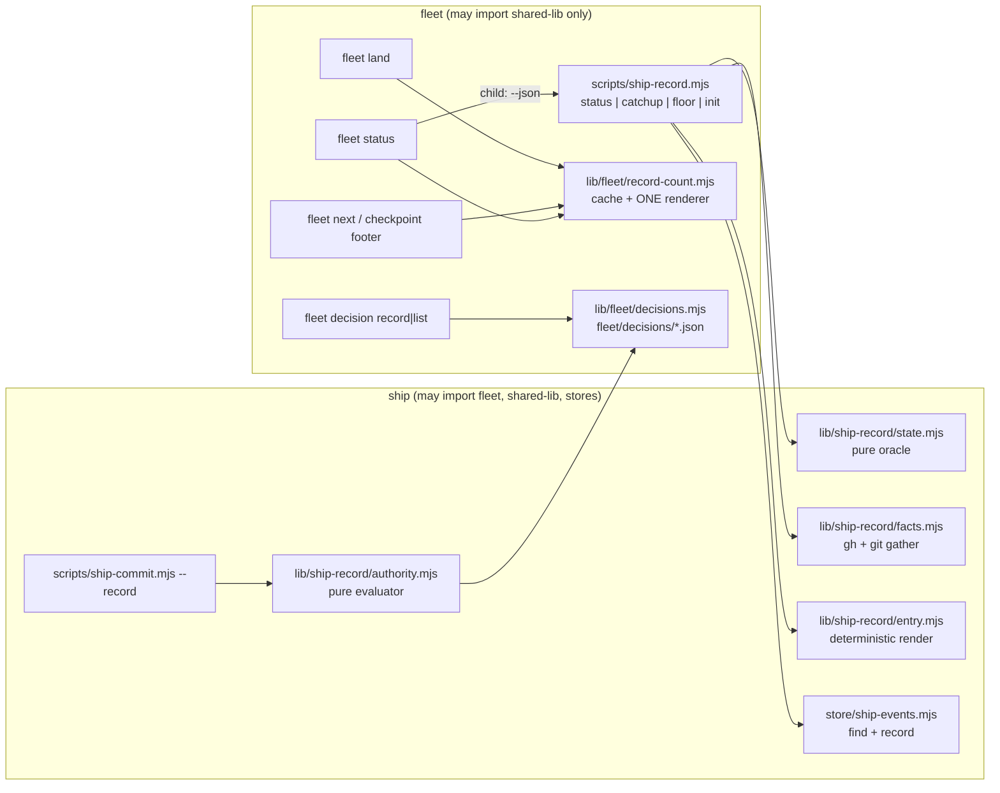

# Plan: Ship record catch-up — /ship's RECORD half without its PUSH/MERGE authority
- **Date**: 2026-11-16
- **Status**: In Progress
- **Author**: Claude + Louis
- **Scope**: backend (Node ESM CLIs + libs, skill prose) — stack `js-ts`
- **Target domain(s)**: `fleet`, `ship`, `skills-content`
- ⚠ **Cross-domain work** — touches >1 domain. Boundary crossings are deliberate and checked against `allowedDeps` below:
  `ship → fleet` is allowed (`.audit-loop/domain-map.json`); `fleet → ship` is NOT, so fleet reaches the new ship CLI only as a
  **child process** (the `upstream-count.mjs` pattern), never by import.

## 1. Context Summary

### The problem (measured 2026-11-16 at CES main `88bf43ee`, by the session that launched this one)

Fleet coordinators land PRs with `gh pr merge` / `fleet land`, which bypasses `/ship`, so its record-keeping never happens:

| Repo | Log | Last entry | Commits on main since |
|---|---|---|---|
| storyline | `status.md` | 2026-10-06 | 325 |
| wine-cellar-app | `status.md` | 2026-10-15 | 394 |
| ai-organiser | `status.md` | 2026-11-09 | 8 |
| CES | `docs/status/entries/` | 2026-11-13 | 24 |

AI-* provenance trailers, last 14 days: 0 of 254 consumer commits; 7 of 47 in CES. (`measured`, by the launching session; this
plan re-derives the per-repo numbers through the new `status` verb, which is the instrument — §9.)

### Why it happens (root causes, not symptoms)

1. `/ship` is user-only (`disable-model-invocation`) and fuses two halves with very different risk: the **record** half
   (status entry, plan Implementation Log, `Backlog:` line, `ship_event`) and the **push/merge** half. Chips stop at ship-ready,
   coordinators merge, and nobody owns the record half.
2. The pre-authorised ship (`ship-commit.mjs --preauthorised`) is per-chip, strict (passed/converged + final-review approve), and
   rarely granted — correctly, because it pushes code.
3. `/ship --train` is source-repo-gated; `ship-train.mjs` is not even in the sync closure (it classifies against the sync closure
   and publishes with the source repo's sync tools).

### Code Trace (pinned to `88bf43ee`)

- **/ship record half** — `skills/ship/SKILL.md` Step 2 `:559-585 (88bf43ee)` picks the entry location by ONE marker,
  `docs/status/entries/README.md`; Step 2b `:587-602` pastes `node scripts/backlog-snapshot.mjs`'s line (never written by a script);
  Step 5 `:646-674` appends a plan `## Implementation Log` block; Step 6.3 `:804-865` commits via `ship-commit.mjs` with
  `--path` (mandatory) and `--expect-head/--expect-branch`; Step 7 `:1053-1082` emits `record-ship-event` with outcome in
  `shipped|blocked|warned|overridden|aborted`.
- **Train gate** — `skills/ship/SKILL.md:1088-1095 (88bf43ee)` and `skills/ship/references/train-mode.md:7-11` — the gate is
  PROSE ("say so and stop"); `scripts/ship-train.mjs` has no package-name check, but `realContext` `:92-206` imports
  `lib/sync-inventory.mjs` (`closure`, `:137`) and the pinned-worktree publication path, neither of which a consumer has.
  `scripts/lib/sync-entry-lists.mjs` `CORE_ENTRY` `:20` lists `scripts/fleet.mjs` `:91` and `scripts/ship-commit.mjs` `:174`
  and `scripts/backlog-snapshot.mjs` `:263` — but not `ship-train.mjs`.
- **ship-commit authority seam** — `scripts/ship-commit.mjs` `KNOWN_FLAGS` `:85-91`, argv loop `:255-286` (boolean
  `--preauthorised` stored at `:264`), the pre-authorised refusal block `:672-693` sets `values.shipAuthority = 'launch-prompt'`;
  `scripts/lib/commit-trailers.mjs:30` reserves `AI-Ship-Authority` and `:598` renders only `launch-prompt`.
  `scripts/lib/ship-preauth.mjs:67-118 (88bf43ee)` is the pure condition evaluator — the shape to mirror (one row per condition,
  fail closed, an empty change set never reads clean `:108`).
- **ship_event writer** — `scripts/lib/cross-skill/commands/ship.mjs:34-61` → `scripts/lib/store/ship-events.mjs:33-67`
  (`insertReturning('ship_events', …)`); table `supabase/migrations/20260419120000_cross_skill_data_loop.sql:128-149`: outcome
  CHECK-constrained, `block_reasons jsonb` free-form, **no unique key** — so idempotency must be a read-before-write.
- **Merged-PR facts** — `scripts/lib/fleet/merged-facts.mjs:82-87` `listMergedPullRequests` (bounded `MERGED_LIMIT=100`
  `:35`; a result of exactly the limit cannot prove completeness), `MERGED_PR_FIELDS :31-33`; gh plumbing in
  `scripts/lib/fleet/gh-facts.mjs` (`spawnGh`, `classifyGhFailure`).
- **Fleet status → cache → footer pattern** — `scripts/lib/fleet/commands.mjs:201-231 (88bf43ee)` (`cmdStatus` writes the
  unregistered and upstream caches); `scripts/lib/fleet/upstream-count.mjs:1-200` is the template: `status` runs a bounded CHILD
  (`runUpstreamQueues :87-98`), `nextRecord :125-147` keeps measured/partial/unmeasured apart with `measuredAt`/`attemptedAt`,
  ONE renderer `renderUpstreamLine :170-183` serves `status` and `next`; `scripts/lib/fleet/coordination.mjs:70-82`
  `checkpointFooter` composes footer lines and never throws.
- **Directives** — `scripts/lib/fleet/directives.mjs:1-60`: closed vocabulary (`DIRECTIVE_KINDS :38` — no merge/push/override
  expressible), new record kinds live in NEW registry subdirectories so older readers never see them, writes inside `transact`.
- **Fleet CLI** — `scripts/fleet.mjs:1-197` thin dispatcher; verbs declared in `scripts/lib/fleet/argv.mjs:16` `VERBS`.
  `cmdLand` `scripts/lib/fleet/land.mjs:49`.
- **Chip/coordinator contract** — `skills/fleet/references/chip-preamble.md:47-59 (88bf43ee)` STOP POINT (chips never ship) and
  the bracketed PRE-AUTHORISED SHIP block; `skills/fleet/references/coordination-rationale.md` §Rule 8 (push lanes: per-entry
  files make the status lane unnecessary).
- **Status format** — `skills/ship/references/status-md-format.md:10-21` (marker-present = one immutable file per entry,
  `<YYYY-MM-DD>-<HHMMSS>-<kebab-slug>.md`, one `## ` heading, date equals file name); `docs/status/entries/README.md` (the
  CES marker and contract); `skills/ship/references/flow-rationale.md` §Step 2b — **"Never let a script write `status.md`: PR #87
  destroyed 19,257 lines of it that way."**
- **Domain map** — `.audit-loop/domain-map.json` `allowedDeps`: `fleet: [shared-lib]`, `ship: [fleet, shared-lib, stores]`;
  rule `scripts/ship*.mjs → ship`, `scripts/lib/ship-train/** → ship`.

### Neighbourhood considered (Phase 0.5)

`get-neighbourhood` returned only `review` bands (ship-commit `main`, helpers; `visual/store.mjs writeDriftLedger`) — nothing above
the repo's noise floor, so the oracle and writer are greenfield. **Reused, not re-written**: `listMergedPullRequests`/gh plumbing
(merged-facts, gh-facts), the cache/child/renderer pattern (upstream-count), the pure-evaluator shape (ship-preauth), the
registry `transact` + closed-schema pattern (directives), `atomicWriteFileSync` (file-io), commit-trailer parsing
(commit-trailers), `backlog-snapshot.mjs` (spawned, not re-implemented).

### Evaluation of the proposed design direction (the brief asked for this, not acceptance)

| Direction | Verdict | Why |
|---|---|---|
| Split RECORD from PUSH/MERGE | **Adopt** | The record half has no gate to launder: it writes docs only, ships no code, merges nothing. The split is the whole fix. |
| Watermark-keyed idempotent catch-up | **Adopt, but derive the watermark** | A separate watermark file is a second source of truth that drifts and conflicts. The **entries themselves** are the ledger: a PR is recorded iff its squash commit added an entry (self-recorded by `/ship`) OR an entry named `…-pr-<N>.md` exists on the base tree; the only stored watermark is a one-time **floor** entry. |
| One owner per repo (coordinator) | **Adopt as convention + make duplicates harmless** | A lock cannot span machines/sessions; instead per-PR entry file names are **deterministic from the merge time and PR number**, so two runs write the same path with the same bytes — git sees an identical add, not two entries. |
| Per-entry status files in consumers | **Adopt** | Required by determinism above and kills the status-lane conflicts (Rule 8). `ship-record init` writes the marker; `status.md` becomes frozen history there too. |
| Cadence trigger + "N merged PRs unrecorded" nudge | **Adopt** | `fleet status` measures (child process), `fleet next`/checkpoint footer and `fleet land` read it. Unmeasured ≠ 0. |
| Durable standing permission, docs-only | **Adopt; the scope is enforced in code, the words are recorded** | Recorded as a `fleet decision` (the user's exact words, attributable, revocable, optionally expiring). The *safety* comes from code — `ship-commit.mjs --record` allows only new entry files and marker-only plan appends, judged against HEAD — and from the user's merge of the record PR. The decision is a declaration, not verified authority (no code here can verify a user's origin, §2.6). Merges are not expressible. |
| Lift `--train` source-repo gate | **Do not lift (this plan)** | It would not fix the cause: `--train` is still human-typed (same gate as `/ship`), and lifting it means syncing `ship-train` + fleet serial + the train-provenance store reader to consumers and inventing a closure-free tier classifier. Its consumer value was the record half (solved here) and squash trailers (measured here, §2.6). Independent: nothing in this plan calls `ship-train`. Recorded as a follow-up with named preconditions (§8). |
| Backfill vs watermark-now | **Summarised floor now** | Re-creating ~720 per-PR entries from titles adds noise git log already holds. One floor entry per repo states the gap honestly (count, PR range, trailer coverage) and starts per-PR recording from there. |
| `decision` directive (gd-afeu finding 7) | **Adopt, scoped** | It is the durable home the standing permission needs. Closed `scope` enum; no merge/push/override value exists, so none can be granted. |
| `ship_event` per recorded PR | **Adopt with an honest outcome** | Outcome `warned`, `blockReasons:["merged-without-ship"]` — never `shipped`, which would claim /ship's gates ran (an unmeasured round wearing a clean round's clothes). No migration needed (`block_reasons` is free-form jsonb). Read-before-write makes it idempotent. |

## 2. Proposed Architecture



### 2.1 The record-state oracle (ONE predicate) (#5 Single Source of Truth, #13 Idempotency)

`classifyRecordState({floors, merged, baseEntryNames, baseMarkers, inBand})` — pure, in `lib/ship-record/state.mjs`. Per merged
PR after the floor: `recorded`, `unrecorded`, or `unknown`. **Recorded has exactly two forms of evidence, both naming THIS PR**
(audit R1-H9 — "some status file changed" is not evidence):
1. **marker** — an entry on the base tree carries `<!-- ship-record v1 pr=<N> merge=<sha> -->` with this PR's number AND merge
   sha (catch-up entries; a `/ship` that knows its PR may add it too);
2. **in-band** — the PR's own merge commit **added** (diff-filter `A`, never `M`/`D`) a non-README file under
   `docs/status/entries/`, or, in a marker-absent repo, added at least one `## ` heading line to `status.md` (a `+## ` line in
   the merge's diff). That is `/ship` Step 2's own footprint for the PR being shipped.

Anything else — a modification, a deletion, an edit of another entry — is not evidence: the PR stays `unrecorded` (or
`unknown` if the merge commit is not in the local object store). A train member whose only record is the train log entry is
classified `unrecorded` and gets its own catch-up entry; that redundancy is accepted (the train entry is a batch summary, and
parsing `#N` out of prose would be guessing).

Overall state: `measured` (every PR classified), `partial` (some `unknown`, or a listing window could not be completed —
§2.1a), `unmeasured` (gh/git could not answer), `no-floor` (never initialised), `ambiguous-floor` (more than one floor on the base
tree — refused, never "pick the newest", audit R1-H5). **Every state except `measured`/`partial` carries `unrecorded: null`,
never `0`.** Every reader — the CLI, `catchup`, the fleet cache — calls this one function.

Facts are gathered in `lib/ship-record/facts.mjs` (injectable runners, never throws, each failure carries its reason):
- **base (audit R1-H3)** — ONE resolved pair `{branch, ref, repo}`: `branch` is the bare name (`--base <name>` if given,
  else the target of `refs/remotes/origin/HEAD` with the `refs/remotes/origin/` prefix stripped, else `main`); `ref` is always
  the fully-qualified `refs/remotes/origin/<branch>` (never a short name — the `gatherChangedPaths` lesson) and must resolve with
  `git rev-parse --verify`, or the state is `unmeasured: base ref <ref> not found — git fetch origin <branch>`; `repo` is
  `owner/name` from `git remote get-url origin` (the `githubSlugFromUrl` helper ship-train already has, moved to a shared spot
  only if it is not importable as is), passed to every gh call as `-R`, and `GH_REPO`/`GH_HOST` are stripped from gh's env (the
  ship-train `ghEnv` rule). gh receives `--base <branch>`; git receives `<ref>`.
- the base **tree**, not the working tree: `git ls-tree -r --name-only <ref> -- docs/status/entries/`, and the markers are read
  with `git cat-file -p <ref>:<path>` only for files whose name matches `*-pr-<N>.md` or `*-record-floor.md` (bounded).
- floors: every `docs/status/entries/*-record-floor.md` on the base tree, parsed by `parseFloorMarker` — the ONE grammar
  (audit R3-H1), shared by the renderer, the parser, the examples and a writer→reader round-trip test:
  `<!-- ship-record-floor v1 merged-through=<ISO-8601 UTC, Z suffix> covered=<ascending comma-separated positive ints, ≥1> -->`.
  A malformed timestamp, an empty or non-ascending `covered`, a duplicate, or two markers in one file ⇒ the floor is
  `invalid` and the state is `unmeasured: invalid floor <file> (<why>)`, never silently ignored. Zero → `no-floor`; two or more → `ambiguous-floor`.
- in-band: `git diff-tree --no-commit-id --name-status -r <merge>^1 <merge> -- docs/status/entries/` (and `-p -- status.md`
  for marker-absent repos), memoised per merge oid.
- trailers: `git log -1 --format=%B <merge>` parsed with `commit-trailers.mjs`; the entry reports what it OBSERVED
  (`AI-Gate: converged` or `no AI-* trailers on the squash commit`), never an inference about which gates ran (R1-H9).

#### 2.1a Listing every merged PR since the floor (audit R1-H4)

GitHub search has no merge-time sort and caps a query at 1000 results, so "list the newest N" cannot reach the rest. The lister
walks **date windows** instead: `gh pr list -R <repo> --state merged --base <branch> --search "merged:<from>..<to>" --limit 500
--json number,title,headRefName,mergedAt,mergeCommit,url`, starting with `[floor date, today]`. A window that returns exactly its
limit is split in half and re-queried (bisection) until every window returns fewer than the limit; a single-day window that
still hits the limit is reported `partial` with that day named. Results are filtered **overlap-safe** (audit R2-H5, R3-H3): the
listing starts **7 days before** `floor.mergedThrough` (`RECHECK_DAYS`), and a PR is excluded only if its number is in the
floor's `covered` set — never by timestamp alone. So a PR that GitHub's search returned late (after the floor was written)
with a merge time *before* the cutoff is still found, as long as it surfaces within the recheck window; one that surfaces
later than that is a stated limit (§8). The floor's `covered` list is the full set of PR numbers the floor summarised,
not just those at the cutoff instant. Then de-duplicated by PR number, and ordered by `(mergedAt, number)` so equal timestamps order stably.
Recorded PRs do not occupy a fixed window — every window is listed in full — so they never starve the unrecorded ones. A gh
failure in any window makes the whole result `unmeasured` with that window and `classifyGhFailure`'s reason (a partial list must
never read as complete). Bound: at most 64 gh calls per run; past that, `partial`.

### 2.2 The writer — only ever CREATES files (#15 Error handling, incident PR #87)

`ship-record catchup` writes, per unrecorded PR (oldest first, capped at `--max 30` per run so one run is bounded; the rest are
reported, not dropped), `docs/status/entries/<YYYY-MM-DD>-<HHMMSS>-pr-<N>.md` where the timestamp is the PR's **`mergedAt` in
UTC** — the merge IS the ship. Every byte is a pure function of PR facts (`renderPrEntry`), so a re-run, or a concurrent run on
another machine, produces the same path and the same bytes. `status.md` is never touched.

**Where each entry field comes from (audit R1-H6)** — one source per field, each with its failure rendering:

| Field | Source | Bound | On failure |
|---|---|---|---|
| number, mergedAt, merge sha, head ref, url | the §2.1a listing (fixed once merged) | — | (the PR is not listed at all) |
| title | the **merge commit's subject line** (`git log -1 --format=%s <merge>`), a trailing ` (#N)` removed — immutable, unlike the GitHub title, which stays editable after merge (audit R3-H2) | ≤160 chars | as for changed files |
| changed files | `git diff-tree --no-commit-id --name-only -r --no-renames <merge>^1 <merge>` — local and authoritative, no gh pagination | first 20 listed, then `+<n> more across <top dirs>` | merge not local ⇒ the PR is `unknown`, no entry written |
| touched plans | the same file list, filtered to `docs/plans/*.md` | — | as above |
| trailers | `git log -1 --format=%B <merge>`, parsed in full by `commit-trailers.mjs` | three observed states (audit R3-M3): `AI-Gate: <value>` (one of the four) · `AI-* trailers present, no valid AI-Gate` · `no AI-* trailers` | as above |

**Only immutable inputs (audit R2-H2, R3-H2).** Every rendered field is fixed once the PR is merged: the merge commit's own
facts (subject, files, trailers, sha) and the listing fields GitHub does not let anyone edit on a merged PR (number, mergedAt,
merge sha, head ref name). The GitHub title is not rendered. The PR **body is deliberately not rendered** — it is editable on GitHub after merge and a
fetch can fail transiently, either of which would make two runs disagree about an immutable file; the entry links the PR
instead. Operational outcomes (event writes, plan-log suggestions, skips) go in the run entry and the envelope, never in the
per-PR entry. A wrong immutable entry is corrected the way every entry is (the README contract): by a NEW entry that names
the one it corrects, in a reviewed PR.

A sensitive path (`classifyPath === 'sensitive'`, the single oracle) is listed by its directory only, never by name.

**Create-only, atomic, symlink-resistant (audit R1-H8).** `docs/status/entries/` must be a real directory (`lstat`, not a
symlink, inside the repo root). Each entry is written to a temp file in the same directory and published with `fs.linkSync(tmp,
final)` — atomic, and it fails with `EEXIST` rather than replacing anything — then the temp is unlinked. An interrupted run
leaves at most a stray `*.tmp-<pid>` (cleaned up by the next run; never a half-written entry under a real name). On `EEXIST`:
identical bytes ⇒ no-op; different bytes ⇒ reported and left alone. **No existing file is ever opened for writing** — not
`status.md`, not a plan (§2.4). Same-machine runs serialise on a file lock in the git common dir
(`withFileLock`, the ship-train `lease` shape, `maxWaitMs: 0` — a second run refuses with "another catch-up is running").

Per-PR entry (heading grammar = the README's; exactly one `## `):

```markdown
## 2026-11-16 — #372 chore(upstream): record e5a067c3 disposition
<!-- ship-record v1 pr=372 merge=88bf43ee… -->

### Changes
- Merged #372 at 2026-11-16T09:12:44Z as `88bf43ee…` from `claude/…` (<url>).

### Files Affected
- <≤20 paths; else "<n> files across <top dirs>">

### Provenance
- Recorded after merge by `ship-record catchup`: no in-band /ship record was found for this PR.
- Squash-commit trailers: `AI-Gate: converged` | AI-* trailers present, no valid AI-Gate | no AI-* trailers.
- Plan: `docs/plans/<x>.md` (touched by this PR) | none.
```

When ≥1 per-PR file was written, ONE run entry `<now UTC>-record-catchup.md` lists them and carries the `Backlog:` line from
`backlog-snapshot.mjs` run as a sibling child (its own `unmeasured` fields pass through; a failed run renders
`Backlog: unmeasured (<reason>)`, never a blank). This is the only non-deterministic file; duplicates of it are harmless.

**One output boundary for every external field (audit R2-H6)** — `sanitizeField(value, kind)` in `entry.mjs`, the only path
from a fact to entry text: (1) redact with `redactSecrets` (`lib/secret-patterns.mjs`, the gentle redactor — `sanitizer.mjs`
would corrupt prose) **before** truncating, so a secret cannot be cut into an unredacted fragment; (2) strip control characters
and collapse newlines (a title cannot open a new `## ` heading); (3) neutralise markup for its context — HTML `<`/`>` and
`<!--`/`-->` escaped, so no field can forge a marker or inject HTML; Markdown left as text inside a code span for the
head ref and paths, fenced with one more backtick than the longest run in the value; (4) truncate (title ≤160). Kinds: `title`, `ref` (must also match git's ref charset, else
`<unprintable ref>`), `path` (sensitive ⇒ directory only), `url` (must be `https://github.com/<repo>/pull/<N>` for the resolved
repo, else omitted). Markers are rendered ONLY from validated integers and 40-hex shas, never from text.

### 2.3 Floor and init (#18 Backward compat)

- `ship-record floor --write`: one summarised backfill entry `<now>-record-floor.md` naming the last log entry it found (newest
  entry file, else `status.md`'s first `## YYYY-MM-DD`), the merged-PR count and range since then, trailer coverage, and the
  marker `<!-- ship-record-floor v1 merged-through=<ISO> covered=<N,N,…> -->`. **The cutoff is a GitHub timestamp, never the
  local clock (audit R1-H5)**: it is the `mergedAt` of the newest PR in the summary listing whose `mergedAt` is at least 15
  minutes old (a settle window for GitHub's search index, audit R2-H5); `covered` lists EVERY PR number the floor summarised
  (bounded by the listing; a few KB at the measured backlogs). A PR not in `covered` — merged in the settle window, or one
  the listing did not yet show — is recorded per PR by the next catch-up (§2.1a's recheck window). The summary listing must be **complete** (§2.1a `measured`); a `partial`/`unmeasured` listing
  refuses (exit 3) — a floor is a claim about everything before it.
  **Refuses** (exit 3) if any floor exists on the base tree or in the working tree. Two coordinators proposing floors on two
  branches both merge as two files; the oracle then reads `ambiguous-floor` (unmeasured) and every verb refuses until a human
  deletes one in a reviewed PR — a loud stop instead of a silent skip of the PRs between them. A floor never moves.
- `ship-record init`: in a repo without `docs/status/entries/README.md`, writes the consumer marker (same contract as CES's,
  minus the source-only integrity-gate paragraph). Refuses if it exists. `catchup`/`floor` refuse with "run `ship-record init`"
  when the marker is absent — they never fall back to writing `status.md`.

### 2.4 Plan Implementation Log — suggested, never written by the script (audit R2-H1)

No file-system primitive gives a true compare-and-swap against another editor, and flow-rationale §Step 2b already rules that
the log is *pasted, not written* by a script (PR #87). So for each PR that touched a `docs/plans/*.md` file, the run entry and
the envelope carry a **suggested line**:
`- <date>: merged #<N> (<sha12>) — recorded by ship-record catch-up <!-- ship-record pr=<N> -->`, and the coordinator pastes it
into that plan's `## Implementation Log` (Step 5's shape) in the same record commit, exactly as `/ship` Step 2b pastes the
`Backlog:` line. A plan already containing the marker is not suggested again (the idempotency key). The plan's `Status:` is
never changed by the record half — that is a judgement, not a record. `ship-commit --record` accepts the pasted change by a section-aware rule (§2.6), so a
correctly placed line inside a log that is not the last section is accepted. A plan with no `## Implementation Log` gets the
section created at EOF with the line under it.

### 2.5 ship_event (#16 Graceful degradation)

**Reconciled, at-least-once — not exactly-once (audit R1-H7, R2-H4 ruled LOW).** Events are a separate pass, independent of which files this run created: for
every PR after the floor that carries a catch-up marker on the base tree OR in the working tree (written by this or an earlier
run), ensure one event exists — the batched existence read below (new in `store/ship-events.mjs`;
a schema fault degrades loudly via `describeSchemaFault`, never as "absent"), and if absent `recordShipEvent(repoId,
{outcome:'warned', blockReasons:['merged-without-ship'], commitSha:<merge>, branch:<headRef>})`. A failed write is therefore
retried by the next run, and a cloud-off run is caught up by the first cloud-on run. **Bounded (audit R3-M1)**: existence is
looked up in ONE batched read per run — `findShipEvents(repoId, shas, 'merged-without-ship')`, `commit_sha = ANY($2)` — over
at most 500 marker-bearing PRs, newest first; the envelope carries `events.backlog` (marked PRs not checked this run) so a
long tail is visible, never assumed done; markers older than 90 days are not reconciled (stated limit). **Store registry
(R3-M2, deliberated: dismissed)**: no new write-shaped export is added — the pass calls the existing `recordShipEvent` and adds
only a read — so the `audit-store-writers.mjs` census is unchanged; durableWrite's obligation is scoped to
`legacy-production-audit.mjs`'s cloud block. Output counts `{written, existing, lost,
skipped}`; `lost > 0` sets exit 1 and names the PRs.
**Serialisation**: the same-machine file lock (§2.2) serialises writers; the table has no unique key and this plan adds no
migration (a migration must reach every store before merge, a cost the record half does not justify). The residual race —
two owners on two machines in the same second — can store a duplicate row; the one-owner rule makes it unlikely, it does not
make it impossible. **Any count of these warnings must deduplicate by `(repo_id, commit_sha)`** (stated in
`record-catchup.md`), and database-enforced uniqueness (partial unique index + `ON CONFLICT DO NOTHING`, rolled out to every
store with the writer) is a **prerequisite before any reader makes a decision from these events' cardinality** — recorded in
Out of Scope with that trigger. Not routed through `durableWrite`: that registry covers
`legacy-production-audit.mjs`'s cloud block, and the reconciliation pass already gives this writer retry-on-next-run semantics.
The repo id comes from the scope resolver `cross-skill.mjs` uses (`ctx.resolveScope`, no second resolver).

### 2.6 Authority — the standing record permission (#1 SRP, AGENTS "Where enforcement lives")

**Where the trust boundary actually is (audit R1-H2).** No code in this repo can verify that words came from the user — any
process that can run `fleet` can write a record. So the plan does not pretend the decision record is the safety boundary. The
three things that make an agent-made record commit safe are, in order: (1) **what it can contain** — code-checked, docs-only,
create-or-append (below); (2) **what it cannot do** — it never merges, and pushing a branch is something coordinators may
already do; (3) **the user's merge of the record PR** — the one trusted approval, unchanged. The decision record is the
*attributable declaration* the brief asks for: the exact words, who recorded them, when, and their id carried into the commit
so the reviewer reads them before approving the merge.

- **`fleet decision record --scope <record-catchup|note> --words-file - [--expires <ISO>]`** (stdin, the backtick rule)
  writes `fleet/decisions/<dec-id>.json` inside `transact`: `{schemaVersion:1, id, at, scope, words, recordedBy:{session,
  hostSession}, expiresAt|null}` (`z.strictObject`; `words` 1–4000 chars, the user's exact text, no control characters).
  Immutable. **`fleet decision revoke <id> --words-file -`** writes a separate revocation record (never edits or deletes the
  original). `fleet decision list [--scope] [--all]` reads, bounded (`complete:false` over the cap, never "none"). A decision is
  *active* iff unrevoked and unexpired. The registry is per repository (`fleet/` lives in the repo's git common dir), so scope
  is the repo by construction. The `scope` enum has no merge/push/override value; every render says *a decision records the
  user's words; it grants only its scope, and never a merge*. An unknown `schemaVersion`/scope on disk is listed as
  `unsupported`, never active (the directives rule).
- **`ship-commit.mjs --record --decision <dec-id>`** — pure evaluator `evaluateRecordCommit` in `lib/ship-record/authority.mjs`,
  one row per condition, fail closed. **It judges the exact change against HEAD immediately before commit (audit R1-H1)**, not
  the path names: for each `--path`, ship-commit already commits that path's worktree content (`--only` semantics) after its
  head/branch identity check; the evaluator receives, per path, `{statusAtHead: absent|blob, lstat: regular|symlink|other,
  oldBytes, newBytes}` gathered in that same window, and allows only:
  - `docs/status/entries/<name>.md` **absent at HEAD**, regular file, name matching the entry grammar, content with exactly one
    `## ` heading; or
  - `docs/status/entries/README.md` **absent at HEAD**, regular file, bytes **equal to** `renderInitReadme()` (audit R2-H3 —
    the marker `init` writes; anything else under that name refuses); or
  - `docs/plans/<name>.md` **present at HEAD**, regular file, and `planChangeIsRecordOnly(oldBytes, newBytes)` holds (audit
    R3-H4): a line diff whose ONLY change is inserted lines (no deleted or modified line, every other byte preserved), each
    inserted line matching the suggestion grammar, all inserted inside the existing `## Implementation Log` section (between
    its heading and the next `## ` or EOF); or, when the file has no such section, inserted at EOF as `## Implementation Log`
    plus those lines. Anything else refuses with the first offending line number.
  Refused, each with its own reason: any other path, a deletion, a rename (`--no-renames` lists both ends), a symlink, an empty
  set, a gate other than `not-run`, `--preauthorised` or `--no-tests` combined, a `--decision` that is missing, revoked, expired,
  or of another scope. ship-commit's existing `post-commit-drift` check (exit 1, do not push) still guards changes between
  evaluation and commit. On success the commit carries `AI-Ship-Authority: record-catchup` and `AI-Decision: <dec-id>` (new
  reserved trailer key).
- **What stays human**: merging the record PR. The coordinator opens it like any docs PR; the user's merge approval (or the next
  train/land approval) lands it. Nothing here merges.

### 2.7 Cadence + nudge (#19 Observability)

`lib/fleet/record-count.mjs` mirrors `upstream-count.mjs`: `fleet status` runs `ship-record.mjs status --json` as a bounded child
(60 s), located as a **sibling of the running `fleet.mjs`** (works in both the source layout and the synced
`scripts/.claude-skills/` layout); writes `record-count.json` beside the other fleet caches; ONE renderer
`renderRecordLine` feeds `status`, `next` and the checkpoint footer:
the `next:` command in each line is the CLI's own `remedy` field (§2.9), never re-derived by fleet, so the two cannot disagree:
`records: 7 merged PR(s) unrecorded since floor #372 — node scripts/ship-record.mjs catchup --write (coordinator)` ·
`records: not initialised — node scripts/ship-record.mjs init` (or `… floor --write` when the marker already exists) ·
`records: AMBIGUOUS (2 floors) — a human removes one in a reviewed PR` · `records: UNMEASURED (<reason>)` · stale >24 h says so.
`fleet land` prints the same line after a merge outcome. A missing sibling script renders `records: UNMEASURED (ship-record.mjs
not found — re-sync)`, never absent.

### 2.9 CLI contract — `scripts/ship-record.mjs` (audit R1-M2)

| Verb | Writes? | Flags | Exit |
|---|---|---|---|
| `status` | never | `--json`, `--base <branch>`, `--fetch` (runs `git fetch origin <branch>` first; a failure is reported, the run continues on the last fetch) | 0 always (a nudge; the state is in the envelope) · 2 argv |
| `catchup` | only with `--write` (dry run otherwise: the same envelope with `wouldWrite`) | `--write`, `--json`, `--base`, `--max <n>` (default 30), `--no-events`, `--fetch` | 0 done · 1 error or `events.lost>0` · 2 argv · 3 refused (state not `measured`/`partial`, no marker, lock held) |
| `floor` | only with `--write` | `--write`, `--json`, `--base`, `--fetch` | 0 · 1 · 2 · 3 refused (floor exists, listing not complete, no marker) |
| `init` | always (it is the write) | `--json` | 0 · 1 · 3 refused (marker exists) |

Every envelope: `{ok, verb, state, base:{branch,ref,repo,oid}, floor, counts:{merged,recorded,unrecorded,unknown,withTrailers},
unrecorded:[{number,title,mergedAt,mergeCommit}], wrote:[paths], events:{written,existing,lost,skipped}, reason, remedy}` —
`counts.unrecorded` is `null` whenever `state` is not `measured`/`partial`. `remedy` is the one executable next command for the
state (`init` → `floor --write` → `catchup --write` → `status --fetch` for unknown merges). `assertKnownFlags` per verb;
`--selfcheck-relocation` first in `main()`; `isInvokedAsScript` entry guard; `finishAndExit` after stdout.

### 2.8 Right-sizing gate

- **Band-aid**: tell coordinators in prose to write status entries after merging. (Unenforced prose is exactly what decayed.)
- **Over-engineered**: a store-backed record ledger table with a watermark column, a daemon, and an auto-merging record bot.
- **Chosen**: entries-as-ledger + one floor + a pure oracle + a create-only writer + a code-checked docs-only commit mode. Each
  piece serves a current requirement in the brief; no new table, no migration, no new persistent artifact besides the entries
  themselves and one derived cache.

**Manual vs scripted**: scripted — the catch-up repeats per PR across four repos (hundreds of sites); hand-writing is what failed.

## 6. Sustainability Notes

- **Assumption**: squash merges (one merge commit per PR). A true merge commit still has `^1` = base parent, so `diff-tree`
  remains correct; rebase-merges (several commits per PR) would make "self-recorded" inspect only the tip — documented limit.
- **Assumption**: `gh` is the PR oracle. A non-GitHub host reads `unmeasured`, honestly.
- **Extension points**: the `scope` enum (a future `decision` scope is one enum value + one consumer), `renderPrEntry` (one pure
  function), the oracle's input is plain data so a future store-backed source plugs in without touching readers.
- **Lifting `--train` later**: the record catch-up does not depend on it, so it can be decided on its own evidence (§8).

## 7. File-Level Plan

| File | Intent | Purpose / key exports | Principle |
|---|---|---|---|
| `scripts/lib/ship-record/state.mjs` | create | `parseFloorMarker`, `prNumberFromEntryName`, `classifyRecordState` — pure oracle | #5, #11 |
| `scripts/lib/ship-record/facts.mjs` | create | `resolveBaseRef`, `readBaseEntryNames`, `listMergedSince`, `selfRecorded`, `trailerGate` — injectable gather | #3, #16 |
| `scripts/lib/ship-record/entry.mjs` | create | `entryFileName`, `renderPrEntry`, `renderRunEntry`, `renderFloorEntry`, `renderInitReadme`, `sanitizeField`, `planLogSuggestion` | #11, #13 |
| `scripts/lib/ship-record/authority.mjs` | create | `evaluateRecordCommit`, `RECORD_PATH_RULES`, `renderRecordConditions` — pure | #1, #12 |
| `scripts/ship-record.mjs` | create | CLI: `status`, `catchup`, `floor`, `init`; `--json`, `--base`, `--max`, `--write`, `--no-events`; `--selfcheck-relocation`; exit 0 ok · 1 error · 2 argv · 3 refused | #2 |
| `scripts/lib/store/ship-events.mjs` | modify | add `findShipEvents(repoId, shas, reason)` (one batched read; schema fault loud) | #13 |
| `scripts/lib/fleet/decisions.mjs` | create | schema, `recordDecision`, `revokeDecision` (both in `transact`), `readDecisions`, `activeDecision(id, scope)` | #12 |
| `scripts/lib/fleet/argv.mjs` | modify | `decision` verb (record, revoke, list) flags/help | — |
| `scripts/fleet.mjs` | modify | dispatch `decision`; usage line | — |
| `scripts/ship-commit.mjs` | modify | `--record` flag → `evaluateRecordCommit`; `shipAuthority='record-catchup'` | #12 |
| `scripts/lib/commit-trailers.mjs` | modify | render/parse `AI-Ship-Authority: record-catchup` and the new reserved `AI-Decision: <dec-id>` | #5 |
| `scripts/lib/fleet/record-count.mjs` | create | cache schema, `runRecordStatus` (child), `refreshRecordCache`, `readRecordCache`, `renderRecordLine` | #19 |
| `scripts/lib/fleet/commands.mjs` | modify | `cmdStatus` refreshes the record cache + line | — |
| `scripts/lib/fleet/coordination.mjs` | modify | `checkpointFooter`/`next` render the record line | — |
| `scripts/lib/fleet/land.mjs` | modify | post-merge record nudge line | — |
| `scripts/lib/sync-entry-lists.mjs` | modify | add `scripts/ship-record.mjs` to `CORE_ENTRY` (consumers receive it) | — |
| `.audit-loop/domain-map.json` | modify | rule `scripts/lib/ship-record/** → ship` | — |
| `skills/ship/references/record-catchup.md` | create | runbook: verbs, the floor, the commit, cadence, what stays human | — |
| `skills/ship/SKILL.md` | modify | ≤3-line pointer beside Train mode + reference-index row; net size ≤ baseline (trim elsewhere) | — |
| `skills/ship/references/status-md-format.md` | modify | per-PR and floor entry templates; consumer `init` | — |
| `skills/ship/references/train-mode.md` | modify | why the gate stays; pointer to record catch-up | — |
| `skills/fleet/SKILL.md` | modify | `decision` verb in usage; net size ≤ baseline | — |
| `skills/fleet/references/coordinator-playbook.md` | modify | §Record catch-up: owner, cadence, launch-time `fleet decision record` | — |
| `skills/fleet/references/chip-preamble.md` | modify | chips never run catch-up (one owner) | — |
| `skills/fleet/references/coordination-rationale.md` | modify | Rule 8: record lane note | — |
| `tests/ship-record-state.test.mjs` | create | oracle + floor + name parsing | — |
| `tests/ship-record-entry.test.mjs` | create | determinism, sanitising, plan-log safe-append | — |
| `tests/ship-record-cli.test.mjs` | create | verbs over a temp git repo + fake gh | — |
| `tests/ship-record-authority.test.mjs` | create | evaluator both directions; ship-commit `--record` refusals | — |
| `tests/fleet-decisions.test.mjs` | create | schema, closed scope, transact, list cap | — |
| `tests/fleet-record-count.test.mjs` | create | interpret/unmeasured/stale/renderer | — |

### 7b. Implementation Phases

**Phase 1 — Record-state oracle + `status`**: the pure oracle, the fact gatherers, and the read-only `status` verb with its
`--json` envelope. Files: `scripts/lib/ship-record/state.mjs` (create), `scripts/lib/ship-record/facts.mjs` (create),
`scripts/ship-record.mjs` (create), `tests/ship-record-state.test.mjs` (create), `.audit-loop/domain-map.json` (modify).

**Phase 2 — Writer verbs**: deterministic entry rendering, create-only writes, `catchup`/`floor`/`init`, the run entry with the
Backlog line, and the plan-log suggestions (the script never writes a plan). Files: `scripts/lib/ship-record/entry.mjs` (create), `scripts/ship-record.mjs`
(modify), `tests/ship-record-entry.test.mjs` (create), `tests/ship-record-cli.test.mjs` (create).

**Phase 3 — ship_event emission**: idempotent read-before-write per recorded PR. Files: `scripts/lib/store/ship-events.mjs`
(modify), `scripts/ship-record.mjs` (modify), `tests/ship-record-cli.test.mjs` (modify).

**Phase 4 — Decision records**: `fleet decision record|list`, closed scope, transact writes. Files:
`scripts/lib/fleet/decisions.mjs` (create), `scripts/lib/fleet/argv.mjs` (modify), `scripts/fleet.mjs` (modify),
`tests/fleet-decisions.test.mjs` (create).

**Phase 5 — Docs-only record commit**: `ship-commit.mjs --record`, the pure evaluator, the trailer value. Files:
`scripts/lib/ship-record/authority.mjs` (create), `scripts/ship-commit.mjs` (modify), `scripts/lib/commit-trailers.mjs`
(modify), `tests/ship-record-authority.test.mjs` (create).

**Phase 6 — Fleet nudge**: the record-count cache, `status`/`next`/footer line, the post-land nudge. Files:
`scripts/lib/fleet/record-count.mjs` (create), `scripts/lib/fleet/commands.mjs` (modify), `scripts/lib/fleet/coordination.mjs`
(modify), `scripts/lib/fleet/land.mjs` (modify), `tests/fleet-record-count.test.mjs` (create).

**Phase 7 — Distribution + docs**: sync entry, skill prose and references within the size gates. Files:
`scripts/lib/sync-entry-lists.mjs` (modify), `skills/ship/references/record-catchup.md` (create), `skills/ship/SKILL.md`
(modify), `skills/ship/references/status-md-format.md` (modify), `skills/ship/references/train-mode.md` (modify),
`skills/fleet/SKILL.md` (modify), `skills/fleet/references/coordinator-playbook.md` (modify),
`skills/fleet/references/chip-preamble.md` (modify), `skills/fleet/references/coordination-rationale.md` (modify).

**Close-out (not a phase)**: `npm run skills:regenerate`, `npm run skills:check`, `npm run skills:size:gate` (re-baseline only a
shrink), `npm run size:ratchet:gate`, `npm run bundle:deps`, `npm run guards:preflight`, the pre-push check; then a dry run of
`node scripts/ship-record.mjs status` on this repo as the live control (§9).

## 8. Risk & Trade-off Register

| Risk / trade-off | Mitigation |
|---|---|
| A script writing the log (PR #87 destroyed 19,257 lines) | Create-only (`wx`) writes; never opens `status.md`; plan append only when provably at EOF of `## Implementation Log` and prefix-verified. |
| gh returns a truncated list | Date-window bisection (§2.1a); only a single-day overflow is `partial`, named; the cache never shows a partial as complete. |
| Merge commit not fetched locally | That PR is `unknown` (partial), never `unrecorded` — a wrong "unrecorded" would duplicate a /ship entry. `remedy` is `status --fetch`. |
| Two coordinators race | Same machine: file lock. Across machines: deterministic names + bytes ⇒ identical adds; two floors ⇒ `ambiguous-floor` stop; run entries may duplicate (harmless); events: one-owner rule + distinct-`commit_sha` counting (§2.5). |
| Agent-authored PR body forges a marker / leaks a secret | Marker delimiters stripped; `redactSecrets` applied; body capped. |
| `ship_event` outcome semantics | `warned` + `merged-without-ship`, never `shipped`; dashboards counting `shipped` are not inflated. |
| A `decision` read as authority beyond its scope, or forged by an agent | Closed enum; it is labelled a declaration, not verified authority; `ship-commit --record` judges the change itself against HEAD regardless of the decision; its id rides in `AI-Decision` so the merge reviewer reads the words; merges never consult it. |
| Record commit smuggles a non-record change | Per-path evaluation against HEAD (new-entry or marker-only append), symlinks/deletions/renames refused, `post-commit-drift` still guards the window. |
| ship SKILL.md / fleet SKILL.md are over the 12K cap and may not grow | Detail lives in `references/record-catchup.md`; SKILL.md edits are net-neutral or shrinking (re-baseline the shrink). |
| **Deferred: lifting `--train` for consumers** | Independent of this plan (nothing here calls ship-train). Preconditions for a follow-up: sync ship-train + `store/train-provenance` + fleet serial callback; a tier classifier that does not need the sync closure; the `sync` verb skipped by construction; and evidence that the trailer gap (now measured per entry) justifies it. |
| **Deferred: event uniqueness at the database** | Accepted at LOW (R2-H4 deliberation): at-least-once events, counted by `(repo_id, commit_sha)`. Trigger: the first reader that decides on these events' cardinality — then a partial unique index + `ON CONFLICT DO NOTHING`, migrated to every store with the writer. |
| **Deferred: per-PR retroactive backfill** | Replaced by one summarised floor per repo (brief allows it); git log keeps the per-commit detail. |
| **Deferred: running the floor/catch-up in each consumer** | Operational, after this merges and syncs: coordinator runs `init` → `floor --write` → `catchup` per repo, committing with `--record`. |

## 9. Testing Strategy

- **Unit (pure)**: `classifyRecordState` (recorded by self / by name / by floor; unknown merge ⇒ partial; gh at limit ⇒
  partial; gh failure ⇒ `unrecorded:null`), `parseFloorMarker`, `entryFileName` (UTC from `mergedAt`, kebab slug, date equals
  heading), `renderPrEntry` byte-determinism (same facts twice ⇒ identical; different run time ⇒ identical; no gh call reaches it),
  `sanitizeField` per kind (a fake key in a title, a branch and a trailer is redacted before truncation; a title with `
## `
  cannot open a heading; `-->`/`<script>` neutralised; a sensitive path renders as its directory; a non-PR url is omitted),
  `planLogSuggestion` (marker present ⇒ no suggestion), `evaluateRecordCommit` (allowed set passes; a `scripts/` path, a modified entry, an empty set, gate≠not-run, missing
  decision each refuse with their own reason), decisions schema (unknown scope rejected; `merge` not expressible), record-count
  `interpret`/`nextRecord`/`renderRecordLine` (missing/unreadable/unmeasured/stale/partial/measured).
- **Integration**: CLI over a temp git repo with a fake `gh` (the ship-train fake-context style): `status` ⇒ counts; `catchup
  --write` ⇒ files; second `catchup --write` ⇒ zero new files (**the idempotency oracle**); `floor --write` twice ⇒ second refuses
  exit 3; marker absent ⇒ catchup refuses; `ship-commit --record` in the temp repo commits an entry and refuses a code file.
- **Proof plan** (`references/proof-oracle.md`):
  | Behaviour | Oracle | Pass condition | Report evidence |
  |---|---|---|---|
  | Rerun is a no-op | CLI test, run twice | 2nd run writes 0 files, emits 0 events | test name + count |
  | Unmeasured never reads 0 | red test with gh absent | `unrecorded === null`, line says UNMEASURED | test output |
  | Docs-only enforced | red tests: `--record --path scripts/x.mjs`; a plan edit that rewrites (not appends); a modified existing entry; a symlinked entry | exit 2, each with its own refused condition | stderr lines |
  | Listing is complete past one window | fake gh with 1,200 merged PRs over 30 days, limit 500 | bisection reaches all 1,200; a single-day overflow reads `partial` | test counts |
  | Events reconcile | fake store: first run's write fails, second run | 2nd run writes the missing event, `existing` for the rest | test counts |
  | Floor is unambiguous | two floor files on the base tree | every verb refuses, state `ambiguous-floor`, `unrecorded:null` | envelope |
  | Real repo answer | live `node scripts/ship-record.mjs status --json` on CES | `no-floor` before any floor; the merged count after a dry floor matches `gh pr list` independently | both commands + numbers |
- **Distribution (audit R1-M1, Tier 3 — same commit as the sync change)**: add `scripts/ship-record.mjs` to the
  relocation/CLI-smoke census (`--selfcheck-relocation` from a copied `scripts/.claude-skills/` layout, the existing
  `relocation-guard`/`cli-entry-guards` tests), assert its import closure is inside the sync closure (`sync-inventory`
  `getSyncClosure` contains every file `collectImportClosure` reaches from it), and run `status` + `catchup --write` from that
  relocated copy against a temp repo with a fake gh, including the sibling `backlog-snapshot.mjs` child and the fleet-side
  sibling lookup of `ship-record.mjs`. **Domain edges**: the new `scripts/lib/ship-record/**` rule tags new files only (no
  retag); outbound edges `ship → fleet` (decisions reader), `ship → stores` (ship-events), `ship → shared-lib` are all in
  `allowedDeps`; inbound from fleet is a child process, not an import edge. `tests/arm-vocabulary-layering.test.mjs` re-derives
  both directions in `npm test` and must stay green.
- Every new check is seen to fail first (red-then-green, one defect at a time).

## 11. Execution Clustering

- **Cluster A** — Phases 1-3 — fix-gate: yes
  - Coupling: the oracle (P1) decides what the writer (P2) writes and which PRs get a `ship_event` (P3); all three share the
    `classifyRecordState` result shape and the CLI's envelope, so the wiring pass must see them together.
  - author-tier: standard
- **Cluster B** — Phases 4-5 — fix-gate: yes
  - Coupling: `ship-commit --record` (P5) reads the decision registry (P4) through `hasDecision`; the authority boundary is the
    seam between them.
  - author-tier: frontier
- **Cluster C** — Phases 6-7 — fix-gate: final
  - Coupling: the nudge (P6) spawns the CLI from A and names commands the docs (P7) document; the sync entry (P7) is what makes the
    sibling-path lookup in P6 resolve in consumers.
- **Final gate**: consolidated Gemini final review over the union diff of Clusters A–C.

## Out of Scope (Future)

- **Event uniqueness at the database boundary** — trigger: a reader that makes a decision from `merged-without-ship` event
  counts. Then: a partial unique index on `ship_events (repo_id, commit_sha) WHERE block_reasons @> '["merged-without-ship"]'`
  + conflict-safe insert, rolled out to every store before the writer that relies on it.
- **Lifting `/ship --train`'s source-repo gate** — preconditions in §8.
- **Rendering the PR body** — only once it can be read from an immutable source (it is editable on GitHub after merge).

## Audit trail

- **R1** (GPT, 2026-11-16): SIGNIFICANT_GAPS H:9 M:2 — 11/11 accepted (H2, H7 as compromises). Fixed: per-path HEAD-judged
  record commit; decision reframed as declaration + revoke/expiry; base branch/ref/repo triple; date-window bisection;
  GitHub-timestamp floor + ambiguous-floor stop; field sources; event reconciliation; atomic create-only writes; PR-specific
  record evidence; distribution tests; CLI contract.
- **R2** (GPT): NEEDS_REVISION H:6 — 5 accepted, 1 (H4, event uniqueness) deliberated → compromise LOW. Fixed: no script-written
  plans (suggested lines only); PR body dropped for determinism; canonical init marker allowed; overlap-safe cutoff with
  `covered=` + settle window; one sanitising boundary for every external field.
- **R3** (GPT, cap): NEEDS_REVISION H:4 M:3 — 6 accepted, M2 (durableWrite) deliberated → dismissed (the rule is scoped to
  legacy-production-audit). Fixed: one floor grammar + round-trip test; title from the immutable merge-commit subject; 7-day
  recheck window with a full `covered` set; section-aware plan-change rule; batched bounded event reconciliation; three-state
  trailer reporting. Cap reached; structural card consulted; proceeding to the mandatory final gate.
- **Cap call** (autonomous run, recorded per /audit-plan): **STOP at the cap, not convergence** — round 3 was still productive
  (86% acceptance, HIGH 9→6→4). The card's one STRUCTURAL cluster ("Broken Base Ref Mapping" → `buildProposals`) is a lexical
  match to an unrelated repo-identity helper, not a shared primitive. Remaining risk is implementation-completeness, which the
  clustered `/audit-code` verifies against real code.
- **Final gate** (Gemini, round 1): **APPROVE**, gate `approve` (blocking 0, debt 2 LOW), both folded in: the file plan now names `revokeDecision` and the `AI-Decision` trailer; `sanitizeField` renders `ref`/`path` with a backtick fence one longer than the longest backtick run in the value (CommonMark), so a backtick cannot close the span.

## Implementation Log

### 2026-11-16 — /cycle --autonomous (clusters A–C)
- **Completed**: all seven phases. Cluster A — `scripts/lib/ship-record/{state,facts,entry,commands}.mjs`, `scripts/ship-record.mjs`
  (`status | catchup | floor | init`), `findShipEvents` in `scripts/lib/store/ship-events.mjs`. Cluster B —
  `scripts/lib/fleet/decisions.mjs` + `decisions-cmd.mjs` (`fleet decision record | revoke | list`),
  `scripts/lib/ship-record/authority.mjs`, `ship-commit.mjs --record --decision`, `AI-Ship-Authority: record-catchup` +
  `AI-Decision` trailers. Cluster C — `scripts/lib/fleet/record-count.mjs` (status/next/footer/land), the runbook
  `skills/ship/references/record-catchup.md`, ship/fleet skill prose, `CORE_ENTRY` + `CLI_SMOKE_SET` + CLI catalog.
- **Audits**: A — 6 GPT rounds (H 11→3→1→0→2→1), stopped at the cap while productive (every finding fixed with a regression
  test). B — 5 rounds, converged at R5 (PASS, H0 M2, both then fixed). C — 6 rounds; see the audit trail. Every dismissal
  went through deliberation (B H6/M3/M5, C H1/M4/L1) or is a tooling coverage notice.
- **Live proof** (measured 2026-11-16 on CES, this branch): `node scripts/ship-record.mjs status --json` → `no-floor`,
  `unrecorded: null`; a dry `floor --json` covers 31 merged PRs since the last entry (2026-11-13), and an independent
  `gh pr list --state merged --base main --search "merged:>=2026-11-13"` counts 31 settled PRs — equal. Trailer coverage in
  that window: 2 of 31.
- **Deviations from the plan, and why**:
  - The script writes NO plan file (§2.4 after audit R2-H1): plan Implementation Log lines are printed for the
    coordinator to paste; `--record` accepts a section-aware, insertion-only plan change.
  - The PR body and head-ref name are not rendered (immutability, R2-H2 / A-R1-M12); the title is the merge commit's subject.
  - Extra files: `scripts/lib/ship-record/commands.mjs` (verbs, testable without the CLI) and
    `scripts/lib/fleet/decisions-cmd.mjs` (keeps ship-commit's import of the reader free of fleet's command layer).
  - Rule 8's note went into `skills/fleet/references/coordinator-playbook.md` §7, not `coordination-rationale.md`, which is
    at 11,992 of its 12,000-char cap.
  - `--fetch` uses an explicit `+refs/heads/<b>:refs/remotes/origin/<b>` refspec; the base branch must come from
    `origin/HEAD` or `--base` (no guessed `main`).
- **Remaining (operational, after merge + sync)**: per repo, the coordinator records the standing decision, runs
  `init` (consumers) → `floor --write` → commit with `--record` → docs-only PR the user merges → `catchup --write` at each
  cadence point.
