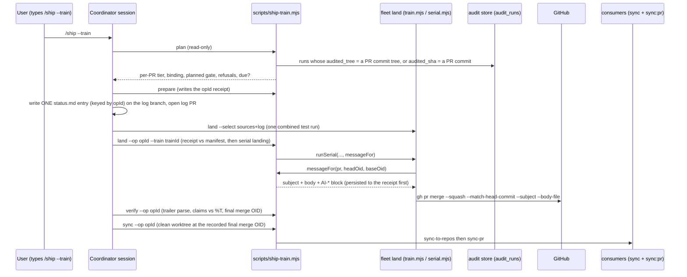

# Plan: Ship trains — batched, impact-based `/ship --train`
- **Date**: 2026-10-11
- **Status**: Approved
- **Author**: Claude + Louis Strydom
- **Scope**: backend (CLI + skill prose + docs; no UI)
- **Target domain(s)**: `ship`, `fleet`, `shared-lib`, `skills-content`
- ⚠ **Cross-domain work** — touches >1 domain. The crossings are intentional: `ship` gains a caller of `fleet`'s serial landing (one new seam, §2.4), and `shared-lib`'s gate decision gains a second caller. No new edge runs *into* `ship`.
- **Depends on**: none recorded as a plan. Two **path holds**, not plan dependencies (§11): the `/cycle` session on `claude/fleet-unclaimed-work-impl` owns `scripts/lib/fleet/**`, `scripts/fleet.mjs` and `skills/fleet/**` until its four clusters merge, and the keyset PR (`fix/ship-nudge-keyset-paging`) holds `skills/ship/SKILL.md`. Cluster A touches neither.

---

## 1. Context Summary

**Detected**: scope `backend`, stack `js-ts` (`cross-skill detect-stack`).

### 1.1 The problem, measured

`/ship` is `disable-model-invocation: true` (`skills/ship/SKILL.md:14` (5157ff65)), so only the user can run it, in each session separately. With several sessions working concurrently that left two bad options, and on 2026-10-11 we took both:

- **One manual `/ship` per PR per chat.** PRs #202–#206 each waited for a separate human `/ship` in a separate session.
- **Merge without `/ship`.** #200 and #201 were merged with no `/ship` at all. They skipped the status.md entry, the `AI-*` trailers, the AGENTS drift check, Steps 6.5–6.8 and the consumer sync.

The provenance loss is wider than the two unshipped PRs. The **figure** and its **attribution** are measured separately here, because the first draft of this plan attributed the whole figure to the squash. The coordinator's re-check showed that was wrong for the cases it sampled (#193, #195, #198 carry `AI-Gate` on 0 of 7, 0 of 4 and 0 of 6 of their own commits).

**The figure.** *Measured* 2026-10-11 at 5157ff65, with `git log origin/main --since=2026-09-25 --grep='^AI-Gate:' --oneline | wc -l` against the unfiltered count:
- **20 of 76** commits on `main` since the switch to branch + PR + squash-merge carry an `AI-Gate` line.
- **12 of the last 13** carry none.
- The coordinator reproduced the figure independently.

**The attribution.** *Measured* 2026-10-11 over **all 80 PRs merged into `main` since 2026-09-25**. Method:
- for each PR, `gh pr view <n> --json commits` gives its **own** branch commits; a commit "carries" the trailer when its message has an `AI-Gate:` line;
- `git log -1 --format=%B <mergeCommit>` gives the squash commit on `main`, which is then run through `parseMessageTrailers`.

| Class | PRs | What happened |
|---|---|---|
| **A — `/ship` never ran** | **54** | No branch commit carries `AI-Gate`. ship-commit never wrote a trailer, so there was nothing to lose. **The dominant cause.** |
| **B — carried on the branch, lost on the squash** | **9** | **B1 (4):** #162, #163, #164, #165, all merged 2026-10-06. The last branch commit carries the block, but the squash commit's body was replaced with a hand-written summary and has **no** `AI-Gate` at all (e.g. squash `e9307d26` vs its branch commit's `AI-Gate: not-run` / `AI-Run-ID: 94d699be…`). **B2 (5):** #186, #187, #192, #196, #197. GitHub's default squash body (the PR title plus one bullet per commit) keeps the block, but **mid-list**, where git's last-paragraph rule cannot parse it (e.g. squash `5df1ade5`: `AI-Gate: waived` followed by further `*` bullets). |
| C — carried and parseable | 17 | Survived the squash, mostly because the ship commit was the last (or only) commit on the branch. |

So there are **two causes, and this design has to answer both**:
- **A (54/80)** is the pressure to merge without `/ship`. One human `/ship` per PR per session is what produced it. A train removes the pressure: one keystroke covers the batch (§2.7).
- **B (9/80)** is real, cited, and independent of A. Nothing passes `--subject` or `--body` to `gh pr merge`; its callers are `scripts/lib/fleet/train-approve.mjs:213` (prints the command), `scripts/lib/fleet/serial.mjs:245` (runs it) and `scripts/lib/sync-pr.mjs:296` (consumer PRs) (all 5157ff65). So the squash message is whatever GitHub defaults to, or whatever the merger types. The train answers B by writing the message itself (§2.3 `messageFor`), so the block is always the last paragraph.

**The provenance convention is not failing on its own terms. The workflow mostly routes around it (A), and the landing path drops it when it does run (B).**

Consumer sync has the same shape. It fires only from `.githooks/pre-push` §2 (`.githooks/pre-push:281-318` (5157ff65)), and only when a push updates the default branch from a checkout whose HEAD is that tip. A PR merged on GitHub never pushes `main` locally, so it never syncs consumers. Someone has to remember to run it.

### 1.2 What exists today (Code Trace)

**`/fleet land` already builds trains.**

- A train has an immutable manifest under `<git-common-dir>/fleet/trains/<trainId>.json`: `TrainSchema`, `scripts/lib/fleet/registry.mjs:98-126` (5157ff65). Immutability is enforced by `writeTrain`'s `TRAIN_IMMUTABLE` refusal at `registry.mjs:375-396`.
- `buildTrain` (`scripts/lib/fleet/train.mjs:280`) creates a detached integration worktree, squashes each PR in landing order, and records `candidate:{oid,tree}`. `runTiers` (`train.mjs:502`) then runs **one combined test run**.
- `approvable` (`scripts/lib/fleet/overlap.mjs:405`) is the pure eligibility predicate.
- In `pr` mode, `--approve` only *prints* `gh pr merge … --squash --match-head-commit` (`train-approve.mjs:211-213`).
- `--approve --serial` *executes* the merges one PR at a time: update-branch when BEHIND, wait for required checks on that exact head, then merge (`runSerial`, `serial.mjs:143`; the merge call at `:245`).
- Fleet writes **no** trailers and no status.md entry, checks **no** audit provenance, and triggers **no** consumer sync. `grep` over `scripts/lib/fleet` for `status.md|trailer|provenance|sync-to-repos` finds only a CLI-path lookup at `handover.mjs:223`.

**Provenance today** is commit-time only.

- `scripts/ship-commit.mjs` reads the worktree's `.audit/last-audit-run.json` with `resolveEvidence` (`scripts/lib/commit-trailers.mjs:165`).
- It compares the tree being committed with the marker's `auditedTree` in `evaluateGateVerification` (`commit-trailers.mjs:338-411`). Tree equality means `passed`; a differing tree means `converged`. Either value then needs the store verdict from `getAuditRunConvergence`, which reads `round_converged_after`.
- It renders the block with `formatTrailerBlock` and `composeFinalMessage` (`commit-trailers.mjs:472`, `:513`).
- It has **no mode that verifies an existing commit**. The store's `getRunMeta` (`scripts/lib/store/runs-findings.mjs`, 5157ff65) returns `auditedSha`, `auditedTree` and `branch` per run id.

**Consumer reach has an oracle.**

- `getSyncClosure()` (`scripts/lib/sync-inventory.mjs`) returns the files the sync ships. *Measured* at 5157ff65: **921 files**.
- It includes `.claude/skills/**`, `supabase/migrations/**`, `scripts/lib/fleet/serial.mjs`, `scripts/ship-commit.mjs`, `scripts/lib/store/**`, and some `tests/fixtures/**` (the `--adopt` schema contract).
- It excludes `skills/**` (the authoring copy), `docs/reference/**` and `scripts/sync-to-repos.mjs`.

**status.md is written by the model, never by a script.** See `skills/ship/SKILL.md:713-715` (5157ff65): in PR #87 a script write destroyed 19,257 lines. Each `/ship` prepends one entry, so several sessions shipping in parallel all conflict on it.

### 1.3 Neighbourhood considered

`get-neighbourhood` over `scripts/lib/fleet/train.mjs`, `scripts/ship-commit.mjs`, `scripts/lib/commit-trailers.mjs` and `skills/ship/SKILL.md`, intent "verify per-PR audit provenance, classify PR impact, land PRs, one consumer sync":

| Band | Symbol | Decision |
|---|---|---|
| `precedent` (above-floor-standout, 0.756) | `scripts/ship-commit.mjs:121` `main` | **Not extended.** It is a single-commit CLI at 854 lines, bound to the local working tree and marker. A train verifies *other sessions'* PR heads against the store and never commits locally. What both need is the gate **decision**, and that already lives in `commit-trailers.mjs`. So the train **reuses `evaluateGateVerification` and `formatTrailerBlock` unchanged** and adds a sibling CLI (§2.2). |
| `review` (0.57–0.64) | `formatTrailerBlock`, `resolveEvidence`, `isContentVerifiable`, `evaluateGateVerification`, `composeFinalMessage`, `validateTrailerInput` | Reused as-is. The train builds an `evidence` object from a store-bound run rather than a marker file (§2.3). |

**Security incident neighbourhood**: INC-001 (symlink sensitive-path bypass) came back on path proximity only. The train reads no file contents for egress, so it does not apply.

### 1.4 Patterns reused vs new

**Reused:**
- fleet's train: manifest, integration worktree, one combined test run, `approvable`, serial landing with required checks.
- `commit-trailers.mjs`: the gate decision and the rendering.
- `getSyncClosure()`: what reaches consumers.
- `file-taxonomy.mjs` `matchFileKind`: what counts as code.
- `cli-io.mjs`: `emit`, `assertKnownFlags`, `finishAndExit`.
- `/ship`'s own steps, run once per train instead of once per PR.
- The `pending-note` mechanism (Step 6.8), which carries a deviation into the next status entry.

**New:**
- One pure impact classifier.
- One pure provenance binder.
- One read-only store query.
- One CLI, `scripts/ship-train.mjs`.
- One optional callback seam in `serial.mjs`.
- One `/ship` flag, `--train`, with its reference doc.

---

## 2. Proposed Architecture

### 2.1 The flow (what `/ship --train` does)

Sessions stop at **ship-ready**: audited, PR open, `fleet ready`. They do **not** run `/ship` and do **not** write status.md. When a train is due, the user types `/ship --train` once, in the coordinator session. Under the skill, the coordinator then runs these steps (T0–T9):

| Step | Action | Mechanism |
|---|---|---|
| T0 | Pre-ship nudges, once per train | `/ship` Step 0.5 queries, unchanged. Not per PR: the store questions are repo-wide. |
| T1 | **Plan** | `node scripts/ship-train.mjs plan --json` (read-only, writes nothing). For each ready session with an open PR it reports: the tier (§2.5), the provenance binding (§2.3), the **planned gate**, any refusal, and whether a train is **due** (§2.6). Not due → stop, naming the missing trigger. |
| T2 | Refusals | A PR with a refusal (no bound converged run on a non-ride-along, an unverifiable store, a ride-along-only set) stops the train. The only overrides are invocation flags: `--waive <n,…>`, `--allow-unaudited <n,…>` and `--end-of-day`. They are read **only** from the `/ship --train` invocation, the same rule `/ship` applies to its existing override flags (`skills/ship/SKILL.md:536-543` (5157ff65)). |
| T2b | **Prepare** (the receipt) | `node scripts/ship-train.mjs prepare --select <n,…> [--waive …] [--allow-unaudited …] [--end-of-day]` re-runs T1's computation and writes the **operation receipt** (§2.8). The receipt holds a stable `opId`, the selected PRs and their exact head oids, the bindings, the planned decisions, the overrides, the base-pinning verdict, and a fingerprint. It is the single handoff from planning to execution; `plan` itself stays read-only. |
| T3 | **Train log** | On a branch `ship/train-<opId>` in the coordinator's worktree, the model writes **one** status.md entry by hand, using the train template (§7, Phase 7). The entry is keyed by the **`opId`**, not the fleet train id, which does not exist yet. It runs the AGENTS drift check (`/ship` Step 4) and commits through `ship-commit.mjs --gate not-run`. It pushes, opens a PR, and runs `fleet claim` + `fleet ready` on that branch. The log is a ride-along; fleet decides its landing position (§2.8 "Landing order"). `prepare --log-pr <n>` records the log PR's number and head in the receipt. |
| T4 | **Build** | `node scripts/fleet.mjs land --select <sources…,log>`: the existing train build with one combined test run. Not `approvable` → stop. |
| T5 | **Land** | `node scripts/ship-train.mjs land --op <opId> --train <trainId>` records the `opId → trainId` mapping and **compares the receipt with the fleet manifest**: same PR set, same head oids, same base. It re-derives every binding and refuses if anything moved since `prepare`. It then drives fleet's **serial** landing. Fleet calls `messageFor` per PR **at merge time**, after any update-branch (§2.3). Each message is persisted to the receipt **before** its merge is submitted (§2.9). |
| T6 | **Verify** | `node scripts/ship-train.mjs verify --op <opId>` reads each merge commit and requires its trailers to parse and match the **actual** decision persisted before that merge (§2.8). It diffs actual vs planned, records interleaved foreign commits, and records the **final merge OID**: the last train merge in observed order. A deviation becomes a `pending-note`, so the **next** status entry carries it. A `passed` claim whose `AI-Audited-Tree` ≠ `%T` sets `publicationBlocked` (§2.3). |
| T7 | Post-land advisories, once per train | `/ship` Steps 6.5–6.7, unchanged. |
| T8 | **Consumer sync** | `node scripts/ship-train.mjs sync --op <opId>` refuses while `publicationBlocked` is set. Otherwise it fetches and creates a clean detached worktree at the receipt's recorded **final merge OID** (never a re-read branch tip), checks the worktree's tree against that commit, and runs `sync-to-repos` there, then `sync-pr`. If `main` has moved past that OID, the output says the newer commits are **not** part of this publication (§2.8). It records the Step 6.8 consumer-verification note. |
| T9 | Ship event | One `record-ship-event` per train (it is one human ship action). Its outcome reflects the worst per-PR result. A partially completed train reports `warned` with the phase it stopped in (§2.9). |

**Why the log rides inside the train, not after it.** A follow-up log PR would need its own required-checks wait: a second CI run and a second landing, exactly the per-change overhead trains exist to remove. Riding inside the train means one combined test run covers it.

The cost is that the entry is written before the merge shas exist, and before T5 knows whether an update-branch has turned a planned `passed` into `converged`. So the entry records **planned** gates. T6 is what reconciles them, and any difference reaches the next entry through the existing pending-note drain. That is the same channel Step 6.8 already uses for "verify after the fact" facts.

### 2.2 Components (#5 Modularity, #1 DRY)

| Unit | Kind | Responsibility |
|---|---|---|
| `scripts/lib/ship-train/impact.mjs` | pure | `classifyPrImpact({changes, closure, isCode})` returns `{tier, reasons[]}`, where `changes` is a list of `{status, path, oldPath?}` (§2.5). `isTrainDue({prs, endOfDay})` returns `{due, triggers[], missing[]}`. |
| `scripts/lib/ship-train/provenance.mjs` | pure | `bindAuditRun({commits, candidates})` returns a `tree` binding, an `ancestry` candidate, or an unbound reason. `decideTrainGate({binding, headTree, basePinning, tier, waived, allowUnaudited})` returns `{gate, runId, auditedTree, models, identityProvable, refusal}`. It **calls `evaluateGateVerification`**; it does not reimplement it. `composeSquashMessage({pr, commits, decision})` calls `composeFinalMessage`. `modelsFromRun(row, composerFamily)` returns only substantiated families. |
| `scripts/lib/ship-train/receipt.mjs` | pure + atomic I/O | The receipt schema (Zod, `.strict()`), `fingerprintOf`, the phase transition table (§2.9), and `readReceipt` / `writeReceipt`. Writes are `atomicWriteFileSync` under `withFileLock`, and immutable fields are refused on rewrite. |
| `scripts/lib/commit-trailers.mjs` | shared-lib (+~10 lines) | `evaluateGateVerification` gains `identityProvable = true` (§2.3). The default keeps every existing caller byte-identical. |
| `scripts/lib/store/train-provenance.mjs` | store read | `findCodeRunCandidates({trees, oids})`: one parameterised `SELECT` over `audit_runs`, scoped to the current repo and to code-mode runs, returning each row's match kind. Read-only, so it is not a durable-write registration. |
| `scripts/ship-train.mjs` | CLI | `plan` (read-only), `prepare`, `land`, `verify`, `sync`, `resume`, `abandon`, plus a read-only `message --pr <n>` for inspection. It follows the `--selfcheck-relocation` contract, uses `assertKnownFlags`, and exits through `emit` / `finishAndExit`. |
| `scripts/lib/fleet/serial.mjs` | seam (+~15 lines) | An optional `messageFor({source, headOid, baseOid}) → {subject, body} \| null` on the serial run options. When it returns a value, the merge call adds `--subject` and `--body-file`. When it is absent, behaviour is byte-identical to today. |
| `skills/ship/references/train-mode.md` | prose | The T0–T9 runbook, its refusals and override flags, and the laundering rationale (§2.7). |
| `skills/ship/SKILL.md` | prose (+~12 lines) | A `--train` usage row and a pointer section to the reference above. |

Why a sibling CLI and not a `ship-commit --train` mode: covered in §1.3. In short, `ship-commit` is bound to *this* worktree and marker and always commits. The train never commits locally and verifies *other* commits against the store. Folding those together would add a second evidence source to a file whose whole design is one evidence source.

### 2.3 Per-PR provenance: binding, gate and recording (the central decision)

The pre-authorisation for this work says sessions make **plain commits with no `AI-*` trailers**: the user's `/ship` writes provenance. So the train has to establish *which audit run covered which PR* without any declaration from the session.

**Binding by content, not by declaration (#13, #4).** For a PR with merge-base `B` and commits `C1..Cn`, read every commit oid and tree `T(Ci)`. Then run **one** repo-scoped, code-mode query, `findCodeRunCandidates({trees, oids})`, which returns rows where `audited_tree = ANY(trees) OR audited_sha = ANY(oids)`. Each row is tagged with its **match kind**, `tree` or `sha-only`, and the rows are ordered deterministically: bound commit position, then `created_at`, then `id`. The two kinds are kept apart from the moment they are read. A `tree` match can bind; a `sha-only` match is an **ancestry candidate** and can only ever back an explicitly authorised waiver, never `passed` or `converged`. The oid list is `C1..Cn` and **excludes `B`**: the merge-base is shared with every other branch off `main`, so a run on `B` says nothing about this PR.

`audited_tree` is the audited **worktree** content: `read-tree HEAD` + `add -A`. When a session commits exactly what was audited, that tree *is* a commit tree in the PR. This is E1's content identity, the strongest binding the store can give. It needs no run id from the session, so it cannot be forged by an agent writing a PR body. The best a forger could do is a store row with that exact tree, which is the same bar `passed` has today.

Choose the binding as follows:
- Prefer the newest bound commit `Ck`, and among its runs the newest converged one.
- Commits `Ck+1..Cn` are the **post-audit delta**. Record them by count and file list.
- If no tree matches, the PR is **unbound**. Typical causes: a stray untracked file was in the audited worktree, or the audit ran after a commit that was later amended.

**Ancestry is deliberately not a fallback for `passed`/`converged`.** An `audited_sha` inside `(B, H]` shows that an audit happened on this branch. It does not show what that audit read: the tree it read included uncommitted content that may never have been committed. So an ancestry-only match can support at most `waived` with that run id, and only under `--waive <n>`.

**The gate for the squash commit `S` on `main`.** `S` does not exist when its message is written. Its tree is only **provable** in advance when the server pins the base: a PR that is up to date with `main` squashes to exactly `T(H)`, but `--match-head-commit` protects the head, not the target. If anything else reaches `main` between the message and the merge, GitHub squashes onto the newer base and `T(S) ≠ T(H)`. Detecting that afterwards cannot repair a published `passed` (round-1 finding H1, accepted). So the train claims tree identity **only when it is server-enforced**:

- **Base pinned** (`basePinning: 'strict'`): the destination's ruleset or classic protection requires branches to be up to date before merging (`strict_required_status_checks_policy` / `required_status_checks.strict`). In that case GitHub itself refuses a merge whose head does not contain the current base. With `messageFor` running **after** serial's update-branch on the exact head being merged (`serial.mjs:143-245` (5157ff65)), `T(S) = T(H)` is guaranteed by the server, not predicted. `committedTree = T(H)`.
- **Base not pinned** (`basePinning: 'none'`, or the protection read failed, which is fail-closed): tree identity is **not provable at commit time**. `committedTree` is still `T(H)`, but the evaluator is told `identityProvable: false` (below).

*Measured* 2026-10-11 for **this** repo: `gh api repos/Lbstrydom/claude-engineering-skills/rulesets` → `[]` and `…/branches/main/protection` → 404. `main` is unpinned, so trains here land audited PRs as `converged`, never `passed`. That is the honest result, and it is the reason `prepare` reports the pinning verdict up front.

**One additive input to the shared evaluator.** `evaluateGateVerification` (`scripts/lib/commit-trailers.mjs:338` (5157ff65)) gains an optional `identityProvable` (default `true`, so every existing caller is byte-identical). When it is `false`:
- `passed` is **refused**, with an AGENT FIX naming the missing server pin and pointing at `converged`.
- The under-claim refusal for `converged` ("trees match, use `passed`") is **suspended**, because `passed` is not available to under-claim against.

It can never grant `passed`, and it changes nothing else in the function. This is the one semantic widening the train makes. `converged` now reads "a store-verified converged run, and the committed tree is **not asserted** equal to the audited tree: either it differs, or equality could not be proven at commit time". That still carries no `AI-Audited-Tree`, exactly as today. Phase 7 states the widening in `commit-provenance.md` and in AGENTS.md's four-value paragraph.

With `evidence = {state:'fresh', runId, auditedTree: T(Ck)}` the train calls `evaluateGateVerification`, trying `passed` then `converged`, and takes the first accepted:

| Situation | Gate on `S` | Extra trailers |
|---|---|---|
| Tree-bound converged run, `T(Ck) == T(H)`, base **pinned** | `passed` | `AI-Run-ID`, `AI-Audited-Tree: T(Ck)`. Self-verifying with `%T` on `S`, **reachable from `main` forever** |
| Tree-bound converged run, `T(Ck) == T(H)`, base **not pinned** | `converged` (`identityProvable:false`) | `AI-Run-ID` |
| Tree-bound converged run, `T(Ck) ≠ T(H)` (post-audit commits, or base merged in by update-branch) | `converged` | `AI-Run-ID` |
| Tree-bound run, not converged | refuse. Under `--waive <n>`: `waived` | `AI-Run-ID` |
| Ancestry candidate only (`sha-only`) | refuse. Under `--waive <n>`: `waived` | `AI-Run-ID` of the newest candidate |
| No run, ride-along tier | `not-run` (the normal case for docs/tests/config) | none |
| No run, `standard`/`urgent` tier | refuse. Under `--allow-unaudited <n>`: `not-run` | none |
| Store unreachable / cloud off | `standard`/`urgent` refuse (cannot verify, so cannot claim; same fail-closed bar as `ship-commit`). Ride-alongs: `not-run` | none |

**Post-merge mismatch blocks publication (defence in depth).** On a base-pinned destination T6 should never find `AI-Audited-Tree ≠ %T`. If it does, the server pin was not what `prepare` read. The receipt then gets `publicationBlocked: true` with both trees, a pending-note is filed, and T8 refuses to sync until the operator has read it and re-runs `sync --op <opId> --accept-provenance-mismatch`. That flag is invocation-only and recorded in the receipt.

`AI-Skill: ship`.

`AI-Models` lists **only substantiated participants** (round-1 M1, accepted). It is assembled from what the run row actually records:
- `author_model` (arm-eval column, `supabase/migrations/20260701160000_arm_eval.sql:98` (5157ff65));
- `final_review_model` (`20260610120000_final_review_shadow.sql:16`);
- the auditor model, if the row records one.

Each is mapped through `modelFamily` (`scripts/lib/model-resolver.mjs:383` (5157ff65)), the one family function AGENTS.md mandates, and then through `canonicaliseModels`. Which column holds the **auditor** model is a build-time census, Phase 2's first step. An unrecorded stage is **omitted**, never assumed, and the receipt lists `attributionMissing: [stage…]`.

The model that composes the squash message is always a substantiated participant: it is the coordinator's own family. If nothing else is recorded, `AI-Models` is that family alone, and the train entry says "audit-stage attribution unrecorded". That keeps `AI-Models` non-empty (its grammar requires it) without inventing anyone.

**Recording: per-PR trailers + the status.md entry. No new manifest file, no new trailer key.**

- **Per-PR trailers at squash-merge** are authoritative. They are git-native, they answer the existing query cookbook unchanged, and `passed` stays self-verifying from git alone.
- **The status.md train entry** is the human-readable cross-PR record. It names every PR (including ride-alongs), its tier, its planned gate and run id, and the `opId`.
- **fleet's existing local manifest** (`trains/<id>.json`, already immutable) holds the machine record of what was tested and landed. `ship-train` adds nothing to its schema. Its own **operation receipt** (§2.8) sits beside it at `<git-common-dir>/fleet/ship-trains/<opId>.json`: local and outside the work tree, so Category A by location. It holds the bindings, planned and actual decisions, persisted messages, merge checkpoints, verify outcome and publication checkpoints.

**Right-sizing for this choice.**
- *Band-aid*: loop `/ship` per PR. It changes nothing structurally and leaves the squash-body loss in place.
- *Over-engineered*: a committed `trains/<id>.json` manifest, plus a new `AI-Train:` trailer key, plus the V2 ship-evidence receipt.
- *Chosen*: the trailers that already exist, rendered by the function that already renders them, delivered through the place they are lost when /ship does run (the squash body). The **current requirements** it serves are the 9 measured class-B losses (§1.1) and, through the single keystroke per train, the 54 class-A bypasses.

An `AI-Train` key would answer "which commits shipped together". The status.md entry answers that already, and a new reserved key would be a schema change across every consumer for a query nobody has asked.

**Who writes `AI-*`.** The reserved-namespace invariant is "only the helper renders the block, so a hand-typed block never enters history" (`commit-provenance.md:145-147`). After this change there are **two emission points**, `ship-commit.mjs` (direct commits) and `ship-train.mjs` (squash messages). Both render through the **same** `formatTrailerBlock` / `composeFinalMessage` and the same `evaluateGateVerification`, so there is still one renderer and one gate decision. AGENTS.md and `commit-provenance.md` are updated to say so (Phase 7). A `messageFor` body is never typed by an agent: it is computed inside `ship-train.mjs` from the store and git.

### 2.4 The one fleet seam

`runSerial` gains an optional `messageFor` callback. `ship-train land` calls fleet's serial landing **as a library** with that callback. It does not shell out to `fleet land --approve --serial`: a CLI flag would have to carry a command template, and that is a new injection surface.

Nothing else in fleet changes:
- no schema change;
- no change to `approvable`;
- no change to `--approve` without `--serial`.

The PR-mode non-serial path (print-only) stays as it is. The train always lands serially, because only serial mode knows the head at the moment of merge.

Domain edges: `ship` → `fleet` (new: `ship-train.mjs` imports `serial.mjs` and `registry.mjs`) and `ship` → `shared-lib` (exists). `fleet` imports nothing from `ship`. Per AGENTS.md, a new edge means re-checking `tests/arm-vocabulary-layering.test.mjs` and the `allowedDeps` in `.audit-loop/domain-map.json`. If `ship → fleet` is not already allowed, Phase 5 adds it to `allowedDeps` with a reason.

### 2.5 Impact tiers (`classifyPrImpact`)

The PR's change list comes from `git diff --name-status -z -M B...H` on the fetched PR ref, never `gh pr view --json files`, which pages at 100. The output is NUL-delimited, so it is safe for paths containing whitespace or newlines, and it is parsed into `{status, path, oldPath?}`. A rename or copy keeps **both endpoints**, so a file renamed *out of* the closure is evaluated at its old path, which is in the closure. A delete is evaluated at the deleted path (round-1 M2, accepted). "Changed path" below means the union of every `path` and every `oldPath`.

1. **`urgent`**: any changed path is in `getSyncClosure()`. Reason `reaches-consumers:<n> files`. The closure contains synced `scripts/lib/store/**`, `scripts/lib/db/**`, migrations and security libs, so "changes behaviour, security or the store **for consumers**" is covered by the same single oracle. No second hand-kept list.
2. **`standard`**: otherwise, any changed file is source code per `file-taxonomy.mjs` `matchFileKind` and is not under `tests/`. This is repo-internal behaviour, e.g. `scripts/sync-to-repos.mjs`, which the closure does not include.
3. **`ride-along`**: otherwise. Only tests, docs or config.

The closure is computed on the **base** (`main`) checkout. A PR that *adds* a brand-new synced file without touching any existing synced file would read as `standard`. The failure direction is benign: the PR waits for the ≥3 or end-of-day trigger instead of shipping now, and is never shipped *less* carefully. The T6 log re-classifies against `getSyncClosure()` run in the train's integration worktree, so the record is exact. Measured and accepted as R4.

### 2.6 When a train is due (`isTrainDue`)

`due` ⇔ the set has **at least one non-ride-along PR** and one of:
- any `urgent` PR;
- **≥ 3** ship-ready PRs in total;
- `--end-of-day`.

A ride-along-only set is **never** due, not even at end of day. Ride-alongs wait for the next real train and are named in its entry (the user's rule).

This reconciles the four triggers the brief lists. Read literally, "≥3 ship-ready PRs" would let three docs PRs form a train of their own, which contradicts "never a train of their own"; the non-ride-along precondition removes that contradiction.

When the user types `/ship --train` and the set is not due, `plan` refuses with the missing trigger and the exact re-invocation (`/ship --train --end-of-day`). It is a nudge with a human override, never a silent no-op.

### 2.7 Why the human gate stays: one `/ship --train`, not a relaxed `disable-model-invocation`

The alternative is to drop `disable-model-invocation` so that a coordinator agent can run `/ship` on a schedule. That turns a **standing, agent-held authority** into the thing that publishes to `main` and to every consumer. Today the only path from "an agent decided" to "consumers received it" passes through a human keystroke. With the gate relaxed, an agent could reach the push through any chain of agent-authored inputs — another session's message, a file, a PR body, a directive. That is the laundering path AGENTS.md and fleet's participant rules already refuse (`skills/fleet/SKILL.md:92-95`). A train keeps the keystroke and spends it better: the per-PR human cost goes from N keystrokes to 1, and the human still sees what is being shipped (the T1 table) at the moment they authorise it.

The remaining limit is cooperative, stated plainly. `ship-train.mjs land` is an ordinary CLI, and an agent with a shell could run it. So could `gh pr merge`, or `fleet land --approve --serial`. The skill gate is a policy layer, as it is for `/fleet`, and an agent cannot enforce a gate against its own shell. The train changes neither the reachability nor the policy. It removes the *pressure* to bypass `/ship`, which is what actually produced #200/#201.

### 2.8 The operation receipt (planning → execution handoff)

`plan` is read-only and writes nothing. `prepare` is the one step that turns a plan into something executable. It writes `<git-common-dir>/fleet/ship-trains/<opId>.json` (round-1 H2, accepted).

The receipt is versioned (`schemaVersion: 1`) and validated by a Zod schema with `.strict()`. It holds:
- `opId`: generated by `prepare`, in fleet's `newTrainId` shape but with an `s-` prefix.
- `createdAt`.
- `repo`.
- `destination{ref, expectedOid}`, read with `ls-remote`.
- `basePinning`, with the evidence that decided it.
- `selected[{pr, headOid, mergeBaseOid, tier, reasons, binding{kind, runId, boundCommit, postAuditCommits}, decision{gate, runId, auditedTree, models, identityProvable}}]`.
- `overrides{waive[], allowUnaudited[], endOfDay}`.
- `fingerprint`: a sha256 over the canonical JSON of everything above.

The fields above are **immutable once written**, the same discipline as fleet's `TrainSchema`. Mutable fields are appended by later steps:
- `logPr{number, headOid}`;
- `trainId`;
- `phase`;
- `landingOrder[]` (from the fleet manifest);
- `actual{pr → {headOid, baseOid, basePinning, inputs, claims, subject, bodySha256, bodyPath}}`, persisted before the merge is submitted;
- `merges{pr → {mergeOid, observedHeadOid}}`;
- `verify{perPr, plannedVsActual[], interleaved[], finalMergeOid, publicationBlocked}`;
- `publicationAmendment{acceptedOids[], at}`;
- `publication{sync: {consumer → status}, syncPr: {consumer → status}}`.

**Train id ordering.** The status entry is keyed by `opId` because the fleet train id does not exist until T4. `land --op <opId> --train <trainId>` writes the mapping and refuses unless:
1. the fleet manifest's source set equals `selected` plus `logPr` (same PR numbers, same head oids);
2. the manifest's `baseOid` equals `destination.expectedOid`;
3. every binding re-derived from the store now still equals the receipt's.

Anything that moved means a **new `prepare`**, never a patched receipt.

**Planned vs actual decisions** (round-2 H2, accepted). `selected[].decision` is the **planned** decision and stays immutable as planning history. At merge time `messageFor` computes the **actual** decision on the head being merged. Before returning, it persists `actual[pr]`:
- `headOid`, the observed base oid, and the `basePinning` re-read;
- the gate inputs (binding, `T(Ck)`, `T(H)`, `identityProvable`);
- the resulting claims (gate, run id, audited tree, models);
- the canonical message's sha256 and path.

`verify` checks each landed commit against **`actual[pr]`**, not the plan. Separately, it diffs actual against planned and turns every difference into a pending-note.

**Which differences need renewed authorization**:
- **Note only**: any change that keeps the PR landable with an evidence-backed claim, e.g. `passed` → `converged` after an update-branch, or a narrower `AI-Models`.
- **Stop (`diverged`), with no message persisted and no merge submitted**: any change that would turn a planned accept into a **refusal**, e.g. the head moved to commits outside the binding, the run row vanished, or the store became unreachable. Re-authorization is a new `prepare` for the remaining PRs.

**Publication pin** (round-1 H3, accepted). `verify` records `finalMergeOid`: the merge commit of the **last PR to land in observed merge order**, from `gh pr view --json mergeCommit` per PR, ordered by first-parent position on `main`. Each train merge commit is verified **individually** against its `actual[pr]`. On an unpinned `main`, an unrelated merge can land *between* two train merges (round-2 H1, accepted). So the first-parent chain from `finalMergeOid` back to `expectedOid` is not required to contain only train commits. Instead:
- every commit on it that is not a train merge is recorded in `interleaved[]` (oid, subject, PR if any);
- a non-empty `interleaved[]` puts the op in **`verified-interleaved`**, which is a recoverable **blocked** state, not a success.

`sync` refuses in that state unless re-invoked as `sync --op <opId> --accept-interleaved`. That flag is invocation-only, and the human is shown the interleaved list first. It is recorded in the receipt as a `publicationAmendment{acceptedOids[], at}`: an immutable record of exactly what the publication contains beyond the train. The train does not acquire audit evidence for interleaved commits. Those commits reached `main` by their own route and carry whatever provenance that route gave them; the amendment only declares that this publication includes them.

Commits that landed **after** `finalMergeOid` are never part of this publication. `sync` checks out `finalMergeOid` exactly, never a branch tip read later, and says that newer commits are excluded. A train never silently widens what it publishes.

**Landing order** (round-2 M1, accepted). Fleet decides landing order (`proposeLandingOrder`, `scripts/lib/fleet/overlap.mjs:476` (5157ff65)), not `--select` order. The plan therefore **does not require the log PR to land last**. `finalMergeOid` is defined by observed merge order, so it is correct whatever position the log takes. `land` records the manifest's source order in the receipt (`landingOrder[]`), and `verify` checks that the observed merge order equals it. If the train stops partway, the log PR may already describe PRs that did not land. The pending-note for the next entry then names exactly which planned PRs did not land, read from `merges` vs `selected`.

### 2.9 Partial failure and recovery

Each external mutation is bracketed by a write-ahead record and a confirmation record (round-1 H5, accepted). All receipt writes go through `atomicWriteFileSync` under a per-op lock (`withFileLock` on `<opId>.lock`). A second process on the same op is **refused**, not queued, matching fleet's `withTrainLock` (`scripts/lib/fleet/train.mjs:156` (5157ff65)).

| Phase | Before the mutation | After | On interruption: `ship-train resume --op <opId>` |
|---|---|---|---|
| `prepared` | — | receipt written | nothing external happened; safe to `abandon` |
| `log-opened` | `logPr` intent | `logPr{number, headOid}` | `gh pr view` reconciles; an orphan log PR is closed by `abandon` |
| `built` | — | `trainId` mapped | fleet's own `--abandon`/rebuild applies; the receipt is untouched |
| `landing` | **`actual[pr]` (decision + message) persisted before the merge is submitted** | `merges[pr]` after fleet observes MERGED | for each PR, `gh pr view --json state,headRefOid,mergeCommit`: **MERGED** at the persisted `headOid` → record the merge (the remote did it; never resubmit) · **OPEN** at the persisted head → **revalidate, then replay**: re-read `basePinning` and recompute the decision on the current head and base; resubmit the persisted bytes only if the recomputed claims equal `actual[pr].claims` exactly, else stop as `diverged` (the old attempt and message are kept as history; the remaining PRs need a new `prepare`) · head moved → stop, `diverged`, a human reads it. Fleet's `resumeSerial` drives the merge loop; `messageFor` serves the persisted message for an already-decided `(pr, headOid)` only after that revalidation passes (round-3 H1) |
| `landed` | — | all merges recorded | — |
| `verified` / `verified-interleaved` | — | `verify{…}` | re-runnable; pure reads. `verified-interleaved` is blocked until `sync --accept-interleaved` writes the `publicationAmendment` |
| `publishing` | per consumer `syncing` | per consumer `synced` / `failed{retryable}` | re-runs only the consumers not yet `synced`. `sync-to-repos` already journals in-progress work (`scripts/.sync-in-progress.json`) and refuses rollbacks per consumer receipt, so a re-run is safe. `sync-pr` is per-consumer and skips a consumer with nothing to do. |
| `done` / `partial` | — | — | `partial` names the stuck phase and drives T9's `warned` |

**Retryable vs terminal.**
- **Retryable**: gh 5xx, network errors, a lock held by a live pid.
- **Terminal**: a head moved, a manifest mismatch, a store schema fault (`describeSchemaFault`, loud), `publicationBlocked`.

A terminal state never auto-retries. `abandon --op <opId>` is allowed only before `landing`. After the first merge it is refused, because some of the train is on `main`; the only ways forward are `resume` or a human.

---

## 6. Sustainability Notes

- **Assumptions that could change.** `passed` on a squash commit rests on two things holding together: the server refusing a merge whose head is not up to date, and GitHub squashing an up-to-date head to exactly that head's tree.
  - The first is **read** from the destination's protection at `prepare` time, never assumed. Without it, `passed` is simply not offered (§2.3).
  - The second is **checked** on every train by T6. A violation blocks publication rather than being merely reported.
  - Turning on strict up-to-date protection is a repo setting. It is the user's decision and **not** made by this plan. It is the switch that makes `passed` reachable here.
- **Direct-squash repos.** For a consumer whose `mergeMethod` is `direct-squash`, `messageFor` needs a sibling hook where `applySources` commits (`scripts/lib/fleet/train.mjs:364` (5157ff65)). That is deliberately not built (§8, D2). There, the push lease against `expectedOid` *is* a server-enforced base pin, so it is the cleaner route to `passed` if a consumer ever needs it.
- **Extension point.** `messageFor` is the single seam a future evidence receipt (V2) would attach to.

## 7. File-Level Plan

### 7b. Implementation Phases

- **Phase 1 — Impact classifier**: `classifyPrImpact` + `isTrainDue`, pure, test-first. Files: `scripts/lib/ship-train/impact.mjs` (create), `tests/ship-train-impact.test.mjs` (create).
- **Phase 2 — Provenance binder, evaluator input, store read**. Steps:
  - **First step is a census**: which `audit_runs` column, if any, records the auditor model. Run the query, record its result in the Implementation Log, then write `modelsFromRun` against it.
  - Write `bindAuditRun` (tree binding vs ancestry candidate kept apart), `decideTrainGate` (via `evaluateGateVerification`), `composeSquashMessage` (via `composeFinalMessage`) and `modelsFromRun`.
  - Add `evaluateGateVerification`'s `identityProvable` input, default `true`.
  - Write `findCodeRunCandidates({trees, oids})`. The read degrades loudly on a schema fault (`describeSchemaFault`) and never returns an empty list on a broken query.
  - Enrol the new DB suite in `scripts/db-test-container.mjs`'s `*_SUITE_FILES` **and** in `.github/workflows/postgres-parity.yml`: two edits, because the binding query must be asserted once on real Postgres.

  Files: `scripts/lib/ship-train/provenance.mjs` (create), `scripts/lib/store/train-provenance.mjs` (create), `scripts/lib/commit-trailers.mjs` (modify), `tests/commit-trailers.test.mjs` (modify), `tests/ship-train-provenance.test.mjs` (create), `tests/ship-train-provenance.db.test.mjs` (create), `scripts/db-test-container.mjs` (modify), `.github/workflows/postgres-parity.yml` (modify).
- **Phase 3 — Receipt + `ship-train.mjs` non-landing verbs**:
  - The receipt module: schema, fingerprint, the phase table and locked atomic writes.
  - `plan` (read-only), `prepare` (writes the receipt, including the base-pinning read via `gh api` rulesets + classic protection, which fails closed to `none`), `message` (read-only), `verify` (records `finalMergeOid` and `publicationBlocked`), and `abandon` (pre-`landing` only).
  - `plan` reads `node scripts/fleet.mjs status --json` (the CLI, so no fleet edit) plus git.
  - CLI smoke and registration.

  Files: `scripts/lib/ship-train/receipt.mjs` (create), `tests/ship-train-receipt.test.mjs` (create), `scripts/ship-train.mjs` (create), `tests/ship-train-cli.test.mjs` (create), `package.json` (modify — `ship:train` script), `scripts/lib/sync-isolation-verify.mjs` (modify — `CLI_SMOKE_SET`).
- **Phase 4 — Serial `messageFor` seam**:
  - An optional callback; when it is absent, behaviour is byte-identical to today.
  - The message goes to a temp `--body-file` under the train's log dir and is removed after the merge.
  - On resume, the callback re-reads protection and recomputes the decision for an already-decided `(pr, headOid)`. It re-sends the persisted message byte-for-byte only when the recomputed claims equal the persisted ones, and otherwise returns a `diverged` stop. Permission to replay is never implied by persistence alone.

  Files: `scripts/lib/fleet/serial.mjs` (modify), `tests/fleet-serial.test.mjs` (modify).
- **Phase 5 — `land`, `resume` and `sync` verbs**:
  - `land --op --train` runs the receipt ↔ manifest comparison and re-binding (§2.8). It calls `approveSerial` with a `messageFor` that persists each message **before** returning it.
  - `resume --op` follows the §2.9 table and reconciles every ambiguous merge with `gh pr view`.
  - `sync --op` refuses on `publicationBlocked`. Otherwise it does a detached `git worktree add` at the receipt's `finalMergeOid` and checks that commit's tree. It provisions dependencies with `provisionNodeModules` (`scripts/lib/pinned-worktree/manage.mjs`, the pinned-revision precedent), runs `sync-to-repos.mjs` then `sync-pr.mjs` with per-consumer checkpoints, and removes the worktree.
  - Fault-injection tests interrupt immediately before and after every external mutation.
  - Domain-map `allowedDeps` for `ship → fleet`, if the layering test requires it.

  Files: `scripts/ship-train.mjs` (modify), `tests/ship-train-cli.test.mjs` (modify), `tests/ship-train-recovery.test.mjs` (create), `.audit-loop/domain-map.json` (modify).
- **Phase 6 — `/ship --train` skill surface**: a usage row, a pointer section and the reference doc, plus a one-line cross-reference from fleet's landing doc. Files: `skills/ship/SKILL.md` (modify), `skills/ship/references/train-mode.md` (create), `skills/fleet/references/landing.md` (modify).
- **Phase 7 — Records and invariants docs**: the status.md train-entry template (keyed by `opId`, with a planned-gate and `identityProvable` column); in the provenance reference, the second emission point, the content-binding rule, the server-pin precondition for `passed` on squash, and `converged`'s widened reading; AGENTS.md's provenance paragraph ("written only by" → two emission points, one renderer, one evaluator; `converged` = "not asserted equal"). Files: `skills/ship/references/status-md-format.md` (modify), `docs/reference/commit-provenance.md` (modify), `AGENTS.md` (modify).

**Close-out (not a phase)**: `npm run skills:regenerate`, `npm run skills:check`, `npm run bundle:deps`, `npm run plans:index`, then `npm test`. The shared generated files in `.fleet.json` `hotFiles` are regenerated at rebase, never claimed.

### Key exports and dependencies

| File | Exports | Imports | Imported by |
|---|---|---|---|
| `scripts/lib/ship-train/impact.mjs` | `classifyPrImpact`, `isTrainDue`, `TIERS` | `file-taxonomy.mjs` | `ship-train.mjs` |
| `scripts/lib/ship-train/provenance.mjs` | `bindAuditRun`, `decideTrainGate`, `composeSquashMessage`, `modelsFromRun` | `commit-trailers.mjs`, `model-resolver.mjs` (`modelFamily`) | `ship-train.mjs` |
| `scripts/lib/ship-train/receipt.mjs` | `ReceiptSchema`, `fingerprintOf`, `PHASES`, `readReceipt`, `writeReceipt` | `zod`, `file-io.mjs` (`atomicWriteFileSync`), the existing file-lock helper | `ship-train.mjs` |
| `scripts/lib/store/train-provenance.mjs` | `findCodeRunCandidates` | `db/client.mjs`, `db/errors.mjs`, `store/repo.mjs` | `ship-train.mjs` |
| `scripts/ship-train.mjs` | CLI only | the four above, `sync-inventory.mjs`, `fleet/serial.mjs`, `fleet/registry.mjs`, `pinned-worktree/manage.mjs` (`provisionNodeModules`), `cli-io.mjs` | `skills/ship/references/train-mode.md` (prose) |

## 8. Risk & Trade-off Register

- **R1 — Base moves between update-branch and merge.** `--match-head-commit` protects the head, not the target. *Resolved by construction* (round-1 H1): `passed` is offered only where the server refuses a non-up-to-date merge (§2.3). On an unpinned destination, which is this repo as measured, audited PRs land as `converged` with `identityProvable:false`. Residual: the protection read could be wrong or change mid-train. T6's `%T` check catches that and **blocks publication** until a human has read it.
- **R2 — Planned gates in the log can differ from actual.** Covered in §2.1. T6 plus pending-note reconcile it, and the entry labels its column "planned".
- **R3 — Unbound PRs because of a stray untracked file in the audited worktree.** The binder refuses, and the honest repairs are `--waive` or a re-audit. *Accepted*: refusing beats inferring. `plan` names the newest `sha-only` ancestry candidate, returned by the same query (§2.3), so the operator can see the cause.
- **R7 — `converged`'s meaning widens.** It now also covers "equality not provable at commit time". The widening only *removes* an implied claim ("the tree differs"). It never adds one, and it carries no new trailer. A reader who needs the distinction has `AI-Audited-Tree`'s presence (on `passed`) and the train entry's `identityProvable` column. *Accepted*, documented in Phase 7.
- **R4 — Closure on the base under-classifies a PR that only *adds* synced files.** Benign direction, as §2.5 explains.
- **R5 — The coordinator's log branch must itself be a fleet session.** It claims only `status.md`. Parallel `/ship` runs no longer touch status.md, which **removes** today's main status.md conflict source.
- **R6 — Sessions that still run single `/ship`.** Single `/ship` stays valid for coordinator-less work. It is unchanged, and its squash-body loss is the same defect. *Deferred (D1)*: `/ship`'s own branch path could pass the body at merge time too, but `/ship` does not merge (it pushes a branch). That needs its own design and is out of scope here.
- **D2 — Deferred**: a `messageFor` for `direct-squash`/`direct-merge` modes (`applySources`). No current consumer of this feature uses them. This repo is `pr` mode (the fleet default) and, measured 2026-10-11, has no ruleset or branch protection on `main`.
- **D3 — Deferred**: backfilling provenance for the 56 already-merged commits. Not possible honestly: the squash trees exist, but claims made after the fact would not be produced at ship time.

## 9. Testing Strategy

**Tier 1, test-first (pure):**
- **`classifyPrImpact`**:
  - a closure hit beats everything (including a `tests/fixtures/**` file that is in the closure);
  - code outside the closure → `standard`;
  - only `docs/**`, `*.md` or `tests/**` → `ride-along`;
  - an empty file list → `ride-along`, flagged with reason `no-files`;
  - a rename **out of** the closure → `urgent` (old endpoint);
  - a rename **into** the closure → `urgent`;
  - a delete of a closure file → `urgent`;
  - a rename from `tests/` into `scripts/` → not `ride-along`;
  - a path containing a space and one containing a newline both parse correctly from `-z` output.
- **`isTrainDue`**:
  - all four triggers fire;
  - three ride-alongs → **not** due (the contradiction case);
  - `--end-of-day` with only ride-alongs → not due.
- **`bindAuditRun`**:
  - a tree match on the head;
  - a tree match on an earlier commit (delta recorded);
  - the newest converged run wins;
  - **a `sha-only` candidate never binds** for `passed`/`converged` (the must-not-fire direction);
  - a run on the merge-base `B` is never a candidate.
- **`decideTrainGate`**:
  - every row of the §2.3 table;
  - **`passed` is refused whenever `basePinning !== 'strict'`, even with equal trees** (the must-not-fire direction for H1);
  - `AI-Audited-Tree` is present only on `passed` (assert its **absence** on `converged`);
  - refusals name the override flag.
- **`evaluateGateVerification` with `identityProvable`**:
  - the default `true` leaves all existing `tests/commit-trailers.test.mjs` cases unchanged;
  - `false` refuses `passed`;
  - `false` permits `converged` on equal trees;
  - `false` never turns a non-converged or absent store row into an accept.
- **`modelsFromRun`**:
  - a row with only `final_review_model` yields that family plus the composer, nothing else;
  - no hard-coded `gpt`/`gemini` without a recording column.
- **Receipt**:
  - `.strict()` rejects unknown keys;
  - an immutable field rewrite is refused;
  - the fingerprint changes when any selected head changes;
  - a second writer on the same op is refused.
- **`composeSquashMessage`**: the output round-trips through `parseMessageTrailers` as a **parseable trailer block**. This is the regression test for class B (§1.1): B1 (body replaced) and B2 (block buried mid-list) both fail this round-trip.

**DB-gated (enrolled twice):** `findCodeRunCandidates` against real Postgres:
- matches by tree (kind `tree`);
- matches by sha (kind `sha-only`);
- a row matching both is reported once, as `tree`;
- deterministic ordering;
- excludes plan-mode runs and other repos;
- a missing column reads as a loud schema fault, not `[]`.

**CLI:**
- `--selfcheck-relocation`;
- unknown flags exit 2;
- `plan --json` against a fixture registry with git repos;
- `verify` against a bare-origin fixture with squash commits carrying and lacking trailers.

**`serial.mjs`:**
- with `messageFor` absent, the recorded `gh` argv is byte-identical to the current tests;
- when present, `--subject`/`--body-file` are added and the body file holds the message;
- `messageFor` is called with the **post-update** head (fake gh that reports BEHIND, then an updated oid).

**Recovery (fault injection, `tests/ship-train-recovery.test.mjs`):** interrupt immediately before and immediately after each external mutation:
- the log PR is opened;
- each merge is submitted;
- each consumer sync.

In every case, `resume` must:
- **never resubmit a merge GitHub already performed**;
- resend the **persisted** message byte-for-byte when the PR is still open at the same head **and** the revalidated claims are unchanged;
- stop as `diverged` with no resend when they have changed. Case: persist `passed` under strict protection, interrupt before the merge, remove strict protection, resume → `diverged`;
- stop as `diverged` when a head moved;
- re-run only the consumers not yet `synced`;
- refuse `abandon` after the first merge.

**Publication pin:** `sync` checks out `finalMergeOid` even when the fake remote's tip has moved past it, and says so. It refuses while `publicationBlocked` is set.

**Interleaving:** a foreign merge lands between two train merges (fake remote). Expected:
- `verify` ends in `verified-interleaved` with that oid in `interleaved[]`, not `verified`;
- `sync` refuses without `--accept-interleaved`;
- with the flag, `sync` writes the `publicationAmendment` and checks out `finalMergeOid`;
- a commit landing *after* `finalMergeOid` is never in the amendment.

**Planned vs actual:** update-branch legitimately turns a planned `passed` into an actual `converged`. Expected:
- `verify` accepts the commit only against `actual[pr]`;
- `verify` files exactly one planned-vs-actual pending-note;
- a hand-edited squash body that matches the plan but not `actual[pr]` is rejected.

A change that turns an accept into a refusal stops as `diverged`, with no message persisted and no merge submitted.

**Landing order:** a manifest with the same sources and heads but the log PR first. `finalMergeOid` is the last observed train merge (not the log's), and `verify` checks the observed order against `landingOrder[]`.

**Empirical (pre-ship, verification-discipline):** run `plan` against today's real open PRs (#202–#206) **read-only** and check each binding by hand against the store. A check is not trusted until it has been seen to fail, so the negative control is a PR whose head was amended after its audit.

## 11. Execution Clustering

- **Cluster A** — Phases 1–3 — fix-gate: yes
  - Coupling: the decision core and its handoff. The classifier, binder, evaluator input and receipt are only meaningful together inside `plan`/`prepare`/`verify`, and the wiring pass needs to see `decideTrainGate` → `evaluateGateVerification(identityProvable)` and the receipt's use of both in one diff. It touches **no** held path (`scripts/lib/commit-trailers.mjs` is shared-lib, unclaimed), so it can start now.
  - author-tier: standard
- **Cluster B** — Phases 4–5 — fix-gate: yes
  - Coupling: the seam and its only caller. `messageFor` (fleet) and `ship-train land` (ship) must be audited across the boundary, since the post-update-head timing is the correctness claim. **Blocked** until the `claude/fleet-unclaimed-work-impl` claim on `scripts/lib/fleet/**` is released. If `fleet claim` reports BLOCKED, stop and report; never `--override`.
- **Cluster C** — Phases 6–7 — fix-gate: final
  - Coupling: the human-facing surface and the invariant docs. They describe A+B and must agree with the CLI as built. **Blocked** on the keyset PR's hold on `skills/ship/SKILL.md` and on the fleet claim for `skills/fleet/**`.
- **Final gate**: the mandatory consolidated Gemini review over the union diff of A+B+C.

## Audit Trail

- **/audit-plan** (SID `audit-plan-1791751223`, run `bd49abc4-243e-42cc-85ec-e5d14328841d`), 3 GPT rounds, stopped at the default cap:
  - R1 H5 M2, 7/7 accepted;
  - R2 H2 M1, 3/3 accepted (propagation debt from R1's fixes: interleaving, planned vs actual, landing order);
  - R3 H1, 1/1 accepted (replay permission on resume).
  - Acceptance was 100% in every round. Every finding was a concrete design defect, with no rigor pressure. The cap was reached with the count falling (7 → 3 → 1).
- **Final gate** (Gemini `latest-pro`, `--mode plan`): **APPROVE** on round 1. Disposition `approve`, 0 blocking, 0 debt, 0 new findings, 0 wrongly dismissed.
