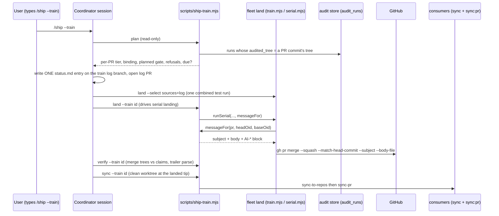

# Plan: Ship trains — batched, impact-based `/ship --train`
- **Date**: 2026-10-11
- **Status**: Draft
- **Author**: Claude + Louis Strydom
- **Scope**: backend (CLI + skill prose + docs; no UI)
- **Target domain(s)**: `ship`, `fleet`, `shared-lib`, `skills-content`
- ⚠ **Cross-domain work** — touches >1 domain. The crossings are intentional: `ship` gains a caller of `fleet`'s serial landing (one new seam, §2.4), and `shared-lib`'s gate decision gains a second caller. No new edge runs *into* `ship`.
- **Depends on**: none recorded as a plan. Two **path holds**, not plan dependencies (§11): the `/cycle` session on `claude/fleet-unclaimed-work-impl` owns `scripts/lib/fleet/**`, `scripts/fleet.mjs` and `skills/fleet/**` until its four clusters merge, and the keyset PR (`fix/ship-nudge-keyset-paging`) holds `skills/ship/SKILL.md`. Cluster A touches neither.

---

## 1. Context Summary

**Detected**: scope `backend`, stack `js-ts` (`cross-skill detect-stack`).

### 1.1 The problem, measured

`/ship` is `disable-model-invocation: true` (`skills/ship/SKILL.md:14` (5157ff65)), so only the user can run it, in each session separately. With several sessions working concurrently that left two bad options, and on 2026-10-11 we took both:

- **One manual `/ship` per PR per chat.** PRs #202–#206 each waited for a separate human `/ship` in a separate session.
- **Merge without `/ship`.** #200 and #201 were merged with no `/ship` at all. They skipped the status.md entry, the `AI-*` trailers, the AGENTS drift check, Steps 6.5–6.8 and the consumer sync.

The provenance loss is wider than the two unshipped PRs. *Measured* 2026-10-11 at 5157ff65, with `git log origin/main --since=2026-09-25 --grep='^AI-Gate:' --oneline | wc -l` against the unfiltered count:

- **20 of 76** commits on `main` since the switch to branch + PR + squash-merge carry an `AI-Gate` line.
- **12 of the last 13** carry none.
- A finer reading of the same 76 commits (each body run through `parseMessageTrailers`) found 56 with no `AI-Gate` line at all. 5 have one only in the body, where git's last-paragraph rule cannot parse it. 15 have a parseable trailer.

The cause: nothing passes `--subject` or `--body` to `gh pr merge`. Its callers are `scripts/lib/fleet/train-approve.mjs:213` (prints the command), `scripts/lib/fleet/serial.mjs:245` (runs it) and `scripts/lib/sync-pr.mjs:296` (consumer PRs) (all 5157ff65). GitHub therefore writes its default squash body: the PR title plus one bullet per commit. The ship commit's trailer block survives as a parseable trailer only when the ship commit happens to be listed last.

**The provenance convention is not failing on its own terms. The landing path routes around it.**

Consumer sync has the same shape. It fires only from `.githooks/pre-push` §2 (`.githooks/pre-push:281-318` (5157ff65)), and only when a push updates the default branch from a checkout whose HEAD is that tip. A PR merged on GitHub never pushes `main` locally, so it never syncs consumers. Someone has to remember to run it.

### 1.2 What exists today (Code Trace)

**`/fleet land` already builds trains.**

- A train has an immutable manifest under `<git-common-dir>/fleet/trains/<trainId>.json`: `TrainSchema`, `scripts/lib/fleet/registry.mjs:98-126` (5157ff65). Immutability is enforced by `writeTrain`'s `TRAIN_IMMUTABLE` refusal at `registry.mjs:375-396`.
- `buildTrain` (`scripts/lib/fleet/train.mjs:280`) creates a detached integration worktree, squashes each PR in landing order, and records `candidate:{oid,tree}`. `runTiers` (`train.mjs:502`) then runs **one combined test run**.
- `approvable` (`scripts/lib/fleet/overlap.mjs:405`) is the pure eligibility predicate.
- In `pr` mode, `--approve` only *prints* `gh pr merge … --squash --match-head-commit` (`train-approve.mjs:211-213`).
- `--approve --serial` *executes* the merges one PR at a time: update-branch when BEHIND, wait for required checks on that exact head, then merge (`runSerial`, `serial.mjs:143`; the merge call at `:245`).
- Fleet writes **no** trailers and no status.md entry, checks **no** audit provenance, and triggers **no** consumer sync. `grep` over `scripts/lib/fleet` for `status.md|trailer|provenance|sync-to-repos` finds only a CLI-path lookup at `handover.mjs:223`.

**Provenance today** is commit-time only.

- `scripts/ship-commit.mjs` reads the worktree's `.audit/last-audit-run.json` with `resolveEvidence` (`scripts/lib/commit-trailers.mjs:165`).
- It compares the tree being committed with the marker's `auditedTree` in `evaluateGateVerification` (`commit-trailers.mjs:338-411`). Tree equality means `passed`; a differing tree means `converged`. Either value then needs the store verdict from `getAuditRunConvergence`, which reads `round_converged_after`.
- It renders the block with `formatTrailerBlock` and `composeFinalMessage` (`commit-trailers.mjs:472`, `:513`).
- It has **no mode that verifies an existing commit**. The store's `getRunMeta` (`scripts/lib/store/runs-findings.mjs`, 5157ff65) returns `auditedSha`, `auditedTree` and `branch` per run id.

**Consumer reach has an oracle.**

- `getSyncClosure()` (`scripts/lib/sync-inventory.mjs`) returns the files the sync ships. *Measured* at 5157ff65: **921 files**.
- It includes `.claude/skills/**`, `supabase/migrations/**`, `scripts/lib/fleet/serial.mjs`, `scripts/ship-commit.mjs`, `scripts/lib/store/**`, and some `tests/fixtures/**` (the `--adopt` schema contract).
- It excludes `skills/**` (the authoring copy), `docs/reference/**` and `scripts/sync-to-repos.mjs`.

**status.md is written by the model, never by a script.** See `skills/ship/SKILL.md:713-715` (5157ff65): in PR #87 a script write destroyed 19,257 lines. Each `/ship` prepends one entry, so several sessions shipping in parallel all conflict on it.

### 1.3 Neighbourhood considered

`get-neighbourhood` over `scripts/lib/fleet/train.mjs`, `scripts/ship-commit.mjs`, `scripts/lib/commit-trailers.mjs` and `skills/ship/SKILL.md`, intent "verify per-PR audit provenance, classify PR impact, land PRs, one consumer sync":

| Band | Symbol | Decision |
|---|---|---|
| `precedent` (above-floor-standout, 0.756) | `scripts/ship-commit.mjs:121` `main` | **Not extended.** It is a single-commit CLI at 854 lines, bound to the local working tree and marker. A train verifies *other sessions'* PR heads against the store and never commits locally. What both need is the gate **decision**, and that already lives in `commit-trailers.mjs`. So the train **reuses `evaluateGateVerification` and `formatTrailerBlock` unchanged** and adds a sibling CLI (§2.2). |
| `review` (0.57–0.64) | `formatTrailerBlock`, `resolveEvidence`, `isContentVerifiable`, `evaluateGateVerification`, `composeFinalMessage`, `validateTrailerInput` | Reused as-is. The train builds an `evidence` object from a store-bound run rather than a marker file (§2.3). |

**Security incident neighbourhood**: INC-001 (symlink sensitive-path bypass) came back on path proximity only. The train reads no file contents for egress, so it does not apply.

### 1.4 Patterns reused vs new

**Reused:**
- fleet's train: manifest, integration worktree, one combined test run, `approvable`, serial landing with required checks.
- `commit-trailers.mjs`: the gate decision and the rendering.
- `getSyncClosure()`: what reaches consumers.
- `file-taxonomy.mjs` `matchFileKind`: what counts as code.
- `cli-io.mjs`: `emit`, `assertKnownFlags`, `finishAndExit`.
- `/ship`'s own steps, run once per train instead of once per PR.
- The `pending-note` mechanism (Step 6.8), which carries a deviation into the next status entry.

**New:**
- One pure impact classifier.
- One pure provenance binder.
- One read-only store query.
- One CLI, `scripts/ship-train.mjs`.
- One optional callback seam in `serial.mjs`.
- One `/ship` flag, `--train`, with its reference doc.

---

## 2. Proposed Architecture

### 2.1 The flow (what `/ship --train` does)

Sessions stop at **ship-ready**: audited, PR open, `fleet ready`. They do **not** run `/ship` and do **not** write status.md. When a train is due, the user types `/ship --train` once, in the coordinator session. Under the skill, the coordinator then runs these steps (T0–T9):

| Step | Action | Mechanism |
|---|---|---|
| T0 | Pre-ship nudges, once per train | `/ship` Step 0.5 queries, unchanged. Not per PR: the store questions are repo-wide. |
| T1 | **Plan** | `node scripts/ship-train.mjs plan --json` (read-only). For each ready session with an open PR it reports: the tier (§2.5), the provenance binding (§2.3), the **planned gate**, any refusal, and whether a train is **due** (§2.6). Not due → stop, naming the missing trigger. |
| T2 | Refusals | A PR with a refusal (no bound converged run on a non-ride-along, an unverifiable store, a ride-along-only set) stops the train. The only overrides are invocation flags: `--waive <n,…>`, `--allow-unaudited <n,…>` and `--end-of-day`. They are read **only** from the `/ship --train` invocation, the same rule `/ship` applies to its existing override flags (`skills/ship/SKILL.md:536-543`). |
| T3 | **Train log** | On a branch `ship/train-<date>-<shortid>` in the coordinator's worktree, the model writes **one** status.md entry by hand, using the train template (§7, Phase 7). It runs the AGENTS drift check (`/ship` Step 4) and commits through `ship-commit.mjs --gate not-run`. It pushes, opens a PR, and runs `fleet claim` + `fleet ready` on that branch. The log is a ride-along and lands **last**. |
| T4 | **Build** | `node scripts/fleet.mjs land --select <sources…,log>`: the existing train build with one combined test run. Not `approvable` → stop. |
| T5 | **Land** | `node scripts/ship-train.mjs land --train <id>` re-checks T1's bindings against the manifest's exact source oids, then drives fleet's **serial** landing. Fleet calls `messageFor` per PR **at merge time**, after any update-branch (§2.3). |
| T6 | **Verify** | `node scripts/ship-train.mjs verify --train <id>` reads each merge commit and requires its trailers to parse and match the planned claims (§2.3). A deviation becomes a `pending-note`, so the **next** status entry carries it. |
| T7 | Post-land advisories, once per train | `/ship` Steps 6.5–6.7, unchanged. |
| T8 | **Consumer sync** | `node scripts/ship-train.mjs sync --train <id>` creates a clean detached worktree at the remote tip the train landed on and runs `sync-to-repos` there, then `sync-pr`. It records the Step 6.8 consumer-verification note. |
| T9 | Ship event | One `record-ship-event` per train (it is one human ship action). Its outcome reflects the worst per-PR result. |

**Why the log rides inside the train, not after it.** A follow-up log PR would need its own required-checks wait: a second CI run and a second landing, exactly the per-change overhead trains exist to remove. Putting it last means one combined test run covers it.

The cost is that the entry is written before the merge shas exist, and before T5 knows whether an update-branch has turned a planned `passed` into `converged`. So the entry records **planned** gates. T6 is what reconciles them, and any difference reaches the next entry through the existing pending-note drain. That is the same channel Step 6.8 already uses for "verify after the fact" facts.

### 2.2 Components (#5 Modularity, #1 DRY)

| Unit | Kind | Responsibility |
|---|---|---|
| `scripts/lib/ship-train/impact.mjs` | pure | `classifyPrImpact({files, closure, isCode})` returns `{tier, reasons[]}`. `isTrainDue({prs, endOfDay})` returns `{due, triggers[], missing[]}`. |
| `scripts/lib/ship-train/provenance.mjs` | pure | `bindAuditRun({commits, runs})` returns a binding or an unbound reason. `decideTrainGate({binding, predictedTree, tier, waived, allowUnaudited})` returns `{gate, runId, auditedTree, models, refusal}`. It **calls `evaluateGateVerification`**; it does not reimplement it. `composeSquashMessage({pr, commits, decision})` calls `composeFinalMessage`. |
| `scripts/lib/store/train-provenance.mjs` | store read | `findCodeRunsByAuditedTrees({trees})`: one parameterised `SELECT` over `audit_runs`, scoped to the current repo and to code-mode runs. Read-only, so it is not a durable-write registration. |
| `scripts/ship-train.mjs` | CLI | `plan`, `land`, `verify`, `sync`, plus a read-only `message --pr <n>` for inspection. It follows the `--selfcheck-relocation` contract, uses `assertKnownFlags`, and exits through `emit` / `finishAndExit`. |
| `scripts/lib/fleet/serial.mjs` | seam (+~15 lines) | An optional `messageFor({source, headOid, baseOid}) → {subject, body} \| null` on the serial run options. When it returns a value, the merge call adds `--subject` and `--body-file`. When it is absent, behaviour is byte-identical to today. |
| `skills/ship/references/train-mode.md` | prose | The T0–T9 runbook, its refusals and override flags, and the laundering rationale (§2.7). |
| `skills/ship/SKILL.md` | prose (+~12 lines) | A `--train` usage row and a pointer section to the reference above. |

Why a sibling CLI and not a `ship-commit --train` mode: covered in §1.3. In short, `ship-commit` is bound to *this* worktree and marker and always commits. The train never commits locally and verifies *other* commits against the store. Folding those together would add a second evidence source to a file whose whole design is one evidence source.

### 2.3 Per-PR provenance: binding, gate and recording (the central decision)

The pre-authorisation for this work says sessions make **plain commits with no `AI-*` trailers**: the user's `/ship` writes provenance. So the train has to establish *which audit run covered which PR* without any declaration from the session.

**Binding by content, not by declaration (#13, #4).** For a PR with merge-base `B` and commits `C1..Cn`, read every commit tree `T(Ci)`. Then query the store for code-mode runs where `audited_tree ∈ {T(C1)..T(Cn)}`.

`audited_tree` is the audited **worktree** content: `read-tree HEAD` + `add -A`. When a session commits exactly what was audited, that tree *is* a commit tree in the PR. This is E1's content identity, the strongest binding the store can give. It needs no run id from the session, so it cannot be forged by an agent writing a PR body. The best a forger could do is a store row with that exact tree, which is the same bar `passed` has today.

Choose the binding as follows:
- Prefer the newest bound commit `Ck`, and among its runs the newest converged one.
- Commits `Ck+1..Cn` are the **post-audit delta**. Record them by count and file list.
- If no tree matches, the PR is **unbound**. Typical causes: a stray untracked file was in the audited worktree, or the audit ran after a commit that was later amended.

**Ancestry is deliberately not a fallback for `passed`/`converged`.** An `audited_sha` inside `(B, H]` shows that an audit happened on this branch. It does not show what that audit read: the tree it read included uncommitted content that may never have been committed. So an ancestry-only match can support at most `waived` with that run id, and only under `--waive <n>`.

**The gate for the squash commit `S` on `main`.** `S` does not exist yet when the message is written, so the comparand is the **predicted** `T(S)`:

- If the land-time base tip is an ancestor of the PR head `H`, GitHub's squash of an up-to-date head reproduces `H`'s tree exactly, so `T(S) = T(H)`.
- `serial.mjs` already update-branches a BEHIND PR before merging (`serial.mjs:143-245`). `messageFor` runs **after** that, on the new head, so the prediction holds at merge time.
- If the base is not an ancestor (no update ran, or a race), the prediction is "unknown". Then `passed` is never claimed.

With `evidence = {state:'fresh', runId, auditedTree: T(Ck)}` and `committedTree = predicted T(S)`, the train calls **the existing** `evaluateGateVerification`. It tries `passed`, then `converged`, and takes the first accepted. So:

| Situation | Gate on `S` | Extra trailers |
|---|---|---|
| Bound converged run, `T(Ck) == T(S)` (audited at head, PR already current with base) | `passed` | `AI-Run-ID`, `AI-Audited-Tree: T(Ck)`. Self-verifying with `%T` on `S`, **reachable from `main` forever** |
| Bound converged run, trees differ (post-audit commits, or base merged in by update-branch) | `converged` | `AI-Run-ID` |
| Bound run, not converged | refuse. Under `--waive <n>`: `waived` | `AI-Run-ID` |
| Ancestry-only match | refuse. Under `--waive <n>`: `waived` | `AI-Run-ID` |
| No run, ride-along tier | `not-run` (the normal case for docs/tests/config) | none |
| No run, `standard`/`urgent` tier | refuse. Under `--allow-unaudited <n>`: `not-run` | none |
| Store unreachable / cloud off | `standard`/`urgent` refuse (cannot verify, so cannot claim; same fail-closed bar as `ship-commit`). Ride-alongs: `not-run` | none |

`AI-Skill: ship`.

`AI-Models` is **derived from the bound run row**, not typed: `claude` (the author) is always included, plus `gpt` for a code-audit run, plus `gemini` when `gemini_verdict` is non-null. An unbound PR gets `claude`. This is *more* evidence-bound than today's declared lineup, which is a v2 item in `commit-provenance.md:293-299` (5157ff65). Its grammar is still validated by `canonicaliseModels`.

**Recording: per-PR trailers + the status.md entry. No new manifest file, no new trailer key.**

- **Per-PR trailers at squash-merge** are authoritative. They are git-native, they answer the existing query cookbook unchanged, and `passed` stays self-verifying from git alone.
- **The status.md train entry** is the human-readable cross-PR record. It names every PR (including ride-alongs), its tier, its planned gate and run id, and the train id.
- **fleet's existing local manifest** (`trains/<id>.json`, already immutable) holds the machine record of what was tested and landed. `ship-train` adds nothing to its schema. Its own small results file sits beside it, `<git-common-dir>/fleet/ship-trains/<trainId>.json`: Category A, local, gitignored by location. It holds the bindings, decisions and T6 verify outcome.

**Right-sizing for this choice.**
- *Band-aid*: loop `/ship` per PR. It changes nothing structurally and leaves the squash-body loss in place.
- *Over-engineered*: a committed `trains/<id>.json` manifest, plus a new `AI-Train:` trailer key, plus the V2 ship-evidence receipt.
- *Chosen*: the trailers that already exist, rendered by the function that already renders them, delivered through the one place they are being lost (the squash body). The **current requirement** it serves is the measured 56/76 loss.

An `AI-Train` key would answer "which commits shipped together". The status.md entry answers that already, and a new reserved key would be a schema change across every consumer for a query nobody has asked.

**Who writes `AI-*`.** The reserved-namespace invariant is "only the helper renders the block, so a hand-typed block never enters history" (`commit-provenance.md:145-147`). After this change there are **two emission points**, `ship-commit.mjs` (direct commits) and `ship-train.mjs` (squash messages). Both render through the **same** `formatTrailerBlock` / `composeFinalMessage` and the same `evaluateGateVerification`, so there is still one renderer and one gate decision. AGENTS.md and `commit-provenance.md` are updated to say so (Phase 7). A `messageFor` body is never typed by an agent: it is computed inside `ship-train.mjs` from the store and git.

### 2.4 The one fleet seam

`runSerial` gains an optional `messageFor` callback. `ship-train land` calls fleet's serial landing **as a library** with that callback. It does not shell out to `fleet land --approve --serial`: a CLI flag would have to carry a command template, and that is a new injection surface.

Nothing else in fleet changes:
- no schema change;
- no change to `approvable`;
- no change to `--approve` without `--serial`.

The PR-mode non-serial path (print-only) stays as it is. The train always lands serially, because only serial mode knows the head at the moment of merge.

Domain edges: `ship` → `fleet` (new: `ship-train.mjs` imports `serial.mjs` and `registry.mjs`) and `ship` → `shared-lib` (exists). `fleet` imports nothing from `ship`. Per AGENTS.md, a new edge means re-checking `tests/arm-vocabulary-layering.test.mjs` and the `allowedDeps` in `.audit-loop/domain-map.json`. If `ship → fleet` is not already allowed, Phase 5 adds it to `allowedDeps` with a reason.

### 2.5 Impact tiers (`classifyPrImpact`)

The PR's file list comes from `git diff --name-only B...H` on the fetched PR ref, never `gh pr view --json files`, which pages at 100.

1. **`urgent`**: any changed file is in `getSyncClosure()`. Reason `reaches-consumers:<n> files`. The closure contains synced `scripts/lib/store/**`, `scripts/lib/db/**`, migrations and security libs, so "changes behaviour, security or the store **for consumers**" is covered by the same single oracle. No second hand-kept list.
2. **`standard`**: otherwise, any changed file is source code per `file-taxonomy.mjs` `matchFileKind` and is not under `tests/`. This is repo-internal behaviour, e.g. `scripts/sync-to-repos.mjs`, which the closure does not include.
3. **`ride-along`**: otherwise. Only tests, docs or config.

The closure is computed on the **base** (`main`) checkout. A PR that *adds* a brand-new synced file without touching any existing synced file would read as `standard`. The failure direction is benign: the PR waits for the ≥3 or end-of-day trigger instead of shipping now, and is never shipped *less* carefully. The T6 log re-classifies against `getSyncClosure()` run in the train's integration worktree, so the record is exact. Measured and accepted as R4.

### 2.6 When a train is due (`isTrainDue`)

`due` ⇔ the set has **at least one non-ride-along PR** and one of:
- any `urgent` PR;
- **≥ 3** ship-ready PRs in total;
- `--end-of-day`.

A ride-along-only set is **never** due, not even at end of day. Ride-alongs wait for the next real train and are named in its entry (the user's rule).

This reconciles the four triggers the brief lists. Read literally, "≥3 ship-ready PRs" would let three docs PRs form a train of their own, which contradicts "never a train of their own"; the non-ride-along precondition removes that contradiction.

When the user types `/ship --train` and the set is not due, `plan` refuses with the missing trigger and the exact re-invocation (`/ship --train --end-of-day`). It is a nudge with a human override, never a silent no-op.

### 2.7 Why the human gate stays: one `/ship --train`, not a relaxed `disable-model-invocation`

The alternative is to drop `disable-model-invocation` so that a coordinator agent can run `/ship` on a schedule. That turns a **standing, agent-held authority** into the thing that publishes to `main` and to every consumer. Today the only path from "an agent decided" to "consumers received it" passes through a human keystroke. With the gate relaxed, an agent could reach the push through any chain of agent-authored inputs — another session's message, a file, a PR body, a directive. That is the laundering path AGENTS.md and fleet's participant rules already refuse (`skills/fleet/SKILL.md:92-95`). A train keeps the keystroke and spends it better: the per-PR human cost goes from N keystrokes to 1, and the human still sees what is being shipped (the T1 table) at the moment they authorise it.

What remains is cooperative, stated plainly. `ship-train.mjs land` is an ordinary CLI, and an agent with a shell could run it. So could `gh pr merge`, or `fleet land --approve --serial`. The skill gate is a policy layer, as it is for `/fleet`, and an agent cannot enforce a gate against its own shell. The train changes neither the reachability nor the policy. It removes the *pressure* to bypass `/ship`, which is what actually produced #200/#201.

---

## 6. Sustainability Notes

- **Assumptions that could change.** GitHub's squash merge of an up-to-date head reproducing the head tree is what makes `passed` claimable. T6 checks that assumption on every train, and a violation is reported, not hidden. If it ever stops holding, `passed` silently becomes unreachable on squash (the code falls through to `converged`), never falsely claimed.
- **Direct-squash repos.** For a consumer whose `mergeMethod` is `direct-squash`, `messageFor` needs a sibling hook where `applySources` commits (`train.mjs:364`). That is deliberately not built (§8, D2).
- **Extension point.** `messageFor` is the single seam a future evidence receipt (V2) would attach to.

## 7. File-Level Plan

### 7b. Implementation Phases

- **Phase 1 — Impact classifier**: `classifyPrImpact` + `isTrainDue`, pure, test-first. Files: `scripts/lib/ship-train/impact.mjs` (create), `tests/ship-train-impact.test.mjs` (create).
- **Phase 2 — Provenance binder + store read**: `bindAuditRun`, `decideTrainGate` (via `evaluateGateVerification`), `composeSquashMessage` (via `composeFinalMessage`), and `findCodeRunsByAuditedTrees`. The read degrades loudly on a schema fault (`describeSchemaFault`) and never returns an empty list on a broken query. It is enrolled as a DB suite in `scripts/db-test-container.mjs`'s `*_SUITE_FILES` **and** `.github/workflows/postgres-parity.yml`, two edits, because the binding query must be asserted once on real Postgres. Files: `scripts/lib/ship-train/provenance.mjs` (create), `scripts/lib/store/train-provenance.mjs` (create), `tests/ship-train-provenance.test.mjs` (create), `tests/ship-train-provenance.db.test.mjs` (create), `scripts/db-test-container.mjs` (modify), `.github/workflows/postgres-parity.yml` (modify).
- **Phase 3 — `ship-train.mjs` read-only verbs**: `plan`, `message`, `verify`. `plan` reads `node scripts/fleet.mjs status --json` (the CLI, so no fleet edit) plus git, and `verify` reads merge commits by PR. All three are read-only. CLI smoke + registration. Files: `scripts/ship-train.mjs` (create), `tests/ship-train-cli.test.mjs` (create), `package.json` (modify — `ship:train` script), `scripts/lib/sync-isolation-verify.mjs` (modify — `CLI_SMOKE_SET`).
- **Phase 4 — Serial `messageFor` seam**: optional callback, a temp `--body-file` (under the train's log dir, removed after merge), and byte-identical behaviour when absent. Files: `scripts/lib/fleet/serial.mjs` (modify), `tests/fleet-serial.test.mjs` (modify).
- **Phase 5 — `land` and `sync` verbs**: `land --train <id>` re-binds against the manifest's exact source oids and refuses if any binding moved since `plan`. It calls `approveSerial` with `messageFor` and writes `ship-trains/<id>.json`. `sync --train <id>` does a detached `git worktree add` at the train's landed remote tip (read back with `ls-remote`, never a local ref), provisions dependencies with `provisionNodeModules` (`scripts/lib/pinned-worktree/manage.mjs`, the pinned-revision precedent fleet already uses), runs `sync-to-repos.mjs` then `sync-pr.mjs`, and removes the worktree. Domain-map `allowedDeps` for `ship → fleet`, if the layering test requires it. Files: `scripts/ship-train.mjs` (modify), `tests/ship-train-cli.test.mjs` (modify), `.audit-loop/domain-map.json` (modify).
- **Phase 6 — `/ship --train` skill surface**: a usage row, a pointer section and the reference doc, plus a one-line cross-reference from fleet's landing doc. Files: `skills/ship/SKILL.md` (modify), `skills/ship/references/train-mode.md` (create), `skills/fleet/references/landing.md` (modify).
- **Phase 7 — Records and invariants docs**: the status.md train-entry template; the second emission point and the content-binding rule in the provenance reference; AGENTS.md's provenance paragraph ("written only by" → the two emission points, one renderer). Files: `skills/ship/references/status-md-format.md` (modify), `docs/reference/commit-provenance.md` (modify), `AGENTS.md` (modify).

**Close-out (not a phase)**: `npm run skills:regenerate`, `npm run skills:check`, `npm run bundle:deps`, `npm run plans:index`, then `npm test`. The shared generated files in `.fleet.json` `hotFiles` are regenerated at rebase, never claimed.

### Key exports and dependencies

| File | Exports | Imports | Imported by |
|---|---|---|---|
| `scripts/lib/ship-train/impact.mjs` | `classifyPrImpact`, `isTrainDue`, `TIERS` | `file-taxonomy.mjs` | `ship-train.mjs` |
| `scripts/lib/ship-train/provenance.mjs` | `bindAuditRun`, `decideTrainGate`, `composeSquashMessage`, `modelsFromRun` | `commit-trailers.mjs` | `ship-train.mjs` |
| `scripts/lib/store/train-provenance.mjs` | `findCodeRunsByAuditedTrees` | `db/client.mjs`, `db/errors.mjs`, `store/repo.mjs` | `ship-train.mjs` |
| `scripts/ship-train.mjs` | CLI only | the three above, `sync-inventory.mjs`, `fleet/serial.mjs`, `fleet/registry.mjs`, `pinned-worktree/manage.mjs` (`provisionNodeModules`), `cli-io.mjs` | `skills/ship/references/train-mode.md` (prose) |

## 8. Risk & Trade-off Register

- **R1 — Base moves between update-branch and merge.** `--match-head-commit` protects the head, not the target. If someone else merges to `main` in that window, GitHub squashes onto the newer base and `T(S) ≠ T(H)`, so a `passed` claim is false on `main`. *Mitigation*: `AI-Audited-Tree` vs `%T` exposes the mismatch with pure git, forever, and T6 checks it on every train and files a pending-note. It cannot be amended on a protected `main`. *Accepted*: the window is seconds, in a cooperative fleet, and the claim is self-refuting rather than silent.
- **R2 — Planned gates in the log can differ from actual.** Covered in §2.1. T6 plus pending-note reconcile it, and the entry labels its column "planned".
- **R3 — Unbound PRs because of a stray untracked file in the audited worktree.** The binder refuses, and the honest repairs are `--waive` or a re-audit. *Accepted*: refusing beats inferring. `plan` names the nearest ancestry-matched run so the operator can see the cause.
- **R4 — Closure on the base under-classifies a PR that only *adds* synced files.** Benign direction, as §2.5 explains.
- **R5 — The coordinator's log branch must itself be a fleet session.** It claims only `status.md`. Parallel `/ship` runs no longer touch status.md, which **removes** today's main status.md conflict source.
- **R6 — Sessions that still run single `/ship`.** Single `/ship` stays valid for coordinator-less work. It is unchanged, and its squash-body loss is the same defect. *Deferred (D1)*: `/ship`'s own branch path could pass the body at merge time too, but `/ship` does not merge (it pushes a branch). That needs its own design and is out of scope here.
- **D2 — Deferred**: a `messageFor` for `direct-squash`/`direct-merge` modes (`applySources`). No current consumer of this feature uses them; this repo is `pr` mode under a required-checks ruleset.
- **D3 — Deferred**: backfilling provenance for the 56 already-merged commits. Not possible honestly: the squash trees exist, but claims made after the fact would not be produced at ship time.

## 9. Testing Strategy

**Tier 1, test-first (pure):**
- **`classifyPrImpact`**:
  - a closure hit beats everything (including a `tests/fixtures/**` file that is in the closure);
  - code outside the closure → `standard`;
  - only `docs/**`, `*.md` or `tests/**` → `ride-along`;
  - an empty file list → `ride-along`, flagged with reason `no-files`.
- **`isTrainDue`**:
  - all four triggers fire;
  - three ride-alongs → **not** due (the contradiction case);
  - `--end-of-day` with only ride-alongs → not due.
- **`bindAuditRun`**:
  - a tree match on the head;
  - a tree match on an earlier commit (delta recorded);
  - the newest converged run wins;
  - **an ancestry-only match never binds** for `passed`/`converged` (the must-not-fire direction).
- **`decideTrainGate`**:
  - every row of the §2.3 table;
  - `passed` is refused when the predicted tree is unknown;
  - `AI-Audited-Tree` is present only on `passed` (assert its **absence** on `converged`);
  - refusals name the override flag.
- **`composeSquashMessage`**: the output round-trips through `parseMessageTrailers` as a **parseable trailer block**. This is the regression test for the 56/76 defect.

**DB-gated (enrolled twice):** `findCodeRunsByAuditedTrees` against real Postgres:
- matches by tree;
- excludes plan-mode runs and other repos;
- a missing column reads as a loud schema fault, not `[]`.

**CLI:**
- `--selfcheck-relocation`;
- unknown flags exit 2;
- `plan --json` against a fixture registry with git repos;
- `verify` against a bare-origin fixture with squash commits carrying and lacking trailers.

**`serial.mjs`:**
- with `messageFor` absent, the recorded `gh` argv is byte-identical to the current tests;
- when present, `--subject`/`--body-file` are added and the body file holds the message;
- `messageFor` is called with the **post-update** head (fake gh that reports BEHIND, then an updated oid).

**Empirical (pre-ship, verification-discipline):** run `plan` against today's real open PRs (#202–#206) **read-only** and check each binding by hand against the store. A check is not trusted until it has been seen to fail, so the negative control is a PR whose head was amended after its audit.

## 11. Execution Clustering

- **Cluster A** — Phases 1–3 — fix-gate: yes
  - Coupling: the read-only core. The classifier and binder are only meaningful together inside `plan`/`verify`, and the wiring pass needs to see `decideTrainGate` → `evaluateGateVerification` and the CLI's use of the store read in one diff. It touches **no** held path, so it can start now.
  - author-tier: standard
- **Cluster B** — Phases 4–5 — fix-gate: yes
  - Coupling: the seam and its only caller. `messageFor` (fleet) and `ship-train land` (ship) must be audited across the boundary, since the post-update-head timing is the correctness claim. **Blocked** until the `claude/fleet-unclaimed-work-impl` claim on `scripts/lib/fleet/**` is released. If `fleet claim` reports BLOCKED, stop and report; never `--override`.
- **Cluster C** — Phases 6–7 — fix-gate: final
  - Coupling: the human-facing surface and the invariant docs. They describe A+B and must agree with the CLI as built. **Blocked** on the keyset PR's hold on `skills/ship/SKILL.md` and on the fleet claim for `skills/fleet/**`.
- **Final gate**: the mandatory consolidated Gemini review over the union diff of A+B+C.
