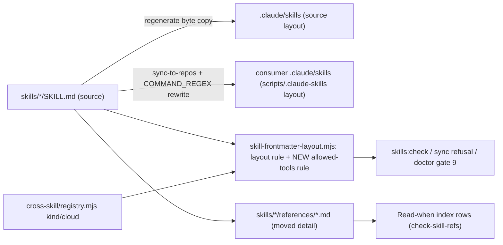

# Plan: Align CES skills with Claude Code skill best practice
- **Date**: 2026-11-02
- **Status**: Complete — shipped in #326 (01943741). An optional follow-up for pre-existing prose defects is not started.
- **Author**: Claude + Louis
- **Scope**: backend (tooling + skill/docs prose; no UI) — stack `js-ts`
- **Target domain(s)**: `skills-content`, `shared-lib`, `scripts`, `install`
- ⚠ **Cross-domain work** — touches >1 domain; the crossings are intentional (skill prose ↔ the lint/sync libs that govern it).
- ⚠ **Untagged paths**: `AGENTS.md` — root context file, deliberately unowned by any domain rule.

> **Neighbourhood considered** (arch-memory, `precedent` / `above-floor-cluster`):
> `lintSkillFrontmatterLayout` `scripts/lib/skill-frontmatter-layout.mjs:112 (c351ac17)` —
> the existing per-file oracle for SKILL.md frontmatter. **Decision: extend it** with an
> `allowed-tools` content rule. Every consumer already reaches it through `lintSkillTree`
> `:197`: `scripts/check-skill-frontmatter.mjs:55` (`skills:check`),
> `scripts/sync-to-repos.mjs:1004` (sync refusal, source tree) and
> `scripts/lib/sync-isolation-verify.mjs:792` (doctor gate 9, the consumer's rewritten tree)
> — all `c351ac17`. A sibling linter would need three new call sites to reach the same coverage.

## 1. Context Summary

**Why now.** An external post restated Claude Code's skill guidance (folder + `SKILL.md`,
only the description resident until match, `SKILL.md` < 500 lines, `allowed-tools` /
`context: fork` / `paths` frontmatter). CES already matches most of it — repo-scoped
install, trigger-first descriptions under the 1024-char cap, mechanics in `scripts/`. The
gaps are size, and skills have been **observed losing instructions mid-run after context
compaction** — which the docs explain exactly (below).

**Documented facts this plan rests on** (Claude Code docs, code.claude.com, fetched 2026-11-02):

| Fact | Source | Consequence here |
|---|---|---|
| After compaction, each invoked skill body is **re-attached capped at 5,000 tokens** (25,000 total, oldest dropped first); "truncation keeps the start of the file, so put the most important instructions near the top" | `/docs/en/skills` §Skill content lifecycle; `/docs/en/context-window` §What survives compaction | The compaction loss is mechanical: `ship` (27,043 tokens, measured) keeps its first ~18%. **This gives Track A a non-arbitrary ceiling.** |
| "Keep `SKILL.md` under 500 lines"; reference supporting files "so Claude knows what each file contains and when to load it" | `/docs/en/skills` | Matches the repo's existing `references/` + `Read when` index contract. |
| `allowed-tools` **pre-approves** listed tools **for the invoking turn only**; it does **not** restrict other tools; it applies **even in a `-p` run in an untrusted folder** | `/docs/en/skills` frontmatter table | Value is modest (one turn); the risk is real (a synced skill pre-approves in any consumer). |
| Bash rule `*` matches any text and may sit anywhere; a rule with no `*` matches **one exact command** | `/docs/en/permissions` §Wildcard patterns | Combined with the global `--out` flag of `cross-skill.mjs` (below), any wildcard admits a file write — so grants are exact strings only. |
| `context: fork` runs the skill in a subagent that **does not see conversation history**; `AskUserQuestion` is removed in subagents | `/docs/en/skills` §Run skills in a subagent; `/docs/en/sub-agents` | Rules out fork for any skill whose input is "this code" from the conversation — see §8, optional trial **declined**. |
| `paths` = file-glob auto-activation | `/docs/en/skills` | No use for name-invoked workflow skills — **skipped**. |
| Unknown frontmatter keys are ignored silently by Claude Code; Copilot documents `name`, `description`, `license`, `compatibility`, `metadata`, `allowed-tools` ("space-separated string of pre-approved tools") | `/docs/en/skills`; learn.microsoft.com `visualstudio/ide/copilot-agent-skills` | Copilot's handling of the `Bash(...)` grammar is **unknown** (not testable here — no Copilot host in this environment). |

**Measured baseline — tokens** (method: Anthropic `count_tokens` API, model
`claude-opus-5-5`, file text LF-normalised as one user message, minus a one-token message
baseline — the full procedure is in §Appendix A so it reproduces from a fresh checkout;
2026-11-02, `c351ac17`).
Measured ratio is **2.32–2.81 chars/token (median ≈2.5)** — *not* the 4 chars/token the
repo's `≈tokens = chars/4` orientation figure assumes.

| File | tokens | chars | | File | tokens | chars |
|---|---:|---:|---|---|---:|---:|
| AGENTS.md | 36,290 | 88,747 | | ux-lock | 7,728 | 19,357 |
| ship | 27,043 | 69,344 | | explain | 6,665 | 16,760 |
| persona-test | 22,447 | 57,174 | | nav-audit | 6,378 | 16,368 |
| audit-code | 22,030 | 55,696 | | fleet | 5,323 | 13,758 |
| cycle | 18,621 | 46,673 | | investigate | 4,822 | 13,548 |
| click-test | 17,354 | 44,239 | | visual-audit | 4,782 | 11,744 |
| plan | 14,783 | 38,354 | | ai-context-management | 4,419 | 10,248 |
| audit-plan | 11,041 | 27,401 | | security-strategy | 3,603 | 9,100 |
| brainstorm | 9,456 | 23,546 | | skills | 2,617 | 6,496 |

(`chars` = LF-canonical decoded characters, the unit `skill-size-ratchet` uses; `wc -c`
bytes differ slightly.) **12 of 17 SKILL.md files exceed the 5,000-token re-attach cap.**

**Measured baseline — routing evals** (`claude plugin eval . --tag pilot --runs 1
--ablation none`, run in this session-private worktree at `c351ac17` with `skills/`,
`evals/` and `.claude-plugin/` unmodified, 2026-11-02, 236 s, $2.58): **12/13 pass**.

| Case | Score | | Case | Score |
|---|---|---|---|---|
| ai-context-management-drift-check | 1.00 | | investigate-claim-question | 1.00 |
| audit-code-request | **0.50 (fail: `invokes-audit-code` 0x)** | | nav-audit-vs-persona-test | 1.00 |
| audit-plan-request | 1.00 | | persona-test-vs-click-test | 1.00 |
| brainstorm-vs-plan | 1.00 | | plan-vs-audit-plan-design-request | 1.00 |
| click-test-vs-persona-test | 1.00 | | ux-lock-verify-vs-audit-code | 1.00 |
| cycle-full-flow-request | 1.00 | | visual-audit-vs-persona-test | 1.00 |
| explain-topic-question | 1.00 | | | |

**Revision pinning for the candidate run** (spend-bearing): run it only from a committed
HEAD, with `git status --porcelain -- skills evals .claude-plugin` empty, and record the
sha beside the table. This worktree has no concurrent writer, which is the hazard the
`fixture:create` rule exists for; the sha + clean-status record is what makes the two runs
comparable.

**Code Trace** (all pinned to `c351ac17`):
- Skill sync: `scripts/sync-to-repos.mjs:1402` and `:1564` pass every synced file through
  `rewriteCommandSurface` `scripts/lib/sync-rewriter.mjs:121`, which applies
  `COMMAND_REGEX` `scripts/lib/sync-rewriter.mjs:35` (`/\bnode\s+scripts\/([^\s`"'),;&|]+)/g`)
  via `rewriteTextCommandInvocations` → `sourceRelToDestRel` `scripts/lib/sync-path-map.mjs:105`.
  The regex is not frontmatter-aware, so `Bash(node scripts/cross-skill.mjs detect-stack)`
  in frontmatter is **already** rewritten to `scripts/.claude-skills/cross-skill.mjs` in a
  consumer. The source repo's `.claude/skills/` is a byte copy (`scripts/regenerate-skill-copies.mjs`),
  i.e. correctly the source layout. **Per-layout emission already exists — Track B needs a
  test of the emitted bytes, not a new generator.**
- Frontmatter governance: `KNOWN_TOP_LEVEL_KEYS` `scripts/lib/skill-frontmatter-layout.mjs:49`
  already lists `allowed-tools`; `lintSkillFrontmatterLayout` `:112` checks layout only
  (column-0, typing), not content.
- Command safety: `scripts/lib/cross-skill/registry.mjs` declares `kind` / `cloud` per
  subcommand. `kind:'local', cloud:'none'` = `detect-stack`, `preview-gate`,
  `resolve-repo-identity`, `compute-target-domains`, `arm-eval-toggle` — but
  `arm-eval-toggle` writes a toggle and `resolve-repo-identity --persist` writes a file, so
  `kind` is **not** a safe oracle. **`scripts/cross-skill.mjs:175` declares a global
  `--out` flag** — every subcommand can write its output to an arbitrary path.
  `get-neighbourhood` embeds the intent text via `scripts/lib/neighbourhood-query.mjs`
  (egress + spend) — excluded although the brief named it.
- Size governance: `LIMIT_CHARS = 12000` `scripts/skill-size-ratchet.mjs:58`, drift-only
  against `.skill-size-baseline.json` (a shrink fails until re-baselined).
  `DEFAULT_MAX_AGENTS_MD_CHARS = 92000` `scripts/lib/claudemd/context-size.mjs:49`, read by
  `scripts/check-context-drift.mjs`.
- Reference contract: `docs/reference/skill-reference-format.md` — three-column index
  (`File | Summary | Read when`), each `references/*.md` carries `summary:` frontmatter
  byte-identical to its row (≤120 chars), enforced by `scripts/check-skill-refs.mjs`.
  Synced pointers are gated by `scripts/check-skill-consumer-refs.mjs` (no `npm run`
  aliases, no out-of-closure `docs/` paths) and `scripts/check-synced-doc-links.mjs`.
- Prose is pinned by tests — test files reading a given `SKILL.md` (grep, 2026-11-02):
  ship 23 · plan 17 · audit-code 11 · persona-test 3 · audit-plan 2 · cycle 2 ·
  click-test 1 · brainstorm 0; 144 test files mention `AGENTS.md`.
- Routing evals: `evals/` (13 cases, `docs/reference/plugin-evals.md`) assert which skill
  fires — they exercise **descriptions**, which this plan does not change.

**Patterns reused**: `references/` + `Read when` index; `summary:` frontmatter contract;
the drift-only size ratchet; the sync rewriter; the frontmatter lint library. **New**: one
content rule (exact-string allowed-tools allowlist) inside the existing lint library.

## 2. Proposed Architecture



### Track A — slim SKILL.md bodies (pilot first) (#1 DRY, #5 single source of truth, #10 modularity)

- **Ceiling: 4,500 tokens per SKILL.md, measured with `count_tokens`** — the documented
  5,000-token re-attach cap with a 10% margin. Characters are only the ratchet's drift
  proxy; the token count is the acceptance measurement, re-run with the same method as the
  baseline. The pilot tests whether the ceiling is reachable without losing required
  content; §Pilot result records the measured answer before Phase 2 uses it.
- **What stays resident** (in this order, top-first, because truncation keeps the start):
  trigger + usage; the step list with **every decision point**; **human pauses**; **runner
  invocations** (exact commands); **invariants / hard rules**; **failure reporting**
  (AUDIT_NOT_RUN, BLOCKED, exit-code meanings); **the decision detail of every critical
  branch** (a branch whose wrong handling ships a defect, spends money, or reports a run
  that did not happen as one that did); the reference index.
- **What moves**: worked examples, incident histories and measurements, rationale
  paragraphs, rare-mode detail, long tables only one branch needs. Each move is a
  cut+paste into `references/<topic>.md` **plus a pointer at the exact step that needs it**
  (`→ references/<topic>.md — read when <condition>`) **plus** an index row. A move with no
  site pointer is a defect. **Never rewrite judgment into code**; never move a runner
  invocation, a pause or a critical branch's decision detail.
- **Exception when the ceiling is unreachable** (likely for `ship`): the SKILL.md may
  exceed it only if its first 4,500 tokens hold the complete spine above (step list with
  every decision, pauses, commands, failure rules, critical-branch detail, reference index).
  Verified by measuring the token offset of the last spine element; recorded per skill in
  §Results. If even the spine exceeds 4,500 tokens, that is reported, not hidden.
- **Scope**: every SKILL.md over the 5,000-token cap — audit-plan (pilot), ship,
  persona-test, audit-code, cycle, click-test, plan, brainstorm, ux-lock, explain,
  nav-audit, fleet. Under the cap today (investigate, visual-audit,
  ai-context-management, security-strategy, skills) — out of scope: no compaction loss.

### Track B — `allowed-tools` for local read-only CLIs (#13 validation, #5 SSOT, #16 graceful degradation)

- **Grants are exact full-command strings — no wildcard anywhere.** A rule without `*`
  matches one exact command; with `*` it would admit `--out <path>` (a write). v1 allowlist
  (`ALLOWED_TOOLS_PREAPPROVABLE`, exported from `scripts/lib/skill-frontmatter-layout.mjs`):
  - `node scripts/cross-skill.mjs detect-stack`
  - `node scripts/cross-skill.mjs preview-gate --format human`

  `compute-target-domains` is dropped: its `--json` payload varies per call, so it cannot
  be granted without a wildcard. Each allowlisted entry is also cross-checked against the
  registry (`kind:'local' && cloud:'none'`) — necessary, not sufficient, so it is a second
  check on the explicit list, never a substitute for it.
- **Accepted grammar** (`lintAllowedTools(value)`), anchored, all-or-nothing:
  - the value is a **single-line YAML scalar** (plain or quoted) — a YAML list, block
    scalar, flow sequence, or a duplicated `allowed-tools` key is rejected;
  - it matches `^Bash\(([^()]+)\)( Bash\(([^()]+)\))*$` — tokens separated by exactly one
    space, nothing before, between or after;
  - each inner command, after mapping `scripts/.claude-skills/` → `scripts/` (so the
    consumer's rewritten copy validates against the same list), equals an allowlist entry
    byte-for-byte; no duplicates.

  Any violation → finding `[allowed-tools/not-preapprovable]` (or `/malformed`). The rule
  runs inside `lintSkillFrontmatterLayout`, so the three consumers above inherit it.
- **Frontmatter added**: `plan` and `ship`: `Bash(node scripts/cross-skill.mjs detect-stack)` ·
  `cycle`: `Bash(node scripts/cross-skill.mjs preview-gate --format human)`.
- **Per-layout emission**: no new generator — a test asserts the bytes the existing
  rewriter emits (§9).
- **Copilot**: behaviour unknown and untestable here. Bounded worst cases: Copilot ignores
  the grant (status quo), or honours it as written (pre-approval of two read-only local
  commands). Recorded as unknown in `docs/reference/skill-surface-ownership.md`, with the
  turn-scoped / untrusted-folder facts.

### Track C — trim AGENTS.md (last) (#1 DRY, #5 SSOT)

- AGENTS.md costs **36,290 tokens in every session**. Classify each `##` section as
  **repo-wide invariant** (stays resident — Copilot/Cursor read only this file) or
  **job-specific dossier** (moves). Candidates, confirmed by measurement in Phase 7: Shadow
  Final-Review A/B (closed experiment), Tiered-Recall Pipeline, Model Swap-In Evaluation
  Harness, Memory-Health Gate, Learning System, Local Weekly Maintenance, Azure Work Profile,
  R2+ Audit Mode, Commit provenance trailers.
- A moved section becomes a stub (*what it is / when you need it / pointer*); its detail
  merges into the **existing** `docs/` page the section already links (most do) — no new
  doc unless none exists. Any rule binding work *outside* that job (e.g. "do not pin
  concrete model IDs", "pass jsonb values raw") stays resident.
- Before cutting: grep `tests/` for each moved phrase; a test pinning it means it is NOT
  job-specific → keep it.
- Lower `DEFAULT_MAX_AGENTS_MD_CHARS` to (measured new size + ~3,000), rounded to the
  nearest 1,000, **only after** the shrink, in the same commit.

**Scope addition (approved by Louis via the coordinator, 2026-11-02) — split by AUDIENCE.**
The coordinator session and implementation sessions load the same AGENTS.md but do different
jobs, so each pays for the other's material. Every section is tagged:
1. **ALL** — repo-wide invariants (egress/security, stdout drain, store rules, scope
   discipline, verification discipline): resident.
2. **IMPLEMENTER** — testing doctrine, sync contract, code style, job dossiers: condensed
   stubs pointing into `docs/` (as above).
3. **COORDINATOR** — fleet operations, merging only the audited head, consumer-sync order,
   session-brief conventions, one heavy job at a time, archive/worktree hygiene: moved to
   `skills/fleet/references/coordinator-playbook.md`, with a "read when coordinating" row in
   `/fleet`'s index and a one-line pointer left in AGENTS.md.

**Guardrail**: CES is public and `/fleet` syncs to every consumer, so only generic,
publishable rules move there. Anything account-specific, personal or private-repo-specific
(account switches, peak-hour windows, store hosts, consumer-repo internals) is left out and
stays in the coordinator's personal memory; each omission is listed in §Results. The
coordinator's personal memory index is out of scope (the coordinator slims it after merge,
pointing at the rules listed in the PR description).

**Jev (TypeSafe System-One router) — rejected**, recorded in
`docs/research/jev-router-rejected.md`: no current requirement (skill routing is already
measured by `evals/`), egress of every task's text to `api.typesafe.ai`, measured wording
sensitivity and overconfidence in the brainstorm debate round, and 0.75–1.5 s hook latency
per prompt.

## 6. Sustainability Notes
- The ceiling is tied to a documented host constant and a measured tokenizer ratio; the
  plan records the derivation and method so both can be re-measured when either changes.
- The allowlist is the one extension point for Track B: adding a command is one exact
  string plus the registry check that already runs.
- Drift-only ratchets stay drift-only: re-baselining pins the smaller sizes so regrowth fails.

**Right-sizing (Track B, new structure):**
- *Band-aid*: hand-write `allowed-tools` lines with no check — a later edit can pre-approve
  `openai-audit.mjs` or a wildcard (and so `--out`) in every consumer silently.
- *Over-engineered*: a per-layout frontmatter generator + a registry-wide `preapprovable`
  schema field + an argument-aware command parser.
- *Chosen*: an exact-string allowlist + one anchored lint rule inside the existing oracle,
  and a test of the bytes the existing rewriter emits. Current requirement: pre-approval
  must never widen past exact read-only local commands, in either layout.

**Manual vs scripted (Track A)**: by hand. Every cut is a judgment about what is
load-bearing; the sites are irregular. No codemod. (The token counter is a measurement
script, not a transformation.)

## 7. File-Level Plan

### 7b. Implementation Phases

**Phase 1 — Pilot: slim audit-plan + measure**: move Step 3's long rubrics (grounding,
test-premise lint, execution-clustering, convergence evidence) and Step 6 detail into
references; keep triage rules, round cap, gate commands, mandatory-final-gate rule resident.
Record before/after tokens and chars, what moved, any test that pinned moved prose, and
confirm or revise the Phase 2–5 ceiling in §Pilot result. Files:
`skills/audit-plan/SKILL.md` (modify), `skills/audit-plan/references/triage-rubrics.md` (create),
`skills/audit-plan/references/convergence-evidence.md` (create),
`docs/plans/skill-best-practice-alignment.md` (modify).

**Phase 2 — Slim ship**: Files: `skills/ship/SKILL.md` (modify),
`skills/ship/references/*.md` (create; topics decided by reading — named in §Results).

**Phase 3 — Slim persona-test**: Files: `skills/persona-test/SKILL.md` (modify),
`skills/persona-test/references/*.md` (create).

**Phase 4 — Slim audit-code**: Files: `skills/audit-code/SKILL.md` (modify),
`skills/audit-code/references/*.md` (create).

**Phase 5 — Slim the remaining over-cap skills**: Files: `skills/cycle/SKILL.md`,
`skills/click-test/SKILL.md`, `skills/plan/SKILL.md`, `skills/brainstorm/SKILL.md`,
`skills/ux-lock/SKILL.md`, `skills/explain/SKILL.md`, `skills/nav-audit/SKILL.md`,
`skills/fleet/SKILL.md` (modify), and each one's `references/*.md` (create).
Also (pilot Finding 2): shorten the shared worktree-preflight marker and move its recipe
to a synced shared reference. Files: `scripts/lib/worktree-preflight.mjs` (modify),
`docs/audit/shared-references/worktree-preflight.md` (create),
`scripts/sync-shared-audit-refs.mjs` (modify), `skills/*/SKILL.md` (modify — marker only),
`skills/*/gate-contract.json` (modify — the pinned marker line in `ignoredCandidates`),
each receiving skill's `## Reference files` table (modify — one row for
`references/worktree-preflight.md`, its `summary:` byte-matching the row),
`tests/worktree-preflight-gate.test.mjs` (modify).

Phases 2–5 each also retarget any test that pinned moved prose to the reference file (same
assertion, new path — never weakened; if the test pins it *because* it must be resident,
it stays resident). Files: `tests/*.test.mjs` (modify, only as found).

**Phase 6 — allowed-tools rule + frontmatter**: Files:
`scripts/lib/skill-frontmatter-layout.mjs` (modify), `tests/skill-allowed-tools.test.mjs` (create),
`skills/plan/SKILL.md`, `skills/ship/SKILL.md`, `skills/cycle/SKILL.md` (modify — frontmatter only),
`docs/reference/skill-surface-ownership.md` (modify).

**Phase 7 — Trim AGENTS.md + lower cap**: Files: `AGENTS.md` (modify),
`scripts/lib/claudemd/context-size.mjs` (modify), `docs/reference/*.md` / `docs/runbooks/*.md`
(modify — the existing targets each moved section already links).

Also (scope addition): COORDINATOR-audience material → `skills/fleet/references/coordinator-playbook.md` (create),
`skills/fleet/SKILL.md` (modify — one index row + pointer).

**Phase 8 — Jev rejection note**: Files: `docs/research/jev-router-rejected.md` (create).

**Close-out (not a phase)**: `npm run skills:regenerate` → `npm run skills:check` →
`node scripts/skill-size-ratchet.mjs --update-baseline` (shrinks) → `npm run skills:size:gate`
→ `npm run context:check` → `npm run skills:consumer-refs:gate` →
`npm run docs:synced-links:gate` → `npm run plans:index` → affected tests → token re-measure
(§Appendix A) → commit → `claude plugin eval . --tag pilot --runs 1 --ablation none` from
the committed HEAD (revision pinning above), compared per case with the baseline table.

## 8. Risk & Trade-off Register
- **Moving prose a model must follow into a file it might not open.** Mitigations: site
  pointers, critical-branch detail resident, spine in the retained prefix, and the §9 spot
  checks. Residual risk accepted and **unmeasured** for non-critical branches: no instrument
  here grades post-compaction adherence across every branch, and building one is a separate
  project. The status quo is itself lossy — today 12 skills lose everything past 5,000
  tokens after compaction.
- **Tests pinning prose** (ship 23, plan 17, audit-code 11 files). Run each skill's tests
  after its phase; retarget, never weaken.
- **`allowed-tools` in untrusted folders**: exact strings only; the lint fails closed on
  anything else, in both layouts.
- **Copilot `Bash(...)` grammar unknown** — bounded worst case stated in Track B.
- **AGENTS.md trim removing something Copilot/Cursor need**: only job-scoped dossiers move.
- **Eval nondeterminism** (1 run per case): a newly failing case is re-run once; it counts
  as a regression if it fails again.
- **Deferred / declined**:
  - `context: fork` on `explain`/`investigate` — **declined**: the subagent sees no
    conversation history, and both skills' inputs are routinely "this code / that claim"
    from the conversation; a forked run would answer a different question.
  - `paths` — skipped: auto-activation by file glob; these skills are invoked by name.
  - `compute-target-domains` / `get-neighbourhood` grants — excluded (variable payload /
    egress).
  - The pre-existing `audit-code-request` eval failure — out of scope: this plan changes no
    description, and the failure predates it (baseline above).
  - Lowering `skill-size-ratchet`'s `LIMIT_CHARS` — not needed; re-baselining pins the gains.

## 9. Testing Strategy
- **Unit** (`tests/skill-allowed-tools.test.mjs`): each allowlisted entry passes in both
  layouts; multiple valid tokens pass; mixed valid+invalid fails; a non-allowlisted
  cross-skill subcommand, `openai-audit.mjs`, any `*`, a trailing argument (`--out x`), a
  non-Bash tool, a bare `Bash`, a YAML list, a block scalar, a duplicate key, double spaces
  and trailing text each fail with the named kind; the registry cross-check fails on a
  fixture registry declaring an allowlisted command `kind:'write'`; every real
  `skills/*/SKILL.md` passes. **Emitted bytes**: the real `rewriteCommandSurface` on
  `skills/plan/SKILL.md` yields frontmatter naming `scripts/.claude-skills/cross-skill.mjs
  detect-stack`, and `lintSkillTree` over that rewritten tree passes (the gate-9 path); the
  regenerated `.claude/skills/plan/SKILL.md` names `scripts/cross-skill.mjs`.
- **Negative control**: the rule is seen to fail on a real skill with an injected
  `Bash(node scripts/openai-audit.mjs *)` before it is trusted green.
- **Behavioural spot checks (Track A)** — targeted, not exhaustive:
  1. *Live canary*: this `/cycle` run's own per-cluster `/audit-code` rounds after Phase 4
     run on the slimmed `audit-code` (after `skills:regenerate`); record which references
     were opened and whether every resident step ran.
  2. *Failure branch*: invoke the slimmed `/audit-code` prerequisite path with no GPT route
     (`OPENAI_API_KEY=` empty, no Azure) on a one-file scope → it must report
     `AUDIT_NOT_RUN`/degraded per its prerequisite ladder, not a clean run.
  3. *Ship-blocking case*: `/ship` cannot be model-invoked; the first human `/ship` of this
     PR is its canary — noted in the hand-back for Louis to watch.
  4. *Post-compaction*: if this run compacts, record whether the re-attached skills still
     held their spine (the transcript shows the re-attachment).
- **Proof plan** (per behaviour change):
  | Change | Oracle | Pass condition | Evidence |
  |---|---|---|---|
  | SKILL.md slimmed | `count_tokens` (Appendix A) + reading | spine-only (pilot Finding 1): no non-spine paragraph left resident, every "always" step still resident (Finding 4), recovery note + end marker present (Finding 3); tokens reported against 4,500 | before/after table in §Results |
  | Content preserved | `git diff` + reading: moved text appears verbatim in a reference, with a site pointer | no orphan deletions | per-skill "moved to" list |
  | Prose contracts intact | the skill's pinning tests | all pass | command + counts |
  | Routing unchanged | plugin evals, per case | no newly failing case vs baseline | both tables |
  | allowed-tools safe | `skills:check` + new tests | green; red on the negative control | outputs |
  | AGENTS.md shrunk | `context:check` + `count_tokens` | passes under the lowered cap | before/after |

## 11. Execution Clustering
- **Cluster A** — Phases 1–1 — fix-gate: yes
  - Coupling: the pilot sets the ceiling and the moving pattern every later phase follows.
- **Cluster B** — Phases 2–5 — fix-gate: yes
  - Coupling: same transformation, same reference contract and the same pinned-prose
    retargeting; audited together so the wiring pass sees index rows ↔ reference files.
- **Cluster C** — Phases 6–6 — fix-gate: yes
  - Coupling: lint rule, its tests and the frontmatter it governs land as one unit.
- **Cluster D** — Phases 7–8 — fix-gate: final
  - Coupling: the AGENTS.md trim and the cap it lowers; the Jev note rides along (docs only).
- **Final gate**: consolidated Gemini review over the union diff.

## Pilot result
Measured 2026-11-02 (§Appendix A method), `skills/audit-plan/SKILL.md`:
**11,041 → 7,896 tokens (−28.5%)**, 27,401 → 18,889 chars. Moved verbatim:
the full grounding / test-premise / §11 / same-module rubrics →
`references/triage-rubrics.md`; acceptance-rate evidence, Gemini-cap rationale,
`--run-id` measurement and the Step 3.5b manual fallback → `references/convergence-evidence.md`.
Deleted (duplicates, not moves): the Key Principles list (each item is stated in its
step). Compressed: three ASCII status cards to one-line formats. Every rubric keeps a
resident one-line form with its HIGH/LOW consequence and a `→ references/…` pointer.
Pinning tests: 10 files, 241 tests — none broke except the expected size baseline.

**Finding 1 — the 4,500-token ceiling is not reachable with the spine resident.** After
the cut, the file *is* the spine (step list, commands, triage/convergence/cap tables,
final-gate disposition, reference index). Reaching 4,500 would require moving runner
commands or critical-branch tables, which this plan forbids. **Revised target for
Phases 2–5: "spine only"** — every non-spine paragraph moves or is deduplicated; the
result is whatever the spine weighs, reported in tokens against 4,500 without hiding the
gap. Expected reduction from the pilot: ~25–40% (more where a skill carries more
incident history). This is a measured target, not a mandate.

**Finding 2 — one shared block costs 870 tokens in every skill.** The worktree-preflight
marker (`MARKER_BLOCK`, `scripts/lib/worktree-preflight.mjs`) inlines a ~1,700-char
`skills:hydrate` one-liner; it is 11% of audit-plan's slimmed body and sits in 17 skills
(~14,800 tokens total). Its gate-contract rationale says the recipe is inlined because a
skill file is "the only carrier that reaches the reader" in an unadopted consumer — but a
skill's own `references/` directory is synced with it and reaches the same reader.
**Amendment (Phase 5)**: shorten `MARKER_BLOCK` to the instruction plus a pointer, and
carry the recipe in a shared reference `references/worktree-preflight.md`
(canonical `docs/audit/shared-references/worktree-preflight.md`, distributed by
`scripts/sync-shared-audit-refs.mjs`). The gate keeps pinning the (shorter) block verbatim.

**Finding 3 — what survives compaction is the start, so make the start a recovery
pointer** (from the Cluster A audit, H1). A spine-only body above 5,000 tokens still
loses its tail after compaction. Every SKILL.md over the cap therefore gets, directly
under its `#` title, a note that *describes* (never quotes) an **end marker** — the
file's last line, `— end of /<name> —`: *if that last line is not in your context,
re-read `.claude/skills/<name>/SKILL.md` in full before continuing.* A missing last line
is deterministic where "looks cut off" is not (truncation can end on a clean paragraph);
the note must not contain the marker text, or seeing the note would look like seeing
the marker (Cluster A audit R3). Truncation keeps the start (documented), so this line always survives, and the
file it names exists in both layouts (it is the copy the host loaded). This turns
post-compaction loss from silent into recoverable; it does not replace slimming.

**Finding 4 — a slim can silently demote a normal-path step** (Cluster A audit, H2). The
pilot moved "record dismissed findings into the local PlanFpTracker" into the
manual-fallback section, so a warning-free run would have skipped it. Restored resident.
Rule for Phases 2–5: before moving a paragraph, check whether its trigger is
"always" or "only when X" — only the latter may move behind a conditional pointer.

## Results
Tokens per Appendix A (count_tokens, `claude-opus-5-5`, 2026-11-02); chars = LF-canonical
(ratchet unit). "Before" = `c351ac17`; "after" = this branch.

| File | tokens before | tokens after | Δ tokens | chars before | chars after |
|---|---:|---:|---:|---:|---:|
| skills/ship/SKILL.md | 27,043 | 22,318 | −17.5% | 69,344 | 56,894 |
| skills/persona-test/SKILL.md | 22,447 | 17,020 | −24.2% | 57,174 | 43,426 |
| skills/audit-code/SKILL.md | 22,030 | 16,287 | −26.1% | 55,696 | 40,563 |
| skills/cycle/SKILL.md | 18,621 | 16,316 | −12.4% | 46,673 | 40,966 |
| skills/click-test/SKILL.md | 17,354 | 12,193 | −29.7% | 44,239 | 30,911 |
| skills/plan/SKILL.md | 14,783 | 12,741 | −13.8% | 38,354 | 33,207 |
| skills/audit-plan/SKILL.md (pilot) | 11,041 | 7,678 | −30.5% | 27,401 | 18,708 |
| skills/brainstorm/SKILL.md | 9,456 | 8,183 | −13.5% | 23,546 | 20,551 |
| skills/ux-lock/SKILL.md | 7,728 | 6,891 | −10.8% | 19,357 | 17,603 |
| skills/explain/SKILL.md | 6,665 | 5,229 | −21.5% | 16,760 | 13,631 |
| skills/nav-audit/SKILL.md | 6,378 | 5,192 | −18.6% | 16,368 | 13,460 |
| skills/fleet/SKILL.md | 5,323 | 4,833 | −9.2% | 13,758 | 12,885 |
| skills/investigate/SKILL.md | 4,822 | 4,225 | −12.4% | 13,548 | 12,366 |
| skills/visual-audit/SKILL.md | 4,782 | 4,185 | −12.5% | 11,744 | 10,562 |
| skills/ai-context-management/SKILL.md | 4,419 | 3,822 | −13.5% | 10,248 | 9,066 |
| skills/security-strategy/SKILL.md | 3,603 | 3,034 | −15.8% | 9,100 | 7,989 |
| skills/skills/SKILL.md | 2,617 | 2,048 | −21.7% | 6,496 | 5,385 |
| **All 17 SKILL.md** | **189,112** | **152,195** | **−19.5%** | | |
| AGENTS.md | 36,290 | 30,990 | −14.6% | 88,747 | 75,884 |

Every skill also lost ~620 tokens to pilot Finding 2 (hydrate recipe → shared reference).
Over the 5,000-token re-attach cap after: 11 of 17 (before: 12); every over-cap skill now
carries the compaction-recovery note + end marker (Finding 3). `context:check` cap
lowered 92,000 → 79,000 after measuring 75,884.

**Routing evals** (`claude plugin eval . --tag pilot --runs 1 --ablation none`): baseline
12/13 at `c351ac17` (`audit-code-request` failing before any change). Candidate at `e6cdd25f`
(clean `skills/ evals/ .claude-plugin/`, $2.23): **12/13, identical per case** — same single
failure, no newly failing case. (`ai-context-management-drift-check` first errored because a
concurrent test run left a temp fixture dir the sandbox could not copy — an instrument fault;
re-run alone at `12b1ad77`: 1.00.)

**Final gate** (Gemini, consolidated): APPROVE over the union diff, but coverage PARTIAL —
3,831 changed lines never shown (generated copies excluded as byte-verified); a focused
Gemini pass on the AGENTS.md cluster: APPROVE, 58 lines unseen. **Full suite** (local,
`node --test`, 2026-11-02): 10,110 pass, 2 fail → one fixed (PowerShell fence labels); the
other (`prepush-installed-tree-identity`) reads this machine's installed `node_modules`,
which this branch does not change.

**Audits** (`/audit-code`, per-cluster scope):
- Cluster A: 5 rounds → PASS (H:0 M:0 L:0).
- Cluster B: 3 rounds, stopped on rigor pressure (R3 acceptance 1/16). Every remaining
  HIGH is a re-raise of a deferred defect in text that predates the slim and was moved
  verbatim or kept unchanged; each deferral names its independence in the ledger. Fixed
  in-cluster: preflight marker asks before editing `package.json`; recipe fenced; playbook
  merge bound with `--match-head-commit` and tree-id comparison; census JSON; cycle wording.
- Cluster C: 3 rounds → converged in-cluster. Fixed a real bypass (quoted
  `"allowed-tools":` key passed the old rule — reproduced old ok:true / new ok:false),
  folded/continued scalars, escaped spellings; trust boundary documented (deliberated
  HIGH → MEDIUM).

**Deferred to a follow-up** (all predate this change, text unchanged or moved verbatim):
persona-test shell safety (URL interpolation, PowerShell `cat` encoding, fixed payload
paths, sessionKey wording, dedup wording); audit-code recipes (dirty-aware base in R2+,
`--base HEAD` example, BSD `xargs -r`, Step 6 example, census trigger, honest-deferral
reverse dependencies, cross-surface clause); ship Step 2 drain order and Step 5.8
default-branch fallback; cycle stale-resume and Step 8 summary ordering; click-test v2
design notes; three ship gate-contract `stated` strings already absent from SKILL.md;
per-line disposition reasons for the 77 rewrapped lines.

**Coordinator rules now in `/fleet`** (`skills/fleet/references/coordinator-playbook.md`):
§1 merge only the audited head (`--match-head-commit`, tree ids); §2 retarget a stacked
PR before `--delete-branch`; §3 before archiving or removing a worktree — shared worktree
paths, tag local-only commits, back up ignored files, repoint hooks paths, re-list; §4
fast-forwarding a checkout other repos execute is a deploy — migrate every store first;
§5 look for competing implementations before rebasing; §6 whole suite before a branch's
first push. Already in `/fleet` before this change (`coordination.md`): chip authority
block, archive sweep, confirm-idle, WIP limits, one heavy job at a time, message budget,
status words carry their artifact. Left out as private/account-specific: account
switches, peak-hour windows, store hosts, pins/ghost-run handover steps,
consumer-repo specifics.

## Out of Scope (Future)
- **Ongoing token gate** (audit-plan R2 M2). A same-character edit could in principle add
  tokens or push a spine element past the retained prefix without tripping the char
  ratchet. Deferred: this plan's result does not depend on it — the char ratchet already
  fails any growth and measured chars/token sits in a 2.3–2.8 band — and a token gate needs
  network + an API key inside the pre-push check, which the sandbox-honesty and air-gap
  rules exclude. Revisit if a re-measure shows a skill drifting over 4,500 tokens without
  char growth.

## Appendix A — Token measurement procedure
Run from the repo root with `ANTHROPIC_API_KEY` resolvable through `scripts/lib/load-env.mjs`.
Save as a scratch file outside the repo (it is a measurement, not tooling) and run
`node <file> "$PWD" claude-opus-5-5 skills/*/SKILL.md AGENTS.md`. It prints
`tokens chars chars/token path`.

```js
import fs from 'node:fs';
import { pathToFileURL } from 'node:url';
const root = process.argv[2];
process.chdir(root);
await import(pathToFileURL(root + '/scripts/lib/load-env.mjs').href);
const { default: Anthropic } = await import(pathToFileURL(root + '/node_modules/@anthropic-ai/sdk/index.mjs').href);
const c = new Anthropic();
const model = process.argv[3] || 'claude-opus-5-5';
const count = async (t) => (await c.messages.countTokens({ model, messages: [{ role: 'user', content: t }] })).input_tokens;
const base = await count('x');
for (const f of process.argv.slice(4)) {
  const t = fs.readFileSync(f, 'utf8').replace(/\r\n/g, '\n');
  const n = (await count(t)) - base + 1;
  console.log(String(n).padStart(6), String(t.length).padStart(7), (t.length / n).toFixed(2), f);
}
```

**Spine offset** (exception check): write the SKILL.md prefix up to and including the last
spine element to a scratch file and measure it with the same script. Any API error aborts
the run — a missing count is never read as zero.

## Audit trail
- `/audit-plan` R1 (GPT, 2026-11-02): H:5 M:2 — 6 accepted, H4 compromise→MEDIUM after
  deliberation. Fixes: exact-string grants (global `--out` found), anchored grammar,
  per-file rule placement with cited call sites, token-measured ceiling (2.5 chars/token
  measured), widened spine rule + site pointers + spot checks, per-case eval baseline.
- `/audit-plan` R2 (GPT): H:1 M:2 — H1 accepted (revision pinning by sha + clean status),
  M1 accepted (Appendix A + per-case baseline table), M2 deferred (Out of Scope: token gate
  would need network in pre-push). Acceptance 2/3; remaining surface is process rigor →
  GPT loop stopped at R2, proceeding to the mandatory final gate.
- Final gate (Gemini, plan mode, R1): **APPROVE** — gate `approve`, 0 blocking, 0 debt.
